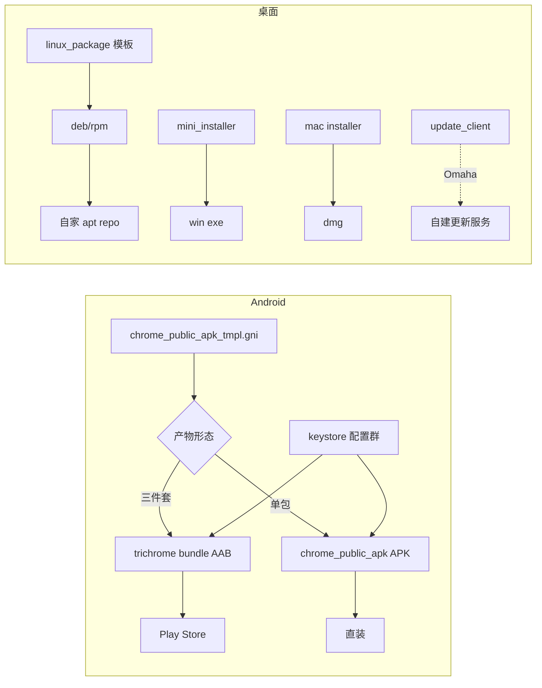

# 5.3 · 各平台打包分发差异：APK/deb/msi/dmg 与更新通道矩阵

> 同一份源码，六个平台四种产物三种更新机制。本篇是"发行工程"的跨平台总账：各平台打包链入口、签名体系、分发通道，以及自产品选型建议。Linux deb/rpm 细节见 1.4，Android 启动链见 3.2——本篇管"产物怎么来、怎么到用户手里"。

## ① 角色定位

打包分发是**平台差异最大**的领域：Android 走 GN+python 出 APK/AAB（gradle 只作壳）、Linux 走 dpkg/rpm、Windows 走 mini_installer 自解压、macOS 走 dmg+xcode 签章。更新机制同样分裂：Play Store / apt / Omaha updater / Sparkle 类。**定制者按目标平台选一条链深挖即可，本篇给地图与选型**。

## ② 定制切入点全景表

| 想改什么 | 动哪里 | 难度 | 影响面 |
|---|---|---|---|
| Android 包名 | `chrome/android/chrome_public_apk_tmpl.gni` declare_args 里 `chrome_public_manifest_package`（默认 "org.chromium.chrome"，已实证） | 改配置 | APK 身份（与官方版共存） |
| Android 应用名/图标 | `chrome/android/java/` 资源 + channel.gni（channel 变量贯穿） | 改配置 | 桌面标识 |
| 出 APK | gn target `chrome_public_apk`（chrome/android/BUILD.gn 定义群） | 改配置 | 直装产物 |
| 出 AAB（Play 上架） | `trichrome_chrome_bundle` 一族（`chrome/android/trichrome.gni` 组织三件套：chrome/webview/stub） | 改配置 | Play 分发形态 |
| 动态 feature modules | `chrome/android/modules/`（chrome_bundle_tmpl.gni/chrome_feature_modules.gni，按需下载模块） | 动架构 | 包体瘦身 |
| Android 签名 | `build/config/android/rules.gni`/`config.gni`/`internal_rules.gni` 的 keystore 配置群（debug 默认 keystore→发布注入） | 改配置+密钥管理 | 安装身份与升级连续性 |
| APK 安装脚本 | `build/android/adb_install_apk.py`、`apk_operations.py`（开发期装机工具） | 只读 | 开发流程 |
| Linux deb/rpm | 1.4 全解（linux_package 模板双产物） | 改配置 | - |
| Windows msi/exe | `chrome/installer/mini_installer/`（自解压+setup） | 动架构 | win 交付 |
| macOS dmg | `chrome/installer/mac/`（dmg 脚本+签名+公证） | 改配置+证书 | mac 交付 |
| 更新：Play 通道 | AAB+Play 内部测试轨（包名签名单调） | 改配置 | Android 升级 |
| 更新：自建 Omaha | `components/update_client/` + 自建服务（1.4 §4 路线乙） | 动架构 | 全平台自控升级 |
| 更新：win/mac 官方壳 | updater（`chrome/browser/updater/` 已实证存在）对接系统更新器 | 动架构 | 桌面升级 |
| 信创/Linux 发行版 | deb 系（1.4）+ flatpak（`chrome/installer/linux/flatpak/`） | 改配置 | 受控环境 |

## ③ 关键源码走读：Android 打包链（自产品最高频）

**第一站：target 组织。** `chrome/android/chrome_public_apk_tmpl.gni` 是 Android 产物的模板枢纽（头部 import 群实证）：它把 `chrome_public_apk`/`trichrome_chrome_bundle` 等目标统一成模板，包名由 declare_args 的 `chrome_public_manifest_package` 控制（默认 org.chromium.chrome）——**自产品第一改就是它**（配合 3.3 品牌资产）。

**第二站：trichrome 三件套。** `chrome/android/trichrome.gni` 组织 chrome/webview/stub 三个共享库包——Android 上浏览器与系统 WebView 共享 lib 的方案（省磁盘但签名必须一致）。自产品如果不需要跟系统 WebView 共存，单 APK 形态更简单（直接 chrome_public_apk）。

**第三站：签名链。** keystore 配置集中在 `build/config/android/{rules,config,internal_rules}.gni`：开发期默认 debug keystore（即装即用），发布时注入自家 keystore（GN args 或环境变量）。**签名决定升级连续性**：换 keystore=用户必须卸载重装，发布前定终身。Play 上架还需 AAB+Play App Signing。

**模块化**：`chrome/android/modules/` 的 feature modules 支持 Play 按需下发（如 cashbox/some feature），自产品初期全部静态打进 APK 最省心。

## ④ 实操：自产品 Android 发布最小路径

1. `chrome_public_manifest_package = "com.mycompany.browser"`（apk_tmpl.gni args）
2. 品牌资产替换（3.3 清单的 Android 部分：java 资源图标/应用名）
3. `target_os="android"` 构建 `chrome_public_apk`（1.3 配方）
4. 自家 keystore 签名配置 → adb 直装验证 → 后续上 Play 转 bundle target
5. 更新：直装阶段官网发 APK+应用内检查（或接自建 Omaha）；Play 阶段交给商店

桌面侧对照：Linux 出 deb（1.4 半天方案）；win/mac 初期可以不做（维护成本高，用户按需提）。

## ⑤ 依赖与数据流

## ⑥ 坑与勘误

- **Android 包不是 gradle 工程**（最大误解）：gradle 只包了个壳，真正打包是 GN target + python（apk_tmpl.gni import 链实证）；改产物结构动 gni，不是 build.gradle。
- **trichrome 签名一致约束**：三包共享 lib 必须同签名，且与设备上系统 WebView 版本对齐——自产品避开=用单 APK 形态。
- **keystore 丢了=用户全量流失**（Android 侧无解），密钥管理先于首次发布。
- Windows mini_installer 是自解压架构（资源嵌 exe），与 Linux 链完全不同源，别复用认知。
- macOS 公证（notarization）是硬门槛（无公证用户打不开），证书年费+流程时间要预算。
- Play 上架的 AAB 必须 Play App Signing，与本地 keystore 是两层密钥——文档先读再签。
- 本机未构建（1.1 同因），target 名/args 已源码实证，命令输出待构建链打通回填。

## ⑦ 验证方法

- APK：`aapt2 dump badging out/*.apk | head`（包名/版本/图标三查）；签名 `apksigner verify --print-certs`
- 升级连续性：旧版装→新版覆盖装，应保留数据（签名一致）
- deb：1.4 §7 同款；AAB：bundletool build-apks 本地模拟 Play 下发
- 更新链：故意发降级版，确认客户端拒绝（版本单调）

## ⑧ 延伸

- Linux 链全解：1.4；Android 启动与结构：3.2；品牌资产：3.3；构建配方：1.3
- 图谱层位：chrome 外壳层 android 子图；repo-docs：`docs/android_build_instructions.md`
