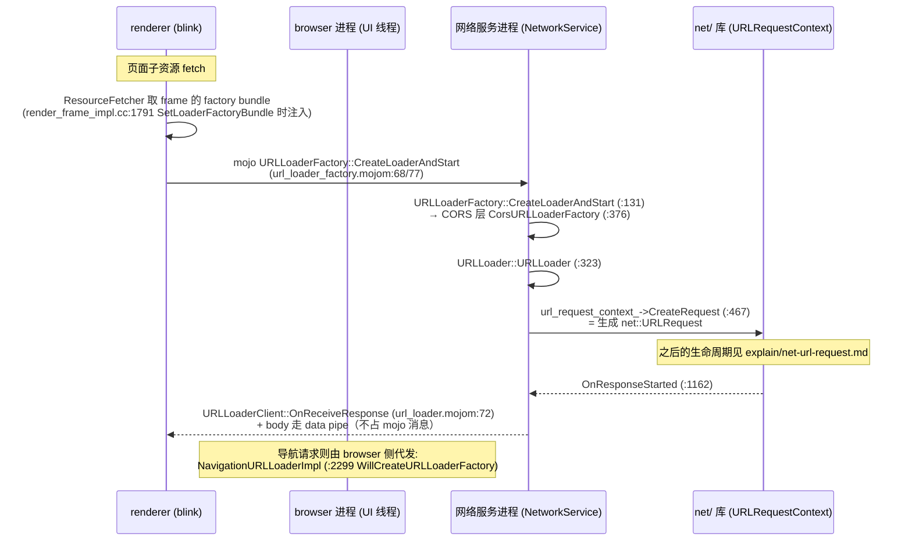
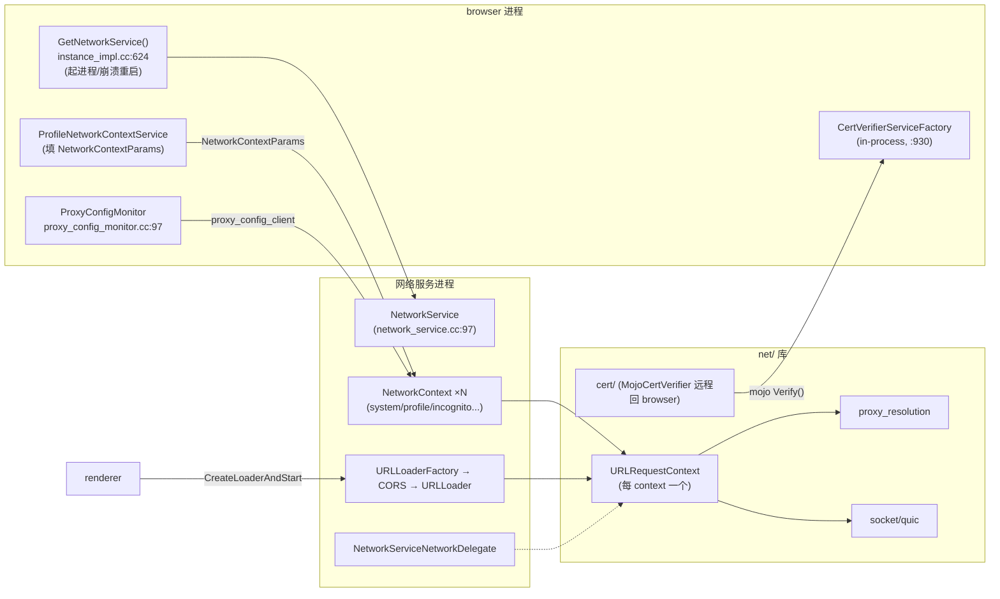

# 6.1 网络栈全景与服务化架构：NetworkService 的进程边界与定制面

> 定位：架构分层与定制入口。请求内部机制（URLRequest 生命周期 / HostResolver）见 `explain/net-url-request.md`、`explain/dns-host-resolver.md`，本篇不重复。

## 1. 角色定位

Chromium 网络栈是三层结构：**`net/` 底层库**（纯 C++、无 mojo 依赖，`net/url_request/` 的 `URLRequestContext` 聚合 host_resolver/cert_verifier/proxy_resolution_service/socket pool 等约 20 个组件，见 `net/url_request/url_request_context.h:135-173`）→ **`services/network/` 服务化包装**（把 net 栈暴露为 mojo 接口：`NetworkService` → `NetworkContext` → `URLLoaderFactory` → `URLLoader`）→ **browser 侧调度层**（content 的 `network_service_instance_impl.cc` 负责起进程/重启，chrome 层 `chrome/browser/net/` 负责填参数）。2018 年"网络服务化"改造后，renderer 再也不能直接碰 net 栈——一切请求都跨进程/跨 mojo 发给网络服务。对定制者的直接后果：**你要改的东西八成不在你最初以为的那一层**。改 UI 策略去 browser 层（`NetworkContextParams` + 各种 client remote），改协议行为去 `services/network/`，改算法去 `net/`。网络服务可独立成进程（沙箱内、无磁盘根权限），也可 in-process 跑在专用线程——这个进程边界是本篇一切定制点选择的第一决定因素。

## 2. 定制切入点全景表

| # | 想改什么 | 动哪里（文件:行） | 难度 | 影响面 |
|---|---|---|---|---|
| 1 | 代理配置接管 | chrome 侧 `chrome/browser/net/proxy_config_monitor.cc:97`（`AddToNetworkContextParams` 往 `NetworkContextParams::proxy_config_client_receiver` 塞 pipe）；服务侧 `services/network/network_context.cc:3087`（`ProxyConfigServiceMojo`）+ `services/network/proxy_config_service_mojo.cc:38`（`OnProxyConfigUpdated`） | 改逻辑 | 所有走该 NetworkContext 的请求；推送式更新 |
| 2 | PAC 脚本注入/替换 | `services/network/url_request_context_builder_mojo.cc:81`（`CreateProxyResolutionService`）；PAC 求解进程工厂 `chrome/browser/net/chrome_mojo_proxy_resolver_factory.cc`（Linux/Mac/Win 各有变体文件）；builder 侧 `SetMojoProxyResolverFactory`（同 cc:43） | 动架构 | PAC 求解跑在独立 utility 进程，需跨进程调试 |
| 3 | 内网根证书信任（抓包刚需） | `CertVerifierCreationParams.initial_additional_certificates`（`services/cert_verifier/public/mojom/cert_verifier_service_factory.mojom:25`）；chrome 填充点 `chrome/browser/net/profile_network_context_service.cc:764`（`GetCertificatePolicy` → :789 `trust_anchors.push_back`） | 改逻辑 | 全 context；与 Chrome Root Store 叠加信任 |
| 4 | 按 SPKI 忽略证书错误 | `--ignore-certificate-errors-spki-list` 开关，消费点 `services/network/ignore_errors_cert_verifier.cc:34`（`MaybeWrapCertVerifier`） | 改配置 | 仅命令行粒度，重启生效 |
| 5 | URLLoaderFactory 拦截（browser 层、不动网络服务） | `ContentBrowserClient::WillCreateURLLoaderFactory`（`content/public/browser/content_browser_client.h:1987`）+ `network_context.mojom:768` 的 `URLLoaderFactoryOverride` | 改逻辑 | 可按 frame/类型细粒度；保留网络服务安全特性 |
| 6 | 请求头改写 | `URLLoaderFactoryParams::header_client`（消费点 `services/network/url_loader.cc:448`，`OnLoaderCreated` 后逐请求 `OnReceivedHeaders`） | 改逻辑 | browser 进程回调，不碰 net/ |
| 7 | NetworkDelegate 全钩子 | `services/network/network_service_network_delegate.h:30`：OnBeforeURLRequest(:56, 实现在 .cc:87)、OnBeforeStartTransaction(:59)、OnHeadersReceived(:63)、OnBeforeRedirect/OnResponseStarted/OnCompleted(.cc:176)、OnCanSetCookie/OnCanGetCookies、reporting 系列；挂载点 `network_context.cc:2915-2921` | 改逻辑 | 网络**服务进程内**全量请求（含 websocket） |
| 8 | 网络服务进程化开关 | feature `NetworkServiceInProcess2`（`content/public/common/content_features.cc:768`，Android 默认开）；强制开关 `content/browser/network/network_service_util_internal.cc:45`；in-process 专用线程 `kNetworkServiceDedicatedThread`（`content/browser/network_service_instance_impl.cc:593`） | 改配置 | 内存占用/崩溃半径/调试方式全变 |
| 9 | Cookie 管控 | `services/network/cookie_settings.cc`（策略判定）+ `restricted_cookie_manager.cc`（renderer 可达接口）+ `URLLoaderFactoryParams::cookie_observer` | 改逻辑 | 存储/发送两侧独立控制 |
| 10 | HSTS 干预 | `network_context.cc:3152`（`set_hsts_policy_bypass_list`）+ `net/http/transport_security_state.h` | 改逻辑 | 按 hostname 前缀绕过强制 https |
| 11 | 自定义 DNS | 全局 `host_resolver_manager_` 创建于 `services/network/network_service.cc:489`，注入点 `network_context.cc:2940-2942`（`set_host_resolver_manager/factory`）；运行时改配置 `network_service.cc:579/778`（`SetDnsConfigOverrides`） | 动架构 | 全部 context 共享一个 manager |
| 12 | 网络日志 | 命令行 `--log-net-log=<path> --net-log-capture-mode=Everything`（解析于 `content/browser/network_service_instance_impl.cc:698` 起）；运行时导出 `NetworkContext::CreateNetLogExporter`（`network_context.cc:2208`） | 改配置 | 含 socket 字节级事件（Everything） |
| 13 | 离线/限速模拟、预载 | `services/network/throttling/`（`throttling_controller.cc` + `network_conditions.cc`，DevTools 网络仿真同款）；prefetch：`services/network/prefetch_cache.cc` + `prefetch_matching_url_loader_factory.cc` | 改逻辑 | 按 context 注入延迟/吞吐 |
| 14 | 请求调度（低优先级延迟） | `services/network/resource_scheduler/`（`resource_scheduler.cc`，每个 URLLoaderFactory 创建 `ResourceSchedulerClient`，见 `url_loader_factory.cc:87`） | 改逻辑 | 影响 renderer 感知的排队行为 |

## 3. 关键源码走读：一次请求的三层旅程



**第 0 跳——browser 侧装配（谁给了 renderer 工厂）**。content 层入口是 `content::GetNetworkService()`（`content/browser/network_service_instance_impl.cc:624`）：懒创建、断线自动重启。out-of-process 时走 `ServiceProcessHost::Launch`（:654-662）；in-process 时 `CreateInProcessNetworkService`（:315）默认起专用线程（feature `kNetworkServiceDedicatedThread`，:593，默认启用），否则落在 browser IO 线程（:353）。判定函数 `IsInProcessNetworkServiceImpl`（`content/browser/network/network_service_util_internal.cc:45`）：`--single-process`、测试强制、Android 低内存设备（≤1077MB，:58）、feature `NetworkServiceInProcess2`（Android 默认开）。`NetworkService::CreateNetworkContext`（`services/network/network_service.cc:725`）之后，chrome 通过 `ChromeContentBrowserClient::ConfigureNetworkContextParams`（`chrome/browser/chrome_content_browser_client.cc:7173`）→ `ProfileNetworkContextService` 填 NetworkContextParams（含代理 pipe :1473、证书参数）。导航时 `NavigationURLLoaderImpl` 调 `WillCreateURLLoaderFactory`（`content/browser/loader/navigation_url_loader_impl.cc:2299`）允许 embedder 改装工厂；commit 时 subresource 工厂随帧下发 renderer（`content/renderer/render_frame_impl.cc:1791`）。browser 进程自用的工厂走 `StoragePartitionImpl::CreateURLLoaderFactoryForBrowserProcessInternal`（`content/browser/storage_partition_impl.cc:3661`）。

**第 1 跳——mojo 接口面**。renderer 只见 `network.mojom.URLLoaderFactory::CreateLoaderAndStart`（`services/network/public/mojom/url_loader_factory.mojom:77`，接口声明 :68）。一个 URLLoader = 一个请求；重定向回环由 renderer 决定是否 `URLLoader::FollowRedirect`（`url_loader.mojom:46`，实现 `url_loader.cc:779`）。options 位掩码（同文件 :10-70）控制 cookie 屏蔽、mime sniff 等。

**第 2 跳——服务端装配链**。`NetworkContext` 构造（`services/network/network_context.cc:713`）在 :811 调 `MakeURLRequestContext`（:2865）——这是**整张定制面最密集的函数**：证书（:2891 `MojoCertVerifier` 包远程 CertVerifierService，:2900-2904 再包 Caching+Coalescing 两层，:2907 `IgnoreErrorsCertVerifier` 包装 SPKI 白名单）、NetworkDelegate（:2915）、自定义代理 delegate（:2924）、host resolver（:2940）、代理配置（:3087 `ProxyConfigServiceMojo`）、HSTS 豁免（:3152）。请求到达时 `URLLoaderFactory::CreateLoaderAndStart`（:131）先做配额/keepalive 检查（`CreateLoaderAndStartWithSyncClient` :199），过 CORS 工厂（`services/network/cors/cors_url_loader_factory.cc:376`）后进入 `URLLoader::URLLoader`（:323），在 :467 `url_request_context_->CreateRequest(...)` 完成 mojo→net 的最后一跳。响应经 `OnResponseStarted`（:1162）写 data pipe 回传。

**第 3 层——net/ 库全景**。`net/` 按域分目录：`url_request/`（请求状态机）、`http/`（含 spdy、HSTS）、`quic/`（HTTP/3）、`socket/`（连接池）、`proxy_resolution/`（代理决策+PAC）、`cert/`（验证与信任库）、`dns/`、`cookies/`、`disk_cache/`。`URLRequestContext` 聚合它们（`net/url_request/url_request_context.h:135-173`）；代理解析的组装点在 `services/network/url_request_context_builder_mojo.cc:81`，Win/Mac/Linux 可整链替换为"系统代理解析服务"（:92-119），PAC 求解本身跑在独立 utility 进程（`content/utility/utility_thread_impl.cc:264` 注册表中可见 `proxy_resolver.mojom.ProxyResolverFactory` 独立进程类型）。

## 4. 实操：最小 patch 示例

### 4.1 内网根证书信任（不装系统证书库、不污染其它应用）

chrome 官方通道就是 `AdditionalCertificates.trust_anchors`。最小改法：在 `chrome/browser/net/profile_network_context_service.cc` 的 `GetCertificatePolicy`（:764 起）中追加：

```cpp
// profile_network_context_service.cc, GetCertificatePolicy() 内,
// 在 "return additional_certificates;" (:923 附近) 之前插入:
  {
    // 企业内网根证书, DER 编码。生产实现应从安装目录/策略文件读取。
    static const uint8_t kCorpRootDer[] = {0x30, 0x82, /* ... DER 字节 ... */};
    additional_certificates->trust_anchors.push_back(
        std::vector<uint8_t>(std::begin(kCorpRootDer), std::end(kCorpRootDer)));
  }
```

链路自检：`GetCertificatePolicy` 的结果在 `ConfigureNetworkContextParamsInternal` 内（同文件 :947/:959 调用点）塞进 `CertVerifierCreationParams.initial_additional_certificates`（`cert_verifier_service_factory.mojom:25`）→ `content::GetCertVerifierParams`（`content/browser/network_service_instance_impl.cc:975`）→ CertVerifierService 构建 `TrustStoreChrome`（`services/cert_verifier/cert_verifier_creation.cc:127` 起）。**注意**：证书验证器运行在 browser 进程（`GetCertVerifierServiceFactory` :930 in-process 运行），网络服务经 `MojoCertVerifier`（`network_context.cc:2891`）远程调用——你不需要动网络服务。

### 4.2 全量请求观察器（网络服务进程内、含 websocket）

挂 `NetworkServiceNetworkDelegate`——它挂在每个 NetworkContext 上（`network_context.cc:2915`），覆盖所有 URLLoaderFactory。两处插桩：

```cpp
// services/network/network_service_network_delegate.cc
int NetworkServiceNetworkDelegate::OnBeforeURLRequest(...) {   // :87
  DCHECK(request);
+ LOG(INFO) << "[net-observe] start " << request->url() << " annot="
+           << request->traffic_annotation().unique_id_checksum64;
  ...                                                          // 原 :89 之后

void NetworkServiceNetworkDelegate::OnCompleted(               // :176
    net::URLRequest* request, bool started) {
+ LOG(INFO) << "[net-observe] done " << request->url()
+           << " status=" << request->status().error();
```

若不想编网络服务（避免每次升级 rebase），browser 侧替代：实现 `WillCreateURLLoaderFactory` 时填 `header_client`（消费点 `url_loader.cc:448`），可观察/改写每个请求的头——代价是不覆盖 websocket 与非 factory 路径。

## 5. 依赖与数据流



关键契约：**NetworkContextParams 是一次性快照**（创建后大部分字段不可改，代理/证书更新走各自的 client pipe：`ProxyConfigClient`、`CertVerifierServiceUpdater`）；**body 数据走 data pipe** 不经 mojo 方法调用，所以抓 body 要在 `URLLoader` 写管道处或用 NetLog；**`NetworkContext` 有回调义务**（`NetworkContextClient`，由 `content/browser/network_service_client.cc` 实现——cookie 询问、auth 弹窗等都回 browser UI 线程决策）。

## 6. 坑与勘误

1. **崩溃重启是惰性全量重建**（源码实证）：断线时 `OnNetworkServiceProcessGone`（`instance_impl.cc:475`）只通知观察者；真正重启发生在下一次任何人调 `GetNetworkService()`（:629-653，且打 `Network service crashed...restarting` ERROR 日志）。所有 NetworkContext/URLLoaderFactory pipe 全部失效；`SystemNetworkContextManager::GetContext`（`system_network_context_manager.cc:524`）自愈依赖 `OnNetworkServiceCreated`（每次重启都回调：`chrome_content_browser_client.cc:7169` → `system_network_context_manager.cc:812`）。你的 embedder 代码若持有裸 `NetworkContext*`，重启后即悬垂——一律经 `GetNetworkService()`/`GetContext()` 重新取。
2. **in/out-of-process 行为差异**：Android 低内存设备默认 in-process（`network_service_util_internal.cc:58`）；in-process 且 `kNetworkServiceDedicatedThread` 关闭时网络跑在 browser IO 线程（`instance_impl.cc:353`）——你在 net 层加的重 IO 会卡整个 browser。测试崩溃语义必须 out-of-process（`content/public/test/browser_test_base.cc:831` 的 `SimulateNetworkServiceCrash` 直接 CHECK in-process 拒绝）。
3. **`GetNetworkService()` 只能 UI 线程调**（头文件 `network_service_instance.h:56` 注释+实现内 CHECK）。网络服务进程内代码反向同步等 UI 是死锁配方（cookie/auth 决策都是异步回调设计，别改成同步）。
4. **QUIC/HTTP3 隐藏路径**：UDP 不走 `socket/` 的 TCP 连接池同一路径——QUIC 会话池在 `HttpNetworkSession`（`net/http/http_network_session.cc:417-418` 的 `CommonConnectJobParams` 挂 `quic_context`），且"最后一个代理必须是 QUIC"才会在代理上用 QUIC（同文件 :395-403）。`NetworkService::DisableQuic()`（`network_service.mojom:296`）一次性、不可恢复。抓包工具只见 TCP 不见 QUIC 时先 `--disable-quic`（另有 `DisableQuic` mojom 与 switch 两条路）。
5. **勘误：SystemNetworkDelegate 已死**（源码实证）：老资料教你写 `SystemNetworkDelegate` 装 `URLRequestContextBuilder`——现在 `chrome/browser/net/chrome_network_delegate.h:11` 只剩 file:// 访问判定的静态方法；chrome 策略实际经 `NetworkServiceNetworkDelegate`（服务内）+ 各种 mojo client（browser 侧）注入。同理 `services/network/url_loader.md` 自己都还是 TODO 空壳，别指望它。
6. **证书验证器已独立服务化**：`CertVerifierService` 由 browser 进程持有（`instance_impl.cc:930-946`），网络服务侧 `MojoCertVerifier` 每次验证都是 IPC——官方用 Caching+Coalescing 双层包装压开销（`network_context.cc:2900-2904`）。定制验证逻辑应去 `services/cert_verifier/cert_verifier_creation.cc`（Chrome Root Store 分支 :118 起 / 系统验证分支 :96 起），而不是包装网络服务。
7. **证书错误双开关**（源码实证+6.4 篇反勘误修正）：`--ignore-certificate-errors-spki-list` 是精准通道（`ignore_errors_cert_verifier.cc:34` 消费）。~~`--ignore-certificate-errors` 已不被网络栈消费~~——6.4 实证它**仍全链生效**：`network_session_configurator.cc:835` 解析→转发进网络服务进程→`ssl_client_socket_impl.cc:1247` 改写证书区间错误（含 PKP 违规 ERR_SSL_PINNED_KEY_NOT_IN_CERT_CHAIN）为 OK。spki-list 精准可发布；另一个连证书钉扎一起豁免=仅限开发。完整裁决链见 6.4。

## 7. 验证方法

- **进程拓扑**：`ps aux | grep "utility-sub-type=network.mojom.NetworkService"`（注册表见 `content/utility/utility_thread_impl.cc:264-266`）；in-process 时无此进程，看 `chrome://process-internals`。
- **全量请求流**：`chrome --log-net-log=/tmp/net.json --net-log-capture-mode=Everything --net-log-file-format=ndjson`（解析于 `instance_impl.cc:698-725`），用 [netlog viewer](https://netlog-viewer.appspot.com/) 打开；运行时导出走 `NetworkContext::CreateNetLogExporter`（`network_context.cc:2208`）即 chrome://net-export。**坑**：chrome://net-internals 已被移除，老教程失效。
- **证书信任生效**：访问内网 https 站点，`chrome://flags` 无关；直接看 NetLog 事件 `CERT_VERIFY_PROC`/BUILT_IN CertVerifier 结果，或临时在 `cert_verifier_creation.cc:158` 处 `LOG(INFO)` 打 trust store 大小。
- **崩溃重启路径**：浏览器测试里 `SimulateNetworkServiceCrash`（`browser_test_base.cc:831`）+ 监听 `RegisterNetworkServiceProcessGoneHandler`；手动触发可 kill 网络服务进程后继续导航，观察 ERROR 日志与自愈。
- **代理接管生效**：改 `ProxyConfigServiceMojo` 后，NetLog 的 `PROXY_CONFIG_CHANGED` 事件 + `net-log` 中每请求的 `PROXY_RESOLUTION_SERVICE` 段。
- **插桩回归**：`services/network/` 单测 `out/Default/bin/run_network_unittests --gtest_filter=*NetworkDelegate*`；net 层 `run_net_unittests`。

## 8. 延伸

- 机制深解：`explain/net-url-request.md`（URLRequest 状态机/重定向/优先级）、`explain/dns-host-resolver.md`（DNS 全链）。
- 姊妹篇：`2.1-content-api-clients.md`（ContentBrowserClient 钩子总览，本篇 WillCreateURLLoaderFactory 是其网络子集）、`2.3-navigation-lifecycle.md`（导航请求与 URLLoader 交接）、`9.1-process-model.md`（utility/service 进程模型）、`10.1-mojo-primer.md`（本篇接口面全部是 mojo，先读它）。
- 图谱：网络相关节点集中在 services/network/ 与 net/url_request/ 前缀；NetworkService/NetworkContext/URLLoaderFactory 三节点是本主题枢纽。
- 上游设计文档：`src/net/README.md` 指向 chromium.org 网络栈设计文档（Network Stack Overview）；`services/network/cross_origin_read_blocking_explainer.md`（CORB 设计，本地）。

（正文完）
