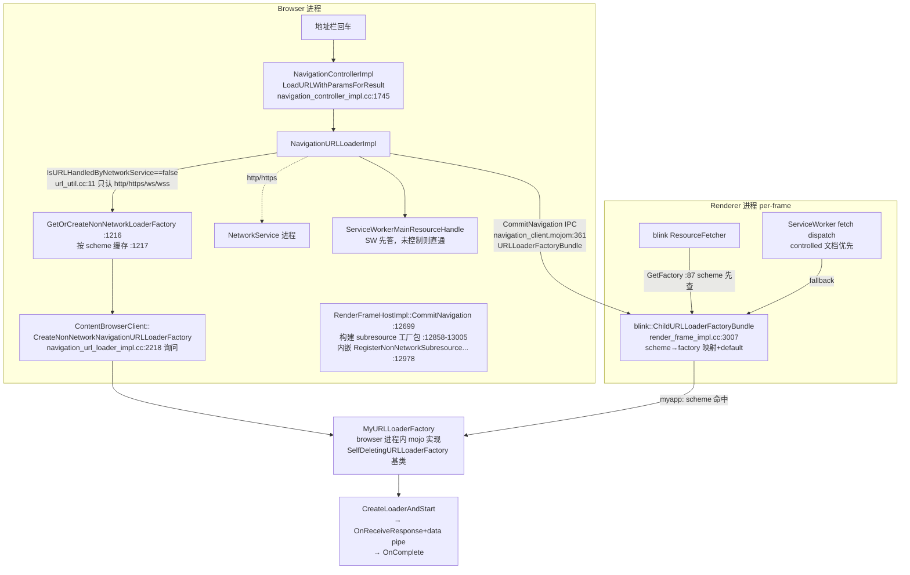

# 6.2 请求生命周期与拦截：URLLoaderFactory 体系与自定义 scheme

> 定位：6.1 讲了网络栈三层架构（net/ → services/network → browser 调度层），本篇下沉到**单个请求**粒度：一个请求从发出到拿到响应字节经过哪些可插拔的工厂与节流器；以及让 `myapp://` 成为一等公民 scheme 要打点哪几处。2.1 给了 `CreateNonNetworkNavigationURLLoaderFactory` 的契约定位，本篇展开全族；10.1/10.2 是 mojo 前置。

## 1. 角色定位

网络服务化之后，"发一个请求"被拆成一串 mojo 对象：renderer 不再持有 `URLRequest`，而是拿 `network::mojom::URLLoaderFactory` 的 remote，调 `CreateLoaderAndStart()`（`services/network/public/mojom/url_loader_factory.mojom:77`）换回 `URLLoader` pipe（`url_loader.mojom:25`），响应经 `URLLoaderClient::OnReceiveResponse/OnComplete` 流回。**谁提供 factory，谁就拥有这个请求的生杀大权**——可以是网络服务里的正路工厂，也可以是 browser 进程里 embedder 自写的实现（本篇主角）。

content 围绕这条 pipe 建了**三层工厂定制点**（导航主资源/worker 主脚本/subresource——时机、进程、生命周期各不相同），加上两套正交的拦截机制（`URLLoaderThrottle` per-request 改写拦截；`WillCreateURLLoaderFactory` 的 factory_builder/factory_override 代理链——extension WebRequest、企业 header 注入建在这上面），再加 scheme 注册表这条线（决定 URL 怎么解析、能不能 commit、算不算 secure）——四条线的组合就是"请求级定制"的全部版图。

## 2. 定制切入点全景表

| # | 想改什么 | 动哪里（文件:行） | 难度 | 影响面 |
|---|---|---|---|---|
| 1 | 注册自定义 scheme | `ContentClient::AddAdditionalSchemes`（`content/public/common/content_client.h:164`，`Schemes` 结构体 :117-160 共 15 类属性）；落地 `content/common/url_schemes.cc:66`（`url::AddStandardScheme(..., SCHEME_WITH_HOST)`） | 改配置 | 全进程 URL 解析/origin；启动早期锁死（`content/app/content_main_runner_impl.cc:982`） |
| 2 | 导航级供数 | `ContentBrowserClient::CreateNonNetworkNavigationURLLoaderFactory`（`content/public/browser/content_browser_client.h:1811`）；消费点 `content/browser/loader/navigation_url_loader_impl.cc:2218` | 改逻辑 | 每次导航按 scheme 询问，含重定向各段 |
| 3 | subresource 供数 | `RegisterNonNetworkSubresourceURLLoaderFactories`（同文件 :1847）；消费点 `content/browser/renderer_host/render_frame_host_impl.cc:12978` | 改逻辑 | per-frame 工厂包，commit 时快照 |
| 4 | worker 主脚本走自家通道 | `RegisterNonNetworkWorkerMainResourceURLLoaderFactories`（同文件 :1824）；消费 `content/browser/worker_host/worker_script_fetcher.cc:678` | 改逻辑 | dedicated/shared worker 顶层脚本 |
| 5 | SW 脚本更新通道 | `RegisterNonNetworkServiceWorkerUpdateURLLoaderFactories`（同文件 :1836）；实际启动取脚本复用 subresource 钩子（`content/browser/service_worker/embedded_worker_instance.cc:926`） | 改逻辑 | SW 更新检查/启动 |
| 6 | 请求/响应统一改写 | 自定义 `blink::URLLoaderThrottle`（`third_party/blink/public/common/loader/url_loader_throttle.h:45`；`WillStartRequest` :118 / `WillRedirectRequest` :139 / `WillProcessResponse` :146），注册于 `CreateURLLoaderThrottles`（`content_browser_client.h:1759`，chrome 样板 `chrome/browser/chrome_content_browser_client.cc:6158`） | 改逻辑 | browser 发起的请求（导航+worker 脚本） |
| 7 | renderer 侧 throttle | `ContentRendererClient::CreateURLLoaderThrottleProvider`（`content/public/renderer/content_renderer_client.h:431`）；keepalive 双保险 `CreateURLLoaderThrottlesForKeepAlive`（`content_browser_client.h:1796`） | 改逻辑 | 每个 renderer 的 subresource/fetch |
| 8 | factory 级代理链 | `ContentBrowserClient::WillCreateURLLoaderFactory`（`content_browser_client.h:1987`）：`factory_builder.Append()`（`services/network/public/cpp/url_loader_factory_builder.h:56`）或 `factory_override`（`services/network/public/mojom/network_context.mojom:768`）；chrome 样板 `chrome_content_browser_client.cc:6849` | 改逻辑 | content 创建的全部 factory，按 URLLoaderFactoryType 细分 |
| 9 | 逐请求头改写（保留网络安全特性） | `TrustedURLLoaderHeaderClient`：`WillCreateURLLoaderFactory` 的 `header_client` 出参绑定 | 改逻辑 | browser 回调进网络服务（6.1 表 #6） |
| 10 | 白名单网络/审计日志 | throttle `WillStartRequest` 改 URL 或 `Delegate::CancelWithError`（`url_loader_throttle.h:58`）；续传 `Resume` :69 | 改逻辑 | 零新增 IPC 面 |
| 11 | 响应体换掉（离线兜底/预载注入） | throttle `WillProcessResponse` + `Delegate::UpdateDeferredResponseHead`（:75）/`InterceptResponse`（:81）；或导航级 `content::URLLoaderRequestInterceptor`（`content/public/browser/url_loader_request_interceptor.h:52/:80`） | 动架构 | 前者换头+接管 pipe，后者整请求接管 |
| 12 | 下载改道非网络 scheme | 免费搭乘：`content/browser/download/download_manager_impl.cc:1718` 自动查询 subresource 钩子 | 改配置 | 无需新代码 |
| 13 | scheme 权限 | `ChildProcessSecurityPolicy::RegisterWebSafeScheme`（`content/public/browser/child_process_security_policy.h:52`）；判定 `CanRequestURL`/`CanCommitURL`（`content/browser/security/cpsp/child_process_security_policy_impl.h:220/:321`）；chrome 样板 `chrome/browser/browser_process_impl.cc:391` | 改配置 | 不注册则 renderer 发起请求被拒杀 |
| 14 | scheme 的 renderer 安全属性 | `RenderThreadImpl::RegisterSchemes`（`content/renderer/render_thread_impl.cc:885`）：`WebSecurityPolicy::RegisterURLSchemeAsDisplayIsolated/AsWebUI/...`（:888 起） | 改逻辑 | iframe 嵌套/fetch/CSP 待遇 |
| 15 | WebUI 家族（chrome:// 别名） | `GetAdditionalWebUISchemes`（`content_browser_client.h:609`）+ `content/public/browser/web_ui_url_loader_factory.h`（passkey 门禁 :51） | 改逻辑 | 复用 WebUI origin 锁/资源管理 |

## 3. 关键源码走读：myapp:// 从地址栏到返回字节

### 3.1 请求拦截三层地图（核心交付）



三层关键差异：**导航级**在 browser 进程、按 scheme 逐次询问（每次导航及每段重定向）；**subresource 级**在 commit 时一次性把 per-frame 工厂包发给 renderer，frame 生命周期内不再回 browser；**worker/SW 级**由 browser 代发。throttle 与 factory 代理链叠在任何一层之上。

### 3.2 第一层：导航请求怎么找到你的 factory

地址栏输入 `myapp://panel/index.html` 回车 → `NavigationControllerImpl::LoadURLWithParamsForResult`（`content/browser/renderer_host/navigation_controller_impl.cc:1745`）→ NavigationRequest → `NavigationURLLoaderImpl` 问一个决定性问题：`network::IsURLHandledByNetworkService(url)`。谓词极小（`services/network/public/cpp/url_util.cc:11-13`）：**只认 http/https/ws/wss**。myapp:// 不在名单 → `GetOrCreateNonNetworkLoaderFactory()`（`navigation_url_loader_impl.cc:1216`，per-scheme 缓存 :1217）→ `CreateNonNetworkLoaderFactory`（:1239）→ `CreateTerminalNonNetworkLoaderFactory`（:2208），第一顺位问 embedder：

```
GetContentClient()->browser()->CreateNonNetworkNavigationURLLoaderFactory(
    url.GetScheme(), frame_tree_node->frame_tree_node_id())  // :2218-2220
```

返回非空即接管；空则落 content 内建兜底（:2229 起依次 filesystem/about/data/file/content）。注意参数只有 scheme+frame_tree_node_id，**没有 RenderFrameHost**——注释明说重定向链上这些会变。chrome 实现（`chrome/browser/chrome_content_browser_client.cc:6323`）按 scheme 分发：extension:// 给 `CreateExtensionNavigationURLLoaderFactory`，isolated-app 给 IWA factory。

### 3.3 第二层：subresource 工厂包的构建与投递

`RenderFrameHostImpl::CommitNavigation`（`render_frame_host_impl.cc:12699`）为即将渲染的文档构建 subresource 工厂（map 声明 :12858）：content 先铺底（:12942-12974：file://→`FileURLLoaderFactory`、filesystem://、data://→`DataURLLoaderFactory`、Android content://），然后：

```
GetContentClient()->browser()->RegisterNonNetworkSubresourceURLLoaderFactories(
    GetProcess()->GetDeprecatedID(), routing_id_,
    subresource_loader_factories_config.origin(), &non_network_factories);  // :12975-12979
```

每个工厂再包一层 `url_loader_factory::CreateAndConnectToPendingReceiver`（:12995）——这层包装会调用 `ContentBrowserClient::WillCreateURLLoaderFactory`（类型 `kDocumentSubResource`），所以**WillCreate 拦截对非网络 scheme 工厂同样生效**。整包经 `blink.mojom.URLLoaderFactoryBundle`（`content/common/navigation_client.mojom:361`）随 CommitNavigation IPC 进 renderer，`RenderFrameImpl` 落成 `blink::ChildURLLoaderFactoryBundle`（`render_frame_impl.cc:3007`）。

renderer 每个请求的选路在 `URLLoaderFactoryBundle::GetFactory`（`third_party/blink/common/loader/url_loader_factory_bundle.cc:87`）：**先查 `scheme_specific_factories_[url.GetScheme()]`（:89-90）→ isolated world → default_factory（网络服务）**。mojom 结构见 `third_party/blink/public/mojom/loader/url_loader_factory_bundle.mojom:24-32`。subresource 供数只需在 map 塞一个 `"myapp"` 条目。

### 3.4 第三层：你的 factory 长什么样

`network::SelfDeletingURLLoaderFactory`（`services/network/public/cpp/self_deleting_url_loader_factory.h:23`）解决自管理生命周期：receiver 全断即自删，`Clone` 已被 final。最小样板 `DataURLLoaderFactory`（`content/browser/data_url_loader_factory.h:17`，实现 .cc:55）：`CreateLoaderAndStart` 里构造 `URLResponseHead` → `CreateDataPipe` → `client->OnReceiveResponse(head, consumer, nullopt)` → `DataPipeProducer::Write` 异步写完 → `OnComplete`。把 `net::DataURL::BuildResponse` 换成自家数据源即是完整 myapp:// handler。URLLoader 侧协议（`url_loader.mojom:25`）只有 `FollowRedirect`（:46）/`SetPriority`——不重定向就什么都不用实现。

### 3.5 拦截链与 throttle 的位置

`WillCreateURLLoaderFactory`（`content_browser_client.h:1987`）拿到 `network::URLLoaderFactoryBuilder& factory_builder`：builder 是"拦截层列表"（`url_loader_factory_builder.h:56`，`Append()` 按序叠加，串成 head→…→terminal 的 pipe 链）。chrome 在这里叠了三层真货（`chrome_content_browser_client.cc:6849` 起）：extension WebRequest 代理、企业 HTTP header 注入代理、signin 代理。要保留网络服务安全检查则用 `factory_override` 出参（`network_context.mojom:768`）整厂替换。

throttle 是另一条轴：browser 发起的请求在 `CreateContentBrowserURLLoaderThrottles`（`content/browser/loader/url_loader_throttles.cc:42`）汇聚 embedder 的 `CreateURLLoaderThrottles`（`content_browser_client.h:1759`）+ content 自带 variations/CriticalClientHints/ReduceAcceptLanguage。throttle 实例 per-request，钩子序列 `WillStartRequest`（可改 URL/头，`url_loader_throttle.h:118`）→ `WillRedirectRequest`（:139）→ `WillProcessResponse`（:146），配 `Delegate::CancelWithError/Resume/UpdateDeferredResponseHead/InterceptResponse`（:58/:69/:75/:81）。

### 3.6 scheme 注册与安全判定

`myapp://host/path` 要解析出 host、参与 origin 计算，必须启动早期进标准 scheme 表：`ContentMainRunnerImpl` → `RegisterContentSchemes`（`content/app/content_main_runner_impl.cc:982`）→ `AddAdditionalSchemes(&schemes)`（`content/common/url_schemes.cc:60`）→ 各属性分发（:66-115）。`Schemes`（`content_client.h:117`）15 字段各管一摊：`standard_schemes`（解析+origin）、`secure_schemes`（potentially trustworthy，解锁 geolocation 等）、`local_schemes`（同 file: 隔离）、`cors_enabled_schemes`、`service_worker_schemes`、`csp_bypassing_schemes`、`code_cache_schemes` 等。chrome 填法在 `chrome/common/chrome_content_client.cc:205`（extension scheme 注册 7 属性 :215-258；IWA :270-273）。

权限面独立于解析面：`CanRequestURL`（`child_process_security_policy_impl.cc:1826`）对非 WebSafe scheme 查 per-process 授权；`CanCommitURL`（:1946）更严（走 `CanCommitSchemeInAnyProcess`，:2020 注释明说比 `IsWebSafeScheme` 严）。默认 WebSafe 表只有 http/https/ws/wss/data/blob/filesystem（`RegisterDefaultSchemes`，:1227-1241）。**自定义 scheme 不进这张表，renderer 发起的 myapp:// subresource 会被拒杀**——要么 `RegisterWebSafeScheme("myapp")`（chrome 样板 `browser_process_impl.cc:391`），要么像 chrome-search 用更严的 `RegisterWebSafeIsolatedScheme`。renderer 侧还有第三张表：`RenderThreadImpl::RegisterSchemes`（`render_thread_impl.cc:885`）的 `WebSecurityPolicy::RegisterURLSchemeAs*` 系列——决定 display 语义（能否被 iframe/fetch/JS URL 触达），与 browser 侧 browse 权限互为表里。

## 4. 实操：注册 myapp:// 并由自家 handler 供数（全）

**第 1 步：scheme 注册（ContentClient 子类）**

```cpp
// 参照 chrome/common/chrome_content_client.cc:205 结构
void MyAppContentClient::AddAdditionalSchemes(Schemes* schemes) {
  schemes->standard_schemes.push_back("myapp");       // 解析出 host，参与 origin
  schemes->secure_schemes.push_back("myapp");         // potentially trustworthy（按需）
  schemes->cors_enabled_schemes.push_back("myapp");   // fetch CORS 语义（按需）
  schemes->service_worker_schemes.push_back("myapp"); // 仅当 myapp 页面要注册 SW
}
```

时机是关键：晚于 `content_main_runner_impl.cc:982` 的调用点，scheme 注册表已锁死（`g_registered_url_schemes` 防重入 + `should_lock_registry`）。

**第 2 步：handler（browser 进程 mojo 实现）**

```cpp
// 骨架抄 content/browser/data_url_loader_factory.cc
class MyAppURLLoaderFactory : public network::SelfDeletingURLLoaderFactory {
 public:
  static mojo::PendingRemote<network::mojom::URLLoaderFactory> Create() {
    mojo::PendingRemote<network::mojom::URLLoaderFactory> pending_remote;
    // 自管理生命周期：receiver 全断即自删（对照 data_url_loader_factory.cc:121-132）
    base::MakeSelfDeleting<MyAppURLLoaderFactory>(
        pending_remote.InitWithNewPipeAndPassReceiver());
    return pending_remote;
  }
  // 基类已 final 掉 Clone，只需实现：
  void CreateLoaderAndStart(
      mojo::PendingReceiver<network::mojom::URLLoader> loader,
      int32_t request_id, uint32_t options,
      const network::ResourceRequest& request,
      mojo::PendingRemote<network::mojom::URLLoaderClient> client,
      const net::MutableNetworkTrafficAnnotationTag& annotation) override {
    mojo::Remote<network::mojom::URLLoaderClient> client_remote(std::move(client));
    auto head = network::mojom::URLResponseHead::New();
    head->mime_type = "text/html";
    std::string body = ResolveMyAppResource(request.url);   // 你的数据源
    mojo::ScopedDataPipeProducerHandle producer;
    mojo::ScopedDataPipeConsumerHandle consumer;
    if (CreateDataPipe(nullptr, producer, consumer) != MOJO_RESULT_OK) {
      client_remote->OnComplete(network::URLLoaderCompletionStatus(
          net::ERR_INSUFFICIENT_RESOURCES));
      return;
    }
    head->content_length = body.size();
    client_remote->OnReceiveResponse(std::move(head), std::move(consumer), std::nullopt);
    // DataPipeProducer::Write + OnComplete 与 data_url_loader_factory.cc:89-113 同构，略
  }
};
```

**第 3 步：三层挂接（ContentBrowserClient 子类）**

```cpp
mojo::PendingRemote<network::mojom::URLLoaderFactory>
MyAppContentBrowserClient::CreateNonNetworkNavigationURLLoaderFactory(
    const std::string& scheme, content::FrameTreeNodeId ftn_id) {
  if (scheme == "myapp") return MyAppURLLoaderFactory::Create();
  return {};
}
void MyAppContentBrowserClient::RegisterNonNetworkSubresourceURLLoaderFactories(
    int render_process_id, int render_frame_id,
    const std::optional<url::Origin>& initiator,
    NonNetworkURLLoaderFactoryMap* factories) {
  factories->emplace("myapp", MyAppURLLoaderFactory::Create());
}
```

worker 主脚本要认 myapp:// 则再覆写 :1824 的 worker 钩子（复用同一 handler）。

**第 4 步：安全清单（缺一不可）**

1. `standard_schemes`——否则 `myapp://panel/x` 解析成 path-only，origin 是 opaque；
2. `RegisterWebSafeScheme("myapp")`（启动早期；否则 renderer 发起的 subresource 被 `CanRequestURL` 拒杀）；
3. commit 校验：`CanCommitURL`（`child_process_security_policy_impl.h:321`）走 `CanCommitSchemeInAnyProcess`，WebSafe 注册后自动放行；
4. renderer display 属性：在 `RegisterSchemes` 同型钩子按需 `RegisterURLSchemeAsDisplayIsolated`（防止任意网页 iframe 你的内部页面）；
5. 要 myapp:// 页面用 fetch → `cors_enabled_schemes` + renderer `RegisterURLSchemeAsSupportingFetchAPI`（样例 `render_thread_impl.cc:899`）。

## 5. 依赖与数据流

输入：`ResourceRequest`（URL/method/headers/initiator/destination）+ 调用方上下文（frame、process、UKM id）。输出：`URLResponseHead` + data pipe + `URLLoaderCompletionStatus`。契约要点：

| 契约 | 生产方 | 消费方 | 备注 |
|---|---|---|---|
| `CreateLoaderAndStart` | 请求方 | 你的 handler | request_id factory 内唯一；摧毁 URLLoader=取消 |
| `URLLoaderFactoryBundle` | RFHI CommitNavigation :12995 | renderer bundle | per-frame 快照；worker 场景 browser 内自用不下发 |
| throttle `Delegate` | ThrottlingURLLoader | 你的 throttle | Cancel/Resume/UpdateHead/Intercept 四件套 |
| scheme 注册表 | url::（browser 启动） | 全进程 | 锁死后不可增量 |

横切关系：SW 层在 renderer 内先于 bundle 选路（controlled 文档的 fetch 先 dispatch 给 SW，fallback 才回 `GetFactory`）；网络服务侧 `URLLoader`（`services/network/url_loader.cc`）持有 CORB/重定向/证书校验等安全特性——用 `factory_override` 替换**保留**这些特性，自建 factory 则**全部放弃**（坑 #6）。

## 6. 坑与勘误

1. **API 名勘误（源码实证）**：网传 `RegisterNonNetworkURLLoaderFactories`（browser 发起请求版）已不存在——本仓 grep 全无；browser 进程自用请求现在直接走 `TerminalParams::ForBrowserProcess`（`content/browser/loader/url_loader_factory_utils.h:134`）。现名四件套：1811/1824/1836/1847。
2. **throttle 头文件勘误（源码实证）**：`content/public/browser/url_loader_throttle.h` 不存在；真身在 `third_party/blink/public/common/loader/url_loader_throttle.h:45`；`content/public/browser/url_loader_throttles.h` 只是包装（:32）。
3. **navigation 与 subresource 时机差异**：导航工厂**每次导航/每段重定向都问**（`navigation_url_loader_impl.cc:2218`），且 per-scheme 缓存（:1217，`is_cacheable` 才进缓存）；subresource 包是 **commit 时一次快照**，frame 存续期不刷新——运行时改注册逻辑对已 commit 页面无效，需刷新。另 opener 继承：新窗口无 opener 才新建 bundle（`render_frame_impl.cc:1784-1795`）。
4. **display vs browse 双轨（源码实证）**：URL 能被解析 ≠ 能被 renderer 请求（CPSPI WebSafe 表，`child_process_security_policy_impl.cc:1403`）≠ 能被嵌套展示（blink display 表，`render_thread_impl.cc:885`）。三张表在不同进程/时机注册，漏一张就是"导航能开但 iframe 打不开"或"subresource 全 404"。
5. **拦截死循环/自噬**：throttle 在 `WillStartRequest` 改 `request->url` 触发 internal redirect——注释明言副作用：upload 数据可能丢、redirect 计数会耗（`url_loader_throttle.h:118` 附近）；SW 先接管再 fallback 时 throttle 会**重建**（:112 注释块），同一请求可能两次进你的 throttle——改写必须幂等。A→B→A 式互改最终撞 `ERR_TOO_MANY_REDIRECTS`。
6. **factory_builder vs factory_override 选型**：`content_browser_client.h:1936-1971` 注释钉死——prefer `factory_builder`（less error-prone）；需要网络安全特性（CORB 等）才用 `factory_override`。自建非网络 factory = 主动放弃网络服务全部防护，handler 必须自己做 origin 锁（对照 `web_ui_url_loader_factory.h:40-48` 的警告：无锁 factory 交给 renderer 等于送权限）。
7. **SW 叠加层**：SW 更新检查走专属钩子（:1836），但 SW **启动**取脚本走 subresource 钩子+kRoutingIdNone（`embedded_worker_instance.cc:926`，`content_browser_client.h:1844-1846` 注释钉版）；controlled 页面的 subresource 先 SW 后你的 factory——myapp:// 页面若注册了 SW，SW 的 fetch handler 先看到请求。
8. **renderer 工厂 per-frame 粒度**：bundle 挂在 RenderFrame 上，同进程不同 frame 各持一份；worker 场景 render_frame_id=kRoutingIdNone，注册函数必须容忍 frame_host==nullptr（chrome 样板：`chrome_content_browser_client.cc:6750` 解析 frame_host 可空，:6836 worker 走 `AddChromeSchemeFactoriesForWorker` 分支）。
9. **下载与 DevTools 免费通道**：非网络 scheme 下载自动查 subresource 钩子（`download_manager_impl.cc:1718`）；DevTools 拦截也复用同一钩子（`content/browser/devtools/protocol/network_handler.cc:4174`）——按 scheme 精确匹配而非无脑塞，否则会被这些通道意外消费。

## 7. 验证方法

- **冒烟**：地址栏 `myapp://panel/index.html`；DevTools Network 面板看该请求 Initiator/Scheme；失败时按错误码分层定位（`ERR_ABORTED` 多为权限层拒）。
- **scheme 注册**：`--enable-logging=stderr --v=0` 看早期 crash（锁死后注册直接 CHECK 挂）；unit test 断言 `url::FindStandardScheme` 与 `ChildProcessSecurityPolicy::GetInstance()->IsWebSafeScheme("myapp")`。
- **工厂链路**：`content::url_loader_factory::SetInterceptorForTesting`（`content/browser/loader/url_loader_factory_utils.h:32`）插桩验证 factory 创建与 WillCreate 拦截顺序。
- **browsertest 样板**：`content/browser/navigation_browsertest.cc:3395`（覆写导航钩子的测试类）、`content/browser/renderer_host/render_frame_host_impl_browsertest.cc:196`——拷骨架喂假响应断言 commit。
- **throttle**：`NameForLoggingWillStartRequest`（`url_loader_throttle.h:122`）返回的直方图名在 defer 时打点，`chrome://histograms` 可查。
- **renderer 选路**：unit test 构造 `blink::URLLoaderFactoryBundle` 塞 `"myapp"` 条目，调 `GetFactory(request)`（`url_loader_factory_bundle.cc:87`）断言命中。

## 8. 延伸

- 图谱：第 10 层（content/loader 子图：`NavigationURLLoaderImpl`/`URLLoaderFactoryBundle`/`url_loader_factory_utils` 节点簇）与第 12 层（services/network：`URLLoader`/`URLLoaderFactory`/`URLLoaderFactoryBuilder`）。
- 本手册：6.1（网络服务化，factory_override/header_client 的服务侧消费）、2.1（ContentBrowserClient 契约总表）、2.3（导航生命周期——§3.2 上游）、8.1（extension WebRequest——WillCreate 链最大用户）、10.1/10.2（mojo 基础与自建服务）。
- explain：`explain/net-url-request.md`（URLRequest 内部）、`explain/render-process-host.md`（commit 时刻进程视角）。
- docs-online：`multi-process-resource-loading.md`（资源加载多进程设计史，对照理解三层划分的由来）。
- 上游权威：`content/public/browser/content_browser_client.h:1800-2005` 注释块是本主题最完整最新的官方文档。
