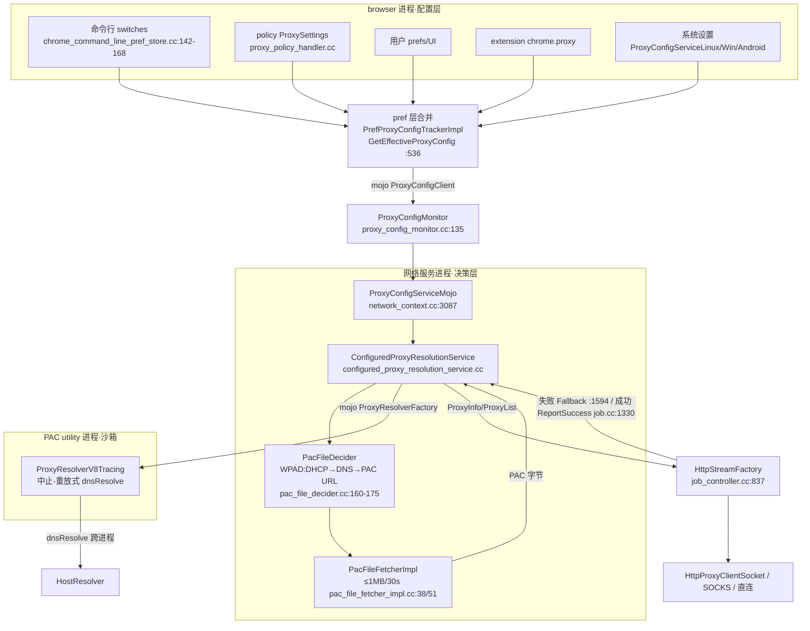

# 6.3 代理体系定制：ProxyConfigService/PAC/fixed proxy 全景

> 定位：6.1 讲了网络服务三层架构、6.2 讲了 URLLoader 拦截，本篇专讲"这个请求走哪条出口"——net/proxy_resolution 的决策体系 + services/proxy_resolver 的 PAC 执行环境 + chrome 侧的配置接线。证书链抓包见 6.1 §4.1，DNS 见 6.5。

## 1. 角色定位

代理体系是 net/ 栈里少数**横跨三个进程**的子系统。它分两层：**配置层**负责回答"当前的有效代理配置是什么"——命令行/prefs/policy/extension/系统设置五路信号在 browser 进程汇入 `PrefProxyConfigTrackerImpl`（`components/proxy_config/pref_proxy_config_tracker_impl.cc:536` 的 `GetEffectiveProxyConfig` 裁决优先级），胜出的 `net::ProxyConfig` 由 `ProxyConfigMonitor` 经 mojo 推给网络服务进程的 `ProxyConfigServiceMojo`（`chrome/browser/net/proxy_config_monitor.cc:97` → `services/network/network_context.cc:3087`）。**决策层**在网络服务进程内，`ConfiguredProxyResolutionService`（`net/proxy_resolution/configured_proxy_resolution_service.h:65`）把配置翻译成每次请求的 `ProxyInfo`：四级 fallback 依次是 override rules → WPAD 自动探测 → PAC URL → 手工 fixed proxy（头文件 :136-143 钉版）。PAC 脚本是 JavaScript，跑在**独立沙箱 utility 进程**的 V8 里（`chrome/browser/net/chrome_mojo_proxy_resolver_factory.cc:41`），不跑在网络服务进程。

上游消费者是 `HttpStreamFactory::JobController::DoResolveProxy`（`net/http/http_stream_factory_job_controller.cc:837`）——每个 HTTP(S) 事务建流前必经；下游产物 `ProxyInfo` 内含一条**优先级降序的 ProxyList 容错链**（`net/proxy_resolution/proxy_list.h:30`），失败逐个 Fallback。认证（407/NTLM）由 `HttpAuthController` 接管。在图谱 16 层里它属于 net 库层，但定制入口大半在 chrome 装配层——"改哪一层"是本篇反复出现的判据。

## 2. 定制切入点全景表

| # | 想改什么 | 动哪里（文件:行） | 难度 | 影响面 |
|---|---|---|---|---|
| 1 | 全局强制走自家网关（fixed proxy） | 命令行 `--proxy-server/--proxy-bypass-list`（`chrome/common/chrome_switches.h:641/635`）→ 翻译点 `chrome/browser/prefs/chrome_command_line_pref_store.cc:158-166`；代码级用 `net::ProxyConfig::ProxyRules::ParseFromString`（`net/proxy_resolution/proxy_config.cc:94`）构造后交给 `ProxyConfigServiceFixed`（`net/proxy_resolution/proxy_config_service_fixed.h:17`） | 改配置 | 整 profile/整 context |
| 2 | 按域/按 URL 分流 | `net::ProxyDelegate::OnResolveProxy`（`net/base/proxy_delegate.h:44`），挂载点在 `ConfiguredProxyResolutionService::DidFinishResolvingProxy`（`configured_proxy_resolution_service.cc:1278-1280`，每次成功解析都会回调且可直接改写 `ProxyInfo`） | 改逻辑 | 全部请求，URL 粒度 |
| 3 | PAC 脚本注入/替换 | 脚本下发链 `InitProxyResolver::DoCreateResolver`（`configured_proxy_resolution_service.cc:536-545`）→ mojo 工厂；改 JS 绑定环境 `services/proxy_resolver/proxy_resolver_v8.cc:560-605`（alert/myIpAddress/dnsResolve/isInNetEx 注册表） | 动架构 | 沙箱 utility 进程内，需跨进程调试 |
| 4 | 系统代理对接（读 OS 设置） | `ProxyConfigService::CreateSystemProxyConfigService`（`net/proxy_resolution/proxy_config_service.h:80`）；Linux 读 gsettings/KDE kioslaverc/env（`proxy_config_service_linux.h:35-36`）、Android 从 Java 层回调（`proxy_config_service_android.h:33`）、Win 在 `win/proxy_config_service_win.cc` | 改逻辑 | 平台相关，各国实现差异大 |
| 5 | 认证代理（Basic/NTLM/Negotiate） | 407 处理 `net/http/http_auth_controller.cc:225`（隧道建立期无可用方案→`ERR_PROXY_AUTH_UNSUPPORTED`，:311-320）；凭据缓存 `HttpAuthCache`；白名单开关 `--auth-server-allowlist`（`chrome_switches.h:117`） | 改逻辑 | 弹窗走 LoginHandler，缓存按 NAK 隔离 |
| 6 | bypass 规则语义定制 | 规则解析 `ProxyHostMatchingRules::AddRuleFromString`（`proxy_host_matching_rules.cc:206`）；隐式规则（localhost/loopback/link-local）`MatchesImplicitRules`（:236-270），反扣语法 `<-loopback>`（:25） | 改配置 | 语法全集见 `net/docs/proxy.md` |
| 7 | per-profile 代理（企业多身份） | 每 profile 一个 `ProxyConfigMonitor(profile)`（`chrome/browser/net/proxy_config_monitor.h:56`）+ 每 profile 独立 NetworkContext，配置各自推送 | 改配置 | 非默认：普通 chrome 共用系统配置，需自建 profile 级 tracker |
| 8 | 更细粒度（每 WebContents/每帧） | 无原生开关；用 #2 的 ProxyDelegate 看 URL，或 6.2 的 `WillCreateURLLoaderFactory` 给不同帧发不同 factory | 改逻辑 | 组合方案 |
| 9 | policy 强制代理 | `components/proxy_config/proxy_policy_handler.cc:57-69`（ProxyMode 五值 direct/auto_detect/pac_script/fixed_servers/system 校验表）；新式按目的分流走 `proxy_override_rules_policy_handler.cc` | 改配置 | CONFIG_POLICY 永远压过系统设置（`pref_proxy_config_tracker_impl.cc:530-533`） |
| 10 | PAC 引擎切换（V8↔系统库） | `--winhttp-proxy-resolver`/`--use-system-proxy-resolver`（`chrome_switches.h:836/789`），装配分支 `system_network_context_manager.cc:1017-1045` 与 `services/network/url_request_context_builder_mojo.cc:82-115` | 改配置 | Win/Mac/Linux(dbus) 可用；Linux V8 是默认 |
| 11 | 代理故障回退行为 | `ProxyList::Fallback`（`proxy_list.cc:199-225`，坏代理冷却 5 分钟）；失败重试入口 `http_stream_factory_job_controller.cc:1594`；成功回报 `http_stream_factory_job.cc:1330` | 改逻辑 | 改 `kDefaultRetryDelay` 即改全局容错节奏 |
| 12 | 禁止"失败回退直连" | `ProxyConfig::set_pac_mandatory`（`proxy_config.h:305-311`），消费点 `DidFinishResolvingProxy`（`configured_proxy_resolution_service.cc:1321-1335`，mandatory 时返回 `ERR_MANDATORY_PROXY_CONFIGURATION_FAILED`） | 改逻辑 | 安全审计刚需：防代理失效后明文裸奔 |
| 13 | WPAD/DHCP 探测 | 探测顺序 `PacFileDecider::BuildPacSourcesFallbackList`（`pac_file_decider.cc:160-175`：WPAD_DHCP→WPAD_DNS→CUSTOM）；DNS 预检 QuickCheck 1 秒超时（:58, :248-250），开关 `pref proxy.quick_check_enabled`（`chrome/common/pref_names.h:2560`） | 改配置 | 关 QuickCheck 可修内网 wpad 解析慢 |
| 14 | 代理设置 UI | ChromeOS：`chrome/browser/resources/ash/settings/internet_page/network_proxy_section.ts`；非 ChromeOS 桌面版**无内置代理设置页**，跳系统对话框 | 改逻辑 | 想做产品级代理面板需自建 WebUI（参照 4.2） |
| 15 | QUIC 与代理交互 | `net/base/proxy_server.h:32-42`（`SCHEME_QUIC` 位）；建流期方案过滤 `job_controller.cc:869-880`（WebSocket 永不走 QUIC 代理）；rules 解析受 `ENABLE_QUIC_PROXY_SUPPORT` 编译闸（`proxy_config.cc:110-112`） | 改逻辑 | QUIC 代理尚属实验面 |
| 16 | 坏代理缓存运营 | `ClearBadProxiesCache`/`proxy_retry_info()`（`configured_proxy_resolution_service.h:182-185`）；NetLog 可视 `GetProxyNetLogValues`（.cc:1523） | 改配置 | 运维排障"为什么还在用死代理" |

## 3. 关键源码走读：一次请求的代理决策主线

```mermaid
sequenceDiagram
    participant U as URLRequest<br/>(网络服务进程)
    participant J as JobController<br/>(http_stream_factory)
    participant S as ConfiguredProxy<br/>ResolutionService
    participant P as PAC utility 进程<br/>(V8)
    participant K as Socket 层

    U->>J: 建流（HttpNetworkTransaction）
    J->>S: DoResolveProxy → ResolveProxy(url)<br/>(job_controller.cc:849 / service.cc:936)
    S->>S: SanitizeUrl（剥 user/pass/ref；https 再剥 path/query）<br/>(proxy_resolution_url_sanitizer.cc:10-24)
    S->>S: TryToCompleteSynchronously (cc:1012)<br/>override rules → PvD 动态路由 → manual rules
    alt 配置含 auto_detect/pac_url
        S->>P: GetProxyForURL（mojo，ConfiguredProxyResolutionRequest.cc:254）
        P->>P: 执行 FindProxyForURL（proxy_resolver_v8.cc）<br/>dnsResolve 未命中→中止重放（v8_tracing.cc:36-52）
        P-->>S: "PROXY a:80; PROXY b:8080; DIRECT"
        S->>S: SetFromPacString 解析进 ProxyList
    else 手工 fixed proxy
        S->>S: ProxyRules::Apply (proxy_config.cc:61)<br/>bypass 命中→UseDirectWithBypassedProxy
    end
    S->>S: DidFinishResolvingProxy (cc:1265)<br/>ProxyDelegate::OnResolveProxy → DeprioritizeBadProxyChains
    S-->>J: ProxyInfo（首链 + 降序容错链）
    J->>K: 用首链建连接（HTTP CONNECT / SOCKS / 直连）
    K-->>J: 连接失败
    J->>J: proxy_info_.Fallback(error) (job_controller.cc:1594)<br/>首链记入 bad_until=now+5min
    J->>K: 换下一链重试……
    J->>S: 全链失败→报错；最终成功→ReportSuccess（job.cc:1330）
```

**入口**。`DoResolveProxy`（`http_stream_factory_job_controller.cc:837-854`）先看 `LOAD_BYPASS_PROXY` 标志（:842-845，Ctrl+Shift+R 等场景直接直连），然后调 `ResolveProxy`。`ConfiguredProxyResolutionService::ResolveProxy`（`configured_proxy_resolution_service.cc:936`）第一件事是给 URL 脱敏（:966）——**https URL 进 PAC 时没有 path/query**（`proxy_resolution_url_sanitizer.cc:18-21`），PAC 想按路径分流 https 是不可能的，这是设计而非 bug。

**同步快路径**。`TryToCompleteSynchronously`（:1012）按优先级试三件事：(1) 企业 ProxyOverrideRules——目的匹配器命中且无 DNS 条件即刻生效（:1026-1047），有 DNS 条件转异步（`ConfiguredProxyResolutionRequest::Start`，`configured_proxy_resolution_request.cc:90-134` 逐条发 DNS 探测再 `EvaluateApplicableOverrideRules` :300）；(2) Provisioning Domains 动态路由（:1049-1062）；(3) 若此前 PAC 下载失败（`permanent_error_`），先看隐式 bypass 救场（:1064-1072，`ApplyPacBypassRules` :1629 检查 localhost/link-local 强制直连）。配置含自动设置（`HasAutomaticSettings`）则必须进 PAC 异步路径（:1077-1090）；手工配置走 `ProxyRules::Apply`（:1093）。

**ProxyRules::Apply 的 bypass 语义**（`proxy_config.cc:61-92`）：先查 `bypass_rules.Matches(url, reverse_bypass)`，命中则 `UseDirectWithBypassedProxy()`——`ProxyInfo::did_bypass_proxy()` 置 true（`proxy_info.h:96`），区别于普通直连。未命中按 `PROXY_LIST`（全 scheme 一条链）或 `PROXY_LIST_PER_SCHEME`（http/https/ftp 各一条链 + `socks=` 兜底链，:151-157）取 `ProxyList` 填进结果。

**PAC 异步路径**。`ConfiguredProxyResolutionRequest::ContinueProxyResolution`（`configured_proxy_resolution_request.cc:233-259`）最终调 `GetProxyResolver()->GetProxyForURL`（:254）。resolver 初始化（配置首次生效或变更时）由 `OnProxyConfigChanged`（`configured_proxy_resolution_service.cc:1562`）触发 `InitializeUsingLastFetchedConfig` → `InitProxyResolver::Start`（:398）：状态机先跑 `PacFileDecider`（:516-523）——按 WPAD_DHCP → WPAD_DNS（可选 1 秒 DNS QuickCheck 预检，`pac_file_decider.cc:58/248`）→ 自定义 PAC URL 顺序找脚本，下载走普通 `URLRequest`（上限 1MB/30 秒，`pac_file_fetcher_impl.cc:38/51`）；成功后 `DoCreateResolver`（:536-545）把脚本字节交给 `ProxyResolverFactory`——Chrome 默认是 `ProxyResolverFactoryMojo`（`services/network/proxy_service_mojo.cc:40-46`），mojo 另一端就是沙箱 utility 进程里的 `ProxyResolverImpl` → `ProxyResolverV8Tracing`。后者有个精巧设计（`services/proxy_resolver/proxy_resolver_v8_tracing.cc:36-52`）：把 PAC 脚本建模为"只依赖输入 URL 的确定性程序"，`dnsResolve()` 未命中缓存就**中止 JS 执行、发起真 DNS、拿到结果后从头重放**，单脚本 DNS 上限 20 次（:64）——PAC 线程永不因阻塞 DNS 卡死。注意 PAC 里的 `dnsResolve` 会跨进程回到网络服务的 HostResolver（`services/proxy_resolver/host_resolver_mojo.h`），DNS 定制（6.5）会直接改变 PAC 行为。

**容错链与坏代理账本**。解析产物 `ProxyInfo` 持有降序 `ProxyList`；`DidFinishResolvingProxy`（:1265）在成功时给 `ProxyDelegate` 最后一次改写机会（:1278-1280），再把 `proxy_retry_info_` 里未过冷却期的链降级到队尾（:1289）。连接失败后 `JobController` 调 `proxy_info_.Fallback(error)`（`job_controller.cc:1594`），`ProxyList::Fallback`（`proxy_list.cc:199-225`）把首链出队并写入 `ProxyRetryInfoMap`，`bad_until = now + 5min`（:213）——注意 DIRECT 链不会被记账（:207）。整个事务成功时 `ReportSuccess`（`http_stream_factory_job.cc:1330`）把本请求实际试过的坏链正式入账。

## 4. 实操：「内网直连 + 外网强制走自家网关」

需求：`*.corp.example`、`10.0.0.0/8` 走内网直连，其余全部走公司网关 `gw.corp.example:3128`。

**路线 A：零代码（配置面）**。

```bash
chrome --proxy-server="http=gw.corp.example:3128;https=gw.corp.example:3128" \
       --proxy-bypass-list="*.corp.example;10.0.0.0/8"
```

生效链：`chrome_command_line_pref_store.cc:158-166` 把它写成 `kProxy` pref（`CreateFixedServers(proxy_server, bypass_list)`）→ `PrefProxyConfigTrackerImpl` 判为 `CONFIG_FALLBACK` → 正常生效。语义核对：bypass 命中走 `UseDirectWithBypassedProxy`（`proxy_config.cc:67-70`），未命中的 scheme 无映射时也是直连（:82-85），所以 `ftp=` 不写即可。改用托管 policy 时把 `ProxySettings` 设为 `fixed_servers` 模式 + 同 bypass list，`proxy_policy_handler.cc:57-69` 校验后以 `CONFIG_POLICY` 优先级压过一切本机配置（`pref_proxy_config_tracker_impl.cc:530-533`）。

**路线 B：代码级（接管配置推送）**。在自研 browser 里最稳的切入点是 browser 侧的 `ProxyConfigMonitor`——它本来就是"配置→网络服务"的唯一推送通道：

```cpp
// chrome/browser/net/proxy_config_monitor.cc 的 OnProxyConfigChanged 里
// 用自家分流配置替换读到的系统配置（示意）：
net::ProxyConfig config;
config.proxy_rules().ParseFromString(
    "http=gw.corp.example:3128;https=gw.corp.example:3128");   // proxy_config.cc:94
config.proxy_rules().bypass_rules.ParseFromString(
    "*.corp.example;10.0.0.0/8");                              // proxy_host_matching_rules.cc:192
net::ProxyConfigWithAnnotation annotated(
    config, net::NetworkTrafficAnnotationTag(DefineNetworkTrafficAnnotation(...)));
// 沿原有 observer 通知路径下发（AddToNetworkContextParams 已接好的 mojo 管道，
// proxy_config_monitor.cc:97-101 → network_context.cc:3087）
```

更彻底的动态分流（例如按登录用户身份决定出口）用 `net::ProxyDelegate`：

```cpp
class CorpProxyDelegate : public net::ProxyDelegate {
  void OnResolveProxy(const GURL& url, const net::NetworkAnonymizationKey&,
                      const std::string&,
                      const net::ProxyRetryInfoMap&,
                      net::ProxyInfo* result) override {
    if (url.DomainIs("corp.example")) { result->UseDirect(); return; }
    // 否则保留 fixed proxy 结果，或在此改写 result->UseNamedProxy("gw:3128")
  }
};
// 挂载：NetworkContextParams::custom_proxy_config_client_receiver 通路
// （services/network/network_context.cc:2923-2929 会装 NetworkServiceProxyDelegate，
// 它正是 net::ProxyDelegate 的网络服务侧实现，services/network/network_service_proxy_delegate.h:28）
```

两条路线的差别：A 改配置零维护但只有 host/scheme 粒度；B 里 Monitor 方案保持"配置单点"架构不变，ProxyDelegate 方案拿到的是**每次请求**的最终裁决权（含 URL/NAK），代价是绕过了 bypass 统计（`did_bypass_proxy` 不会置位）。

## 5. 依赖与数据流



契约要点：(1) 配置单向流动，网络服务从不回读系统设置——所有变更必须经 browser 侧重推；(2) `OnLazyPoll`（`proxy_config_service.h:71`）是网络服务向 browser 的"有流量了"信号，轮询型实现（Linux gsettings）借此省电；(3) IP 变化后代理自动重配有 2 秒静默窗（`kDelayAfterNetworkChangesMs`，`configured_proxy_resolution_service.cc:81`），期间请求排队；(4) PAC 脚本重试节流失败后 8s→32s→2m→4h（:125-165），成功后 12h——**改了 PAC 文件不会立刻生效**。

## 6. 坑与勘误

- **PAC 执行环境的变迁**（源码实证）：老文档说 PAC 在 browser 进程/网络服务进程线程池跑——已过时。现状是 `ChromeMojoProxyResolverFactory` 经 `ServiceProcessHost::Launch` 起独立沙箱 utility 进程（`chrome_mojo_proxy_resolver_factory.cc:41-51`，进程子类型 `proxy_resolver.CrUtilityMain`，`content/utility/utility_main.cc:229-232`），空闲即退出、崩溃自动拉新（:51-54）；仅 Android 退化为进程内实例（:33-37）。跨进程调试要 `--utility-cmd-prefix` 挂 gdb，NetLog 里 PAC 错误经 `ProxyResolverErrorObserver` mojo 回传。
- **`<local>` 不是 Chromium 语法**（源码实证）：`scheme_host_port_matcher_unittest.cc:55-59` 钉死 `<local>` 被当字面 hostname 解析。"绕过简单主机名"功能由 Windows/macOS 的 checkbox 映射到 `PrependRuleToBypassSimpleHostnames`（`proxy_host_matching_rules.h:80`），Linux 端没有对应 UI。
- **隐式 bypass 关不掉**（源码实证）：localhost/127.0.0.1/::1/169.254/16/[FE80::]/10 永远直连（`MatchesImplicitRules`，`proxy_host_matching_rules.cc:236-270`），连 PAC 都被 `ApplyPacBypassRules`（`configured_proxy_resolution_service.h:429-433` 注释、cc:1629）挡在外面；唯一豁免语法是 `<-loopback>`（:25）。企业用 `*.localhost` 内网域会中招。
- **直连回退语义**（源码实证）：PAC 下载/解析失败且非 mandatory 时静默回退直连（`DidFinishResolvingProxy`，:1321-1326）；`CreateFromCustomPacURL` 默认 `pac_mandatory=false`（`proxy_config.h:333-339`），连 `--proxy-pac-url` 都传的 false（`chrome_command_line_pref_store.cc:152`）。安全敏感场景必须显式 set true，否则代理一挂流量明文裸奔。
- **代理与证书链叠加**（呼应 6.1 实操）：HTTPS 代理（`https=` scheme）的 CONNECT 隧道握手走完整 TLS 验证，内网中间人网关需要 6.1 §4.1 的 trust anchors 注入双份（代理证书 + 目标证书）；HTTP 代理则是明文 CONNECT。`socks=` 裸写默认按 **SOCKS4** 解析（`proxy_config.cc:151-157`），要 v5 必须写 `socks5://`；SOCKS 不承载 UDP，WebRTC/QUIC 流量不会走 SOCKS 代理。
- **QUIC 代理是实验面**（源码实证）：`ParseFromString` 对 QUIC 代理串有 `ENABLE_QUIC_PROXY_SUPPORT` 编译闸 CHECK（`proxy_config.cc:110-112`）；建流期 WebSocket 明确不选 QUIC 代理（`job_controller.cc:873-879`）。
- **平台差异**：ChromeOS 的系统配置源为 NULL，全部经 `ash::ProxyConfigServiceImpl`（`chrome/browser/net/proxy_service_factory.cc:36-47`）；桌面版没有内置代理设置页，改设置要去 OS 层或 policy。

## 7. 验证方法

1. **NetLog 观测**：`chrome --log-net-log=/tmp/net.json --net-log-capture-mode=Everything` 后开任意页面。看四类事件：`PROXY_CONFIG_CHANGED`（配置何时被推下来）、`PROXY_RESOLUTION_SERVICE_RESOLVED_PROXY_LIST`（每次解析结果，`configured_proxy_resolution_service.cc:1282-1287` 写入）、`PROXY_LIST_FALLBACK`（`proxy_list.cc:208`）、`PAC_JAVASCRIPT_ERROR`。用 netlog viewer 打开。
2. **命令行冒烟**：先 `--no-proxy-server` 对照直连，再 `--proxy-server=http://gw:3128` 看出口 IP（如 https://httpbin.org/ip 类自建回显服务）。注意 `--no-proxy-server` 与其它代理 switch 同用会告警拒配（`chrome_command_line_pref_store.cc:121-131`）。
3. **PAC 本地调试**：`python3 -m http.server` 起个目录放 `proxy.pac`，`--proxy-pac-url=http://127.0.0.1:8000/proxy.pac`。PAC URL 本身的下载不受隐式 bypass 影响（bypass 只作用于业务 URL 的解析结果）；但脚本里 `dnsResolve` 走真实 DNS。
4. **单测**：`out/Release/net_unittests --gtest_filter='ConfiguredProxyResolutionServiceTest.*:ProxyConfig*Test.*:PacFileDeciderTest.*'`；V8 侧 `services/proxy_resolver/proxy_resolver_v8_unittest.cc`。改 `net/proxy_resolution` 后这三个族是回归底线。
5. **policy 生效**：`chrome://policy` 看 ProxySettings 是否 `OK`、`chrome://version` 的 Command Line 确认 switches 没被策略覆盖。

## 8. 延伸

- 姊妹篇：`6.1-network-service.md`（网络服务架构 + 证书信任实操）、`6.2-url-loader-intercept.md`（按帧拦截的另一种分流姿势）、`6.5-dns-custom.md`（PAC 里 dnsResolve 的最终归宿）、`11.2-pref-system.md`（pref/policy 通道全貌）。
- 仓内权威文档：`net/docs/proxy.md`（1055 行，代理 URI 格式、bypass 语法全集、各 scheme 语义，比任何网上教程都新）。
- explain 系列：`explain/net-url-request.md`（决策结果的消费侧）、`explain/dns-host-resolver.md`。
- 图谱相关：`net/proxy_resolution/`（决策层全部节点）、`services/proxy_resolver/`（沙箱 PAC 引擎）、`chrome/browser/net/proxy_*` 与 `components/proxy_config/`（配置层装配）。IP Protection 的多跳 ProxyChain 入口在 `net/base/proxy_chain.h:32`（`is_for_ip_protection` :196），是 proxy 链式代理的前沿扩展位。
