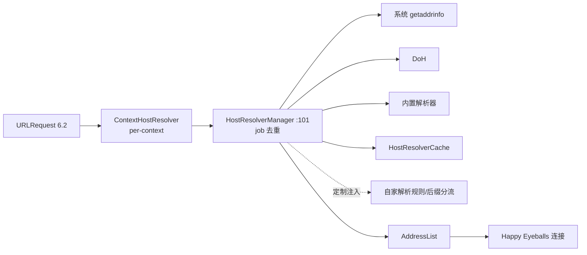

# 6.5 · DNS 与 HostResolver 定制：解析层接管

> 域名怎么被解析、结果怎么缓存、怎么让"特定域名走自家通道"（内网直连/防劫持/分级解析）。机制深解见 `../explain/dns-host-resolver.md`（HostResolverManager 内部调度），本篇纯定制视角，承接 6.1-6.3 的网络组。

## ① 角色定位

DNS 决策链在 `net/dns/`：**HostResolverManager**（`host_resolver_manager.h:101`，调度核心——并发/job 去重/缓存）统筹多个解析源（系统 getaddrinfo/DoH/内置解析器），**ContextHostResolver**（context_host_resolver.cc，per-NetworkContext 包装，11.3 式的分区隔离在 DNS 的投影）+ **HostResolverCache**（TTL 缓存）。嵌入面：每个 NetworkContext 挂一个 resolver，上层 URLRequest 全部经它。

## ② 定制切入点全景表

| 想干什么 | 动哪里 | 难度 | 影响面 |
|---|---|---|---|
| 域名分流解析 | HostResolver 的 MapHost 名机制（host_mapping_rules：--host-resolver-rules 的代码面）+静态映射表 | 改配置 | 测试/内网直连 |
| 自定义解析器 | 换 NetworkContextParams 的 resolver 配置（嵌入者路线 B 全控）或 ContentBrowserClient 网络钩子（6.1） | 改逻辑 | 全解析 |
| DoH 升级管控 | DnsOverHttps 配置（模板/自动升级策略，net/dns/doh 一带）+policy | 改配置 | 加密解析 |
| 缓存干预 | HostResolverCache 参数（TTL 服从/容量/负缓存） | 改配置 | 解析时延 |
| 防劫持 | DoH 强制+证书钉扎联动（6.4）/内置解析器优先系统 | 改配置 | 安全 |
| 内网 DNS 后缀 | resolver 的 search domain 处理（getaddrinfo 语义） | 改配置 | 企业内网 |
| 解析日志 | resolver 层观测（net-log 的 DNS 类别现成） | 只读 | 审计 |
| IPv6/IPv4 优先 | Happy Eyeballs 参数（net/dns 一带） | 改配置 | 连接选路 |
| 本地域名保护 | resolver 的 localhost/intranet 直通规则 | 改配置 | 内网兼容 |
| 测试桩 | mock host resolver（net/base/test 一带，单测基建） | 只读 | 测试 |
| per-profile 差异 | ContextHostResolver 分区（多 profile 不同 DNS 策略——企业身份场景） | 改逻辑 | 隔离 |
| 恶意域拦截 | 解析层黑名单（返回 NOTFOUND——比 6.2 拦截更早更省） | 改逻辑 | 安全产品 |

## ③ 关键源码走读：一次解析的路径

**第一站：入口分流。** URL 的 host 进 ContextHostResolver→HostResolverManager（:101 类）建 job（同 host 并发请求去重合流）。

**第二站：多源赛马。** manager 按配置调度解析源：系统解析（getaddrinfo 线程池）/DoH（HTTP/2 或 HTTP/3 到 DoH 服务器）/内置异步解析器——**优先级与回退是策略面**（DoH 失败回系统是默认降级链）。

**第三站：缓存与 TTL。** HostResolverCache 存正/负结果（负缓存防风暴），TTL 服从可调——定制"域名秒级生效"（改配置下发）要懂这里。结果回流后 URLRequest 拿 AddressList 走连接（Happy Eyeballs 双栈竞速）。

## ④ 实操：「自家域走自家解析，其余走系统」

企业/产品场景：`*.mycorp.internal` 必须走内网 DNS（系统 resolver 的 search 域不可靠）。
1. **轻路线**：`--host-resolver-rules`（映射规则文件/命令行——静态映射，零代码）；
2. **重路线**：自定义 resolver 逻辑（6.1 的网络服务钩子注入自家解析器实现，仅对目标后缀拦截，其余委托 manager）——支持动态域名表（配置服务下发）。
验证配套：chrome://net-export 抓 DNS 事件看分流命中。

## ⑤ 依赖与数据流

## ⑥ 坑与勘误

- **--host-resolver-rules 只对部分解析路径生效**（历史限制，以现源码消费点为准——动态解析场景实测验证，别当万能）。
- DoH 的自动升级（Auto-Upgrade）会在用户无感时切走系统 DNS——企业场景显式锁策略（11.2 policy 通道）。
- 缓存的 TTL 服从：上游 TTL 很短时频繁重查（调缓存参数缓解），很长时故障切换慢——两个方向的产品预期要对齐。
- 负缓存会让"刚修好的域名"继续打不开（TTL 内）——运维侧知识，文档要写进产品手册。
- resolver 是 per-NetworkContext 不是全局单例（11.3 分区投影）——"全局 DNS 策略"要每 context 配置。
- Android 的系统解析语义不同（5.2 清单：getaddrinfo 行为/私有 DNS 设置叠加）。

## ⑦ 验证方法

- chrome://net-export：DNS 事件流（源/耗时/缓存命中）
- dig 对照：浏览器解析结果 vs 系统 dig（分流正确性）
- DoH 生效：net-log 里 DoH 服务器查询记录
- 故障演练：内网 DNS 挂→回退链行为（产品 SLA 预期）

## ⑧ 延伸

- 调度内部：`../explain/dns-host-resolver.md`（必读前置）；网络架构：6.1；请求拦截（更上游的拦截位）：6.2；代理（并列的选路体系）：6.3
- 图谱层位：net 层 dns 子图（HostResolverManager 40 节点大子图）
