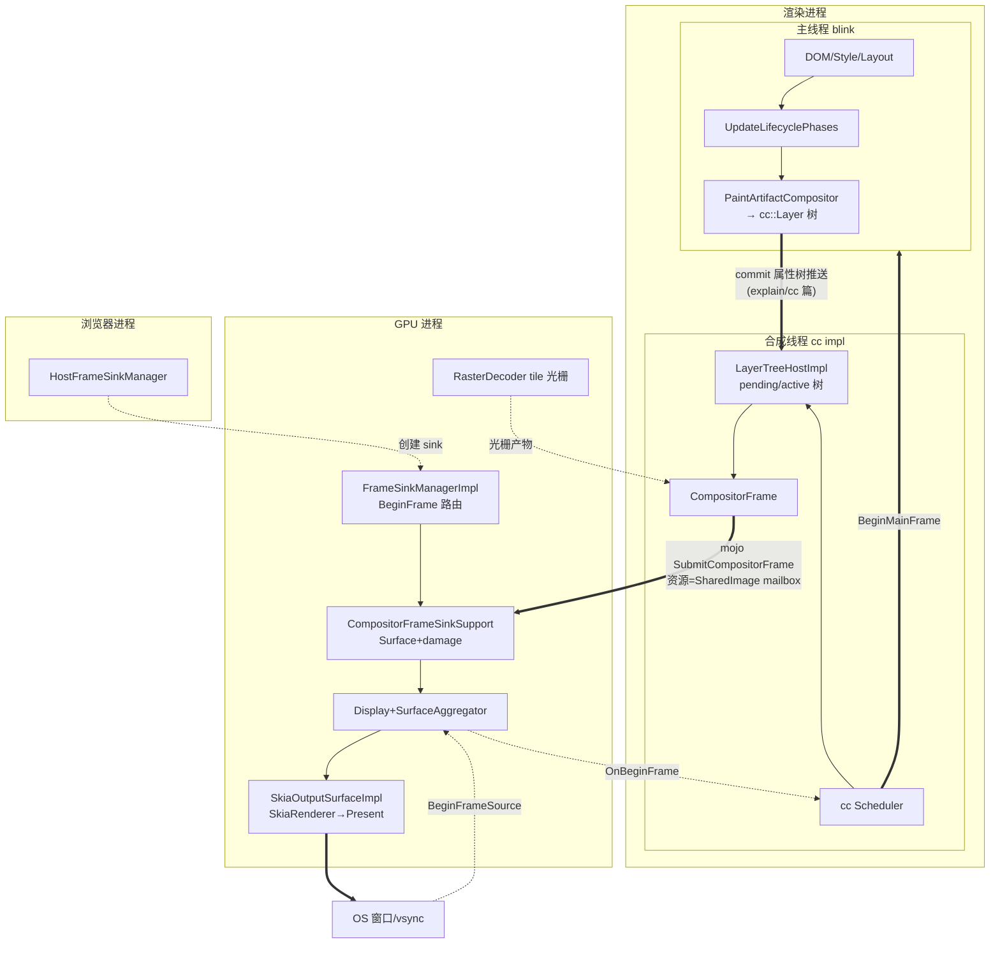

# 7.1 渲染管线全景：blink→cc→viz→gpu 数据流与定制切入点

> 源码 src@8fe2331 行号实证（2026-10 快照）。单点深解见 explain 三篇：`explain/cc-layer-tree-impl.md`、`explain/viz-root-frame-sink.md`、`explain/gpu-webgpu-decoder.md`。本篇讲**管线串联与定制面**，单点内部不重复。

## 一、角色定位

渲染管线横贯图谱四层：`content-child` 里 blink 主线程产出绘制描述，`cc-compositor` 在同进程合成线程变成 cc Layer 树与 CompositorFrame，跨进程交 GPU 进程 `viz-display` 聚合上屏，光栅与 GPU 命令落 `gpu-command-buffer`。官方三篇设计文档（docs-online/）是 CCThreadProxy 时代（约 2014）描述，类名已全换（第六节勘误）。一个像素 DOM→屏幕与一个 vsync 屏幕→DOM 是同一条管线的两个方向——



要点：viz 在 **GPU 进程**；renderer 经 `cc::mojo_embedder::AsyncLayerTreeFrameSink` 与 viz 双向 mojo（帧下行/BeginFrame 上行/资源回收随行）；帧里只有资源引用没有像素——tile 光栅在 renderer 发起、GPU 进程 `RasterDecoder` 执行。

## 二、定制切入点全景表

| 想改什么 | 动哪里（行号实证） | 难度 | 影响面 |
|---|---|---|---|
| 注入 JS（自动化/AI 采集） | `content/public/renderer/render_frame_observer.h:139` `DidCreateScriptContext` / `:143` `DidClearWindowObject` | 改逻辑 | 单帧文档 |
| 注入全局 CSS | `third_party/blink/public/web/web_document.h:152` `InsertStyleSheet`；或暗色滤镜 `RasterDarkModeFilterImpl`（`widget_base.cc` InitParams） | 改逻辑 | 全页样式，受站点 CSS 干扰 |
| 自绘水印层（不碰 DOM） | `web_frame_widget_impl.cc:3863` `SetRootLayer` 包容器层（第四节）；先例 `inspector_overlay_agent.cc:449` | 改逻辑 | 合成层最顶，零输入影响 |
| 每帧时机回调（rAF 级） | `web_frame_widget_impl.cc:3050` `BeginMainFrame` / `layer_tree_view.cc:251` | 改逻辑 | 主线程热路径 |
| 拦生命周期（改绘制产物） | `web_frame_widget_impl.cc:1843` → `local_frame_view.cc:2400` | 改逻辑 | lifecycle 不变量 DCHECK 网 |
| 观察 commit 树同步 | `proxy_impl.cc:872`、`layer_tree_host_impl.cc:3787`（explain/cc 篇） | 动架构 | 合成线程核心 |
| 帧率/调度干预 | `scheduler.cc:456`；`--disable-frame-rate-limit`（`components/viz/common/switches.cc:36`，分支 `widget_base.cc:807`）；viz 帧率决策 explain/viz 篇 | 改配置→改逻辑 | 能耗/流畅度 |
| 光栅参数（tile/checker/LCD） | `layer_tree_settings.cc:207` `GenerateLayerTreeSettings`（tile 尺寸 L261-292，`--default-tile-width` 读取 L293）；`cc/trees/layer_tree_settings.h:62/83` | 改配置 | 内存/清晰度/速度 |
| GPU 光栅执行点 | `gpu/command_buffer/service/raster_decoder.cc:3019` `DoRasterCHROMIUM`（PaintOp 回放）；stub `raster_command_buffer_stub.cc:83` | 动架构 | 所有 tile 像素 |
| GPU 命令流插桩 | `gpu/ipc/service/command_buffer_stub.h:57`（GLES2/Raster/WebGPU 三 stub 家族） | 动架构 | GPU 进程全局 |
| WebGPU 低层注入 | `webgpu_decoder_impl.cc`（`DoCommands`/`HandleDawnCommands`，explain/gpu 篇） | 动架构 | WebGPU 内容 |
| viz 聚合前改帧 | `display.cc:774` `DrawAndSwap`（`:867` aggregate 与 `:986` DrawFrame 间插 pass） | 动架构 | 该窗口一切内容 |
| viz 帧提交观察 | `compositor_frame_sink_support.cc:750`、root 侧 `root_compositor_frame_sink_impl.cc:579` | 改逻辑 | 全部客户端帧 |
| renderer 内截图 | `cc/layers/layer.h:172` `RequestCopyOfOutput` | 改逻辑 | 单帧回读有延迟 |
| browser 截图/视频捕获 | `delegated_frame_host.h:150`；`viz/.../video_capture/frame_sink_video_capturer_impl.cc` + `content/browser/media/capture/web_contents_video_capture_device.cc` | 改配置 | 见姊妹篇 7.2 |
| 性能插桩 | Perfetto Flow 现成：`async_layer_frame_sink.cc:344`→`layer_tree_host_impl.cc:2812`→`display.cc:901`；HUD `layer_tree_host.cc:1893`（`--show-fps-counter`） | 改配置→改逻辑 | 观测零风险 |
| 软硬合成切换 | `widget_base.cc:890` `IsGpuCompositingDisabled` 分支；`--disable-gpu-compositing`（`content_switches.cc:137`） | 改配置 | 全局渲染模式 |

17 行。选段原则：**内容语义改 blink、画面合成改 cc、跨窗口改 viz、像素/GPU 改 gpu 段**。

## 三、关键源码走读：一帧的生命周期

**管道建立**：renderer 首帧前 `WidgetBase::RequestNewLayerTreeFrameSink`（`widget_base.cc:727` 起；browser 预派发 pipes 优先 `:861`，否则 `widget_host_->CreateFrameSink(...)`）。browser 端 `render_widget_host_impl.cc:4153` 接收，`:4181` `GetHostFrameSinkManager()->CreateCompositorFrameSink(...)` 跨进程到 GPU 进程 `frame_sink_manager_impl.cc:404` 落成 `CompositorFrameSinkImpl`（`:427`）；renderer 在 `widget_base.cc:984` 构造 `AsyncLayerTreeFrameSink` 交 cc。Android WebView 特例走同步版（`:945` 一带）。

**vsync→BeginFrame 下行**：viz BeginFrameSource（root sink 装配，explain/viz 篇）发 `BeginFrameArgs`，经 `RegisterBeginFrameSource`（`frame_sink_manager_impl.cc:826`）路由到 `CompositorFrameSinkSupport::OnBeginFrame`（`compositor_frame_sink_support.cc:1188`），mojo 进 renderer `AsyncLayerTreeFrameSink::OnBeginFrame`（`async_layer_frame_sink.cc:328`）：回填 presentation feedback、回收资源；`needs_begin_frames_` 为假直接 ACK 丢弃（`:368`），为真则 `:379` 喂 Scheduler。**BeginFrame 是拉不是推**——renderer 按需声明（`SetNeedsBeginFrame` mojo `:433`），背景节流的根基。

**Scheduler 分派**：`Scheduler::OnBeginFrameDerivedImpl`（`scheduler.cc:456`）驱动状态机：出主帧→`ScheduledActionSendBeginMainFrame`（`proxy_impl.cc:806`）post 主线程；该画→draw。丢帧 trace 在 `scheduler.cc:412/487/518`。

**主帧（主线程）**：`ProxyMain::BeginMainFrame`（`proxy_main.cc:174`）按序：`WillBeginMainFrame`（`:354`）→ `LayerTreeView::BeginMainFrame`（`layer_tree_view.cc:251`）→ `WebFrameWidgetImpl::BeginMainFrame`（`web_frame_widget_impl.cc:3050`）跑 `Page::Animate`（`page.cc:1523`，rAF+CSS 动画）→ `AnimateLayers`（`proxy_main.cc:362`）→ `RequestMainFrameUpdate`（`:377`）→ `layer_tree_host.cc:405` → `LayerTreeView::UpdateLayerTreeHost`（`:289`）→ `WidgetBase::UpdateVisualState`（`widget_base.cc:1156`）→ `WebFrameWidgetImpl::UpdateLifecycle`（`:1843`）→ `Page::UpdateLifecycle`（`page.cc:1533`）→ `LocalFrameView::UpdateLifecyclePhases`（`local_frame_view.cc:2400`）。此即 style/layout/paint 全生命周期，产出 PaintArtifact；`PaintArtifactCompositor::Update`（`paint_artifact_compositor.cc:1158`）转 cc Layer 树，根层经 `ChromeClientImpl::AttachRootLayer`（`chrome_client_impl.cc:958`→`:968`）挂 `WebFrameWidgetImpl::SetRootLayer`（`:3863`）。**blink→cc 边界在此**：之后主线程只改 cc Layer 属性。

**commit 与激活**：`SetNeedsCommit`（`layer_tree_host.h:327`）后 Scheduler 择机在合成线程跑 `ProxyImpl::ScheduledActionCommit`（`proxy_impl.cc:872`；`BeginCommit`/`FinishCommit` `:886-887`）推入 pending `LayerTreeImpl`，`LayerTreeHostImpl::ActivateSyncTree`（`:3787`，免锁交换 `:3836`）。细节见 explain/cc 篇。同时 tile 光栅经 RasterInterface 发 GPU 进程 `RasterDecoder::DoRasterCHROMIUM`（`raster_decoder.cc:3019`）回放 PaintOpBuffer 产出 SharedImage。

**出帧提交**：`ProxyImpl::DrawInternal`（`proxy_impl.cc:956`）→ `PrepareToDraw`（`:1010`）+ `DrawLayers`（`:1018`；实现在 `layer_tree_host_impl.cc:2689`）从 active 树生成 CompositorFrame，`:2823` `layer_tree_frame_sink_->SubmitCompositorFrame(...)` → `AsyncLayerTreeFrameSink::SubmitCompositorFrame`（`async_layer_frame_sink.cc:182`，mojo 发送 `:266`）。

**viz 聚合上屏**：`MaybeSubmitCompositorFrame`（`compositor_frame_sink_support.cc:750`）过 Surface 校验落 SurfaceManager，damage 传播；下一 BeginFrame `Display::DrawAndSwap`（`display.cc:774`）用 `SurfaceAggregator::Aggregate`（`:867`）合成 render pass 列表，`renderer_->DrawFrame`（`:986`）交 SkiaRenderer，`SkiaOutputSurfaceImpl::SwapBuffers`（`skia_output_surface_impl.cc:750`）post DDL 到 GPU 线程执行并 Present；呈现时间戳随下一轮 `OnBeginFrame` 的 timing_details 回流（`async_layer_frame_sink.cc:357-366`）——闭环。

## 四、实操：加载完成后叠加自绘水印层（cc Layer 路线）

不碰 DOM、不影响输入命中与布局，在合成输出最顶叠半透明水印。先例：DevTools Inspector 覆盖层（`inspector_overlay_agent.cc:449`，`cc::PictureLayer`+自实现 `ContentLayerClient`）。挂点 `WebFrameWidgetImpl::SetRootLayer`——blink 每次换根层都经此（`chrome_client_impl.cc:968`），包一个容器层：

```cpp
// third_party/blink/renderer/core/frame/web_frame_widget_impl.cc
// 新增 include：cc/layers/picture_layer.h、cc/paint/paint_recorder.h
// 匿名 namespace 内新增：
class WatermarkLayerClient final : public cc::ContentLayerClient {
 public:
  scoped_refptr<cc::DisplayItemList> PaintContentsToDisplayList() override {
    auto list = base::MakeRefCounted<cc::DisplayItemList>();
    cc::PaintRecorder recorder;
    cc::PaintCanvas* canvas = recorder.beginRecording();
    cc::PaintFlags flags;
    flags.setColor(SkColorSetARGB(40, 255, 0, 0));
    canvas->drawRect(SkRect::MakeXYWH(24, 24, 220, 56), flags);  // paint_canvas.h:155
    canvas->drawTextBlob(SkTextBlob::MakeFromString(             // paint_canvas.h:205
        "CUSTOM BUILD", SkFont(nullptr, 28)), 32, 62, flags);
    list->StartPaint();
    list->push<cc::DrawRecordOp>(recorder.finishRecordingAsPicture());
    list->EndPaintOfUnpaired(gfx::Rect(layer_bounds_));
    list->Finalize();
    return list;
  }
  bool FillsBoundsCompletely() const override { return false; }
  gfx::Size layer_bounds_ = gfx::Size(256, 96);
};
```

改 `SetRootLayer`（原函数 `web_frame_widget_impl.cc:3863`，锚在 `:3885` 的 SetRootLayer 调用前）：

```cpp
// 改前（:3883-3885）：
//   } else {
//     widget_base_->LayerTreeHost()->SetRootLayer(std::move(layer));
//   }
// 改后：
  } else {
    if (layer && ForMainFrame() && !watermark_root_) {   // 仅主 frame 一次
      watermark_client_ = std::make_unique<WatermarkLayerClient>();
      auto wm = cc::PictureLayer::Create(watermark_client_.get());  // picture_layer.h:26
      wm->SetIsDrawable(true);                            // layer.h:653
      wm->SetBounds(watermark_client_->layer_bounds_);    // layer.h:229
      auto container = cc::Layer::Create();               // layer.h:102
      container->AddChild(wm);
      watermark_root_ = container;
    }
    if (watermark_root_) {
      if (layer.get() != watermark_page_layer_) {         // 防重复挂载
        watermark_root_->AddChild(layer);                 // layer.h:123
        watermark_page_layer_ = layer.get();
      }
      layer = watermark_root_;                            // 页面内容垫底
    }
    widget_base_->LayerTreeHost()->SetRootLayer(std::move(layer));
  }
```

头文件加成员：`scoped_refptr<cc::Layer> watermark_root_; raw_ptr<cc::Layer> watermark_page_layer_ = nullptr; std::unique_ptr<WatermarkLayerClient> watermark_client_;`（cc::Layer 前向声明）。两个防护：**SetRootLayer 会被多次调用**（detach 传 null、重挂传新层），靠 `watermark_page_layer_` 比对防重复 AddChild；**ContentLayerClient 与 PictureLayer 互相持有**（`content_layer_client.h:20` 注释明示不可拷贝），两者同由 WebFrameWidgetImpl 拥有、同生共死。上面版本"根层就位即生效"；要严格等 load，把触发换到 `RenderFrameObserver::DidMeaningfulLayout`（`render_frame_observer.h:191`）。要跟随窗口尺寸，在 `UpdateLifecycle`（`:1843`）尾部同步 SetBounds 并 SetNeedsCommit。替代方案：帧率观察器零代码——Perfetto 抓 `cc,benchmark,viz,benchmark,graphics.pipeline` 即得全链 flow（第七节）；要常驻则实现 `cc::RenderFrameMetadataObserver`（注册通道 `widget_base.cc` 的 `RegisterRenderFrameMetadataObserver`）。

## 五、依赖与数据流契约

- **blink→cc**：PaintArtifact（PaintOpBuffer+属性树）。契约：change tracking 正确、`PaintArtifactCompositor::Update` 幂等；改绘制别绕过 lifecycle。
- **cc→viz**：CompositorFrame（RenderPass/quad+`TransferableResource` mailbox+`LocalSurfaceId`+`BeginFrameAck`）。契约：资源匹配 Ack、surface_id 单调，违规被 `MaybeSubmitCompositorFrame` 拒收断管。
- **资源回收**：viz 用完经 `OnBeginFrame` 的 `ReturnedResource` 返还（`async_layer_frame_sink.cc:357` `ReclaimResources`）。自定义层持 SharedImage 必须尊重该时序。
- **renderer→GPU 光栅**：独立 command buffer（`raster_command_buffer_stub.cc:56` Initialize）；SharedImage 由 quad 引用，跨进程零像素拷贝。
- **viz→OS**：`SkiaOutputSurfaceImpl::SwapBuffers`（`:750`）DDL 异步；Present 反馈 `DidSwapBuffersComplete`（`:1306`）回环。
- **进程归属**：viz 在 GPU 进程；browser 只持 `HostFrameSinkManager` 仲裁（`viz_process_transport_factory.cc:461` 创建口）；renderer 内部再分 blink main + cc impl 两线程。

## 六、坑与勘误

1. **官方文档类名整体过期**（文档对比）：CCThreadProxy/CCLayerTreeHost/CCLayerImpl → 现 ProxyMain/ProxyImpl、LayerTreeHost/LayerTreeImpl；"impl thread=合成线程"习惯未变；单/双线程开关收敛到 `layer_tree_view.cc:96-100`（单线程仅 web tests，`commit_to_active_tree=!is_threaded`，`layer_tree_settings.cc:218`）。
2. **RenderWidget/RenderWidgetCompositor 已不存在**（源码实证）：content/renderer/ 无 `render_widget*.cc`；widget 宿主并入 blink——LayerTreeHost 由 `LayerTreeView` 创建（`layer_tree_view.cc:97/100`），sink 管道在 `WidgetBase`（`widget_base.cc:790` 起）。老教程"改 RenderWidgetCompositor 挂 root layer"须平移到 `WebFrameWidgetImpl`。
3. **单向阻塞铁律仍在**（源码+文档）：主线程可阻塞等合成线程（commit completion），反向禁止——impl 线程同步调主线程必死锁。水印类改动全落主线程侧。
4. **BeginFrame 是拉不是推**（源码实证）：`needs_begin_frames_` 假则直接 ACK 丢弃（`async_layer_frame_sink.cc:368-377`）；隐藏 tab 经 `WidgetBase::SetCompositorVisible`→`LayerTreeHost::SetVisible(false)`（`layer_tree_host.h:282`）停帧。帧观察器别假设匀速——**帧时序天然突发**（丢帧 `scheduler.cc:412`）。
5. **viz 进程归属演变**（源码实证）：曾长期 browser 进程 in-process viz，现标准形态 GPU 进程（`viz_process_transport_factory.cc:461` 唯一创建口）；Android WebView 有同步合成特例（`widget_base.cc:945` 一带）。
6. **背景光栅与 delegated compositing**：后台 tab 无 BeginFrame 不光栅不合成；delegated 模式 renderer 从不直接画屏——在 viz 段改帧会波及同窗口全部 surface（含视频 overlay），影响面与 renderer 侧不可同日而语。
7. **帧里没有像素**：新人在 CompositorFrame 里找位图必落空——声明式引用（mailbox），真像素在 GPU 进程 SharedImage；viz 段注水印需自产 SharedImage 或用纯色 quad。

## 七、验证方法

- **水印 patch**：`autoninja -C out/Custom chrome` 后开任意页面看左上角红条+文字；用 `delegated_frame_host.h:150` 的 browser 截图比对；确认输入仍落页面（水印层未设 hit-test）。
- **管线观测（零改动）**：Perfetto/chrome://tracing 抓 `cc,benchmark`+`viz,benchmark`+`graphics.pipeline`：一帧被 perfetto Flow 串成 RECEIVE_BEGIN_FRAME（`async_layer_frame_sink.cc:344`）→ STEP_SUBMIT_COMPOSITOR_FRAME（`layer_tree_host_impl.cc:2812`）→ DrawAndSwap（`display.cc:901`）；丢帧看 `Scheduler::BeginFrameDropped`。
- **开关矩阵**：`--show-fps-counter`（HUD `layer_tree_host.cc:1893`）；`--disable-gpu-compositing`（`content_switches.cc:137`）验软件回退（`widget_base.cc:890`）；`--disable-frame-rate-limit` 测满负荷（synthetic begin frame source，`widget_base.cc:807`）；`--default-tile-width/height`（`layer_tree_settings.cc:293` 起读取）验光栅参数。
- **单测**：`cc_unittests`、`components_unittests --gtest_filter=Viz*`、viz pixeltest（`viz/service/display/`）；水印逻辑照 inspector overlay 测试模式补。

## 八、延伸

- 图谱层：`layer:cc-compositor`、`layer:viz-display`、`layer:gpu-command-buffer`、`layer:content-child`——本篇纵贯四层；查询 `src/.understand-anything/knowledge-graph.json` 按 filePath 前缀过滤。
- explain 深解：`explain/cc-layer-tree-impl.md`（三棵树与 commit）、`explain/viz-root-frame-sink.md`（Display/BeginFrameSource/帧率决策）、`explain/gpu-webgpu-decoder.md`（WebGPU 解码）。
- 姊妹篇：custom-dev/7.2（内容获取全谱，在产）、custom-dev/9.1-process-model.md（GPU 进程模型）。
- 官方文档（对照勘误读）：`docs-online/gpu-accelerated-compositing-in-chrome.md`（概念有效类名旧）、`docs-online/compositor-thread-architecture.md`（双线程动机）、`docs-online/rendering-architecture-diagrams.md`（旧时序图）。
