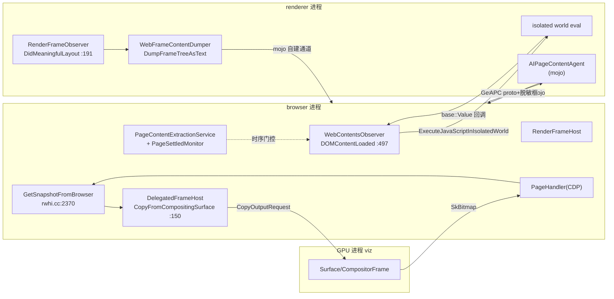

# 7.2 页面内容获取注入点：截图 / DOM 访问 / 全文抽取 / 选区（AI 浏览器的"读"半边）

> 源码 src@8fe2331820（2026-10-08 快照）行号实证。姊妹篇：12.1（AI 集成全景 C 路线）、2.3（RenderFrameHost 生命周期）、7.1（渲染管线——注意其勘误：RenderWidget 已删并入 blink，合成器侧现名 LayerTreeView/WidgetBase）。合成器侧单点见 `../explain/cc-layer-tree-impl.md`。

## 一、角色定位

12.1 把 AI 浏览器的工作切成"读"与"写"两半，本篇是读半边的落地：把一个 `WebContents` 里用户正在看的东西——像素、DOM、文本、选区、语义结构——搬进 browser 进程交给模型。Chromium 没有一个统一的"页面内容服务"，官方自己就有五条互不通用的通道，分居三个进程：

- **browser 进程**：CDP 协议通道（`content/browser/devtools/protocol/page_handler.cc`）、平台 API 通道（`RenderWidgetHostView::CopyFromSurface`、`RenderFrameHost::ExecuteJavaScriptInIsolatedWorld`、`WebContentsObserver` 回调族）；
- **renderer 进程**：blink 文本接口（`WebFrameContentDumper`）与文档生命周期挂点（`RenderFrameObserver`）——Chrome 的 translate/安全浏览走这条（`chrome_render_frame_observer.cc`）;
- **renderer→browser 的 Mojo 语义通道**：`AIPageContentAgent.GetAIPageContent()`——Gemini 时代新加的第四代通道，产出结构化 proto + 截图脱敏框。

上游是 7.1 的渲染管线（截图本质是从 viz 合成产物回读像素），下游是 12.1 的 C 路线（侧栏送模型/索引）。本篇回答一个问题：**AI 想拿到页面内容，挂在哪里、什么时候挂、拿到的是什么形态**。

## 二、定制切入点全景表（内容获取五通道 +1）

| # | 想要什么 | 动哪里（行号实证） | 数据形态 | 难度 | 影响面/AI 适用度 |
|---|---|---|---|---|---|
| 1 | 整页像素截图（browser 侧，任意页面） | `content/public/browser/render_widget_host_view.h:252` `CopyFromSurface`；样板 `chrome/browser/glic/widget/inactive_view_controller.cc:157-185` | SkBitmap（viz 回读） | 改逻辑 | 多模态直接可喂；视口内 only |
| 2 | CDP 全家桶（截图/DOM/Runtime.evaluate） | `content/public/browser/devtools_agent_host.h:87` `GetOrCreateFor` + `components/devtools/simple_devtools_protocol_client/simple_devtools_protocol_client.h:37-41` `AttachToWebContents`/`:51-60` `SendCommand` | 协议 JSON/binary | 改配置 | 与 DevTools/Puppeteer 生态同构；需自管会话 |
| 3 | load 后注入 JS 抽正文 | `content/public/browser/render_frame_host.h:624` `ExecuteJavaScriptInIsolatedWorld`；时机 `web_contents_observer.h:497` `DOMContentLoaded`；样板 `components/dom_distiller/content/browser/distiller_page_web_contents.cc:219-238` | 任意 JS 返回值 | 改逻辑 | 最灵活；延迟一个 eval 往返 |
| 4 | renderer 内全文抽取（不跑页面 JS） | `third_party/blink/public/web/web_frame_content_dumper.h:40` `DumpFrameTreeAsText`；挂点 `content/public/renderer/render_frame_observer.h:191` `DidMeaningfulLayout`；生产样板 `chrome/renderer/chrome_render_frame_observer.cc:852-877` | WebString 纯文本 | 改逻辑 | 零脚本执行、含 display:none；OOPIF 盲区 |
| 5 | 选区监听（划词即上下文） | `content/public/browser/web_contents_observer.h:975` `OnTextSelectionChanged`；扩展 `render_frame_host.h:872` `RequestTextSurroundingSelection`；renderer 侧 `third_party/blink/public/web/web_local_frame.h:573-574` `SelectionAsText/SelectionAsMarkup` | u16string | 改配置 | 划词翻译/问答的标准做法；回调高频需防抖 |
| 6 | 结构化语义（第五通道+1，AI 原生） | `components/optimization_guide/content/browser/page_content_proto_provider.h:144` `GetAIPageContent`（Mojo）；blink 侧 `third_party/blink/public/mojom/content_extraction/ai_page_content.mojom:763-771` `AIPageContentAgent` | AnnotatedPageContent proto + 脱敏框 | 改配置 | 语义树+每节点几何+`GetImageBytes(dom_node_id)` 拿原图；Chrome 官方 AI 通道 |
| 7 | AX 树快照（无障碍语义） | `content/public/browser/web_contents.h:656` `RequestAXTreeSnapshot` / `:668` `RequestAXTreeSnapshotWithinBrowserProcess` | ui::AXTreeUpdate | 改配置 | agent 操作页面的事实标准（crbug 模型同源）；体积大 |
| 8 | 抽取时机=页面稳定后 | `components/page_content_annotations/content/browser/page_settled_monitor.h:44-75`（四条件状态机）；高层封装 `page_content_extraction_service`（`pces_guide.md`） | — | 改配置 | 解决"合成未完成就截"的时序坑 |
| 9 | 全页（超视口）截图 | `page_handler.cc:1391-1420` `CaptureFullPageScreenshot`（改视口重截）；尺寸上限 `kMaxDimension=128*1024`（`:1404`） | 位图 | 改逻辑 | CDP `captureBeyondViewport`；页面可能在截时变尺寸 |
| 10 | 截图时保持后台页出帧 | `web_contents.h:933` `IncrementCapturerCount(stay_hidden=true)`（`page_handler.cc:1488` 用法） | — | 改配置 | 隐藏 tab 截图不空白的钥匙 |
| 11 | 截图脱敏（密码/OTP/支付） | `ai_page_content.mojom:728/731/747` `include_passwords/sensitive_payments/otps_for_redaction`；结果 `page_content_proto_provider.h:121` `visible_bounding_boxes_for_redaction` | Rect 列表 | 改配置 | AI 截图合规刚需；浏览器侧拼合 |
| 12 | 隐身帧里跑抽取（不碰用户 tab） | `distiller_page_web_contents.cc:153-170` `CreateNewWebContents`（`initially_hidden=true` 造影子 WebContents） | — | 改逻辑 | 离线批量抓取/预蒸馏 |
| 13 | 视频级捕获（连续帧） | `content/browser/media/capture/web_contents_video_capture_device.cc` + `viz/frame_sink_video_capturer_impl`（7.1 表已列） | 视频流 | 动架构 | 屏幕录像/agent 回放；本篇不展开 |
| 14 | PDF 正文 | `page_context_fetcher.cc`（`components/page_content_annotations/content/`，PCES 对 PDF 走纯文本分支） | 文本 | 改配置 | PDF tab 不能 JS 注入 |

14 行。选路原则一句话：**要多模态像素走 1/9，要结构化语义走 6/7，要轻量文本走 3/4，要交互上下文走 5**。

## 三、关键源码走读

### 主线一：一次页面截图的跨进程旅程（CDP 路径）

以 DevTools 发 `Page.captureScreenshot` 为例，全链都在 browser 进程发起，像素从 GPU 合成产物回读：

1. **入口与全页分叉**：`PageHandler::CaptureScreenshot`（`content/browser/devtools/protocol/page_handler.cc:1422`）。若 `captureBeyondViewport=true` 且无 clip，先走 mojo 问 renderer 全页尺寸：`host_->GetAssociatedLocalMainFrame()->GetFullPageSize(...)`（`:1444-1447`；blink 侧定义 `third_party/blink/public/mojom/frame/frame.mojom:1275`），异步回来后进 `CaptureFullPageScreenshot`（`:1391`）——它把全页尺寸做成 clip 再递归调自己。注意 `:1394` 的 TODO 注释明说：拿到尺寸时页面可能已经变了（坑节展开）。
2. **保活**：`wc->IncrementCapturerCount(gfx::Size(), stay_hidden=true, stay_awake=true, is_activity=false)`（`:1478-1480`）——告诉页面"你在被捕获，即使不可见也要出帧"（`web_contents.h:898-941` 有完整契约说明）。
3. **视口操纵**：截图=临时改 renderer 的 DeviceEmulationParams（`:1520-1600`）：clip 模式下 `viewport_offset` 设为 clip 原点、`SetDeviceEmulationParams` 推给 renderer；`capture_beyond_viewport` 还要改 WebPreferences：`hide_scrollbars=true` + `record_whole_document=true`（`:1566-1568`），并且有个 crbug.com/40727379 workaround——**把 view_size 先设成 1x1 再设真值**，否则截图里会带滚动条（`:1573` 起，源码实证）。
4. **跨进程取像素**：`widget_host->GetSnapshotFromBrowser(callback, from_surface=true)`（`:1638`）→ `RenderWidgetHostImpl::GetSnapshotFromBrowser`（`render_widget_host_impl.cc:2370`）。新路径（feature `kCDPScreenshotNewSurface`，`:2381-2389`）三步：`blink_widget_->ForceRedraw()` 强制 renderer 重绘 → `RequestRepaintOnNewSurface()` → `GetView()->CopyFromSurface(...)`（`:2390-2393`）——`blink_widget_` 是 7.1 勘误过的 `blink::WebFrameWidget`（RenderWidget 并入 blink 后的现名）。旧路径 `RequestForceRedraw(snapshot_id)`（`:3813`，同样落 `blink_widget_->ForceRedraw`）。
5. **viz 回读**：`CopyFromSurface`（`render_widget_host_view.h:252`）平台实现落 `DelegatedFrameHost::CopyFromCompositingSurface`（`content/browser/renderer_host/delegated_frame_host.h:150`）——本质是对当前 CompositorFrame 的 Surface 发 `viz::CopyOutputRequest`，在 GPU 侧拷出 SharedImage 转位图。这就是 7.1 管线的"读回"方向：帧已提交 viz，截图只是向 Surface 要一份拷贝。Android 例外：走 `DelegatedFrameHostAndroid::CopyFromCompositingSurface`，且 popup 合成不支持（`render_widget_host_view_base.cc:218-222` NOTREACHED 实证）。
6. **失败重试**：`OnSnapshotFromSurfaceReceived`（`render_widget_host_impl.cc:4052`）失败最多重试 **5 次**（`kMaxRetries=5`，`:4056`），全败则回空图；且 snapshot_id 小于当前值的等待者直接共享本次结果（`:4068-4075`）。
7. **收尾**：`PageHandler::ScreenshotCaptured`（`page_handler.cc:1995`）：恢复原视口尺寸与 emulation 参数（`:1997-2005`）、恢复 WebPreferences、按 `requested_image_size` 裁剪（`:2023-2028` `CreateTiledBitmap`），编码 PNG/JPEG/WebP（`:2030`）回协议。

直接用 browser 侧 API（不走 CDP）就跳过 1/3/7：glic 的样板（`inactive_view_controller.cc:171-185`）一行 `CopyFromSurface(gfx::Rect(), gfx::Size(), base::TimeDelta(), callback)` 拿 `viz::CopyOutputBitmapWithMetadata`（类型 `render_widget_host_view.h:64-65`，`base::expected` 风格）。

### 主线二：RenderFrameObserver 的文档生命周期挂载时序

renderer 侧注入要回答"文档到哪一步了"。`content/public/renderer/render_frame_observer.h` 是准绳（构造函数自动注册：`render_frame_observer.cc:13-19` 把 this 塞进 `RenderFrameImpl::observers_`；析构时 `Dispose()` 摘除 `:26-32`）。一次跨文档导航，主框架 observer 依次看到：

```
DidCreateNewDocument (:128)          — 新 Document 对象刚建（最早，DOM 未解析）
DidCreateDocumentElement (:129)      — <html> 元素出现
DidDispatchDOMContentLoadedEvent (:137) — DOM 就绪，defer 脚本已跑
DidHandleOnloadEvents (:138)         — onload 完成
DidFinishLoad (:135)                 — renderer 侧 load 结束
DidMeaningfulLayout (:191)           — 按 kFinishedParsing/kVisuallyNonEmpty 语义布局
```

关键区别（`web_contents_observer.h:494-510` 注释实证）：browser 侧 `DOMContentLoaded(RenderFrameHost*)`（`:497`）时"defer 脚本已执行、document_end 扩展脚本已注入"；`DidFinishLoad`（`:509`）对应 onload，但与 `DidStopLoading`（整个帧树状态）**不是一回事**——抽正文挂错会截到半成品或重复抽取。Chrome 自己的选择在 `chrome_render_frame_observer.cc:420-422`：`DidMeaningfulLayout(layout_type)` → `CapturePageText(layout_type)`，按语义布局类型区分"解析完成"（喂 translate）与"视觉充实"。

frame 粒度：每个 frame（含 iframe）各有自己的 RenderFrame 与 observer 链——**OOPIF 在独立进程里有独立 observer**，主 frame observer 看不到它的 DOM（坑节展开）。observer 生命周期铁律：`OnDestruct()=0`（`:79`）要你 `delete this`，之后 `render_frame()` 永远可能为 null，每次调用前判空。

## 四、实操：browser 进程监听 load 后抽取正文（两种）

目标：页面加载完成后拿到正文文本送 AI。同一件事的两条官方路——JS 注入式（browser 进程全程）与 blink 文本式（renderer 进程）。

### A. JS 注入式（推荐起步；dom_distiller 同款）

```cpp
// 我方 embedder 代码：class AiPageCapture : public content::WebContentsObserver
// 挂点 1：web_contents_observer.h:497 —— defer 脚本已跑，正文 DOM 大体成形
void AiPageCapture::DOMContentLoaded(content::RenderFrameHost* rfh) override {
  if (!rfh->IsInPrimaryMainFrame()) return;           // 只抽主框架
  if (!rfh->IsDOMContentLoaded()) return;             // render_frame_host.h:1074
  static const int32_t kAiWorldId =                   // isolated_world_ids.h:24-30
      content::ISOLATED_WORLD_ID_CONTENT_END + 1;     // embedder 自留段起点
  rfh->ExecuteJavaScriptInIsolatedWorld(              // render_frame_host.h:624
      u"JSON.stringify({title: document.title,"
      u" text: document.body ? document.body.innerText.slice(0, 20000) : ''})",
      base::BindOnce(&AiPageCapture::OnTextExtracted, weak_factory_.GetWeakPtr(),
                     rfh->GetGlobalFrameToken()),
      kAiWorldId);
}
void AiPageCapture::OnTextExtracted(content::GlobalRenderFrameHostToken token,
                                    base::Value result) {
  // result 为 JSON 字符串，解析后送 AI 管线
}
```

四个实锤细节：① 必须 `ExecuteJavaScriptInIsolatedWorld`——`ExecuteJavaScript`（`render_frame_host.h:611-618`）被 `RenderFrameHostImpl::CanExecuteJavaScript`（`render_frame_host_impl.cc:14265`）CHECK 限制在 chrome://、WebUI 进程、about:blank，普通 https 页面直接 CHECK 失败崩溃；② isolated world 与页面主 world 隔离，页面 JS 看不到你的脚本与全局变量（Chrome 扩展 content script 同机制）；③ world id 从 `ISOLATED_WORLD_ID_CONTENT_END` 起、禁 0（`distiller_javascript_utils.cc:27` DCHECK），且一个 world id 全进程只该一个主人；④ 官方样板 `distiller_page_web_contents.cc:197-201`：`DOMContentLoaded` 回调里先 `IsDOMContentLoaded()` 判重（`:142`，observer 挂上时可能已过事件），再注入（`:219`），注入前 `Observe(nullptr)` 防二次回调。

### B. blink 文本式（零 JS 执行；Chrome translate 同款）

改 renderer：在 `chrome/renderer/chrome_render_frame_observer.cc:873` 旁边，或自建 observer 挂 `DidMeaningfulLayout`：

```cpp
// 自建 content::RenderFrameObserver 子类 AiTextObserver
void AiTextObserver::DidMeanfulLayoutHook(blink::WebMeaningfulLayout type) {
  if (type != blink::WebMeaningfulLayout::kFinishedParsing) return;  // 解析完一次
  // 生产样板：chrome_render_frame_observer.cc:873-876
  auto contents = base::MakeRefCounted<base::RefCountedString16>(
      blink::WebFrameContentDumper::DumpFrameTreeAsText(
          render_frame()->GetWebFrame(), /*max_chars=*/65535).Utf16());
  GetAiAgentRemote()->OnPageText(contents);   // 自建 mojo 通道回 browser 进程
}
```

要点：① 上限取 `kMaxIndexChars = 65535`（`chrome_render_frame_observer.cc:122`，Chrome 全文索引/翻译的实际配额）；② `DumpFrameTreeAsText` 直接读布局后 innerText，不执行任何页面脚本、不受 CSP 限制（`frame_content_as_text.cc:39` 用 `documentElement()->innerText()`）；③ 若不想自建，最省事是在 embedder 的 `ContentRendererClient::RenderFrameCreated` 里 `new AiTextObserver(render_frame)`——构造即注册（`render_frame_observer.cc:13-19`）。

两式取舍：JS 式赢在**灵活性**（能拿 `document.querySelector` 精确抽取、能跑 Readability 类算法——dom_distiller 的 `kReadability` 型就是注入 JS 跑 readability，`distiller_page_web_contents.cc:132`）；blink 式赢在**确定性**（不触发页面副作用、拿到的就是 Chrome translate 看到的同一份文本）。

## 五、依赖与数据流



输入是 7.1 管线产物（Surface 里的帧、blink 里的 DOM）；输出五形态：位图（通道 1/9）、协议 JSON（通道 2）、任意 JS 值（通道 3）、纯文本（通道 4）、语义 proto/AXTree（通道 6/7）。时序契约：`PageSettledMonitor`（`page_settled_monitor.h:30-70`）定义的"页面已稳定"四条件——网络与主线程空闲(+绘制稳定)、load 完成、visual state update 已发生（renderer 已产出过帧）、LCP 已出现或超时——是所有"截早了/抽早了"问题的官方答案。

## 六、坑与勘误

1. **`ExecuteJavaScript` 在普通网页上会 CHECK 崩溃**（源码实证）：`render_frame_host_impl.cc:14265-14275` 只放行 chrome-devtools:// scheme、有 WebUI bindings 的进程、about:blank。embedder 抓网页内容唯一正门是 isolated world 版。
2. **老 API 名已死**（源码实证）：网上资料说的 `WebFrame::ContentAsText/ContentAsMarkup` 不存在了；现行：`WebFrameContentDumper::DumpFrameTreeAsText`（`web_frame_content_dumper.h:40`）与 `WebDocument::ContentAsTextForTesting`（`web_document.h:134`，仅 web_test 用）。markup 抽取只有 test 版 `TestWebFrameContentDumper::DumpAsMarkup`（`layout_dump.cc:71`）。
3. **截图截到空白/旧帧**（源码实证）：页面不可见时 renderer 不出帧，Surface 里是陈旧内容。三重防线：`IncrementCapturerCount(stay_hidden=true)`（`page_handler.cc:1488`）、`ForceRedraw`+`RequestRepaintOnNewSurface` 再 `CopyFromSurface`（`render_widget_host_impl.cc:2381-2393`）、失败自动重试 5 次（`:4056`）。新 feature 路径还加了 `CHECK(visibility != kHidden)`（`page_handler.cc:1628`）——完全隐藏的页直接崩给你看，别赌。
4. **全页截图带滚动条**（源码实证）：`crbug.com/40727379` workaround 要求 view_size 设两遍（先 1x1 再真值，`page_handler.cc:1573` 起）；自己实现全页截图必须复刻 `hide_scrollbars`+`record_whole_document`（`:1566-1568`）与 `crbug.com/1003629`。
5. **iframe 跨 origin 盲区**（源码实证，三处独立印证）：① `DumpFrameTreeAsText` 头文件注释明说 OOPIF 不支持、只收同进程直接子帧（`web_frame_content_dumper.h:17-19`）；② `FrameContentAsText` 递归时 `DynamicTo<LocalFrame>` 把 RemoteFrame 静默跳过（`frame_content_as_text.cc:45`）；③ AX 快照专门给了 `AXTreeSnapshotPolicy::kSameOriginDirectDescendants` 剪枝选项（`web_contents.h:641-649`）。跨站 iframe 内容要按 frame 逐个下请求。
6. **DumpFrameTreeAsText 的文本序不保证**（源码实证）：头文件注释（`:20-28`）明言顺序与用户所见不一致、可能含不可见文本（display:none、未展开 div）、帧间分隔无规范——**给 LLM 前要自己过一遍清洗**，且注释警告此 API 资源密集（`:34-35`）。
7. **全文长度**：Chrome 生产配额 65535 字符（`chrome_render_frame_observer.cc:122`）；CDP 全页截图尺寸上限 128K 像素/边（`page_handler.cc:1404`，注释提及 headless 16K 限制的兼容）。
8. **observer 的 frame 粒度**：`RenderFrameObserver` 每 frame 一个、OOPIF 在别的进程另有实例；主 frame observer 收不到子 frame 的 `DidCreateNewDocument`。browser 侧回调都带 `RenderFrameHost*`，务必判 `IsInPrimaryMainFrame()`（distiller 样板 `:238-244` 还示范了非主 frame 导航失败不应失败整个蒸馏）。
9. **DOMContentLoaded ≠ load ≠ DidStopLoading**（源码注释实证）：`web_contents_observer.h:507-510` 明写 DidFinishLoad 与 DidStopLoading 用不同触发集；SPA 软导航不触发导航回调，只有 `DidFinishSameDocumentNavigation`（`render_frame_observer.h:161`）。动态页要配轮询或 `PageSettledMonitor`。
10. **选区回调高频**：`OnTextSelectionChanged`（`web_contents_observer.h:975`）每次选区变化都来，含拖选中间态；要内容用 `SelectionAsText`（`web_local_frame.h:573`，renderer 侧）或 browser 侧 `RequestTextSurroundingSelection`（`render_frame_host.h:872`）补上下文，并防抖。
11. **平台差异**：Android 的 `CopyFromSurface` 直落 `DelegatedFrameHostAndroid`，popup 不支持（`render_widget_host_view_base.cc:218-222`）；`from_surface=false` 的窗口抓取在 Mac 要 WakeLock 防打盹（`render_widget_host_impl.cc:2393-2400`）。
12. **AI 截图脱敏是浏览器侧职责**：renderer 只报框（密码、`-webkit-text-security`、支付、OTP，`ai_page_content.mojom:726/733/743`），框的拼合与打码发生在 `AIPageContentResult::visible_bounding_boxes_for_redaction`（`page_content_proto_provider.h:130`）之后——自建截图通道要自己消费这些 Rect。

## 七、验证方法

- **CDP 通道**：`chrome --remote-debugging-port=9222`，`curl -X POST http://localhost:9222/json/new?url=...` 拿 target id，`curl .../page/<id>` WebSocket 或直接 `SimpleDevToolsProtocolClient::AttachToWebContents` + `SendCommand("Page.captureScreenshot")`（`simple_devtools_protocol_client.h:51`）；对照 `CaptureScreenshotTest`（`content/browser/devtools/protocol/devtools_protocol_browsertest.cc:636` 起）看官方断言。
- **截图新路径**：`--enable-features=CDPScreenshotNewSurface` 切 `page_handler.cc:1624` 分支，对比两条路径成功率；Perfetto 里 `TRACE_EVENT0("renderer", "ChromeRenderFrameObserver::CapturePageText")`（`chrome_render_frame_observer.cc:871`）直接可见抽取耗时。
- **JS 注入式**：callback 里 `LOG(INFO) << result`；单元测试参考 `distiller_page_web_contents_browsertest.cc`；isolation 验证：页面里 `window.__probe=1` 后注入脚本读 `typeof window.__probe === 'undefined'` 应为真。
- **blink 文本式**：`content/web_test` 的 dump 模式（`--run-web-tests` 文本基线即 `ContentAsTextForTesting` 产物，`layout_dump.cc:67`）；自带 observer 可临时 `fprintf(stderr)` 计字符数对照 65535 截断。
- **AX/AIPageContent**：`chrome://accessibility` 看 AX 树；`GetAIPageContent` 有 browsertest（grep `page_content_proto_provider_browsertest`）；PCES 观察者按 `pces_guide.md` 三种模式（observer 注册/异步取/强刷）各写一个冒烟。
- **时序**：慢速网络下（`--host-resolver-rules` 指到 throttled server）验证 `PageSettledMonitor` 是否等 LCP；对照 DevTools Performance 的 FCP/LCP 事件。

## 八、延伸

- 图谱相关：`content-browser`（WebContentsObserver/DevTools agent host）、`content-renderer`（RenderFrameObserver/AIPageContentAgent）、`blink-dom`（WebFrame/WebDocument/innerText）、`cc-compositor`+`viz`（CopyOutputRequest 回读，本篇主线一步的第 5 站）各层。
- 讲透Chromium：`custom-dev/12.1-ai-integration-map.md`（C 路线全景与"侧栏取全文"原始需求）、`custom-dev/2.3-navigation-lifecycle.md`（RenderFrameHost/导航状态机，本篇时序回调的宿主生命周期）、`custom-dev/7.1-rendering-pipeline.md`（帧如何到 Surface——截图的数据源）、`explain/cc-layer-tree-impl.md`（合成器侧 Surface/帧细节）。
- 源内文档：`components/page_content_annotations/content/pces_guide.md`（PCES 集成指南，官方最新）；`third_party/blink/public/mojom/content_extraction/ai_page_content.mojom`（AI 通道完整接口）；`components/dom_distiller/core/distiller_page.h`（Readability 蒸馏框架）。
- 下一篇预告衔接：7.4（GPU 命令流）解释 CopyOutputRequest 在 GPU 进程的执行；8.1（扩展架构）是"不想改源码时的 JS 注入替代面"。
