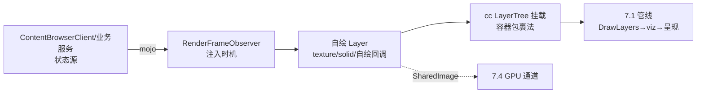

# 7.3 · 合成器与图层定制：水印/overlay/自绘内容进页面

> 想"在所有网页上叠加自己的视觉层"（企业水印/AI 标注/护眼滤镜/录屏提示）——落点在 cc 合成器的 Layer 体系。7.1 已走读管线全程+给出水印雏形，本篇把 Layer 定制面系统化：层类型选型、挂载方式、与 blink 内容的层级关系。

## ① 角色定位

cc 是 renderer 进程内的合成器（主线程 LayerTree+合成线程 LayerTreeImpl，`../explain/cc-layer-tree-impl.md` 深解）。**Layer 是内容载体**：基类 `cc/layers/layer.h`（1282 行，:90 `class CC_EXPORT Layer : public base::RefCounted<Layer>`），派生家族覆盖各内容形态（PictureLayer 网页主内容/TextureLayer 外部纹理/VideoLayer 视频/SolidColorLayer 纯色/UI 层等）。定制者注入的"自绘层"与网页内容同树合成——**比改 blink 输出（重）或后处理 GPU（重）都轻**。

## ② 定制切入点全景表

| 想干什么 | 动哪里 | 难度 | 影响面 |
|---|---|---|---|
| 全局水印层 | 7.1 实操已给雏形（WatermarkLayerClient+容器层包裹，先例 `inspector_overlay_agent.cc:449` 的 DevTools overlay） | 改逻辑 | 全页面叠加 |
| 外部纹理注入 | `cc/layers/texture_layer.h`（172 行）+ 7.4 的 SharedImage 通道（摄像头/自家渲染器画面进页面合成） | 改逻辑 | 动态视觉源 |
| 纯色/渐变底 | SolidColorLayer（护眼滤镜/暗色幕布的合成器侧实现） | 改逻辑 | 全屏效果 |
| 层级与命中 | 注入层的 stacking/`hit-testable` 属性（不挡交互是硬需求：水印要"看得见点不到"） | 改逻辑 | 交互边界 |
| DevTools overlay 同构 | inspector_overlay 范式（DevTools 的 highlight 层就是官方自绘层满配实现） | 参考 | 学习样本 |
| 视频/AR 叠加 | VideoLayer/媒体管线（media 与 cc 交接，7.4 §2） | 动架构 | 播放链 |
| 每帧自绘动画 | Layer::SetNeedsDisplay+客户端绘制回调（时间驱动内容） | 改逻辑 | 动态内容 |
| 变换/裁剪链 | Layer 的 transform/clip 家族（跟随视口/锚定屏幕角） | 改逻辑 | 摆放策略 |
| 低分辨率预览 | raster 相关参数（7.1 §2）与层的分辨率提示 | 改配置 | 性能 |
| 多页签区分 | per-WebContents 注入（挂载时区分主 frame 归属） | 改逻辑 | 作用域 |
- 补充：| Android 差异 | cc 同构但宿主 WidgetBase 层不同（7.1 勘误后架构） | 呼应 | 5.2 |

## ③ 关键源码走读：注入层的合成路径

**第一站：层树挂载。** 定制层要成为 LayerTree 根的孩子（或包裹原根——7.1 的容器层法）。挂载点在 renderer 侧的 `web_frame_widget_impl.cc` 一带（7.1 实操锚 :3863/:3855），**挂载时机**选文档创建后（2.3 的 RenderFrameObserver 时机）或 frame sink 就绪回调。

**第二站：内容产出。** 注入层三类内容源：自绘（客户端 Draw 回调→raster 任务）、外部纹理（TextureLayer+SharedImage 句柄，GPU 侧更新）、静态资源（SolidColor/picture）。**水印类选自绘+静态缓存**（一帧画完不再 SetNeedsDisplay，零持续成本）。

**第三站：合成与呈现。** 注入层与网页层在 cc 的 draw 阶段按树序合成（7.1 走读的 DrawLayers→submit→viz）——**无需碰 viz/GPU**，定制止步于 cc 层即全程生效。

## ④ 实操：屏幕角锚定的"AI 处理中"指示层

需求：AI 浏览器在摘要生成时页面右下角浮一个动态指示（不挡交互）。
1. SolidColorLayer（半透明圆角背景）+自绘文本层，组合进容器 Layer；
2. transform 锚定视口右下（监听 resize 更新，跟随滚动不动=挂在 outermost 层级之上的策略按 7.1 容器法）；
3. `hit-testable=false`（点不到）；动画期 SetNeedsDisplay 节流（呼吸效果 20fps 足够）；
4. 状态驱动：12.x 的 LLM 服务回调→mojo 到 renderer→层显隐。
工作量一页纸代码，**不碰 blink 主内容**——升级安全面小。

## ⑤ 依赖与数据流

## ⑥ 坑与勘误

- **hit-test 是第一坑**：忘关命中=整页点不动（层透明也拦截）；反过来要可点击就要精细的命中区域。
- 注入层进了**每页签每个 iframe 的树**还是只主 frame——作用域决策失误=水印套娃（子 frame 各叠一层）。
- 动态层节流：每帧 SetNeedsDisplay=持续 raster 开销（低端机肉眼可见掉帧）；静态水印务必"画一次"。
- 老资料里的 cc 接口名大改过（7.1 勘误 RenderWidget 删除波的连带）：**texture_layer 的更新 API 以现头文件为准**（本篇只锚定文件与类存在性，API 签名自查）。
- 截图交互：注入层会进截图（CapturePage 合成的就是完整树）——水印进截图是特性（企业要的）或缺陷（AI 内容提取被污染），产品侧要明确。
- Android 的注入路径经 5.2 清单核对（同 cc 不同宿主时机）。

## ⑦ 验证方法

- 视觉冒烟：长页滚动/缩放下水印稳定（跟随策略正确性）
- 交互回归：注入层区域内点击/悬停穿透正常（hit-testable=false 生效）
- 性能：tracing 看 raster 任务增量（静态层应≈0）
- 截图一致性：CapturePage 结果含水印层（特性确认）

## ⑧ 延伸

- 管线位置：7.1（必读前置）；纹理源：7.4；注入时机：2.3；层树内部：`../explain/cc-layer-tree-impl.md`；DevTools 满配样本：inspector_overlay 一族
- 图谱层位：渲染栈层 cc 段（Layer 基类是图谱大节点）
