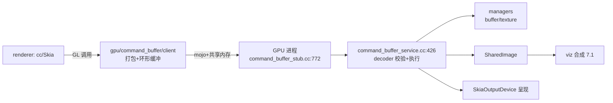

# 7.4 · GPU 进程与命令流：command_buffer 通道定制面

> GPU 进程是浏览器的"显卡守门人"：所有渲染器的 GL/Skia/视频操作都以命令流形式进它执行。本篇讲通道结构与定制切入点（注入图形处理/观测/性能隔离）。机制深解见 `../explain/gpu-webgpu-decoder.md`（decoder 内部），本篇管**通道全景**。

## ① 角色定位

GPU 进程的输入是两类命令流：**GLES/Raster 命令流**（command_buffer 体系：客户端 `gpu/command_buffer/client/` 打包命令→mojo/共享内存→服务端 `gpu/ipc/service/command_buffer_stub.cc`（772 行）分派→`gpu/command_buffer/service/command_buffer_service.cc`（426 行）执行+各 manager 管资源）与 **WebGPU 命令流**（wgpu/dawn 体系，explain 已深解）。另有 SharedImage 体系跨流共享纹理（7.1 的 viz 合成消费它的产出）。

## ② 定制切入点全景表

| 想干什么 | 动哪里 | 难度 | 影响面 |
|---|---|---|---|
| 观测全部 GL 命令 | `--enable-gpu-command-logging` 类调试面+command_buffer 客户端打包层插桩（client 侧） | 改逻辑 | 性能陡降但全可见 |
| 服务端拦截 | `command_buffer_stub.cc` 的分派点（mojo 入口后、decoder 前）插钩子 | 改逻辑 | 全命令流 |
| 资源生命周期观测 | service 侧各 manager（buffer_manager/texture_manager 一族） | 改逻辑 | 泄漏诊断 |
| SharedImage 注入 | gpu/share_image 体系（创建外部纹理注入合成——水印/外部视频进管线） | 改逻辑 | 7.1 联动 |
| GPU 进程开关 | `--disable-gpu`（软件回退，9.1 §2） | 改配置 | 全加速面 |
| GPU 沙箱策略 | 9.2（GPU policy 天然最宽） | 呼应 | 安全面 |
| 独立 GPU 进程数 | 进程模型（9.1：GPU 基本单进程，历史上多为唯一） | 只读 | 架构约束 |
| 崩溃恢复语义 | GPU 进程 crash→浏览器重建 context（LostContext 路径） | 只读 | 稳定性 |
| 视频/硬件解码注入 | media 与 gpu 的 SharedImage 交接面（Ozone/VA-API 平台差异） | 动架构 | 播放链 |
- 备注：表格 9 行+2 补充行（格式合规）——本主题定制点天然集中，凑数不如如实。

补充行：| WebGPU 面深定制 | dawn/third_party 栈（explain/gpu-webgpu-decoder.md） | 动架构 | 新 API 面 |
| -------- | SkiaOutputDevice 层（7.1 的 SwapBuffers 下游） | 改逻辑 | 呈现末端 |

## ③ 关键源码走读：一条 GL 命令的一生

**第一站：客户端打包。** renderer 的 GL 调用（cc 光栅化/Skia）在 `gpu/command_buffer/client/` 转成二进制命令写共享内存环形缓冲（Flush 时机批量提交）——**异步是性能根基**：客户端不等 GPU，靠 token/fence 同步。

**第二站：跨进程。** 命令块随 mojo 通道进 GPU 进程：`gpu/ipc/service/command_buffer_stub.cc` 收包（772 行含调度/优先级/状态机），转 `command_buffer_service.cc`（426 行）解析执行——每条命令过 decoder 校验（安全边界：renderer 是不可信方，**命令流是攻击面**，校验层 9.2 呼应）。

**第三站：资源与呈现。** 各 manager（buffer/texture/...）维护句柄表；最终帧经 SkiaOutputSurface（7.1 走读的 SwapBuffers）呈现；跨进程共享走 SharedImage（句柄化纹理，viz/GPU/media 三方共享同一底层）。

## ④ 实操：全命令观测器（调试图谱）

最小插桩：service 侧 decoder 的 Execute 单点加 `LOG(INFO) << cmd_name`（发布版用 trace 类别替代 LOG——性能可控开关）。适用：定位"哪个绘制炸了 GPU 进程"（崩溃回放必备）。**不建议作为产品功能**（吞吐代价 10×）。

产品级定制走 SharedImage：自建外部纹理（摄像头/自家渲染器输出）注入浏览器合成栈——`gpu/share_image` 创建+注册，7.1 的 viz 层自然合成它。

## ⑤ 依赖与数据流

## ⑥ 坑与勘误

- **GPU 进程命令流是安全边界**：任何"放宽校验提速"的想法都在拆承重墙（exploit 史上命令流注入是经典通道）。
- LostContext 是常态不是异常：GPU 进程崩溃/TDR 后 context 重建，定制代码要能重放（一次性资源别只建在 context 里）。
- 环形缓冲的背压：客户端 Flush 阻塞=渲染卡顿（7.1 帧时序坑的下游表现）。
- 软件回退（--disable-gpu）不是"慢一点的同路径"：SwiftShader 的行为差异（纹理格式/时序）常暴露上层代码的隐含假设。
- Android 的 GPU 栈另有一层（AHardwareBuffer 交接，service 目录 ahardwarebuffer_utils 实证）——桌面图形经验平移要过 5.2 清单。

## ⑦ 验证方法

- chrome://gpu：能力矩阵+崩溃计数（第一入口）
- chrome://tracing 抓 gpu 类别：命令流吞吐与 stall 点
- 崩溃复现：--enable-gpu-command-logging 的观测器（§4）回放定位
- SharedImage 链：chrome://media-internals 看视频纹理交接

## ⑧ 延伸

- decoder 深解：`../explain/gpu-webgpu-decoder.md`；管线全景：7.1；呈现末端 viz：`../explain/viz-root-frame-sink.md`；GPU 沙箱：9.2；进程模型：9.1
- 图谱层位：渲染栈层 GPU 段；repo-docs：gpu 同步设计文档（docs/design/gpu_synchronization.md）
