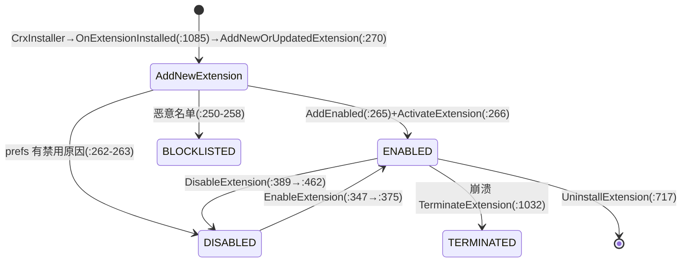
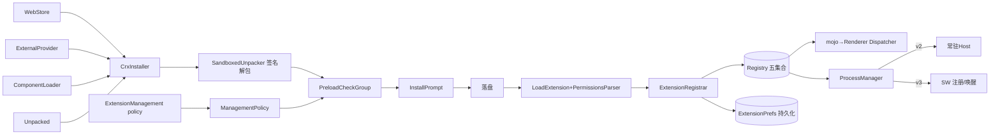

# 8.1 扩展系统架构：加载/运行/权限与定制管控面

> 源码基线 @8fe2331（M157 dev），全部 `file:line` 逐行核实。姊妹篇：8.2（策略深做）、8.3（自建 API）。本篇打地基。

## 1. 角色定位

扩展系统四层：`extensions/common`（manifest 解析、权限模型、API features）、`extensions/browser`（安装器、生命周期、进程管理）、`extensions/renderer`（绑定注入，dispatcher.cc:290 起）、`chrome/browser/extensions`（Chrome 接线：ExtensionService、策略、商店 UI）。content 层不感知扩展，`chrome-extension` scheme 的隔离全部经 `ChromeContentBrowserClient` 回调注入（§3.4）——自制浏览器改扩展行为的总闸。

启动接线：`ProfileManager` 调 `ExtensionSystem::Get(profile)->InitForRegularProfile(...)`（chrome/browser/profiles/profile_manager.cc:1579）→ 创建 `ExtensionService`（chrome_extension_system.cc:238-245）→ `Init()`（:312）。生命周期状态机的实现者是 `ExtensionRegistrar`（extensions/browser）；ExtensionService 已从历史 4000 行巨石瘦身为 991 行编排层——老教程最大失真点。

扩展身份= `ManifestLocation`（extensions/common/mojom/manifest.mojom:18-46）：kInternal（用户装）、kExternalPref/kExternalRegistry（预装 json/注册表）、kUnpacked/kCommandLine（开发者）、kComponent（浏览器部件）、kExternalPolicyDownload（企业强推）等 11 种。**location 决定一切差异**：能否自动更新（manifest.h:72-77）、是否受 MV2 禁令（manifest_v2_util.cc:37-41）、是否要开发者模式（extension_management.cc:463-465）、能否被用户禁用。定制管控本质=操纵 location 与 policy 检查链。

## 2. 定制切入点全景表

| # | 定制需求 | 动哪里（file:line） | 难度 | 影响面 |
|---|---|---|---|---|
| 1 | 禁商店安装 | `ExtensionInstallBlocklist=["*"]`→denylist（pref_names.h:92）；判定 extension_management.cc:189-194 | 配置 | 全来源被拒含 unpacked（unpacked_installer.cc:346）；store 网页仍可浏览，配 URLBlocklist |
| 2 | 白/黑名单 | Allowlist/Denylist（pref_names.h:87-92）或 ExtensionSettings installation_mode（constants.cc:19-24） | 配置 | 安装前 PolicyCheck 拦（crx_installer.cc:688） |
| 3 | 预装（本地 json） | /usr/share/chromium/extensions/\<id\>.json（chrome_paths.cc:54-58）→provider（external_provider_impl.cc:885-893）；键定义 :133-147 | 配置 | 装机即装（kExternalPref），更新可指向自建服务器 |
| 4 | 预装（policy 强推） | ExtensionInstallForcelist（pref_names.h:99）→ExternalPolicyLoader（external_policy_loader.cc:45-58）→provider（external_provider_impl.cc:767-781） | 配置 | kExternalPolicyDownload；用户不可禁/卸 |
| 5 | 预装为 component | ComponentLoader::AddDefaultComponentExtensions（component_loader.cc:674）内加 AddComponentFromDir（component_loader.h:156） | 逻辑 | kComponent：免 MV2 禁令、免签名、不进管理 UI，随二进制分发 |
| 6 | 屏蔽三方侧装 | BlockExternalExtensions（pref_names.h:46），gate external_provider_impl.cc:884 | 配置 | 只关 json/注册表 provider，不影响 policy 强推 |
| 7 | 默认禁开发者模式 | IsAllowedByUnpackedDeveloperModePolicy（extension_management.cc:455-474）；--load-extension 三重限制（extension_service.cc:423-441） | 配置 | unpacked 须开 chrome://extensions 开关 |
| 8 | MV2/MV3 开关 | ShouldDisableLegacyExtensions（manifest_v2_handler.cc:110-118，无条件 true） | 逻辑 | 改 false 复活 MV2；现状安装拒（:157-168）、启动即禁（:203-227） |
| 9 | 自建更新服务器 | manifest update_url + ExtensionSettings override_update_url（extension_management.cc:326-348） | 配置 | 非商店来自签 CRX3 即过（verifier_formats.cc:28-34），仅商店 URL 强制 proof（:19-26） |
| 10 | API 白名单 | extensions/common/api/_api_features.json + _permission_features.json + chrome 层 *.override.json | 配置 | 按 channel/extension_types/allowlist/context 控 API |
| 11 | 禁特定权限 | ExtensionSettings blocked_permissions（constants.cc:26；extension_management.cc:238-244） | 配置 | 含被禁权限直接拒装 |
| 12 | file:// 管控 | file_url_navigation_allowed（constants.cc:46；extension_management.cc:699） | 配置 | unpacked 默认放行（manifest.h:100-103） |
| 13 | native messaging | Blocklist/Allowlist/UserLevelHosts（pref_names.h:120-126）；判定 chrome_messaging_delegate.cc:45-81 | 配置 | blocklist 支持 "*"，allowlist 优先 |
| 14 | 进程/隔离管控 | GetStoragePartitionConfigForSite（chrome_content_browser_client.cc:1840-1845） | 逻辑 | 改 chrome-extension:// 与 web 的隔离边界 |
| 15 | 一键全禁 | --disable-extensions（extension_util.cc:65-68）或 pref（:357-362） | 配置 | extensions_enabled=false，component 除外 |

## 3. 关键源码走读

### 3.1 CRX 安装全链

商店路线：`WebstoreInstaller::Start`（webstore_installer.cc:233）→ `DownloadCrx`（:482）→ `StartDownload`（:509）→ `StartCrxInstaller`（:650）→ `crx_installer_->InstallCrx(path)`（:670）。

**校验**：`InstallCrx`（crx_installer.cc:235-242）按来源选 VerifierFormat：商店→CRX3_WITH_PUBLISHER_PROOF（需 Google 签发 proof）；非商店→CRX3（自签即可）。`SandboxedUnpacker::StartWithCrx`（sandboxed_unpacker.cc:286）在不可信工具进程解包，`ValidateSignature`（:903）调 `crx_file::Verify`（:916）验签并导出公钥→扩展 ID（crx_verifier.h:47-54，ID=公钥指纹）。**ID 由签名密钥唯一决定**。

**检查与授权**：`OnUnpackSuccess`（crx_installer.cc:548）→ `CheckInstall`（:630）并行三组 PreloadCheck（:685-699）：PolicyCheck/RequirementsChecker/BlocklistCheck。全过→`ConfirmInstall`（:769）：用户下载必须弹确认框（:827-834）；商店已授权或外部 provider 流静默（:832-833）。

**落盘**：`CompleteInstall`（:939）→ AssetsManager 去重落盘（:956）→ `ReloadExtensionAfterInstall` 重新 `file_util::LoadExtension`（:983）→ `ReportSuccessFromUIThread`（:1052）里 `PermissionsUpdater.GrantActivePermissions`（:1073-1075）烙 granted 权限→`registrar_->OnExtensionInstalled`（:1085）。权限解析入口 `PermissionsParser::Parse/Finalize`（permissions_parser.h:22-28）；运行期判权是 `PermissionsData`（含 withheld/tab 临时授权，与声明分离）。

### 3.2 生命周期状态机

`ExtensionRegistrar`（extension_registrar.h:49-52：唯一可改 ExtensionRegistry 的类）操作五集合（extension_registry.h:63-87）：**enabled/disabled/blocklisted/blocked/terminated**。



- **ActivateExtension**（:1107-1143）：先 RendererStartupHelper::OnExtensionLoaded（renderer_startup_helper.cc:493，向各 renderer 发 mojo LoadExtensions 携带序列化 manifest/权限）再 TriggerOnLoaded——顺序注释明确为避免导航竞态；事件页/SW 随后 MaybeSpinUpLazyContext（:1346）。
- **DisableExtension**（:389）：policy 强装只接受内部禁用理由交集（:415-427：CORRUPTED/RELOAD/UNSUPPORTED_MANIFEST_VERSION 等），用户手动禁用被丢——"policy 优先于用户"的实现点。
- **UninstallExtension**（:717）：同步出 registry、异步清盘；policy 强装返回 false。禁用原因持久化在 ExtensionPrefs（extensions.settings，pref_names.h:72），重启由 InstalledLoader 恢复。

### 3.3 启动扫描与外部 provider

`InitForRegularProfile`（chrome_extension_system.cc:397）顺序：建 ExtensionService（:238）→ 注册 ManagementPolicy providers（:278-279；:158-194 含 ExtensionManagement 两 provider+InstallVerifier）→ AddDefaultComponentExtensions（:302）→ `ExtensionService::Init()`（:312）。

`Init`（extension_service.cc:344-405）加载顺序：① component LoadAll（:352）→ ② InstalledLoader.LoadAllExtensions（:371）→ ③ CheckManagementPolicy（:374）→ ④ --disable-extensions-except 与 --load-extension（:377-379）→ ⑤ external_provider_manager_->CheckForExternalUpdates()（:390）。

provider 栈（external_provider_impl.cc:711-970）：policy FORCED/RECOMMENDED（:767-781，不被 flag 跳过）→ Linux `/usr/share/chromium/extensions`（:885-893）→ `<module>/extensions`（:903-910）→ 自编译构建才有 per-user `<user-data>/External Extensions`（:913-922，CHROMIUM_BRANDING 条件）→ 默认预装应用（:933-937）→ ExternalComponentLoader（:951-954）。json 格式：`{"external_crx":路径,"external_version":版本}` 或 `{"external_update_url":URL}` 二选一（:358-376）。

### 3.4 MV3 运行时与进程隔离

`BackgroundInfo::IsServiceWorkerBased`（background_info.h:48）区分 v2/v3。激活时 `ServiceWorkerTaskQueue::ActivateExtension`（service_worker_task_queue.cc:395）注册 scope=`chrome-extension://<id>/` 的 SW（:439）；版本一致则仅 VerifyRegistration（:433-436）。事件唤醒+空闲回收，失败有 RetryStartWorker。MV2 走 `ProcessManager::CreateBackgroundHost`（process_manager.cc:305-353）常驻 ExtensionHost。renderer 侧 `Dispatcher`（dispatcher.cc:290）构造时 CreateBindingsSystem（:311）并注册 scheme 的 WebSecurityPolicy（:317-319）。

隔离：`GetStoragePartitionConfigForSite`（chrome_content_browser_client.cc:1840-1845）按扩展 ID 给独立 storage partition；扩展 origin 的 view-source 放行（:2276）、地址空间视为 loopback（:2289-2293）、跨源 shared worker 放行（:3484 起）。ProcessManager 维护 ProcessMap；incognito 有独立 IncognitoProcessManager（process_manager.cc:1193）。

## 4. 实操：预装自家扩展+禁商店

### 方案 A：external json（免 policy 设施）

1. 自签 CRX3 打包（extension_creator.cc 同逻辑），ID=公钥指纹。
2. `/usr/share/chromium/extensions/<id>.json`（自编译路径；Google 品牌是 /usr/share/google-chrome/extensions，chrome_paths.cc:54-58）：

```json
{ "external_update_url": "https://updates.example.com/ext/service/update2/crx" }
```

本地变体：`{"external_crx":"/opt/mybrowser/extensions/mine.crx","external_version":"1.2.3"}`（成对，external_provider_impl.cc:358-367）。
3. 更新服务器实现 Omaha XML 协议（解析器 updater/safe_manifest_parser.cc）；校验只要 CRX3 自签（verifier_formats.cc:32-34）。
4. 禁商店需另配方案 B 的 blocklist。

### 方案 B：policy 路线（推荐，可机器下发）

`/etc/chromium/policies/managed/mybrowser.json`（非品牌 Linux，policy_paths.cc:21；目录注册 chrome_paths.cc:410-413）：

```json
{
  "ExtensionInstallBlocklist": ["*"],
  "ExtensionInstallAllowlist": ["<自家扩展ID>"],
  "ExtensionInstallForcelist": [
    "<自家扩展ID>;https://updates.example.com/ext/service/update2/crx"
  ],
  "ExtensionSettings": {
    "<自家扩展ID>": {
      "installation_mode": "force_installed",
      "update_url": "https://updates.example.com/ext/service/update2/crx",
      "override_update_url": true,
      "blocked_permissions": ["debugger", "nativeMessaging"]
    },
    "*": { "installation_mode": "blocked", "blocked_install_message": "仅允许公司审核过的扩展" }
  }
}
```

挂载链：策略→pref extensions.install.forcelist（pref_names.h:99；监听 extension_management.cc:125-126）→ ExternalPolicyLoader FORCED（external_policy_loader.cc:45-52）→ provider（external_provider_impl.cc:767-781）→ CRX 校验 GetPolicyVerifierFormat()=CRX3（extension_downloader.cc:1139-1142+verifier_formats.cc:28-30）→ 静默安装（外部流独立 acknowledge 生命周期，crx_installer.cc:815-825 注释）。`"*"` 入 blocklist 后 BlocklistedByDefault 为 true（extension_management.cc:189-194），商店/unpacked/拖装全拒，forcelist/allowlist 豁免。

商店入口：非 ChromeOS 的商店"应用"由 AddWebStoreApp（component_loader.cc:602-615）装载且默认关（extension_features.cc:190-197，仅 ChromeOS 默认开），自编译桌面构建本就不装；网页本身用 URLBlocklist 拦 chromewebstore.google.com。

## 5. 依赖与数据流



契约：ExtensionPrefs 是唯一持久层（granted 权限/禁用原因/location/版本）；ExtensionRegistry 是唯一运行时真值；改状态必经 ExtensionRegistrar；"能不能"判定收敛到四个闸口：PreloadCheckGroup、CanAddExtension（extension_registrar.cc:1398）、ManagementPolicy providers、features JSON。

## 6. 坑与勘误

- **"ExtensionService 在 extensions/browser"已过时**（源码实证）：M157 在 chrome/browser/extensions/extension_service.cc（991 行编排层），状态机已迁 ExtensionRegistrar，老教程行号全失效。
- **MV2 死透**（源码实证）：ShouldDisableLegacyExtensions 无条件 true（manifest_v2_handler.cc:110-118），仅 component 豁免（manifest_v2_util.cc:37-41）；无 policy 后门，想支持只能改代码。
- **MV2→MV3 差异**（源码实证）：v2 常驻；v3 事件唤醒+空闲回收且装完保证跑一次（extension_registrar.cc:1346 读 kPrefHasStartedServiceWorker）。依赖常驻定时器的扩展迁 v3 必须改 alarms。
- **更新签名分级**（源码实证）：仅商店 URL 强制 publisher proof；policy/external 来源自签 CRX3 即过（verifier_formats.cc:19-34）；商店 URL 强制 https（extension_downloader.cc:189-194）。自建服务器别复用商店路径。
- **policy 优先级**（源码实证）：强装扩展用户禁不掉（内部理由交集，extension_registrar.cc:408-435）；用户装的 policy 说禁就禁（extension_service.cc:374）。`removed` 与 `blocked` 区别在是否删盘。
- **Linux per-user 外部目录是编译期条件**（源码实证）：`<user-data>/External Extensions` 仅 CHROMIUM_BRANDING 构建有（external_provider_impl.cc:913-914），Google Chrome 反而没有。
- **扩展 ID 不可自定义**：由 CRX 公钥决定（crx_verifier.h:47-54）；多渠道分发同一扩展必须同密钥。
- **--load-extension 三重门槛**（源码实证）：品牌构建/Enhanced Safe Browsing/InstallTypeBlocklist::command_line 依次拒绝（extension_service.cc:423-441）；自动化优先 --disable-extensions-except（:377）。

## 7. 验证方法

- `chrome://policy` 看策略应用无错；`chrome://extensions-internals`（注册于 chrome_extension_system.cc:321-323）导出全部运行时状态/安装阶段/禁用原因，信息量远超 chrome://extensions。
- `--enable-logging=stderr --v=1` 看安装链 DVLOG；失败码映射在 sandboxed_unpacker.cc:928-958（如 CRX_SIGNATURE_VERIFICATION_FAILED），UMA `Extensions.SandboxUnpackFailureReason2`。
- 自建更新服务器联调：改 override_update_url 后重启（pref 变更经 extension_management.cc:118-141 触发刷新），chrome://extensions 开发者模式"更新"强制拉取；请求组包在 updater/manifest_fetch_data.cc。
- MV2 复活 patch：改后重启看 MV2 项不再灰；`extensions_unittests --gtest_filter=ManifestV2*`。
- 快速回路：非品牌构建 `--load-extension=/path --disable-extensions-except=/path`。

## 8. 延伸

- 图谱（src/.understand-anything/knowledge-graph.json，40,412 节点）extensions/browser 与 chrome/browser/extensions 层；`../onboarding/ONBOARDING.md`。
- 姊妹篇：`12.1-ai-integration-map.md`（扩展×built-in AI 权限）、`2.1-content-api-clients.md`（§3.4 宿主回调面）、`2.3-navigation-lifecycle.md`（ExtensionNavigationThrottle）、`9.1-process-model.md`、`11.2-pref-system.md`（ExtensionPrefs 落盘）、`3.3-branding-degoogle.md`。
- explain：`../explain/chrome-profile.md`、`../explain/render-process-host.md`。
- 源内文档：`extensions/browser/extension_service_workers.md`（MV3 SW 生命周期）、`extensions/renderer/bindings.md`、`components/crx_file/README.md`。
- 8.2 深做 ExtensionSettings 全字段与自定义 ManagementPolicy provider；8.3 基于 extensions/common/features 与 .override.json 做私有 API。
