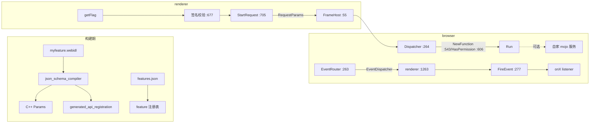

# 8.3 自定义扩展 API：给扩展暴露自己的 chrome.myfeature 接口

> 姊妹篇：8.1（扩展架构）、10.2（mojo 服务）、12.3（glic AI 面板）。

## 1. 角色定位

扩展 API 是 Chromium 声明式程度最高的子系统：从 schema 到 JS 可调用，胶水（C++ 类型、JS 绑定、参数校验、IPC 分发）几乎全由 `tools/json_schema_compiler/` 构建期生成。加一个 API 的必写代码量极小（一个实现类+几行登记），且对自家 API 与 Google API 一视同仁——`chrome.tabs` 与你的 `chrome.myfeature` 走同一管线。

横跨三层：**common**（schema 与 feature 门控，`extensions/common/api/` 与 `chrome/common/extensions/api/` 按"跨 embedder 通用 vs Chrome 专属"分层）；**browser**（实现与注册表）；**renderer**（native bindings，`extensions/renderer/bindings/`，把 schema 实例化成 V8 对象）。请求经 mojo（`extensions/common/mojom/frame.mojom`）跨进程，事件经 `mojom::EventDispatcher` 回流。2025 年起 schema 从 JSON/旧 IDL 向 **WebIDL** 迁移（`extensions_webidl_conversion.md`），当前混存；新 API 一律写 .webidl。

## 2. 定制切入点全景表

| 定制需求 | 动哪里（file:line 实证） | 难度 | 影响面 |
|---|---|---|---|
| 新增 API `chrome.myfeature.foo()` | 六步见第 4 节，模板 `extensions/common/api/system_cpu.webidl:53` 起 | 改逻辑 | 全链自动生成 |
| 仅自家扩展可用 | `extensions/common/api/_api_features.json` 加 `allowlist`（范例 :33） | 改配置 | 第三方拿权限也不可见 |
| fork 定制不碰上游 | `extensions/common/api/_api_features.override.json`（官方为 downstream fork 预留） | 改配置 | rebase 零冲突，首选 |
| 按版本灰度 | 同文件 `channel` 键（`chrome/common/extensions/api/_features.md:179-186`） | 改配置 | 发行版默认 stable 全量 |
| 实验 flag 门控 | `feature_flag` 键，范例 `chrome/common/extensions/api/_api_features.json:68-71` | 改配置 | 配合 base::Feature |
| API 事件 `onX` | webidl 写 `interface OnXEvent : ExtensionEvent`（照 `extensions/common/api/alarms.webidl`）+ browser `EventRouter::BroadcastEvent` | 改逻辑 | renderer 零代码 |
| 权限颗粒度 | `extensions/common/api/_permission_features.json:710-713`；`kFlagCannotBeOptional` 见 `extensions/common/permissions/extensions_api_permissions.cc:27` 起数组 | 改配置 | 安装警告/optional API |
| 暴露给网页/WebUI | `contexts` 键（清单 `_features.md:221-225`；`web_page` 需手改 renderer，坑 6） | 改配置 | 安全边界，慎重 |
| 平台差异（Android） | `extensions/common/api/schema.gni:12-46` 分段 | 改配置 | 编译面控制 |
| 后端挂自家 mojo 服务 | 实现类持 `mojo::Remote`，范式 `chrome/browser/extensions/api/glic_private/glic_private_api.cc:18` | 动架构 | API 即服务前端 |
| JS 端同步逻辑 | `APIBindingHooksDelegate`（`extensions/renderer/bindings/api_bindings_system.cc:92-99`） | 改逻辑 | 少数 API 才需要 |
| 权限警告文案 | `chrome/common/extensions/permissions/chrome_permission_message_rules.cc` + grd | 改配置 | 用户信任界面 |
| 裁剪既有 API | 两处 gni 删行（`extensions/common/api/schema.gni`、`chrome/common/extensions/api/api_sources.gni`） | 改配置 | 下游生态受影响 |
| API 限流 | `extensions/browser/quota_service.cc`（Assess 在 dispatcher :382 调） | 改逻辑 | 防滥用 |
| 类型系统/跨 API 类型引用 | webidl `dictionary` 定义 + `$ref` 引用（生成 `extensions/common/api/<api>.h`）；types-only 段见 `schema.gni:41` 起 `extensions_types_only_schema_files_` | 改配置 | 类型复用面 |
| .d.ts 类型声明 | `tools/json_schema_compiler/ts_definition_generator.py:27` | 工具 | TS 开发体验 |
| 文档/externs 生成 | `tools/json_schema_compiler/js_externs_generator.py`（产物清单 `extensions/common/api/generated_externs_list.txt`） | 工具 | Closure/TS 消费 |
| schema 先占位 | `DECLARE_UNIMPLEMENTED_EXTENSION_FUNCTION`（`extensions/browser/extension_function.h:114-127`） | 改配置 | 返回 not implemented |

## 3. 关键源码走读

### 3.1 `chrome.tabs.create()` 旅程

**schema**：`chrome/common/extensions/api/tabs.json:360` 定义 `create`，`:1174` 定义 `onCreated`；构建期编译为嵌入二进制的 schema 字符串与 C++ 类型 `tabs::Create::Params`。

**renderer**：上下文创建时 `NativeExtensionBindingsSystem` 按 feature 可用性实例化 API 对象（`extensions/renderer/bindings/api_bindings_system.cc:55`/`:69`，从 schema 取 functions/types/events/properties 构造 `APIBinding`）。JS 调用时签名校验失败抛 `InvocationError`（`extensions/renderer/bindings/api_binding.cc:677-690`），成功则 `StartRequest(...)` 返回 Promise（`:705`）。

**跨进程**：主线程 `SendRequestIPC`（`extensions/renderer/ipc_message_sender.cc:71-83`）把 `mojom::RequestParamsPtr`（`extensions/common/mojom/frame.mojom:43`）交 `GetLocalFrameHost()->Request()`（frame.mojom:162）；service worker 走 `WorkerThreadIPCMessageSender`（同文件 :356 起）。

**browser**：`ExtensionFrameHost::Request`（`extensions/browser/extension_frame_host.h:55`）转 `DispatchWithCallbackInternal`（`extension_function_dispatcher.cc:264`）：ProcessMap 校验、error page 拦截后 `CreateExtensionFunction`（`:533`）里 `NewFunction(params.name)` 查工厂（`:543-547`）、`HasPermission()` 终审（`:606`），quota 评估后 `RunWithValidation().Execute()`（`:376`）。

**实现**：`tabs_api.cc:2140`（`TabsCreateFunction::Run`；声明 `tabs_api.h:308`、`:316` `DECLARE_EXTENSION_FUNCTION("tabs.create", TABS_CREATE)`）：`Params::Create(args())` 反序列化，失败 `EXTENSION_FUNCTION_VALIDATE` 杀请求；`Respond(WithArguments(result))` 沿 mojo 回 renderer → `CompleteRequest`（api_bindings_system.cc:117）→ resolve Promise。

### 3.2 事件回流

browser 端 `EventRouter` 调 `mojom::EventDispatcher::DispatchEvent`（`extensions/browser/event_router.cc:209`、`:263`）；renderer 端 `Dispatcher::DispatchEvent`（`extensions/renderer/dispatcher.cc:1263`）→ `DispatchEventHelper`（`:883`）→ `APIEventHandler::FireEventInContext`（`api_event_handler.cc:277`）触发 listener。你只需 browser 端 BroadcastEvent，回流链零新代码；webidl 照 `alarms.webidl` 的 `OnAlarmEvent : ExtensionEvent` 写。

### 3.3 门控体系

四份 feature 文件（`_features.md:13-28`）：`_api_features.json`（API 可用性，不满足则 `chrome.x` undefined）、`_permission_features.json`（权限可授性）、`_manifest_features.json`、`_behavior_features.json`。条目可 simple 可 complex（多定义 OR）。常用键：`dependencies`、`contexts`、`channel`、`platforms`、`extension_types`、`allowlist`（旧名 extension_ids）、`feature_flag`、`internal`。browser 端 `ExtensionAPI`（`extensions/common/extension_api.cc:242`/`:270`）合并两处来源统一查表。

## 4. 实操：加 `chrome.myfeature.getFlag()` 六步

以 `system.cpu.getInfo` 为模板：

**Step 1 schema**——新建 `extensions/common/api/myfeature.webidl`：

```webidl
dictionary FlagInfo {
  required DOMString name;
  required boolean enabled;
};

interface Myfeature {
  // |PromiseValue|: info
  static Promise<FlagInfo> getFlag(optional DOMString name);
};

partial interface Browser {
  static attribute Myfeature myfeature;
};
```

对照 `system_cpu.webidl:53-64`（`interface CPU` + `getInfo()` 在 :56 + `partial interface System/Browser` 挂载）。命名：API 名最后一段转首字母大写作 interface 名。

**Step 2**——`extensions/common/api/schema.gni:28`（`"system_cpu.webidl",`）旁加 `"myfeature.webidl",`。

**Step 3**——`_api_features.json` 照 :837-840 加：

```json
"myfeature": {
  "dependencies": ["permission:myfeature"],
  "contexts": ["privileged_extension"]
},
```

**Step 4 权限三件套**——① `_permission_features.json` 照 :710-713 加；② `extensions/common/mojom/api_permission_id.mojom` 枚举末尾加 `kMyfeature = <next>`（对照 `kSystemCpu = 168` 在 :195；禁重排，废弃用 `kDeleted_`）；③ `extensions_api_permissions.cc` 的 `permissions_to_register[]`（:27 起）加 `{APIPermissionID::kMyfeature, "myfeature"}`（对照 :147）。

**Step 5 实现+注册**——建 `extensions/browser/api/myfeature/`，BUILD.gn 仿 `system_cpu/BUILD.gn:11`；类仿 `system_cpu_api.h:12-14`：

```cpp
class MyfeatureGetFlagFunction : public ExtensionFunction {
 public:
  DECLARE_EXTENSION_FUNCTION("myfeature.getFlag", MYFEATURE_GETFLAG)
  ResponseAction Run() override;
};
```

宏（`extension_function.h:102`）登记名与直方图枚举——枚举加 `extension_function_histogram_value.h` 末尾（对照 `SYSTEM_CPU_GETINFO = 507` 在 :568）。实现仿 `system_cpu_api.cc:14-18`：`Params::Create(args())` 解参，`RespondNow(WithArguments(...))` 同步或 `RespondLater()` 异步。注册表零手写：`cpp_bundle_generator.py:184-189` 生成的 `GeneratedFunctionRegistry::RegisterAll` 自动收录（入口 `core_extensions_browser_api_provider.cc:19-21`）。

**Step 6 绑定零代码**——manifest 声明 `"permissions": ["myfeature"]`（MV3 样本 `chrome/test/data/extensions/api_test/system_cpu/manifest.json`），JS 调 `chrome.myfeature.getFlag('demo').then(...)`。JS 同步逻辑才需要 `APIBindingHooksDelegate`（范例 `extensions/renderer/api/runtime_hooks_delegate.cc`）。

## 5. 依赖与数据流



契约：schema 是单一事实源（JS 可见面、C++ 类型、TS 声明、校验全由它派生）；feature 文件是第二事实源（谁配调用）。实现类只依赖生成头与 browser_sources，可单测。

## 6. 坑与勘误

1. **api_features 漏标=静默 undefined**：不写条目则 `chrome.myfeature` 不存在且无报错（bindings.md 明言）；`dependencies` 指错同样静默。排查：feature→permission→schema.gni。（源码实证）
2. **schema 校验严格**：renderer 签名校验先于 IPC（api_binding.cc:677-690），多参/类型不符即 TypeError；browser 二次校验失败视为 bad message。（源码实证）
3. **MV3 SW 生命周期**：长任务 API 拖住 SW（dispatcher :400-412 keepalive）；事件配 lazy listener，别做常驻连接。（源码实证）
4. **rebase 冲突**：两份 features json 上游高频改动，直改必撞。官方解法：`_api_features.override.json`（extensions 与 chrome 两处均有，头注释明示 downstream fork 专用）。（源码实证）
5. **两个枚举只增不挪**：`api_permission_id.mojom` 与 histogram_value.h 均禁重排/删除；后者要同步 `tools/metrics/histograms/histograms.xml`。（源码实证）
6. **文档过时**：`_api_features.json:10` 称 `web_page` context 需手改 `extension_bindings_system.cc`——该文件已不存在，现行是 `native_extension_bindings_system.cc`。（源码实证，勘误）
7. **json/webidl 混存**：新 API 必须用 .webidl；存量转换用 `web_idl_diff_tool.py` 验证。（文档实证）
8. **放哪层**：跨 embedder 通用放 extensions/common/api（配 schema.gni），Chrome 耦合放 chrome/common/extensions/api（配 api_sources.gni，:28 glic_private/:42 tabs.json）；放错 extensions_shell 编不过。（源码实证）
9. **Android 面窄**：schema.gni:12-46 分 desktop-android 段与 enable_extensions 段。（源码实证）
10. **权限文案联动**：`extensions_api_permissions.cc:24-26` 注释警告改权限标志须同步 ChromePermissionMessageRule，否则安装警告与实际权限不一致。（源码实证）

## 7. 验证方法

1. 编译期就位：`autoninja -C out/Default extensions_browser` 后查 `out/Default/gen/extensions/common/api/myfeature.h` 与 `gen/extensions/browser/api/generated_api_registration.h` 是否出现 `MyfeatureGetFlagFunction`。
2. 浏览器冒烟：`chrome --enable-experimental-extension-apis`（`extensions/common/switches.cc:20-21`；stable channel 无需）加载未打包扩展，console 敲 `chrome.myfeature`，undefined 则按坑 1 排查。
3. 自动化：仿 `chrome/browser/extensions/system_cpu_apitest.cc:50-54`（`RunExtensionTest("system_cpu")`）+ 数据目录 `chrome/test/data/extensions/api_test/system_cpu/`（`chrome.test.callbackPass`，test_cpu_api.js:19）。
4. 门控/权限单测：仿 `feature_compiler_test.py` 与 `extensions/common/permissions/api_permission_unittest.cc`。
5. 事件链：测试扩展 `onX.addListener(() => chrome.test.succeed())`。

## 8. 延伸

- 图谱：renderer bindings 层与 browser extension 层（第 9/12 层，节点 `extensions/renderer/bindings/*`、`extension_function_dispatcher.cc`、`event_router.cc`）。
- explain：`work4ai/讲透Chromium/explain/` 扩展架构篇（8.1）、mojo IPC 篇（10.2）。
- 权威文档：`src/extensions/renderer/bindings.md`、`src/chrome/common/extensions/api/_features.md`、`src/tools/json_schema_compiler/extensions_webidl_conversion.md`。
- 先例深读：`glic_private_api.cc`（扩展 API 桥自家服务+mojo 范式，12.3 扩展面）；`extensions/browser/api/system_cpu/`（本篇六步模板）。
