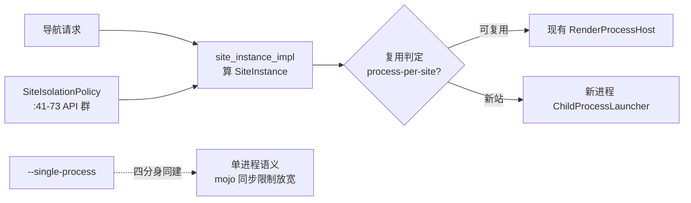

# 9.1 · 进程模型与进程数控制：site isolation 与 --single-process 真相

> 定制者最常问的三连："能不能少开几个进程？""能不能单进程？""进程数到底谁说了算？"本篇用源码回答，破除单进程执念，给出真正可控的进程数调节手段。

## ① 角色定位

进程模型的决策链分两层：**content/ 层**（进程怎么分：site_instance 算法 + site isolation 策略，`content/browser/renderer_host/` 的 RenderProcessHost 群是进程宿主，render_process_host_impl.cc 一个文件 6585 行）与 **chrome/ 层**（要不要额外进程：GPU/utility/network service 的开关）。定制者手里的旋钮全在命令行开关与策略 policy 上，代码改动多数不必要。

## ② 定制切入点全景表

| 想改什么 | 动哪里 | 难度 | 影响面 |
|---|---|---|---|
| 全站隔离开/关 | `--site-per-process`（content_switches.cc:684 实证）/反向 `--disable-site-isolation-trials`；策略 API `site_isolation_policy.h:41 UseDedicatedProcessesForAllSites()` | 改配置 | 渲染进程数↑ |
| 同站复用进程 | `--process-per-site`（:560，**与 site-per-process 是两回事，官方注释原话"你要的可能是另一个"**） | 改配置 | 进程数↓ |
| 按 site instance 分 | about_flags.cc:940 可见 `per_site_instance` 模式实验 | 改配置 | 进程数↑↑ |
| 沙箱 iframe 隔离 | `AreIsolatedSandboxedIframesEnabled()`（:44）+ 对应开关 | 改配置 | iframe 独立进程 |
| 严格 origin 隔离 | `IsStrictOriginIsolationEnabled()`（:51） | 改配置 | 进程数↑ |
| 单进程模式 | `--single-process`（content_switches.cc:667）——**仍存在但半弃养**，见 §⑥ | 改配置 | 全架构语义变化 |
| GPU 进程合并 | `--disable-gpu`（软件渲染）或 in-process-gpu 类开关 | 改配置 | GPU 进程消失 |
| 网络服务进程化开关 | `--disable-network-service` / NetworkService 运行模式（10.x） | 改配置 | network 进程去向 |
| utility 进程数 | 各 service 的运行模式（in-process 与否） | 改配置 | utility 数 |
| 渲染进程上限 | RenderProcessHost 的 limit 逻辑（renderer_host 实现）+ `--renderer-process-limit` | 改配置 | 上限封顶 |
| 进程复用策略 | site_instance_impl.cc 的 process 复用判定（`content/browser/site_instance_impl.cc`） | 改逻辑 | 分配算法 |
| 自定义隔离规则 | SiteIsolationPolicy 子类化/动态 isolated origin（`AreDynamicIsolatedOriginsEnabled()` :63） | 改逻辑 | 企业级管控 |

## ③ 关键源码走读：进程怎么分出去的

**第一站：两个易混开关的官方裁决。** `content/public/common/content_switches.cc:555-560`：`kProcessPerSite`（process-per-site）的注释明确写着——"这不是 site-per-process（那是隔离，不是合并）。你要的可能是另一个"。**想减进程用 process-per-site（同站合住），想加隔离用 site-per-process（一站一房）**，方向相反。

**第二站：隔离策略的真源。** `content/public/browser/site_isolation_policy.h:41-73` 是静态策略 API 群（UseDedicatedProcessesForAllSites/AreIsolatedSandboxedIframesEnabled/IsStrictOriginIsolationEnabled/...），实现在 content/browser 侧综合 field trial、策略、命令行得出。**定制"哪些站必须隔离"的正确姿势是 isolated origins 机制**（策略或 `AreDynamicIsolatedOriginsEnabled` 运行时注入），不是改分配算法。

**第三站：单进程模式还活着吗。** `content/app/content_main_runner_impl.cc`：575-584 行（kSingleProcess 参与"四分身同建"判定——browser/renderer/gpu/utility client 在单进程下同进程构造，2.1 篇已走读）；1256-1258 行更有意思——**单进程时跳过 `mojo::SyncCallRestrictions::DisableSyncCallInterrupts()`**：即单进程下 mojo 同步调用限制被放宽。这暴露了单进程的本质：**它不是"合并省内存"的部署模式，而是为早期测试保留的兼容形态**——IPC 死锁语义、崩溃爆炸半径、沙箱边界全部改变，任何真产品都不该走这条线。

## ④ 实操：三档进程数控制方案

**档一（推荐）：策略级调节。** 低配设备/嵌入式：`--process-per-site` + `--renderer-process-limit=N` + 关沙箱 iframe 隔离；安全敏感场景反向：默认全站隔离已开，加 isolated origins 白名单管企业内部站。**零代码，随版本升级存活**。

**档二：Chrome 层服务进程合并。** network service in-process（10.x 篇开关）、GPU 软件渲染合并——配合档一可把常驻进程从 ~10 压到 ~4。

**档三（不推荐）：single-process。** 只用于自动化测试的兼容路径。真要嵌入式壳，正确答案是 **android_webview 形态**（2.2 篇：webview 的进程模型本身就是宿主可控的）或 headless 按需起进程。

## ⑤ 依赖与数据流

## ⑥ 坑与勘误

- **process-per-site ≠ site-per-process**（switches.cc:558 官方原话），方向相反，搜资料时一半文章混用。
- `--single-process` **没有被删除**（:667 声明+main_runner 多处消费实证），但语义半弃养：mojo 同步限制放宽（1256 行）意味着为多进程写的代码在单进程下可能死锁或重入——**不是官方支持的部署形态**。
- 渲染进程数没有"一个总开关"：site instance 算法+隔离策略+复用策略+上限四层共同决定；**想精确控制请用 isolated origins/policy 面，别硬改分配算法**（site_instance_impl 是 content 层最热的代码之一，改了升级必冲突）。
- GPU 进程即使 `--disable-gpu` 也可能存在（软件 GL 的 viz 仍要进程边界，7.x 篇）。
- Android 上默认隔离比桌面激进（安全模型不同），平移开关集合前先对基线（5.2）。
- 进程数调优前先量：`chrome://process-internals`（resources 里 process 页实证存在）看真实分布再动手。

## ⑦ 验证方法

- `chrome://process-internals` + 任务管理器（Shift+Esc）：进程数/类型/归属站点三查
- 开关对比矩阵：同站开两页，process-per-site 下应同进程（task manager 的 Process ID 列）
- 单进程冒烟：`--single-process` 起动跑复杂页（音视频/worker），观察稳定性边界
- 隔离生效：DevTools 的 process ID per frame（iframe 独立进程=隔离开了）

## ⑧ 延伸

- 进程孵化机制：9.3（ChildProcessLauncher，`../explain/child-process-launcher.md` 打底）；沙箱边界：9.2；宿主大图：`../explain/render-process-host.md`
- 网络服务进程化：10.x；webview 进程模型：2.2；图谱层位：content 三分层的中层
