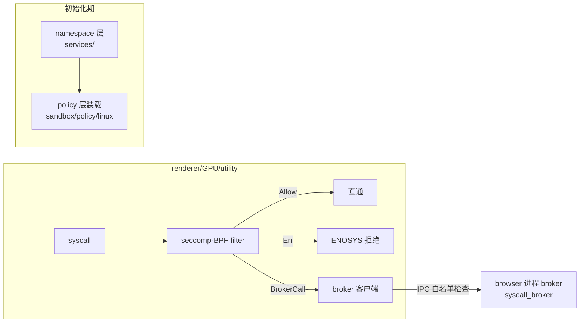

# 9.2 · 沙箱定制：Linux namespace+seccomp 体系与放宽/收紧面

> 沙箱是 Chromium 安全模型的承重墙（renderer/GPU/utility 全在沙箱里跑），也是定制者最容易"一刀切关掉"然后埋雷的地方。本篇给 Linux 主线的沙箱分层地图、合法的放宽通道与收紧范式。机制深解见 `../explain/sandbox-target-process.md`（目标进程侧视角）。

## ① 角色定位

Chromium 沙箱三层材料（Linux）：**namespace 层**（user/pid/net 等 CLONE_NEW*，`sandbox/linux/services/namespace_sandbox.cc` 一带）→ **seccomp-BPF 层**（系统调用过滤，`sandbox/linux/seccomp-bpf/`+`bpf_dsl/` 策略 DSL）→ **broker 层**（`sandbox/linux/syscall_broker/`，被禁 syscall 的白名单代理）。策略集中在新架构 `sandbox/policy/`（每类进程一个 policy：`sandbox/policy/linux/bpf_base_policy_linux.cc` 起，audio/broker 等特化），平台分叉 mac/win 各有子树。

## ② 定制切入点全景表

| 想干什么 | 动哪里 | 难度 | 影响面 |
|---|---|---|---|
| 开发期整体关闭 | `--no-sandbox`（sandbox::policy 域开关，content_switches.cc:635 注释实证其在 policy 线）——**仅开发/CI，禁止发布** | 改配置 | 全安全模型 |
| 放行某 syscall | 对应进程 policy：`sandbox/policy/linux/bpf_<进程>_policy_linux.cc` 的 Eval 方法加 Allow() | 改逻辑 | 该进程过滤面 |
| 换策略基类 | 自定义 policy 继承 bpf_base_policy_linux（Err()→Allow() 白名单扩展范式） | 改逻辑 | 系统调用面 |
| broker 白名单 | `syscall_broker` 的允许清单（open/stat 类代理） | 改逻辑 | 文件访问面 |
| namespace 单独控制 | `sandbox/linux/services/`（namespace_sandbox/credentials——user ns 可用性探测） | 改逻辑 | 隔离层 |
| 关闭某进程沙箱 | policy 层的 per-process 开关（GPU/utility 特例路径） | 改配置 | 单进程 |
| Android 差异 | `seccomp_starter_android.h`（USE_SECCOMP_BPF 编译门，5.2 呼应） | 只读 | 平台差异 |
| 老式 setuid | `sandbox/linux/suid/`（历史 setuid helper，现代环境基本退役） | 只读 | 历史包袱 |
| 沙箱失败诊断 | `--disable-seccomp-filter-sandbox` 类分项开关+`sandbox/linux/integration_tests`（测试范式） | 只读 | 调试 |
| 收紧自家进程 | 新 utility 进程配专属 policy（10.2 服务化联动） | 改逻辑 | 自家服务 |
| Yama/ptrace | `services/yama.cc`（ptrace 限制联动） | 只读 | 调试器交互 |
| 沙箱状态观测 | chrome://sandbox（resources 有 sandbox-internals 页） | 只读 | 三层状态 |

## ③ 关键源码走读：一个 syscall 的命运

**第一站：分层启用。** 子进程孵化（9.3）后、进 main 分派前，目标进程侧按平台初始化沙箱（`../explain/sandbox-target-process.md` 的两段式：setuid/namespace 先，seccomp 后——预热 RPC 拿 broker 通道）。**顺序即安全：早一层失败后一层不启用，进程宁可起不来也不能裸奔**。

**第二站：策略求值。** 每次系统调用过 seccomp-BPF filter → 走该进程 policy 的 `Eval`（`sandbox/policy/linux/bpf_base_policy_linux.cc` 是共享基线，特化 policy 继承它）→ 三判决：Allow（白名单直通）/ Err（拒绝返回 ENOSYS）/ **BrokerCall（交给 broker 代理检查后执行）**。renderer 的 policy 最严（几乎全 Err+有限 broker），utility 稍宽，GPU 因驱动需要最宽。

**第三站：broker。** 被禁的 open 类调用经 IPC 问 browser 进程的 broker（`sandbox/linux/syscall_broker/`）：broker 按自己的允许清单决定代开/拒绝——**这是"沙箱内访问文件"的唯一正道**，也是定制加"自家配置文件可读"的合法通道。

## ④ 实操：两个常见需求的正解

**A. renderer 里跑自家 native 库需要新 syscall**：在 renderer policy（继承 base）里为该 syscall 加 `Allow()`——**精确到单 syscall**，别动基类；同时评估是否有 broker 替代路径（文件访问优先走 broker 白名单）。

**B. CI/开发环境裸跑**：`--no-sandbox`（或分项 --disable-seccomp-filter-sandbox）——发布版**绝不携带**：它同时关闭 namespace+seccomp，等于把 renderer 的任意代码执行暴露给全系统（历史上逃逸链第一步都是"先想办法让沙箱没起"）。

## ⑤ 依赖与数据流

## ⑥ 坑与勘误

- **--no-sandbox 三宗罪**：发布携带=自毁安全模型；**部分功能在 no-sandbox 下行为不同**（如 dialog 显示路径 content_switches.cc:635 注释实证）；CI 全裸跑会让"沙箱内正常"的代码混进主线（集成测试 `sandbox/linux/integration_tests` 是回归防线）。
- syscall 被拒的表现是 ENOSYS 而非 EPERM——native 库报"函数未实现"先怀疑 seccomp（不是 libc 缺符号）。
- 加 Allow 的连带审计：每放行一个 syscall，读 policy 文件头的安全注释（官方对每个已放行项都有逃逸分析）——**无脑放行=给自己产品开后门**。
- namespace 可用性依环境（容器内 user ns 受限）：沙箱会静默降级到 setuid/无 namespace 形态，行为差异藏在 chrome://sandbox 状态里。
- GPU 进程 policy 本来就宽（驱动需求）——"反正 GPU 都能……"的类比对 renderer 不成立，两者基线不同。
- Android 的 seccomp 是编译期门（USE_SECCOMP_BPF）+系统集成，桌面的 policy 文件心智不能直接平移（5.2）。

## ⑦ 验证方法

- chrome://sandbox：三层状态（namespace/seccomp/broker）逐进程可见
- 压力验证：`sandbox/linux/integration_tests` 跑基线；自家 policy 改动配套单测（`*_unittest.cc` 同目录范式）
- syscall 探测：strace 子进程看 ENOSYS 分布（放行前后对比）
- 逃逸自检：故意在 renderer 调被禁 syscall 确认拒绝路径（发布前冒烟）

## ⑧ 延伸

- 目标进程侧机制：`../explain/sandbox-target-process.md`；孵化时序：9.3；进程模型为什么需要沙箱：9.1；Android：5.2/3.2
- 图谱层位：sandbox 层（16 层地基带）；官方设计文档：repo-docs 的 sandbox.md/sandbox_faq.md（设计向，与现行代码差异以源码为准）
