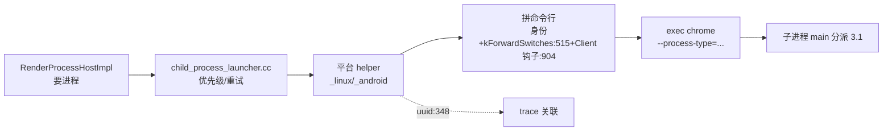

# 9.3 · 子进程孵化与命令行注入：让每个进程带着你的配置启动

> 每个渲染/GPU/utility 进程都是 browser 进程重新 fork+exec 出来的"新浏览器"——它们的命令行是拼接出来的。想给子进程注入配置（日志/feature/自家开关）、想理解孵化链（进程从哪起、zygote 是什么），本篇给全地图。机制深解见 `../explain/child-process-launcher.md`，本篇纯定制视角。

## ① 角色定位

孵化链：browser 进程的宿主对象（RenderProcessHostImpl 等）→ `content/browser/child_process_launcher.cc`（调度层：优先级/重试）→ 平台 helper（`child_process_launcher_helper.cc`+`_linux/_android/...`）→ fork/exec（Linux 直接 exec chrome 二进制加 `--process-type` 开关；Android 走 service 声明；Linux 渲染进程可走 zygote 优化路径）。**子进程不是"轻量线程"——它们执行同一个 chrome 二进制**，靠命令行区分身份。

## ② 定制切入点全景表

| 想干什么 | 动哪里 | 难度 | 影响面 |
|---|---|---|---|
| 给子进程加自定义开关 | `ContentBrowserClient::AppendExtraCommandLineSwitches`（content_browser_client.h:904，按 child_process_id 分进程类型注入——2.1 契约面的正式成员） | 改逻辑 | 全部子进程 |
| 浏览器开关自动转发给子进程 | `kForwardSwitches` 清单（child_process_launcher_helper.cc:515 起：日志类 kEnableLogging/kLogFile/kV 等）——加条目即转发 | 改配置 | 转发面 |
| 渲染进程数上限 | `--renderer-process-limit`（content_switches.h:179）+ 9.1 的复用策略 | 改配置 | 进程数 |
| 子进程等调试器挂载 | `--wait-for-debugger-children`（helper :325 kWaitForDebugger 注入路径） | 改配置 | 调试 |
| 进程身份开关 | `--process-type`（kRendererProcess:177/kGpuProcess:135 等，孵化器拼装） | 只读 | 进程分派根 |
| 启动器内建注入 | helper :243（kDisableMojoBroker）、:348（kTraceProcessTrackUuid trace 关联）等——理解现网行为 | 只读 | 观测 |
| 优先级/调度 | child_process_launcher.cc 的优先级参数（后台 tab 降优先级入口） | 改逻辑 | 性能策略 |
| 孵化重试/崩溃恢复 | launcher 的重试逻辑（renderer 崩溃=crashed 状态→rehost） | 改逻辑 | 稳定性语义 |
| zygote 开关 | `--no-zygote`（Linux 渲染孵化路径切换，5.1 平台线呼应） | 改配置 | Linux 启动形态 |
| Android 进程声明 | AndroidManifest 的 `:sandboxed_process` service 组（3.2 呼应） | 改配置 | Android 孵化 |
| 沙箱联动 | 孵化时挂 sandbox（9.2 深做；helper 的 sandbox 初始化序列） | 动架构 | 安全边界 |
| 子进程侧消费定制开关 | 各进程 main 分派后的 switch 解析（3.1 的 kMainFunctions 表下游） | 改逻辑 | 进程内行为 |

## ③ 关键源码走读：一条命令行是怎么拼出来的

**第一站：身份拼装。** 孵化时 helper 构造 `command_line_`：chrome 二进制路径 + `--process-type=<renderer|gpu|utility>`（content_switches.h:135-179 的 kXxxProcess 群）+ mojo 通道 token 等 IPC 凭据——**没有这串，子进程不知道自己是谁**（3.1 走读的 RunProcess 分派的输入端）。

**第二站：三层注入汇流。** 最终命令行=①基础身份串（helper 拼装）+②`CopySwitchesFrom(browser_command_line, kForwardSwitches)`（helper.cc:523，白名单转发：日志/verbosity 类，:515 清单可查）+③**`AppendExtraCommandLineSwitches` 钩子**（content_browser_client.h:904）——嵌入者按进程类型自由追加。Chrome 自己的满配实现在 chrome_content_browser_client（2.1 走读过的 1868-1914 一带的姊妹方法），shell 的最简实现对照（2.2）。

**第三站：调度与观测。** launcher.cc 把孵化请求排优先级（前台 renderer 先于后台），完成后回 OnProcessLaunched；`:348` 的 kTraceProcessTrackUuid 把子进程关联进 trace——**性能观测的进程对齐全靠它**（7.1 的 Perfetto 流呼应）。

## ④ 实操：给所有 renderer 进程注入自家开关

```cpp
// 你的 ContentBrowserClient 实现（2.1 的契约面）：
void MyContentBrowserClient::AppendExtraCommandLineSwitches(
    base::CommandLine* command_line, int child_process_id) {
  // child_process_id 区分进程类型（render_process_host 查询）
  command_line->AppendSwitchASCII("my-ai-mode", "on");
}
```
配合各进程侧的 switch 解析（renderer main 分派后读），即完成"browser 决策→全进程生效"的配置下发。**注意**：只加不改——已有开关的语义别动（升级兼容）。

## ⑤ 依赖与数据流



## ⑥ 坑与勘误

- **开关不会自动转发**：browser 命令行的自定义开关默认不进子进程——必须进 kForwardSwitches 或走 :904 钩子。"我加了 --my-flag 怎么 renderer 没反应"十有八九是这。
- zygote 模式（Linux 默认渲染路径）下命令行语义特殊（fork 前定，exec 无）——3.1 坑⑥"zygote 不走 main()"的孵化侧镜像；`--no-zygote` 切换后行为不同。
- Android 的孵化=系统 service 而非 exec：开关走 bundle/`://sandbox` 机制（3.2），桌面心智直接平移必错。
- child_process_id→进程类型映射要通过宿主查询，不要靠猜序号（复用后 id 会变）。
- 给 utility 进程注开关时注意它可能频繁重启（每个 service 一批），开销敏感。
- 重试语义：renderer 被杀后的 rehost 不重跑你的注入链（快照式恢复）——动态配置别只靠孵化时注入。

## ⑦ 验证方法

- `chrome://process-internals` / 任务管理器命令行列（部分平台可见完整命令行）
- `ps aux | grep process-type` 直接看子进程 argv（Linux 最直观）
- --wait-for-debugger-children 挂 gdb 验证注入到达
- trace 里 ProcessTrack uuid 对齐（:348 机制）

## ⑧ 延伸

- 孵化机制深解：`../explain/child-process-launcher.md`；进程分派下游：3.1；进程模型：9.1；沙箱：9.2；zygote/平台：5.1
- 图谱层位：content 三分层的 browser 侧孵化子图
