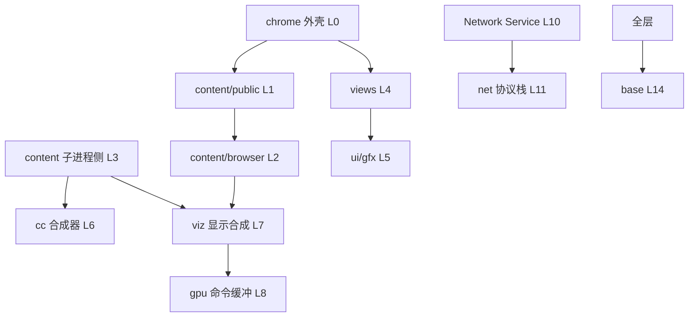

# Chromium 新人上手指南（ONBOARDING）

> 基于源码知识图谱（40,412 节点 / 102,182 边 / 16 分层 / 16 步导览，HEAD 8fe2331）与官方架构文档层（docs-online 8 篇经典 + 仓内 1818 篇）生成。文中文件引用均为图谱真实节点。

## 1. 一句话定位与技术栈

Chromium 是 Google 主导的开源浏览器引擎工程——既是 Chrome 的上游，也是可被任意 embedder 嵌入的多进程渲染引擎（content 模块）。图谱覆盖约 10.9k 核心源文件，展开为 40,412 节点、102,182 条 imports 边，是理解现代浏览器的最完整标本。

技术底座：**C++ 主力**（全仓统一 styleguide），Java/Obj-C++ 承担 Android/macOS 平台层；**mojo** 是唯一 IPC 体系，`.mojom` IDL 生成 C++/Java/Rust 多语言桩（`mojo/golden/generated/c++/results.test-mojom.h.golden` 的 golden 快照保证生成器回归安全）；**GN + Ninja** 构建，各组件 `*_export.h`（如 `base/base_export.h`、`cc/cc_export.h`）承载 component build 符号可见性；Blink/V8/Skia 均在第三方仓，经 gin/content 胶水接入。

## 2. 多进程架构总览

第一课是进程拓扑（导览步 1）：**browser 进程**统筹全局，**renderer 进程**运行 Blink 渲染网页，**GPU 进程**独占显卡驱动，**utility 进程**承载 NetworkService、Audio 等轻量服务（注册中枢 `content/utility/services.cc`）。`chrome/app/chrome_main_delegate.cc` 是所有进程共用的启动委托——同一个 main 按 `--type` 分化进程身份；`content/gpu/gpu_main.cc` 与 `content/utility/utility_main.cc` 是 GPU/Utility 入口样本；Linux 上 renderer 经 zygote（`content/zygote/zygote_linux.cc`）fork 配合沙箱预热。

背后是 16 分层**依赖金字塔**：chrome 外壳（L0，4092 节点）→ content 公共 API（L1）→ 浏览器/子进程实现（L2/L3）→ 渲染栈（cc→viz→gpu）与 UI 栈（views→gfx）双线 → Network Service（L10）→ net（L11）→ mojo（L12）与 sandbox（L13）→ base 底座（L14，5030 节点）+ url/gin（L15）。图谱实测强耦合边：`renderer_host→content/public/browser` 613 条（全图最强）、`viz/service↔viz/common` 523 条（第二）、`chrome/browser→content/public/browser` 313 条、http/socket/dns 各向 `net/base` 输出 400-500 条。

**站点隔离**是多进程模型的安全深化：不同站点文档进不同 renderer，进程边界即安全边界。`content/public/browser/site_instance.h` 头注释完整阐述 full/partial/no site isolation 三种进程模型；`content/public/browser/site_isolation_policy.cc` 从命令行、Feature 与 field trial 三级来源判定隔离模式。配合 L13 沙箱，每个子进程都带着沙箱出生。

## 3. 核心子系统逐讲

**mojo IPC（L12，2822 节点）**：C++ 词汇表四件套——`mojo/public/cpp/bindings/remote.h`（调用端）、`receiver.h`（接收端分发）、`pending_remote.h`/`pending_receiver.h`（未绑定可传递端点）；`struct_traits.h` 定义序列化契约；传输内核为 core/ipcz；`ipc/param_traits_utils.cc` 是被取代的 legacy IPC 遗存。重消费者：renderer_host（189 条边）、network service（190+197 条边）。

**net 协议栈（L11，4011 节点）**：不感知进程模型的纯协议实现。核心抽象 `net/url_request/url_request.h`（一次 URL 异步加载 + Delegate 回调）；`net/http/http_cache_transaction.cc`（约 4600 行）以 DoLoop 状态机驱动缓存命中与条件化请求；`net/http/http_network_transaction.cc` 驱动建流→认证→收发；`net/dns/host_resolver_manager.cc` 管解析调度与 DoH 探测。

**Network Service（L10，2904 节点）**：net 的 mojo 服务化包装，独立进程运行。`services/network/network_context.cc` 装配 URLRequestContext（每 profile 一个）；`services/network/url_loader.cc` 同时实现 mojom::URLLoader 与 net::URLRequest::Delegate；`services/network/cors/cors_url_loader.cc` 全链路套 CORS/ORB 校验。

**content 三层（L1/L2/L3，共约 6359 节点）**——多进程渲染引擎的抽象：
- **content/public（L1）**：embedder 稳定契约。`web_contents.h` 定义 WebContents（"在矩形区域渲染网页内容的顶层类"）；`content/public/browser/content_browser_client.h` 约 375 个虚方法覆盖全部可定制点（Chrome 侧实现 `chrome/browser/chrome_content_browser_client.cc` 约一万行；content 侧兜底 `content/public/browser/content_browser_client.cc`）；`render_frame_host.h`（137 纯虚）与 `render_process_host.h` 是帧级/进程级通信管道。
- **content/browser（L2）**：renderer_host 目录（445 文件）管理全部 RenderProcessHost——`render_frame_host_impl.cc`（2 万行）是 frame 浏览器侧宿主，`navigation_request.cc`（1.3 万行）是导航中央状态机，`web_contents_impl.cc` 是最核心页面对象；`loader/navigation_url_loader_impl.cc` 把请求接到 net 栈并串行执行拦截器。
- **content 子进程侧（L3）**：`render_frame_impl.cc` 是 renderer 中单 frame 中枢（blink::WebLocalFrameClient 核心实现）；`content/child/child_thread_impl.cc` 是全部子进程主线程核心（建立 Mojo 通道）。

**cc 合成器（L6，3079 节点）**：把 Blink 输出变成合成帧。双线程结构：主线程 `cc/trees/layer_tree_host.cc`（Layer 树宿主）+ 合成线程 `cc/trees/layer_tree_host_impl.cc`（6232 行，绘制管线心脏）；`cc/trees/property_tree.cc`（3177 行）实现 Transform/Clip/Effect/Scroll 四棵属性树；`cc/tiles/tile_manager.cc`（2430 行）管光栅任务图；`cc/paint/paint_op.h` 定义 37 个绘制 op。

**viz（L7，2262 节点）+ gpu（L8，2674 节点）**：viz 在 GPU 进程聚合所有 renderer 的 cc 输出与浏览器 UI——`components/viz/service/display/surface_aggregator.cc` 聚合 Surface 树，`skia_renderer.cc` 把 DrawQuad 翻译为 Skia 调用，`display.cc` 的 DrawAndSwap 是管线终点。gpu 是通向驱动的统一通道：client 侧 `gpu/command_buffer/client/gles2_implementation.cc` 编码命令流，service 侧 `gpu/command_buffer/service/gles2_cmd_decoder.cc`（1.7 万行）校验后翻译；跨进程纹理共享靠 SharedImage（`gpu/command_buffer/common/shared_image_usage.h`）；SwiftShader 软件兜底。

**ui/gfx + views（L5/L4，共 5031 节点）**：gfx 是 views/cc/viz 共用的图形语言——`ui/gfx/geometry/transform.h`（4x4 矩阵带 2D 快路径）、`ui/gfx/render_text_harfbuzz.cc`（约 2740 行复杂脚本整形）。views 是自研保留模式 UI 工具包——`ui/views/view.cc`（4300 行）是全部控件祖先，`ui/views/widget/widget.cc`（3224 行）封装跨平台原生窗口；`ui/views/controls/webview/webview.h` 把 WebContents 嵌进界面——UI 主线与渲染主线在此汇合。

**chrome 外壳（L0）与共享组件（L9）**：`chrome/browser/browser_process_impl.cc` 是主进程服务工厂与生命周期中枢；`chrome/browser/profiles/profile.h`（继承 content::BrowserContext）定义用户数据体系；`chrome/browser/download/chrome_download_manager_delegate.cc`（2796 行）承载下载拦截。组织骨架 keyed_service（`components/keyed_service/core/keyed_service.h` 两阶段销毁 + 依赖拓扑序广播）是读懂 chrome/browser 万余文件的钥匙；偏好门面 `components/prefs/pref_service.h`。

**base（L14，5030 节点）与 L15**：绝对底座（1492 文件）——`base/functional/callback.h`+`bind.h` 是全仓异步词汇表，`base/memory/weak_ptr.h` 是生命周期安全标配，base/task 任务体系取代裸线程并经 `base/threading/thread_restrictions.h` 审查阻塞 IO，`base/values.h` 是序列化通用载体。L15 的 `url/gurl.h`/`url/origin.h` 是网络与内容层共用的 URL/Origin 基准；gin（`gin/v8_platform.cc`）是 V8↔C++ 桥。

## 4. 一条 URL 的生命周期

从地址栏回车到像素上屏，把导览 16 步串成一条线：

1. **输入与宿主**：地址栏是 views 控件（`ui/views/controls/textfield/textfield.cc`）；页面宿主 WebContents 被 webview 嵌入浏览器窗口。
2. **导航发起（browser）**：`navigation_controller.h` 的 LoadURL 进入 `content/browser/renderer_host/navigation_request.cc` 状态机——throttle、重定向、响应校验。
3. **资源加载**：`navigation_url_loader_impl.cc` 组装 ResourceRequest，经 mojo 到 `services/network/url_loader.cc`，落入 net 栈：`http_cache.cc` 判缓存 → `http_network_transaction.cc` 建流 → `host_resolver_manager.cc` 解析；URL 由 `url/gurl.h` 规范化。
4. **渲染（renderer）**：响应回到 `render_frame_impl.cc`；Blink 排版、V8 执行 JS（经 `gin/v8_platform.cc` 桥接），产出绘制记录。
5. **合成（cc）**：进 `layer_tree_host.cc` 主线程层树 → commit 推送到 `layer_tree_host_impl.cc` 合成线程 → `property_tree.cc` 四棵属性树 → `tile_manager.cc` 按可见性调度光栅。
6. **显示合成（GPU 进程）**：合成帧经 cc/mojo_embedder 提交 viz——`compositor_frame_sink_support.cc` 管理 Surface → `surface_aggregator.cc` 聚合 → `skia_renderer.cc` 翻译 → `components/viz/service/display_embedder/skia_output_surface_impl_on_gpu.cc` 回放并 swap。
7. **真实 GPU**：命令流进命令缓冲，`gles2_cmd_decoder.cc` 校验翻译给驱动/ANGLE/Vulkan；纹理靠 SharedImage + SyncToken 跨进程同步；无 GPU 走 SwiftShader。
8. **输入回流**：滚轮/触摸经 `cc/input/input_handler.cc`（2811 行）走合成器线程快速路径——不回 renderer 主线程即可滚动。

整条链横跨 4 类进程、7 个分层；每一跳的边界都是一个 mojo 接口或一条命令缓冲。

## 5. 目录导览：「想改 X 去哪找」

| 需求 | 目录 | 关键文件（图谱实证） |
|---|---|---|
| Chrome 产品行为/功能 | `chrome/browser/` | `chrome_content_browser_client.cc` |
| 新增 embedder 钩子 | `content/public/browser/` | `content_browser_client.cc`（默认兜底面） |
| 导航/前进后退 | `content/browser/renderer_host/` | `navigation_request.cc` |
| 页面生命周期 | `content/browser/web_contents/` | `web_contents_impl.cc` |
| HTTP/DNS/socket | `net/http/` `net/dns/` | `http_cache_transaction.cc` |
| CORS/cookie 跨源安全 | `services/network/cors/` | `cors_url_loader.cc` |
| 滚动卡顿/渲染性能 | `cc/trees/` `cc/tiles/` | `layer_tree_host_impl.cc`、`tile_manager.cc` |
| 花屏/多窗口合成 | `components/viz/service/` | `surface_aggregator.cc` |
| WebGL/WebGPU/纹理 | `gpu/command_buffer/` | `gles2_cmd_decoder.cc` |
| 原生 UI 控件 | `ui/views/` | `view.cc`、`widget.cc` |
| 文本渲染/几何 | `ui/gfx/` | `render_text_harfbuzz.cc` |
| IPC 接口定义 | 各模块 `.mojom` | `remote.h`、`struct_traits.h` |
| 偏好项 | `components/prefs/` | `pref_service.h` |
| Profile/多用户 | `chrome/browser/profiles/` | `profile.h` |
| 站点隔离策略 | `content/public/browser/` + `components/site_isolation/` | `site_isolation_policy.cc`（两处同名各管一层） |
| 沙箱 | `sandbox/win/src/` `sandbox/linux/` | `sandbox_policy_base.cc` |
| 异步/任务/线程 | `base/task/` `base/functional/` | `sequenced_task_runner.h`、`weak_ptr.h` |
| URL/Origin 语义 | `url/` | `gurl.h`、`origin.h` |
| 下载 | `chrome/browser/download/` | `chrome_download_manager_delegate.cc` |

治理提示：仓库根部有 OWNERS/WATCHLISTS 等治理元文件（图谱 L15 收录 22 个）；改目录前先看同位置 README 与 OWNERS。

## 6. 构建与开发工作流

- **构建**：`gn gen out/Default` → `autoninja -C out/Default chrome` 增量编译（源码已就绪，HEAD 8fe2331）。常用 GN args：`is_component_build=true`（开发期链接提速）、`is_debug=true`。
- **常用 ninja 目标**：`chrome`、`unit_tests`、`browser_tests`、`content_unittests`/`net_unittests`。
- **测试入口（图谱实证）**：导航栈最大浏览器测试 `content/browser/navigation_browsertest.cc`（1 万余行，ContentBrowserTest 基类）；站点隔离主测试集 `content/browser/site_per_process_browsertest.cc`；安全回归 `content/browser/security_exploit_browsertest.cc`（约 140 个测试模拟被攻陷渲染进程发伪造 Mojo 消息）；嵌入层单测 `chrome/browser/chrome_content_browser_client_unittest.cc`（136 个 TEST_F）。net 有专用 mock 体系（`net/socket/socket_test_util.h`）。
- **文档层**：docs-online/ 有 8 篇 chromium.org 经典架构文档；仓内 `docs/` 722 篇（含 `docs/design/` 官方设计文档）。设计疑义先查 docs 再读码。

## 7. 设计决策与取舍

- **多进程隔离 vs 内存成本**：每站点独立 renderer 换来故障隔离与安全边界，代价是内存与 IPC 往返。对策：进程复用阈值、Android 按内存阈值降级隔离、zygote 预热 fork。
- **mojo 接口 vs 直接调用**：跨进程必须 IPC，但进程内边界也 mojo 化（Network Service 可进程内/外运行，`content/browser/network_service_instance_impl.cc` 装配两种形态）——换来部署弹性与"一切皆服务"演进，代价是序列化开销与版本管理。
- **chrome→content 单向依赖**：chrome 只消费 content/public（313 条边），content 不知 chrome 存在（`ContentBrowserClient` 约 375 虚方法反转控制）。content 因此可被任意 embedder 复用；代价是接口面巨大、`chrome_content_browser_client.cc` 膨胀至万行级。
- **viz 独立服务化**：显示合成集中到 GPU 进程，使跨进程帧聚合、HitTest、视频捕获成为可能；`viz/service↔common` 523 条边强内聚印证其自成一体。
- **命令缓冲而非直接 GL**：renderer 不能信任（安全）也不能直接触碰（稳定）驱动，命令流经 GPU 进程校验翻译（`gles2_cmd_decoder.cc` 的 1.7 万行即校验成本），换来崩溃隔离与 SwiftShader 兜底。
- **分层纪律**：base 不依赖业务层；net 不感知进程模型；gfx 不含业务——各层 `*_export.h` 与 DEPS 机制共同维护金字塔不倒挂。

## 8. 新人上手路径：16 步导览的分周计划

导览已按学习曲线排序，建议 6 周（每周 2-3 步 + 练习）：

**第 1 周｜进程模型与启动（步 1-2）**：读 `chrome/app/chrome_main_delegate.cc` 理解同一 main 如何分化多进程。练习：任务管理器对照进程树，观察 `--type` 开关的变化。

**第 2 周｜mojo 与网络（步 3-4）**：写最小 .mojom 接口用 Remote/Receiver 通车；通读 `services/network/url_loader.cc`。练习：给 mojom 结构加字段跑 golden 测试。

**第 3 周｜content 三层（步 5-6）**：以 WebContents 为主角读 `web_contents_impl.cc`，下钻 `navigation_request.cc` 状态机。练习：注册 NavigationThrottle（`content/public/browser/navigation_throttle.h`）拦截导航打日志。

**第 4 周｜渲染管线（步 7-10，核心）**：cc 双线程模型 → 光栅 → viz 聚合 → gpu 命令缓冲；配合 docs-online 的 GPU 加速合成等两篇文档。练习：开 cc 的 HUD（`cc/layers/heads_up_display_layer_impl.cc`）观察 FPS。

**第 5 周｜UI 与产品层（步 11-13）**：gfx 词汇表 → views 窗口体系（重点 webview 汇合点）→ chrome 外壳（keyed_service 组织法）。练习：加一个 views 气泡控件（`ui/views/bubble/bubble_dialog_delegate_view.cc`）；用 `chrome://flags`（后端 `chrome/browser/about_flags.cc`）开关 Feature。

**第 6 周｜基础设施（步 14-16）**：Network Service 服务化 → base 习惯用法 → sandbox 三平台（Linux seccomp-bpf 的 `sandbox/linux/bpf_dsl/bpf_dsl.h` DSL）。练习：读 `sandbox/linux/seccomp-bpf-helpers/baseline_policy.cc` 基线系统调用决策表。

六周后应能回答三个验收问题：一条 URL 经过了哪些进程与接口？新增一个浏览器特性要动哪几层？为什么 renderer 进程"作恶"也偷不走你的文件？

---

*生成于 2026-10-10，数据源：src@8fe2331 知识图谱（40,412 节点/102,182 边）+ docs-online 官方文档层。单文件精讲见 ../explain/，设计文档见 ../repo-docs/ 与 ../docs-online/。*
