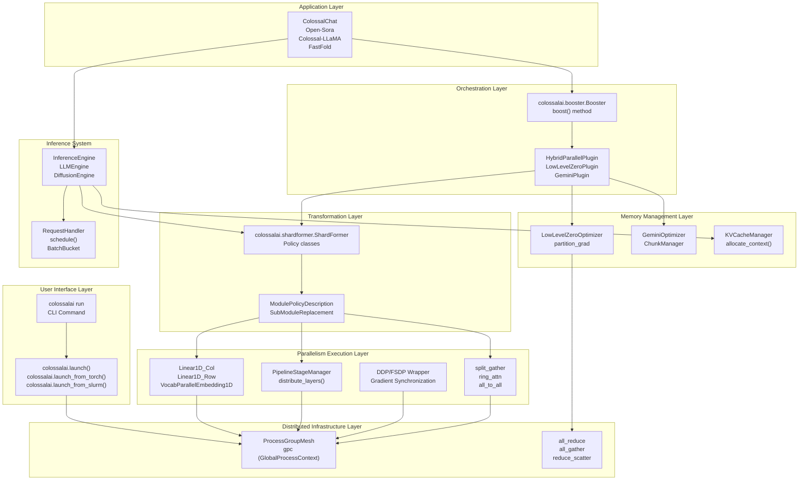
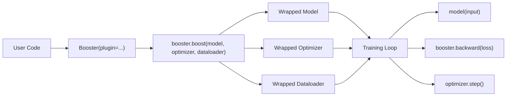
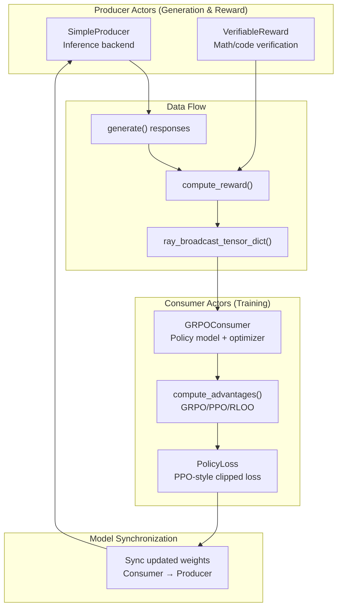

<!-- source: DeepWiki mcp.deepwiki.com · repo hpcaitech/ColossalAI · page 1 Overview · fetched 2026-10-21 -->

# Overview

<details>
<summary>Relevant source files</summary>

The following files were used as context for generating this wiki page:

- [README.md](README.md)
- [applications/ColossalChat/.gitignore](applications/ColossalChat/.gitignore)
- [applications/README.md](applications/README.md)
- [colossalai/nn/optimizer/README.md](colossalai/nn/optimizer/README.md)
- [docs/README-zh-Hans.md](docs/README-zh-Hans.md)
- [docs/source/en/basics/launch_colossalai.md](docs/source/en/basics/launch_colossalai.md)
- [docs/source/en/get_started/installation.md](docs/source/en/get_started/installation.md)
- [docs/source/zh-Hans/basics/launch_colossalai.md](docs/source/zh-Hans/basics/launch_colossalai.md)
- [docs/source/zh-Hans/get_started/installation.md](docs/source/zh-Hans/get_started/installation.md)
- [examples/README.md](examples/README.md)
- [examples/tutorial/.gitignore](examples/tutorial/.gitignore)
- [examples/tutorial/README.md](examples/tutorial/README.md)
- [examples/tutorial/download_cifar10.py](examples/tutorial/download_cifar10.py)
- [examples/tutorial/sequence_parallel/data/dummy_dataloader.py](examples/tutorial/sequence_parallel/data/dummy_dataloader.py)

</details>


## Purpose and Scope

Colossal-AI is a unified deep learning system designed to make large-scale AI model training, inference, and optimization cheaper, faster, and more accessible. This system addresses the challenges of training and deploying models ranging from billions to trillions of parameters by providing integrated parallelism strategies, memory optimization techniques, and inference acceleration.

This document provides a high-level overview of the Colossal-AI system architecture, its core components, and entry points. For specific topics:
- Installation procedures, see [Installation](#2.1)
- Distributed environment setup, see [Distributed Environment Setup](#2.2)
- Parallelism techniques (ZeRO, Gemini, TP, PP, SP, etc.), see [Parallelism Techniques](#3)
- Training orchestration with Booster, see [Booster API](#4)
- Model transformation with ShardFormer, see [ShardFormer Framework](#5)
- Inference optimization, see [Inference Engine](#6)
- Applications (ColossalChat, Open-Sora, etc.), see [Applications and Examples](#9)

**Sources:** [README.md:1-156](), [docs/README-zh-Hans.md:1-122]()

## System Design Philosophy

Colossal-AI follows three core design principles:

1. **Ease of Use**: Write distributed models as if coding for a single GPU. The system automatically handles distribution, communication, and memory management.

2. **Composability**: Combine multiple parallelism strategies (Tensor Parallelism, Pipeline Parallelism, Data Parallelism, Sequence Parallelism, ZeRO) seamlessly through a unified interface.

3. **Efficiency**: Optimize both training speed and memory utilization through heterogeneous memory management, kernel fusion, and adaptive scheduling.

The system achieves these goals through layered abstractions that separate user-facing APIs from low-level optimizations.

**Sources:** [README.md:136-156](), [examples/tutorial/README.md:5-14]()

## High-Level Architecture

### Component Organization

Colossal-AI is organized into several architectural layers, each with distinct responsibilities:



**Sources:** [README.md:136-156](), Diagram 1 from provided diagrams

### Training Pipeline Flow

The following diagram shows how a user model flows through the system from input to execution:

```mermaid
graph LR
    subgraph Input
        UserModel["HuggingFace Model<br/>(LlamaForCausalLM, BertModel, etc)"]
        Config["Training Config<br/>(batch_size, mixed_precision, etc)"]
    end
    
    subgraph ShardFormerTransform["ShardFormer Transformation"]
        PolicySelect["AutoPolicy.from_pretrained()"]
        PolicyApply["Policy.module_policy dict<br/>LlamaPolicy<br/>BertPolicy<br/>Qwen2Policy"]
        ModReplace["SubModuleReplacement<br/>Linear → Linear1D_Col/Row<br/>Attention → ColoAttention"]
        AttrMod["Attribute adjustments<br/>config.num_attention_heads"]
    end
    
    subgraph BoosterOrch["Booster Orchestration"]
        PluginInit["Plugin initialization<br/>HybridParallelPlugin(tp_size, pp_size)<br/>GeminiPlugin(placement_policy)"]
        BoostCall["booster.boost(model, optimizer, dataloader)"]
    end
    
    subgraph WrappedComp["Wrapped Components"]
        ModelWrapper["HybridParallelModule<br/>ModelWrapper"]
        OptWrapper["OptimizerWrapper<br/>LowLevelZeroOptimizer<br/>HybridAdam"]
        DataWrapper["DataloaderWrapper<br/>DistributedSampler"]
    end
    
    subgraph Execution["Training Loop"]
        ForwardPass["forward()<br/>Distributed operations"]
        BackwardPass["backward()<br/>booster.backward()"]
        OptStep["optimizer.step()<br/>Parameter updates"]
        CheckpointSave["booster.save_checkpoint()<br/>booster.load_checkpoint()"]
    end
    
    UserModel --> PolicySelect
    PolicySelect --> PolicyApply
    PolicyApply --> ModReplace
    PolicyApply --> AttrMod
    
    ModReplace --> PluginInit
    AttrMod --> PluginInit
    Config --> PluginInit
    
    PluginInit --> BoostCall
    BoostCall --> ModelWrapper
    BoostCall --> OptWrapper
    BoostCall --> DataWrapper
    
    ModelWrapper --> ForwardPass
    ForwardPass --> BackwardPass
    BackwardPass --> OptWrapper
    OptWrapper --> OptStep
    OptStep --> CheckpointSave
```



**Sources:** Diagram 2 from provided diagrams, [README.md:138-149]()

## Core Components

### Initialization and Launch System

The system provides multiple entry points for initializing the distributed environment:

| Launch Method | Function | Use Case | Environment Variables |
|--------------|----------|----------|----------------------|
| **Native** | `colossalai.launch()` | Direct programmatic launch | Manual rank/world_size setup |
| **Torch** | `colossalai.launch_from_torch()` | PyTorch distributed launcher | `RANK`, `WORLD_SIZE`, `LOCAL_RANK` |
| **CLI** | `colossalai run` command | Single/multi-node with hostfile | Set by launcher |
| **SLURM** | `colossalai.launch_from_slurm()` | HPC clusters with SLURM | `SLURM_PROCID`, `SLURM_NPROCS` |
| **OpenMPI** | `colossalai.launch_from_openmpi()` | MPI-based clusters | `MPI_COMM_WORLD_RANK`, `OMPI_COMM_WORLD_SIZE` |

After initialization, the system creates a `ProcessGroupMesh` that manages multi-dimensional process group topology for different parallelism strategies.

**Sources:** [docs/source/en/basics/launch_colossalai.md:10-230](), [docs/source/zh-Hans/basics/launch_colossalai.md:10-212]()

### Booster: Orchestration Layer

The `Booster` class ([Booster API](#4)) serves as the central orchestration mechanism. It:

1. Accepts a `Plugin` instance specifying parallelism and memory strategies
2. Calls `booster.boost(model, optimizer, dataloader)` to transform components
3. Returns wrapped versions that handle distributed execution transparently



**Plugin types include:**
- `HybridParallelPlugin`: Combines TP + PP + DP + SP
- `LowLevelZeroPlugin`: ZeRO Stage 1/2
- `GeminiPlugin`: ZeRO Stage 3 with CPU/NVMe offloading
- `TorchDDPPlugin`: Standard PyTorch DDP
- `TorchFSDPPlugin`: PyTorch Fully Sharded Data Parallel

**Sources:** [README.md:138-149](), Diagram 1 from provided diagrams

### ShardFormer: Model Transformation Layer

`ShardFormer` ([ShardFormer Framework](#5)) automatically transforms HuggingFace models for distributed execution:

1. **Policy Selection**: `AutoPolicy.from_pretrained(model)` detects model architecture
2. **Module Replacement**: Replaces `nn.Linear` with `Linear1D_Col`/`Linear1D_Row`, standard attention with `ColoAttention`
3. **Attribute Modification**: Adjusts model attributes (e.g., `num_attention_heads /= tp_size`)
4. **Method Injection**: Replaces forward methods with pipeline-aware versions

Model-specific policies exist for LLaMA, BERT, GPT-2, Qwen2, DeepseekV3, and others.

**Sources:** Diagram 2 from provided diagrams, [README.md:142-149]()

### Parallelism Strategies

The system implements four primary parallelism dimensions that can be combined:

| Strategy | Implementation | Key Classes/Functions | Memory Reduction | Communication Pattern |
|----------|---------------|----------------------|------------------|---------------------|
| **Tensor Parallelism (TP)** | Split weight matrices column/row-wise | `Linear1D_Col`, `Linear1D_Row`, `VocabParallelEmbedding1D` | ~1/tp_size | All-reduce after each layer |
| **Pipeline Parallelism (PP)** | Distribute layers across stages | `PipelineStageManager`, `distribute_layers()` | ~1/pp_size | P2P between stages |
| **Data Parallelism (DP)** | Replicate model, split data | DDP wrapper, gradient sync | None (but ZeRO compatible) | All-reduce gradients |
| **Sequence Parallelism (SP)** | Split sequence dimension | `split_gather`, `ring_attn`, `all_to_all` | Reduces activation memory | All-to-all or ring communication |

**ZeRO Integration**: Data parallelism can be enhanced with ZeRO optimizer states sharding:
- **Stage 1**: Partition optimizer states only (`LowLevelZeroOptimizer` with `partition_grad=False`)
- **Stage 2**: Partition optimizer states + gradients (`partition_grad=True`)
- **Stage 3**: Partition all (parameters, gradients, optimizer states) via `GeminiPlugin` with `ChunkManager`

**Sources:** [README.md:142-149](), Diagram 3 from provided diagrams

### Memory Management

Two primary memory optimization systems:

**1. ZeRO (Zero Redundancy Optimizer)**

`LowLevelZeroOptimizer` reduces memory by partitioning training states across data parallel ranks:
- Groups parameters into buckets (`BucketStore`)
- Registers gradient hooks (`_run_reduction()`)
- Performs reduce-scatter instead of all-reduce for Stage 2

**2. Gemini (Heterogeneous Memory Manager)**

`GeminiOptimizer` with `ChunkManager` enables training models 120x larger:
- Chunk-based parameter storage
- Dynamic placement across GPU/CPU/NVMe based on access patterns
- Automatic prefetching and eviction

**Sources:** [README.md:150-151](), Diagram 6 from provided diagrams

### Inference System

The inference engine ([Inference Engine](#6)) provides optimized serving for LLMs and diffusion models:

**Key Components:**
- `InferenceEngine`: Facade that routes to `LLMEngine` or `DiffusionEngine`
- `RequestHandler`: Manages request lifecycle with priority queues, schedules prefill vs decode batches
- `KVCacheManager`: Two-layer cache abstraction (logical blocks → physical GPU tensors)
- `BatchBucket`: Aggregates sequences for efficient batch processing
- Paged attention with Flash Decoding

**Distributed Inference**: `RPCInferenceEngine` coordinates RPC workers for multi-node inference with model sharding.

**Sources:** [README.md:413-448](), Diagram 4 from provided diagrams

## Application Layer

Colossal-AI powers several production-ready applications:

| Application | Purpose | Key Features |
|-------------|---------|--------------|
| **ColossalChat** | ChatGPT clone with RLHF | Producer-consumer architecture, GRPO/PPO/RLOO algorithms, Ray-based coordination |
| **Open-Sora** | Video generation (Sora-like) | Diffusion model training, 16-second 720p generation |
| **Colossal-LLaMA** | LLaMA fine-tuning/pretraining | Domain-specific adaptation with minimal compute |
| **FastFold** | Protein structure prediction | AlphaFold training/inference acceleration |
| **ColossalQA** | Document retrieval QA system | RAG (Retrieval-Augmented Generation) |
| **SwiftInfer** | Multi-round conversation | StreamingLLM, breaks length limits |

These applications demonstrate integration patterns for different model types and serve as reference implementations.

**Sources:** [README.md:158-305](), [applications/README.md:1-23]()

## Distributed RL Training Example

ColossalChat uses a producer-consumer pattern for RLHF:



Producers generate text and compute rewards. Consumers train the policy model and sync weights back. Ray collective groups coordinate communication.

**Sources:** Diagram 5 from provided diagrams, [README.md:216-255]()

## System Requirements and Installation

**Minimum Requirements:**
- PyTorch >= 2.2
- Python >= 3.7
- CUDA >= 11.0
- NVIDIA GPU Compute Capability >= 7.0 (V100/RTX 20 series or newer)
- Linux OS

**Installation Methods:**

```bash
# PyPI (basic installation)
pip install colossalai

# PyPI with extension building
BUILD_EXT=1 pip install colossalai

# From source
git clone https://github.com/hpcaitech/ColossalAI.git
cd ColossalAI
BUILD_EXT=1 pip install .
```

Setting `BUILD_EXT=1` pre-compiles CUDA/C++ kernels. Otherwise, kernels compile on first use at runtime.

For detailed installation instructions including Docker usage and CUDA 10.2 compatibility, see [Installation](#2.1).

**Sources:** [README.md:450-521](), [docs/source/en/get_started/installation.md:1-68]()

## Quick Start Pattern

A minimal Colossal-AI training script follows this pattern:

```python
import colossalai
from colossalai.booster import Booster
from colossalai.booster.plugin import GeminiPlugin

# 1. Launch distributed environment
colossalai.launch_from_torch()

# 2. Define model, optimizer, dataloader (standard PyTorch)
model = MyModel()
optimizer = torch.optim.Adam(model.parameters())
dataloader = MyDataLoader()

# 3. Create plugin and booster
plugin = GeminiPlugin(placement_policy='cuda', strict_ddp_mode=True)
booster = Booster(plugin=plugin)

# 4. Boost components
model, optimizer, dataloader = booster.boost(model, optimizer, dataloader)

# 5. Training loop (mostly standard PyTorch)
for data, labels in dataloader:
    outputs = model(data)
    loss = criterion(outputs, labels)
    booster.backward(loss, optimizer)  # Use booster.backward instead of loss.backward()
    optimizer.step()
    optimizer.zero_grad()
```

The key differences from standard PyTorch:
1. Call a launch function
2. Wrap with `booster.boost()`
3. Use `booster.backward()` instead of `loss.backward()`

**Sources:** [examples/tutorial/README.md:1-60]()

## Repository Structure

```
ColossalAI/
├── colossalai/           # Core library code
│   ├── booster/          # Booster and plugin system
│   ├── shardformer/      # Model transformation layer
│   ├── inference/        # Inference engine
│   ├── nn/               # Neural network modules (parallel layers)
│   ├── zero/             # ZeRO optimizer implementations
│   ├── checkpoint_io/    # Checkpoint management
│   └── ...
├── applications/         # Production applications
│   ├── ColossalChat/     # RLHF chatbot
│   ├── Colossal-LLaMA/   # LLaMA fine-tuning
│   ├── ColossalQA/       # QA system
│   └── ColossalEval/     # Evaluation pipelines
├── examples/             # Example scripts and tutorials
│   ├── language/         # LLM examples (LLaMA, GPT, BERT)
│   ├── images/           # Vision model examples
│   └── tutorial/         # Educational tutorials
└── tests/                # Test suite
```

**Sources:** [README.md:1-610](), [examples/README.md:28-39](), [applications/README.md:14-23]()

## Community and Support

- **GitHub Repository**: https://github.com/hpcaitech/ColossalAI
- **Documentation**: https://www.colossalai.org/
- **Forum**: GitHub Discussions
- **Slack**: Community workspace for real-time discussion
- **Paper**: "Colossal-AI: A Unified Deep Learning System For Large-Scale Parallel Training" (ICPP '23)

The project has been accepted as official tutorials by NeurIPS, SC, AAAI, PPoPP, CVPR, ISC, and NVIDIA GTC conferences.

**Sources:** [README.md:551-609](), [examples/tutorial/README.md:6-8]()

## Next Steps

To dive deeper into specific components:
- **Installation and Setup**: See [Getting Started](#2) for installation and [Distributed Environment Setup](#2.2) for launch configuration
- **Understanding Parallelism**: See [Parallelism Techniques](#3) for detailed explanations of each strategy
- **Using the Booster**: See [Booster API](#4) for orchestration details and plugin selection
- **Model Transformation**: See [ShardFormer Framework](#5) for automatic model sharding
- **Inference Optimization**: See [Inference Engine](#6) for serving large models efficiently
- **Memory Optimization**: See [Memory Optimization Techniques](#7) for advanced memory management
- **Real Applications**: See [Applications and Examples](#9) for production use cases

**Sources:** [README.md:1-610]()

---

