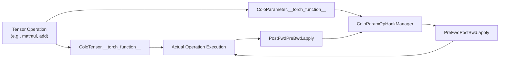
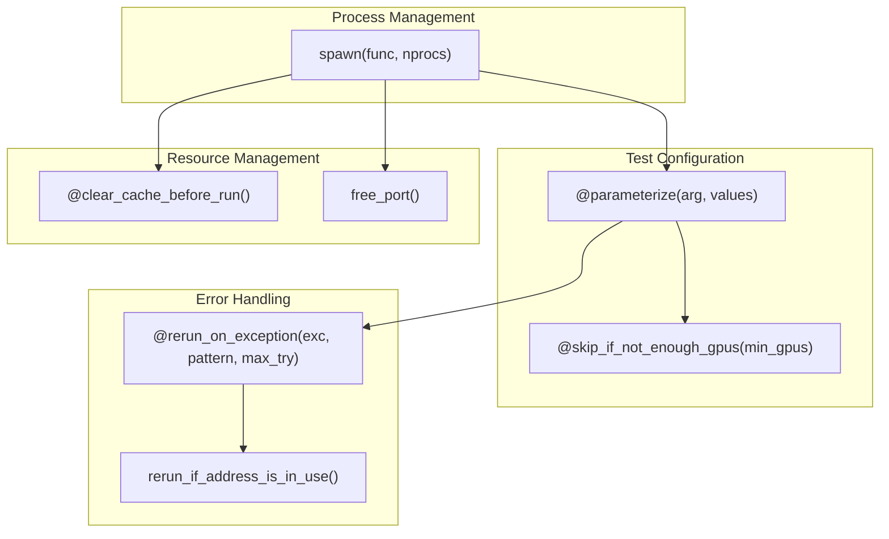
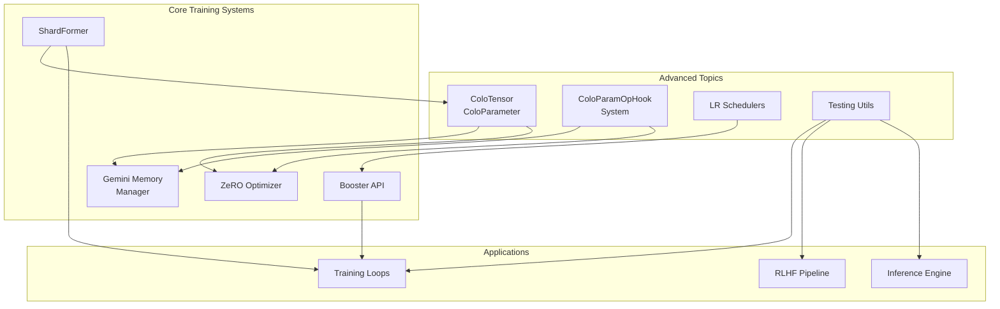

<!-- source: DeepWiki mcp.deepwiki.com · repo hpcaitech/ColossalAI · page 10 Advanced Topics · fetched 2026-10-21 -->

# Advanced Topics

<details>
<summary>Relevant source files</summary>

The following files were used as context for generating this wiki page:

- [colossalai/nn/lr_scheduler/delayed.py](colossalai/nn/lr_scheduler/delayed.py)
- [colossalai/tensor/__init__.py](colossalai/tensor/__init__.py)
- [colossalai/tensor/colo_parameter.py](colossalai/tensor/colo_parameter.py)
- [colossalai/tensor/colo_tensor.py](colossalai/tensor/colo_tensor.py)
- [colossalai/tensor/param_op_hook.py](colossalai/tensor/param_op_hook.py)
- [tests/test_optimizer/test_lr_scheduler.py](tests/test_optimizer/test_lr_scheduler.py)

</details>


This section covers specialized features and advanced implementation details in ColossalAI for power users and contributors. These topics enable extending the framework's capabilities, customizing training workflows, and ensuring code quality in distributed environments.

The advanced topics are organized into three main areas:

1. **Custom Tensor Operations** ([10.1](#10.1)) - ColoTensor and ColoParameter classes that intercept operations for distributed training optimizations
2. **Learning Rate Schedulers** ([10.2](#10.2)) - Multi-stage learning rate management with warmup and delay phases
3. **Distributed Training Testing** ([10.3](#10.3)) - Utilities for testing distributed training code across multiple processes

For information about basic distributed training, see [Getting Started](#2). For parallelism strategies, see [Parallelism Techniques](#3).

## Overview of Advanced Systems

### Custom Tensor Operations System

ColossalAI provides custom tensor classes that extend PyTorch's tensor system to enable operation interception and hook-based optimizations for distributed training. The system consists of three main components:

**Tensor Operation Interception Flow**


Sources: [colossalai/tensor/colo_tensor.py:66-92](), [colossalai/tensor/colo_parameter.py:55-70](), [colossalai/tensor/param_op_hook.py:85-111]()

| Component | Purpose | Key Methods |
|-----------|---------|-------------|
| `ColoTensor` | Base tensor class for operation interception | `__torch_function__`, `__new__`, `__deepcopy__` |
| `ColoParameter` | Parameter-specific tensor with hook support | `__torch_function__` (with hook triggers) |
| `ColoParamOpHook` | Abstract base class for custom hooks | `pre_forward`, `post_forward`, `pre_backward`, `post_backward` |
| `ColoParamOpHookManager` | Static manager for hook lifecycle | `use_hooks`, `pre_op`, `post_op`, `rewrite_op` |

The hook system enables memory optimizations (e.g., gradient sharding, parameter offloading) by intercepting parameter operations at critical points in the forward and backward passes. See [Custom Tensor Operations](#10.1) for implementation details.

Sources: [colossalai/tensor/colo_tensor.py:39-103](), [colossalai/tensor/colo_parameter.py:46-96](), [colossalai/tensor/param_op_hook.py:9-164]()

### Learning Rate Scheduler System

ColossalAI provides multi-stage learning rate schedulers that combine warmup phases, flat learning rate phases, and standard PyTorch schedulers. The system is built on a two-stage scheduler architecture:

**Learning Rate Scheduler Hierarchy**
```mermaid
classDiagram
    class "_LRScheduler" {
        <<torch.optim.lr_scheduler>>
        +optimizer
        +last_epoch
        +step()
        +get_lr()
    }
    class "TwoStageScheduler" {
        +after_scheduler: _LRScheduler
        +finished: bool
        +state_dict()
        +load_state_dict()
    }
    class "DelayerScheduler" {
        +delay_epochs: int
        +get_lr()
        +step()
    }
    class "WarmupScheduler" {
        +warmup_epochs: int
        +get_lr()
        +step()
    }
    class "WarmupDelayerScheduler" {
        +warmup_epochs: int
        +delay_epochs: int
        +get_lr()
        +step()
    }
    
    _LRScheduler <|-- TwoStageScheduler
    TwoStageScheduler <|-- DelayerScheduler
    TwoStageScheduler <|-- WarmupScheduler
    TwoStageScheduler <|-- WarmupDelayerScheduler
```

Sources: [colossalai/nn/lr_scheduler/delayed.py:24-180]()

| Scheduler | Phases | Use Case |
|-----------|--------|----------|
| `DelayerScheduler` | Flat LR → After Scheduler | Delay complex schedules until model stabilizes |
| `WarmupScheduler` | Linear Warmup → After Scheduler | Standard warmup for large batch training |
| `WarmupDelayerScheduler` | Linear Warmup → Flat LR → After Scheduler | Combined warmup and stabilization |

All schedulers inherit from `TwoStageScheduler`, which manages transitioning from an initial phase to a standard PyTorch scheduler. See [Learning Rate Schedulers](#10.2) for configuration examples.

Sources: [colossalai/nn/lr_scheduler/delayed.py:24-180]()

### Distributed Training Testing Framework

ColossalAI provides utilities for testing distributed training code across multiple processes. The testing framework addresses common challenges:

**Testing Utilities Organization**


Sources: [colossalai/testing/utils.py:16-252]()

| Challenge | Solution | Utility |
|-----------|----------|---------|
| Multiple process coordination | Process spawning with rank assignment | `spawn(func, nprocs)` |
| Testing parameter combinations | Parameterized test generation | `@parameterize(argument, values)` |
| Port conflicts | Automatic retry on address errors | `@rerun_if_address_is_in_use()` |
| Insufficient GPU resources | Conditional test execution | `@skip_if_not_enough_gpus(min_gpus)` |
| CUDA cache interference | Pre-test cache clearing | `@clear_cache_before_run()` |

See [Distributed Training Testing](#10.3) for detailed usage patterns and examples.

Sources: [colossalai/testing/utils.py:16-252]()

## Integration with Core Systems

These advanced topics integrate with ColossalAI's core systems in specific ways:

**System Integration Points**


Sources: [colossalai/tensor/colo_parameter.py:1-97](), [colossalai/tensor/param_op_hook.py:1-165](), [colossalai/nn/lr_scheduler/delayed.py:1-180]()

### Custom Tensor Operations in Memory Optimization

`ColoParameter` and `ColoParamOpHook` are fundamental to implementing ZeRO and Gemini memory optimizations:

- **ZeRO Stages 1/2/3**: Hooks enable parameter/gradient sharding by intercepting operations and managing partitioned states
- **Gemini**: Hooks implement heterogeneous memory management by moving parameters between GPU/CPU/NVMe based on access patterns
- **ShardFormer**: Uses `ColoTensor` to track distributed tensor states during model transformation

See [ZeRO](#3.1), [Gemini](#3.2), and [ShardFormer](#5) for details on these integrations.

Sources: [colossalai/tensor/param_op_hook.py:9-164]()

### Learning Rate Schedulers in Training Pipelines

The scheduler system integrates with the Booster API for training orchestration:

- **Booster wrapping**: Schedulers are wrapped by `booster.boost()` for distributed training compatibility
- **State management**: `TwoStageScheduler.state_dict()` enables checkpoint saving/loading
- **Multi-stage training**: Warmup and delay phases support large-batch training and transfer learning workflows

See [Booster API](#4) for integration examples.

Sources: [colossalai/nn/lr_scheduler/delayed.py:30-53]()

### Testing Framework for Quality Assurance

The testing utilities validate distributed training correctness:

- **Plugin testing**: Verify HybridParallelPlugin, ZeroPlugin, GeminiPlugin functionality across process configurations
- **ShardFormer testing**: Validate model transformation correctness with different parallelism strategies
- **Inference testing**: Test RequestHandler, KVCacheManager, and RPCInferenceEngine under load

See [Distributed Training Testing](#10.3) for testing patterns.

Sources: [colossalai/testing/utils.py:1-252]()

## Summary

Advanced usage of ColossalAI often requires interacting with these specialized systems:

1. **Custom tensor operations** - Using `ColoTensor` and `ColoParameter` for distributed-aware tensor operations
2. **Parameter operation hooks** - Implementing custom hooks to control parameter behavior during training
3. **Distributed testing utilities** - Simplifying the testing of distributed training code
4. **Cluster management** - Coordinating processes and device meshes for efficient parallel training

These advanced topics provide the foundation for implementing custom optimizations and extending ColossalAI's capabilities for specialized use cases.

---

