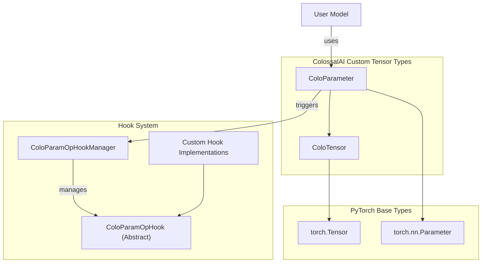
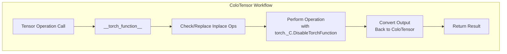
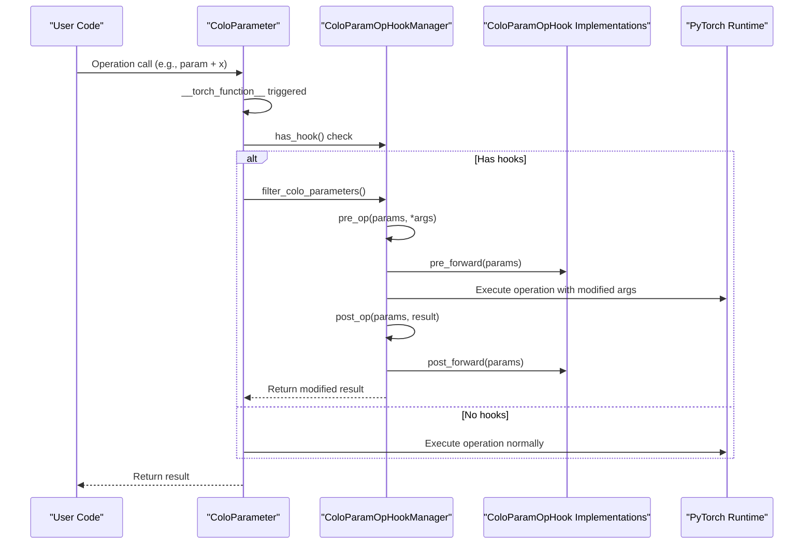
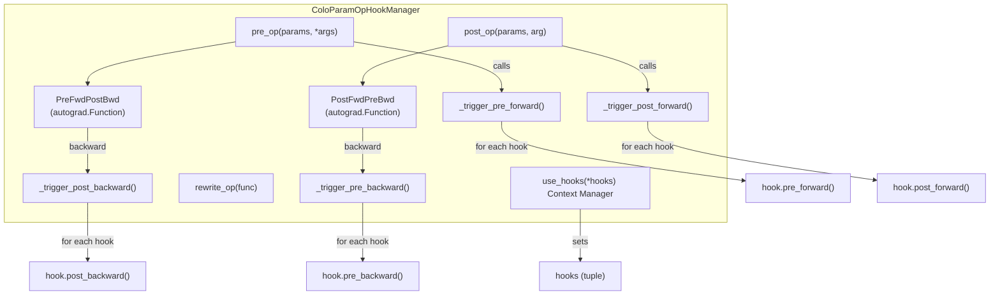

<!-- source: DeepWiki mcp.deepwiki.com · repo hpcaitech/ColossalAI · page 10.1 Custom Tensor Operations · fetched 2026-10-21 -->

# Custom Tensor Operations

<details>
<summary>Relevant source files</summary>

The following files were used as context for generating this wiki page:

- [colossalai/tensor/__init__.py](colossalai/tensor/__init__.py)
- [colossalai/tensor/colo_parameter.py](colossalai/tensor/colo_parameter.py)
- [colossalai/tensor/colo_tensor.py](colossalai/tensor/colo_tensor.py)
- [colossalai/tensor/param_op_hook.py](colossalai/tensor/param_op_hook.py)

</details>


This page explores the custom tensor operations in ColossalAI, which extend PyTorch's tensor functionality to enable distributed training optimizations. These custom tensor types and operation hooks provide the foundation for many of ColossalAI's memory optimization techniques and parallelism strategies.

## Overview of Custom Tensor System

ColossalAI implements custom tensor types that extend PyTorch's native tensors, providing hooks into tensor operations that can be used to implement various optimizations for distributed training. The custom tensor system consists of two main components:

1. **Custom Tensor Types** - Extended versions of PyTorch tensors
2. **Operation Hooks** - Mechanism to intercept and modify tensor operations



**Diagram: ColossalAI Custom Tensor Types and Hook System**

Sources: [colossalai/tensor/colo_tensor.py](colossalai/tensor/colo_tensor.py), [colossalai/tensor/colo_parameter.py](colossalai/tensor/colo_parameter.py), [colossalai/tensor/param_op_hook.py](colossalai/tensor/param_op_hook.py)

## Custom Tensor Types

### ColoTensor

The `ColoTensor` class extends PyTorch's `torch.Tensor` to intercept tensor operations through PyTorch's `__torch_function__` mechanism. This makes it possible to modify how tensor operations work without changing the API that users interact with.



**Diagram: ColoTensor Operation Flow**

Key characteristics of `ColoTensor`:

- Acts as a wrapper around regular PyTorch tensors
- Intercepts tensor operations through `__torch_function__`
- Converts inplace operations to their non-inplace equivalents
- Ensures outputs are properly converted back to `ColoTensor` type

From [colossalai/tensor/colo_tensor.py:39-102](colossalai/tensor/colo_tensor.py), we can see that `ColoTensor` implements:

- `__new__` method to create a new tensor subclass
- `__torch_function__` to intercept operations
- `__deepcopy__` to ensure proper copying behavior

The handling of inplace operations is particularly important:

```python
# Defined mapping of inplace operations to their non-inplace equivalents
INPALCE_MAPPING = {
    torch.Tensor.add_: torch.Tensor.add,
    torch.Tensor.sub_: torch.Tensor.sub,
    torch.Tensor.mul_: torch.Tensor.mul,
    torch.Tensor.div_: torch.Tensor.div,
}
```

When an inplace operation is detected, it's replaced with its non-inplace version and the `inplace` keyword argument is set to `False`:

```python
# replace the in-place function
if func in INPALCE_MAPPING:
    func = INPALCE_MAPPING[func]
# set the 'inplace' kwargs to False
if "inplace" in kwargs:
    kwargs["inplace"] = False
```

Sources: [colossalai/tensor/colo_tensor.py:6-11](colossalai/tensor/colo_tensor.py), [colossalai/tensor/colo_tensor.py:83-88](colossalai/tensor/colo_tensor.py)

### ColoParameter

`ColoParameter` extends both `ColoTensor` and `torch.nn.Parameter`, making it usable as a module parameter while providing the custom operation interception functionality. More importantly, it adds the ability to trigger parameter operation hooks.



**Diagram: ColoParameter Operation Flow**

Key features of `ColoParameter`:

- Inherits from both `ColoTensor` and `torch.nn.Parameter`
- Integrates with the hook system for parameter operations
- Filters operations to identify which ones should trigger hooks
- Enables pre-operation and post-operation processing

From [colossalai/tensor/colo_parameter.py:46-96](colossalai/tensor/colo_parameter.py), we can see the implementation, with the most important part being the `__torch_function__` method that determines when to trigger hooks.

Sources: [colossalai/tensor/colo_parameter.py:46-96](colossalai/tensor/colo_parameter.py)

## Parameter Operation Hook System

The hook system allows customization of operations involving `ColoParameter` objects. This system is crucial for implementing advanced features like custom memory management, communication patterns, and gradient manipulation.

### ColoParamOpHook

The `ColoParamOpHook` is an abstract base class defining the interface for parameter operation hooks:

```python
class ColoParamOpHook(ABC):
    @abstractmethod
    def pre_forward(self, params: List[torch.Tensor]) -> None:
        pass

    @abstractmethod
    def post_forward(self, params: List[torch.Tensor]) -> None:
        pass

    @abstractmethod
    def pre_backward(self, params: List[torch.Tensor]) -> None:
        pass

    @abstractmethod
    def post_backward(self, params: List[torch.Tensor]) -> None:
        pass

    def rewrite_op(self, func) -> Any:
        return func
```

It defines four key hook points in the computation graph:
- **pre_forward**: Before forward computation using parameters
- **post_forward**: After forward computation using parameters
- **pre_backward**: Before backward computation through parameters
- **post_backward**: After backward computation through parameters

This design enables a wide range of customizations at different stages of the computation.

Sources: [colossalai/tensor/param_op_hook.py:9-35](colossalai/tensor/param_op_hook.py)

### ColoParamOpHookManager

The `ColoParamOpHookManager` provides static methods to manage hooks and orchestrate hook execution:



**Diagram: ColoParamOpHookManager Structure**

Key components:

1. **Context Manager**: `use_hooks(*hooks)` provides a simple way to apply hooks within a specific context
2. **Pre/Post Operation Methods**: `pre_op` and `post_op` prepare arguments and results for hook processing
3. **Autograd Functions**: `PreFwdPostBwd` and `PostFwdPreBwd` ensure backward hooks are triggered during backpropagation
4. **Hook Triggers**: Call the appropriate hook methods on all registered hooks

The manager's design ensures that:
- Forward hooks are called at the appropriate time during forward computation
- Backward hooks are called at the appropriate time during backpropagation
- Arguments and return values are properly processed before and after operations

Sources: [colossalai/tensor/param_op_hook.py:37-164](colossalai/tensor/param_op_hook.py)

## Using Custom Tensor Operations

### Creating Custom Parameter Hook

To implement custom parameter behavior, you can create a custom hook class:

```python
class MyCustomHook(ColoParamOpHook):
    def pre_forward(self, params: List[torch.Tensor]) -> None:
        # Preprocessing before parameter is used in forward pass
        pass
        
    def post_forward(self, params: List[torch.Tensor]) -> None:
        # Postprocessing after parameter is used in forward pass
        pass
        
    def pre_backward(self, params: List[torch.Tensor]) -> None:
        # Preprocessing before gradient computation for parameter
        pass
        
    def post_backward(self, params: List[torch.Tensor]) -> None:
        # Postprocessing after gradient computation for parameter
        pass
```

### Applying Hooks with Context Manager

Hooks can be applied using the context manager:

```python
my_hook = MyCustomHook()
with ColoParamOpHookManager.use_hooks(my_hook):
    # Operations on ColoParameter within this context
    # will trigger the hook methods
    output = model(input)
    loss = criterion(output, target)
    loss.backward()
```

## Integration with Distributed Training

Custom tensor operations in ColossalAI are particularly useful for distributed training scenarios. They enable:

1. **Transparent Memory Management**: Hooks can swap tensors between devices or memory tiers without user intervention
2. **Communication Operation Injection**: Insert communication operations (like all-reduce) at appropriate points
3. **Custom Gradient Handling**: Modify gradients before they're applied to parameters
4. **Optimization Techniques**: Implement Zero Redundancy Optimizer (ZeRO) stages transparently

These capabilities form the basis for many advanced features described in other sections, such as:
- ZeRO optimization techniques (see [Zero Redundancy Optimizer (ZeRO)](#3.1))
- Gemini memory management system (see [Gemini: Memory Management System](#3.2))
- Various parallelism strategies (see [Parallelism Techniques](#3))

## Common Use Cases

| Use Case | Hook Methods Used | Description |
|----------|-------------------|-------------|
| Parameter Sharding | pre_forward, post_backward | Gather sharded parameters before use, re-shard after gradient computation |
| Gradient Accumulation | post_backward | Accumulate gradients over multiple iterations |
| Activation Checkpointing | pre_forward, post_forward | Save activations for backward pass to reduce memory usage |
| Offloading | pre_forward, post_forward, post_backward | Move parameters between CPU and GPU as needed |
| Custom Communication | post_backward | Add custom communication operations for gradient synchronization |

## Conclusion

The custom tensor operations system in ColossalAI provides a powerful abstraction layer that allows the framework to implement advanced distributed training optimizations while maintaining a simple API for users. By extending PyTorch's native tensors and providing hooks into tensor operations, ColossalAI can transparently introduce complex behaviors like memory management, communication optimization, and gradient manipulation without requiring users to modify their model code.

Sources: [colossalai/tensor/__init__.py:1-18](colossalai/tensor/__init__.py), [colossalai/tensor/colo_tensor.py](colossalai/tensor/colo_tensor.py), [colossalai/tensor/colo_parameter.py](colossalai/tensor/colo_parameter.py), [colossalai/tensor/param_op_hook.py](colossalai/tensor/param_op_hook.py)

---

