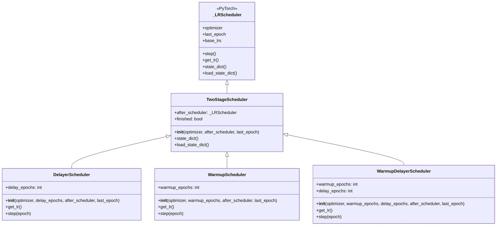
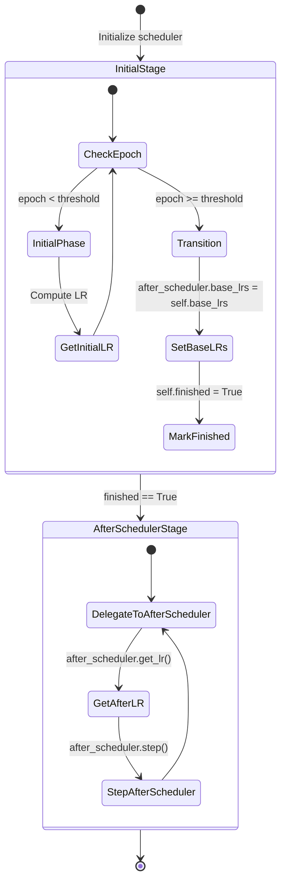
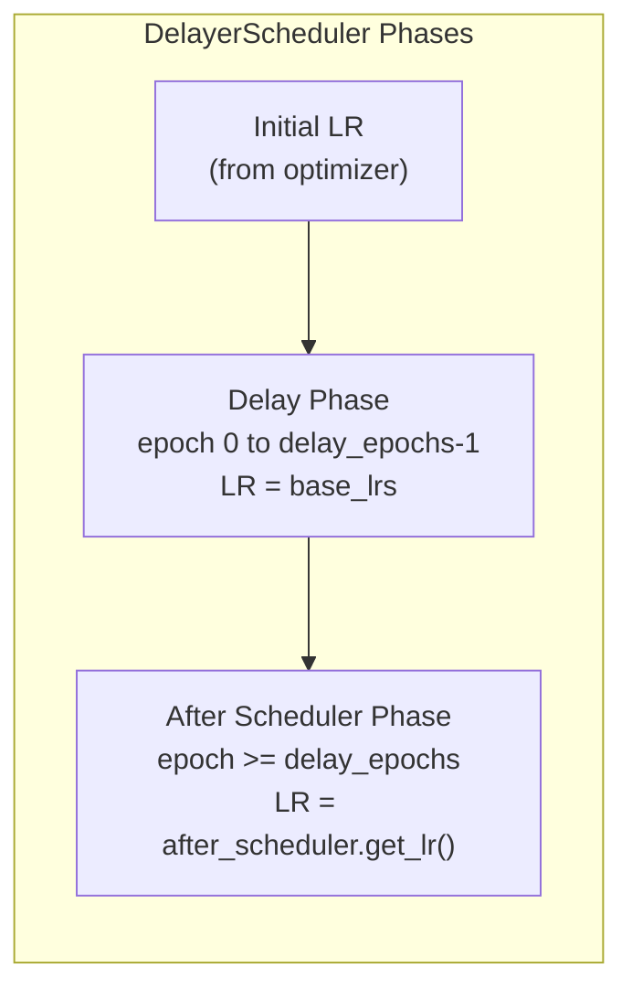
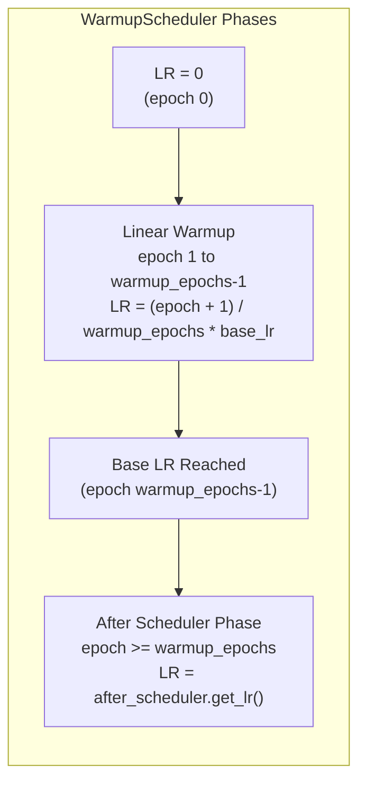
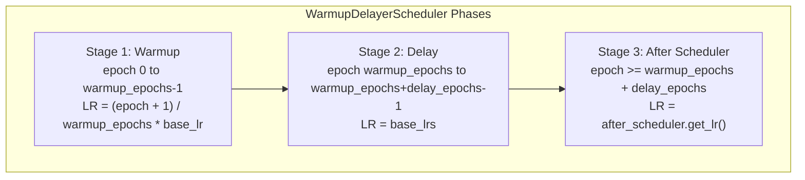

<!-- source: DeepWiki mcp.deepwiki.com · repo hpcaitech/ColossalAI · page 10.2 Learning Rate Schedulers · fetched 2026-10-21 -->

# Learning Rate Schedulers

<details>
<summary>Relevant source files</summary>

The following files were used as context for generating this wiki page:

- [colossalai/nn/lr_scheduler/delayed.py](colossalai/nn/lr_scheduler/delayed.py)
- [tests/test_optimizer/test_lr_scheduler.py](tests/test_optimizer/test_lr_scheduler.py)

</details>


## Purpose and Scope

This document describes ColossalAI's learning rate scheduler system, which provides multi-stage learning rate scheduling strategies for distributed training workloads. The scheduler framework supports warmup phases, delayed scheduling, and composite scheduling patterns that combine multiple stages of learning rate adjustment.

For information about optimizer wrappers and memory-efficient optimization strategies, see [Zero Redundancy Optimizer (ZeRO)](#3.1) and [Gemini: Memory Management System](#3.2). For integration of schedulers with the training orchestration layer, see [Booster API](#4).

---

## Overview

Learning rate schedulers control how the learning rate changes during training. In large-scale distributed training scenarios, effective learning rate scheduling is critical for model convergence and stability. ColossalAI provides specialized schedulers that support:

- **Warmup phases**: Gradually increase learning rate from zero to avoid training instability in early epochs
- **Delayed scheduling**: Maintain a constant learning rate for a specified period before applying complex scheduling logic
- **Composite scheduling**: Combine multiple scheduling strategies in sequence
- **State persistence**: Save and restore scheduler state for training resumption

---

## Architecture: Two-Stage Scheduler Pattern

The scheduler system is built around a two-stage pattern implemented in the `TwoStageScheduler` base class. This pattern separates an initial scheduling phase (warmup, delay, or both) from a subsequent scheduling phase that uses any standard PyTorch learning rate scheduler.

### Class Hierarchy



**Sources**: [colossalai/nn/lr_scheduler/delayed.py:1-180]()

### Two-Stage Execution Flow



**Sources**: [colossalai/nn/lr_scheduler/delayed.py:24-54](), [colossalai/nn/lr_scheduler/delayed.py:74-94]()

---

## Scheduler Implementations

### DelayerScheduler

The `DelayerScheduler` maintains a flat (constant) learning rate for a specified number of epochs before transitioning to another scheduler. This is useful when you want to establish stable training dynamics before applying more complex scheduling logic.

#### Configuration Parameters

| Parameter | Type | Description |
|-----------|------|-------------|
| `optimizer` | `torch.optim.Optimizer` | The optimizer whose learning rate will be scheduled |
| `delay_epochs` | `int` | Number of epochs to maintain the base learning rate (must be >= 0) |
| `after_scheduler` | `_LRScheduler` | The scheduler to apply after the delay period |
| `last_epoch` | `int` | Index of the last epoch, defaults to -1 for starting from beginning |

#### Learning Rate Progression



#### Implementation Details

The `DelayerScheduler.get_lr()` method [colossalai/nn/lr_scheduler/delayed.py:74-82]() implements the logic:

1. **During delay phase** (`last_epoch < delay_epochs`): Returns `base_lrs` unchanged
2. **At transition** (`last_epoch == delay_epochs` and `finished == False`): 
   - Sets `after_scheduler.base_lrs = self.base_lrs` to ensure continuity
   - Marks `finished = True`
3. **After transition** (`finished == True`): Delegates to `after_scheduler.get_lr()`

The `step()` method [colossalai/nn/lr_scheduler/delayed.py:84-93]() handles epoch progression:
- Before finishing: Calls parent class step
- After finishing: Delegates to `after_scheduler.step()`, adjusting epoch count by subtracting `delay_epochs`

**Sources**: [colossalai/nn/lr_scheduler/delayed.py:56-94]()

---

### WarmupScheduler

The `WarmupScheduler` applies a linear warmup schedule that gradually increases the learning rate from zero to the base learning rate over a specified number of epochs, then transitions to another scheduler.

#### Configuration Parameters

| Parameter | Type | Description |
|-----------|------|-------------|
| `optimizer` | `torch.optim.Optimizer` | The optimizer whose learning rate will be scheduled |
| `warmup_epochs` | `int` | Number of epochs for linear warmup (converted to int internally) |
| `after_scheduler` | `_LRScheduler` | The scheduler to apply after warmup |
| `last_epoch` | `int` | Index of the last epoch, defaults to -1 |

#### Learning Rate Progression



#### Linear Warmup Formula

The warmup learning rate is calculated as [colossalai/nn/lr_scheduler/delayed.py:119]():

```
lr = [(last_epoch + 1) / warmup_epochs * base_lr for base_lr in base_lrs]
```

This produces a linear ramp from 0 (at epoch 0) to `base_lr` (at epoch `warmup_epochs - 1`).

**Sources**: [colossalai/nn/lr_scheduler/delayed.py:96-131]()

---

### WarmupDelayerScheduler

The `WarmupDelayerScheduler` combines both warmup and delay phases. It first applies linear warmup, then maintains a flat learning rate, and finally transitions to a third scheduler. This three-stage approach provides maximum control over the early training dynamics.

#### Configuration Parameters

| Parameter | Type | Description |
|-----------|------|-------------|
| `optimizer` | `torch.optim.Optimizer` | The optimizer whose learning rate will be scheduled |
| `warmup_epochs` | `int` | Number of epochs for linear warmup (must be >= 0) |
| `delay_epochs` | `int` | Number of epochs to maintain flat LR after warmup (must be >= 0) |
| `after_scheduler` | `_LRScheduler` | The scheduler to apply after warmup + delay |
| `last_epoch` | `int` | Index of the last epoch, defaults to -1 |

#### Three-Stage Progression



#### Phase Transition Logic

The `get_lr()` method [colossalai/nn/lr_scheduler/delayed.py:155-168]() implements three-phase logic:

1. **Warmup phase** (`last_epoch < warmup_epochs`): Returns linear warmup LR
2. **Delay phase** (`warmup_epochs <= last_epoch < warmup_epochs + delay_epochs`): Returns `base_lrs`
3. **After scheduler phase** (`last_epoch >= warmup_epochs + delay_epochs`):
   - On first call: Resets optimizer parameter group LRs to `base_lrs` [colossalai/nn/lr_scheduler/delayed.py:159-161]()
   - Sets `after_scheduler.base_lrs = self.base_lrs`
   - Marks `finished = True`
   - Delegates to `after_scheduler.get_lr()`

**Sources**: [colossalai/nn/lr_scheduler/delayed.py:133-179]()

---

## State Management

All schedulers inherit state serialization capabilities from `TwoStageScheduler` and PyTorch's `_LRScheduler`.

### State Dictionary Structure

The `TwoStageScheduler.state_dict()` method [colossalai/nn/lr_scheduler/delayed.py:30-38]() produces:

| Key | Description |
|-----|-------------|
| `last_epoch` | Current epoch index |
| `finished` | Boolean indicating if initial phase is complete |
| `base_lrs` | Base learning rates for each parameter group |
| `warmup_epochs` | (If applicable) Number of warmup epochs |
| `delay_epochs` | (If applicable) Number of delay epochs |
| `after_scheduler_type` | Class name of the after_scheduler |
| `after_scheduler_dict` | Serialized state of the after_scheduler |

### State Loading

The `load_state_dict()` method [colossalai/nn/lr_scheduler/delayed.py:40-53]() restores scheduler state:

1. Checks for `after_scheduler_dict` in state
2. If present, loads state into `after_scheduler` via `after_scheduler.load_state_dict()`
3. If missing, logs a warning but continues (may cause unexpected behavior)
4. Loads remaining state into the scheduler instance

This enables training checkpoint/resume workflows where scheduler state must be preserved across interruptions.

**Sources**: [colossalai/nn/lr_scheduler/delayed.py:30-53]()

---

## Integration with Training Loop

### Basic Usage Pattern

```mermaid
sequenceDiagram
    participant User as "Training Script"
    participant Opt as "torch.optim.Optimizer"
    participant Sched as "Scheduler<br/>(e.g., WarmupScheduler)"
    participant After as "after_scheduler<br/>(e.g., CosineAnnealingLR)"
    
    User->>Opt: Initialize optimizer
    User->>After: Create after_scheduler(optimizer)
    User->>Sched: Create WarmupScheduler(optimizer, after_scheduler)
    
    loop Training Loop
        User->>User: Forward pass
        User->>User: Backward pass
        User->>Opt: optimizer.step()
        User->>Sched: scheduler.step()
        
        alt During Warmup Phase
            Sched->>Sched: Compute warmup LR
            Sched->>Opt: Update param_groups['lr']
        else After Warmup Phase
            Sched->>After: Delegate to after_scheduler.step()
            After->>After: Compute scheduled LR
            After->>Opt: Update param_groups['lr']
        end
    end
```

### Example with Booster Integration

When using the Booster API (see [Booster API](#4)), the scheduler is wrapped and managed automatically:

```
booster = Booster(plugin=plugin)
model, optimizer, criterion, dataloader, lr_scheduler = booster.boost(
    model, optimizer, criterion, dataloader, lr_scheduler
)
```

The Booster returns a wrapped scheduler that maintains the same interface but integrates with the distributed training infrastructure.

**Sources**: [colossalai/nn/lr_scheduler/delayed.py:1-180]()

---

## Additional Schedulers

While this document focuses on the two-stage scheduler framework, ColossalAI provides additional schedulers:

### CosineAnnealingWarmupLR

Referenced in tests [tests/test_optimizer/test_lr_scheduler.py:4-16](), this scheduler combines cosine annealing with warmup. It supports:

- `total_steps`: Total training steps
- `warmup_steps`: Number of warmup steps
- State dictionary serialization for checkpoint compatibility

The test demonstrates state save/load behavior across multiple steps [tests/test_optimizer/test_lr_scheduler.py:12-16]().

**Sources**: [tests/test_optimizer/test_lr_scheduler.py:1-21]()

---

## Implementation Notes

### _enable_get_lr_call Context Manager

The `_enable_get_lr_call` helper class [colossalai/nn/lr_scheduler/delayed.py:12-22]() manages the internal PyTorch flag `_get_lr_called_within_step`. This flag prevents warnings when calling `get_lr()` outside of a `step()` call, which is necessary when the two-stage scheduler queries the after_scheduler's learning rate.

### PyTorch Version Compatibility

The module handles PyTorch version differences [colossalai/nn/lr_scheduler/delayed.py:4-7]():
- PyTorch >= 2.0.0: Imports `LRScheduler` (renamed from `_LRScheduler`)
- PyTorch < 2.0.0: Imports `_LRScheduler` (original name)

This ensures compatibility across PyTorch versions while using the same base class.

**Sources**: [colossalai/nn/lr_scheduler/delayed.py:1-22]()

---

## Use Cases and Recommendations

| Scenario | Recommended Scheduler | Configuration |
|----------|----------------------|---------------|
| Standard training with warmup | `WarmupScheduler` | Set `warmup_epochs` to 5-10% of total epochs, use `CosineAnnealingLR` or `StepLR` as after_scheduler |
| Fine-tuning pre-trained models | `DelayerScheduler` | Set `delay_epochs` to maintain initial LR while model adapts, then apply decay schedule |
| Large-batch training | `WarmupDelayerScheduler` | Use warmup to stabilize gradients, delay to establish dynamics, then apply learning rate decay |
| Curriculum learning | `DelayerScheduler` | Maintain constant LR during each curriculum stage, transition schedulers between stages |

### Parameter Selection Guidelines

- **Warmup epochs**: Typically 1-10% of total training epochs. Larger models and higher learning rates benefit from longer warmup.
- **Delay epochs**: Use when initial training dynamics need stabilization. Common in transfer learning (5-20% of total epochs).
- **After scheduler choice**: 
  - `CosineAnnealingLR`: Smooth decay, good for most scenarios
  - `StepLR`: Periodic decay, useful for milestone-based training
  - `ReduceLROnPlateau`: Adaptive decay based on validation metrics

**Sources**: [colossalai/nn/lr_scheduler/delayed.py:56-179]()

---

