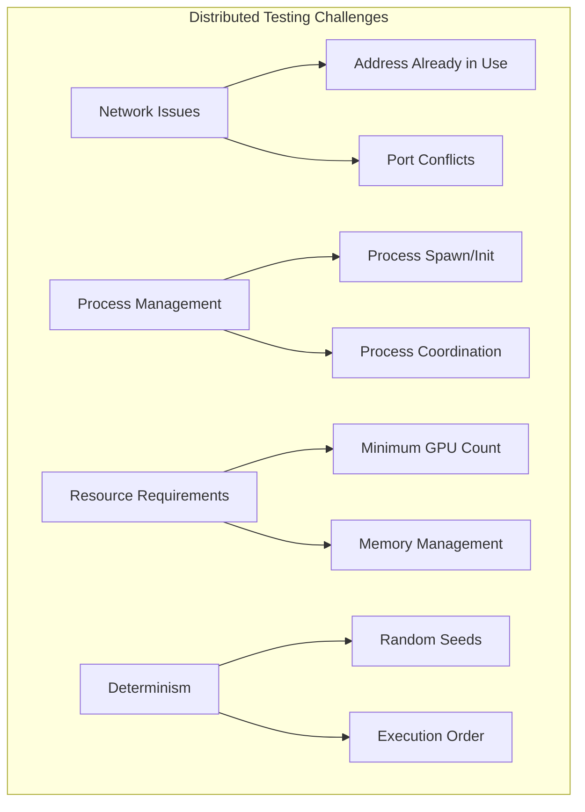
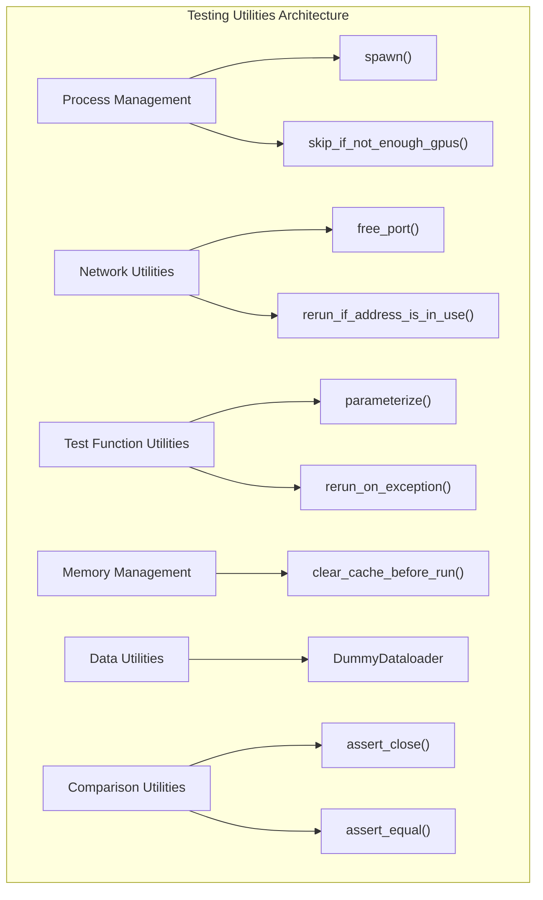
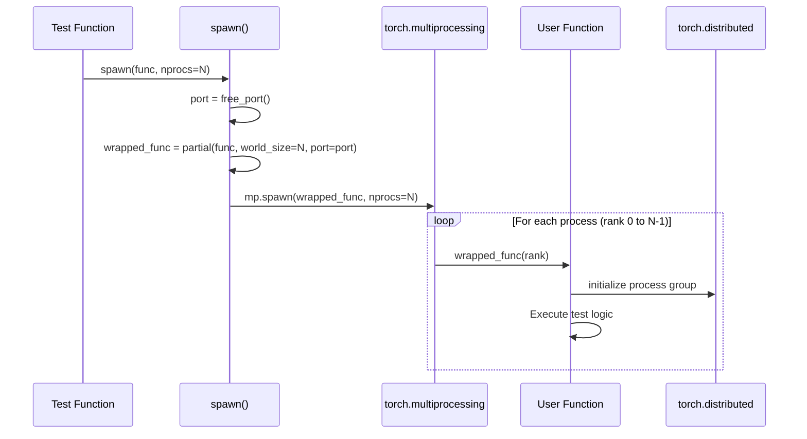
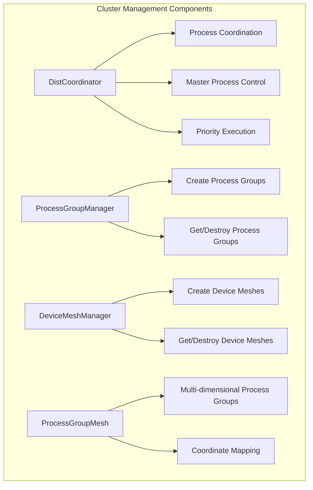
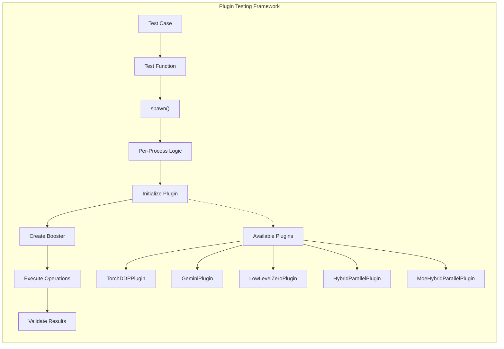

<!-- source: DeepWiki mcp.deepwiki.com · repo hpcaitech/ColossalAI · page 10.3 Distributed Training Testing · fetched 2026-10-21 -->

# Distributed Training Testing

<details>
<summary>Relevant source files</summary>

The following files were used as context for generating this wiki page:

- [.github/workflows/build_on_pr.yml](.github/workflows/build_on_pr.yml)
- [.github/workflows/build_on_schedule.yml](.github/workflows/build_on_schedule.yml)
- [.github/workflows/compatiblity_test_on_dispatch.yml](.github/workflows/compatiblity_test_on_dispatch.yml)
- [.github/workflows/compatiblity_test_on_pr.yml](.github/workflows/compatiblity_test_on_pr.yml)
- [.github/workflows/compatiblity_test_on_schedule.yml](.github/workflows/compatiblity_test_on_schedule.yml)
- [.github/workflows/doc_check_on_pr.yml](.github/workflows/doc_check_on_pr.yml)
- [.github/workflows/doc_test_on_pr.yml](.github/workflows/doc_test_on_pr.yml)
- [.github/workflows/doc_test_on_schedule.yml](.github/workflows/doc_test_on_schedule.yml)
- [.github/workflows/draft_github_release_post_after_merge.yml](.github/workflows/draft_github_release_post_after_merge.yml)
- [.github/workflows/example_check_on_dispatch.yml](.github/workflows/example_check_on_dispatch.yml)
- [.github/workflows/example_check_on_pr.yml](.github/workflows/example_check_on_pr.yml)
- [.github/workflows/example_check_on_schedule.yml](.github/workflows/example_check_on_schedule.yml)
- [.github/workflows/release_docker_after_publish.yml](.github/workflows/release_docker_after_publish.yml)
- [.github/workflows/release_nightly_on_schedule.yml](.github/workflows/release_nightly_on_schedule.yml)
- [.github/workflows/release_pypi_after_merge.yml](.github/workflows/release_pypi_after_merge.yml)
- [.github/workflows/release_test_pypi_before_merge.yml](.github/workflows/release_test_pypi_before_merge.yml)
- [.github/workflows/report_leaderboard_to_lark.yml](.github/workflows/report_leaderboard_to_lark.yml)
- [.github/workflows/run_chatgpt_examples.yml](.github/workflows/run_chatgpt_examples.yml)
- [.github/workflows/run_chatgpt_unit_tests.yml](.github/workflows/run_chatgpt_unit_tests.yml)
- [.github/workflows/run_colossalqa_unit_tests.yml](.github/workflows/run_colossalqa_unit_tests.yml)
- [.github/workflows/scripts/generate_leaderboard_and_send_to_lark.py](.github/workflows/scripts/generate_leaderboard_and_send_to_lark.py)
- [colossalai/__init__.py](colossalai/__init__.py)
- [colossalai/shardformer/layer/loss.py](colossalai/shardformer/layer/loss.py)
- [colossalai/shardformer/modeling/deepseek_v3.py](colossalai/shardformer/modeling/deepseek_v3.py)
- [colossalai/shardformer/modeling/qwen2.py](colossalai/shardformer/modeling/qwen2.py)
- [colossalai/shardformer/policies/auto_policy.py](colossalai/shardformer/policies/auto_policy.py)
- [colossalai/shardformer/policies/deepseek_v3.py](colossalai/shardformer/policies/deepseek_v3.py)
- [colossalai/shardformer/policies/qwen2.py](colossalai/shardformer/policies/qwen2.py)
- [examples/language/deepseek/benchmark.py](examples/language/deepseek/benchmark.py)
- [tests/kit/model_zoo/transformers/__init__.py](tests/kit/model_zoo/transformers/__init__.py)
- [tests/kit/model_zoo/transformers/deepseek_v3.py](tests/kit/model_zoo/transformers/deepseek_v3.py)
- [tests/test_shardformer/test_model/test_shard_deepseek_v3.py](tests/test_shardformer/test_model/test_shard_deepseek_v3.py)
- [tests/test_shardformer/test_model/test_shard_qwen2.py](tests/test_shardformer/test_model/test_shard_qwen2.py)
- [version.txt](version.txt)

</details>


## Purpose and Scope

This document provides a comprehensive guide to testing distributed training code in ColossalAI. It covers utility functions, testing patterns, and best practices to effectively test distributed training implementations across multiple processes and accelerators. This document focuses specifically on testing infrastructure rather than the distributed training implementations themselves. For information about parallelism techniques, see [Parallelism Techniques](#3).

## Overview of Distributed Testing Challenges

Testing distributed deep learning code presents unique challenges compared to testing single-process code:

1. Processes must be coordinated across multiple devices
2. Race conditions can cause intermittent failures
3. Address conflicts between concurrent test runs
4. Ensuring proper synchronization and communication between processes
5. Testing with different numbers of devices and configurations



Sources: [colossalai/testing/utils.py:71-154](), [colossalai/testing/utils.py:183-207]()

## Testing Utilities

ColossalAI provides several utilities in the `colossalai.testing` module to address these challenges:



Sources: [colossalai/testing/__init__.py:1-39](), [colossalai/testing/utils.py:1-29]()

### Process Spawning and Management

The `spawn` function is the primary utility for launching distributed tests. It creates multiple processes for testing distributed training code:



Sources: [colossalai/testing/utils.py:229-252]()

Key process management utilities:

- `spawn(func, nprocs, **kwargs)`: Spawns multiple processes to run the given function
- `skip_if_not_enough_gpus(min_gpus)`: Decorator to skip tests if not enough GPUs are available
- `clear_cache_before_run()`: Decorator to clear GPU memory before running a test

Example usage:

```python
from colossalai.testing import spawn, skip_if_not_enough_gpus

@skip_if_not_enough_gpus(min_gpus=4)
def test_my_distributed_function():
    def run_dist(rank, world_size, port):
        # Initialize distributed environment
        colossalai.launch(rank=rank, world_size=world_size, port=port, host="localhost")
        
        # Test logic here
        model = MyDistributedModel()
        # Run assertions...
    
    spawn(run_dist, 4)  # Run with 4 processes
```

Sources: [tests/test_cluster/test_device_mesh_manager.py:7-29](), [tests/test_cluster/test_process_group_mesh.py:127-139]()

### Dealing with Network Issues

Network conflicts are common in distributed testing. ColossalAI provides utilities to handle these issues:

- `free_port()`: Finds a free port for distributed communication
- `rerun_if_address_is_in_use()`: Decorator to retry tests when "address already in use" errors occur
- `rerun_on_exception(exception_type, pattern, max_try)`: More general decorator to retry tests on specific exceptions

These utilities help prevent test failures due to temporary network issues or port conflicts.

Example:

```python
from colossalai.testing import rerun_if_address_is_in_use, spawn

@rerun_if_address_is_in_use()
def test_distributed_function():
    spawn(run_distributed_code, 4)
```

Sources: [colossalai/testing/utils.py:71-180](), [colossalai/testing/utils.py:212-227]()

### Parameterizing Distributed Tests

The `parameterize` decorator allows running distributed tests with different parameters:

```python
from colossalai.testing import parameterize, spawn

def test_parallel_strategy():
    @parameterize('tp_size', [1, 2, 4])
    @parameterize('pp_size', [1, 2])
    def run_with_config(rank, world_size, port, tp_size, pp_size):
        colossalai.launch(rank=rank, world_size=world_size, port=port, host="localhost")
        # Test with different tp_size and pp_size configurations
    
    spawn(run_with_config, 8)  # Requires 8 GPUs for all configurations
```

This approach enables testing multiple configurations without spawning multiple processes for each configuration.

Sources: [colossalai/testing/utils.py:16-67]()

### Data Utilities for Testing

Testing distributed training often requires dummy data:

- `DummyDataloader`: A simple dataloader that generates synthetic data using a provided function

Example:

```python
from colossalai.testing import DummyDataloader
import torch

def generate_batch():
    return torch.randn(16, 3, 224, 224), torch.randint(0, 10, (16,))

dataloader = DummyDataloader(generate_batch, length=100)
```

Sources: [colossalai/testing/utils.py:280-298]()

## Cluster Management Utilities

ColossalAI provides several cluster management utilities that are useful for distributed testing:



Sources: [colossalai/cluster/__init__.py:1-6]()

### DistCoordinator

The `DistCoordinator` class provides utilities for coordinating distributed processes during testing:

- Identifying master process: `is_master()`, `is_node_master()`
- Controlling execution flow: `block_all()`, `priority_execution()`
- Output management: `print_on_master()`, `print_on_node_master()`

Example:

```python
from colossalai.cluster import DistCoordinator

coordinator = DistCoordinator()

# Execute code only on master process
if coordinator.is_master():
    # Download dataset or perform other one-time setup
    pass

# Alternatively, use context manager for priority execution
with coordinator.priority_execution():
    # This code runs on one process while others are blocked
    dataset = load_dataset()

# Print only from master to avoid cluttered output
coordinator.print_on_master(f"Test completed successfully")
```

Sources: [colossalai/cluster/dist_coordinator.py:11-201]()

### Process Group and Device Mesh Management

For testing complex parallelism strategies, ColossalAI provides:

- `ProcessGroupManager`: Creates and manages process groups
- `DeviceMeshManager`: Creates and manages device meshes
- `ProcessGroupMesh`: Manages multi-dimensional process groups

These utilities help in setting up the distributed environment needed for testing different parallelism strategies.

Example of testing with DeviceMeshManager:

```python
from colossalai.cluster import DeviceMeshManager
from colossalai.cluster.device_mesh_manager import DeviceMeshInfo

def test_function(rank, world_size, port):
    colossalai.launch(rank=rank, world_size=world_size, port=port, host="localhost")
    
    # Create a device mesh for testing
    device_mesh_manager = DeviceMeshManager()
    device_mesh_info = DeviceMeshInfo(
        physical_ids=[0, 1, 2, 3],
        mesh_shape=(2, 2)
    )
    device_mesh = device_mesh_manager.create_device_mesh("test_mesh", device_mesh_info)
    
    # Test logic using the device mesh
    # ...
    
    # Clean up
    device_mesh_manager.destroy_all()
```

Sources: [colossalai/cluster/device_mesh_manager.py:1-121](), [tests/test_cluster/test_device_mesh_manager.py:7-29]()

## Testing Plugin Systems

ColossalAI's plugin-based architecture requires specific testing approaches:



Sources: [colossalai/booster/plugin/__init__.py:1-24]()

Testing different plugins requires:

1. Spawning appropriate number of processes
2. Initializing the specific plugin with test configurations
3. Creating the Booster with the plugin
4. Executing distributed operations
5. Validating results across processes

Example pattern for testing plugins:

```python
from colossalai.testing import spawn
from colossalai.booster.plugin import TorchDDPPlugin, GeminiPlugin

def test_plugin():
    def run_with_plugin(rank, world_size, port):
        colossalai.launch(rank=rank, world_size=world_size, port=port, host="localhost")
        
        # Create test model and optimizer
        model = create_test_model()
        optimizer = torch.optim.Adam(model.parameters(), lr=0.001)
        
        # Initialize plugin
        plugin = TorchDDPPlugin()
        # or plugin = GeminiPlugin(...)
        
        # Create booster
        booster = Booster(plugin=plugin)
        model, optimizer = booster.boost(model, optimizer)
        
        # Execute and test
        # ...
        
    spawn(run_with_plugin, 4)
```

Sources: [colossalai/booster/plugin/__init__.py:1-24]()

## Best Practices for Distributed Testing

### Test Structure

Follow these practices for effective distributed tests:

1. **Modular Test Functions**: Separate initialization, execution, and validation logic
2. **Error Handling**: Use `rerun_on_exception` to handle transient errors
3. **Resource Availability Checks**: Use `skip_if_not_enough_gpus` to avoid errors on systems with fewer GPUs
4. **Cleanup**: Always clean up resources after tests (process groups, caches, etc.)
5. **Isolation**: Make sure tests don't interfere with each other

```python
from colossalai.testing import spawn, skip_if_not_enough_gpus, clear_cache_before_run, rerun_if_address_is_in_use

@skip_if_not_enough_gpus(min_gpus=4)
@rerun_if_address_is_in_use()
@clear_cache_before_run()
def test_distributed_feature():
    def distributed_test_logic(rank, world_size, port):
        # Setup
        colossalai.launch(rank=rank, world_size=world_size, port=port, host="localhost")
        
        # Test logic
        # ...
        
        # Cleanup
        # ...
    
    spawn(distributed_test_logic, 4)
```

Sources: [colossalai/testing/utils.py:71-207](), [colossalai/testing/utils.py:229-276]()

### Validating Distributed Results

When testing distributed code, validate results across processes:

1. **Consistency Checks**: Ensure values are consistent across processes where expected
2. **Process-Specific Checks**: Verify process-specific values where sharding is used
3. **Aggregation**: Gather metrics from all processes for validation

```python
from colossalai.testing import assert_equal_in_group
from colossalai.cluster import DistCoordinator

def validate_distributed_output(outputs, tp_group):
    # Check that outputs are equal across processes in the TP group
    assert_equal_in_group(outputs, tp_group)
    
    coordinator = DistCoordinator()
    if coordinator.is_master():
        print("All outputs match across TP group!")
```

Sources: [colossalai/testing/__init__.py:1-9]()

## Testing With CUDA and Different PyTorch Versions

ColossalAI supports multiple CUDA and PyTorch versions. Testing across these configurations requires:

1. Setting up appropriate testing environments
2. Using compatibility information to skip incompatible tests
3. Managing version-specific features and behaviors

The `.compatibility` and `.cuda_ext.json` files define supported configurations:

| PyTorch Version | CUDA Version |
|-----------------|--------------|
| 2.3.0           | 12.1.0       |
| 2.4.0           | 12.4.1       |
| 2.5.1           | 12.4.1       |

Sources: [.compatibility:1-4](), [.cuda_ext.json:1-13]()

## Summary

Testing distributed training in ColossalAI requires specific utilities and patterns to handle multi-process execution, device coordination, and network issues. The framework provides comprehensive tools for:

1. Process management and spawning
2. Handling network and address issues
3. Parameterizing tests for multiple configurations
4. Cluster component management
5. Result validation across processes

By following the patterns and using the utilities described in this document, you can effectively test distributed training implementations in ColossalAI.

---

