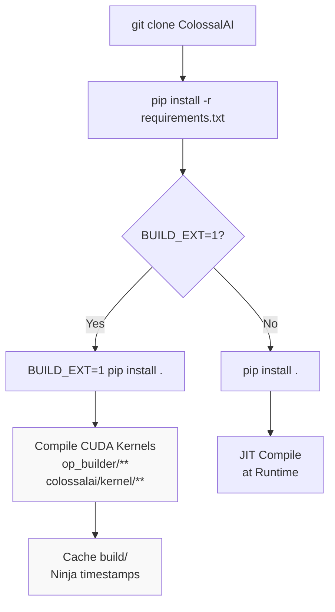
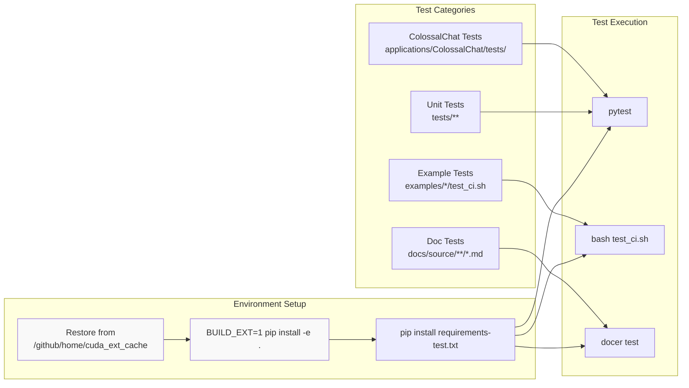
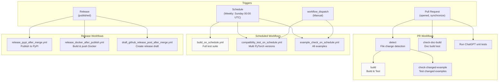
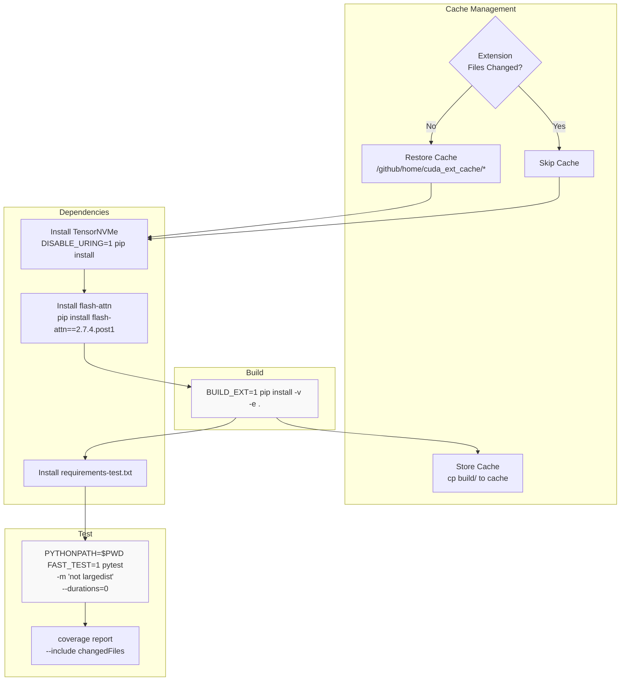
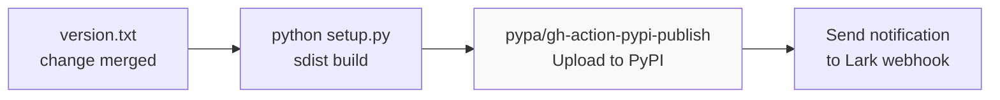
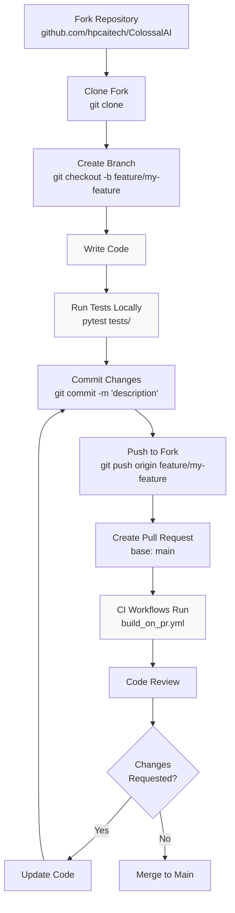

<!-- source: DeepWiki mcp.deepwiki.com · repo hpcaitech/ColossalAI · page 11 Building and Contributing · fetched 2026-10-21 -->

# Building and Contributing

<details>
<summary>Relevant source files</summary>

The following files were used as context for generating this wiki page:

- [.github/workflows/build_on_pr.yml](.github/workflows/build_on_pr.yml)
- [.github/workflows/build_on_schedule.yml](.github/workflows/build_on_schedule.yml)
- [.github/workflows/compatiblity_test_on_dispatch.yml](.github/workflows/compatiblity_test_on_dispatch.yml)
- [.github/workflows/compatiblity_test_on_pr.yml](.github/workflows/compatiblity_test_on_pr.yml)
- [.github/workflows/compatiblity_test_on_schedule.yml](.github/workflows/compatiblity_test_on_schedule.yml)
- [.github/workflows/doc_check_on_pr.yml](.github/workflows/doc_check_on_pr.yml)
- [.github/workflows/doc_test_on_pr.yml](.github/workflows/doc_test_on_pr.yml)
- [.github/workflows/doc_test_on_schedule.yml](.github/workflows/doc_test_on_schedule.yml)
- [.github/workflows/draft_github_release_post_after_merge.yml](.github/workflows/draft_github_release_post_after_merge.yml)
- [.github/workflows/example_check_on_dispatch.yml](.github/workflows/example_check_on_dispatch.yml)
- [.github/workflows/example_check_on_pr.yml](.github/workflows/example_check_on_pr.yml)
- [.github/workflows/example_check_on_schedule.yml](.github/workflows/example_check_on_schedule.yml)
- [.github/workflows/release_docker_after_publish.yml](.github/workflows/release_docker_after_publish.yml)
- [.github/workflows/release_nightly_on_schedule.yml](.github/workflows/release_nightly_on_schedule.yml)
- [.github/workflows/release_pypi_after_merge.yml](.github/workflows/release_pypi_after_merge.yml)
- [.github/workflows/report_leaderboard_to_lark.yml](.github/workflows/report_leaderboard_to_lark.yml)
- [.github/workflows/run_chatgpt_examples.yml](.github/workflows/run_chatgpt_examples.yml)
- [.github/workflows/run_chatgpt_unit_tests.yml](.github/workflows/run_chatgpt_unit_tests.yml)
- [.github/workflows/run_colossalqa_unit_tests.yml](.github/workflows/run_colossalqa_unit_tests.yml)
- [.github/workflows/scripts/generate_leaderboard_and_send_to_lark.py](.github/workflows/scripts/generate_leaderboard_and_send_to_lark.py)
- [README.md](README.md)
- [applications/ColossalChat/.gitignore](applications/ColossalChat/.gitignore)
- [applications/README.md](applications/README.md)
- [colossalai/nn/optimizer/README.md](colossalai/nn/optimizer/README.md)
- [docs/README-zh-Hans.md](docs/README-zh-Hans.md)
- [docs/source/en/basics/launch_colossalai.md](docs/source/en/basics/launch_colossalai.md)
- [docs/source/en/get_started/installation.md](docs/source/en/get_started/installation.md)
- [docs/source/zh-Hans/basics/launch_colossalai.md](docs/source/zh-Hans/basics/launch_colossalai.md)
- [docs/source/zh-Hans/get_started/installation.md](docs/source/zh-Hans/get_started/installation.md)
- [examples/README.md](examples/README.md)
- [examples/tutorial/.gitignore](examples/tutorial/.gitignore)
- [examples/tutorial/README.md](examples/tutorial/README.md)
- [examples/tutorial/download_cifar10.py](examples/tutorial/download_cifar10.py)
- [examples/tutorial/sequence_parallel/data/dummy_dataloader.py](examples/tutorial/sequence_parallel/data/dummy_dataloader.py)

</details>


This document provides a comprehensive guide for developers who want to build ColossalAI from source, set up a development environment, run tests, and contribute code to the project. For information about installing pre-built packages for end-users, see [Installation](#2.1). For details about the automated CI/CD workflows, see [CI/CD Pipeline](#11.1).

## Purpose and Scope

This page covers:
- Building ColossalAI from source with optional CUDA extensions
- Setting up a development environment for contributing
- Running the test suite locally
- Understanding the automated testing infrastructure
- Following the contribution workflow to submit code
- Compiling custom CUDA kernels and extensions

## System Requirements

**Minimum Requirements:**
- PyTorch >= 2.2
- Python >= 3.7
- CUDA >= 11.0
- NVIDIA GPU Compute Capability >= 7.0 (V100/RTX20 and higher)
- Linux OS

**Development Tools:**
- Git for version control
- CMake for building native extensions
- GCC/G++ compiler for CUDA kernels
- Docker (optional, for containerized development)

Sources: [README.md:452-457](), [docs/source/en/get_started/installation.md:1-9]()

## Building from Source

### Basic Installation

Clone the repository and install ColossalAI without building CUDA extensions:

```bash
git clone https://github.com/hpcaitech/ColossalAI.git
cd ColossalAI
pip install -r requirements/requirements.txt
pip install .
```

By default, CUDA kernels are **not** compiled during installation. They will be built at runtime when first needed using JIT (Just-In-Time) compilation.

Sources: [README.md:486-496](), [docs/source/en/get_started/installation.md:30-43]()

### Building with Extensions

To pre-compile CUDA kernels and PyTorch extensions during installation, set the `BUILD_EXT` environment variable:

```bash
BUILD_EXT=1 pip install .
```

This is **required** when using fused optimizers or other components that rely on custom CUDA kernels. The build process compiles kernels in the following directories:
- `colossalai/kernel/` - Custom CUDA kernels
- `op_builder/` - Operator builder modules

The compiled artifacts are cached to speed up subsequent rebuilds.

Sources: [README.md:499-503](), [.github/workflows/build_on_pr.yml:145-148]()

### Build Process Flow



Sources: [README.md:486-519](), [.github/workflows/build_on_pr.yml:133-154]()

### Special Case: CUDA 10.2

For CUDA 10.2, the CUB library must be manually downloaded and copied:

```bash
git clone https://github.com/hpcaitech/ColossalAI.git
cd ColossalAI

# Download CUB library
wget https://github.com/NVIDIA/cub/archive/refs/tags/1.8.0.zip
unzip 1.8.0.zip
cp -r cub-1.8.0/cub/ colossalai/kernel/cuda_native/csrc/kernels/include/

# Build with extensions
BUILD_EXT=1 pip install .
```

Sources: [README.md:505-519](), [docs/source/en/get_started/installation.md:51-65]()

## Development Environment Setup

### Using Docker

ColossalAI provides pre-built Docker images with all dependencies configured:

**Pull from DockerHub:**
```bash
docker pull hpcaitech/colossalai:latest
docker run -ti --gpus all --rm --ipc=host hpcaitech/colossalai bash
```

**Build locally:**
```bash
cd ColossalAI
docker build -t colossalai ./docker
docker run -ti --gpus all --rm --ipc=host colossalai bash
```

Note: Building from the Dockerfile requires GPU support. Configure Nvidia Docker Runtime as the default runtime.

Sources: [README.md:523-549]()

### Development Dependencies

Install test dependencies for local development:

```bash
pip install --no-cache-dir -r requirements/requirements-test.txt
```

For documentation testing:
```bash
pip install -r docs/requirements-doc-test.txt
```

Sources: [.github/workflows/build_on_pr.yml:148](), [.github/workflows/doc_test_on_pr.yml:84-87]()

## Testing Infrastructure

### Test Organization

ColossalAI uses `pytest` for testing with the following test categories:

| Test Type | Location | Trigger |
|-----------|----------|---------|
| Unit Tests | `tests/` | Every PR, Weekly |
| Example Tests | `examples/*/test_ci.sh` | On example changes, Weekly |
| Documentation Tests | `docs/source/**/*.md` | On doc changes, Weekly |
| ColossalChat Tests | `applications/ColossalChat/tests/` | On ColossalChat changes |

Sources: [.github/workflows/build_on_pr.yml:155-174](), [.github/workflows/example_check_on_pr.yml:1-122]()

### Running Tests Locally

**Run all unit tests:**
```bash
PYTHONPATH=$PWD pytest tests/ \
  -m "not largedist" \
  --durations=0 \
  --ignore tests/test_analyzer \
  --ignore tests/test_auto_parallel \
  --ignore tests/test_fx
```

**Run specific test file:**
```bash
pytest tests/test_specific.py -v
```

**Run with coverage:**
```bash
pytest tests/ --cov=colossalai --cov-report=xml
```

The test suite automatically skips tests marked with `largedist` that require large-scale distributed setups.

Sources: [.github/workflows/build_on_pr.yml:156-174](), [.github/workflows/build_on_schedule.yml:66-78]()

### Test Execution Flow



Sources: [.github/workflows/build_on_pr.yml:101-174](), [.github/workflows/example_check_on_pr.yml:100-122](), [.github/workflows/doc_test_on_pr.yml:69-103]()

### Example Test Integration

Each example must provide a `test_ci.sh` script for automated testing:

```bash
# Example: examples/language/gpt/test_ci.sh
#!/bin/bash
set -e

# Configure test parameters (keep small for CI)
NUM_STEPS=10
BATCH_SIZE=2

# Execute training script
python train.py --steps $NUM_STEPS --batch_size $BATCH_SIZE
```

The test script should:
1. Use small parameters (steps, batch size) for quick execution
2. Export dataset paths with `/data` prefix
3. Complete within several minutes
4. Return non-zero exit code on failure

Sources: [examples/README.md:53-66]()

## CI/CD Pipeline Architecture

### Workflow Overview



Sources: [.github/workflows/build_on_pr.yml](), [.github/workflows/build_on_schedule.yml](), [.github/workflows/compatiblity_test_on_schedule.yml]()

### Build on PR Workflow

The primary CI workflow (`build_on_pr.yml`) executes on every pull request with the following stages:

**1. File Change Detection (`detect` job):**
- Locates base commit for comparison: `git merge-base origin/main $curBranch`
- Identifies changed extension files: `op_builder/**`, `colossalai/kernel/**`, `setup.py`
- Identifies changed library files: `**/*.py`, `**/*.h`, `**/*.cpp`, `**/*.cu`
- Outputs: `anyExtensionFileChanged`, `changedLibraryFiles`

**2. Build and Test (`build` job):**
- Runs only if library files changed
- Container: `hpcaitech/pytorch-cuda:2.2.2-12.1.0`
- GPU access: `--gpus all --shm-size=2g`
- Steps:
  - Checkout and install TensorNVMe (optional dependency)
  - Restore cached CUDA extensions (if no extension files changed)
  - Install flash-attention: `pip install flash-attn==2.7.4.post1 --no-build-isolation`
  - Install ColossalAI: `BUILD_EXT=1 pip install -v -e .`
  - Store CUDA extension cache
  - Execute unit tests with pytest
  - Generate coverage report for changed files

**3. Artifact Upload:**
- Uploads test coverage report
- Includes PR number for later processing

Sources: [.github/workflows/build_on_pr.yml:1-211]()

### Build and Test Process



Sources: [.github/workflows/build_on_pr.yml:102-211]()

### Compatibility Testing

ColossalAI maintains compatibility across multiple PyTorch and CUDA versions through dedicated workflows:

**Compatibility Matrix:**
The `.compatibility` file defines supported PyTorch-CUDA combinations:
```
2.2.2-12.1.0
2.3.0-12.1.0
2.4.0-12.1.0
```

**Test Execution:**
- Runs in Docker containers for each PyTorch-CUDA combination
- Tests all unit tests except marked with `largedist`
- Executes on schedule (weekly) or on `.compatibility` file changes
- Can be manually triggered with custom version inputs

Sources: [.github/workflows/compatiblity_test_on_pr.yml:1-88](), [.github/workflows/compatiblity_test_on_schedule.yml:1-97]()

### Example Testing Workflows

**On Pull Request (`example_check_on_pr.yml`):**

1. **Change Detection:**
   - Monitors `examples/**` directory (excluding `*.md`)
   - Extracts changed example directories using `detect_changed_example.py`
   - Creates matrix of affected examples

2. **Test Execution:**
   - Runs `test_ci.sh` in each changed example directory
   - Uses mounted dataset volume: `-v /data/scratch/examples-data:/data/`
   - Timeout: 30 minutes per example
   - Parallel execution with `fail-fast: false`

**Weekly Schedule (`example_check_on_schedule.yml`):**
- Tests all examples regardless of changes
- Matrix generated by `check_example_weekly.py`
- Notifies via Lark webhook on failure

Sources: [.github/workflows/example_check_on_pr.yml:1-122](), [.github/workflows/example_check_on_schedule.yml:1-69]()

### Release Workflows

**PyPI Publication (`release_pypi_after_merge.yml`):**


**Docker Publication (`release_docker_after_publish.yml`):**
- Triggers on GitHub release published
- Builds Docker image: `docker build --build-arg VERSION=v${version} -t hpcaitech/colossalai:$version ./docker`
- Tags as latest: `docker tag $tag hpcaitech/colossalai:latest`
- Pushes to DockerHub

**Nightly Releases (`release_nightly_on_schedule.yml`):**
- Runs every Saturday 00:00 UTC
- Updates package name to `colossalai-nightly` via `update_setup_for_nightly.py`
- Publishes to PyPI with date-stamped version

Sources: [.github/workflows/release_pypi_after_merge.yml:1-68](), [.github/workflows/release_docker_after_publish.yml:1-79](), [.github/workflows/release_nightly_on_schedule.yml:1-70]()

## Contributing Code

### Contribution Workflow



Sources: [README.md:557-570](), [examples/README.md:40-52]()

### Code Requirements

**For New Features:**

1. **Implementation:**
   - Add code in appropriate module (`colossalai/` directory)
   - Follow existing code style and patterns
   - Include docstrings for public APIs

2. **Testing:**
   - Add unit tests in `tests/` directory
   - Ensure tests pass locally: `pytest tests/test_your_feature.py`
   - Mark distributed tests appropriately

3. **Documentation:**
   - Update relevant documentation in `docs/source/`
   - Add code examples if applicable
   - Include inline comments for complex logic

4. **Examples (if applicable):**
   - Create example in `examples/` with `test_ci.sh`
   - Provide README with usage instructions
   - Keep CI test parameters small (< 5 minutes)

Sources: [README.md:557-570](), [examples/README.md:53-66]()

### Pull Request Guidelines

**Required Information:**
- Clear description of changes
- Motivation and context
- Related issue numbers (if any)
- Breaking changes highlighted

**CI Requirements:**
- All automated tests must pass
- Code coverage should not decrease significantly
- Documentation builds successfully
- No new lint errors

**Review Process:**
- At least one maintainer approval required
- Address all review comments
- Keep PR scope focused and manageable
- Rebase on main if conflicts occur

Sources: [README.md:557-570]()

### Testing Your Contribution

**Before Submitting PR:**

1. **Run affected tests:**
```bash
# Test specific module
pytest tests/test_your_module.py -v

# Test with coverage
pytest tests/test_your_module.py --cov=colossalai.your_module --cov-report=term
```

2. **Test examples (if added/modified):**
```bash
cd examples/your_example
bash test_ci.sh
```

3. **Test documentation (if added/modified):**
```bash
pip install -v ./ColossalAI-Documentation/doc-build/third_party/hf-doc-builder
pip install -v ./ColossalAI-Documentation/doc-build
docer test -p docs/source/your_doc.md
```

4. **Verify build with extensions:**
```bash
# Clean previous build
rm -rf build/
rm -rf colossalai.egg-info/

# Rebuild with extensions
BUILD_EXT=1 pip install -e . --force-reinstall --no-cache-dir
```

Sources: [.github/workflows/build_on_pr.yml:155-174](), [.github/workflows/doc_test_on_pr.yml:94-103]()

## Extension Development

### CUDA Kernel Compilation

Custom CUDA kernels are organized in:
- `colossalai/kernel/cuda_native/` - Native CUDA implementations
- `op_builder/` - Builder modules for custom operators

**Builder Structure:**
Each operator builder inherits from a base builder class and defines:
- Source files to compile
- Include directories
- Compiler flags
- Library dependencies

**Build Process:**

1. **Configuration:** Set `BUILD_EXT=1` environment variable

2. **Compilation:** Ninja build system compiles CUDA kernels
   - Uses cached timestamps to avoid recompilation
   - Stores build artifacts in `build/` directory

3. **Installation:** Extensions are registered with PyTorch's extension loader

**Cache Management:**

The CI system caches compiled extensions to speed up builds:
```bash
# Cache location
/github/home/cuda_ext_cache/

# Cache is restored if extension files unchanged
# Cache is invalidated if op_builder/** or colossalai/kernel/** modified
```

Sources: [.github/workflows/build_on_pr.yml:133-154]()

### Adding a New CUDA Extension

**Steps:**

1. **Create kernel implementation:**
   - Add `.cu` file in `colossalai/kernel/cuda_native/csrc/`
   - Implement kernel and host interface

2. **Create builder:**
   - Add builder class in `op_builder/`
   - Define sources, includes, and flags
   - Register with extension system

3. **Add Python wrapper:**
   - Create Python module in `colossalai/kernel/`
   - Provide user-friendly API
   - Handle fallback for CPU-only systems

4. **Add tests:**
   - Create test file in `tests/`
   - Test correctness against reference implementation
   - Test performance characteristics

5. **Update build configuration:**
   - Ensure `setup.py` includes new extension
   - Update any build scripts if needed

Sources: [README.md:499-503]()

## Community Resources

**Getting Help:**
- GitHub Issues: Report bugs or request features
- Slack: Join for discussions and questions
- WeChat: Chinese community support
- Forum: GitHub Discussions for long-form questions

**Contributing Beyond Code:**
- Report bugs and suggest features
- Improve documentation
- Share examples and tutorials
- Help answer community questions
- Review pull requests

**Recognition:**
Contributors are recognized in the project README and may be invited to write tutorials or blog posts for the official documentation.

Sources: [README.md:551-573]()

---

## Key Takeaways

| Task | Command/Action |
|------|----------------|
| Clone repo | `git clone https://github.com/hpcaitech/ColossalAI.git` |
| Install basic | `pip install .` |
| Install with extensions | `BUILD_EXT=1 pip install .` |
| Run tests | `pytest tests/ -m "not largedist"` |
| Test coverage | `pytest --cov=colossalai --cov-report=xml` |
| Test examples | `cd examples/your_example && bash test_ci.sh` |
| Build Docker | `docker build -t colossalai ./docker` |
| Submit PR | Fork → Branch → Commit → Push → PR |

The ColossalAI project maintains high code quality through comprehensive automated testing, multiple compatibility checks, and a structured contribution workflow. Contributors should ensure their code passes all CI checks before requesting review.

---

