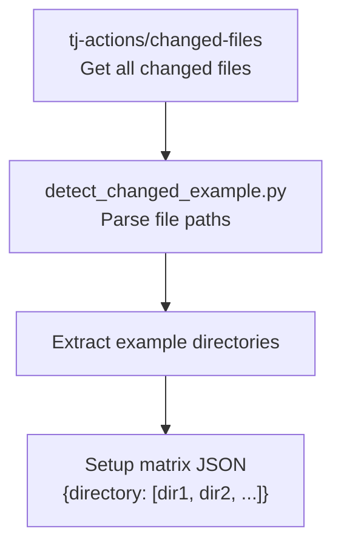
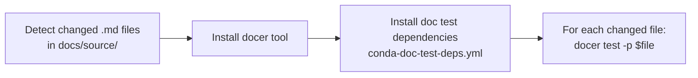
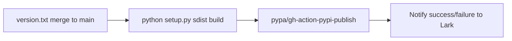
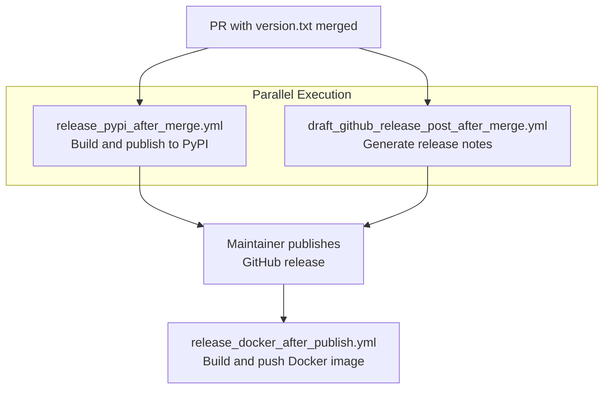

<!-- source: DeepWiki mcp.deepwiki.com · repo hpcaitech/ColossalAI · page 11.1 CI/CD Pipeline · fetched 2026-10-21 -->

# CI/CD Pipeline

<details>
<summary>Relevant source files</summary>

The following files were used as context for generating this wiki page:

- [.github/workflows/build_on_pr.yml](.github/workflows/build_on_pr.yml)
- [.github/workflows/build_on_schedule.yml](.github/workflows/build_on_schedule.yml)
- [.github/workflows/compatiblity_test_on_dispatch.yml](.github/workflows/compatiblity_test_on_dispatch.yml)
- [.github/workflows/compatiblity_test_on_pr.yml](.github/workflows/compatiblity_test_on_pr.yml)
- [.github/workflows/compatiblity_test_on_schedule.yml](.github/workflows/compatiblity_test_on_schedule.yml)
- [.github/workflows/doc_check_on_pr.yml](.github/workflows/doc_check_on_pr.yml)
- [.github/workflows/doc_test_on_pr.yml](.github/workflows/doc_test_on_pr.yml)
- [.github/workflows/doc_test_on_schedule.yml](.github/workflows/doc_test_on_schedule.yml)
- [.github/workflows/draft_github_release_post_after_merge.yml](.github/workflows/draft_github_release_post_after_merge.yml)
- [.github/workflows/example_check_on_dispatch.yml](.github/workflows/example_check_on_dispatch.yml)
- [.github/workflows/example_check_on_pr.yml](.github/workflows/example_check_on_pr.yml)
- [.github/workflows/example_check_on_schedule.yml](.github/workflows/example_check_on_schedule.yml)
- [.github/workflows/release_docker_after_publish.yml](.github/workflows/release_docker_after_publish.yml)
- [.github/workflows/release_nightly_on_schedule.yml](.github/workflows/release_nightly_on_schedule.yml)
- [.github/workflows/release_pypi_after_merge.yml](.github/workflows/release_pypi_after_merge.yml)
- [.github/workflows/report_leaderboard_to_lark.yml](.github/workflows/report_leaderboard_to_lark.yml)
- [.github/workflows/run_chatgpt_examples.yml](.github/workflows/run_chatgpt_examples.yml)
- [.github/workflows/run_chatgpt_unit_tests.yml](.github/workflows/run_chatgpt_unit_tests.yml)
- [.github/workflows/run_colossalqa_unit_tests.yml](.github/workflows/run_colossalqa_unit_tests.yml)
- [.github/workflows/scripts/generate_leaderboard_and_send_to_lark.py](.github/workflows/scripts/generate_leaderboard_and_send_to_lark.py)

</details>


This document describes the continuous integration and continuous deployment (CI/CD) system for ColossalAI, implemented using GitHub Actions. The CI/CD pipeline automates building, testing, compatibility validation, and releasing across multiple dimensions including core library tests, application-specific tests, example validation, documentation verification, and multi-version compatibility checks.

For information about the testing framework itself, see [Distributed Training Testing](#10.3). For build configuration and extension compilation, see [Building and Contributing](#11).

## Overview

The CI/CD system consists of 19 distinct GitHub Actions workflows organized into four categories:

| Category | Workflows | Purpose |
|----------|-----------|---------|
| **PR Testing** | 8 workflows | Validate changes on pull requests before merge |
| **Scheduled Testing** | 6 workflows | Weekly regression testing and nightly releases |
| **Release Automation** | 4 workflows | Package and publish releases to PyPI and DockerHub |
| **Community Metrics** | 1 workflow | Track contributor activity and engagement |

All workflows run on self-hosted runners using Docker containers with pre-configured PyTorch and CUDA environments.

Sources: [.github/workflows/*.yml]()

## CI/CD Architecture

```mermaid
graph TB
    subgraph "Trigger Events"
        PREvent["Pull Request<br/>synchronize/opened/reopened"]
        ScheduleEvent["Cron Schedule<br/>Weekly/Daily"]
        ReleaseEvent["Version Change<br/>version.txt merge"]
        ManualEvent["workflow_dispatch<br/>Manual Trigger"]
    end
    
    subgraph "PR Testing Workflows"
        BuildOnPR["build_on_pr.yml<br/>Core library tests"]
        ChatGPTExamples["run_chatgpt_examples.yml<br/>RLHF examples"]
        ChatGPTUnit["run_chatgpt_unit_tests.yml<br/>Chat unit tests"]
        ExampleCheckPR["example_check_on_pr.yml<br/>Changed examples"]
        CompatPR["compatiblity_test_on_pr.yml<br/>PyTorch compatibility"]
        DocCheckPR["doc_check_on_pr.yml<br/>Doc i18n & build"]
        DocTestPR["doc_test_on_pr.yml<br/>Doc code snippets"]
        ColossalQA["run_colossalqa_unit_tests.yml<br/>QA system tests"]
    end
    
    subgraph "Scheduled Workflows"
        BuildSchedule["build_on_schedule.yml<br/>Sunday 00:00 UTC"]
        CompatSchedule["compatiblity_test_on_schedule.yml<br/>Saturday 19:00 UTC"]
        ExampleSchedule["example_check_on_schedule.yml<br/>Saturday 16:00 UTC"]
        DocTestSchedule["doc_test_on_schedule.yml<br/>Saturday 23:00 UTC"]
        NightlyRelease["release_nightly_on_schedule.yml<br/>Saturday 00:00 UTC"]
        Leaderboard["report_leaderboard_to_lark.yml<br/>Friday 09:00 UTC"]
    end
    
    subgraph "Release Workflows"
        PyPIRelease["release_pypi_after_merge.yml<br/>Publish to PyPI"]
        DockerRelease["release_docker_after_publish.yml<br/>Build Docker image"]
        DraftRelease["draft_github_release_post_after_merge.yml<br/>Generate release notes"]
    end
    
    subgraph "Infrastructure"
        SelfHosted["Self-Hosted Runners<br/>ubuntu-latest"]
        Containers["Docker Containers<br/>pytorch-cuda:2.2.2-12.1.0"]
        Cache["Build Cache<br/>/github/home/cuda_ext_cache"]
        Secrets["GitHub Secrets<br/>SSH_KEY_FOR_CI, PYPI_API_TOKEN"]
    end
    
    PREvent --> BuildOnPR
    PREvent --> ChatGPTExamples
    PREvent --> ChatGPTUnit
    PREvent --> ExampleCheckPR
    PREvent --> CompatPR
    PREvent --> DocCheckPR
    PREvent --> DocTestPR
    PREvent --> ColossalQA
    
    ScheduleEvent --> BuildSchedule
    ScheduleEvent --> CompatSchedule
    ScheduleEvent --> ExampleSchedule
    ScheduleEvent --> DocTestSchedule
    ScheduleEvent --> NightlyRelease
    ScheduleEvent --> Leaderboard
    
    ReleaseEvent --> PyPIRelease
    ReleaseEvent --> DraftRelease
    PyPIRelease --> DockerRelease
    
    BuildOnPR --> SelfHosted
    BuildSchedule --> SelfHosted
    CompatPR --> Containers
    BuildOnPR --> Cache
    PyPIRelease --> Secrets
```



Sources: [.github/workflows/build_on_pr.yml](), [.github/workflows/build_on_schedule.yml](), [.github/workflows/release_pypi_after_merge.yml]()

## Pull Request Testing Workflows

### Core Library Testing (build_on_pr.yml)

The primary PR testing workflow performs comprehensive validation of core library changes with intelligent change detection and caching.

**Workflow Structure:**

```mermaid
graph LR
    subgraph "detect Job"
        Checkout1["Checkout PR head"]
        LocateBase["Locate base commit<br/>git merge-base origin/main"]
        FindExt["Find extension changes<br/>tj-actions/changed-files"]
        FindLib["Find library changes<br/>tj-actions/changed-files"]
    end
    
    subgraph "build Job"
        Checkout2["Checkout TensorNVMe"]
        RestoreTNVMe["Restore TensorNVMe cache"]
        InstallTNVMe["Install TensorNVMe<br/>DISABLE_URING=1"]
        Checkout3["Checkout ColossalAI"]
        RestoreColossal["Restore Colossal-AI cache"]
        InstallFlash["Install flash-attn==2.7.4.post1"]
        InstallColossal["Install Colossal-AI<br/>BUILD_EXT=1"]
        RunTests["Execute pytest<br/>FAST_TEST=1"]
        CollateArtifact["Generate coverage report"]
        UploadArtifact["Upload artifact"]
    end
    
    Checkout1 --> LocateBase
    LocateBase --> FindExt
    LocateBase --> FindLib
    FindLib --> Checkout2
    
    Checkout2 --> RestoreTNVMe
    RestoreTNVMe --> InstallTNVMe
    InstallTNVMe --> Checkout3
    Checkout3 --> RestoreColossal
    RestoreColossal --> InstallFlash
    InstallFlash --> InstallColossal
    InstallColossal --> RunTests
    RunTests --> CollateArtifact
    CollateArtifact --> UploadArtifact
```



**File Change Detection:**

The workflow uses `tj-actions/changed-files@v35` to detect two categories of changes:

| Category | Files Monitored | Impact |
|----------|----------------|--------|
| Extension files | `op_builder/**`, `colossalai/kernel/**`, `setup.py` | Invalidates build cache |
| Library files | `**/*.py`, `**/*.h`, `**/*.cpp`, `**/*.cu`, `**/*.txt` | Triggers full test suite |

Sources: [.github/workflows/build_on_pr.yml:55-85]()

**Build Cache Strategy:**

The workflow implements a two-tier caching system:

1. **TensorNVMe Cache** ([.github/workflows/build_on_pr.yml:109-126]())
   - Location: `/github/home/tensornvme_cache/`
   - Cached directories: `build/`, `cmake-build/`
   - Restored before TensorNVMe installation
   - Updated after successful build

2. **Colossal-AI CUDA Extension Cache** ([.github/workflows/build_on_pr.yml:133-153]())
   - Location: `/github/home/cuda_ext_cache/`
   - Cached directory: `build/`
   - Only restored if `anyExtensionFileChanged != 'true'`
   - Preserves file timestamps with `-p` flag to avoid ninja rebuild

**Test Execution:**

```bash
CURL_CA_BUNDLE="" PYTHONPATH=$PWD FAST_TEST=1 pytest \
  -m "not largedist" \
  --durations=0 \
  --ignore tests/test_analyzer \
  --ignore tests/test_auto_parallel \
  --ignore tests/test_fx \
  --ignore tests/test_autochunk \
  --ignore tests/test_gptq \
  --ignore tests/test_infer_ops \
  --ignore tests/test_legacy \
  --ignore tests/test_smoothquant \
  tests/
```

The `FAST_TEST=1` environment variable enables abbreviated test execution. Tests marked with `largedist` require multiple nodes and are excluded from PR validation.

Sources: [.github/workflows/build_on_pr.yml:156-173]()

**Coverage Reporting:**

Coverage is calculated only for changed library files using the `coverage` tool:

```python
# Pseudocode from workflow
allFiles = ",".join(changedLibraryFiles)
coverage report --data-file .coverage --include $allFiles > coverage.txt
covPercentage = extract_percentage_from_last_line(coverage.txt)
```

The coverage percentage is extracted and stored as an artifact for PR comments.

Sources: [.github/workflows/build_on_pr.yml:175-210]()

### Application-Specific Testing

#### ColossalChat Testing (run_chatgpt_examples.yml, run_chatgpt_unit_tests.yml)

Two workflows validate the ColossalChat RLHF system:

**Unit Tests Workflow:**

| Aspect | Configuration |
|--------|--------------|
| Trigger paths | `applications/ColossalChat/coati/**`, `requirements.txt`, `setup.py`, `tests/**` |
| Container | `pytorch-cuda:2.2.2-12.1.0` |
| Test command | `pytest tests/` in ColossalChat directory |
| Additional tests | `./tests/test_templating.sh` |

**Examples Workflow:**

Runs comprehensive example scripts including data preparation and training:

```bash
./tests/test_data_preparation.sh
./tests/test_train.sh
```

Environment variables specify data paths:
- `PRETRAINED_MODEL_PATH`: `./models`
- `SFT_DATASET`: `./sft_data`
- `PROMPT_DATASET`: `./prompt_data`
- `PREFERENCE_DATASET`: `./preference_data`
- `KTO_DATASET`: `./kto_data`

Sources: [.github/workflows/run_chatgpt_examples.yml:59-78](), [.github/workflows/run_chatgpt_unit_tests.yml:43-52]()

#### ColossalQA Testing (run_colossalqa_unit_tests.yml)

Tests the retrieval-augmented generation system with mounted test data volumes:

```yaml
volumes:
  - /data/scratch/test_data_colossalqa:/data/scratch/test_data_colossalqa
  - /data/scratch/llama-tiny:/data/scratch/llama-tiny
```

Environment variables configure test models and data paths:

| Variable | Purpose |
|----------|---------|
| `ZH_MODEL_PATH`, `ZH_MODEL_NAME` | Chinese language model configuration |
| `EN_MODEL_PATH`, `EN_MODEL_NAME` | English language model configuration |
| `TEST_DATA_PATH_EN`, `TEST_DATA_PATH_ZH` | Test document paths |
| `TEST_DOCUMENT_LOADER_DATA_PATH` | Document loader test data |
| `SQL_FILE_PATH` | SQL database test files |

Sources: [.github/workflows/run_colossalqa_unit_tests.yml:23-54]()

### Example Testing (example_check_on_pr.yml)

This workflow uses a matrix strategy to test only changed examples in the `examples/` directory.

**Change Detection Logic:**



The Python script [.github/workflows/scripts/example_checks/detect_changed_example.py]() analyzes changed file paths and extracts unique example directories.

**Matrix Execution:**

Each detected example directory runs independently:

```bash
example_dir=${{ matrix.directory }}
cd "${PWD}/examples/${example_dir}"
bash test_ci.sh
```

Every example directory must provide a `test_ci.sh` script for CI validation.

Sources: [.github/workflows/example_check_on_pr.yml:53-121]()

### Compatibility Testing (compatiblity_test_on_pr.yml)

Triggered when `.compatibility` file changes, this workflow tests against multiple PyTorch/CUDA combinations.

**Container Matrix Preparation:**

```bash
IFS=','
DOCKER_IMAGE=()

while read tag; do
  DOCKER_IMAGE+=("\"image-cloud.luchentech.com/hpcaitech/pytorch-cuda:${tag}\"")
done <.compatibility

container=$( IFS=',' ; echo "${DOCKER_IMAGE[*]}" )
container="[${container}]"
```

Each line in `.compatibility` specifies a PyTorch-CUDA version tag (e.g., `2.2.2-12.1.0`).

**Test Execution per Container:**

```yaml
strategy:
  fail-fast: false
  matrix: ${{fromJson(needs.matrix_preparation.outputs.matrix)}}
container:
  image: ${{ matrix.container }}
```

The same test suite runs in each container, ensuring library compatibility across versions.

Sources: [.github/workflows/compatiblity_test_on_pr.yml:19-88]()

### Documentation Testing

#### Build Validation (doc_check_on_pr.yml)

Validates documentation can build successfully:

1. **i18n Check**: Ensures documentation files exist in all supported languages
   ```bash
   python .github/workflows/scripts/check_doc_i18n.py -d docs/source
   ```

2. **Build Check**: Uses the `docer` tool to build documentation
   - Checks out both ColossalAI and ColossalAI-Documentation repos
   - Creates merged branch as main for version detection
   - Runs `bash ./scripts/build.sh` in documentation repo

Sources: [.github/workflows/doc_check_on_pr.yml:29-77]()

#### Code Snippet Testing (doc_test_on_pr.yml)

Tests executable code snippets in documentation:



The `docer test` command extracts and executes code blocks from markdown files, validating they run without errors.

Sources: [.github/workflows/doc_test_on_pr.yml:94-102]()

## Scheduled Testing Workflows

### Weekly Regression Testing (build_on_schedule.yml)

Runs comprehensive tests every Sunday at 00:00 UTC:

**GPU Availability Check:**

```bash
avai=true
ngpu=$(nvidia-smi --query-gpu=name --format=csv,noheader | wc -l)
for i in $(seq 0 $((ngpu-1))); do
  gpu_used=$(nvidia-smi -i $i --query-gpu=memory.used --format=csv,noheader,nounits)
  [ "$gpu_used" -gt "2000" ] && avai=false
done
```

All subsequent steps only execute if `avai == 'true'`, preventing conflicts with other jobs.

**Failure Notification:**

On failure, sends notification to Lark (enterprise messaging platform):

```python
url = f"{SERVER_URL}/{REPO}/actions/runs/{RUN_ID}"
msg = f"Scheduled Build and Test failed, please visit {url} for details"
send_message_to_lark(msg, WEBHOOK_URL)
```

Sources: [.github/workflows/build_on_schedule.yml:19-91]()

### Compatibility Matrix Testing (compatiblity_test_on_schedule.yml)

Similar to PR compatibility testing but triggered weekly (Saturday 19:00 UTC) to catch regressions across all supported PyTorch/CUDA versions.

Matrix is read from `.compatibility` file, which typically contains:

```
2.2.2-12.1.0
2.1.0-11.8.0
2.0.1-11.7.0
```

Each version combination runs full test suite in isolated container.

Sources: [.github/workflows/compatiblity_test_on_schedule.yml:17-96]()

### Weekly Example Testing (example_check_on_schedule.yml)

Tests all examples weekly (Saturday 16:00 UTC), not just changed ones:

```python
# .github/workflows/scripts/example_checks/check_example_weekly.py
# Returns list of all example directories
res = get_all_example_directories()
```

Executes `test_ci.sh` in each example directory, reporting failures to Lark.

Sources: [.github/workflows/example_check_on_schedule.yml:20-68]()

### Documentation Testing (doc_test_on_schedule.yml)

Runs every Saturday 23:00 UTC, testing all documentation files:

```bash
for file in $(find ./docs/source -name "*.md"); do
  docer test -p $file
done
```

Unlike PR-triggered testing which only tests changed files, this validates the entire documentation corpus.

Sources: [.github/workflows/doc_test_on_schedule.yml:42-47]()

## Release Workflows

### PyPI Release Pipeline



#### Stable Release (release_pypi_after_merge.yml)

Triggered when PR modifying `version.txt` is merged to `main`:

```yaml
on:
  pull_request:
    paths:
      - 'version.txt'
    types:
      - closed

jobs:
  build-n-publish:
    if: github.event.pull_request.merged == true && github.base_ref == 'main'
```

Uses PyPI API token from GitHub secrets: `${{ secrets.PYPI_API_TOKEN }}`

Sources: [.github/workflows/release_pypi_after_merge.yml:1-67]()

#### Nightly Release (release_nightly_on_schedule.yml)

Publishes nightly versions every Saturday 00:00 UTC:

**Version Modification:**

```python
# .github/workflows/scripts/update_setup_for_nightly.py
# Modifies setup.py to append nightly suffix to version
# E.g., "0.3.0" becomes "0.3.0.dev20230101"
```

Nightly versions use `.dev` suffix with date to enable pip installation with `--pre` flag.

Sources: [.github/workflows/release_nightly_on_schedule.yml:23-34]()

### Docker Image Release (release_docker_after_publish.yml)

Triggered on official GitHub release publication:

```yaml
on:
  release:
    types: [published]
  workflow_dispatch:
```

**Build and Tag Process:**

```bash
version=$(cat version.txt)
tag=hpcaitech/colossalai:$version
latest=hpcaitech/colossalai:latest
docker build --build-arg VERSION=v${version} -t $tag ./docker
docker tag $tag $latest
docker push $tag
docker push $latest
```

Both versioned tag and `latest` tag are pushed to DockerHub.

Sources: [.github/workflows/release_docker_after_publish.yml:21-44]()

### Release Notes Generation (draft_github_release_post_after_merge.yml)

Automatically generates draft release notes when `version.txt` is merged:

```python
# .github/workflows/scripts/generate_release_draft.py
version = f"v{cat('version.txt')}"
generate_release_draft(version=version, out='release_draft.md')
```

Creates draft GitHub release using `actions/create-release@v1` with generated markdown content.

Sources: [.github/workflows/draft_github_release_post_after_merge.yml:23-43]()

## Infrastructure and Execution Environment

### Self-Hosted Runners

All workflows execute on self-hosted runners with label `[self-hosted, ubuntu-latest]`. This provides:

- **Consistent hardware**: GPU availability for testing
- **Build cache persistence**: `/github/home/` directory survives across runs
- **Faster execution**: Pre-configured environments and cached dependencies
- **Shared volumes**: Access to test data at `/data/scratch/`

### Docker Container Strategy

Most workflows use pre-built Docker images:

| Image | PyTorch | CUDA | Purpose |
|-------|---------|------|---------|
| `image-cloud.luchentech.com/hpcaitech/pytorch-cuda:2.2.2-12.1.0` | 2.2.2 | 12.1.0 | Primary testing environment |
| `image-cloud.luchentech.com/hpcaitech/pytorch-cuda:2.5.1-12.4.1` | 2.5.1 | 12.4.1 | ChatGPT examples testing |
| `hpcaitech/docker-in-docker:latest` | - | - | Docker image building |

Container options typically include:

```yaml
options: --gpus all --rm -v /dev/shm -v /data/scratch:/data/scratch/
```

This mounts shared memory and test data volumes.

Sources: [.github/workflows/build_on_pr.yml:91-93]()

### Concurrency Control

Workflows use GitHub Actions concurrency groups to prevent duplicate runs:

```yaml
concurrency:
  group: ${{ github.workflow }}-${{ github.event.pull_request.number || github.ref }}-run-test
  cancel-in-progress: true
```

This cancels in-progress runs when new commits are pushed to a PR.

Sources: [.github/workflows/build_on_pr.yml:98-100]()

### Secrets Management

The CI/CD system uses several GitHub secrets:

| Secret | Usage |
|--------|-------|
| `SSH_KEY_FOR_CI` | Private repository checkout (TensorNVMe) |
| `PYPI_API_TOKEN` | PyPI package publishing |
| `DOCKER_USERNAME`, `DOCKER_PASSWORD` | DockerHub authentication |
| `LARK_NOTIFICATION_WEBHOOK_URL` | Failure notifications |
| `LARK_APP_ID`, `LARK_APP_SECRET` | Lark API access for leaderboard |

Sources: [.github/workflows/build_on_pr.yml:106](), [.github/workflows/release_pypi_after_merge.yml:31](), [.github/workflows/release_docker_after_publish.yml:37-38]()

## Community Metrics and Reporting

### Contributor Leaderboard (report_leaderboard_to_lark.yml)

Runs every Friday 09:00 UTC to generate weekly community activity reports.

**Data Collection:**

The script [.github/workflows/scripts/generate_leaderboard_and_send_to_lark.py]() uses GitHub REST and GraphQL APIs to collect:

1. **Contributor Leaderboard**:
   - Counts merged pull requests per author in last 7 days
   - Queries: `GET /repos/{org}/{repo}/pulls?state=closed`
   - Filters by `merged_at` timestamp

2. **User Engagement Leaderboard**:
   - Counts member comments on non-member issues/PRs/discussions
   - Queries: `GET /repos/{org}/{repo}/issues/comments?since={date}`
   - GraphQL for discussion comments with pagination

**Visualization:**

```python
def plot_bar_chart(x, y, xlabel, ylabel, title, output_path):
    fig = seaborn.barplot(x=x, y=y)
    fig.set(xlabel=xlabel, ylabel=ylabel, title=title)
    plt.savefig(output_path, dpi=1200)
```

Generates PNG images uploaded to Lark via:

```python
upload_image_to_lark(lark_tenant_token, image_path) -> image_key
send_image_to_lark(image_key, webhook_url)
```

Sources: [.github/workflows/scripts/generate_leaderboard_and_send_to_lark.py:315-570]()

### Metrics Collected

**Pull Request Metrics:**

```python
# Pagination through closed PRs
url = f"https://api.github.com/repos/{org}/{repo}/pulls?per_page=50&page={page}&state=closed"
for pr in response:
    merged_at = pr["merged_at"]
    if merged_at and merge_datetime > start_datetime:
        counter.record(pr["user"]["login"])
```

**Issue/PR Comment Metrics:**

```python
# For each comment on issue/PR
if comment_author_relationship == "MEMBER":
    issue_response = get_issue_details(comment["issue_url"])
    if issue_author_relationship != "MEMBER":
        # Member commented on non-member issue
        user_engagement_count[member_name] += 1
```

**Discussion Comment Metrics:**

Uses GitHub GraphQL API to handle nested comment structure:

```graphql
{
  repository(owner: "org", name: "repo") {
    discussion(number: 123) {
      comments(last: 10) {
        edges {
          node {
            author { login }
            authorAssociation
            replies(last: 100) {
              edges {
                node {
                  author { login }
                  authorAssociation
                }
              }
            }
          }
        }
      }
    }
  }
}
```

Sources: [.github/workflows/scripts/generate_leaderboard_and_send_to_lark.py:90-312]()

## Workflow Dependencies and Execution Flow

### PR Merge to Release Flow



Sources: [.github/workflows/release_pypi_after_merge.yml](), [.github/workflows/draft_github_release_post_after_merge.yml](), [.github/workflows/release_docker_after_publish.yml]()

### Weekly Schedule Overview

```mermaid
gantt
    title Weekly CI/CD Schedule (UTC Time)
    dateFormat HH:mm
    axisFormat %H:%M
    
    section Saturday
    Compatibility Test (19:00)    :crit, 19:00, 3h
    Example Tests (16:00)          :16:00, 2h
    Doc Tests (23:00)              :23:00, 1h
    Nightly Release (00:00)        :00:00, 1h
    
    section Sunday
    Full Build (00:00)             :crit, 00:00, 2h
    
    section Friday
    Leaderboard (09:00)            :09:00, 1h
```

The schedule spreads heavy workloads across weekend to minimize impact on development activity.

Sources: [.github/workflows/build_on_schedule.yml:4-6](), [.github/workflows/compatiblity_test_on_schedule.yml:5-6](), [.github/workflows/example_check_on_schedule.yml:4-5](), [.github/workflows/doc_test_on_schedule.yml:4-5](), [.github/workflows/release_nightly_on_schedule.yml:5-6](), [.github/workflows/report_leaderboard_to_lark.yml:5-7]()

## Manual Workflow Triggers

Two workflows support `workflow_dispatch` for manual testing:

### Manual Example Testing (example_check_on_dispatch.yml)

Allows testing specific example directories:

```yaml
inputs:
  example_directory:
    type: string
    description: example directory, separated by space. For example, language/gpt, images/vit
    required: true
```

Input is parsed by [.github/workflows/scripts/example_checks/check_dispatch_inputs.py]() to validate directory existence.

Sources: [.github/workflows/example_check_on_dispatch.yml:4-8]()

### Manual Compatibility Testing (compatiblity_test_on_dispatch.yml)

Allows testing arbitrary PyTorch/CUDA combinations:

```yaml
inputs:
  torch_version:
    type: string
    description: torch version, separated by comma
    required: true
  cuda_version:
    type: string
    description: cuda version, separated by comma
    required: true
```

Generates Cartesian product of versions:

```bash
for tv in $TORCH_VERSIONS; do
  for cv in $CUDA_VERSIONS; do
    DOCKER_IMAGE+=("hpcaitech/pytorch-cuda:${tv}-${cv}")
  done
done
```

Sources: [.github/workflows/compatiblity_test_on_dispatch.yml:5-13]()

## Best Practices and Design Decisions

### Change-Based Testing Strategy

The CI system implements intelligent test selection:

- **File change detection**: Only test components affected by changes in PR
- **Extension change detection**: Invalidate cache only when necessary
- **Example directory isolation**: Test only modified examples
- **Documentation snippet testing**: Validate only changed markdown files

This minimizes CI execution time while maintaining thorough validation.

Sources: [.github/workflows/build_on_pr.yml:55-85](), [.github/workflows/example_check_on_pr.yml:53-77]()

### Cache Invalidation Strategy

Build caches are preserved across runs unless:

1. Extension-related files change (`op_builder/**`, `colossalai/kernel/**`, `setup.py`)
2. Over one week has passed (weekly scheduled builds don't restore cache)

The `-p` flag preserves timestamps when copying to avoid triggering ninja rebuilds:

```bash
cp -p -r /github/home/cuda_ext_cache/* /__w/ColossalAI/ColossalAI/
```

Sources: [.github/workflows/build_on_pr.yml:133-139]()

### Failure Notification System

Critical scheduled workflows notify team on failure via Lark webhooks:

```python
if failure():
    url = f"{github.server_url}/{repo}/actions/runs/{run_id}"
    msg = f"Build failed, visit {url} for details"
    send_message_to_lark(msg, webhook_url)
```

This ensures regressions detected by scheduled tests are promptly addressed.

Sources: [.github/workflows/build_on_schedule.yml:79-91]()

### Multi-Application Testing Architecture

The CI system separates testing for different applications:

| Application | Workflow | Test Scope |
|-------------|----------|------------|
| Core Library | `build_on_pr.yml` | Main library tests |
| ColossalChat | `run_chatgpt_examples.yml`, `run_chatgpt_unit_tests.yml` | RLHF training system |
| ColossalQA | `run_colossalqa_unit_tests.yml` | RAG system |
| Examples | `example_check_on_pr.yml` | Example scripts |
| Documentation | `doc_test_on_pr.yml` | Code snippets in docs |

Each application has independent trigger paths and test execution, enabling parallel development and targeted testing.

Sources: [.github/workflows/run_chatgpt_examples.yml:6-11](), [.github/workflows/run_colossalqa_unit_tests.yml:6-11](), [.github/workflows/example_check_on_pr.yml:9-12]()