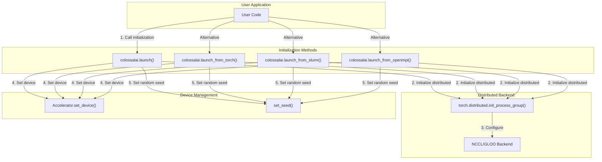
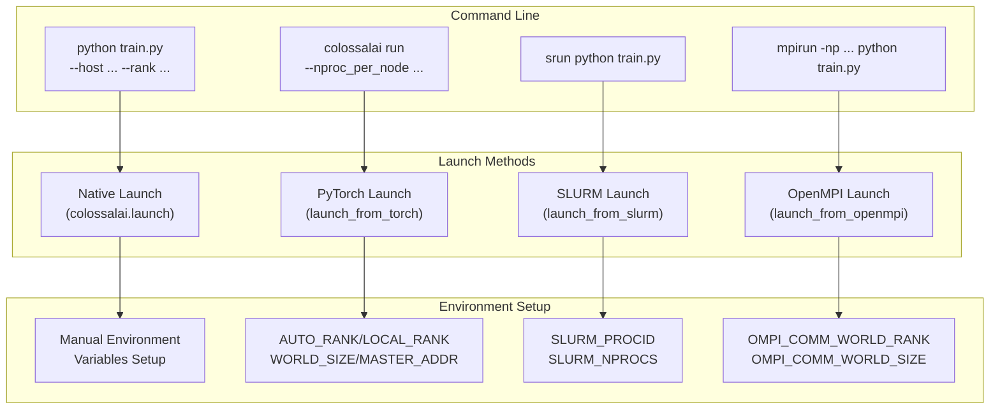
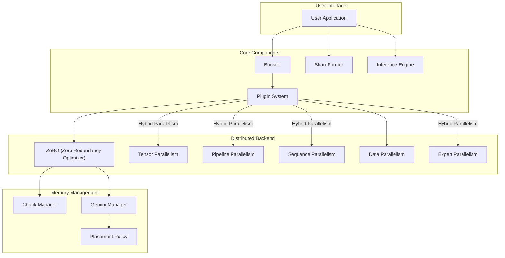
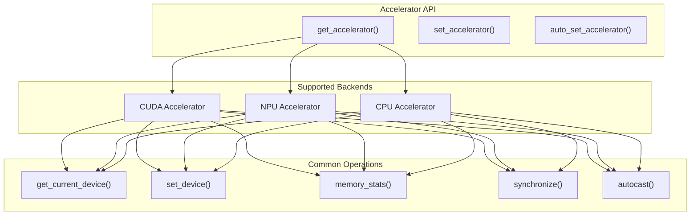

<!-- source: DeepWiki mcp.deepwiki.com · repo hpcaitech/ColossalAI · page 2 Getting Started · fetched 2026-10-21 -->

# Getting Started

<details>
<summary>Relevant source files</summary>

The following files were used as context for generating this wiki page:

- [README.md](README.md)
- [applications/ColossalChat/.gitignore](applications/ColossalChat/.gitignore)
- [applications/README.md](applications/README.md)
- [colossalai/nn/optimizer/README.md](colossalai/nn/optimizer/README.md)
- [docs/README-zh-Hans.md](docs/README-zh-Hans.md)
- [docs/source/en/basics/launch_colossalai.md](docs/source/en/basics/launch_colossalai.md)
- [docs/source/en/get_started/installation.md](docs/source/en/get_started/installation.md)
- [docs/source/zh-Hans/basics/launch_colossalai.md](docs/source/zh-Hans/basics/launch_colossalai.md)
- [docs/source/zh-Hans/get_started/installation.md](docs/source/zh-Hans/get_started/installation.md)
- [examples/README.md](examples/README.md)
- [examples/tutorial/.gitignore](examples/tutorial/.gitignore)
- [examples/tutorial/README.md](examples/tutorial/README.md)
- [examples/tutorial/download_cifar10.py](examples/tutorial/download_cifar10.py)
- [examples/tutorial/sequence_parallel/data/dummy_dataloader.py](examples/tutorial/sequence_parallel/data/dummy_dataloader.py)

</details>


This guide will walk you through the process of setting up Colossal-AI and running your first distributed training job. Colossal-AI is a comprehensive system for training and deploying large AI models efficiently across distributed hardware.

For more advanced topics like specific parallelism techniques or optimization strategies, see [Parallelism Techniques](#3) and [Memory Optimization Techniques](#7).

## System Requirements

Before installing Colossal-AI, ensure your system meets the following requirements:

- PyTorch >= 2.2
- Python >= 3.7
- CUDA >= 11.0
- [NVIDIA GPU Compute Capability](https://developer.nvidia.com/cuda-gpus) >= 7.0 (V100/RTX20 and higher)
- Linux OS

Sources: [README.md:437-446](), [docs/source/en/get_started/installation.md:3-9]()

## Installation

There are several ways to install Colossal-AI depending on your needs.

### Install from PyPI

The easiest way to install Colossal-AI is directly from PyPI:

```bash
pip install colossalai
```

By default, PyTorch extensions are not built during installation. They will be built at runtime when needed. If you want to build them during installation:

```bash
BUILD_EXT=1 pip install colossalai
```

Nightly versions with the latest features are also available:

```bash
pip install colossalai-nightly
```

Sources: [README.md:451-473](), [docs/source/en/get_started/installation.md:13-28]()

### Install from Source

For the latest features or development:

```bash
git clone https://github.com/hpcaitech/ColossalAI.git
cd ColossalAI

# install dependencies
pip install -r requirements/requirements.txt

# install colossalai
pip install .

# with PyTorch extensions (optional)
BUILD_EXT=1 pip install .
```

Sources: [README.md:475-492](), [docs/source/en/get_started/installation.md:30-49]()

### Using Docker

You can use Docker to avoid setting up the environment manually:

```bash
# Pull from DockerHub
docker pull hpcaitech/colossalai

# Or build locally
cd ColossalAI
docker build -t colossalai ./docker
docker run -ti --gpus all --rm --ipc=host colossalai bash
```

Sources: [README.md:512-535](), [docs/source/en/get_started/installation.md:50-66]()

## Initialization Architecture

Understanding how Colossal-AI initializes distributed training is essential. Here's how the main components interact during initialization:

**Title: Colossal-AI Initialization Flow**



Sources: [colossalai/initialize.py:20-184](), [colossalai/__init__.py:1-13]()

## Launching Distributed Training

Colossal-AI offers several methods to launch distributed training. Let's explore each approach:

**Title: Distributed Launch Methods in Colossal-AI**



Sources: [docs/source/en/basics/launch_colossalai.md:1-231](), [colossalai/initialize.py:20-184]()

### Native Launch

This is the most basic approach using `colossalai.launch`:

```python
import colossalai

# Parse arguments
parser = colossalai.get_default_parser()
args = parser.parse_args()

# Launch distributed environment
colossalai.launch(
    rank=args.rank,
    world_size=args.world_size,
    host=args.host,
    port=args.port,
    backend=args.backend
)
```

The command to launch this script would be:

```bash
python train.py --host <host> --rank <rank> --world_size <world_size> --port <port> --backend <backend>
```

Sources: [docs/source/en/basics/launch_colossalai.md:77-96]()

### Using Colossal-AI CLI

For easier launching on both single and multi-node environments:

```python
import colossalai

# Use environment variables set by PyTorch launcher
colossalai.launch_from_torch()
```

Launch with the CLI:

```bash
# Single node with 4 GPUs
colossalai run --nproc_per_node 4 train.py

# Multi-node with specific hosts
colossalai run --nproc_per_node 4 --host host1,host2 --master_addr host1 train.py

# Using a hostfile
colossalai run --nproc_per_node 4 --hostfile ./hostfile --master_addr host1 train.py
```

Sources: [docs/source/en/basics/launch_colossalai.md:99-183]()

### Using SLURM

If you're on a SLURM-managed cluster:

```python
import colossalai

colossalai.launch_from_slurm(
    host=args.host,
    port=args.port
)
```

Launch with SLURM:

```bash
srun python train.py --host <master_node> --port 29500
```

Sources: [docs/source/en/basics/launch_colossalai.md:185-206]()

### Using OpenMPI

For OpenMPI environments:

```python
import colossalai

colossalai.launch_from_openmpi(
    host=args.host,
    port=args.port
)
```

Launch with OpenMPI:

```bash
mpirun --hostfile <my_hostfile> -np <num_process> python train.py --host <node name or ip> --port 29500
```

Sources: [docs/source/en/basics/launch_colossalai.md:208-230]()

## Core Components and Architecture

Understanding Colossal-AI's architecture will help you leverage its capabilities effectively:

**Title: Colossal-AI Core Architecture**



Sources: [README.md:126-141](), [colossalai/zero/__init__.py:1-13]()

## Simple Example: Running Your First Distributed Training

Let's go through a basic example to get familiar with Colossal-AI. 

### 1. Prepare your script

Create a `train.py` file with the following content:

```python
import torch
import colossalai
import torch.nn as nn
import torch.optim as optim
from torchvision.models import resnet18

# Parse arguments
parser = colossalai.get_default_parser()
args = parser.parse_args()

# Launch distributed environment
colossalai.launch(
    rank=args.rank,
    world_size=args.world_size,
    host=args.host,
    port=args.port,
    backend=args.backend
)

# Create model, criterion, optimizer
model = resnet18()
criterion = nn.CrossEntropyLoss()
optimizer = optim.Adam(model.parameters(), lr=0.001)

# Simulate data
batch_size = 32
input_data = torch.rand(batch_size, 3, 224, 224)
target = torch.randint(0, 1000, (batch_size,))

# Forward pass
output = model(input_data)
loss = criterion(output, target)

# Backward pass and optimize
loss.backward()
optimizer.step()

print(f"Training completed on rank {args.rank}, loss: {loss.item()}")
```

### 2. Launch the distributed training

For a single machine with 4 GPUs:

```bash
python train.py --host localhost --world_size 4 --port 29500 --rank 0 &
python train.py --host localhost --world_size 4 --port 29500 --rank 1 &
python train.py --host localhost --world_size 4 --port 29500 --rank 2 &
python train.py --host localhost --world_size 4 --port 29500 --rank 3
```

Or more easily with Colossal-AI CLI (assuming you've modified your script to use `launch_from_torch`):

```bash
colossalai run --nproc_per_node 4 train.py
```

This example demonstrates the basic workflow of launching distributed training with Colossal-AI.

Sources: [examples/tutorial/README.md:1-59]()

## Common Accelerator Support

Colossal-AI provides abstraction for various hardware accelerators, making your code portable across different platforms:

**Title: Accelerator Abstraction in Colossal-AI**



Sources: [colossalai/accelerator/api.py:1-72](), [colossalai/accelerator/npu_accelerator.py:1-289](), [colossalai/accelerator/base_accelerator.py:1-321]()

The accelerator API automatically selects the appropriate backend based on your hardware. You can also explicitly set the accelerator:

```python
from colossalai.accelerator import set_accelerator, auto_set_accelerator, get_accelerator

# Automatically select the best available accelerator
auto_set_accelerator()

# Or explicitly set an accelerator
set_accelerator("cuda")  # Other options: "npu", "cpu"

# Get the current accelerator
accelerator = get_accelerator()
```

Sources: [colossalai/accelerator/__init__.py:1-15](), [colossalai/accelerator/README.md:1-21]()

## Next Steps

Now that you've set up Colossal-AI and run a basic example, you can explore more advanced features:

1. Explore different [Parallelism Techniques](#3) like ZeRO, Tensor Parallelism, and Pipeline Parallelism
2. Learn about the [Booster API](#4) for simplified distributed training
3. Understand [ShardFormer](#5) for efficient model parallelism
4. Try out the [Inference Engine](#6) for optimized model inference
5. Implement [Memory Optimization Techniques](#7) for training larger models
6. Use the [Checkpointing System](#8) for saving and loading distributed models

You can also find examples and applications in the repository:
- Examples directory: [examples/](https://github.com/hpcaitech/ColossalAI/tree/main/examples)
- Applications directory: [applications/](https://github.com/hpcaitech/ColossalAI/tree/main/applications)

Sources: [examples/README.md:1-73](), [applications/README.md:1-27]()

---

