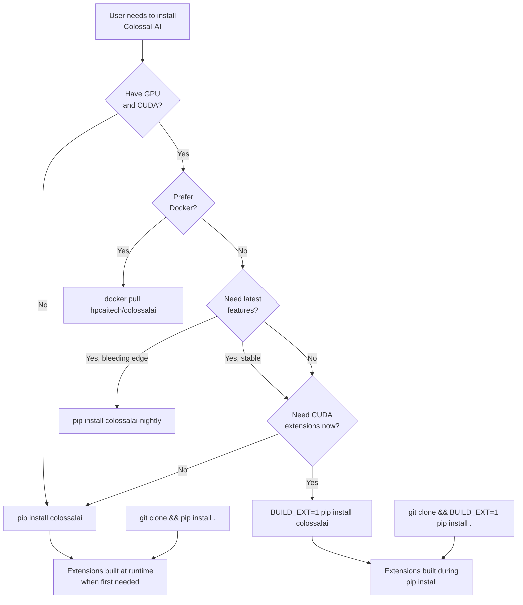
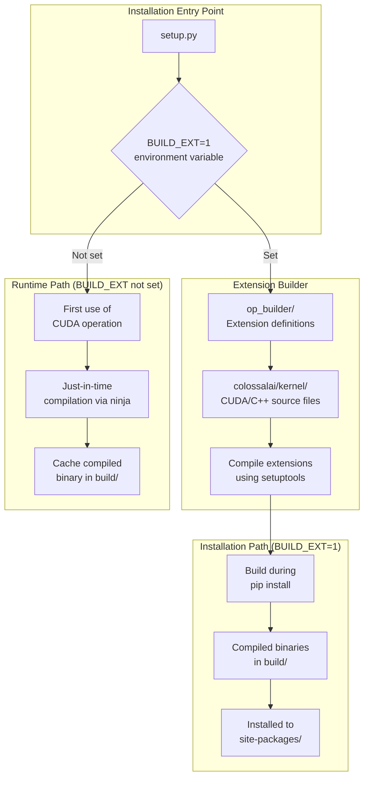
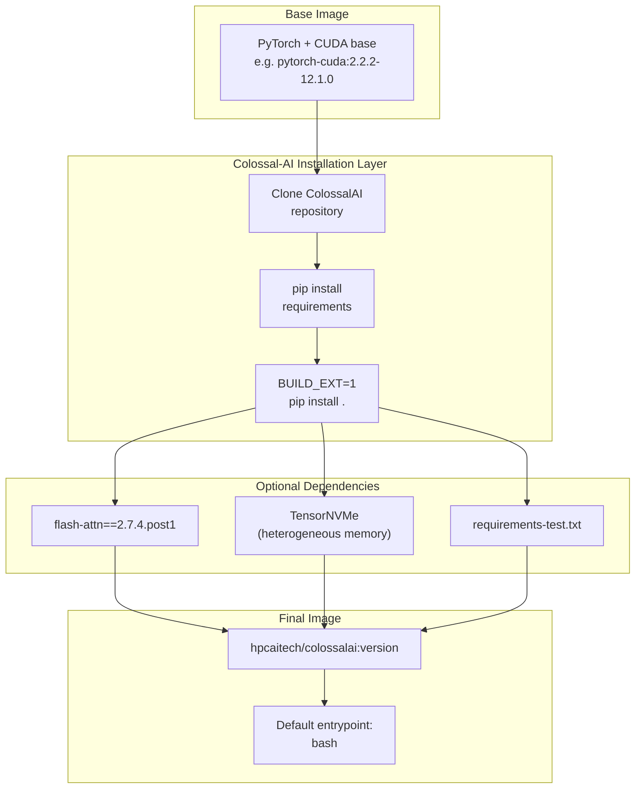
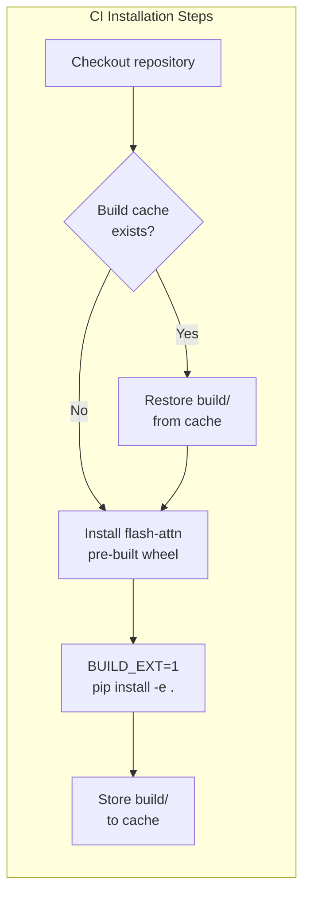

<!-- source: DeepWiki mcp.deepwiki.com · repo hpcaitech/ColossalAI · page 2.1 Installation · fetched 2026-10-21 -->

# Installation

<details>
<summary>Relevant source files</summary>

The following files were used as context for generating this wiki page:

- [.github/workflows/build_on_pr.yml](.github/workflows/build_on_pr.yml)
- [.github/workflows/build_on_schedule.yml](.github/workflows/build_on_schedule.yml)
- [.github/workflows/compatiblity_test_on_dispatch.yml](.github/workflows/compatiblity_test_on_dispatch.yml)
- [.github/workflows/compatiblity_test_on_pr.yml](.github/workflows/compatiblity_test_on_pr.yml)
- [.github/workflows/compatiblity_test_on_schedule.yml](.github/workflows/compatiblity_test_on_schedule.yml)
- [.github/workflows/doc_check_on_pr.yml](.github/workflows/doc_check_on_pr.yml)
- [.github/workflows/doc_test_on_pr.yml](.github/workflows/doc_test_on_pr.yml)
- [.github/workflows/doc_test_on_schedule.yml](.github/workflows/doc_test_on_schedule.yml)
- [.github/workflows/draft_github_release_post_after_merge.yml](.github/workflows/draft_github_release_post_after_merge.yml)
- [.github/workflows/example_check_on_dispatch.yml](.github/workflows/example_check_on_dispatch.yml)
- [.github/workflows/example_check_on_pr.yml](.github/workflows/example_check_on_pr.yml)
- [.github/workflows/example_check_on_schedule.yml](.github/workflows/example_check_on_schedule.yml)
- [.github/workflows/release_docker_after_publish.yml](.github/workflows/release_docker_after_publish.yml)
- [.github/workflows/release_nightly_on_schedule.yml](.github/workflows/release_nightly_on_schedule.yml)
- [.github/workflows/release_pypi_after_merge.yml](.github/workflows/release_pypi_after_merge.yml)
- [.github/workflows/report_leaderboard_to_lark.yml](.github/workflows/report_leaderboard_to_lark.yml)
- [.github/workflows/run_chatgpt_examples.yml](.github/workflows/run_chatgpt_examples.yml)
- [.github/workflows/run_chatgpt_unit_tests.yml](.github/workflows/run_chatgpt_unit_tests.yml)
- [.github/workflows/run_colossalqa_unit_tests.yml](.github/workflows/run_colossalqa_unit_tests.yml)
- [.github/workflows/scripts/generate_leaderboard_and_send_to_lark.py](.github/workflows/scripts/generate_leaderboard_and_send_to_lark.py)
- [README.md](README.md)
- [applications/ColossalChat/.gitignore](applications/ColossalChat/.gitignore)
- [applications/README.md](applications/README.md)
- [colossalai/nn/optimizer/README.md](colossalai/nn/optimizer/README.md)
- [docs/README-zh-Hans.md](docs/README-zh-Hans.md)
- [docs/source/en/basics/launch_colossalai.md](docs/source/en/basics/launch_colossalai.md)
- [docs/source/en/get_started/installation.md](docs/source/en/get_started/installation.md)
- [docs/source/zh-Hans/basics/launch_colossalai.md](docs/source/zh-Hans/basics/launch_colossalai.md)
- [docs/source/zh-Hans/get_started/installation.md](docs/source/zh-Hans/get_started/installation.md)
- [examples/README.md](examples/README.md)
- [examples/tutorial/.gitignore](examples/tutorial/.gitignore)
- [examples/tutorial/README.md](examples/tutorial/README.md)
- [examples/tutorial/download_cifar10.py](examples/tutorial/download_cifar10.py)
- [examples/tutorial/sequence_parallel/data/dummy_dataloader.py](examples/tutorial/sequence_parallel/data/dummy_dataloader.py)

</details>


This document covers the installation procedures for Colossal-AI, including system requirements, installation methods (PyPI, source build, Docker), and extension building options. For information about launching distributed training after installation, see [Distributed Environment Setup](#2.2).

---

## System Requirements

Colossal-AI requires the following environment:

| Component | Requirement |
|-----------|-------------|
| **Python** | >= 3.7 |
| **PyTorch** | >= 2.2 |
| **CUDA** | >= 11.0 |
| **GPU Compute Capability** | >= 7.0 (V100/RTX 20 series and higher) |
| **Operating System** | Linux (only Linux is officially supported) |

The NVIDIA GPU Compute Capability requirement ensures compatibility with modern distributed training features. Consumer-grade GPUs starting from RTX 20 series and datacenter GPUs from V100 onwards meet this requirement.

**Sources:** [README.md:452-458](), [docs/source/en/get_started/installation.md:3-9]()

---

## Installation Method Decision Flow



**Sources:** [README.md:461-503](), [docs/source/en/get_started/installation.md:13-65]()

---

## PyPI Installation

### Standard Installation (Runtime Extension Build)

The simplest installation method downloads the package from PyPI. By default, CUDA extensions are **not** built during installation but will be compiled automatically at runtime when needed.

```bash
pip install colossalai
```

This approach minimizes installation time but incurs a one-time compilation overhead when CUDA kernels are first used during training.

**Sources:** [README.md:461-467](), [docs/source/en/get_started/installation.md:15-19]()

### Installation with Pre-built Extensions

To build CUDA/C++ extensions during installation, set the `BUILD_EXT` environment variable:

```bash
BUILD_EXT=1 pip install colossalai
```

This is **required** when using fused optimizers and recommended for production deployments where runtime compilation delays are unacceptable. The build process compiles kernels in [op_builder/]() and [colossalai/kernel/]() directories.

**Sources:** [README.md:471-477](), [docs/source/en/get_started/installation.md:23-27]()

### Nightly Releases

Weekly nightly builds provide access to unreleased features and bug fixes from the main branch:

```bash
pip install colossalai-nightly
```

Nightly versions are published every Sunday at 00:00 UTC via the automated workflow in [.github/workflows/release_nightly_on_schedule.yml:1-70]().

**Sources:** [README.md:479-484](), [.github/workflows/release_nightly_on_schedule.yml:6]()

---

## Building from Source

### Standard Source Build

For development or to access the latest main branch code:

```bash
git clone https://github.com/hpcaitech/ColossalAI.git
cd ColossalAI

# Install dependencies
pip install -r requirements/requirements.txt

# Install without building extensions (runtime build)
pip install .
```

Extensions will be compiled during runtime when first needed, similar to PyPI installation.

**Sources:** [README.md:490-496](), [docs/source/en/get_started/installation.md:34-43]()

### Source Build with Extensions

To pre-build CUDA extensions during installation:

```bash
git clone https://github.com/hpcaitech/ColossalAI.git
cd ColossalAI

pip install -r requirements/requirements.txt

# Build extensions during installation
BUILD_EXT=1 pip install .
```

The `BUILD_EXT=1` flag triggers the extension build logic in [setup.py](), which processes kernel code in [op_builder/]() to create compiled binaries.

**Sources:** [README.md:498-503](), [docs/source/en/get_started/installation.md:45-49]()

### CUDA 10.2 Compatibility

For legacy CUDA 10.2 systems, the CUB library must be manually downloaded:

```bash
git clone https://github.com/hpcaitech/ColossalAI.git
cd ColossalAI

# Download CUB library version 1.8.0
wget https://github.com/NVIDIA/cub/archive/refs/tags/1.8.0.zip
unzip 1.8.0.zip
cp -r cub-1.8.0/cub/ colossalai/kernel/cuda_native/csrc/kernels/include/

# Build with extensions
BUILD_EXT=1 pip install .
```

This workaround addresses missing CUB headers in older CUDA toolkit installations.

**Sources:** [README.md:505-519](), [docs/source/en/get_started/installation.md:51-65]()

---

## Extension Build Process



The build process follows two paths depending on the `BUILD_EXT` flag:

1. **Runtime Build (default)**: Extensions compile on first use via PyTorch's JIT compilation mechanism, cached in the `build/` directory
2. **Install-time Build**: Extensions compile during `pip install`, installed directly to site-packages

The CI/CD workflows cache the `build/` directory to avoid recompilation across test runs, as seen in [.github/workflows/build_on_pr.yml:133-153]().

**Sources:** [README.md:471-477](), [.github/workflows/build_on_pr.yml:133-154](), [.github/workflows/compatiblity_test_on_pr.yml:59-62]()

---

## Docker Installation

### Pull Pre-built Images

Official Docker images are published to DockerHub after each release:

```bash
# Pull latest release
docker pull hpcaitech/colossalai:latest

# Pull specific version
docker pull hpcaitech/colossalai:v0.x.x
```

Images include PyTorch, CUDA, and all Colossal-AI dependencies pre-configured. The image building and publishing process is automated via [.github/workflows/release_docker_after_publish.yml:1-79]().

**Sources:** [README.md:525-528](), [.github/workflows/release_docker_after_publish.yml:21-44]()

### Build Custom Docker Image

To build from the repository Dockerfile:

```bash
cd ColossalAI
docker build -t colossalai ./docker
```

**Important**: Building Colossal-AI from source requires GPU access during the build. Configure Nvidia Docker Runtime as the default runtime:

```bash
# Verify nvidia-docker runtime is available
docker run --rm --gpus all nvidia/cuda:11.8.0-base-ubuntu22.04 nvidia-smi
```

If GPU access fails during build, install the NVIDIA Container Toolkit and set it as the default runtime in `/etc/docker/daemon.json`.

**Sources:** [README.md:530-541](), [README.md:534]()

### Run Container

Start an interactive container with GPU access:

```bash
docker run -ti --gpus all --rm --ipc=host colossalai bash
```

Flags explained:
- `--gpus all`: Expose all GPUs to the container
- `--rm`: Remove container after exit
- `--ipc=host`: Required for NCCL shared memory communication between processes

**Sources:** [README.md:543-547](), [.github/workflows/build_on_pr.yml:92-93]()

---

## Docker Image Structure



The CI/CD workflows use container images extensively for testing. The base image `image-cloud.luchentech.com/hpcaitech/pytorch-cuda:2.2.2-12.1.0` appears in multiple workflow files, providing a consistent testing environment with pre-installed PyTorch and CUDA.

**Sources:** [.github/workflows/build_on_pr.yml:92](), [.github/workflows/compatiblity_test_on_pr.yml:43](), [docker/Dockerfile]()

---

## Installation Verification

After installation, verify the environment is correctly configured:

```bash
colossalai check -i
```

This command checks:
- Python version compatibility
- PyTorch installation
- CUDA availability
- GPU detection
- Extension build status

Expected output shows green checkmarks for all components. If extensions were not built during installation, you may see a message indicating they will be compiled at runtime.

**Sources:** [examples/tutorial/README.md:50-53]()

---

## Compatibility Testing

Colossal-AI maintains compatibility across multiple PyTorch and CUDA versions. The compatibility matrix is defined in [.compatibility]() and tested via automated workflows:

| Workflow | Purpose | Frequency |
|----------|---------|-----------|
| [compatiblity_test_on_pr.yml]() | Test compatibility changes on PR | Per PR |
| [compatiblity_test_on_schedule.yml]() | Regular compatibility verification | Weekly (Saturday 19:00 UTC) |
| [compatiblity_test_on_dispatch.yml]() | Manual compatibility testing | On demand |

The test matrix is generated from [.compatibility]() which lists supported PyTorch-CUDA version pairs. For example, testing against `pytorch-cuda:2.2.2-12.1.0` verifies PyTorch 2.2.2 with CUDA 12.1.0.

**Sources:** [.github/workflows/compatiblity_test_on_pr.yml:22-32](), [.github/workflows/compatiblity_test_on_schedule.yml:17-29]()

---

## Continuous Integration Installation Pattern

The CI/CD workflows demonstrate best practices for installation in automated environments. The standard pattern from [.github/workflows/build_on_pr.yml:102-154]():



Key optimizations:
1. **Build caching**: The `build/` directory is cached between runs to avoid recompiling unchanged extensions
2. **Pre-built wheels**: Flash-attention is installed from a pre-built wheel rather than compiled from source
3. **Editable install**: Using `-e` flag enables code changes without reinstallation
4. **Extension detection**: Cache restoration skips if extension files changed (detected in [.github/workflows/build_on_pr.yml:55-64]())

**Sources:** [.github/workflows/build_on_pr.yml:102-154](), [.github/workflows/build_on_pr.yml:133-139]()

---

## Troubleshooting

### Issue: Extension Build Failures

**Symptom**: Compilation errors during `BUILD_EXT=1 pip install`

**Solutions**:
1. Verify CUDA toolkit is installed and `nvcc` is in PATH
2. Check CUDA version matches PyTorch CUDA version: `python -c "import torch; print(torch.version.cuda)"`
3. For CUDA 10.2, manually install CUB library as shown in [Building from Source](#building-from-source)
4. Check available disk space - compilation requires temporary space

### Issue: Runtime Extension Build Hangs

**Symptom**: First use of CUDA operations freezes

**Solutions**:
1. Pre-build extensions with `BUILD_EXT=1` during installation
2. Ensure write permissions to the build cache directory
3. Check for conflicting CUDA installations

### Issue: Docker GPU Access Denied

**Symptom**: `docker run --gpus all` fails with "could not select device driver"

**Solutions**:
1. Install NVIDIA Container Toolkit: `apt-get install nvidia-container-toolkit`
2. Restart Docker daemon: `systemctl restart docker`
3. Verify NVIDIA runtime: `docker run --rm --gpus all nvidia/cuda:11.8.0-base-ubuntu22.04 nvidia-smi`

### Issue: Import Errors After Installation

**Symptom**: `ImportError: cannot import name 'X' from 'colossalai'`

**Solutions**:
1. Verify installation: `pip show colossalai`
2. Check for conflicting installations: `pip list | grep colossalai`
3. Reinstall in clean environment: `pip uninstall colossalai && pip install colossalai`
4. For nightly builds, ensure no stable version is installed simultaneously

**Sources:** [README.md:459](), [examples/tutorial/README.md:53]()

---

