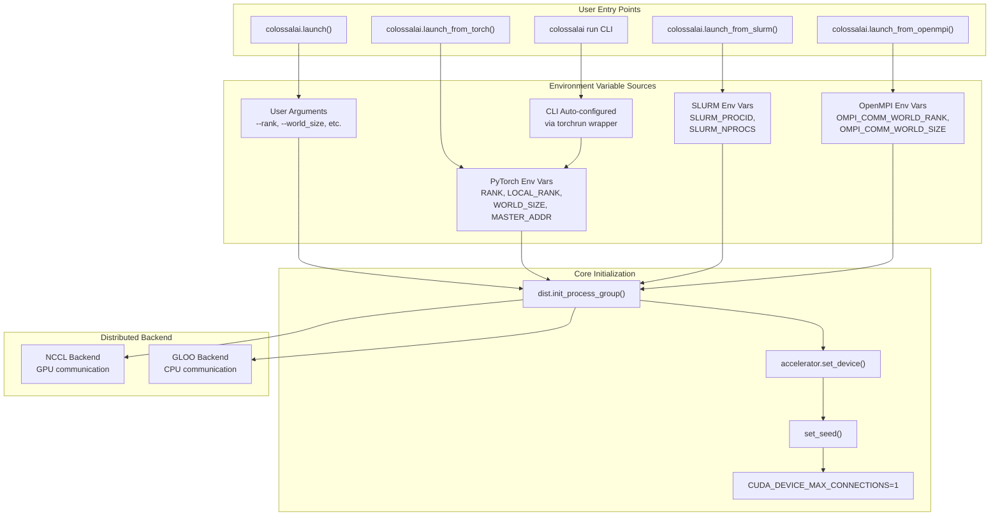
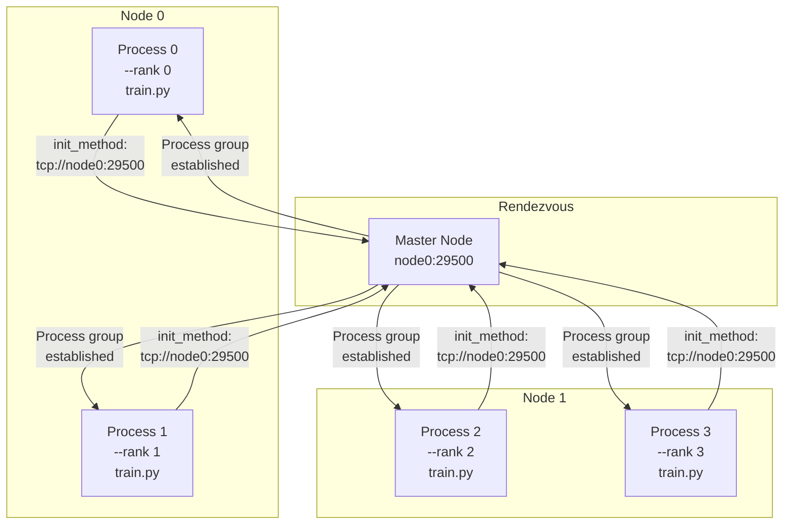
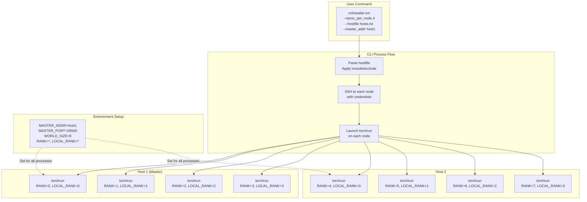
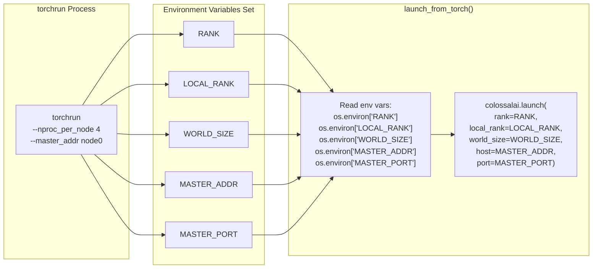
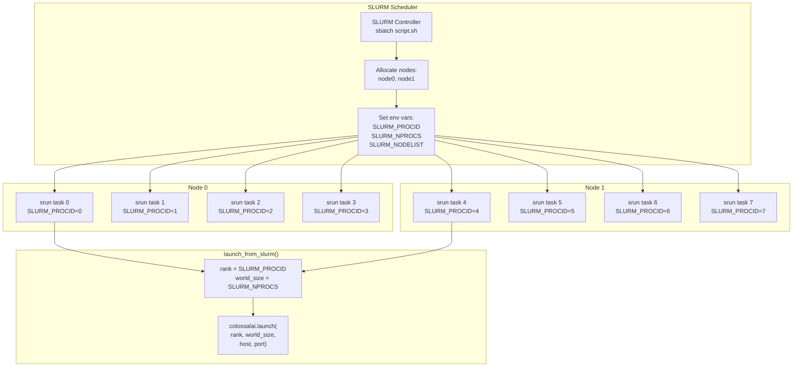
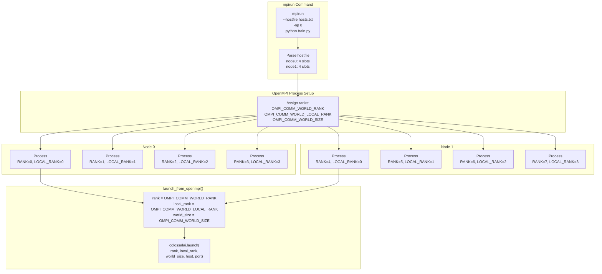

<!-- source: DeepWiki mcp.deepwiki.com · repo hpcaitech/ColossalAI · page 2.2 Distributed Environment Setup · fetched 2026-10-21 -->

# Distributed Environment Setup

<details>
<summary>Relevant source files</summary>

The following files were used as context for generating this wiki page:

- [README.md](README.md)
- [applications/ColossalChat/.gitignore](applications/ColossalChat/.gitignore)
- [applications/README.md](applications/README.md)
- [colossalai/initialize.py](colossalai/initialize.py)
- [colossalai/nn/optimizer/README.md](colossalai/nn/optimizer/README.md)
- [colossalai/zero/__init__.py](colossalai/zero/__init__.py)
- [docs/README-zh-Hans.md](docs/README-zh-Hans.md)
- [docs/source/en/basics/launch_colossalai.md](docs/source/en/basics/launch_colossalai.md)
- [docs/source/en/get_started/installation.md](docs/source/en/get_started/installation.md)
- [docs/source/zh-Hans/basics/launch_colossalai.md](docs/source/zh-Hans/basics/launch_colossalai.md)
- [docs/source/zh-Hans/get_started/installation.md](docs/source/zh-Hans/get_started/installation.md)
- [examples/README.md](examples/README.md)
- [examples/tutorial/.gitignore](examples/tutorial/.gitignore)
- [examples/tutorial/README.md](examples/tutorial/README.md)
- [examples/tutorial/download_cifar10.py](examples/tutorial/download_cifar10.py)
- [examples/tutorial/sequence_parallel/data/dummy_dataloader.py](examples/tutorial/sequence_parallel/data/dummy_dataloader.py)

</details>


This document explains how to initialize the distributed training environment in ColossalAI. Before training can begin, the distributed backend must be properly configured to enable communication between processes across GPUs and nodes. ColossalAI provides multiple launch methods to accommodate different deployment scenarios, including manual initialization, CLI-based launching, and integration with common job schedulers like SLURM and OpenMPI.

For information about parallelism strategies that operate on top of the distributed environment, see [Parallelism Techniques](#3). For installation instructions, see [Installation](#2.1).

## Overview of Launch Methods

ColossalAI supports five primary methods for initializing distributed environments, each designed for specific use cases:

| Launch Method | Function | Use Case | Environment Variables Required |
|---------------|----------|----------|-------------------------------|
| Manual Launch | `colossalai.launch()` | Custom scripts, fine-grained control | None (passed as arguments) |
| CLI Launch | `colossalai run` | Single/multi-node, simplified setup | Set by launcher |
| PyTorch Launch | `colossalai.launch_from_torch()` | Integration with `torchrun` | `RANK`, `LOCAL_RANK`, `WORLD_SIZE`, `MASTER_ADDR`, `MASTER_PORT` |
| SLURM Launch | `colossalai.launch_from_slurm()` | HPC clusters with SLURM | `SLURM_PROCID`, `SLURM_NPROCS` |
| OpenMPI Launch | `colossalai.launch_from_openmpi()` | MPI-managed clusters | `OMPI_COMM_WORLD_RANK`, `OMPI_COMM_WORLD_LOCAL_RANK`, `OMPI_COMM_WORLD_SIZE` |

**Launch Methods Architecture**



Sources: [colossalai/initialize.py:1-185]()

## Core Initialization Parameters

All launch methods require the following parameters to establish the distributed environment:

| Parameter | Type | Description | Default |
|-----------|------|-------------|---------|
| `rank` | int | Global rank of the current process (0 to world_size-1) | Required |
| `world_size` | int | Total number of processes across all nodes | Required |
| `host` | str | Master node address (hostname or IP) | Required |
| `port` | int | Master node port for rendezvous | Required |
| `backend` | str | Communication backend (`nccl`, `gloo`, `mpi`) | `nccl` |
| `local_rank` | int | Local rank on the current node | Auto-calculated |
| `seed` | int | Random seed for reproducibility | 1024 |
| `verbose` | bool | Enable initialization logging | True |

**Initialization Flow Diagram**

```mermaid
graph LR
    subgraph "Step 1: Read Parameters"
        ReadEnv["Read from env vars<br/>or arguments"]
        ValidateParams["Validate rank,<br/>world_size, host, port"]
    end
    
    subgraph "Step 2: Environment Setup"
        SetCUDAConn["Set CUDA_DEVICE_MAX_CONNECTIONS=1<br/>for comm/compute overlap"]
        GetAccel["get_accelerator()<br/>detect GPU type"]
    end
    
    subgraph "Step 3: Process Group Init"
        BuildInitMethod["Build init_method<br/>tcp://[host]:port"]
        InitDistPG["dist.init_process_group()<br/>rank, world_size, backend"]
    end
    
    subgraph "Step 4: Device & Seed"
        SetDeviceID["accelerator.set_device()<br/>local_rank"]
        SetRandomSeed["set_seed(seed)<br/>for reproducibility"]
    end
    
    subgraph "Step 5: Optimization Flags"
        SetDynamo["torch._dynamo.config<br/>.optimize_ddp = True"]
        LogSuccess["Log initialization<br/>success message"]
    end
    
    ReadEnv --> ValidateParams
    ValidateParams --> SetCUDAConn
    SetCUDAConn --> GetAccel
    GetAccel --> BuildInitMethod
    BuildInitMethod --> InitDistPG
    InitDistPG --> SetDeviceID
    SetDeviceID --> SetRandomSeed
    SetRandomSeed --> SetDynamo
    SetDynamo --> LogSuccess
```



Sources: [colossalai/initialize.py:20-76]()

## Method 1: Manual Launch with `colossalai.launch()`

The `colossalai.launch()` function provides direct control over distributed initialization. This method is suitable when you need to manually manage process spawning or integrate with custom launchers.

**Function Signature:**
```python
def launch(
    rank: int,
    world_size: int,
    host: str,
    port: int,
    backend: str = "nccl",
    local_rank: int = None,
    seed: int = 1024,
    verbose: bool = True,
)
```

**Usage Pattern:**

```python
# train.py
import colossalai

# Parse command line arguments
parser = colossalai.get_default_parser()
args = parser.parse_args()

# Initialize distributed environment
colossalai.launch(
    rank=args.rank,
    world_size=args.world_size,
    host=args.host,
    port=args.port,
    backend=args.backend,
    seed=args.seed,
)

# Your training code here
```

**Command Line Execution:**
```bash
# Start process 0 on node0
python train.py --rank 0 --world_size 4 --host node0 --port 29500

# Start process 1 on node0
python train.py --rank 1 --world_size 4 --host node0 --port 29500

# Continue for all ranks...
```

**Manual Launch Architecture:**



Sources: [colossalai/initialize.py:20-76](), [docs/source/en/basics/launch_colossalai.md:78-96]()

## Method 2: CLI Launch with `colossalai run`

The `colossalai run` command provides a simplified interface for launching distributed training jobs. It wraps PyTorch's `torchrun` utility and extends it with multi-node capabilities.

**Single Node Launch:**
```bash
# Launch on current node with 4 GPUs (default port 29500)
colossalai run --nproc_per_node 4 train.py

# Launch with custom port
colossalai run --nproc_per_node 4 --master_port 29505 train.py

# Pass arguments to train.py
colossalai run --nproc_per_node 4 train.py --batch_size 32 --lr 0.001
```

**Multi-Node Launch (Host List):**
```bash
# Launch on 2 nodes with 4 GPUs each
colossalai run --nproc_per_node 4 \
               --hosts host1,host2 \
               --master_addr host1 \
               --ssh_port 22 \
               train.py
```

**Multi-Node Launch (Hostfile):**

Create a hostfile listing available nodes:
```text
# hostfile.txt
host1
host2
host3
host4
```

Launch with hostfile:
```bash
# Launch on all hosts in hostfile
colossalai run --nproc_per_node 4 \
               --hostfile ./hostfile.txt \
               --master_addr host1 \
               train.py

# Launch on subset of hosts
colossalai run --nproc_per_node 4 \
               --hostfile ./hostfile.txt \
               --master_addr host1 \
               --include host1,host2 \
               train.py

# Exclude faulty hosts
colossalai run --nproc_per_node 4 \
               --hostfile ./hostfile.txt \
               --master_addr host1 \
               --exclude host3 \
               train.py
```

**Training Script for CLI Launch:**
```python
# train.py
import colossalai

# Use launch_from_torch to read environment variables
# set by colossalai run (which uses torchrun internally)
colossalai.launch_from_torch(
    backend="nccl",
    seed=1024,
    verbose=True
)

# Your training code
```

**CLI Multi-Node Launch Architecture:**



Sources: [docs/source/en/basics/launch_colossalai.md:99-183](), [colossalai/initialize.py:154-184]()

## Method 3: PyTorch Launch with `launch_from_torch()`

The `launch_from_torch()` function integrates with PyTorch's native distributed launchers (`torch.distributed.launch` and `torchrun`). It automatically reads distributed parameters from environment variables set by these tools.

**Function Signature:**
```python
def launch_from_torch(
    backend: str = "nccl",
    seed: int = 1024,
    verbose: bool = True
)
```

**Environment Variables Read:**
- `RANK`: Global rank of the process
- `LOCAL_RANK`: Local rank on the current node
- `WORLD_SIZE`: Total number of processes
- `MASTER_ADDR`: Master node address
- `MASTER_PORT`: Master node port

**Training Script:**
```python
# train.py
import colossalai

# Launch from PyTorch environment
colossalai.launch_from_torch(
    backend="nccl",
    seed=1024,
    verbose=True
)

# Training code
```

**Launch with torchrun:**
```bash
# Single node with 4 GPUs
torchrun --nproc_per_node=4 train.py

# Multi-node with 2 nodes, 4 GPUs each (run on each node)
# On node 0:
torchrun --nproc_per_node=4 \
         --nnodes=2 \
         --node_rank=0 \
         --master_addr=node0 \
         --master_port=29500 \
         train.py

# On node 1:
torchrun --nproc_per_node=4 \
         --nnodes=2 \
         --node_rank=1 \
         --master_addr=node0 \
         --master_port=29500 \
         train.py
```

**Environment Variable Mapping:**



Sources: [colossalai/initialize.py:154-184](), [docs/source/en/basics/launch_colossalai.md:99-125]()

## Method 4: SLURM Launch with `launch_from_slurm()`

The `launch_from_slurm()` function integrates with the SLURM workload manager commonly used in HPC clusters. It reads rank and world size from SLURM environment variables.

**Function Signature:**
```python
def launch_from_slurm(
    host: str,
    port: int,
    backend: str = "nccl",
    seed: int = 1024,
    verbose: bool = True
)
```

**Environment Variables Read:**
- `SLURM_PROCID`: Process rank (assigned by SLURM)
- `SLURM_NPROCS`: Total number of processes

**Training Script:**
```python
# train.py
import colossalai
import argparse

parser = argparse.ArgumentParser()
parser.add_argument('--host', type=str, required=True)
parser.add_argument('--port', type=int, default=29500)
args = parser.parse_args()

# Launch from SLURM environment
colossalai.launch_from_slurm(
    host=args.host,
    port=args.port,
    backend="nccl",
    seed=1024
)

# Training code
```

**SLURM Batch Script:**
```bash
#!/bin/bash
#SBATCH --job-name=colossal_train
#SBATCH --nodes=2
#SBATCH --ntasks-per-node=4
#SBATCH --gres=gpu:4
#SBATCH --time=24:00:00

# Get master node address
MASTER_ADDR=$(scontrol show hostname $SLURM_NODELIST | head -n 1)

# Launch with srun
srun python train.py --host $MASTER_ADDR --port 29500
```

**SLURM Process Assignment:**



Sources: [colossalai/initialize.py:78-112](), [docs/source/en/basics/launch_colossalai.md:186-206]()

## Method 5: OpenMPI Launch with `launch_from_openmpi()`

The `launch_from_openmpi()` function integrates with OpenMPI for distributed execution. It reads rank information from MPI environment variables.

**Function Signature:**
```python
def launch_from_openmpi(
    host: str,
    port: int,
    backend: str = "nccl",
    seed: int = 1024,
    verbose: bool = True
)
```

**Environment Variables Read:**
- `OMPI_COMM_WORLD_RANK`: Global rank
- `OMPI_COMM_WORLD_LOCAL_RANK`: Local rank on node
- `OMPI_COMM_WORLD_SIZE`: Total number of processes

**Training Script:**
```python
# train.py
import colossalai
import argparse

parser = argparse.ArgumentParser()
parser.add_argument('--host', type=str, required=True)
parser.add_argument('--port', type=int, default=29500)
args = parser.parse_args()

# Launch from OpenMPI environment
colossalai.launch_from_openmpi(
    host=args.host,
    port=args.port,
    backend="nccl",
    seed=1024
)

# Training code
```

**OpenMPI Launch Command:**
```bash
# Launch with mpirun
mpirun --hostfile hostfile.txt \
       -np 8 \
       -bind-to none \
       -map-by slot \
       python train.py --host node0 --port 29500
```

**Hostfile Format:**
```text
node0 slots=4
node1 slots=4
```

**OpenMPI Process Distribution:**



Sources: [colossalai/initialize.py:115-151](), [docs/source/en/basics/launch_colossalai.md:208-229]()

## Environment Configuration Details

### CUDA Device Connection Limit

ColossalAI sets `CUDA_DEVICE_MAX_CONNECTIONS=1` at initialization to ensure deterministic kernel launch ordering when overlapping communication and computation. This prevents race conditions where compute kernels might be scheduled before communication kernels.

```python
# Set in colossalai/initialize.py:10
os.environ["CUDA_DEVICE_MAX_CONNECTIONS"] = "1"
```

This setting ensures:
1. Communication operations are launched first on the GPU
2. Compute operations follow in predictable order
3. Overlapping of communication and computation remains correct

Sources: [colossalai/initialize.py:6-10]()

### Backend Selection

ColossalAI supports multiple communication backends:

| Backend | Hardware | Use Case | Features |
|---------|----------|----------|----------|
| `nccl` | NVIDIA GPU | Standard GPU training | Optimized GPU collectives, multi-GPU/multi-node |
| `gloo` | CPU, GPU | CPU training, debugging | Cross-platform, slower than NCCL |
| `mpi` | CPU, GPU | HPC clusters | Integration with existing MPI infrastructure |

The backend is automatically selected based on the accelerator:
```python
# From colossalai/initialize.py:50-52
cur_accelerator = get_accelerator()
backend = cur_accelerator.communication_backend
```

Sources: [colossalai/initialize.py:50-52]()

### Random Seed Setting

All launch methods set a consistent random seed across all processes to ensure reproducible training:

```python
# From colossalai/initialize.py:66
set_seed(seed)
```

This sets seeds for:
- Python `random` module
- NumPy random number generator
- PyTorch CPU and CUDA random number generators

Sources: [colossalai/initialize.py:66]()

### Device Assignment

Local rank is used to assign each process to a specific GPU:

```python
# From colossalai/initialize.py:63-64
if cur_accelerator.support_set_device:
    cur_accelerator.set_device(local_rank)
```

For a node with 4 GPUs:
- LOCAL_RANK=0 → GPU 0
- LOCAL_RANK=1 → GPU 1
- LOCAL_RANK=2 → GPU 2
- LOCAL_RANK=3 → GPU 3

Sources: [colossalai/initialize.py:63-64]()

## Verification and Debugging

After launching, verify the distributed environment is correctly initialized:

```python
import torch.distributed as dist
from colossalai.logging import get_dist_logger

logger = get_dist_logger()

# Check initialization status
assert dist.is_initialized(), "Distributed backend not initialized"

# Log distributed info
logger.info(f"Rank: {dist.get_rank()}")
logger.info(f"World Size: {dist.get_world_size()}")
logger.info(f"Local Rank: {torch.cuda.current_device()}")
logger.info(f"Backend: {dist.get_backend()}")
```

**Common Issues and Solutions:**

| Issue | Cause | Solution |
|-------|-------|----------|
| `RuntimeError: Address already in use` | Port 29500 occupied | Change `--master_port` to different value |
| `RuntimeError: Could not find RANK` | Wrong launch method | Use `launch_from_torch()` with torchrun |
| `RuntimeError: NCCL error` | Network/GPU communication failure | Check GPU health, network connectivity |
| `RuntimeError: Could not find SLURM_PROCID` | Not using SLURM | Use appropriate launch method for your setup |
| `Connection timeout` | Firewall blocking | Open required ports, check `master_addr` |

Sources: [colossalai/initialize.py:74-75]()

## Complete Example

**Training Script (train.py):**
```python
import torch
import torch.nn as nn
from torch.utils.data import DataLoader, Dataset
import colossalai
from colossalai.booster import Booster
from colossalai.booster.plugin import TorchDDPPlugin

# Launch distributed environment
colossalai.launch_from_torch(
    backend="nccl",
    seed=1024,
    verbose=True
)

# Define model
model = nn.Linear(1024, 1024)

# Define optimizer
optimizer = torch.optim.Adam(model.parameters(), lr=0.001)

# Initialize booster for distributed training
booster = Booster(plugin=TorchDDPPlugin())
model, optimizer, _, _, _ = booster.boost(model, optimizer)

# Training loop
for epoch in range(10):
    for data, labels in dataloader:
        optimizer.zero_grad()
        outputs = model(data)
        loss = criterion(outputs, labels)
        booster.backward(loss, optimizer)
        optimizer.step()
```

**Launch Options:**

```bash
# Option 1: CLI (recommended)
colossalai run --nproc_per_node 4 train.py

# Option 2: torchrun
torchrun --nproc_per_node 4 train.py

# Option 3: Multi-node with CLI
colossalai run --nproc_per_node 4 \
               --hosts node1,node2 \
               --master_addr node1 \
               train.py

# Option 4: SLURM
srun python train.py --host $MASTER_ADDR --port 29500
# (with launch_from_slurm in train.py)

# Option 5: OpenMPI
mpirun --hostfile hosts.txt -np 8 python train.py --host node1 --port 29500
# (with launch_from_openmpi in train.py)
```

Sources: [examples/tutorial/README.md:1-60](), [docs/source/en/basics/launch_colossalai.md:1-232]()

---

