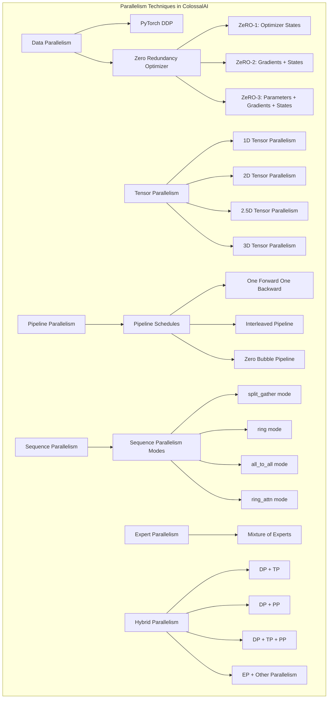
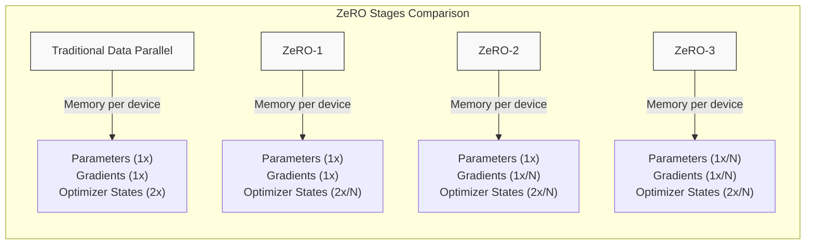
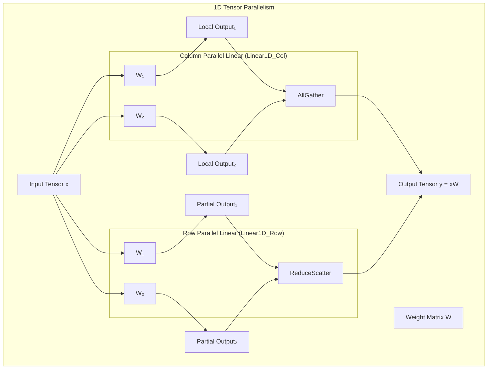
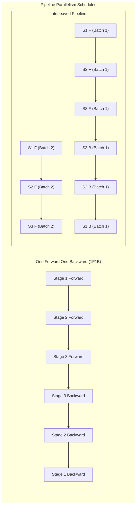
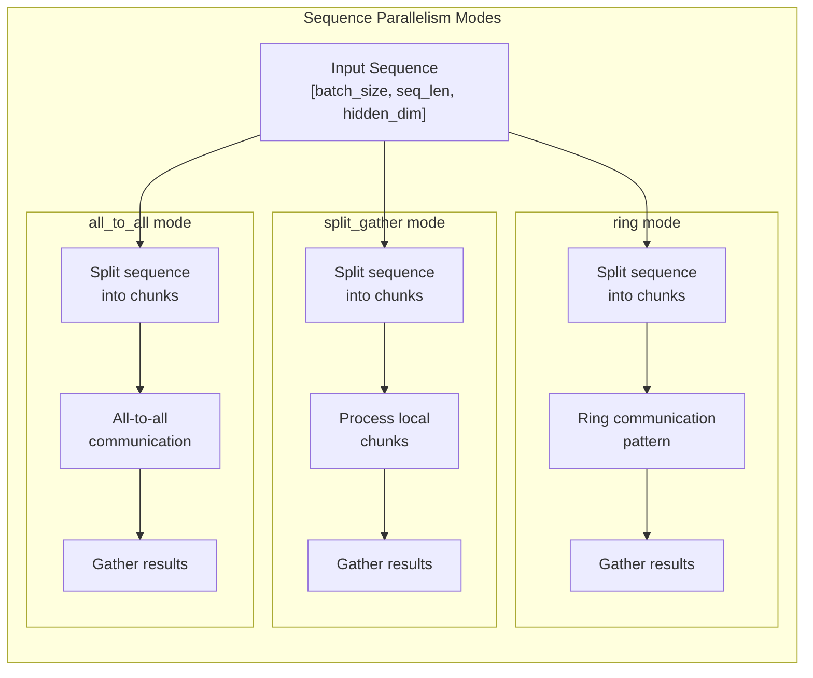
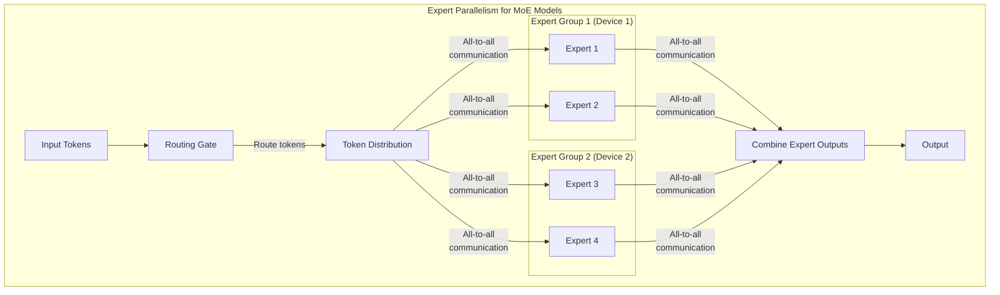
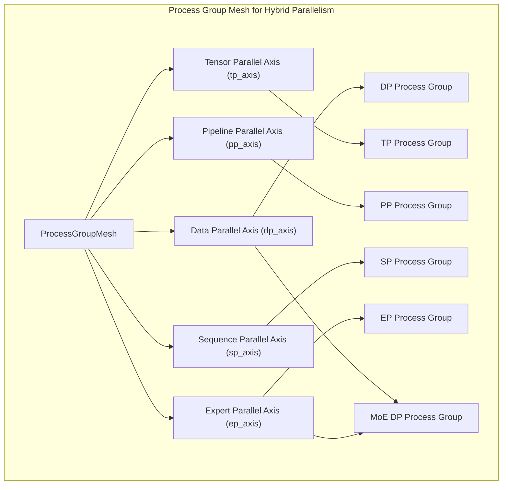

<!-- source: DeepWiki mcp.deepwiki.com · repo hpcaitech/ColossalAI · page 3 Parallelism Techniques · fetched 2026-10-21 -->

# Parallelism Techniques

<details>
<summary>Relevant source files</summary>

The following files were used as context for generating this wiki page:

- [README.md](README.md)
- [applications/ColossalChat/.gitignore](applications/ColossalChat/.gitignore)
- [applications/README.md](applications/README.md)
- [colossalai/booster/booster.py](colossalai/booster/booster.py)
- [colossalai/booster/plugin/gemini_plugin.py](colossalai/booster/plugin/gemini_plugin.py)
- [colossalai/booster/plugin/hybrid_parallel_plugin.py](colossalai/booster/plugin/hybrid_parallel_plugin.py)
- [colossalai/booster/plugin/low_level_zero_plugin.py](colossalai/booster/plugin/low_level_zero_plugin.py)
- [colossalai/booster/plugin/torch_ddp_plugin.py](colossalai/booster/plugin/torch_ddp_plugin.py)
- [colossalai/booster/plugin/torch_fsdp_plugin.py](colossalai/booster/plugin/torch_fsdp_plugin.py)
- [colossalai/checkpoint_io/__init__.py](colossalai/checkpoint_io/__init__.py)
- [colossalai/checkpoint_io/checkpoint_io_base.py](colossalai/checkpoint_io/checkpoint_io_base.py)
- [colossalai/checkpoint_io/general_checkpoint_io.py](colossalai/checkpoint_io/general_checkpoint_io.py)
- [colossalai/checkpoint_io/hybrid_parallel_checkpoint_io.py](colossalai/checkpoint_io/hybrid_parallel_checkpoint_io.py)
- [colossalai/checkpoint_io/index_file.py](colossalai/checkpoint_io/index_file.py)
- [colossalai/checkpoint_io/moe_checkpoint.py](colossalai/checkpoint_io/moe_checkpoint.py)
- [colossalai/checkpoint_io/utils.py](colossalai/checkpoint_io/utils.py)
- [colossalai/nn/optimizer/README.md](colossalai/nn/optimizer/README.md)
- [colossalai/utils/safetensors.py](colossalai/utils/safetensors.py)
- [colossalai/zero/gemini/gemini_optimizer.py](colossalai/zero/gemini/gemini_optimizer.py)
- [colossalai/zero/low_level/bookkeeping/tensor_bucket.py](colossalai/zero/low_level/bookkeeping/tensor_bucket.py)
- [colossalai/zero/low_level/low_level_optim.py](colossalai/zero/low_level/low_level_optim.py)
- [docs/README-zh-Hans.md](docs/README-zh-Hans.md)
- [docs/source/en/basics/launch_colossalai.md](docs/source/en/basics/launch_colossalai.md)
- [docs/source/en/get_started/installation.md](docs/source/en/get_started/installation.md)
- [docs/source/zh-Hans/basics/launch_colossalai.md](docs/source/zh-Hans/basics/launch_colossalai.md)
- [docs/source/zh-Hans/get_started/installation.md](docs/source/zh-Hans/get_started/installation.md)
- [examples/README.md](examples/README.md)
- [examples/tutorial/.gitignore](examples/tutorial/.gitignore)
- [examples/tutorial/README.md](examples/tutorial/README.md)
- [examples/tutorial/download_cifar10.py](examples/tutorial/download_cifar10.py)
- [examples/tutorial/sequence_parallel/data/dummy_dataloader.py](examples/tutorial/sequence_parallel/data/dummy_dataloader.py)
- [tests/test_checkpoint_io/test_gemini_checkpoint_io.py](tests/test_checkpoint_io/test_gemini_checkpoint_io.py)
- [tests/test_checkpoint_io/test_general_checkpoint_io.py](tests/test_checkpoint_io/test_general_checkpoint_io.py)
- [tests/test_checkpoint_io/test_hybrid_parallel_plugin_checkpoint_io.py](tests/test_checkpoint_io/test_hybrid_parallel_plugin_checkpoint_io.py)
- [tests/test_checkpoint_io/test_low_level_zero_checkpoint_io.py](tests/test_checkpoint_io/test_low_level_zero_checkpoint_io.py)
- [tests/test_checkpoint_io/test_safetensors_async_io.py](tests/test_checkpoint_io/test_safetensors_async_io.py)
- [tests/test_checkpoint_io/test_torch_ddp_checkpoint_io.py](tests/test_checkpoint_io/test_torch_ddp_checkpoint_io.py)

</details>


This page provides an overview of distributed parallel training techniques implemented in ColossalAI. It explains how to scale model training across multiple devices and nodes to enable training of large AI models that wouldn't fit on a single device. For information about inference techniques, see [Inference Engine](#6).

## Introduction

ColossalAI implements a comprehensive suite of parallelism techniques that enable efficient distributed training of large-scale models. These techniques can be used individually or combined to achieve optimal performance and resource utilization. The main purpose of these techniques is to:

1. Enable training of models that are too large to fit on a single GPU
2. Accelerate training speed through efficient parallel computation
3. Optimize memory usage across distributed hardware
4. Enable scaling to hundreds or thousands of GPUs efficiently



Sources:
- [README.md:124-148](https://github.com/hpcaitech/ColossalAI/blob/main/README.md)
- [colossalai/booster/plugin/hybrid_parallel_plugin.py:46-51](https://github.com/hpcaitech/ColossalAI/blob/main/colossalai/booster/plugin/hybrid_parallel_plugin.py)

## Data Parallelism

Data parallelism is the most straightforward parallelism technique, where the model is replicated across devices, but each device processes a different batch of data. ColossalAI supports two main types of data parallelism:

### PyTorch DDP (Distributed Data Parallel)

Standard PyTorch DDP is supported in ColossalAI, which replicates the model on each device and performs all-reduce operations to synchronize gradients during backpropagation.

Key characteristics:
- Requires full model replication on each device
- Simple to implement with minimal code changes
- Model parameters stay in sync across all devices
- Communication overhead increases with model size due to all-reduce operations

### Zero Redundancy Optimizer (ZeRO)

ZeRO optimizes memory usage by partitioning model states across devices:

1. **ZeRO-1**: Partitions optimizer states (momentum buffers, variance) across data parallel workers.
2. **ZeRO-2**: Partitions gradients and optimizer states.
3. **ZeRO-3**: Partitions model parameters, gradients, and optimizer states.



ColossalAI implements ZeRO in the `HybridParallelZeroOptimizer` class, which wraps the optimizer and handles the partitioning and communication of model states.

Sources:
- [README.md:136](https://github.com/hpcaitech/ColossalAI/blob/main/README.md)
- [colossalai/booster/plugin/hybrid_parallel_plugin.py:664-704](https://github.com/hpcaitech/ColossalAI/blob/main/colossalai/booster/plugin/hybrid_parallel_plugin.py)
- [colossalai/zero/low_level/zero_hook.py](https://github.com/hpcaitech/ColossalAI/blob/main/colossalai/zero/low_level/zero_hook.py)

## Tensor Parallelism

Tensor parallelism involves splitting individual tensors across devices. ColossalAI implements several forms of tensor parallelism:

### 1D Tensor Parallelism

This technique splits individual layers of the model across devices. For instance, linear layers are partitioned along input or output dimensions:

- `Linear1D_Col`: Partitions the weights matrix column-wise (along the output dimension)
- `Linear1D_Row`: Partitions the weights matrix row-wise (along the input dimension)



### Advanced Tensor Parallelism (2D, 2.5D, 3D)

ColossalAI also supports more advanced tensor parallelism schemes that extend beyond 1D partitioning:

- **2D Tensor Parallelism**: Partitions tensors along two dimensions, requiring different communication patterns
- **2.5D Tensor Parallelism**: An extension of 2D parallelism that uses multiple 2D partitioning planes
- **3D Tensor Parallelism**: Partitions tensors along three dimensions for maximum sharding across devices

These more advanced forms reduce the communication overhead compared to 1D tensor parallelism.

Sources:
- [README.md:132-134](https://github.com/hpcaitech/ColossalAI/blob/main/README.md)
- [colossalai/shardformer/policies/mixtral.py:133-176](https://github.com/hpcaitech/ColossalAI/blob/main/colossalai/shardformer/policies/mixtral.py)
- [colossalai/shardformer/layer/linear.py](https://github.com/hpcaitech/ColossalAI/blob/main/colossalai/shardformer/layer/linear.py)

## Pipeline Parallelism

Pipeline parallelism partitions the model along its layers, with different devices handling different parts of the model. This technique is implemented in the `PipelineStageManager` class, which manages the partitioning and communication between stages.

ColossalAI supports several pipeline scheduling strategies:

### One Forward One Backward (1F1B)

The standard pipeline parallelism schedule where one microbatch is processed at a time, moving forward through all stages, and then backward through all stages.

### Interleaved Pipeline

An optimized schedule that interleaves the forward and backward passes of different microbatches to reduce bubble time.

### Zero Bubble Pipeline

A schedule that aims to eliminate pipeline bubbles entirely by carefully orchestrating the execution of microbatches.



Pipeline parallelism in ColossalAI is implemented with model-specific forward pass handlers, such as those in the `MixtralPipelineForwards` and `DeepseekPipelineForwards` classes, which handle input and output transformations between pipeline stages.

Sources:
- [README.md:135](https://github.com/hpcaitech/ColossalAI/blob/main/README.md)
- [colossalai/pipeline/stage_manager.py](https://github.com/hpcaitech/ColossalAI/blob/main/colossalai/pipeline/stage_manager.py)
- [colossalai/pipeline/schedule/one_f_one_b.py](https://github.com/hpcaitech/ColossalAI/blob/main/colossalai/pipeline/schedule/one_f_one_b.py)
- [colossalai/pipeline/schedule/interleaved_pp.py](https://github.com/hpcaitech/ColossalAI/blob/main/colossalai/pipeline/schedule/interleaved_pp.py)
- [colossalai/pipeline/schedule/zero_bubble_pp.py](https://github.com/hpcaitech/ColossalAI/blob/main/colossalai/pipeline/schedule/zero_bubble_pp.py)

## Sequence Parallelism

Sequence parallelism is designed for handling long sequences efficiently by partitioning the sequence dimension. ColossalAI supports several sequence parallelism modes:

- **split_gather**: Splits the sequence dimension and gathers results, effective for attention operations
- **ring**: Uses a ring-based communication pattern for sequence parallelism
- **all_to_all**: Uses all-to-all communication for sequence parallelism
- **ring_attn**: Uses ring-based communication specifically for attention mechanisms

Sequence parallelism is particularly useful for transformer models with long context lengths.



The sequence parallelism implementation can be found in the `SeqParallelUtils` class and is integrated with the tensor parallelism implementation.

Sources:
- [README.md:135](https://github.com/hpcaitech/ColossalAI/blob/main/README.md)
- [colossalai/booster/plugin/hybrid_parallel_plugin.py:48](https://github.com/hpcaitech/ColossalAI/blob/main/colossalai/booster/plugin/hybrid_parallel_plugin.py)
- [colossalai/shardformer/layer/utils.py](https://github.com/hpcaitech/ColossalAI/blob/main/colossalai/shardformer/layer/utils.py)

## Expert Parallelism for MoE Models

Expert parallelism is designed for Mixture of Experts (MoE) models, where different "expert" neural networks specialize in processing different inputs. ColossalAI implements expert parallelism in the `EPMixtralSparseMoeBlock` and `EPDeepseekMoE` classes.



The expert parallelism implementation includes:

1. Partitioning experts across devices
2. Special routing mechanisms to dispatch tokens to their assigned experts
3. Communication for gathering expert outputs
4. Integration with other parallelism techniques

Expert parallelism can be combined with other techniques like data parallelism and tensor parallelism through the `MoeHybridParallelPlugin` class.

Sources:
- [colossalai/booster/plugin/moe_hybrid_parallel_plugin.py](https://github.com/hpcaitech/ColossalAI/blob/main/colossalai/booster/plugin/moe_hybrid_parallel_plugin.py)
- [colossalai/shardformer/modeling/mixtral.py:53-207](https://github.com/hpcaitech/ColossalAI/blob/main/colossalai/shardformer/modeling/mixtral.py)
- [colossalai/shardformer/modeling/deepseek.py:62-217](https://github.com/hpcaitech/ColossalAI/blob/main/colossalai/shardformer/modeling/deepseek.py)
- [colossalai/moe/_operation.py](https://github.com/hpcaitech/ColossalAI/blob/main/colossalai/moe/_operation.py)

## Hybrid Parallelism

Hybrid parallelism combines multiple parallelism techniques to achieve optimal performance and resource utilization. ColossalAI implements hybrid parallelism through the `ProcessGroupMesh` class, which creates process groups for different parallelism dimensions.



The hybrid parallelism implementation includes:

1. **HybridParallelPlugin**: Combines data, tensor, pipeline, and sequence parallelism
2. **MoeHybridParallelPlugin**: Extends the HybridParallelPlugin with expert parallelism for MoE models
3. **ShardConfig**: Configures which parallelism techniques to enable and how they interact
4. **Optimizer Wrappers**: Different optimizers for different parallelism combinations

Examples of hybrid parallelism:
- DP + TP: Combine data parallelism with tensor parallelism
- DP + PP: Combine data parallelism with pipeline parallelism
- DP + TP + PP: Combine all three
- EP + DP + TP: Combine expert, data, and tensor parallelism for MoE models

Sources:
- [colossalai/booster/plugin/hybrid_parallel_plugin.py](https://github.com/hpcaitech/ColossalAI/blob/main/colossalai/booster/plugin/hybrid_parallel_plugin.py)
- [colossalai/booster/plugin/moe_hybrid_parallel_plugin.py:176-224](https://github.com/hpcaitech/ColossalAI/blob/main/colossalai/booster/plugin/moe_hybrid_parallel_plugin.py)
- [colossalai/cluster/process_group_mesh.py](https://github.com/hpcaitech/ColossalAI/blob/main/colossalai/cluster/process_group_mesh.py)

## Using Parallelism Techniques

To use parallelism techniques in ColossalAI, you need to:

1. **Initialize ColossalAI**: Set up the distributed environment
2. **Create a Plugin**: Configure the desired parallelism techniques
3. **Use the Booster API**: Apply the plugin to your model and optimizer
4. **Execute Training**: Run training with the parallelized model

### Basic Usage Example

```python
import colossalai
from colossalai.booster import Booster
from colossalai.booster.plugin import HybridParallelPlugin

# Initialize ColossalAI
colossalai.launch(host='localhost', port=29500, world_size=8, rank=rank)

# Create the plugin with desired parallelism configuration
plugin = HybridParallelPlugin(
    tp_size=2,                 # Tensor Parallelism: 2 GPUs
    pp_size=2,                 # Pipeline Parallelism: 2 stages
    num_microbatches=4,        # Pipeline microbatches
    zero_stage=1,              # ZeRO stage 1
    precision="bf16"           # Mixed precision training
)

# Create the booster with the plugin
booster = Booster(plugin=plugin)

# Boost the model and optimizer
model, optimizer, _, dataloader, _ = booster.boost(
    model=model,
    optimizer=optimizer,
    dataloader=dataloader
)

# Execute training
for batch in dataloader:
    # For models without pipeline parallelism
    outputs = model(**batch)
    loss = outputs.loss
    optimizer.backward(loss)
    optimizer.step()
    optimizer.zero_grad()
    
    # For models with pipeline parallelism
    outputs = booster.execute_pipeline(
        data_iter=iter([batch]),
        model=model,
        loss_fn=lambda x, y: x.loss,
        optimizer=optimizer
    )
```

### MoE Models Example

For Mixture of Experts models, use the `MoeHybridParallelPlugin`:

```python
from colossalai.booster.plugin import MoeHybridParallelPlugin

# Create the MoE plugin
plugin = MoeHybridParallelPlugin(
    tp_size=2,                 # Tensor Parallelism: 2 GPUs
    pp_size=2,                 # Pipeline Parallelism: 2 stages
    ep_size=2,                 # Expert Parallelism: 2 groups
    zero_stage=1,              # ZeRO stage 1
    precision="bf16"           # Mixed precision training
)
```

### Checkpointing with Parallelism

ColossalAI provides specialized checkpoint I/O classes for different parallelism techniques:

```python
# Save a model with various parallelism techniques
booster.save_model(model, 'checkpoint', shard=True)

# For MoE models
checkpoint_io = MoECheckpointIO(...)
checkpoint_io.save_checkpoint(...)
```

Sources:
- [tests/test_shardformer/test_model/test_shard_mixtral.py:28-157](https://github.com/hpcaitech/ColossalAI/blob/main/tests/test_shardformer/test_model/test_shard_mixtral.py)
- [tests/test_shardformer/test_model/test_shard_deepseek.py:28-164](https://github.com/hpcaitech/ColossalAI/blob/main/tests/test_shardformer/test_model/test_shard_deepseek.py)
- [colossalai/booster/plugin/hybrid_parallel_plugin.py](https://github.com/hpcaitech/ColossalAI/blob/main/colossalai/booster/plugin/hybrid_parallel_plugin.py)
- [colossalai/booster/plugin/moe_hybrid_parallel_plugin.py](https://github.com/hpcaitech/ColossalAI/blob/main/colossalai/booster/plugin/moe_hybrid_parallel_plugin.py)

## Choosing the Right Parallelism Technique

The choice of parallelism technique depends on several factors:

| Parallelism Technique | When to Use | Advantages | Trade-offs |
|-----------------------|-------------|------------|------------|
| Data Parallelism (DDP) | Simple models, sufficient GPU memory | Easy to implement, good scaling efficiency | Limited by model size that must fit on one device |
| ZeRO | Large models with many parameters | Reduces memory footprint, keeps simplicity of data parallelism | Communication overhead increases with higher ZeRO stages |
| Tensor Parallelism | Models with large layers | Enables training very large layers | Complex communication patterns, requires optimized implementation |
| Pipeline Parallelism | Very deep models | Reduces memory footprint, efficient for sequential models | Pipeline bubbles reduce efficiency, complex scheduling |
| Sequence Parallelism | Models with long sequences | Handles very long sequences efficiently | Only applicable to transformer-like models |
| Expert Parallelism | MoE models | Efficient for sparse expert models | Complex load balancing, expert communication |
| Hybrid Parallelism | Complex, extremely large models | Best memory efficiency and scalability | Requires careful tuning and configuration |

When choosing a parallelism technique, consider:
1. Model size and architecture
2. Available hardware resources
3. Communication bandwidth between devices
4. Training batch size requirements
5. Convergence considerations

Sources:
- [README.md:124-148](https://github.com/hpcaitech/ColossalAI/blob/main/README.md)
- [colossalai/booster/plugin/hybrid_parallel_plugin.py](https://github.com/hpcaitech/ColossalAI/blob/main/colossalai/booster/plugin/hybrid_parallel_plugin.py)
- [colossalai/booster/plugin/moe_hybrid_parallel_plugin.py](https://github.com/hpcaitech/ColossalAI/blob/main/colossalai/booster/plugin/moe_hybrid_parallel_plugin.py)

## Conclusion

ColossalAI provides a comprehensive suite of parallelism techniques that can be combined to achieve optimal performance and resource utilization for large-scale model training. By understanding the strengths and trade-offs of each technique, you can choose the right combination for your specific model and hardware configuration.

For more information on specific implementations, refer to the policy files for different model architectures, such as [colossalai/shardformer/policies/mixtral.py](https://github.com/hpcaitech/ColossalAI/blob/main/colossalai/shardformer/policies/mixtral.py) and [colossalai/shardformer/policies/deepseek.py](https://github.com/hpcaitech/ColossalAI/blob/main/colossalai/shardformer/policies/deepseek.py).

---

