<!-- source: DeepWiki mcp.deepwiki.com · repo hpcaitech/ColossalAI · page 3.1 Zero Redundancy Optimizer (ZeRO) · fetched 2026-10-21 -->

# Zero Redundancy Optimizer (ZeRO)

<details>
<summary>Relevant source files</summary>

The following files were used as context for generating this wiki page:

- [colossalai/booster/booster.py](colossalai/booster/booster.py)
- [colossalai/booster/plugin/gemini_plugin.py](colossalai/booster/plugin/gemini_plugin.py)
- [colossalai/booster/plugin/hybrid_parallel_plugin.py](colossalai/booster/plugin/hybrid_parallel_plugin.py)
- [colossalai/booster/plugin/low_level_zero_plugin.py](colossalai/booster/plugin/low_level_zero_plugin.py)
- [colossalai/booster/plugin/torch_ddp_plugin.py](colossalai/booster/plugin/torch_ddp_plugin.py)
- [colossalai/booster/plugin/torch_fsdp_plugin.py](colossalai/booster/plugin/torch_fsdp_plugin.py)
- [colossalai/checkpoint_io/__init__.py](colossalai/checkpoint_io/__init__.py)
- [colossalai/checkpoint_io/checkpoint_io_base.py](colossalai/checkpoint_io/checkpoint_io_base.py)
- [colossalai/checkpoint_io/general_checkpoint_io.py](colossalai/checkpoint_io/general_checkpoint_io.py)
- [colossalai/checkpoint_io/hybrid_parallel_checkpoint_io.py](colossalai/checkpoint_io/hybrid_parallel_checkpoint_io.py)
- [colossalai/checkpoint_io/index_file.py](colossalai/checkpoint_io/index_file.py)
- [colossalai/checkpoint_io/moe_checkpoint.py](colossalai/checkpoint_io/moe_checkpoint.py)
- [colossalai/checkpoint_io/utils.py](colossalai/checkpoint_io/utils.py)
- [colossalai/initialize.py](colossalai/initialize.py)
- [colossalai/utils/safetensors.py](colossalai/utils/safetensors.py)
- [colossalai/zero/__init__.py](colossalai/zero/__init__.py)
- [colossalai/zero/gemini/gemini_optimizer.py](colossalai/zero/gemini/gemini_optimizer.py)
- [colossalai/zero/low_level/bookkeeping/tensor_bucket.py](colossalai/zero/low_level/bookkeeping/tensor_bucket.py)
- [colossalai/zero/low_level/low_level_optim.py](colossalai/zero/low_level/low_level_optim.py)
- [tests/test_checkpoint_io/test_gemini_checkpoint_io.py](tests/test_checkpoint_io/test_gemini_checkpoint_io.py)
- [tests/test_checkpoint_io/test_general_checkpoint_io.py](tests/test_checkpoint_io/test_general_checkpoint_io.py)
- [tests/test_checkpoint_io/test_hybrid_parallel_plugin_checkpoint_io.py](tests/test_checkpoint_io/test_hybrid_parallel_plugin_checkpoint_io.py)
- [tests/test_checkpoint_io/test_low_level_zero_checkpoint_io.py](tests/test_checkpoint_io/test_low_level_zero_checkpoint_io.py)
- [tests/test_checkpoint_io/test_safetensors_async_io.py](tests/test_checkpoint_io/test_safetensors_async_io.py)
- [tests/test_checkpoint_io/test_torch_ddp_checkpoint_io.py](tests/test_checkpoint_io/test_torch_ddp_checkpoint_io.py)

</details>


ZeRO (Zero Redundancy Optimizer) is a memory optimization technique for distributed training of large AI models. It reduces memory consumption by partitioning optimizer states, gradients, and model parameters across data-parallel processes, eliminating memory redundancy while maintaining the computational efficiency of data parallelism.

For memory optimization with heterogeneous memory (CPU-GPU) management using Gemini, see [Gemini: Memory Management System](#3.2).

## Overview and Architecture

ZeRO reduces memory consumption by partitioning model training states across data-parallel ranks:

- **ZeRO-1** (`partition_grad=False`): Partitions optimizer states only
- **ZeRO-2** (`partition_grad=True`): Partitions optimizer states and gradients  
- **ZeRO-3**: Implemented via Gemini (see [3.2](#3.2)) - partitions parameters, gradients, and optimizer states

**ZeRO Implementation Components in ColossalAI**

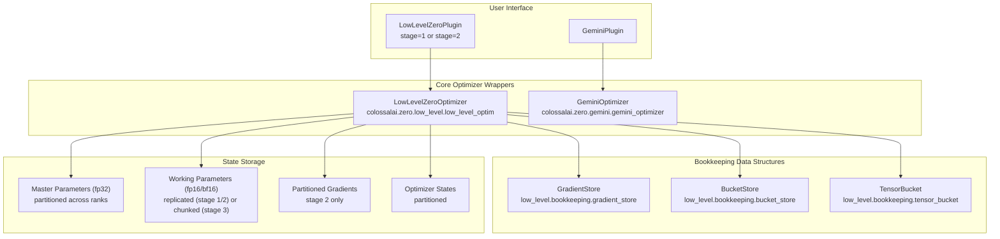

Sources:
- [colossalai/booster/plugin/low_level_zero_plugin.py:368-470]()
- [colossalai/zero/low_level/low_level_optim.py:74-103]()
- [colossalai/zero/low_level/bookkeeping/__init__.py]()
- [colossalai/zero/__init__.py:1-13]()

## Memory Layout and Partitioning Strategy

**Memory Comparison: Data Parallel vs ZeRO-1 vs ZeRO-2**

| Component | Data Parallel | ZeRO-1 | ZeRO-2 |
|-----------|--------------|---------|---------|
| Model Parameters (fp16) | N | N | N |
| Gradients (fp16) | N | N | N/W |
| Master Parameters (fp32) | 2N | 2N/W | 2N/W |
| Momentum (fp32) | 2N | 2N/W | 2N/W |
| Variance (fp32) | 2N | 2N/W | 2N/W |
| **Total Memory** | **8N** | **4N + 4N/W** | **N + 8N/W** |

Where N = number of model parameters, W = world size (number of GPUs)

**Working vs Master Parameter Storage**

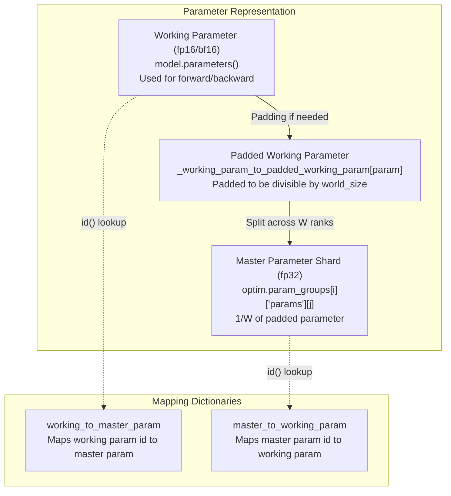

**Parameter Update Flow in LowLevelZeroOptimizer**

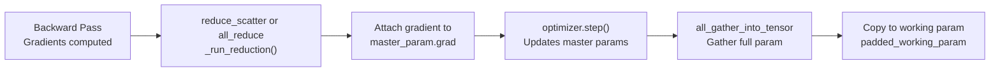

Sources:
- [colossalai/zero/low_level/low_level_optim.py:263-298]()
- [colossalai/zero/low_level/low_level_optim.py:176-180]()
- [colossalai/zero/low_level/low_level_optim.py:527-636]()

## Implementation of ZeRO in ColossalAI

### Key Components

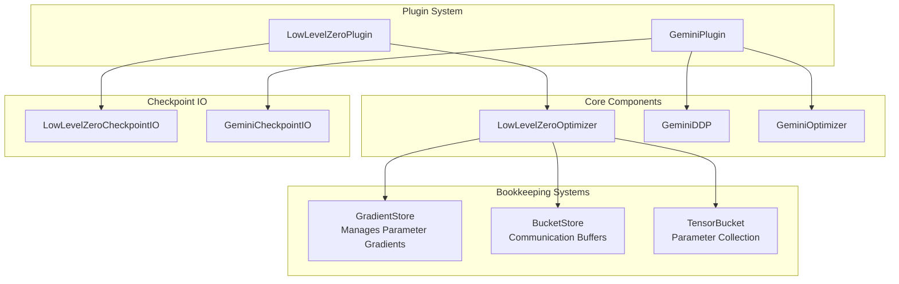

Sources:
- [colossalai/booster/plugin/low_level_zero_plugin.py:117-366]()
- [colossalai/zero/low_level/low_level_optim.py:74-245]()
- [colossalai/zero/low_level/bookkeeping/gradient_store.py:8-15]()
- [colossalai/zero/low_level/bookkeeping/bucket_store.py:13-23]()
- [colossalai/zero/low_level/bookkeeping/tensor_bucket.py:12-33]()

## LowLevelZeroOptimizer Implementation

`LowLevelZeroOptimizer` wraps a PyTorch optimizer and implements ZeRO-1 and ZeRO-2 via the `partition_grad` flag.

**Initialization Parameters**

| Parameter | Type | Purpose |
|-----------|------|---------|
| `optimizer` | `Optimizer` | Base PyTorch optimizer to wrap |
| `initial_scale` | `float` | Initial gradient scale for fp16 (default: 2^16) |
| `partition_grad` | `bool` | Enable ZeRO-2 gradient partitioning (default: False) |
| `cpu_offload` | `bool` | Offload optimizer states to CPU (default: False) |
| `overlap_communication` | `bool` | Overlap gradient comm with backward (default: False) |
| `reduce_bucket_size` | `int` | Size of gradient buckets in bytes (default: 1MB) |
| `communication_dtype` | `torch.dtype` | Data type for gradient communication |
| `dp_process_group` | `ProcessGroup` | Data parallel process group |

**Key Data Structures**

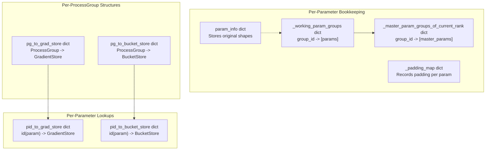

**Gradient Accumulation Hook System**

The optimizer attaches post-accumulation hooks to parameters during `_attach_reduction_hook()`:

```python
# Simplified from colossalai/zero/low_level/low_level_optim.py:305-321
def _grad_handler(param, group_id):
    if self.require_grad_sync:
        self._add_to_bucket(param, group_id)

for param in param_group:
    param.register_post_accumulate_grad_hook(
        partial(_grad_handler, group_id=group_id)
    )
```

When a gradient is ready, `_add_to_bucket()` is called, which triggers `_run_reduction()` when the bucket is full.

Sources:
- [colossalai/zero/low_level/low_level_optim.py:77-240]()
- [colossalai/zero/low_level/low_level_optim.py:143-209]()
- [colossalai/zero/low_level/low_level_optim.py:305-321]()

### Usage with Booster API

Using ZeRO in ColossalAI is made simple with the Booster API:

```python
from colossalai.booster import Booster
from colossalai.booster.plugin import LowLevelZeroPlugin

# For ZeRO-1
plugin = LowLevelZeroPlugin(stage=1)

# For ZeRO-2
plugin = LowLevelZeroPlugin(
    stage=2,                     # Use ZeRO stage 2
    precision="fp16",           # Mixed precision training
    initial_scale=2**16,        # Initial loss scale for mixed precision
    reduce_bucket_size_in_m=12, # Communication bucket size in MB
)

booster = Booster(plugin=plugin)
model, optimizer, criterion, dataloader, lr_scheduler = booster.boost(
    model, optimizer, criterion, dataloader, lr_scheduler
)
```

Sources:
- [colossalai/booster/plugin/low_level_zero_plugin.py:367-471]()
- [colossalai/booster/booster.py:74-173]()

## ZeRO-1 vs ZeRO-2: partition_grad Flag

The `partition_grad` parameter in `LowLevelZeroOptimizer` controls whether ZeRO-1 or ZeRO-2 is used:

**ZeRO-1 (partition_grad=False)**

| Component | Storage | Communication |
|-----------|---------|---------------|
| Working params (fp16) | Replicated | None during backward |
| Gradients (fp16) | Replicated | `all_reduce` sum |
| Master params (fp32) | Partitioned (1/W) | `all_gather` after update |
| Optimizer states (fp32) | Partitioned (1/W) | None |

Gradient reduction in ZeRO-1:
```python
# From _run_reduction() when partition_grad=False
dist.all_reduce(flat_grads, group=grp)  # Sum gradients
flat_grads_per_rank = flat_grads.split(flat_grads.numel() // world_size)
# Each rank stores all gradients but only uses its partition for update
```

**ZeRO-2 (partition_grad=True)**

| Component | Storage | Communication |
|-----------|---------|---------------|
| Working params (fp16) | Replicated | None during backward |
| Gradients (fp16) | Partitioned (1/W) | `reduce_scatter` sum |
| Master params (fp32) | Partitioned (1/W) | `all_gather` after update |
| Optimizer states (fp32) | Partitioned (1/W) | None |

Gradient reduction in ZeRO-2:
```python
# From _run_reduction() when partition_grad=True
flat_grads_list = list(flat_grads.split(len(flat_grads) // world_size))
received_grad = torch.empty_like(flat_grads_list[0])
dist.reduce_scatter_tensor(received_grad, flat_grads, group=grp)
# Each rank only stores and uses its own gradient partition
```

**Memory Savings**

For a model with N parameters using Adam optimizer:
- **ZeRO-1**: Saves 4N bytes per rank (optimizer states only)
- **ZeRO-2**: Saves 6N bytes per rank (gradients + optimizer states)

Sources:
- [colossalai/zero/low_level/low_level_optim.py:93-94]()
- [colossalai/zero/low_level/low_level_optim.py:356-389]()
- [colossalai/booster/plugin/low_level_zero_plugin.py:433-434]()
- [colossalai/booster/plugin/low_level_zero_plugin.py:454]()

## Gradient Reduction and Communication

**BucketStore: Gradient Communication Buffer**

The `BucketStore` accumulates gradients into communication buckets to reduce the number of collective operations:

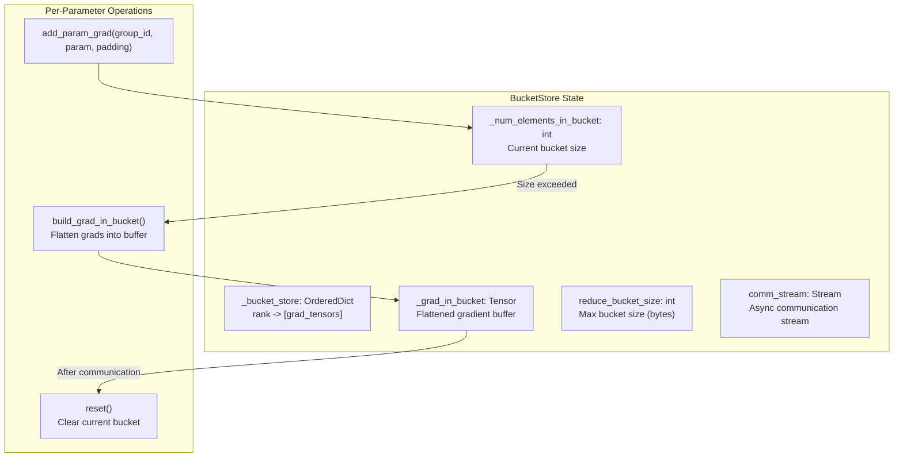

**Gradient Reduction Flow**

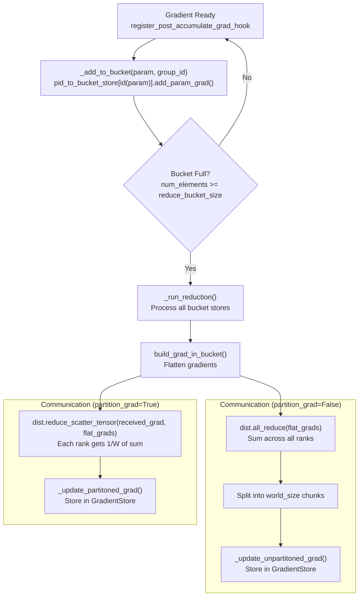

**GradientStore: Partitioned Gradient Management**

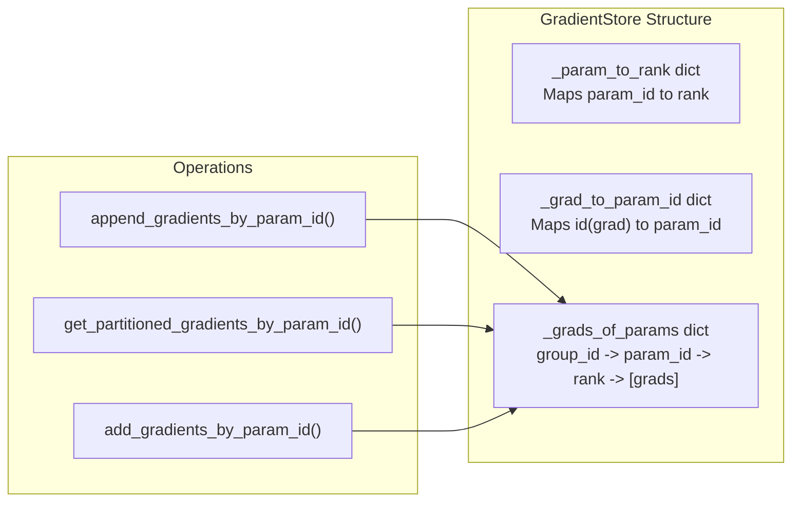

Sources:
- [colossalai/zero/low_level/low_level_optim.py:327-391]()
- [colossalai/zero/low_level/low_level_optim.py:431-445]()
- [colossalai/zero/low_level/bookkeeping/bucket_store.py:13-151]()
- [colossalai/zero/low_level/bookkeeping/gradient_store.py:8-110]()

## Checkpoint Format and Sharding

**LowLevelZeroCheckpointIO** handles checkpoint I/O for ZeRO-1 and ZeRO-2 optimizers.

**Sharded Optimizer Checkpoint Structure**

When saving sharded checkpoints, the following files are created:

| File | Content |
|------|---------|
| `pytorch_optim_group.bin` | Parameter groups configuration |
| `pytorch_optim.bin.index.json` | Index mapping param_id to shard file |
| `pytorch_optim-00001.bin` | Optimizer state shard 1 |
| `pytorch_optim-00002.bin` | Optimizer state shard 2 |
| ... | Additional shards as needed |

**State Dict Sharding Process**

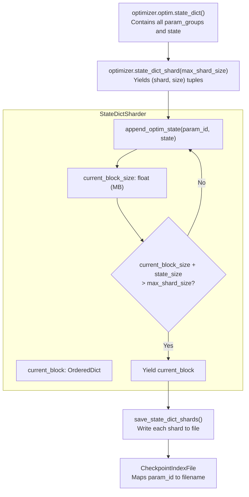

**Loading Sharded Optimizer States**

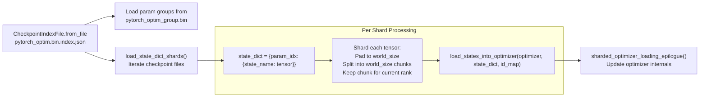

**Model Checkpointing**

Model parameters are saved in full (not partitioned) since working parameters are replicated across ranks. The optimizer calls `model._force_wait_all_gather()` before saving to ensure all parameters are available.

Sources:
- [colossalai/booster/plugin/low_level_zero_plugin.py:117-300]()
- [colossalai/checkpoint_io/utils.py:149-206]()
- [colossalai/checkpoint_io/utils.py:432-459]()
- [colossalai/checkpoint_io/utils.py:229-275]()

## Mixed Precision and Loss Scaling

**LowLevelZeroFP16MixedPrecisionMixin**

The optimizer integrates `FP16MixedPrecisionMixin` to handle dynamic loss scaling:

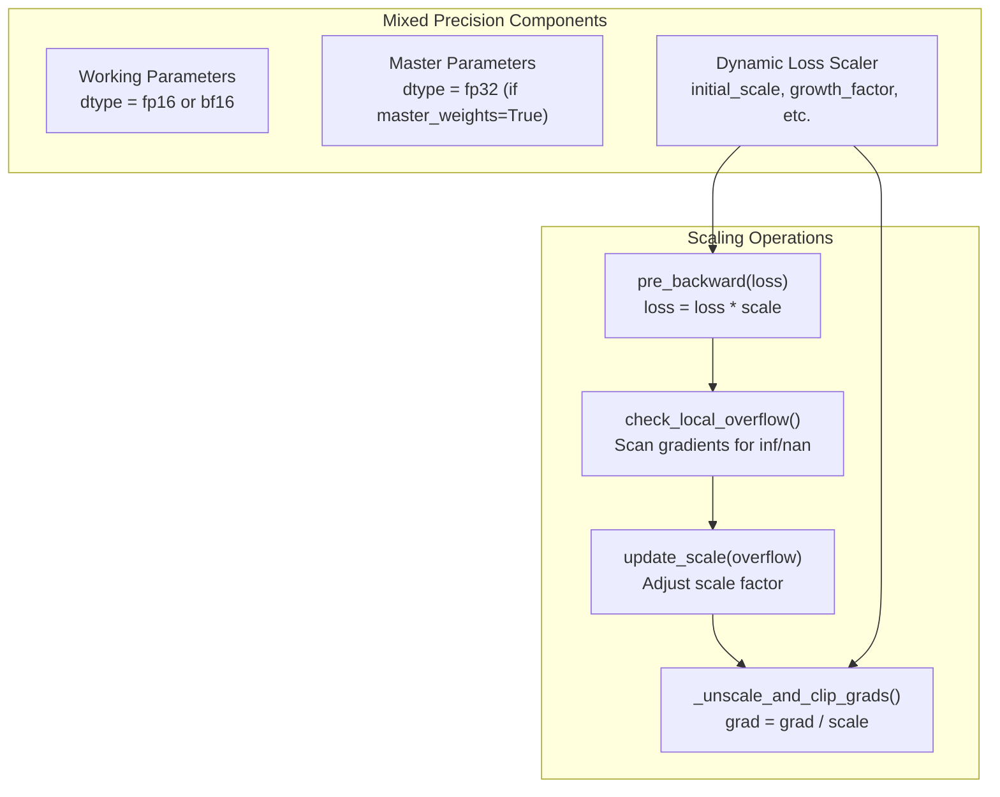

**Overflow Detection and Scale Adjustment**

```python
# Simplified from LowLevelZeroFP16MixedPrecisionMixin
def check_local_overflow(self) -> bool:
    for store in self.pg_to_grad_store.values():
        for group_id in range(self.num_working_param_groups):
            for avg_grad in store.get_working_grads_by_group_id(group_id):
                if avg_grad is not None and has_inf_or_nan(avg_grad):
                    return True
    return False
```

If overflow is detected, the optimizer step is skipped and the loss scale is reduced by `backoff_factor`. Otherwise, the scale grows by `growth_factor` every `growth_interval` steps.

**Master Weights Configuration**

The `master_weights` parameter controls whether fp32 master copies are maintained:

| master_weights | Working Params | Master Params | Memory Overhead |
|----------------|----------------|---------------|-----------------|
| True (default) | fp16/bf16 | fp32 partitioned | 2N/W bytes |
| False | fp16/bf16 | Same as working (partitioned) | 0 bytes |

When `master_weights=False`, the optimizer updates working parameters directly without maintaining separate fp32 copies.

Sources:
- [colossalai/zero/low_level/low_level_optim.py:40-71]()
- [colossalai/zero/low_level/low_level_optim.py:224-239]()
- [colossalai/zero/low_level/low_level_optim.py:702-716]()
- [colossalai/booster/plugin/low_level_zero_plugin.py:425]()
- [colossalai/booster/plugin/low_level_zero_plugin.py:456]()

## Advanced Features

### CPU Offloading

ZeRO can optionally offload optimizer states and parameters to CPU memory:

- Reduces GPU memory usage further
- Enables training even larger models
- Trade-off between memory usage and computation speed

### Gradient Accumulation

Gradient accumulation is supported for training with effectively larger batch sizes:

```python
# Example: Gradient accumulation with ZeRO
for i, batch in enumerate(dataloader):
    # Using no_sync for all but the last micro-batch
    context = optimizer.no_sync() if (i + 1) % accumulation_steps != 0 else nullcontext()
    with context:
        outputs = model(batch)
        loss = criterion(outputs)
        optimizer.backward(loss)
    
    # Only update at the end of accumulation steps
    if (i + 1) % accumulation_steps == 0:
        optimizer.step()
        optimizer.zero_grad()
```

Sources:
- [colossalai/zero/low_level/low_level_optim.py:94-102]()
- [colossalai/zero/low_level/low_level_optim.py:744-752]()

### FP8 Communication

For further memory and bandwidth optimization, ColossalAI supports FP8 communication:

- Reduces communication overhead by using lower precision
- Configurable via plugin parameters
- Compatible with both ZeRO-1 and ZeRO-2

Sources:
- [colossalai/booster/plugin/low_level_zero_plugin.py:429-430]()
- [colossalai/zero/low_level/low_level_optim.py:359-364]()

## Optimizer Step and Parameter Update

**Step Execution Flow**

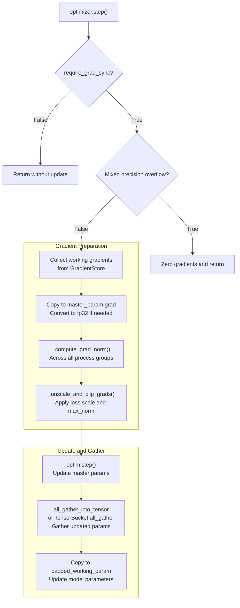

**TensorBucket: Parameter All-Gather Optimization**

After updating master parameters, the optimizer needs to broadcast the updates to all ranks. Instead of one all-gather per parameter, `TensorBucket` groups small parameters together:

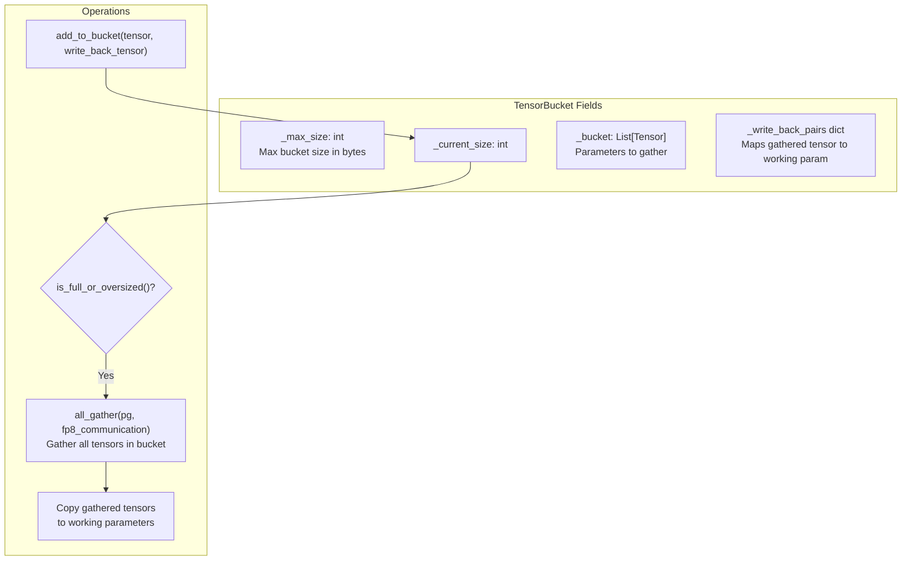

Sources:
- [colossalai/zero/low_level/low_level_optim.py:527-636]()
- [colossalai/zero/low_level/low_level_optim.py:637-696]()
- [colossalai/zero/low_level/low_level_optim.py:702-716]()
- [colossalai/zero/low_level/bookkeeping/tensor_bucket.py:12-69]()

## Integration with Other Parallelism Techniques

ZeRO can be combined with other parallelism techniques in ColossalAI:

- **Tensor Parallelism**: Via ShardFormer and HybridParallelPlugin
- **Pipeline Parallelism**: Compatible with ZeRO for larger models
- **Sequence Parallelism**: Can be used alongside ZeRO
- **Expert Parallelism for MoE**: Special handling for Mixture of Experts models

This hybrid approach allows for extremely large model training with optimal resource utilization.

Sources:
- [colossalai/booster/plugin/low_level_zero_plugin.py:429-489]()
- [colossalai/booster/plugin/gemini_plugin.py:543-566]()
- [colossalai/checkpoint_io/hybrid_parallel_checkpoint_io.py:59-138]()

## Limitations and Considerations

When using ZeRO, consider these factors:

1. **Communication Overhead**: Higher stages increase communication volume
2. **CPU Offloading Performance**: Offloading trades computation speed for memory
3. **Framework Compatibility**: Some PyTorch features may require special handling with ZeRO
4. **Mixed Precision Requirements**: FP16/BF16 mixed precision may be required for largest models

Sources:
- [colossalai/zero/low_level/low_level_optim.py:112-116]()
- [colossalai/booster/plugin/low_level_zero_plugin.py:433-434]()

In summary, ZeRO is a powerful memory optimization technique that enables training of larger models with existing hardware. By eliminating memory redundancy across data-parallel processes, it provides nearly linear memory scaling with the number of devices while maintaining computational efficiency.

---

