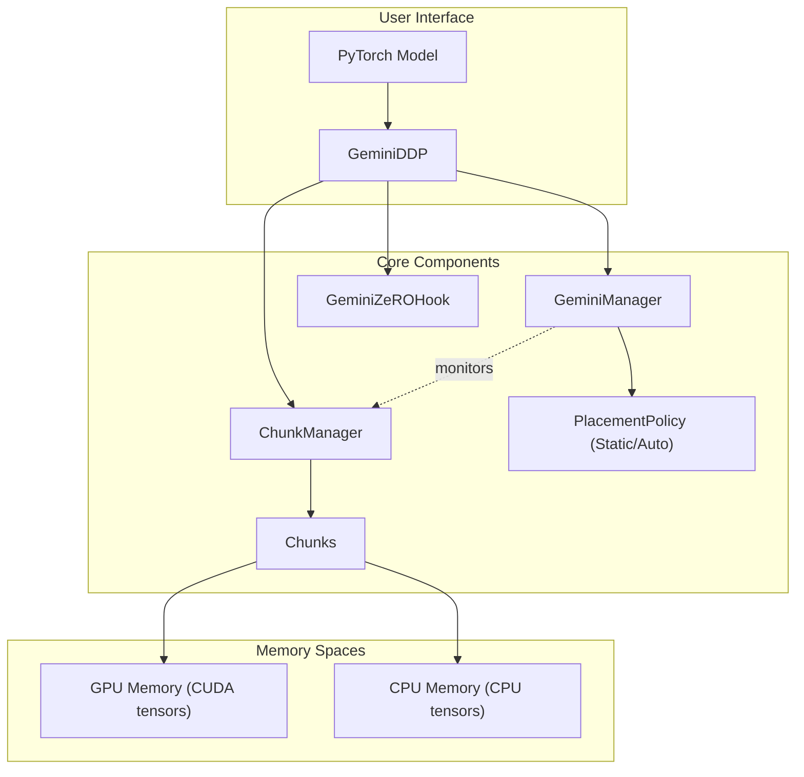
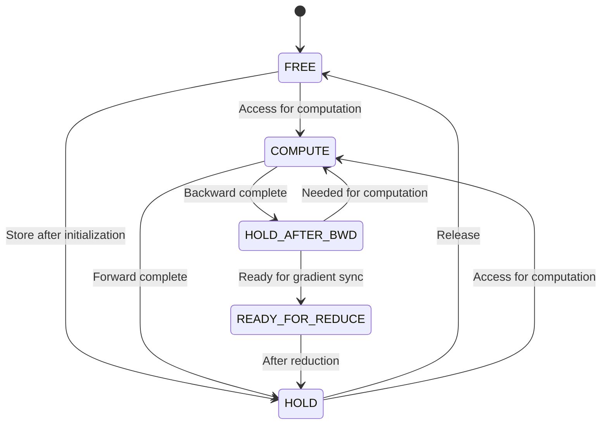
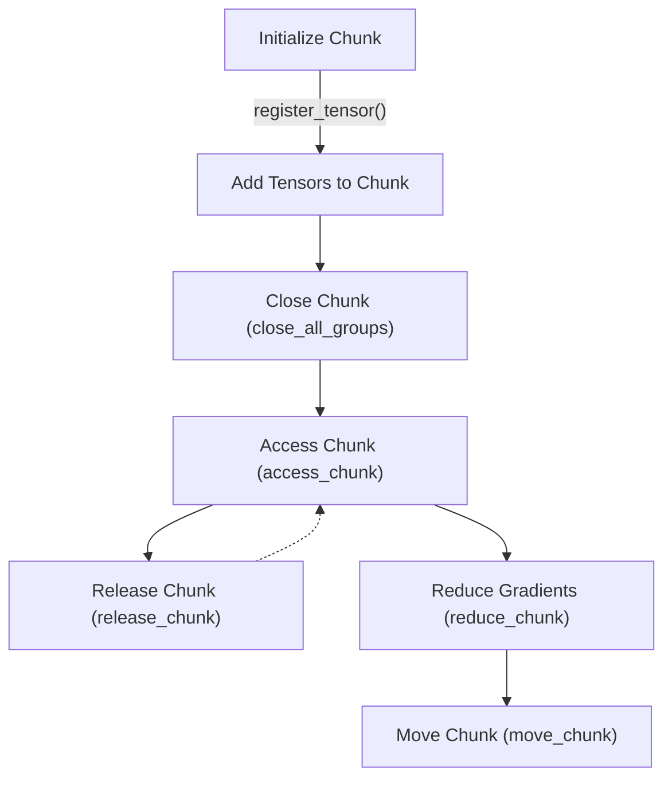
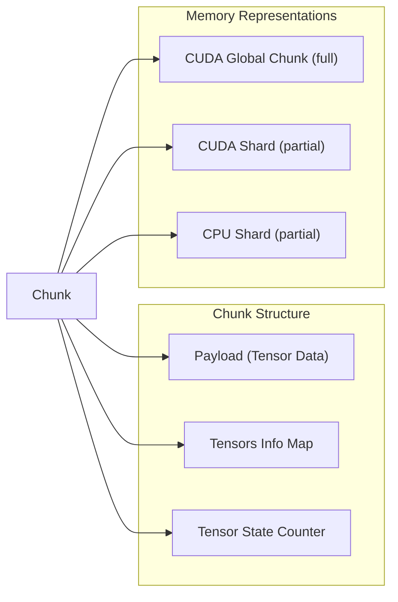
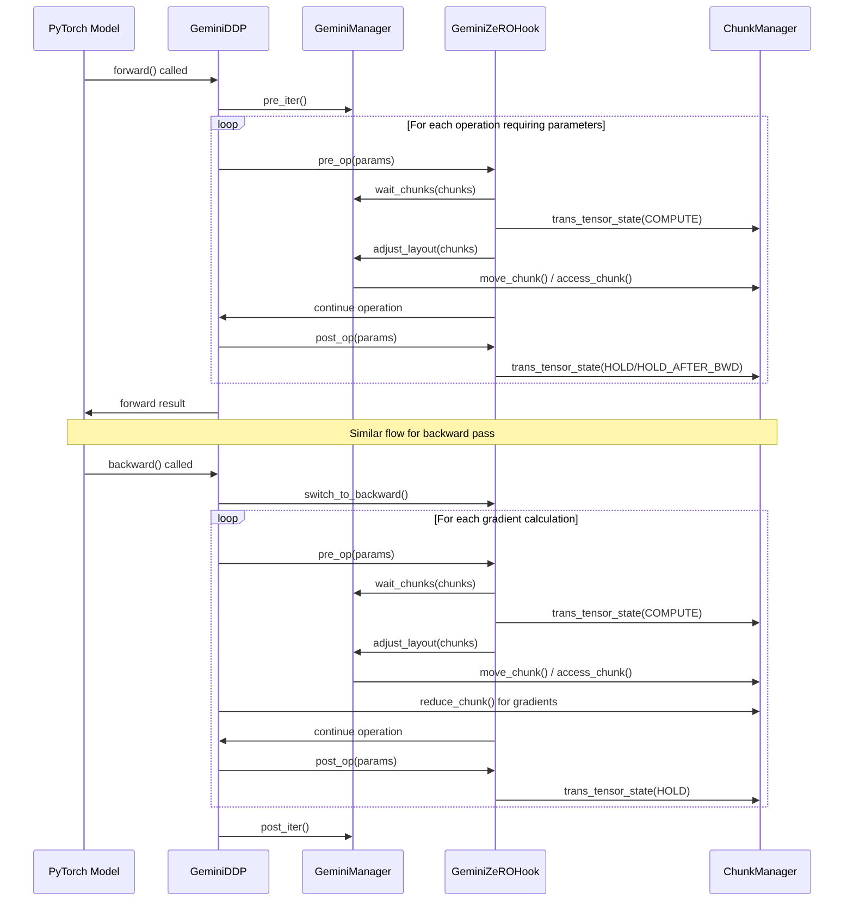

<!-- source: DeepWiki mcp.deepwiki.com · repo hpcaitech/ColossalAI · page 3.2 Gemini: Memory Management System · fetched 2026-10-21 -->

# Gemini: Memory Management System

<details>
<summary>Relevant source files</summary>

The following files were used as context for generating this wiki page:

- [colossalai/booster/booster.py](colossalai/booster/booster.py)
- [colossalai/booster/plugin/gemini_plugin.py](colossalai/booster/plugin/gemini_plugin.py)
- [colossalai/booster/plugin/hybrid_parallel_plugin.py](colossalai/booster/plugin/hybrid_parallel_plugin.py)
- [colossalai/booster/plugin/low_level_zero_plugin.py](colossalai/booster/plugin/low_level_zero_plugin.py)
- [colossalai/booster/plugin/torch_ddp_plugin.py](colossalai/booster/plugin/torch_ddp_plugin.py)
- [colossalai/booster/plugin/torch_fsdp_plugin.py](colossalai/booster/plugin/torch_fsdp_plugin.py)
- [colossalai/checkpoint_io/__init__.py](colossalai/checkpoint_io/__init__.py)
- [colossalai/checkpoint_io/checkpoint_io_base.py](colossalai/checkpoint_io/checkpoint_io_base.py)
- [colossalai/checkpoint_io/general_checkpoint_io.py](colossalai/checkpoint_io/general_checkpoint_io.py)
- [colossalai/checkpoint_io/hybrid_parallel_checkpoint_io.py](colossalai/checkpoint_io/hybrid_parallel_checkpoint_io.py)
- [colossalai/checkpoint_io/index_file.py](colossalai/checkpoint_io/index_file.py)
- [colossalai/checkpoint_io/moe_checkpoint.py](colossalai/checkpoint_io/moe_checkpoint.py)
- [colossalai/checkpoint_io/utils.py](colossalai/checkpoint_io/utils.py)
- [colossalai/initialize.py](colossalai/initialize.py)
- [colossalai/utils/safetensors.py](colossalai/utils/safetensors.py)
- [colossalai/zero/__init__.py](colossalai/zero/__init__.py)
- [colossalai/zero/gemini/gemini_optimizer.py](colossalai/zero/gemini/gemini_optimizer.py)
- [colossalai/zero/low_level/bookkeeping/tensor_bucket.py](colossalai/zero/low_level/bookkeeping/tensor_bucket.py)
- [colossalai/zero/low_level/low_level_optim.py](colossalai/zero/low_level/low_level_optim.py)
- [tests/test_checkpoint_io/test_gemini_checkpoint_io.py](tests/test_checkpoint_io/test_gemini_checkpoint_io.py)
- [tests/test_checkpoint_io/test_general_checkpoint_io.py](tests/test_checkpoint_io/test_general_checkpoint_io.py)
- [tests/test_checkpoint_io/test_hybrid_parallel_plugin_checkpoint_io.py](tests/test_checkpoint_io/test_hybrid_parallel_plugin_checkpoint_io.py)
- [tests/test_checkpoint_io/test_low_level_zero_checkpoint_io.py](tests/test_checkpoint_io/test_low_level_zero_checkpoint_io.py)
- [tests/test_checkpoint_io/test_safetensors_async_io.py](tests/test_checkpoint_io/test_safetensors_async_io.py)
- [tests/test_checkpoint_io/test_torch_ddp_checkpoint_io.py](tests/test_checkpoint_io/test_torch_ddp_checkpoint_io.py)

</details>


## Overview

Gemini is a memory management system in ColossalAI designed to efficiently train large AI models across heterogeneous memory (GPU and CPU). It implements memory optimization techniques that extend ZeRO-3 (Zero Redundancy Optimizer) with dynamic memory management, enabling training of models larger than would fit in GPU memory alone.

For information about ZeRO optimization specifically, see [Zero Redundancy Optimizer (ZeRO)](#3.1).

Sources:
- [colossalai/zero/gemini/gemini_ddp.py:56-105]()
- [colossalai/zero/gemini/gemini_mgr.py:13-36]()

## System Architecture



Gemini consists of several key components:

- **GeminiDDP**: Main wrapper class for PyTorch modules, applying ZeRO-3 optimizations with Gemini memory management
- **ChunkManager**: Manages grouping of tensors into chunks and their movement between devices
- **GeminiManager**: Orchestrates memory placement strategy and monitors memory usage
- **GeminiZeROHook**: Intercepts tensor operations to manage memory dynamically
- **PlacementPolicy**: Determines where tensors should be placed (CPU or GPU)

Sources:
- [colossalai/zero/gemini/gemini_ddp.py:56-818]()
- [colossalai/zero/gemini/gemini_mgr.py:13-204]()
- [colossalai/zero/gemini/chunk/manager.py:14-318]()
- [colossalai/zero/gemini/gemini_hook.py:20-108]()

## Tensor State Management

Gemini tracks the state of each tensor through a state machine to optimize memory usage:



The five tensor states are defined in the `TensorState` enum:

| State | Description |
|-------|-------------|
| FREE | Tensor not currently in use |
| COMPUTE | Tensor is being used in computation |
| HOLD | Tensor is held in memory after computation |
| HOLD_AFTER_BWD | Tensor is held after backward pass |
| READY_FOR_REDUCE | Tensor is ready for reduction across processes |

Valid state transitions are strictly defined to ensure consistency, as shown in the diagram above.

Sources:
- [colossalai/zero/gemini/chunk/chunk.py:13-31]()
- [colossalai/zero/gemini/gemini_hook.py:76-96]()

## Chunk Management

### Chunking Mechanism

Gemini groups model parameters into "chunks" - contiguous blocks of memory containing multiple tensors. This has several advantages:

1. Reduces memory fragmentation
2. Amortizes communication overhead
3. Enables efficient bulk movement between CPU and GPU

Chunk lifecycle:



Sources:
- [colossalai/zero/gemini/chunk/chunk.py:59-684]()
- [colossalai/zero/gemini/chunk/manager.py:45-196]()

### Chunk Implementation

Each `Chunk` maintains:

- A contiguous memory block for multiple tensors
- Metadata mapping tensors to offsets within the chunk
- State information for each contained tensor
- Multiple memory representations (cuda_global_chunk, cuda_shard, cpu_shard)
- Communication handles for asynchronous operations



Sources:
- [colossalai/zero/gemini/chunk/chunk.py:59-192]()
- [colossalai/zero/gemini/chunk/manager.py:14-45]()

### Chunk Optimization

Gemini provides utilities to search for optimal chunk configurations:

- `search_chunk_configuration`: Finds optimal chunk sizes for different distributed configurations
- Balances memory usage and communication overhead
- Considers parameter sizes and grouping patterns

Sources:
- [colossalai/zero/gemini/chunk/search_utils.py:108-191]()

## Placement Policies

Gemini supports different strategies for placing tensors between CPU and GPU memory:

### Static Placement

Parameters are placed according to fixed ratios specified by the user:

- `shard_param_frac`: Fraction of parameters to shard
- `offload_param_frac`: Fraction of parameters to offload to CPU
- `offload_optim_frac`: Fraction of optimizer states to offload to CPU

### Auto Placement

Automatically adapts placement based on runtime memory usage:

- Uses memory statistics collected during a warmup iteration
- Dynamically adjusts placement based on available GPU memory
- Prefetches tensors before they're needed to hide communication overhead
- Monitors both model data and non-model data memory usage

Sources:
- [colossalai/zero/gemini/gemini_mgr.py:36-136]()
- [colossalai/zero/gemini/gemini_ddp.py:75-95]()

## Memory Management Workflow



Sources:
- [colossalai/zero/gemini/gemini_ddp.py:274-310]()
- [colossalai/zero/gemini/gemini_ddp.py:348-352]()
- [colossalai/zero/gemini/gemini_hook.py:27-72]()

## Gradient Processing and Communication

During backward pass, Gemini handles gradients efficiently:

1. **Gradient collection**: Gradients for parameters in each chunk are collected
2. **Asynchronous reduction**: Gradients are reduced across processes asynchronously
3. **Scaling**: Gradients are properly scaled during reduction

The `grad_handle` function in GeminiDDP is a critical component that:
- Intercepts gradient computations
- Accumulates gradients in chunks
- Initiates asynchronous communication
- Ensures proper scaling and synchronization

Sources:
- [colossalai/zero/gemini/gemini_ddp.py:357-436]()
- [colossalai/zero/gemini/chunk/chunk.py:383-425]()

## Advanced Features

### Memory-Efficient Gradient Accumulation

Gemini supports efficient gradient accumulation:

- Only reduces gradients at the end of accumulation steps
- Maintains accumulated gradients efficiently
- Ensures proper scaling across micro-batches

Sources:
- [colossalai/zero/gemini/gemini_ddp.py:341-347]()
- [colossalai/zero/gemini/chunk/manager.py:282-316]()

### Checkpoint Saving and Loading

Gemini provides specialized methods for checkpoint handling:

- Supports saving and loading sharded model states
- Can save only on rank 0 for efficiency
- Properly handles distributed tensor gathering and scattering

Sources:
- [colossalai/zero/gemini/gemini_ddp.py:445-586]()
- [colossalai/zero/gemini/gemini_ddp.py:587-817]()

### FP8 Communication

Gemini supports FP8 communication to reduce communication overhead:

- Uses FP8 format for all-gather operations
- Significantly reduces communication bandwidth requirements
- Activated with `fp8_communication=True` parameter

Sources:
- [colossalai/zero/gemini/chunk/chunk.py:519-541]()
- [colossalai/zero/gemini/gemini_ddp.py:102-104]()

## Usage Example

Typical usage of Gemini involves wrapping a model with `GeminiDDP`:

```python
# Initialize model with Gemini
model = GeminiDDP(
    model,
    # Memory management strategy
    placement_policy="auto",  # or "static"
    # For static policy:
    shard_param_frac=0.5,      # fraction of params to shard
    offload_param_frac=0.3,    # fraction to offload to CPU
    offload_optim_frac=0.7,    # optimizer states to offload
    # Performance options
    pin_memory=True,           # use pinned CPU memory
    mixed_precision=torch.half, # use FP16 for communication
    enable_async_reduce=True,   # asynchronous communication
    master_weights=True        # maintain FP32 master weights
)

# In the training loop
optimizer.zero_grad()
outputs = model(**inputs)  # forward pass
loss = loss_function(outputs)
model.backward(loss)  # use model.backward instead of loss.backward
optimizer.step()
```

Sources:
- [colossalai/zero/gemini/gemini_ddp.py:75-189]()
- [tests/test_zero/test_gemini/test_optim.py:67-124]()

## Integration with ZeRO

Gemini extends ZeRO-3 with enhanced memory management:

| Feature | ZeRO-3 | Gemini |
|---------|--------|--------|
| Parameter Sharding | Yes | Yes |
| Gradient Sharding | Yes | Yes |
| Optimizer State Sharding | Yes | Yes |
| Memory Management | Static | Dynamic |
| Heterogeneous Memory | Limited | Advanced |
| Tensor Grouping | No | Yes (Chunks) |
| Placement Policy | Fixed | Configurable |
| Prefetching | No | Yes |

Sources:
- [colossalai/zero/gemini/gemini_ddp.py:57-63]()

## Conclusion

Gemini Memory Management System provides sophisticated memory management capabilities for training large AI models. By efficiently managing tensors across heterogeneous memory spaces and implementing advanced communication strategies, it enables training of models that would otherwise not fit in GPU memory alone. Its integration with ZeRO optimization techniques and flexible configuration options make it a powerful tool for distributed deep learning.

---

