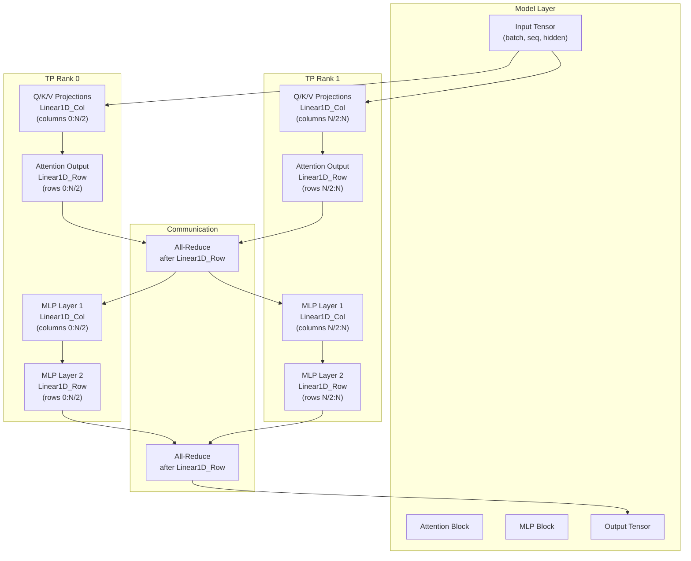
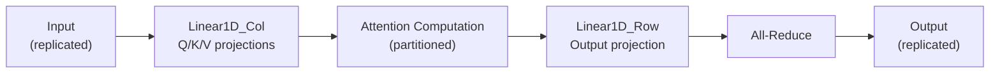
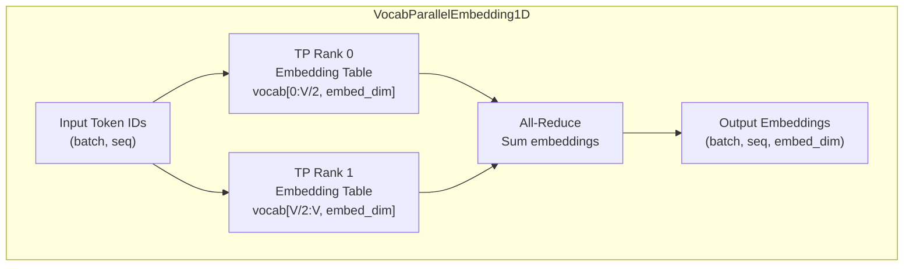
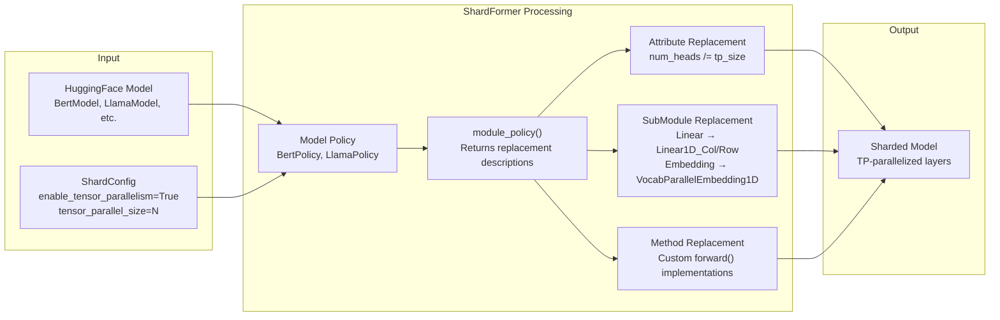
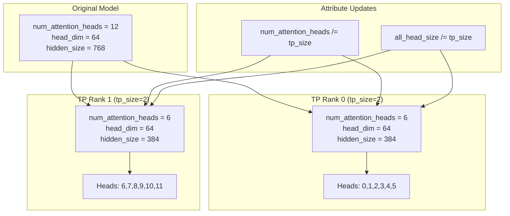
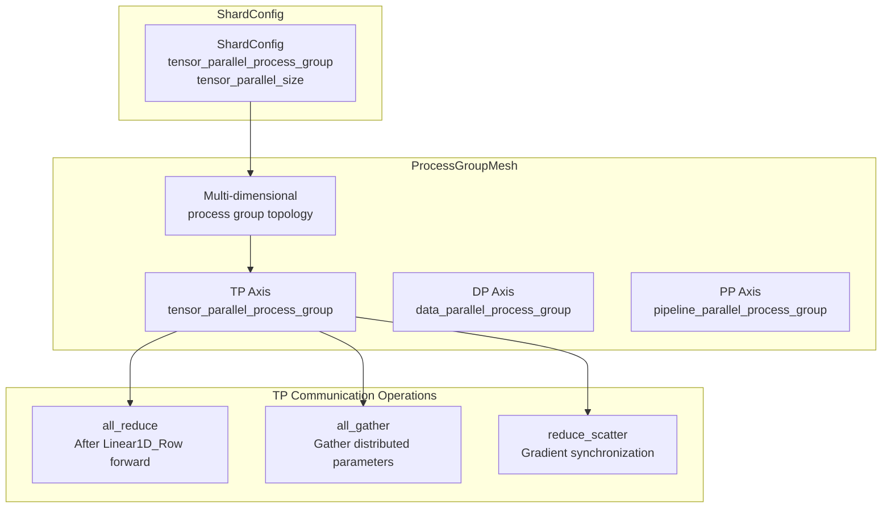
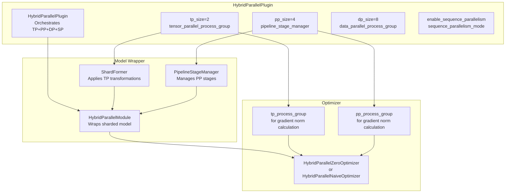
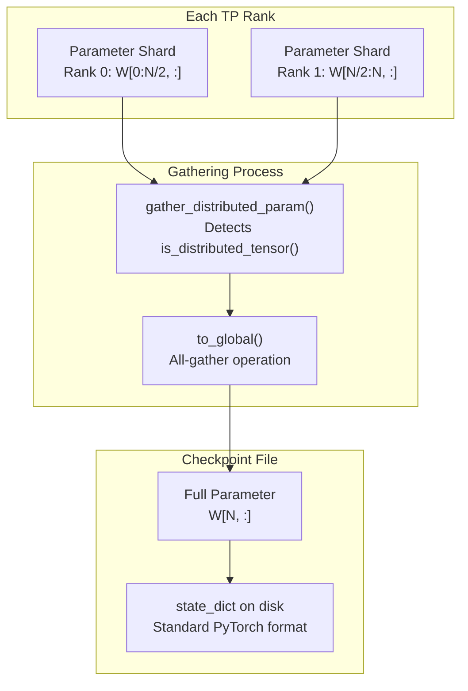

<!-- source: DeepWiki mcp.deepwiki.com · repo hpcaitech/ColossalAI · page 3.3 Tensor Parallelism · fetched 2026-10-21 -->

# Tensor Parallelism

<details>
<summary>Relevant source files</summary>

The following files were used as context for generating this wiki page:

- [colossalai/booster/booster.py](colossalai/booster/booster.py)
- [colossalai/booster/plugin/gemini_plugin.py](colossalai/booster/plugin/gemini_plugin.py)
- [colossalai/booster/plugin/hybrid_parallel_plugin.py](colossalai/booster/plugin/hybrid_parallel_plugin.py)
- [colossalai/booster/plugin/low_level_zero_plugin.py](colossalai/booster/plugin/low_level_zero_plugin.py)
- [colossalai/booster/plugin/torch_ddp_plugin.py](colossalai/booster/plugin/torch_ddp_plugin.py)
- [colossalai/booster/plugin/torch_fsdp_plugin.py](colossalai/booster/plugin/torch_fsdp_plugin.py)
- [colossalai/checkpoint_io/__init__.py](colossalai/checkpoint_io/__init__.py)
- [colossalai/checkpoint_io/checkpoint_io_base.py](colossalai/checkpoint_io/checkpoint_io_base.py)
- [colossalai/checkpoint_io/general_checkpoint_io.py](colossalai/checkpoint_io/general_checkpoint_io.py)
- [colossalai/checkpoint_io/hybrid_parallel_checkpoint_io.py](colossalai/checkpoint_io/hybrid_parallel_checkpoint_io.py)
- [colossalai/checkpoint_io/index_file.py](colossalai/checkpoint_io/index_file.py)
- [colossalai/checkpoint_io/moe_checkpoint.py](colossalai/checkpoint_io/moe_checkpoint.py)
- [colossalai/checkpoint_io/utils.py](colossalai/checkpoint_io/utils.py)
- [colossalai/shardformer/README.md](colossalai/shardformer/README.md)
- [colossalai/shardformer/__init__.py](colossalai/shardformer/__init__.py)
- [colossalai/shardformer/policies/bert.py](colossalai/shardformer/policies/bert.py)
- [colossalai/shardformer/policies/bloom.py](colossalai/shardformer/policies/bloom.py)
- [colossalai/shardformer/policies/falcon.py](colossalai/shardformer/policies/falcon.py)
- [colossalai/shardformer/policies/gpt2.py](colossalai/shardformer/policies/gpt2.py)
- [colossalai/shardformer/policies/gptj.py](colossalai/shardformer/policies/gptj.py)
- [colossalai/shardformer/policies/llama.py](colossalai/shardformer/policies/llama.py)
- [colossalai/shardformer/policies/opt.py](colossalai/shardformer/policies/opt.py)
- [colossalai/shardformer/policies/t5.py](colossalai/shardformer/policies/t5.py)
- [colossalai/shardformer/policies/vit.py](colossalai/shardformer/policies/vit.py)
- [colossalai/shardformer/policies/whisper.py](colossalai/shardformer/policies/whisper.py)
- [colossalai/shardformer/shard/__init__.py](colossalai/shardformer/shard/__init__.py)
- [colossalai/shardformer/shard/shard_config.py](colossalai/shardformer/shard/shard_config.py)
- [colossalai/shardformer/shard/sharder.py](colossalai/shardformer/shard/sharder.py)
- [colossalai/utils/safetensors.py](colossalai/utils/safetensors.py)
- [colossalai/zero/gemini/gemini_optimizer.py](colossalai/zero/gemini/gemini_optimizer.py)
- [colossalai/zero/low_level/bookkeeping/tensor_bucket.py](colossalai/zero/low_level/bookkeeping/tensor_bucket.py)
- [colossalai/zero/low_level/low_level_optim.py](colossalai/zero/low_level/low_level_optim.py)
- [tests/test_checkpoint_io/test_gemini_checkpoint_io.py](tests/test_checkpoint_io/test_gemini_checkpoint_io.py)
- [tests/test_checkpoint_io/test_general_checkpoint_io.py](tests/test_checkpoint_io/test_general_checkpoint_io.py)
- [tests/test_checkpoint_io/test_hybrid_parallel_plugin_checkpoint_io.py](tests/test_checkpoint_io/test_hybrid_parallel_plugin_checkpoint_io.py)
- [tests/test_checkpoint_io/test_low_level_zero_checkpoint_io.py](tests/test_checkpoint_io/test_low_level_zero_checkpoint_io.py)
- [tests/test_checkpoint_io/test_safetensors_async_io.py](tests/test_checkpoint_io/test_safetensors_async_io.py)
- [tests/test_checkpoint_io/test_torch_ddp_checkpoint_io.py](tests/test_checkpoint_io/test_torch_ddp_checkpoint_io.py)

</details>


## Purpose and Scope

This document describes ColossalAI's implementation of **Tensor Parallelism (TP)**, a technique that partitions individual weight matrices and tensors across multiple devices to enable training models that exceed single-device memory capacity. Tensor parallelism operates at the layer level, splitting computation within each transformer layer.

For information about:
- Splitting layers across pipeline stages, see [Pipeline Parallelism](#3.4)
- Replicating models across data parallel ranks, see [Zero Redundancy Optimizer (ZeRO)](#3.1)
- Splitting sequence dimensions, see [Sequence Parallelism](#3.5)
- Combining multiple parallelism strategies, see [Hybrid Parallelism](#3.7)

## Overview of Tensor Parallelism

Tensor parallelism splits the weight matrices of neural network layers across multiple devices. In a typical transformer layer, this means:

1. **Attention layers**: Query, Key, Value projection matrices are split column-wise; output projection is split row-wise
2. **MLP layers**: The first linear layer is split column-wise; the second is split row-wise
3. **Embeddings**: Vocabulary embeddings can be split along the vocabulary dimension

This approach reduces memory requirements per device while introducing communication overhead through collective operations (all-reduce, all-gather).

Sources: [colossalai/booster/plugin/hybrid_parallel_plugin.py:1-120](), [colossalai/shardformer/README.md:1-278]()

## Tensor Parallelism Architecture



**Diagram: Tensor Parallelism Data Flow Through Transformer Layer**

This diagram shows how input tensors are processed through column-parallel and row-parallel linear layers, with communication occurring after row-parallel layers.

Sources: [colossalai/shardformer/policies/bert.py:96-176](), [colossalai/shardformer/policies/llama.py:96-180]()

## Core Components

### Parallel Linear Layers

ColossalAI implements two fundamental parallel linear layer types that replace standard `torch.nn.Linear` modules:

| Class | Purpose | Weight Partition | Communication | File Location |
|-------|---------|------------------|---------------|---------------|
| `Linear1D_Col` | Column-parallel linear | Splits output dimension | None on forward, all-reduce on backward | `colossalai/shardformer/layer/` |
| `Linear1D_Row` | Row-parallel linear | Splits input dimension | All-reduce on forward | `colossalai/shardformer/layer/` |

**Column Parallel (`Linear1D_Col`)**:
- Splits weight matrix along output dimension: `W[hidden, hidden/tp_size]`
- Each rank computes partial outputs
- No communication in forward pass
- Gradient all-reduce in backward pass

**Row Parallel (`Linear1D_Row`)**:
- Splits weight matrix along input dimension: `W[hidden/tp_size, hidden]`
- Each rank has different input columns
- All-reduce required in forward pass to sum partial results
- Input gradients are naturally partitioned in backward pass

Sources: [colossalai/shardformer/policies/bert.py:108-170](), [colossalai/shardformer/policies/llama.py:113-178](), [colossalai/shardformer/policies/gpt2.py:79-124]()

### Pattern: Column-Row Pairing

The typical pattern pairs column-parallel and row-parallel layers to minimize communication:



**Diagram: Column-Row Pattern in Attention**

In this pattern:
1. Input is replicated across all TP ranks
2. `Linear1D_Col` produces partitioned outputs with no communication
3. Computation proceeds on partitioned data
4. `Linear1D_Row` produces partial sums
5. All-reduce combines results to produce replicated output

Sources: [colossalai/booster/plugin/hybrid_parallel_plugin.py:96-176](), [colossalai/shardformer/policies/bert.py:96-176]()

### Parallel Embeddings

For models with large vocabularies, embeddings can be partitioned:



**Diagram: Vocabulary Parallel Embedding**

The `VocabParallelEmbedding1D` class partitions the vocabulary:
- Each rank stores `vocab_size / tp_size` embeddings
- Input tokens are mapped to local indices
- Each rank looks up its portion; out-of-range tokens return zero
- All-reduce sums contributions from all ranks

Sources: [colossalai/shardformer/policies/bert.py:58-64](), [colossalai/shardformer/policies/llama.py:40-44](), [colossalai/shardformer/policies/gpt2.py:43-48]()

## Model Transformation via ShardFormer

ColossalAI uses the **ShardFormer** framework to automatically transform models for tensor parallelism. The transformation is policy-driven and model-agnostic.

### Transformation Pipeline



**Diagram: ShardFormer Model Transformation Flow**

Sources: [colossalai/shardformer/shard/sharder.py:18-76](), [colossalai/shardformer/README.md:195-278]()

### Policy-Based Transformation

Each model architecture has a corresponding policy class that defines transformations:

| Model | Policy Class | File Location |
|-------|-------------|---------------|
| BERT | `BertPolicy` | `colossalai/shardformer/policies/bert.py` |
| LLaMA | `LlamaPolicy` | `colossalai/shardformer/policies/llama.py` |
| GPT-2 | `GPT2Policy` | `colossalai/shardformer/policies/gpt2.py` |
| OPT | `OPTPolicy` | `colossalai/shardformer/policies/opt.py` |
| Bloom | `BloomPolicy` | `colossalai/shardformer/policies/bloom.py` |

**Example Policy Transformation (BERT)**:

```python
# Defined in policy.module_policy()
policy[BertLayer] = ModulePolicyDescription(
    attribute_replacement={
        "attention.self.num_attention_heads": 
            config.num_attention_heads // tp_size
    },
    sub_module_replacement=[
        SubModuleReplacementDescription(
            suffix="attention.self.query",
            target_module=Linear1D_Col
        ),
        SubModuleReplacementDescription(
            suffix="attention.output.dense",
            target_module=Linear1D_Row
        )
    ]
)
```

Sources: [colossalai/shardformer/policies/bert.py:45-176](), [colossalai/shardformer/policies/base_policy.py:205-278]()

## Attention Head Partitioning

A key aspect of tensor parallelism in transformers is dividing attention heads across TP ranks:



**Diagram: Attention Head Distribution Across TP Ranks**

The policy updates model attributes to reflect the partitioned configuration:
- `num_attention_heads` is divided by `tp_size`
- Each rank computes attention for its subset of heads
- QKV projection matrices are column-parallel, producing partitioned head outputs
- Output projection is row-parallel, requiring all-reduce

Sources: [colossalai/shardformer/policies/bert.py:93-106](), [colossalai/shardformer/policies/llama.py:97-111](), [colossalai/shardformer/policies/gpt2.py:66-83]()

## Process Groups and Communication

### TP Process Group Management

Tensor parallelism requires a dedicated process group for collective communication:



**Diagram: TP Process Group and Communication**

The `tensor_parallel_process_group` is passed to all TP layers and used for:
- All-reduce operations in `Linear1D_Row` forward pass
- Gradient synchronization across TP ranks
- Parameter gathering for checkpointing

Sources: [colossalai/booster/plugin/hybrid_parallel_plugin.py:59-87](), [colossalai/shardformer/shard/shard_config.py:16-102](), [colossalai/cluster/process_group_mesh.py]()

### Communication Patterns

| Operation | When | Purpose | Location |
|-----------|------|---------|----------|
| All-Reduce | After `Linear1D_Row` forward | Sum partial outputs across TP ranks | Row-parallel layer forward |
| All-Reduce | After `Linear1D_Col` backward | Sum gradients across TP ranks | Column-parallel layer backward |
| All-Gather | Before checkpoint save | Gather distributed parameters | Checkpoint I/O |
| Reduce-Scatter | Gradient accumulation (optional) | Partition gradients for ZeRO Stage 2 | ZeRO optimizer |

Sources: [colossalai/shardformer/layer/](), [colossalai/checkpoint_io/hybrid_parallel_checkpoint_io.py:96-157]()

## Integration with Hybrid Parallelism

Tensor parallelism is typically combined with other parallelism strategies through the `HybridParallelPlugin`:



**Diagram: TP Integration in HybridParallelPlugin**

The `HybridParallelPlugin` coordinates:
1. **ShardFormer** applies TP transformations based on `tp_size`
2. **PipelineStageManager** assigns layers to PP stages (orthogonal to TP)
3. **Process groups** are created for TP, PP, DP, and optionally SP
4. **Gradient computation** accounts for both TP and PP when computing norms

Sources: [colossalai/booster/plugin/hybrid_parallel_plugin.py:59-238](), [colossalai/booster/plugin/hybrid_parallel_plugin.py:380-488]()

## Gradient Clipping with Tensor Parallelism

When using tensor parallelism, gradient norm calculation must account for distributed parameters:

**Key Considerations:**
1. **Distributed tensors**: Parameters split via TP are marked with `is_distributed_tensor()`
2. **Norm calculation**: For non-distributed parameters, norm contribution is divided by `tp_size` to avoid double-counting
3. **All-reduce**: Gradient norms are all-reduced across TP group to get global norm

**Implementation in HybridParallelNaiveOptimizer:**

```python
# From colossalai/booster/plugin/hybrid_parallel_plugin.py:410-428
if self.tp_size > 1:
    param_for_grad = grad_to_param_mapping[id(grad)]
    if not is_distributed_tensor(param_for_grad):
        # Parameter is replicated across TP group
        # Divide norm to avoid counting multiple times
        grad_norm_exponentiated /= self.tp_size
        
# All-reduce norm across TP group
if self.tp_size > 1:
    dist.all_reduce(
        tensor=total_norm_exponentiated_cuda, 
        op=dist.ReduceOp.SUM, 
        group=self.tp_pg
    )
```

Sources: [colossalai/booster/plugin/hybrid_parallel_plugin.py:380-456](), [colossalai/booster/plugin/hybrid_parallel_plugin.py:584-663]()

## Checkpoint Management

### Saving TP-Sharded Models

When saving checkpoints with tensor parallelism, distributed parameters must be gathered:



**Diagram: Checkpoint Save Process for TP Parameters**

The `HybridParallelCheckpointIO` handles gathering:
1. Iterates through model parameters
2. Calls `gather_distributed_param()` which detects distributed tensors
3. Performs all-gather across TP group to reconstruct full parameter
4. Saves complete parameter to checkpoint

Sources: [colossalai/checkpoint_io/hybrid_parallel_checkpoint_io.py:96-157](), [colossalai/checkpoint_io/utils.py:209-227]()

### Loading into TP-Sharded Models

When loading checkpoints, full parameters are split according to TP configuration:

**Process:**
1. Load full checkpoint on all ranks
2. For each TP-distributed parameter, extract the slice corresponding to current TP rank
3. Load slice into local parameter storage

The `search_tp_partition_dim()` function identifies which dimension was partitioned based on shape differences between loaded and current parameters.

Sources: [colossalai/checkpoint_io/utils.py:107-133](), [colossalai/checkpoint_io/hybrid_parallel_checkpoint_io.py:373-558]()

## TP-Specific Configuration Options

The `ShardConfig` class controls tensor parallelism behavior:

| Parameter | Type | Description | Default |
|-----------|------|-------------|---------|
| `tensor_parallel_process_group` | `ProcessGroup` | Process group for TP communication | None (global group) |
| `enable_tensor_parallelism` | `bool` | Enable TP transformations | `True` |
| `tensor_parallel_size` | `int` | Number of devices in TP group | Computed from process group |
| `fp8_communication` | `bool` | Use FP8 for TP communication | `False` |
| `parallel_output` | `bool` | Keep output distributed (for TP cross-entropy) | `True` |

**Usage Example:**

```python
# From policies and plugins
shard_config = ShardConfig(
    tensor_parallel_process_group=tp_group,
    enable_tensor_parallelism=True,
    fp8_communication=False  # FP8 TP communication
)
```

Sources: [colossalai/shardformer/shard/shard_config.py:16-131](), [colossalai/booster/plugin/hybrid_parallel_plugin.py:59-87]()

## Limitations and Considerations

### Head Count Divisibility
The number of attention heads must be divisible by `tensor_parallel_size`:

```python
# From colossalai/shardformer/policies/bert.py:93-95
assert (
    self.model.config.num_attention_heads % self.shard_config.tensor_parallel_size == 0
), f"The number of attention heads must be divisible by tensor parallel size."
```

This constraint applies to all transformer-based models and is checked during policy initialization.

### Memory vs Communication Trade-off
- **Memory Reduction**: Proportional to `1/tp_size`
- **Communication Overhead**: All-reduce operations after each row-parallel layer
- **Optimal TP Size**: Typically 2-8 GPUs within a single node for low-latency interconnect

### Embedding Padding
When using `VocabParallelEmbedding1D`, vocabulary size is padded to be divisible by `tp_size`:

```python
# From ShardConfig
make_vocab_size_divisible_by: int = 64  # Default padding
```

This ensures efficient partitioning but may increase memory slightly.

Sources: [colossalai/shardformer/policies/bert.py:93-95](), [colossalai/shardformer/policies/llama.py:97-103](), [colossalai/shardformer/shard/shard_config.py:47]()

## Sequence Parallelism Integration

When sequence parallelism is enabled alongside tensor parallelism, additional considerations apply. The `seq_parallel_mode` parameter controls behavior:

| Mode | TP Layer Behavior | File Reference |
|------|-------------------|----------------|
| `split_gather` | TP layers perform split/gather on sequence dimension | [policies/bert.py:108-170]() |
| `ring` | Ring communication pattern for attention | [policies/llama.py:56-57]() |
| `all_to_all` | Sequence redistributed via all-to-all | [policies/llama.py:65-70]() |

For details on sequence parallelism modes, see [Sequence Parallelism](#3.5).

Sources: [colossalai/shardformer/policies/bert.py:108-170](), [colossalai/shardformer/policies/llama.py:52-82](), [colossalai/booster/plugin/hybrid_parallel_plugin.py:185-216]()

---

This document covered ColossalAI's tensor parallelism implementation, including the column/row parallel layer pattern, ShardFormer-based model transformation, attention head partitioning, process group management, hybrid parallelism integration, and checkpoint I/O. For combining TP with other strategies, see [Hybrid Parallelism](#3.7).

---

