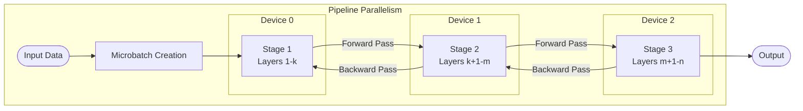
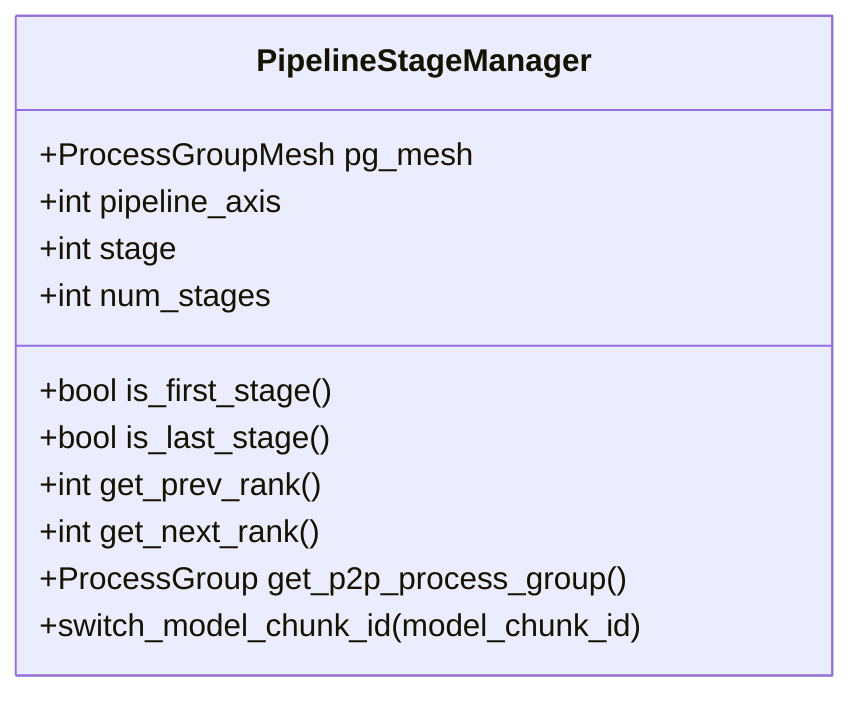
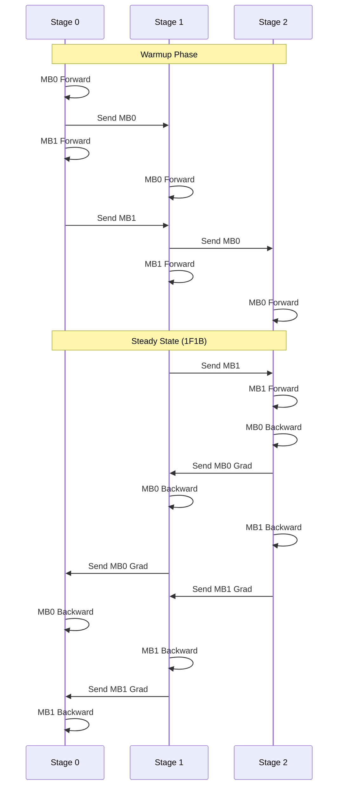
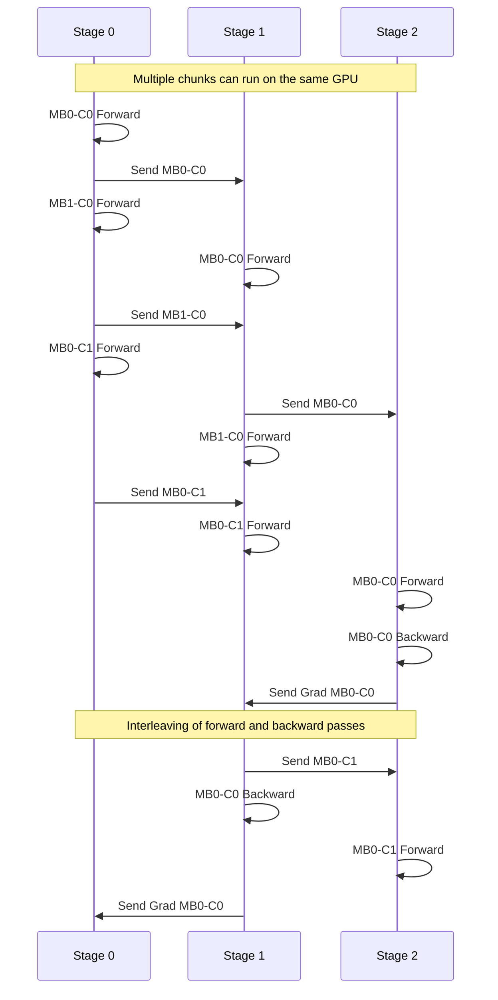
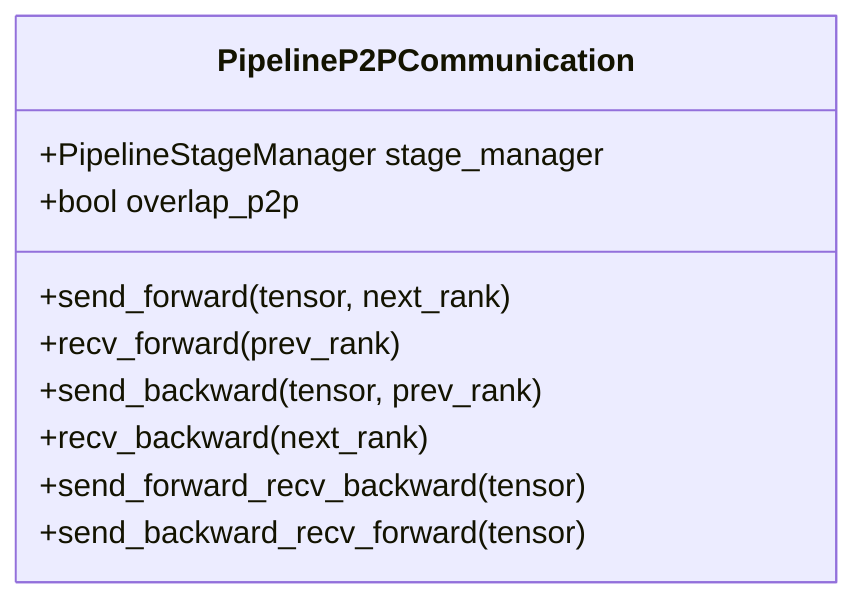
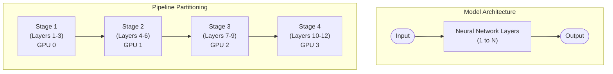
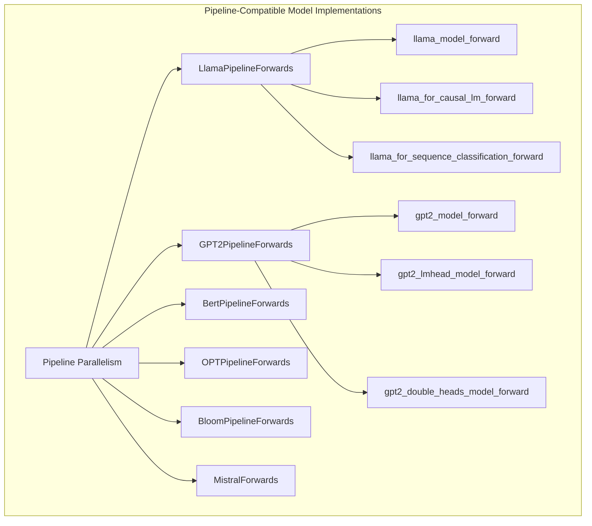
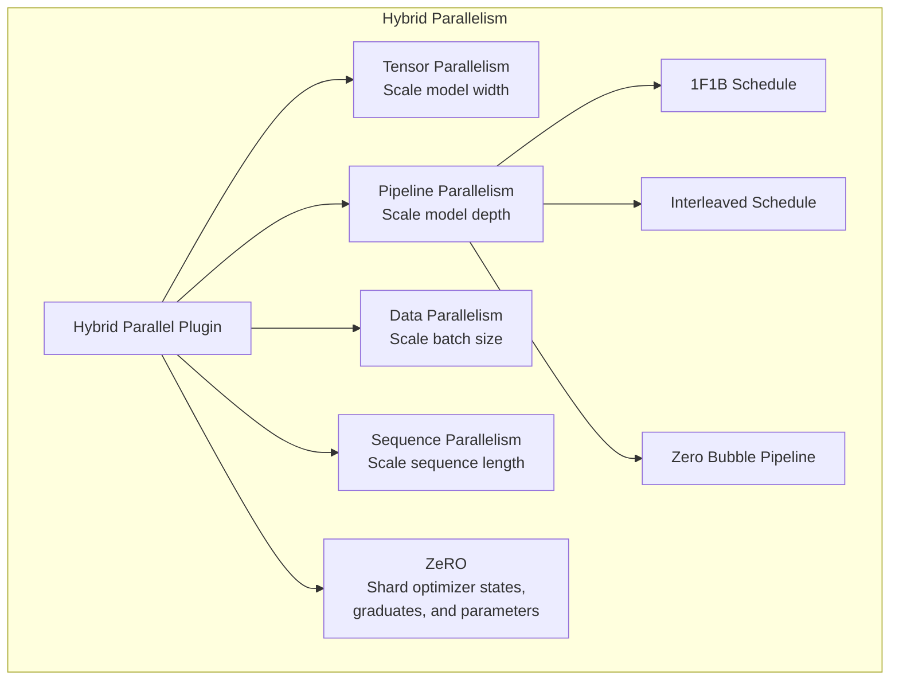

<!-- source: DeepWiki mcp.deepwiki.com · repo hpcaitech/ColossalAI · page 3.4 Pipeline Parallelism · fetched 2026-10-21 -->

# Pipeline Parallelism

<details>
<summary>Relevant source files</summary>

The following files were used as context for generating this wiki page:

- [colossalai/booster/booster.py](colossalai/booster/booster.py)
- [colossalai/booster/plugin/gemini_plugin.py](colossalai/booster/plugin/gemini_plugin.py)
- [colossalai/booster/plugin/hybrid_parallel_plugin.py](colossalai/booster/plugin/hybrid_parallel_plugin.py)
- [colossalai/booster/plugin/low_level_zero_plugin.py](colossalai/booster/plugin/low_level_zero_plugin.py)
- [colossalai/booster/plugin/torch_ddp_plugin.py](colossalai/booster/plugin/torch_ddp_plugin.py)
- [colossalai/booster/plugin/torch_fsdp_plugin.py](colossalai/booster/plugin/torch_fsdp_plugin.py)
- [colossalai/checkpoint_io/__init__.py](colossalai/checkpoint_io/__init__.py)
- [colossalai/checkpoint_io/checkpoint_io_base.py](colossalai/checkpoint_io/checkpoint_io_base.py)
- [colossalai/checkpoint_io/general_checkpoint_io.py](colossalai/checkpoint_io/general_checkpoint_io.py)
- [colossalai/checkpoint_io/hybrid_parallel_checkpoint_io.py](colossalai/checkpoint_io/hybrid_parallel_checkpoint_io.py)
- [colossalai/checkpoint_io/index_file.py](colossalai/checkpoint_io/index_file.py)
- [colossalai/checkpoint_io/moe_checkpoint.py](colossalai/checkpoint_io/moe_checkpoint.py)
- [colossalai/checkpoint_io/utils.py](colossalai/checkpoint_io/utils.py)
- [colossalai/shardformer/layer/attn.py](colossalai/shardformer/layer/attn.py)
- [colossalai/shardformer/layer/utils.py](colossalai/shardformer/layer/utils.py)
- [colossalai/shardformer/modeling/bert.py](colossalai/shardformer/modeling/bert.py)
- [colossalai/shardformer/modeling/blip2.py](colossalai/shardformer/modeling/blip2.py)
- [colossalai/shardformer/modeling/bloom.py](colossalai/shardformer/modeling/bloom.py)
- [colossalai/shardformer/modeling/falcon.py](colossalai/shardformer/modeling/falcon.py)
- [colossalai/shardformer/modeling/gpt2.py](colossalai/shardformer/modeling/gpt2.py)
- [colossalai/shardformer/modeling/gptj.py](colossalai/shardformer/modeling/gptj.py)
- [colossalai/shardformer/modeling/llama.py](colossalai/shardformer/modeling/llama.py)
- [colossalai/shardformer/modeling/mistral.py](colossalai/shardformer/modeling/mistral.py)
- [colossalai/shardformer/modeling/opt.py](colossalai/shardformer/modeling/opt.py)
- [colossalai/shardformer/modeling/t5.py](colossalai/shardformer/modeling/t5.py)
- [colossalai/shardformer/modeling/vit.py](colossalai/shardformer/modeling/vit.py)
- [colossalai/shardformer/modeling/whisper.py](colossalai/shardformer/modeling/whisper.py)
- [colossalai/shardformer/policies/mistral.py](colossalai/shardformer/policies/mistral.py)
- [colossalai/utils/safetensors.py](colossalai/utils/safetensors.py)
- [colossalai/zero/gemini/gemini_optimizer.py](colossalai/zero/gemini/gemini_optimizer.py)
- [colossalai/zero/low_level/bookkeeping/tensor_bucket.py](colossalai/zero/low_level/bookkeeping/tensor_bucket.py)
- [colossalai/zero/low_level/low_level_optim.py](colossalai/zero/low_level/low_level_optim.py)
- [tests/kit/model_zoo/transformers/t5.py](tests/kit/model_zoo/transformers/t5.py)
- [tests/test_checkpoint_io/test_gemini_checkpoint_io.py](tests/test_checkpoint_io/test_gemini_checkpoint_io.py)
- [tests/test_checkpoint_io/test_general_checkpoint_io.py](tests/test_checkpoint_io/test_general_checkpoint_io.py)
- [tests/test_checkpoint_io/test_hybrid_parallel_plugin_checkpoint_io.py](tests/test_checkpoint_io/test_hybrid_parallel_plugin_checkpoint_io.py)
- [tests/test_checkpoint_io/test_low_level_zero_checkpoint_io.py](tests/test_checkpoint_io/test_low_level_zero_checkpoint_io.py)
- [tests/test_checkpoint_io/test_safetensors_async_io.py](tests/test_checkpoint_io/test_safetensors_async_io.py)
- [tests/test_checkpoint_io/test_torch_ddp_checkpoint_io.py](tests/test_checkpoint_io/test_torch_ddp_checkpoint_io.py)
- [tests/test_shardformer/test_layer/test_ring_attn.py](tests/test_shardformer/test_layer/test_ring_attn.py)
- [tests/test_shardformer/test_model/test_shard_blip2.py](tests/test_shardformer/test_model/test_shard_blip2.py)

</details>


Pipeline parallelism is a distributed training technique that partitions neural network models along the depth dimension, placing different layers on separate devices. It enables efficient training of large models that exceed the memory capacity of a single GPU by splitting the model across multiple devices and processing microbatches in a pipelined fashion.

This document covers ColossalAI's pipeline parallelism implementation, including stage management, scheduling strategies, communication mechanisms, and integration with other parallelism techniques. For information about other parallelism methods, see [Tensor Parallelism](#3.3), [Zero Redundancy Optimizer (ZeRO)](#3.1), and [Hybrid Parallelism](#3.7).

## Key Concepts

Pipeline parallelism divides a model into sequential stages, with each stage assigned to a different device. A typical pipeline execution follows these steps:

1. **Model Partitioning**: The model is split into multiple sequential stages
2. **Microbatching**: Input batches are divided into smaller microbatches
3. **Pipeline Scheduling**: Microbatches are processed through the pipeline using a schedule
4. **P2P Communication**: Activations and gradients are communicated between pipeline stages
5. **Gradient Accumulation**: Gradients are accumulated across microbatches before updating



Sources:
- [colossalai/pipeline/stage_manager.py:11-112](colossalai/pipeline/stage_manager.py:11-112)
- [colossalai/pipeline/schedule/one_f_one_b.py:28-108](colossalai/pipeline/schedule/one_f_one_b.py:28-108)
- [examples/language/llama/benchmark.py:61-111](examples/language/llama/benchmark.py:61-111)

## Core Components

### PipelineStageManager

The `PipelineStageManager` class manages pipeline stages and inter-stage communication. It provides the following key functionality:

- Determining the current stage's position (first, last, intermediate)
- Getting the previous and next ranks for communication
- Managing p2p process groups for inter-stage communication
- Supporting model chunks for interleaved execution



Sources:
- [colossalai/pipeline/stage_manager.py:11-112](colossalai/pipeline/stage_manager.py:11-112)
- [tests/test_pipeline/test_stage_manager.py:10-57](tests/test_pipeline/test_stage_manager.py:10-57)

### Pipeline Scheduling Strategies

ColossalAI implements different pipeline scheduling strategies to optimize the execution of microbatches across pipeline stages:

#### 1. One Forward One Backward (1F1B)

The 1F1B schedule executes a forward pass followed by a backward pass for each microbatch, minimizing memory consumption by only storing activations for one microbatch at a time.



Sources:
- [colossalai/pipeline/schedule/one_f_one_b.py:28-108](colossalai/pipeline/schedule/one_f_one_b.py:28-108)
- [colossalai/pipeline/schedule/one_f_one_b.py:246-307](colossalai/pipeline/schedule/one_f_one_b.py:246-307)

#### 2. Interleaved Pipeline Schedule

The interleaved schedule overlaps forward and backward passes of different microbatches to increase device utilization. It supports partitioning a model into multiple chunks per stage (model chunking) to further improve pipeline efficiency.



Sources:
- [colossalai/pipeline/schedule/interleaved_pp.py:26-115](colossalai/pipeline/schedule/interleaved_pp.py:26-115)
- [colossalai/pipeline/schedule/interleaved_pp.py:118-226](colossalai/pipeline/schedule/interleaved_pp.py:118-226)

### P2P Communication

The `PipelineP2PCommunication` class manages point-to-point communication between pipeline stages, handling:

1. Forward communication: Sending activations from earlier to later stages
2. Backward communication: Sending gradients from later to earlier stages
3. Optimizations like overlapping communication with computation
4. Support for FP8 communication to reduce bandwidth usage



Sources:
- [colossalai/pipeline/p2p.py:21-110](colossalai/pipeline/p2p.py:21-110)
- [colossalai/pipeline/p2p.py:172-226](colossalai/pipeline/p2p.py:172-226)
- [colossalai/quantization/fp8.py:285-353](colossalai/quantization/fp8.py:285-353)

## Pipeline Execution Flow

### 1. Model Partitioning

Models are divided into stages based on layer indices. Each stage is assigned to a different device:



Sources:
- [examples/language/llama/benchmark.py:129-195](examples/language/llama/benchmark.py:129-195)
- [colossalai/shardformer/modeling/llama.py:37-91](colossalai/shardformer/modeling/llama.py:37-91)

### 2. Forward Execution

The forward pass moves data through the pipeline stages, with each stage executing its portion of the model:

1. **First stage**: Receives input data, processes it through its layers, and sends the output to the next stage
2. **Intermediate stages**: Receive activations from the previous stage, process them, and forward to the next stage
3. **Last stage**: Receives activations from the previous stage, processes them, and computes the loss

```python
# Pseudocode for pipeline forward pass
def forward_step(model, input_obj, criterion):
    # Load microbatch
    micro_batch = schedule.load_micro_batch()
    
    # For the first stage, input_obj is None
    # For non-first stages, input_obj is the output from the previous stage
    output_obj = model_forward(model, micro_batch, input_obj)
    
    if is_last_stage:
        # Calculate loss at the last stage
        loss = criterion(output_obj, micro_batch)
        return loss
    else:
        # Return intermediate activations for non-last stages
        return output_obj
```

Sources:
- [colossalai/pipeline/schedule/one_f_one_b.py:247-280](colossalai/pipeline/schedule/one_f_one_b.py:247-280)
- [colossalai/shardformer/modeling/llama.py:44-126](colossalai/shardformer/modeling/llama.py:44-126)

### 3. Backward Execution

The backward pass propagates gradients in the reverse direction:

1. **Last stage**: Initiates backward pass from the loss
2. **Intermediate stages**: Receive gradients from the next stage, perform backward through their layers, and send gradients to the previous stage
3. **First stage**: Receives gradients from the second stage and completes the backward pass

```python
# Pseudocode for pipeline backward pass
def backward_step(optimizer, input_obj, output_obj, output_obj_grad):
    # Retain gradients for input tensors
    retain_grad(input_obj)
    
    # Backward pass
    if output_obj_grad is None:
        # At the last stage, backpropagate from loss
        optimizer.backward(output_obj)
    else:
        # At non-last stages, backpropagate using received gradients
        optimizer.backward_by_grad(output_obj, output_obj_grad)
    
    # Collect gradients for the input to send to previous stage
    input_obj_grad = {}
    for k, v in input_obj.items():
        if v.grad is not None:
            input_obj_grad[k] = v.grad
    
    return input_obj_grad
```

Sources:
- [colossalai/pipeline/schedule/one_f_one_b.py:282-325](colossalai/pipeline/schedule/one_f_one_b.py:282-325)
- [colossalai/pipeline/schedule/interleaved_pp.py:429-452](colossalai/pipeline/schedule/interleaved_pp.py:429-452)

## Model Integration

ColossalAI provides pipeline-specific forward implementations for popular language models, allowing them to work seamlessly with pipeline parallelism.



Each model implementation handles:
- Proper data preprocessing
- Awareness of pipeline stage boundaries
- Correct activation passing between stages
- Loss computation at the last stage
- Support for different pipeline scheduling strategies

Sources:
- [colossalai/shardformer/modeling/llama.py:37-483](colossalai/shardformer/modeling/llama.py:37-483)
- [colossalai/shardformer/modeling/gpt2.py:109-193](colossalai/shardformer/modeling/gpt2.py:109-193)
- [colossalai/shardformer/modeling/mistral.py:27-106](colossalai/shardformer/modeling/mistral.py:27-106)

## Advanced Features

### FP8 Communication

Pipeline parallelism supports FP8 communication to reduce communication bandwidth:

```python
def fp8_communication(tensor, rank):
    # Convert tensor to FP8 format before communication
    cast_to_fp8_pipeline(tensor)
    
    # Send tensor
    send_tensor(tensor, rank)
    
    # Convert back to original format after communication
    cast_from_fp8_pipeline(tensor)
```

This optimization reduces communication overhead while maintaining numerical stability.

Sources:
- [colossalai/quantization/fp8.py:285-353](colossalai/quantization/fp8.py:285-353)
- [colossalai/pipeline/schedule/one_f_one_b.py:167-174](colossalai/pipeline/schedule/one_f_one_b.py:167-174)

### Overlapping Communication and Computation

To improve efficiency, ColossalAI supports overlapping communication with computation:

```mermaid
gantt
    title "Without Overlapping vs With Overlapping"
    dateFormat X
    axisFormat %s
    
    section Without Overlap
    Compute (Stage 1)       :a1, 0, 3
    Communicate (1→2)       :a2, after a1, 2
    Compute (Stage 2)       :a3, after a2, 3
    Communicate (2→3)       :a4, after a3, 2
    
    section With Overlap
    Compute (Stage 1)       :b1, 0, 3
    Communicate (1→2)       :b2, after b1, 2
    Compute (Stage 2)       :b3, 2, 5
    Communicate (2→3)       :b4, after b3, 2
```



The implementation uses asynchronous communication operations to overlap with computation, reducing the overall pipeline bubble.

Sources:
- [colossalai/pipeline/p2p.py:238-261](colossalai/pipeline/p2p.py:238-261)
- [colossalai/pipeline/schedule/interleaved_pp.py:118-226](colossalai/pipeline/schedule/interleaved_pp.py:118-226)

### Integration with Other Parallelism Strategies

Pipeline parallelism can be combined with other parallelism techniques to create hybrid parallelism strategies:



The `HybridParallelPlugin` in examples coordinates these different parallelism techniques to efficiently train very large models.

Sources:
- [examples/language/llama/benchmark.py:110-134](examples/language/llama/benchmark.py:110-134)
- [examples/language/llama/benchmark.py:239-257](examples/language/llama/benchmark.py:239-257)

## Usage Example

Here's an example of using pipeline parallelism with the 1F1B schedule:

```python
# Initialize stage manager
pg_mesh = ProcessGroupMesh(dp_size, pp_size)
stage_manager = PipelineStageManager(pg_mesh, pipeline_axis=1)

# Create pipeline schedule
schedule = OneForwardOneBackwardSchedule(
    stage_manager=stage_manager,
    num_microbatches=num_microbatches
)

# Execute pipeline
for step, batch in enumerate(dataloader):
    if pipeline_parallel:
        # Using pipeline parallelism
        data_iter = iter([batch])
        outputs = booster.execute_pipeline(
            data_iter,
            model,
            criterion=lambda outputs, inputs: outputs[0],
            optimizer=optimizer,
            return_loss=True
        )
        loss = outputs["loss"]
    else:
        # Regular training
        outputs = model(**batch)
        loss = outputs[0]
    
    optimizer.step()
    optimizer.zero_grad()
```

Sources:
- [examples/language/llama/benchmark.py:357-377](examples/language/llama/benchmark.py:357-377)
- [examples/language/bert/finetune.py:147-168](examples/language/bert/finetune.py:147-168)

## Debugging and Testing

ColossalAI provides comprehensive tests to verify pipeline parallelism functionality:

1. **Stage Manager Tests**: Verify proper stage identification and communication groups
2. **Scheduling Tests**: Validate the correctness of different scheduling strategies
3. **P2P Communication Tests**: Ensure reliable data transfer between stages
4. **Integration Tests**: Test end-to-end training with different models

These tests help ensure the reliability and correctness of the pipeline parallelism implementation.

Sources:
- [tests/test_pipeline/test_stage_manager.py:10-57](tests/test_pipeline/test_stage_manager.py:10-57)
- [tests/test_pipeline/test_schedule/test_oneF_oneB.py:22-133](tests/test_pipeline/test_schedule/test_oneF_oneB.py:22-133)
- [tests/test_pipeline/test_p2p_communication.py:15-47](tests/test_pipeline/test_p2p_communication.py:15-47)

## Limitations and Considerations

When using pipeline parallelism, consider the following:

1. **Pipeline Bubbles**: Idle times at the beginning and end of the pipeline can impact efficiency
2. **Communication Overhead**: Communication between stages adds latency
3. **Microbatch Size**: Smaller microbatches reduce bubbles but may affect convergence
4. **Model Partitioning**: Uneven partitioning can lead to load imbalance
5. **Memory Usage**: Memory consumption varies with scheduling strategy

Proper configuration is key to achieving optimal performance with pipeline parallelism.

Sources:
- [colossalai/pipeline/schedule/one_f_one_b.py:328-358](colossalai/pipeline/schedule/one_f_one_b.py:328-358)
- [colossalai/pipeline/schedule/interleaved_pp.py:454-474](colossalai/pipeline/schedule/interleaved_pp.py:454-474)

## Conclusion

Pipeline parallelism in ColossalAI provides a powerful way to scale model training across multiple devices. Combined with other parallelism techniques, it enables efficient training of extremely large models that would otherwise be impossible to fit on available hardware.

The implementation offers flexibility through different scheduling strategies, optimized communication mechanisms, and seamless integration with popular model architectures. Advanced features like FP8 communication and computation-communication overlap further enhance efficiency.

---

