<!-- source: DeepWiki mcp.deepwiki.com · repo hpcaitech/ColossalAI · page 3.5 Sequence Parallelism · fetched 2026-10-21 -->

# Sequence Parallelism

<details>
<summary>Relevant source files</summary>

The following files were used as context for generating this wiki page:

- [colossalai/booster/booster.py](colossalai/booster/booster.py)
- [colossalai/booster/plugin/gemini_plugin.py](colossalai/booster/plugin/gemini_plugin.py)
- [colossalai/booster/plugin/hybrid_parallel_plugin.py](colossalai/booster/plugin/hybrid_parallel_plugin.py)
- [colossalai/booster/plugin/low_level_zero_plugin.py](colossalai/booster/plugin/low_level_zero_plugin.py)
- [colossalai/booster/plugin/torch_ddp_plugin.py](colossalai/booster/plugin/torch_ddp_plugin.py)
- [colossalai/booster/plugin/torch_fsdp_plugin.py](colossalai/booster/plugin/torch_fsdp_plugin.py)
- [colossalai/checkpoint_io/__init__.py](colossalai/checkpoint_io/__init__.py)
- [colossalai/checkpoint_io/checkpoint_io_base.py](colossalai/checkpoint_io/checkpoint_io_base.py)
- [colossalai/checkpoint_io/general_checkpoint_io.py](colossalai/checkpoint_io/general_checkpoint_io.py)
- [colossalai/checkpoint_io/hybrid_parallel_checkpoint_io.py](colossalai/checkpoint_io/hybrid_parallel_checkpoint_io.py)
- [colossalai/checkpoint_io/index_file.py](colossalai/checkpoint_io/index_file.py)
- [colossalai/checkpoint_io/moe_checkpoint.py](colossalai/checkpoint_io/moe_checkpoint.py)
- [colossalai/checkpoint_io/utils.py](colossalai/checkpoint_io/utils.py)
- [colossalai/shardformer/layer/attn.py](colossalai/shardformer/layer/attn.py)
- [colossalai/shardformer/layer/utils.py](colossalai/shardformer/layer/utils.py)
- [colossalai/shardformer/modeling/bert.py](colossalai/shardformer/modeling/bert.py)
- [colossalai/shardformer/modeling/blip2.py](colossalai/shardformer/modeling/blip2.py)
- [colossalai/shardformer/modeling/bloom.py](colossalai/shardformer/modeling/bloom.py)
- [colossalai/shardformer/modeling/falcon.py](colossalai/shardformer/modeling/falcon.py)
- [colossalai/shardformer/modeling/gpt2.py](colossalai/shardformer/modeling/gpt2.py)
- [colossalai/shardformer/modeling/gptj.py](colossalai/shardformer/modeling/gptj.py)
- [colossalai/shardformer/modeling/llama.py](colossalai/shardformer/modeling/llama.py)
- [colossalai/shardformer/modeling/mistral.py](colossalai/shardformer/modeling/mistral.py)
- [colossalai/shardformer/modeling/opt.py](colossalai/shardformer/modeling/opt.py)
- [colossalai/shardformer/modeling/t5.py](colossalai/shardformer/modeling/t5.py)
- [colossalai/shardformer/modeling/vit.py](colossalai/shardformer/modeling/vit.py)
- [colossalai/shardformer/modeling/whisper.py](colossalai/shardformer/modeling/whisper.py)
- [colossalai/shardformer/policies/mistral.py](colossalai/shardformer/policies/mistral.py)
- [colossalai/utils/safetensors.py](colossalai/utils/safetensors.py)
- [colossalai/zero/gemini/gemini_optimizer.py](colossalai/zero/gemini/gemini_optimizer.py)
- [colossalai/zero/low_level/bookkeeping/tensor_bucket.py](colossalai/zero/low_level/bookkeeping/tensor_bucket.py)
- [colossalai/zero/low_level/low_level_optim.py](colossalai/zero/low_level/low_level_optim.py)
- [tests/kit/model_zoo/transformers/t5.py](tests/kit/model_zoo/transformers/t5.py)
- [tests/test_checkpoint_io/test_gemini_checkpoint_io.py](tests/test_checkpoint_io/test_gemini_checkpoint_io.py)
- [tests/test_checkpoint_io/test_general_checkpoint_io.py](tests/test_checkpoint_io/test_general_checkpoint_io.py)
- [tests/test_checkpoint_io/test_hybrid_parallel_plugin_checkpoint_io.py](tests/test_checkpoint_io/test_hybrid_parallel_plugin_checkpoint_io.py)
- [tests/test_checkpoint_io/test_low_level_zero_checkpoint_io.py](tests/test_checkpoint_io/test_low_level_zero_checkpoint_io.py)
- [tests/test_checkpoint_io/test_safetensors_async_io.py](tests/test_checkpoint_io/test_safetensors_async_io.py)
- [tests/test_checkpoint_io/test_torch_ddp_checkpoint_io.py](tests/test_checkpoint_io/test_torch_ddp_checkpoint_io.py)
- [tests/test_shardformer/test_layer/test_ring_attn.py](tests/test_shardformer/test_layer/test_ring_attn.py)
- [tests/test_shardformer/test_model/test_shard_blip2.py](tests/test_shardformer/test_model/test_shard_blip2.py)

</details>


Sequence Parallelism (SP) is a parallelism technique that partitions input sequences across multiple devices to enable training with longer sequence lengths. By splitting the sequence dimension instead of replicating entire sequences, SP reduces memory consumption per device and allows for near-infinite context lengths when combined with specialized attention mechanisms.

For information about other parallelism strategies, see [Tensor Parallelism](#3.3), [Pipeline Parallelism](#3.4), and [Hybrid Parallelism](#3.7). For the orchestration layer that configures these strategies, see [Booster API](#4).

## Overview

Sequence Parallelism splits the sequence dimension of input tensors across multiple devices within a sequence parallel process group. This approach is particularly effective for:

- Training with long context lengths (4K+ tokens)
- Reducing activation memory per device
- Enabling near-infinite context via ring attention mechanisms
- Combining with tensor parallelism to reduce memory overhead from LayerNorm and Dropout operations

ColossalAI supports four distinct sequence parallelism modes, each optimized for different use cases and hardware configurations.

**Sources:** [colossalai/booster/plugin/hybrid_parallel_plugin.py:48](), [colossalai/shardformer/modeling/llama.py:33]()

## Supported Modes

ColossalAI implements four sequence parallelism modes, defined in the `SUPPORT_SP_MODE` constant:

| Mode | Description | Primary Use Case |
|------|-------------|------------------|
| `split_gather` | Simple split on forward, gather on backward | Basic SP with TP integration |
| `ring` | Deprecated mode, similar to split_gather | Legacy support |
| `all_to_all` | Redistributes tensors between TP and SP layouts | Advanced TP+SP optimization |
| `ring_attn` | Ring topology with blockwise attention | Near-infinite context lengths |

**Sources:** [colossalai/booster/plugin/hybrid_parallel_plugin.py:48](), [colossalai/shardformer/modeling/llama.py:33]()

### Mode Selection Flow

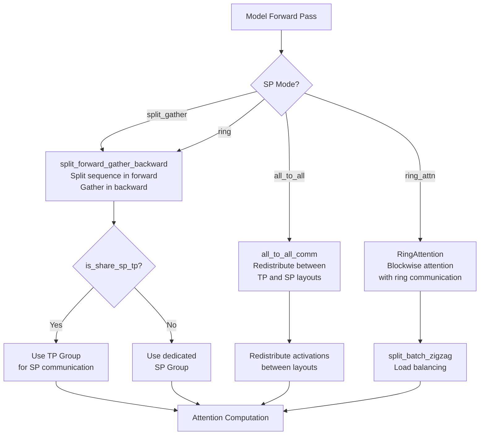

**Sources:** [colossalai/shardformer/modeling/llama.py:148-167](), [colossalai/shardformer/layer/utils.py:1-23]()

## Split-Gather Mode

The `split_gather` mode is the simplest sequence parallelism implementation. It splits the sequence dimension in the forward pass and gathers it in the backward pass, enabling basic sequence parallelism with minimal communication overhead.

### Operation Flow

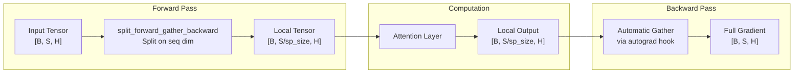

**Sources:** [colossalai/shardformer/layer/_operation.py:1-50]()

### Integration with Tensor Parallelism

When tensor parallelism and sequence parallelism are both enabled, the `is_share_sp_tp` function determines whether they share the same process group. This optimization reduces communication by reusing the TP group for SP operations:

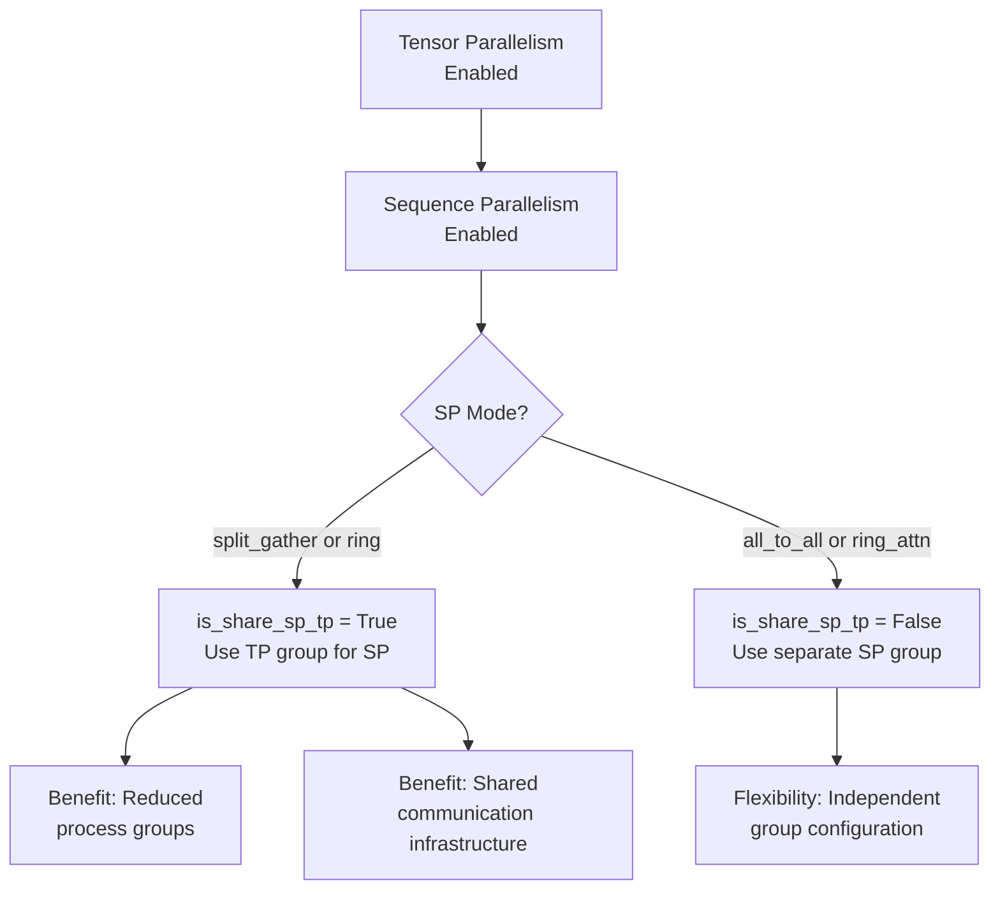

**Sources:** [colossalai/shardformer/layer/utils.py:1-23](), [colossalai/shardformer/modeling/llama.py:160-163]()

## All-to-All Mode

The `all_to_all` mode redistributes tensors between tensor parallel and sequence parallel layouts. This is particularly useful for operations like LayerNorm and Dropout that have sequence-wise semantics.

### Layout Transformation

In `all_to_all` mode, tensors are redistributed using collective communication:

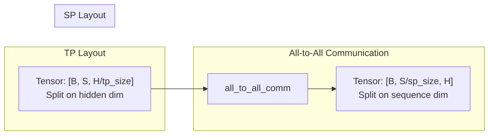

The forward pass uses `split_forward_gather_backward` with a scaling factor of `1/sp_size` to maintain numerical correctness after the redistribution.

**Sources:** [colossalai/shardformer/modeling/llama.py:164-167](), [colossalai/shardformer/layer/_operation.py:1-50]()

## Ring Attention Mode

Ring Attention (`ring_attn`) enables training with near-infinite context lengths by processing attention in a blockwise manner using a ring communication topology. This is the most sophisticated SP mode and is particularly effective for long-context models.

### Ring Attention Architecture

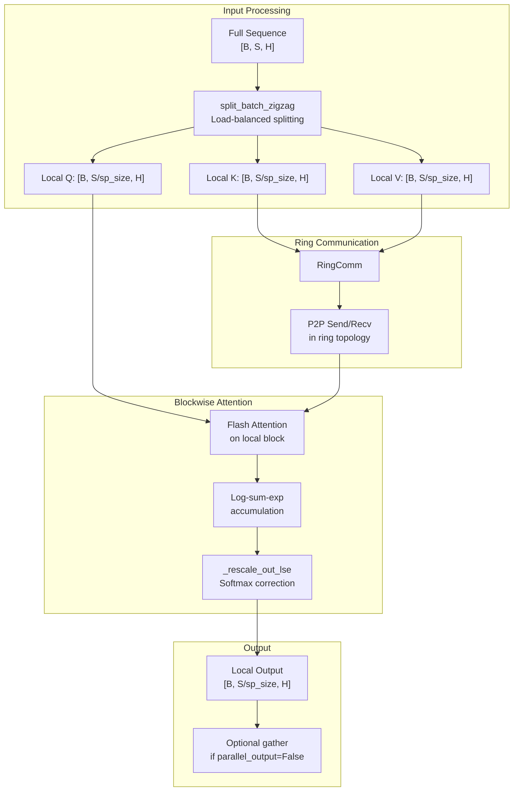

**Sources:** [colossalai/shardformer/layer/attn.py:406-621](), [colossalai/shardformer/layer/utils.py:1-100]()

### Ring Attention Implementation Details

The `RingAttention` class implements the core ring attention algorithm:

| Component | Purpose | Implementation |
|-----------|---------|----------------|
| `RingComm` | Manages P2P communication in ring topology | [colossalai/shardformer/layer/utils.py:1-50]() |
| `split_batch_zigzag` | Load-balanced sequence splitting | [colossalai/shardformer/layer/utils.py:51-100]() |
| `_rescale_out_lse` | Corrects softmax denominator across blocks | [colossalai/shardformer/layer/attn.py:376-403]() |
| `flash_attn_varlen_forward` | Blockwise attention computation | [colossalai/shardformer/layer/attn.py:640-700]() |

The ring attention algorithm performs multiple rounds of communication, where each device:
1. Computes attention for its local Q against received K/V blocks
2. Sends its K/V to the next device in the ring
3. Receives K/V from the previous device
4. Accumulates results using numerically stable log-sum-exp operations

**Sources:** [colossalai/shardformer/layer/attn.py:406-621]()

### Double Ring Topology

For multi-node setups, Ring Attention supports a 2D ring topology to maximize NIC utilization:

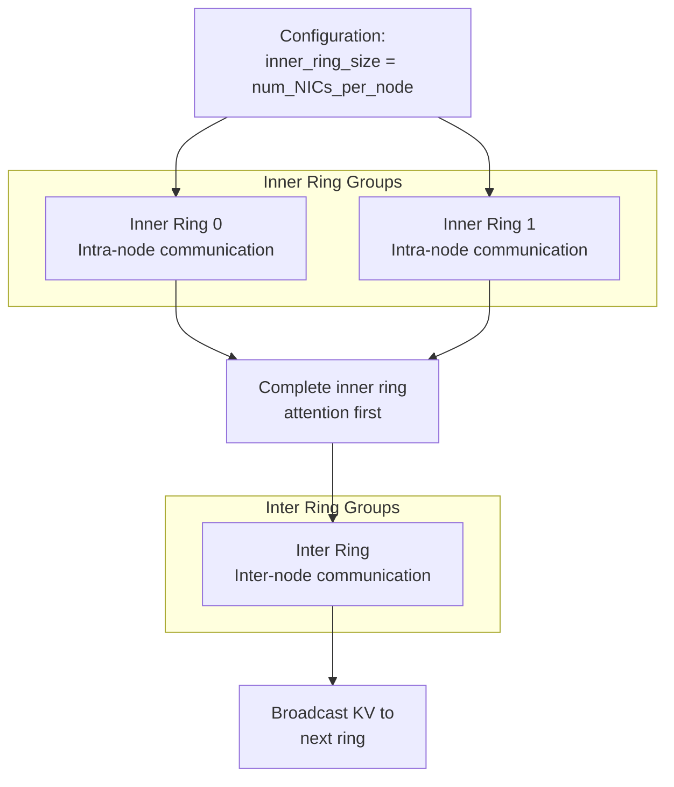

The `get_double_ring_groups` method creates this topology by dividing the SP group into inner rings (typically matching the number of NICs per node) and inter rings for cross-node communication.

**Sources:** [colossalai/shardformer/layer/attn.py:444-495]()

### Zigzag Batching

Ring Attention uses zigzag batching to balance load across devices when sequences have varying lengths (with padding):

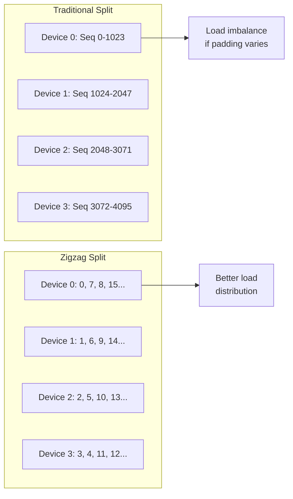

The `split_batch_zigzag` function implements this by interleaving sequence assignments across devices.

**Sources:** [colossalai/shardformer/layer/utils.py:51-100](), [colossalai/shardformer/layer/attn.py:640-700]()

## Gradient Synchronization

Sequence parallelism requires special handling of gradients because some layers produce partially-derived gradients (gradients computed only on local sequence chunks).

### Gradient Synchronization Flow

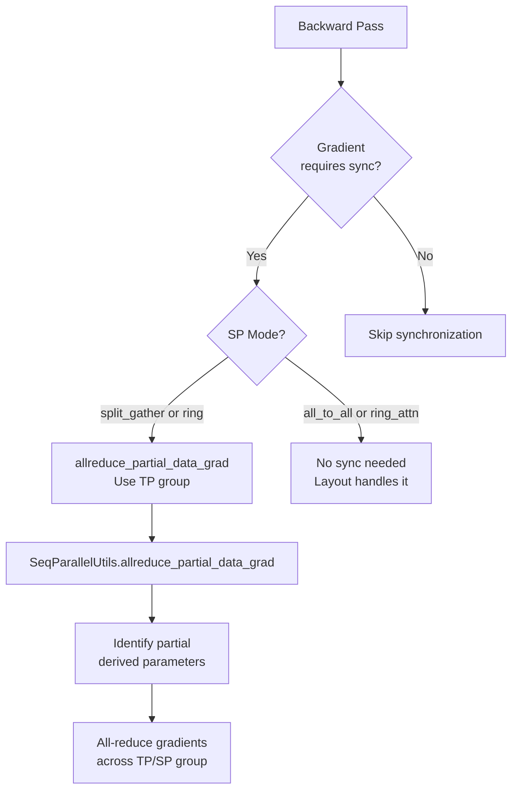

**Sources:** [colossalai/booster/plugin/hybrid_parallel_plugin.py:185-216](), [colossalai/shardformer/layer/utils.py:1-50]()

### Implementation in Optimizers

Gradient synchronization is integrated into optimizer wrappers at three levels:

**HybridParallelNaiveOptimizer:**
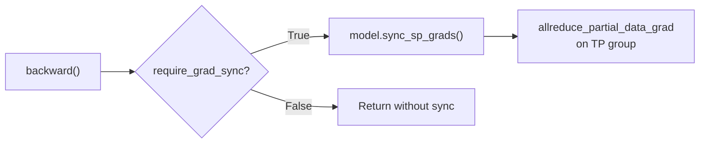

**Sources:** [colossalai/booster/plugin/hybrid_parallel_plugin.py:303-329]()

**HybridParallelZeroOptimizer:**

For ZeRO stages 1 and 2, the optimizer needs to synchronize both DP and SP gradients:

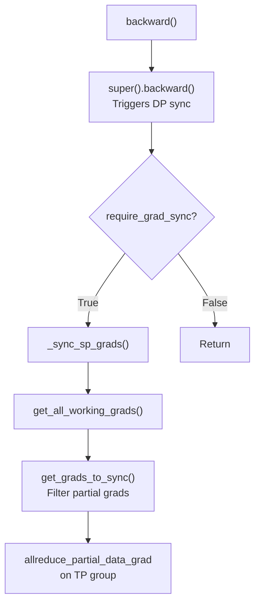

The `_sync_sp_grads` method identifies which gradients are partially derived using `SeqParallelUtils.is_sp_partial_derived_param()` and synchronizes only those gradients.

**Sources:** [colossalai/booster/plugin/hybrid_parallel_plugin.py:745-791](), [colossalai/zero/low_level/low_level_optim.py:792-840]()

### Identifying Partial Gradients

The `is_sp_partial_derived_param` utility function determines if a parameter's gradient is partially derived:

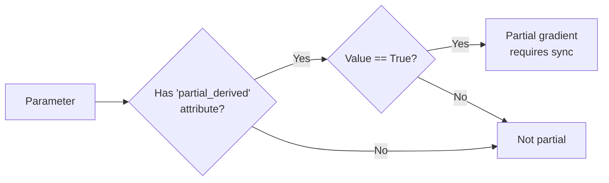

Parameters are marked with `partial_derived=True` during model transformation by ShardFormer policies when they use sequence-parallel linear layers.

**Sources:** [colossalai/shardformer/layer/utils.py:1-50]()

## Integration with Model Transformations

Sequence parallelism is applied during model transformation through ShardFormer policies. Each model-specific policy decides which layers should use SP-aware implementations.

### Policy Configuration

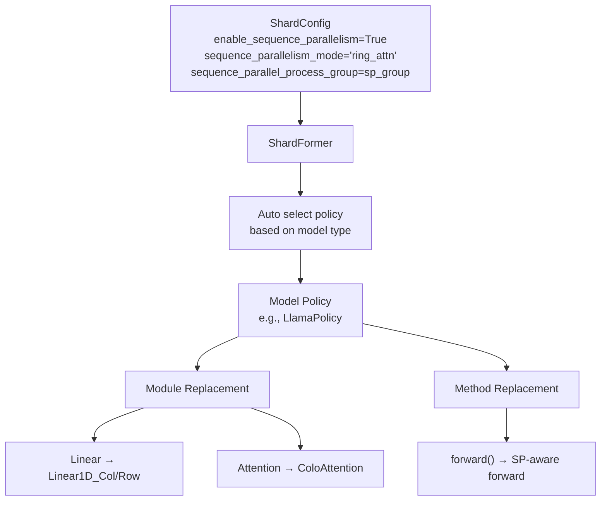

**Sources:** [colossalai/shardformer/__init__.py:1-50](), [colossalai/booster/plugin/hybrid_parallel_plugin.py:84-87]()

### Forward Pass Modifications

The model forward pass is modified to handle sequence parallelism. Here's the flow for LLaMA models:

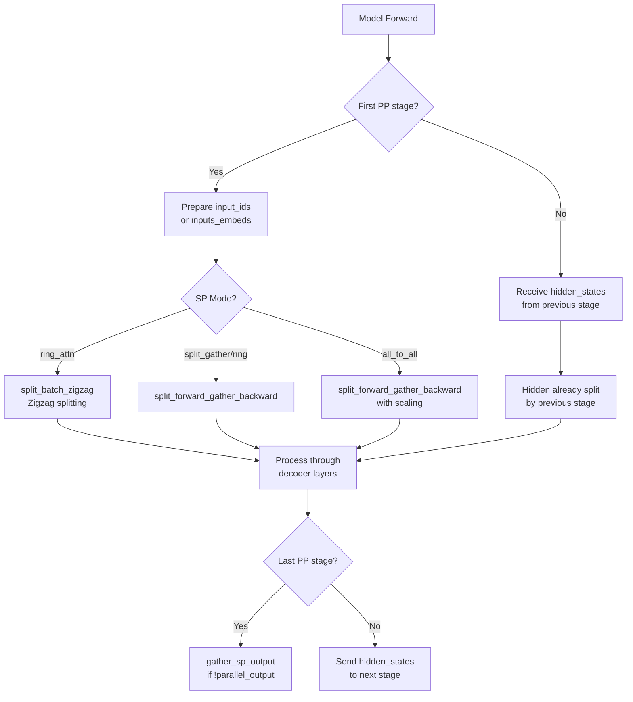

**Sources:** [colossalai/shardformer/modeling/llama.py:43-257]()

## Configuration and Usage

### Basic Setup with HybridParallelPlugin

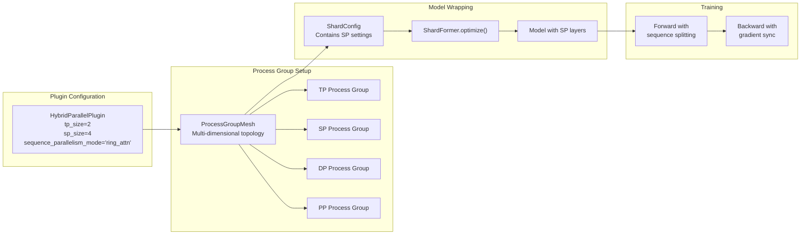

**Sources:** [colossalai/booster/plugin/hybrid_parallel_plugin.py:1-100]()

### Sequence Parallelism Parameters

The following table summarizes key configuration parameters:

| Parameter | Type | Description | Default |
|-----------|------|-------------|---------|
| `enable_sequence_parallelism` | bool | Enable SP | False |
| `sequence_parallelism_mode` | str | SP mode: split_gather/ring/all_to_all/ring_attn | None |
| `sp_size` | int | SP group size | 1 |
| `enable_flash_attention` | bool | Required for ring_attn | False |
| `parallel_output` | bool | Keep output split (avoid gather) | False |

**Sources:** [colossalai/shardformer/shard/shard_config.py:1-100]()

### Mode Selection Guidelines

| Use Case | Recommended Mode | Rationale |
|----------|------------------|-----------|
| Short sequences (<2K) with TP | `split_gather` or `ring` | Simple, low overhead, reuses TP group |
| Medium sequences (2K-8K) with TP | `all_to_all` | Better memory efficiency for LayerNorm/Dropout |
| Long sequences (8K+) | `ring_attn` | Near-infinite context, blockwise computation |
| Very long sequences (32K+) | `ring_attn` with varlen | Handles padding efficiently with zigzag batching |

**Sources:** [colossalai/booster/plugin/hybrid_parallel_plugin.py:48]()

## Process Group Management

Sequence parallelism requires careful management of process groups to coordinate communication:

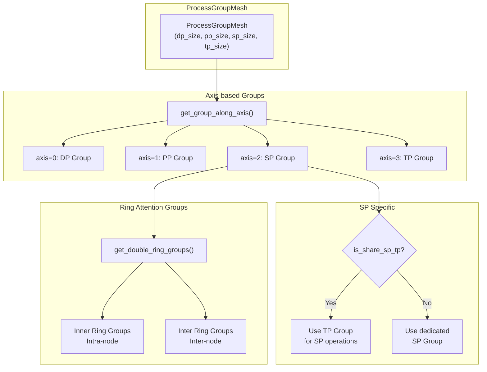

**Sources:** [colossalai/cluster/process_group_mesh.py:1-100](), [colossalai/shardformer/layer/attn.py:444-495]()

## Memory and Performance Considerations

### Memory Savings

Sequence parallelism reduces memory consumption by partitioning activations:

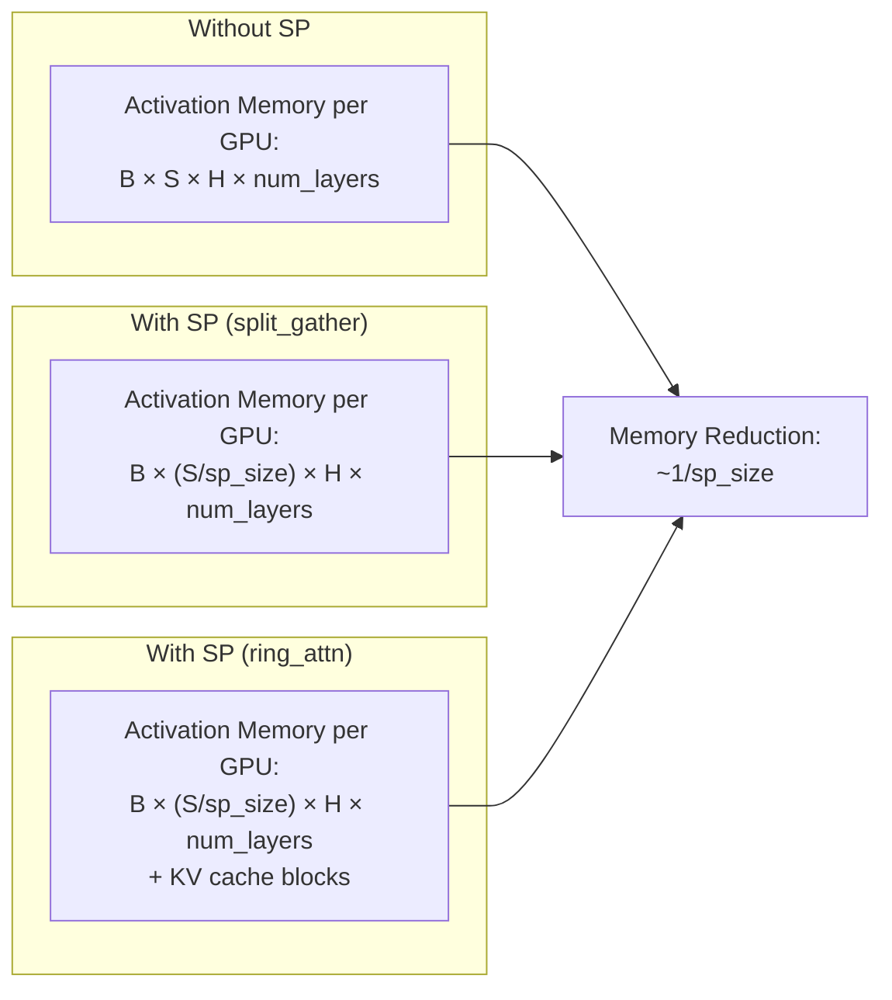

**Sources:** [colossalai/shardformer/layer/attn.py:406-621]()

### Communication Overhead

Different SP modes have different communication characteristics:

| Mode | Forward Communication | Backward Communication | Frequency |
|------|----------------------|------------------------|-----------|
| split_gather | 1× gather per layer | 1× split per layer | 2 × num_layers |
| all_to_all | 1× all-to-all per layer | 1× all-to-all per layer | 2 × num_layers |
| ring_attn | sp_size × P2P per attention | sp_size × P2P per attention | 2 × sp_size × num_attn_layers |

Ring attention has higher communication frequency but overlaps communication with computation, making it viable for long sequences.

**Sources:** [colossalai/shardformer/layer/attn.py:640-800]()

## Advanced Features

### Varlen (Variable Length) Support

Ring Attention supports variable-length sequences with the `PADDED_CAUSAL` attention mask type:

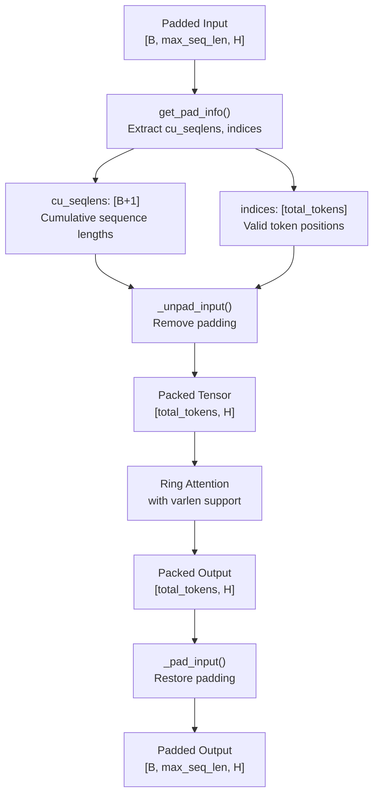

The varlen mode uses `split_varlen_zigzag` for load-balanced splitting across devices.

**Sources:** [colossalai/shardformer/layer/attn.py:54-79](), [colossalai/shardformer/layer/attn.py:640-700]()

### Checkpoint Compatibility

Models trained with sequence parallelism can be saved and loaded using the checkpoint system:

```mermaid
graph LR
    subgraph "Save"
        SPModel["Model with SP layers"] --> Gather["gather_sp_output<br/>Before checkpoint"]
        Gather --> Save["save_sharded_model()"]
    end
    
    subgraph "Load"
        Load["load_sharded_model()"] --> Distribute["Distribute to SP layout"]
        Distribute --> SPModel2["Model with SP layers"]
    end
```

The `force_sp_gather` parameter in model forward passes controls whether outputs are gathered before checkpointing or kept in split format for maximum memory efficiency.

**Sources:** [colossalai/shardformer/modeling/llama.py:59](), [colossalai/checkpoint_io/hybrid_parallel_checkpoint_io.py:1-100]()

## Limitations and Constraints

1. **Ring Attention Requirements**:
   - Requires Flash Attention to be installed
   - Sequence length must be divisible by `sp_size * 2` for proper splitting
   - Only supports causal and padded-causal attention masks

2. **Mode Compatibility**:
   - `ring_attn` mode cannot be combined with cross-attention (decoder-only models)
   - `all_to_all` mode requires careful tuning of the redistribution scale factor

3. **Pipeline Parallelism Integration**:
   - Intermediate pipeline stages receive pre-split hidden states
   - Sequence length calculation must account for SP splitting in non-first stages

**Sources:** [colossalai/shardformer/layer/attn.py:543-554](), [colossalai/shardformer/modeling/llama.py:96-103]()

---

