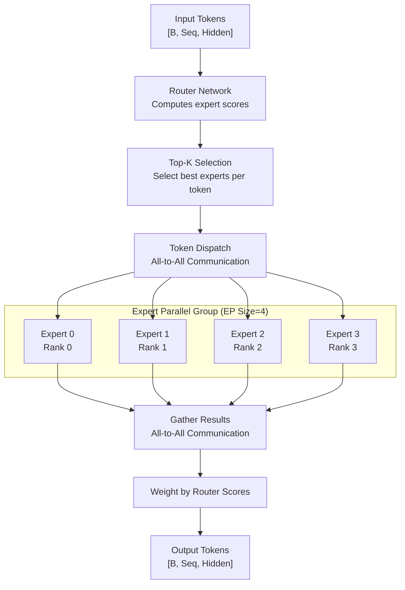
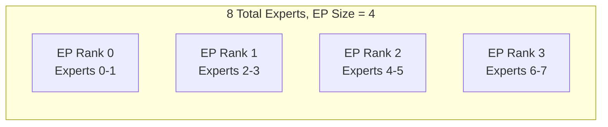
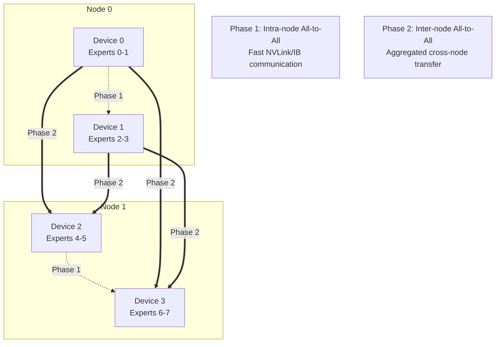
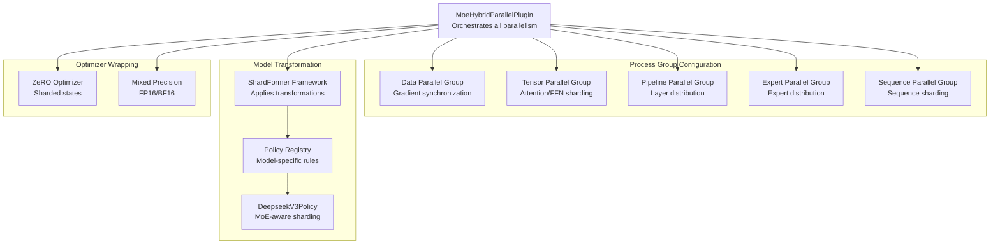
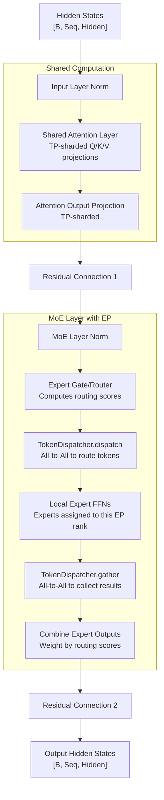

<!-- source: DeepWiki mcp.deepwiki.com · repo hpcaitech/ColossalAI · page 3.6 Expert Parallelism for MoE Models · fetched 2026-10-21 -->

# Expert Parallelism for MoE Models

<details>
<summary>Relevant source files</summary>

The following files were used as context for generating this wiki page:

- [.github/workflows/release_test_pypi_before_merge.yml](.github/workflows/release_test_pypi_before_merge.yml)
- [colossalai/__init__.py](colossalai/__init__.py)
- [colossalai/shardformer/layer/attn.py](colossalai/shardformer/layer/attn.py)
- [colossalai/shardformer/layer/loss.py](colossalai/shardformer/layer/loss.py)
- [colossalai/shardformer/layer/utils.py](colossalai/shardformer/layer/utils.py)
- [colossalai/shardformer/modeling/bert.py](colossalai/shardformer/modeling/bert.py)
- [colossalai/shardformer/modeling/blip2.py](colossalai/shardformer/modeling/blip2.py)
- [colossalai/shardformer/modeling/bloom.py](colossalai/shardformer/modeling/bloom.py)
- [colossalai/shardformer/modeling/deepseek_v3.py](colossalai/shardformer/modeling/deepseek_v3.py)
- [colossalai/shardformer/modeling/falcon.py](colossalai/shardformer/modeling/falcon.py)
- [colossalai/shardformer/modeling/gpt2.py](colossalai/shardformer/modeling/gpt2.py)
- [colossalai/shardformer/modeling/gptj.py](colossalai/shardformer/modeling/gptj.py)
- [colossalai/shardformer/modeling/llama.py](colossalai/shardformer/modeling/llama.py)
- [colossalai/shardformer/modeling/mistral.py](colossalai/shardformer/modeling/mistral.py)
- [colossalai/shardformer/modeling/opt.py](colossalai/shardformer/modeling/opt.py)
- [colossalai/shardformer/modeling/qwen2.py](colossalai/shardformer/modeling/qwen2.py)
- [colossalai/shardformer/modeling/t5.py](colossalai/shardformer/modeling/t5.py)
- [colossalai/shardformer/modeling/vit.py](colossalai/shardformer/modeling/vit.py)
- [colossalai/shardformer/modeling/whisper.py](colossalai/shardformer/modeling/whisper.py)
- [colossalai/shardformer/policies/auto_policy.py](colossalai/shardformer/policies/auto_policy.py)
- [colossalai/shardformer/policies/deepseek_v3.py](colossalai/shardformer/policies/deepseek_v3.py)
- [colossalai/shardformer/policies/mistral.py](colossalai/shardformer/policies/mistral.py)
- [colossalai/shardformer/policies/qwen2.py](colossalai/shardformer/policies/qwen2.py)
- [examples/language/deepseek/benchmark.py](examples/language/deepseek/benchmark.py)
- [tests/kit/model_zoo/transformers/__init__.py](tests/kit/model_zoo/transformers/__init__.py)
- [tests/kit/model_zoo/transformers/deepseek_v3.py](tests/kit/model_zoo/transformers/deepseek_v3.py)
- [tests/kit/model_zoo/transformers/t5.py](tests/kit/model_zoo/transformers/t5.py)
- [tests/test_shardformer/test_layer/test_ring_attn.py](tests/test_shardformer/test_layer/test_ring_attn.py)
- [tests/test_shardformer/test_model/test_shard_blip2.py](tests/test_shardformer/test_model/test_shard_blip2.py)
- [tests/test_shardformer/test_model/test_shard_deepseek_v3.py](tests/test_shardformer/test_model/test_shard_deepseek_v3.py)
- [tests/test_shardformer/test_model/test_shard_qwen2.py](tests/test_shardformer/test_model/test_shard_qwen2.py)
- [version.txt](version.txt)

</details>


## Purpose and Scope

This document explains how Colossal-AI implements Expert Parallelism (EP) for Mixture of Experts (MoE) models, with a focus on the DeepseekV3 implementation. Expert Parallelism is a specialized parallelism strategy that distributes expert networks across devices, enabling MoE models with hundreds of experts to scale beyond single-device memory limits.

For general parallelism concepts, see [Parallelism Techniques](#3). For combining EP with other parallelism strategies, see [Hybrid Parallelism](#3.7). For tensor and pipeline parallelism that apply to non-MoE layers, see [Tensor Parallelism](#3.3) and [Pipeline Parallelism](#3.4).

## Overview of Expert Parallelism

### What is MoE?

Mixture of Experts models use multiple specialized "expert" sub-networks where a routing mechanism selects which experts process each token. Instead of every token passing through the same FFN layer, tokens are dynamically routed to different expert FFNs based on learned routing scores.

### Key Concepts

| Concept | Description |
|---------|-------------|
| **Expert** | A specialized sub-network (typically an MLP) that processes a subset of tokens |
| **Router/Gate** | Mechanism that computes expert assignment scores for each token |
| **Token Dispatcher** | System that physically moves tokens to devices hosting their assigned experts |
| **Expert Parallelism (EP)** | Distributing experts across devices within an EP process group |
| **Top-K Selection** | Each token is routed to K experts (typically K=1 or K=2) |
| **Load Balancing** | Ensuring experts receive roughly equal numbers of tokens to avoid stragglers |

**Sources:** [colossalai/shardformer/modeling/deepseek_v3.py:1-20]()

## DeepseekV3 MoE Architecture

### Model Structure Overview

DeepseekV3 implements a routed MoE architecture where transformer layers alternate between standard attention blocks and MoE layers containing multiple expert FFNs.



**Sources:** [colossalai/shardformer/modeling/deepseek_v3.py:1-100]()

### Expert Distribution Strategy

Experts are distributed uniformly across the EP process group:



Each rank stores `num_experts // ep_size` experts. The experts are partitioned contiguously by expert index.

**Sources:** [colossalai/shardformer/modeling/deepseek_v3.py:1-100]()

## Token Dispatching and Communication

### MoeDispatcher Classes

Colossal-AI provides dispatcher implementations that handle token-to-expert routing:

```mermaid
graph TB
    subgraph Dispatch["Token Dispatching System"]
        Input["Tokens + Router Scores<br/>[Total_Tokens, Hidden]"]
        
        MaskGen["Generate Dispatch Mask<br/>Token-to-Expert mapping"]
        
        DispatcherType{Dispatcher Type}
        
        AllToAll["MoeDispatcherForAllToAll<br/>Uses all_to_all collective"]
        AllGather["MoeDispatcherForAllGather<br/>Uses all_gather pattern"]
        
        SendBuf["Prepare Send Buffers<br/>Group by target rank"]
        
        Comm["All-to-All Communication<br/>Exchange tokens"]
        
        RecvBuf["Receive Buffers<br/>Tokens for local experts"]
        
        Expert["Expert Computation<br/>Process local tokens"]
        
        GatherComm["All-to-All Communication<br/>Return processed tokens"]
        
        Combine["Combine Results<br/>Weight by router scores"]
        
        Output["Output Tokens<br/>[Total_Tokens, Hidden]"]
    end
    
    Input --> MaskGen
    MaskGen --> DispatcherType
    DispatcherType --> AllToAll
    DispatcherType --> AllGather
    AllToAll --> SendBuf
    AllGather --> SendBuf
    SendBuf --> Comm
    Comm --> RecvBuf
    RecvBuf --> Expert
    Expert --> GatherComm
    GatherComm --> Combine
    Combine --> Output
```



**Sources:** [colossalai/shardformer/modeling/deepseek_v3.py:1-50]()

### Hierarchical All-to-All Communication

For multi-node training, `hierarchical_all_to_all` optimizes cross-node bandwidth by performing intra-node communication first:



This reduces inter-node traffic by aggregating data within nodes before exchanging between nodes.

**Sources:** [colossalai/shardformer/modeling/deepseek_v3.py:1-50]()

## Load Balancing for Experts

### EPLoadBalancer

The `EPLoadBalancer` ensures balanced token distribution across experts to prevent stragglers:

| Component | Purpose |
|-----------|---------|
| **Capacity Factor** | Maximum tokens per expert relative to average (e.g., 1.25x) |
| **Token Assignment** | Tracks which tokens are assigned to which experts |
| **Overflow Handling** | Drops or reassigns tokens when experts exceed capacity |
| **Load Metrics** | Tracks utilization per expert for monitoring |

### Auxiliary Loss

MoE models use an auxiliary loss to encourage balanced routing:

```
aux_loss = load_balancing_coefficient * variance(expert_token_counts)
```

This loss term penalizes the model when routing is imbalanced (some experts heavily used, others idle).

**Sources:** [colossalai/shardformer/modeling/deepseek_v3.py:1-100]()

## Integration with MoeHybridParallelPlugin

### Plugin Architecture

The `MoeHybridParallelPlugin` orchestrates EP alongside other parallelism dimensions:



**Sources:** [tests/test_shardformer/test_model/test_shard_deepseek_v3.py:1-60]()

### Process Group Mesh with EP

The process group mesh includes an EP dimension:

```python
# Conceptual layout for world_size = dp * tp * pp * ep * sp
pg_mesh = ProcessGroupMesh(
    dp_size=2,   # Data parallel
    pp_size=2,   # Pipeline parallel  
    ep_size=4,   # Expert parallel (new dimension)
    tp_size=2,   # Tensor parallel
    sp_size=1    # Sequence parallel
)
```

Total world size: 2 × 2 × 4 × 2 × 1 = 32 devices

**Sources:** [tests/test_shardformer/test_model/test_shard_deepseek_v3.py:26-60]()

## DeepseekV3 Forward Pass Implementation

### MoE Layer Forward

The forward pass for a DeepseekV3 MoE layer with EP:



**Sources:** [colossalai/shardformer/modeling/deepseek_v3.py:1-300]()

### Pipeline Stage Distribution

When combining EP with PP, each pipeline stage contains a subset of layers, and within each stage, experts are distributed across the EP group:


Each pipeline stage has its own EP group. Experts in MoE layers within a stage are distributed across that stage's EP group members.

**Sources:** [colossalai/shardformer/modeling/deepseek_v3.py:100-400]()

## DeepseekV3Policy Configuration

### Policy Module Replacements

The `DeepseekV3Policy` defines MoE-aware sharding rules:

```mermaid
graph TB
    Policy["DeepseekV3Policy"]
    
    subgraph ModReplace["Module Replacements"]
        AttnQ["self_attn.q_proj<br/>→ Linear1D_Col (TP)"]
        AttnK["self_attn.k_proj<br/>→ Linear1D_Col (TP)"]
        AttnV["self_attn.v_proj<br/>→ Linear1D_Col (TP)"]
        AttnO["self_attn.o_proj<br/>→ Linear1D_Row (TP)"]
        
        RouterGate["moe.gate<br/>→ Replicated across EP"]
        ExpertW1["moe.experts.*.w1<br/>→ EP-distributed"]
        ExpertW2["moe.experts.*.w2<br/>→ EP-distributed"]
        ExpertW3["moe.experts.*.w3<br/>→ EP-distributed"]
    end
    
    subgraph AttrMod["Attribute Modifications"]
        NumLocalExperts["num_local_experts<br/>= num_experts // ep_size"]
        EPGroupAttr["expert_parallel_group<br/>= ep_process_group"]
        DispatcherAttr["token_dispatcher<br/>= MoeDispatcher instance"]
    end
    
    Policy --> AttnQ
    Policy --> AttnK
    Policy --> AttnV
    Policy --> AttnO
    Policy --> RouterGate
    Policy --> ExpertW1
    Policy --> ExpertW2
    Policy --> ExpertW3
    Policy --> NumLocalExperts
    Policy --> EPGroupAttr
    Policy --> DispatcherAttr
```



Key points:
- **Shared attention layers**: Standard TP sharding (Linear1D_Col/Row)
- **Expert gate/router**: Replicated (not sharded by TP or EP)
- **Expert FFN layers**: Distributed across EP group (not TP-sharded)
- **Expert count**: Each rank stores `num_experts // ep_size` experts

**Sources:** [colossalai/shardformer/policies/auto_policy.py:170-176]()

## Communication Patterns and Costs

### All-to-All Communication

The primary communication primitive for EP is all-to-all:

| Phase | Communication | Data Volume per Rank | Direction |
|-------|---------------|---------------------|-----------|
| **Dispatch** | `dist.all_to_all` | `~(T/N) * H * sizeof(dtype)` | Scatter tokens to expert hosts |
| **Compute** | None (local) | N/A | Process tokens with local experts |
| **Gather** | `dist.all_to_all` | `~(T/N) * H * sizeof(dtype)` | Gather processed tokens |

Where:
- `T` = total tokens across all sequences
- `N` = EP group size
- `H` = hidden dimension

**Total communication per rank:** `2 * T * H * sizeof(dtype)` (dispatch + gather)

### Memory Efficiency

EP reduces memory footprint for expert parameters:

```
Memory without EP (all experts on one device):
  expert_memory = num_experts * expert_param_size

Memory with EP (distributed experts):
  expert_memory_per_device = (num_experts / ep_size) * expert_param_size
  
Memory reduction ratio = ep_size
```

Example for DeepseekV3 with 256 experts, EP size = 8:
- Each device stores 32 experts instead of 256
- 8× reduction in expert parameter memory

**Sources:** [colossalai/shardformer/modeling/deepseek_v3.py:1-100]()

## Training with MoeHybridParallelPlugin

### Basic Setup

```python
from colossalai.booster import Booster
from colossalai.booster.plugin import MoeHybridParallelPlugin
from transformers import AutoModelForCausalLM, AutoConfig

# Initialize plugin with EP
plugin = MoeHybridParallelPlugin(
    tp_size=2,          # Tensor parallel size
    pp_size=2,          # Pipeline parallel size  
    ep_size=4,          # Expert parallel size
    sp_size=1,          # Sequence parallel size
    zero_stage=1,       # ZeRO optimizer stage
    precision="bf16",
    enable_sequence_parallelism=True,
)

# Create booster
booster = Booster(plugin=plugin)

# Load DeepseekV3 model
config = AutoConfig.from_pretrained("deepseek-ai/DeepSeek-V3")
model = AutoModelForCausalLM.from_config(config)

# Boost model (applies EP sharding)
model, optimizer, criterion, dataloader, lr_scheduler = booster.boost(
    model, optimizer, criterion, dataloader, lr_scheduler
)

# Training loop
for batch in dataloader:
    outputs = model(**batch)
    loss = outputs.loss
    booster.backward(loss, optimizer)
    optimizer.step()
    optimizer.zero_grad()
```

The plugin automatically:
1. Creates EP process groups based on `ep_size`
2. Applies `DeepseekV3Policy` to shard experts
3. Configures token dispatchers with EP communication groups
4. Integrates with other parallelism dimensions

**Sources:** [tests/test_shardformer/test_model/test_shard_deepseek_v3.py:26-60]()

## Performance Considerations

### Communication Overhead

EP introduces communication overhead during dispatch and gather phases:

| Factor | Impact | Mitigation Strategy |
|--------|--------|---------------------|
| **Network Bandwidth** | All-to-all is bandwidth-intensive | Use high-bandwidth interconnect (IB, NVLink) |
| **Load Imbalance** | Some ranks wait for others | Increase auxiliary loss coefficient |
| **Small Batch Size** | Communication overhead dominates | Increase batch size or sequence length |
| **Cross-Node Communication** | Inter-node slower than intra-node | Use hierarchical all-to-all |

### Scaling Efficiency

EP scaling efficiency formula:

```
Efficiency = Computation_Time / (Computation_Time + Communication_Time)

Where:
  Computation_Time ∝ (tokens_per_expert * expert_flops)
  Communication_Time ∝ (total_tokens * hidden_dim / bandwidth)
```

Best scaling achieved when:
- Many experts (increases computation per communication)
- Large expert size (increases computation per token)
- High network bandwidth (reduces communication time)
- Balanced routing (minimizes stragglers)

**Sources:** [examples/language/deepseek/benchmark.py:1-400]()

### Optimal Configuration Guidelines

| Model Size | EP Size | TP Size | PP Size | Rationale |
|------------|---------|---------|---------|-----------|
| < 10B params | 1-2 | 2-4 | 1 | Small models: minimal EP needed |
| 10B-100B params | 4-8 | 4-8 | 2-4 | Medium models: balance EP and TP/PP |
| > 100B params | 8-16 | 8 | 4-8 | Large models: maximize EP for expert memory |

**Sources:** [examples/language/deepseek/benchmark.py:1-200]()

## Debugging and Monitoring

### Common Issues

| Issue | Symptoms | Root Cause | Solution |
|-------|----------|------------|----------|
| **Routing Imbalance** | Some GPUs at 100%, others idle | Router learned unbalanced routing | Increase auxiliary loss coefficient (0.01 → 0.1) |
| **OOM on Specific Ranks** | Out of memory on subset of ranks | Expert capacity factor too high | Reduce capacity factor or increase EP size |
| **Slow All-to-All** | Training slower than expected | Network bottleneck | Enable hierarchical_all_to_all, check network topology |
| **Gradient Divergence** | Loss not decreasing | Router gradients unstable | Reduce learning rate, check router initialization |

### Monitoring Metrics

Track these metrics during training:

```python
# Expert load distribution
expert_token_counts = {}  # tokens per expert
load_variance = np.var(list(expert_token_counts.values()))

# Communication time
import time
start = time.time()
# ... all_to_all operation ...
comm_time = time.time() - start

# Expert utilization
activated_experts = len([e for e in expert_token_counts if expert_token_counts[e] > 0])
utilization = activated_experts / num_total_experts
```

**Sources:** [examples/language/deepseek/benchmark.py:1-400]()

## Advanced Topics

### Dynamic Expert Selection

During inference, reduce computation by selecting fewer experts:

```python
# Top-1 routing (fastest, lower quality)
router_output = router(hidden_states)
top_expert = torch.argmax(router_output, dim=-1)

# Top-2 routing (balanced, typical)
top_2_experts = torch.topk(router_output, k=2, dim=-1)

# Threshold-based (adaptive)
active_experts = router_output > threshold
```

### Gradient Accumulation with EP

When using gradient accumulation:

1. Token routing is performed each micro-batch
2. Gradients accumulate locally on each expert
3. Expert parameter updates synchronized across DP group (not EP group)
4. Each EP rank maintains distinct expert parameters

```python
# Gradient accumulation loop
for micro_batch in range(gradient_accumulation_steps):
    outputs = model(batch)
    loss = outputs.loss / gradient_accumulation_steps
    booster.backward(loss, optimizer)  # Accumulate gradients

optimizer.step()  # Synchronize across DP, not EP
optimizer.zero_grad()
```

**Sources:** [colossalai/shardformer/modeling/deepseek_v3.py:1-500]()

## Comparison with Other Parallelism Strategies

| Parallelism Type | What It Distributes | Communication Pattern | Primary Use Case |
|------------------|--------------------|-----------------------|------------------|
| **Expert Parallel (EP)** | Experts across devices | All-to-all for token routing | MoE models with many experts |
| **Tensor Parallel (TP)** | Weight matrices within layer | All-reduce after matmul | Large dense layers (attention, FFN) |
| **Pipeline Parallel (PP)** | Layers across stages | P2P for activations | Very deep models |
| **Data Parallel (DP)** | Full model replicas | All-reduce for gradients | Models fitting on single device |
| **Sequence Parallel (SP)** | Sequence dimension | All-gather for attention | Long sequence lengths |

**Key differences:**
- EP is **orthogonal** to TP/PP/DP/SP and can be combined with all
- EP only applies to **MoE layers**, other strategies apply to all layers
- EP uses **all-to-all** communication (unique among parallelism types)
- EP provides **memory savings** proportional to EP size for expert parameters

**Sources:** [colossalai/shardformer/modeling/deepseek_v3.py:1-100]()

## File Structure Reference

Key implementation files for EP:

```
colossalai/
├── moe/
│   └── _operation.py                     # Core MoE operations
│       ├── MoeDispatcherForAllToAll      # All-to-all based dispatcher
│       ├── MoeDispatcherForAllGather     # All-gather based dispatcher
│       ├── EPLoadBalancer                # Expert load balancing
│       ├── TokenDispatcher                # Token routing interface
│       └── hierarchical_all_to_all       # Optimized cross-node communication
│
├── shardformer/
│   ├── modeling/
│   │   └── deepseek_v3.py                # DeepseekV3 MoE model implementation
│   │       ├── DeepseekV3PipelineForwards  # Pipeline-aware forward passes
│   │       ├── get_deepseek_v3_flash_attention_forward
│   │       └── get_deepseek_v3_sequence_parallel_attention_forward
│   │
│   └── policies/
│       ├── auto_policy.py                # Policy registry
│       │   └── _POLICY_LIST["DeepseekV3*"]  # DeepseekV3 policy entries
│       │
│       └── deepseek_v3.py                # DeepseekV3Policy class
│           └── DeepseekV3Policy.module_policy()  # MoE-aware sharding rules
│
└── booster/
    └── plugin/
        └── moe_hybrid_parallel_plugin.py  # MoeHybridParallelPlugin
            ├── configure_process_groups()   # EP group creation
            └── boost()                      # Applies EP sharding
```

**Sources:** [colossalai/shardformer/policies/auto_policy.py:170-176](), [colossalai/shardformer/modeling/deepseek_v3.py:1-50]()

## Summary

Expert Parallelism is a critical technique for scaling MoE models in Colossal-AI:

**Core Mechanisms:**
1. **Expert Distribution**: Experts divided across EP group (`num_experts / ep_size` per device)
2. **Token Routing**: All-to-all communication dispatches tokens to expert hosts
3. **Load Balancing**: Auxiliary loss and capacity factors ensure balanced routing
4. **Hierarchical Communication**: Optimizes cross-node bandwidth usage

**Integration:**
- Works seamlessly with TP/PP/DP/SP through `MoeHybridParallelPlugin`
- Automatic sharding via model-specific policies (e.g., `DeepseekV3Policy`)
- Transparent to users through the Booster API

**Performance:**
- Achieves `ep_size` memory reduction for expert parameters
- Scales efficiently with high expert count and large expert sizes
- Requires high-bandwidth interconnect for optimal performance

Expert Parallelism enables training and inference of massive MoE models like DeepseekV3 with hundreds of experts across distributed systems.

---

