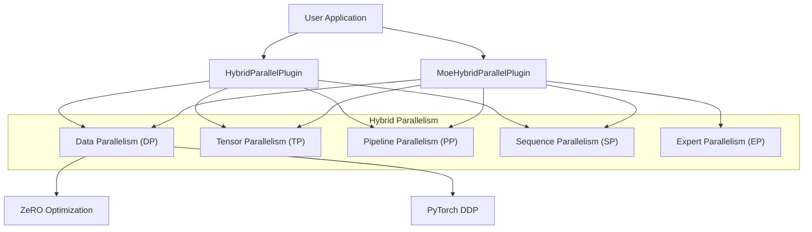
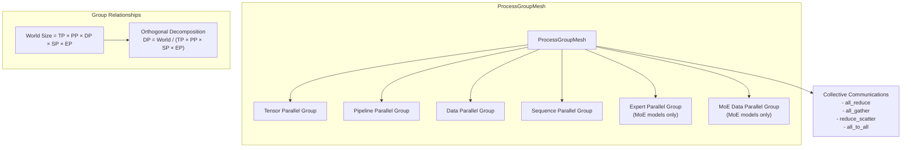
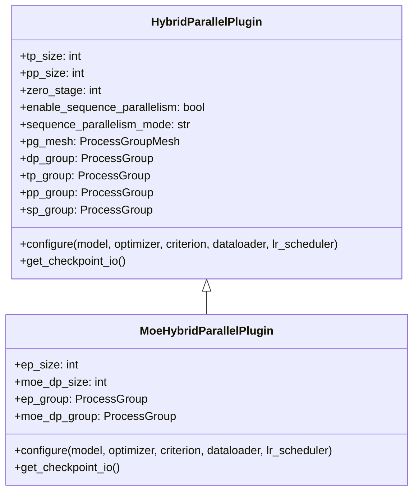
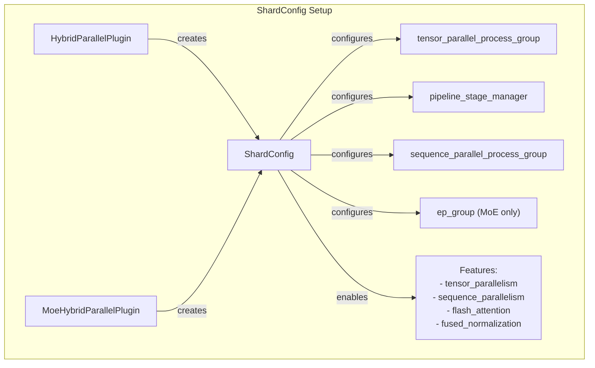
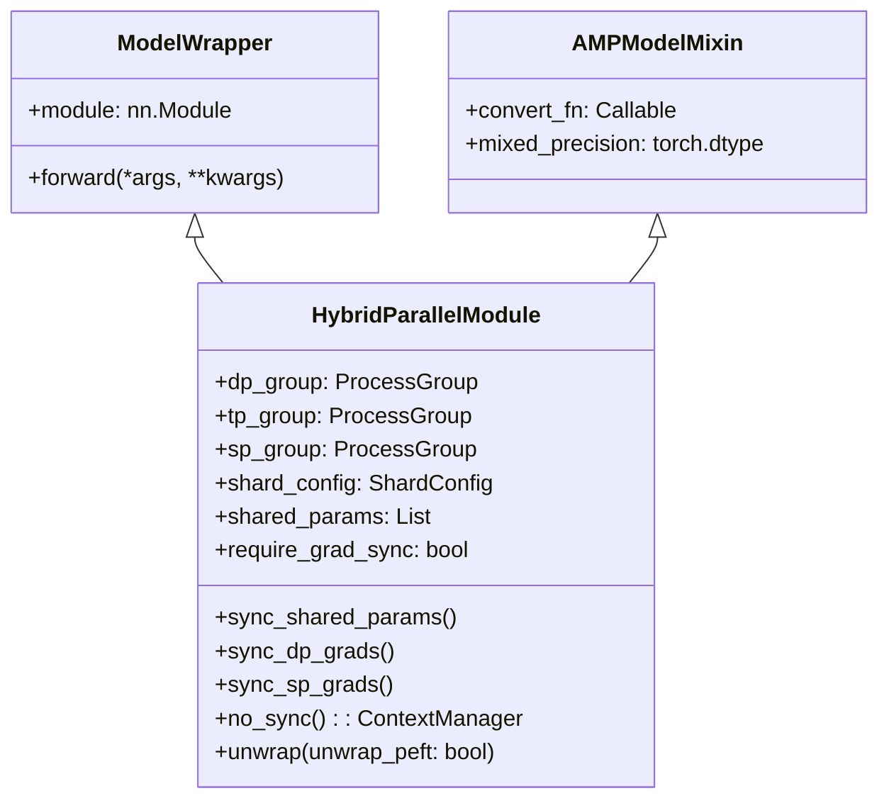
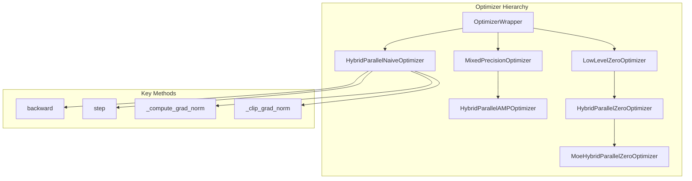
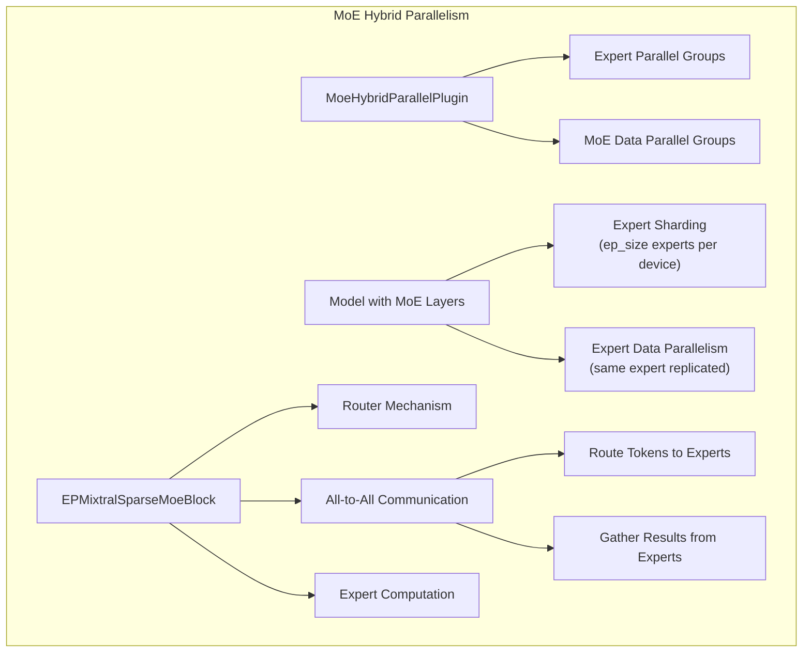
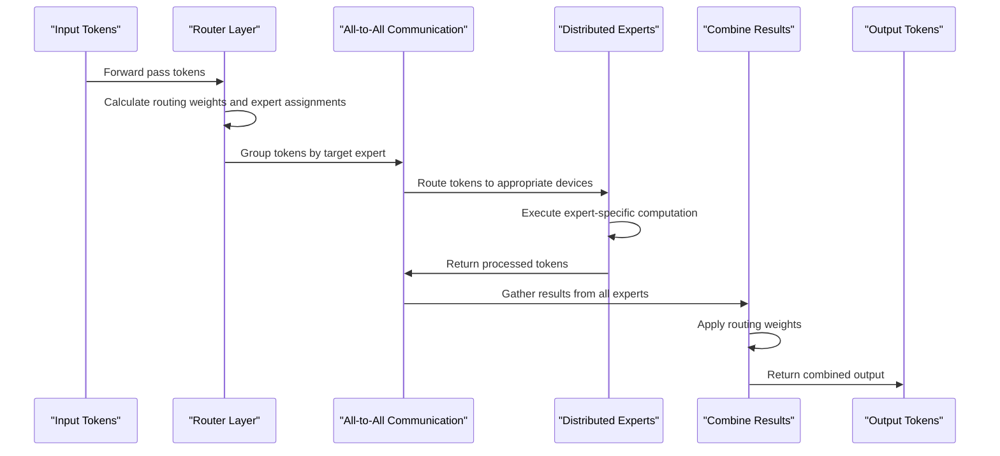
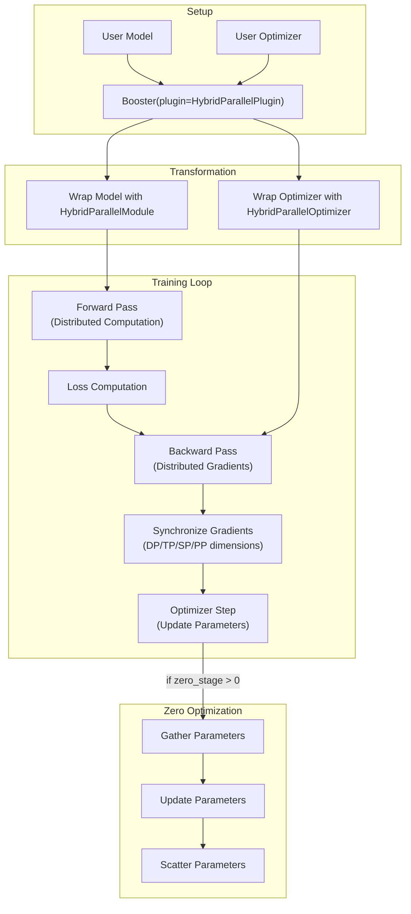
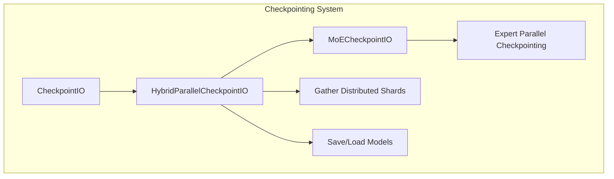

<!-- source: DeepWiki mcp.deepwiki.com · repo hpcaitech/ColossalAI · page 3.7 Hybrid Parallelism · fetched 2026-10-21 -->

# Hybrid Parallelism

<details>
<summary>Relevant source files</summary>

The following files were used as context for generating this wiki page:

- [README.md](README.md)
- [applications/ColossalChat/.gitignore](applications/ColossalChat/.gitignore)
- [applications/README.md](applications/README.md)
- [colossalai/booster/booster.py](colossalai/booster/booster.py)
- [colossalai/booster/plugin/gemini_plugin.py](colossalai/booster/plugin/gemini_plugin.py)
- [colossalai/booster/plugin/hybrid_parallel_plugin.py](colossalai/booster/plugin/hybrid_parallel_plugin.py)
- [colossalai/booster/plugin/low_level_zero_plugin.py](colossalai/booster/plugin/low_level_zero_plugin.py)
- [colossalai/booster/plugin/torch_ddp_plugin.py](colossalai/booster/plugin/torch_ddp_plugin.py)
- [colossalai/booster/plugin/torch_fsdp_plugin.py](colossalai/booster/plugin/torch_fsdp_plugin.py)
- [colossalai/checkpoint_io/__init__.py](colossalai/checkpoint_io/__init__.py)
- [colossalai/checkpoint_io/checkpoint_io_base.py](colossalai/checkpoint_io/checkpoint_io_base.py)
- [colossalai/checkpoint_io/general_checkpoint_io.py](colossalai/checkpoint_io/general_checkpoint_io.py)
- [colossalai/checkpoint_io/hybrid_parallel_checkpoint_io.py](colossalai/checkpoint_io/hybrid_parallel_checkpoint_io.py)
- [colossalai/checkpoint_io/index_file.py](colossalai/checkpoint_io/index_file.py)
- [colossalai/checkpoint_io/moe_checkpoint.py](colossalai/checkpoint_io/moe_checkpoint.py)
- [colossalai/checkpoint_io/utils.py](colossalai/checkpoint_io/utils.py)
- [colossalai/nn/optimizer/README.md](colossalai/nn/optimizer/README.md)
- [colossalai/utils/safetensors.py](colossalai/utils/safetensors.py)
- [colossalai/zero/gemini/gemini_optimizer.py](colossalai/zero/gemini/gemini_optimizer.py)
- [colossalai/zero/low_level/bookkeeping/tensor_bucket.py](colossalai/zero/low_level/bookkeeping/tensor_bucket.py)
- [colossalai/zero/low_level/low_level_optim.py](colossalai/zero/low_level/low_level_optim.py)
- [docs/README-zh-Hans.md](docs/README-zh-Hans.md)
- [docs/source/en/basics/launch_colossalai.md](docs/source/en/basics/launch_colossalai.md)
- [docs/source/en/get_started/installation.md](docs/source/en/get_started/installation.md)
- [docs/source/zh-Hans/basics/launch_colossalai.md](docs/source/zh-Hans/basics/launch_colossalai.md)
- [docs/source/zh-Hans/get_started/installation.md](docs/source/zh-Hans/get_started/installation.md)
- [examples/README.md](examples/README.md)
- [examples/tutorial/.gitignore](examples/tutorial/.gitignore)
- [examples/tutorial/README.md](examples/tutorial/README.md)
- [examples/tutorial/download_cifar10.py](examples/tutorial/download_cifar10.py)
- [examples/tutorial/sequence_parallel/data/dummy_dataloader.py](examples/tutorial/sequence_parallel/data/dummy_dataloader.py)
- [tests/test_checkpoint_io/test_gemini_checkpoint_io.py](tests/test_checkpoint_io/test_gemini_checkpoint_io.py)
- [tests/test_checkpoint_io/test_general_checkpoint_io.py](tests/test_checkpoint_io/test_general_checkpoint_io.py)
- [tests/test_checkpoint_io/test_hybrid_parallel_plugin_checkpoint_io.py](tests/test_checkpoint_io/test_hybrid_parallel_plugin_checkpoint_io.py)
- [tests/test_checkpoint_io/test_low_level_zero_checkpoint_io.py](tests/test_checkpoint_io/test_low_level_zero_checkpoint_io.py)
- [tests/test_checkpoint_io/test_safetensors_async_io.py](tests/test_checkpoint_io/test_safetensors_async_io.py)
- [tests/test_checkpoint_io/test_torch_ddp_checkpoint_io.py](tests/test_checkpoint_io/test_torch_ddp_checkpoint_io.py)

</details>


Hybrid Parallelism in ColossalAI refers to the combination of multiple parallelism strategies to efficiently train large AI models across distributed hardware. This document explains how ColossalAI implements hybrid parallelism by orchestrating various parallelism techniques, enabling the training of models that would be infeasible with a single parallelism approach.

For detailed information about individual parallelism techniques, see the following pages:
- [Zero Redundancy Optimizer (ZeRO)](#3.1)
- [Tensor Parallelism](#3.3)
- [Pipeline Parallelism](#3.4)
- [Sequence Parallelism](#3.5)
- [Expert Parallelism for MoE Models](#3.6)

## Overview of Hybrid Parallelism

Hybrid parallelism is a comprehensive approach to distributed training that combines multiple parallelism strategies:

1. **Data Parallelism (DP)**: Replicates the model across devices and splits the data
2. **Tensor Parallelism (TP)**: Splits individual tensors (model parameters) across devices
3. **Pipeline Parallelism (PP)**: Divides model layers across devices and processes in a pipelined fashion
4. **Sequence Parallelism (SP)**: Partitions operations along the sequence dimension
5. **Expert Parallelism (EP)**: Distributes experts in Mixture-of-Experts (MoE) models across devices

By combining these strategies, ColossalAI provides flexible scaling options for different model architectures and hardware configurations.



Sources:
- [colossalai/booster/plugin/hybrid_parallel_plugin.py:1-488](colossalai/booster/plugin/hybrid_parallel_plugin.py)
- [colossalai/booster/plugin/moe_hybrid_parallel_plugin.py:1-526](colossalai/booster/plugin/moe_hybrid_parallel_plugin.py)

## Process Group Organization

At the core of hybrid parallelism is the concept of process groups - logical collections of processes that communicate with each other. ColossalAI uses a `ProcessGroupMesh` to create a multi-dimensional mesh of process groups for different parallelism strategies.



Sources:
- [colossalai/booster/plugin/hybrid_parallel_plugin.py:46-346](colossalai/booster/plugin/hybrid_parallel_plugin.py)
- [colossalai/booster/plugin/moe_hybrid_parallel_plugin.py:176-359](colossalai/booster/plugin/moe_hybrid_parallel_plugin.py)

## Hybrid Parallel Plugins

ColossalAI provides plugins to easily apply hybrid parallelism to models:

1. **HybridParallelPlugin**: For standard models, supporting DP, TP, PP, and SP
2. **MoeHybridParallelPlugin**: Extends HybridParallelPlugin with EP for MoE models



Sources:
- [colossalai/booster/plugin/hybrid_parallel_plugin.py:46-526](colossalai/booster/plugin/hybrid_parallel_plugin.py)
- [colossalai/booster/plugin/moe_hybrid_parallel_plugin.py:107-425](colossalai/booster/plugin/moe_hybrid_parallel_plugin.py)

### HybridParallelPlugin Configuration

When initializing `HybridParallelPlugin`, several key parameters determine how the model is distributed:

```python
plugin = HybridParallelPlugin(
    tp_size=2,               # Tensor parallelism size
    pp_size=2,               # Pipeline parallelism size
    zero_stage=1,            # ZeRO optimization stage (0, 1, or 2)
    precision="fp16",        # Precision for mixed precision training
    enable_sequence_parallelism=True,  # Enable sequence parallelism
    sequence_parallelism_mode="split_gather",  # Mode for sequence parallelism
)
```

For MoE models, the `MoeHybridParallelPlugin` extends this with expert parallelism configuration:

```python
plugin = MoeHybridParallelPlugin(
    tp_size=2,               # Tensor parallelism size
    pp_size=2,               # Pipeline parallelism size
    ep_size=2,               # Expert parallelism size
    zero_stage=1,            # ZeRO optimization stage (0, 1, or 2)
)
```

Sources:
- [colossalai/booster/plugin/hybrid_parallel_plugin.py:46-150](colossalai/booster/plugin/hybrid_parallel_plugin.py)
- [colossalai/booster/plugin/moe_hybrid_parallel_plugin.py:176-225](colossalai/booster/plugin/moe_hybrid_parallel_plugin.py)

## ShardConfig Integration

The hybrid parallel plugins integrate with ShardFormer through `ShardConfig`, which is used to:
- Define parallel process groups
- Enable specific parallelism techniques
- Configure optimization methods



Sources:
- [colossalai/shardformer/shard/shard_config.py:1-131](colossalai/shardformer/shard/shard_config.py)
- [colossalai/booster/plugin/hybrid_parallel_plugin.py:269-346](colossalai/booster/plugin/hybrid_parallel_plugin.py)
- [colossalai/booster/plugin/moe_hybrid_parallel_plugin.py:362-407](colossalai/booster/plugin/moe_hybrid_parallel_plugin.py)

## HybridParallelModule

When a model is applied with hybrid parallelism, it is wrapped in `HybridParallelModule`, which manages:
- Communication between different parallel groups
- Precision conversion for mixed precision training
- Synchronization of gradients across different dimensions



Sources:
- [colossalai/booster/plugin/hybrid_parallel_plugin.py:59-237](colossalai/booster/plugin/hybrid_parallel_plugin.py)

## Optimizer Wrappers for Hybrid Parallelism

ColossalAI provides several optimizer wrappers for hybrid parallel training, each suited for different scenarios:

### HybridParallelNaiveOptimizer

Basic optimizer for standard precision training that handles:
- Gradient synchronization across DP, TP, and PP dimensions
- Gradient clipping across distributed model parameters
- Gradient synchronization for shared parameters in pipeline parallelism

### HybridParallelAMPOptimizer

Extends the naive optimizer for mixed precision training with:
- Automatic loss scaling for numerical stability
- Integration with PyTorch AMP

### HybridParallelZeroOptimizer

Implements ZeRO optimizer with:
- Parameter, gradient, and optimizer state partitioning (depending on ZeRO stage)
- Memory management for large models
- Communication overlap for performance

### MoeHybridParallelZeroOptimizer

Extends ZeRO optimizer for MoE models with:
- Expert-specific gradient reduction
- Handling of expert parallel parameter groups



Sources:
- [colossalai/booster/plugin/hybrid_parallel_plugin.py:278-665](colossalai/booster/plugin/hybrid_parallel_plugin.py)
- [colossalai/booster/plugin/moe_hybrid_parallel_plugin.py:39-105](colossalai/booster/plugin/moe_hybrid_parallel_plugin.py)

## Expert Parallelism for MoE Models

For Mixture-of-Experts (MoE) models, ColossalAI provides specialized support through:

1. **MoeHybridParallelPlugin**: Extends hybrid parallelism with expert parallelism
2. **EPMixtralSparseMoeBlock**: Implementation for Mixtral MoE models



Sources:
- [colossalai/booster/plugin/moe_hybrid_parallel_plugin.py:1-526](colossalai/booster/plugin/moe_hybrid_parallel_plugin.py)
- [colossalai/shardformer/modeling/mixtral.py:53-207](colossalai/shardformer/modeling/mixtral.py)

### Expert Parallelism Communication Pattern

Expert parallelism introduces a unique communication pattern, where tokens must be routed to their assigned experts across devices:



Sources:
- [colossalai/shardformer/modeling/mixtral.py:122-207](colossalai/shardformer/modeling/mixtral.py)
- [colossalai/moe/_operation.py:1-365](colossalai/moe/_operation.py)

## Training Workflow with Hybrid Parallelism

The following diagram illustrates the training workflow using hybrid parallelism:



Sources:
- [colossalai/booster/plugin/hybrid_parallel_plugin.py:349-488](colossalai/booster/plugin/hybrid_parallel_plugin.py)
- [colossalai/booster/plugin/moe_hybrid_parallel_plugin.py:412-525](colossalai/booster/plugin/moe_hybrid_parallel_plugin.py)

## Implementation Examples

### Basic Usage

Here's how to set up hybrid parallelism for a standard model:

```python
from colossalai.booster import Booster
from colossalai.booster.plugin import HybridParallelPlugin

# Configure the plugin with desired parallelism dimensions
plugin = HybridParallelPlugin(
    tp_size=2,               # Use tensor parallelism across 2 devices
    pp_size=2,               # Split model across 2 pipeline stages
    zero_stage=1,            # Use ZeRO stage 1 optimization
    precision="fp16",        # Use mixed precision training
)

# Create the booster with the plugin
booster = Booster(plugin=plugin)

# Boost the model, optimizer, and dataloader
model, optimizer, criterion, dataloader, lr_scheduler = booster.boost(
    model, optimizer, criterion, dataloader, lr_scheduler
)

# Now train with hybrid parallelism
for batch in dataloader:
    outputs = model(batch)
    loss = criterion(outputs, batch)
    optimizer.backward(loss)
    optimizer.step()
```

### MoE Model Example

For MoE models like Mixtral, use the MoE-specific plugin:

```python
from colossalai.booster import Booster
from colossalai.booster.plugin.moe_hybrid_parallel_plugin import MoeHybridParallelPlugin

# Configure with expert parallelism
plugin = MoeHybridParallelPlugin(
    tp_size=2,               # Tensor parallelism size
    pp_size=2,               # Pipeline parallelism size
    ep_size=2,               # Expert parallelism size
    zero_stage=1,            # ZeRO optimization level
    precision="bf16",        # BFloat16 precision
)

booster = Booster(plugin=plugin)

# Boost the MoE model and train as usual
model, optimizer, criterion, dataloader, lr_scheduler = booster.boost(
    model, optimizer, criterion, dataloader, lr_scheduler
)
```

Sources:
- [tests/test_shardformer/test_model/test_shard_mixtral.py:29-158](tests/test_shardformer/test_model/test_shard_mixtral.py)
- [tests/test_shardformer/test_model/test_shard_deepseek.py:28-163](tests/test_shardformer/test_model/test_shard_deepseek.py)

## Supported Models and Integration

Hybrid parallelism in ColossalAI supports a wide range of models through ShardFormer integration:

| Model           | DP | TP | PP | SP | EP (MoE only) |
|-----------------|:--:|:--:|:--:|:--:|:-------------:|
| BERT/RoBERTa    | ✓  | ✓  | ✓  | ✓  | -             |
| GPT-2/3         | ✓  | ✓  | ✓  | ✓  | -             |
| LLaMA           | ✓  | ✓  | ✓  | ○  | -             |
| Mixtral         | ✓  | ✓  | ✓  | ✓  | ✓             |
| DeepSeek MoE    | ✓  | ✓  | ✓  | ✓  | ✓             |
| BLOOM           | ✓  | ✓  | ✓  | ✓  | -             |
| T5              | ✓  | ✓  | ✓  | ○  | -             |

✓ - Full support, ○ - Partial support

Sources:
- [colossalai/shardformer/README.md:95-141](colossalai/shardformer/README.md)
- [colossalai/shardformer/policies/bert.py:34-622](colossalai/shardformer/policies/bert.py)
- [colossalai/shardformer/policies/mixtral.py:32-358](colossalai/shardformer/policies/mixtral.py)
- [colossalai/shardformer/policies/deepseek.py:22-634](colossalai/shardformer/policies/deepseek.py)

## Checkpointing with Hybrid Parallelism

ColossalAI provides specialized checkpoint I/O for hybrid parallel models:

- **HybridParallelCheckpointIO**: Base class for distributed checkpoint handling
- **MoECheckpointIO**: Extended support for MoE models with expert parallelism

These handle saving and loading distributed models across various parallelism dimensions, ensuring parameters are properly gathered and redistributed.



Sources:
- [colossalai/booster/plugin/moe_hybrid_parallel_plugin.py:412-420](colossalai/booster/plugin/moe_hybrid_parallel_plugin.py)
- [tests/test_moe/test_moe_checkpoint.py:26-160](tests/test_moe/test_moe_checkpoint.py)

## Conclusion

Hybrid Parallelism in ColossalAI provides a comprehensive approach to distributed training by combining multiple parallelism strategies. By strategically applying different techniques to different parts of the model and training process, hybrid parallelism enables efficient scaling to very large models and datasets.

The system is designed to be modular and extensible, allowing users to choose the combination of parallelism strategies that best suits their model architecture and hardware configuration. The integration with ShardFormer simplifies applying these techniques to popular model architectures without requiring extensive code modifications.

---

