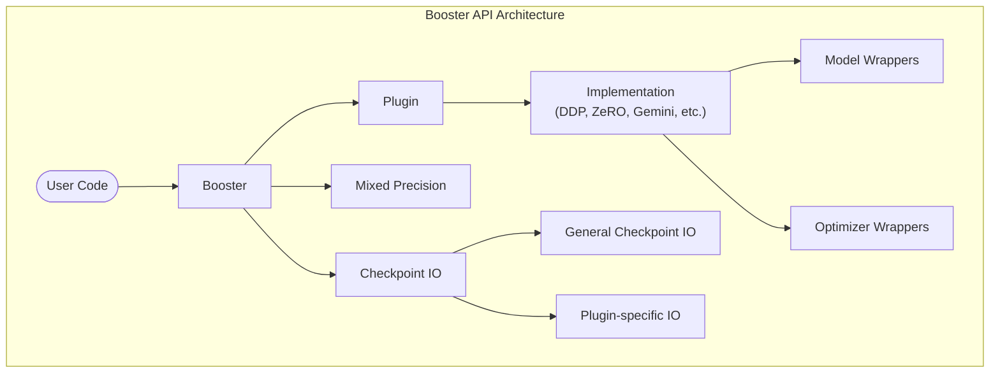
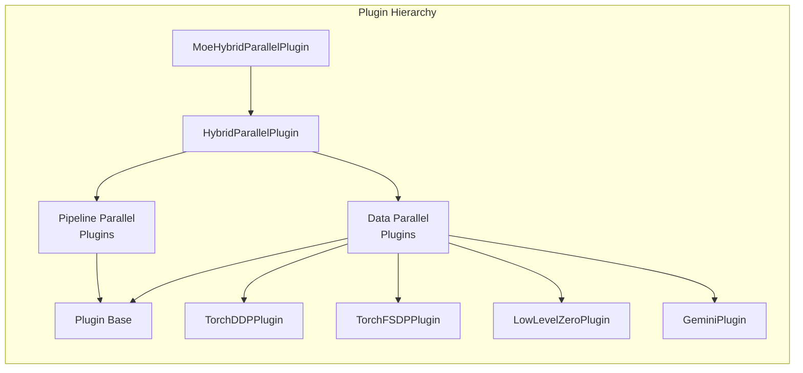
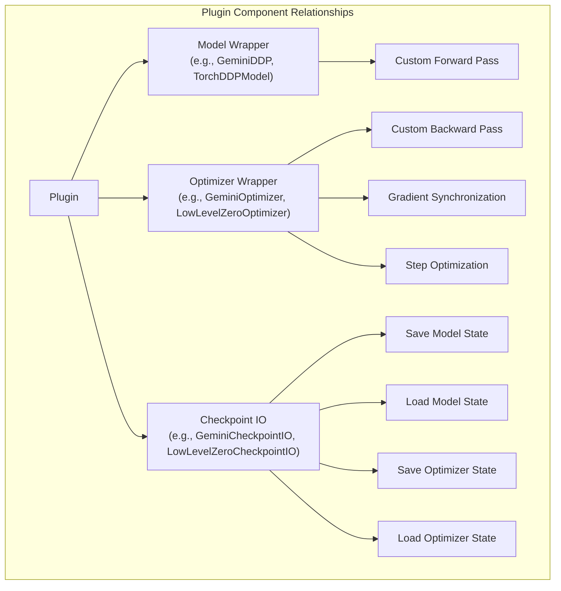

<!-- source: DeepWiki mcp.deepwiki.com · repo hpcaitech/ColossalAI · page 4 Booster API · fetched 2026-10-21 -->

# Booster API

<details>
<summary>Relevant source files</summary>

The following files were used as context for generating this wiki page:

- [README.md](README.md)
- [applications/ColossalChat/.gitignore](applications/ColossalChat/.gitignore)
- [applications/README.md](applications/README.md)
- [colossalai/booster/booster.py](colossalai/booster/booster.py)
- [colossalai/booster/plugin/gemini_plugin.py](colossalai/booster/plugin/gemini_plugin.py)
- [colossalai/booster/plugin/hybrid_parallel_plugin.py](colossalai/booster/plugin/hybrid_parallel_plugin.py)
- [colossalai/booster/plugin/low_level_zero_plugin.py](colossalai/booster/plugin/low_level_zero_plugin.py)
- [colossalai/booster/plugin/torch_ddp_plugin.py](colossalai/booster/plugin/torch_ddp_plugin.py)
- [colossalai/booster/plugin/torch_fsdp_plugin.py](colossalai/booster/plugin/torch_fsdp_plugin.py)
- [colossalai/checkpoint_io/__init__.py](colossalai/checkpoint_io/__init__.py)
- [colossalai/checkpoint_io/checkpoint_io_base.py](colossalai/checkpoint_io/checkpoint_io_base.py)
- [colossalai/checkpoint_io/general_checkpoint_io.py](colossalai/checkpoint_io/general_checkpoint_io.py)
- [colossalai/checkpoint_io/hybrid_parallel_checkpoint_io.py](colossalai/checkpoint_io/hybrid_parallel_checkpoint_io.py)
- [colossalai/checkpoint_io/index_file.py](colossalai/checkpoint_io/index_file.py)
- [colossalai/checkpoint_io/moe_checkpoint.py](colossalai/checkpoint_io/moe_checkpoint.py)
- [colossalai/checkpoint_io/utils.py](colossalai/checkpoint_io/utils.py)
- [colossalai/nn/optimizer/README.md](colossalai/nn/optimizer/README.md)
- [colossalai/utils/safetensors.py](colossalai/utils/safetensors.py)
- [colossalai/zero/gemini/gemini_optimizer.py](colossalai/zero/gemini/gemini_optimizer.py)
- [colossalai/zero/low_level/bookkeeping/tensor_bucket.py](colossalai/zero/low_level/bookkeeping/tensor_bucket.py)
- [colossalai/zero/low_level/low_level_optim.py](colossalai/zero/low_level/low_level_optim.py)
- [docs/README-zh-Hans.md](docs/README-zh-Hans.md)
- [docs/source/en/basics/launch_colossalai.md](docs/source/en/basics/launch_colossalai.md)
- [docs/source/en/get_started/installation.md](docs/source/en/get_started/installation.md)
- [docs/source/zh-Hans/basics/launch_colossalai.md](docs/source/zh-Hans/basics/launch_colossalai.md)
- [docs/source/zh-Hans/get_started/installation.md](docs/source/zh-Hans/get_started/installation.md)
- [examples/README.md](examples/README.md)
- [examples/tutorial/.gitignore](examples/tutorial/.gitignore)
- [examples/tutorial/README.md](examples/tutorial/README.md)
- [examples/tutorial/download_cifar10.py](examples/tutorial/download_cifar10.py)
- [examples/tutorial/sequence_parallel/data/dummy_dataloader.py](examples/tutorial/sequence_parallel/data/dummy_dataloader.py)
- [tests/test_checkpoint_io/test_gemini_checkpoint_io.py](tests/test_checkpoint_io/test_gemini_checkpoint_io.py)
- [tests/test_checkpoint_io/test_general_checkpoint_io.py](tests/test_checkpoint_io/test_general_checkpoint_io.py)
- [tests/test_checkpoint_io/test_hybrid_parallel_plugin_checkpoint_io.py](tests/test_checkpoint_io/test_hybrid_parallel_plugin_checkpoint_io.py)
- [tests/test_checkpoint_io/test_low_level_zero_checkpoint_io.py](tests/test_checkpoint_io/test_low_level_zero_checkpoint_io.py)
- [tests/test_checkpoint_io/test_safetensors_async_io.py](tests/test_checkpoint_io/test_safetensors_async_io.py)
- [tests/test_checkpoint_io/test_torch_ddp_checkpoint_io.py](tests/test_checkpoint_io/test_torch_ddp_checkpoint_io.py)

</details>


The Booster API is ColossalAI's high-level interface for distributed training. It provides a unified way to configure and run large-scale deep learning models with different parallelism strategies, precision modes, and memory optimization techniques. This document explains how to use the Booster API to set up and run distributed training.

For information about specific parallelism techniques, see [Parallelism Techniques](#3), and for ShardFormer (a framework for transformer model parallelism), see [ShardFormer Framework](#5).

## Key Concepts

The Booster API is designed around a plugin-based architecture where specific distributed training strategies are encapsulated in plugins. The main components are:

- **Booster**: The central class that coordinates model training
- **Plugins**: Implementations of different parallelism and optimization strategies
- **CheckpointIO**: Handles saving and loading distributed model states



Sources: [colossalai/booster/booster.py:32-132](https://github.com/hpcaitech/ColossalAI/blob/main/colossalai/booster/booster.py)

## Initialization

### Creating a Booster

To use the Booster API, first initialize ColossalAI, select a plugin, and create a Booster instance:

```python
import colossalai
from colossalai.booster import Booster
from colossalai.booster.plugin import LowLevelZeroPlugin

# Initialize distributed environment
colossalai.launch(...)

# Create a plugin for ZeRO optimization
plugin = LowLevelZeroPlugin(stage=1, precision="fp16")

# Create a booster with the plugin
booster = Booster(plugin=plugin)
```

The Booster constructor accepts the following parameters:

- `device` (optional): Target device for training (e.g., "cuda"). If not specified when using a plugin that doesn't control device placement, defaults to "cuda".
- `mixed_precision` (optional): Mixed precision strategy. Can be a string ("fp16", "fp16_apex", "bf16", "fp8") or a MixedPrecision object.
- `plugin` (optional): The parallelism and optimization plugin to use.

Sources: [colossalai/booster/booster.py:72-124](https://github.com/hpcaitech/ColossalAI/blob/main/colossalai/booster/booster.py)

### Boosting Your Training Components

After creating the Booster, use it to transform your model, optimizer, criterion, dataloader, and learning rate scheduler:

```python
# Prepare your components
model = YourModel()
optimizer = torch.optim.Adam(model.parameters(), lr=1e-4)
criterion = torch.nn.CrossEntropyLoss()
dataloader = plugin.prepare_dataloader(your_dataset, batch_size=32)
lr_scheduler = torch.optim.lr_scheduler.StepLR(optimizer, step_size=1)

# Boost the components
model, optimizer, criterion, dataloader, lr_scheduler = booster.boost(
    model, optimizer, criterion, dataloader, lr_scheduler
)
```

The `boost()` method wraps and transforms the training components according to the plugin's strategy. This includes:

- Distributing model parameters across devices
- Wrapping optimizers for gradient synchronization and sharding
- Preparing dataloaders for distributed training

Sources: [colossalai/booster/booster.py:126-172](https://github.com/hpcaitech/ColossalAI/blob/main/colossalai/booster/booster.py)

## Training Loop

### Basic Training Loop

Once your components are boosted, you can run the training loop:

```python
for epoch in range(num_epochs):
    for input_ids, attention_mask in dataloader:
        # Forward pass
        outputs = model(input_ids, attention_mask)
        loss = criterion(outputs.logits, input_ids)
        
        # Backward pass and optimization
        booster.backward(loss, optimizer)
        optimizer.step()
        lr_scheduler.step()
        optimizer.zero_grad()
```

The `backward()` method handles the gradient computation including any optimizations provided by the plugin.

Sources: [colossalai/booster/booster.py:396-439](https://github.com/hpcaitech/ColossalAI/blob/main/colossalai/booster/booster.py)

### Pipeline Parallelism

For pipeline parallelism, you use `execute_pipeline()` instead of the standard training loop:

```python
for epoch in range(num_epochs):
    data_iter = iter(dataloader)
    output = booster.execute_pipeline(
        data_iter, 
        model, 
        criterion,
        optimizer,
        return_loss=True,
        return_outputs=False
    )
    # Access the loss if needed
    loss = output["loss"]
```

This handles the microbatch partitioning and scheduling for pipeline parallelism.

Sources: [colossalai/booster/booster.py:317-394](https://github.com/hpcaitech/ColossalAI/blob/main/colossalai/booster/booster.py)

### Gradient Accumulation

For gradient accumulation, use the `no_sync()` context manager to skip gradient synchronization during some iterations:

```python
accumulation_steps = 4
for epoch in range(num_epochs):
    for i, (input_ids, attention_mask) in enumerate(dataloader):
        # Use no_sync for all but the last accumulation step
        with booster.no_sync(model, optimizer) if (i + 1) % accumulation_steps != 0 else nullcontext():
            outputs = model(input_ids, attention_mask)
            loss = criterion(outputs.logits, input_ids)
            # Scale the loss to account for accumulation
            loss = loss / accumulation_steps
            booster.backward(loss, optimizer)
        
        # Only update weights after accumulation_steps
        if (i + 1) % accumulation_steps == 0:
            optimizer.step()
            optimizer.zero_grad()
```

Sources: [colossalai/booster/booster.py:441-450](https://github.com/hpcaitech/ColossalAI/blob/main/colossalai/booster/booster.py)

## Checkpoint Management

### Saving and Loading Models

Booster provides methods for saving and loading models that account for distributed model states:

```python
# Save the model (full or sharded)
booster.save_model(model, "model_checkpoint.pt")
# Save as sharded checkpoint
booster.save_model(model, "model_checkpoints/", shard=True)

# Load a model
booster.load_model(model, "model_checkpoint.pt")
# Load from sharded checkpoint
booster.load_model(model, "model_checkpoints/model.safetensors.index.json")
```

### Saving and Loading Optimizers

Similarly, optimizers can be saved and loaded:

```python
# Save the optimizer
booster.save_optimizer(optimizer, "optimizer_checkpoint.pt")
# Save as sharded checkpoint
booster.save_optimizer(optimizer, "optimizer_checkpoints/", shard=True)

# Load an optimizer
booster.load_optimizer(optimizer, "optimizer_checkpoint.pt")
# Load from sharded checkpoint
booster.load_optimizer(optimizer, "optimizer_checkpoints/optimizer.safetensors.index.json")
```

Sources: [colossalai/booster/booster.py:473-593](https://github.com/hpcaitech/ColossalAI/blob/main/colossalai/booster/booster.py)

## Available Plugins

The Booster API provides several plugins for different distributed training strategies:



Sources: [colossalai/booster/plugin/low_level_zero_plugin.py:367-632](https://github.com/hpcaitech/ColossalAI/blob/main/colossalai/booster/plugin/low_level_zero_plugin.py), [colossalai/booster/plugin/gemini_plugin.py:369-675](https://github.com/hpcaitech/ColossalAI/blob/main/colossalai/booster/plugin/gemini_plugin.py), [colossalai/booster/plugin/hybrid_parallel_plugin.py:59-843](https://github.com/hpcaitech/ColossalAI/blob/main/colossalai/booster/plugin/hybrid_parallel_plugin.py), [colossalai/booster/plugin/moe_hybrid_parallel_plugin.py:107-525](https://github.com/hpcaitech/ColossalAI/blob/main/colossalai/booster/plugin/moe_hybrid_parallel_plugin.py), [colossalai/booster/plugin/torch_ddp_plugin.py:197-327](https://github.com/hpcaitech/ColossalAI/blob/main/colossalai/booster/plugin/torch_ddp_plugin.py)

### LowLevelZeroPlugin

Implements ZeRO (Zero Redundancy Optimizer) stages 1 and 2 for memory-efficient data parallelism:

```python
plugin = LowLevelZeroPlugin(
    stage=2,                      # ZeRO stage (1 or 2)
    precision="fp16",             # Precision mode
    initial_scale=2**16,          # Initial loss scale for mixed precision
    reduce_bucket_size_in_m=12,   # Gradient bucket size in MB
    overlap_communication=True,   # Overlap communication and computation
    cpu_offload=False             # Offload optimizer states to CPU
)
```

Sources: [colossalai/booster/plugin/low_level_zero_plugin.py:368-471](https://github.com/hpcaitech/ColossalAI/blob/main/colossalai/booster/plugin/low_level_zero_plugin.py)

### GeminiPlugin

Implements the Gemini memory management system which intelligently places model parameters and optimizer states between GPU and CPU:

```python
plugin = GeminiPlugin(
    placement_policy="auto",       # "auto" or "static"
    precision="fp16",              # Precision mode
    initial_scale=2**16,           # Initial loss scale for mixed precision
    shard_param_frac=1.0,          # Parameter sharding fraction (1.0 = ZeRO-3)
    offload_optim_frac=0.5,        # Optimizer state offload fraction
    pin_memory=True                # Use pinned memory for CPU offloading
)
```

Sources: [colossalai/booster/plugin/gemini_plugin.py:370-489](https://github.com/hpcaitech/ColossalAI/blob/main/colossalai/booster/plugin/gemini_plugin.py)

### HybridParallelPlugin

Combines tensor parallelism, pipeline parallelism, and data parallelism:

```python
plugin = HybridParallelPlugin(
    tp_size=2,                     # Tensor parallelism size
    pp_size=2,                     # Pipeline parallelism size
    num_microbatches=4,            # Number of microbatches for pipeline
    precision="fp16",              # Precision mode
    zero_stage=1,                  # ZeRO stage for data parallelism
    enable_flashattention=True,    # Enable flash attention optimization
    enable_jit_fused=True,         # Enable JIT fusion optimization
)
```

Sources: [colossalai/booster/plugin/hybrid_parallel_plugin.py:61-840](https://github.com/hpcaitech/ColossalAI/blob/main/colossalai/booster/plugin/hybrid_parallel_plugin.py)

### MoeHybridParallelPlugin

Extends HybridParallelPlugin with support for Mixture of Experts models:

```python
plugin = MoeHybridParallelPlugin(
    tp_size=2,                     # Tensor parallelism size
    pp_size=2,                     # Pipeline parallelism size
    ep_size=4,                     # Expert parallelism size
    precision="fp16",              # Precision mode
    zero_stage=1,                  # ZeRO stage for data parallelism
)
```

Sources: [colossalai/booster/plugin/moe_hybrid_parallel_plugin.py:107-525](https://github.com/hpcaitech/ColossalAI/blob/main/colossalai/booster/plugin/moe_hybrid_parallel_plugin.py)

## Plugin Components

Each plugin uses various components to implement its strategy. These include:



Sources: [colossalai/booster/plugin/low_level_zero_plugin.py:67-115](https://github.com/hpcaitech/ColossalAI/blob/main/colossalai/booster/plugin/low_level_zero_plugin.py), [colossalai/checkpoint_io/general_checkpoint_io.py:37-311](https://github.com/hpcaitech/ColossalAI/blob/main/colossalai/checkpoint_io/general_checkpoint_io.py), [colossalai/checkpoint_io/hybrid_parallel_checkpoint_io.py:59-363](https://github.com/hpcaitech/ColossalAI/blob/main/colossalai/checkpoint_io/hybrid_parallel_checkpoint_io.py)

### ModelWrapper

Each plugin provides a model wrapper that adds the necessary functionality for the plugin's strategy:

- `LowLevelZeroModel`: Implements ZeRO optimizations
- `GeminiDDP`: Implements Gemini memory management
- `HybridParallelModule`: Implements hybrid parallelism
- `TorchDDPModel`: Wraps PyTorch's DistributedDataParallel

Sources: [colossalai/booster/plugin/low_level_zero_plugin.py:67-114](https://github.com/hpcaitech/ColossalAI/blob/main/colossalai/booster/plugin/low_level_zero_plugin.py), [colossalai/booster/plugin/hybrid_parallel_plugin.py:59-237](https://github.com/hpcaitech/ColossalAI/blob/main/colossalai/booster/plugin/hybrid_parallel_plugin.py), [colossalai/booster/plugin/torch_ddp_plugin.py:197-206](https://github.com/hpcaitech/ColossalAI/blob/main/colossalai/booster/plugin/torch_ddp_plugin.py)

### OptimizerWrapper

Similarly, each plugin provides an optimizer wrapper:

- `LowLevelZeroOptimizer`: Implements ZeRO optimization for optimizer states
- `GeminiOptimizer`: Implements Gemini memory management for optimizer states
- `HybridParallelNaiveOptimizer`/`HybridParallelAMPOptimizer`/`HybridParallelZeroOptimizer`: Support different optimization strategies for hybrid parallelism

Sources: [colossalai/booster/plugin/hybrid_parallel_plugin.py:278-663](https://github.com/hpcaitech/ColossalAI/blob/main/colossalai/booster/plugin/hybrid_parallel_plugin.py), [colossalai/zero/gemini/gemini_optimizer.py:46-799](https://github.com/hpcaitech/ColossalAI/blob/main/colossalai/zero/gemini/gemini_optimizer.py)

### CheckpointIO

Each plugin also provides a checkpoint IO handler:

- `LowLevelZeroCheckpointIO`: Handles checkpoints for ZeRO models
- `GeminiCheckpointIO`: Handles checkpoints for Gemini models
- `HybridParallelCheckpointIO`: Handles checkpoints for hybrid parallel models
- `MoECheckpointIO`: Handles checkpoints for Mixture of Experts models

Sources: [colossalai/checkpoint_io/general_checkpoint_io.py:37-315](https://github.com/hpcaitech/ColossalAI/blob/main/colossalai/checkpoint_io/general_checkpoint_io.py), [colossalai/checkpoint_io/hybrid_parallel_checkpoint_io.py:59-363](https://github.com/hpcaitech/ColossalAI/blob/main/colossalai/checkpoint_io/hybrid_parallel_checkpoint_io.py), [colossalai/booster/plugin/low_level_zero_plugin.py:117-367](https://github.com/hpcaitech/ColossalAI/blob/main/colossalai/booster/plugin/low_level_zero_plugin.py), [colossalai/booster/plugin/gemini_plugin.py:45-360](https://github.com/hpcaitech/ColossalAI/blob/main/colossalai/booster/plugin/gemini_plugin.py)

## Advanced Features

### Mixed Precision Training

Booster supports mixed precision training through either the plugin or the `mixed_precision` parameter:

```python
# Using plugin with built-in precision control
plugin = LowLevelZeroPlugin(precision="fp16")
booster = Booster(plugin=plugin)

# Using Booster's mixed precision parameter when plugin doesn't control precision
booster = Booster(mixed_precision="fp16")
```

Supported precision modes include:
- `"fp16"`: PyTorch AMP with float16
- `"fp16_apex"`: NVIDIA Apex with float16
- `"bf16"`: PyTorch AMP with bfloat16
- `"fp8"`: 8-bit floating point (for specific hardware)

Sources: [colossalai/booster/booster.py:95-119](https://github.com/hpcaitech/ColossalAI/blob/main/colossalai/booster/booster.py)

### LoRA Support

Booster supports Low-Rank Adaptation (LoRA) for parameter-efficient fine-tuning:

```python
from peft import LoraConfig

# Configure LoRA
lora_config = LoraConfig(
    r=8, 
    lora_alpha=32, 
    target_modules=["q_proj", "v_proj"],
    lora_dropout=0.1
)

# Enable LoRA on the model
model = plugin.enable_lora(model, lora_config=lora_config)
```

To load or save LoRA weights:

```python
# Save LoRA weights
booster.save_lora_as_pretrained(model, "lora_checkpoint/")

# Load LoRA from pretrained weights
model = plugin.enable_lora(model, pretrained_dir="lora_checkpoint/")
```

Sources: [colossalai/booster/plugin/low_level_zero_plugin.py:492-513](https://github.com/hpcaitech/ColossalAI/blob/main/colossalai/booster/plugin/low_level_zero_plugin.py), [colossalai/booster/booster.py:265-315](https://github.com/hpcaitech/ColossalAI/blob/main/colossalai/booster/booster.py)

## Example: Complete Training Script

Here's a complete example using the Booster API with ZeRO optimization:

```python
import colossalai
from colossalai.booster import Booster
from colossalai.booster.plugin import LowLevelZeroPlugin
import torch
from torch.optim import Adam
from torch.utils.data import DataLoader

# Initialize ColossalAI
colossalai.launch(config={}, rank=rank, world_size=world_size, host="localhost", port=29500)

# Create model, dataset, etc.
model = YourModel()
dataset = YourDataset()
criterion = torch.nn.CrossEntropyLoss()

# Create plugin and booster
plugin = LowLevelZeroPlugin(stage=2, precision="fp16")
booster = Booster(plugin=plugin)

# Prepare dataloader with plugin
train_dataloader = plugin.prepare_dataloader(dataset, batch_size=32, shuffle=True)

# Create optimizer
optimizer = Adam(model.parameters(), lr=1e-4)
lr_scheduler = torch.optim.lr_scheduler.CosineAnnealingLR(optimizer, T_max=10)

# Boost model, optimizer, etc.
model, optimizer, criterion, train_dataloader, lr_scheduler = booster.boost(
    model, optimizer, criterion, train_dataloader, lr_scheduler
)

# Training loop
for epoch in range(10):
    for batch in train_dataloader:
        inputs, labels = batch
        outputs = model(inputs)
        loss = criterion(outputs, labels)
        
        # Backward and optimize
        booster.backward(loss, optimizer)
        optimizer.step()
        optimizer.zero_grad()
    
    lr_scheduler.step()
    
    # Save checkpoint
    booster.save_model(model, f"checkpoint_epoch_{epoch}.pt")
    booster.save_optimizer(optimizer, f"optimizer_epoch_{epoch}.pt")
```

## Conclusion

The Booster API provides a flexible and unified interface for distributed training in ColossalAI. By using different plugins, you can easily implement various parallelism strategies and memory optimization techniques without changing your training code significantly.

For more advanced topics, refer to the specific wiki pages for each parallelism technique and the ShardFormer framework.

---

