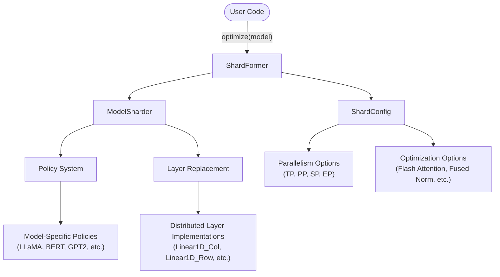
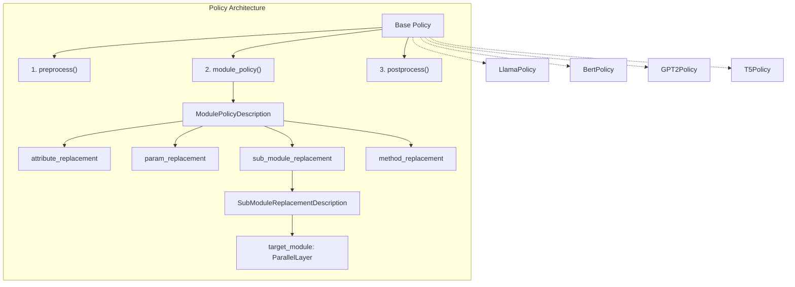
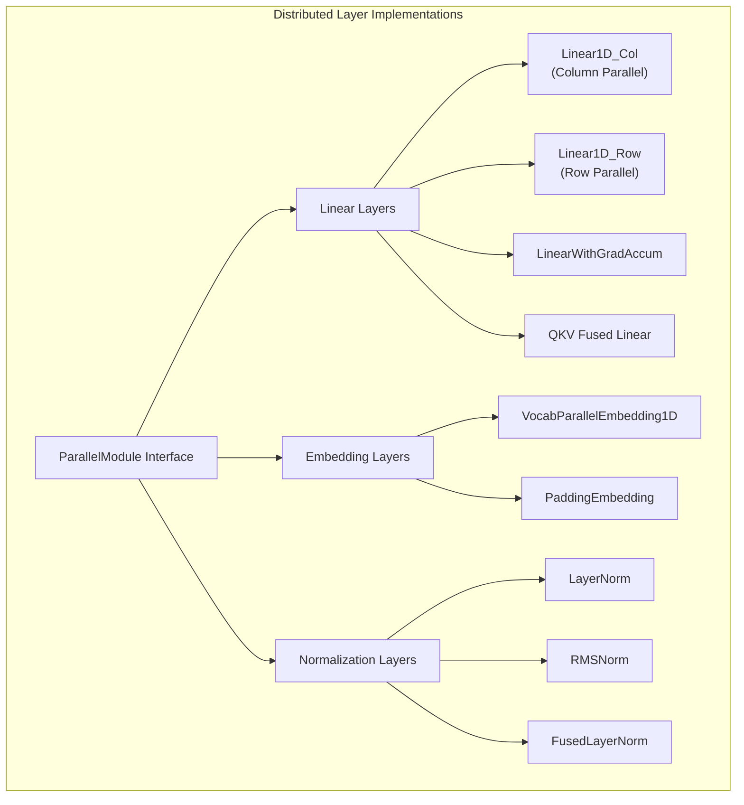
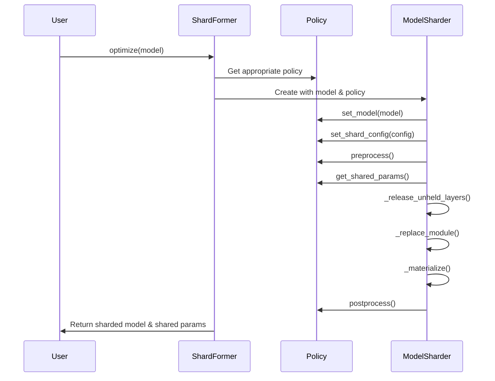
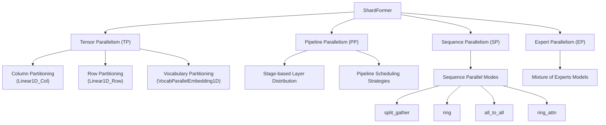

<!-- source: DeepWiki mcp.deepwiki.com · repo hpcaitech/ColossalAI · page 5 ShardFormer Framework · fetched 2026-10-21 -->

# ShardFormer Framework

<details>
<summary>Relevant source files</summary>

The following files were used as context for generating this wiki page:

- [colossalai/shardformer/README.md](colossalai/shardformer/README.md)
- [colossalai/shardformer/__init__.py](colossalai/shardformer/__init__.py)
- [colossalai/shardformer/layer/attn.py](colossalai/shardformer/layer/attn.py)
- [colossalai/shardformer/layer/utils.py](colossalai/shardformer/layer/utils.py)
- [colossalai/shardformer/modeling/bert.py](colossalai/shardformer/modeling/bert.py)
- [colossalai/shardformer/modeling/blip2.py](colossalai/shardformer/modeling/blip2.py)
- [colossalai/shardformer/modeling/bloom.py](colossalai/shardformer/modeling/bloom.py)
- [colossalai/shardformer/modeling/falcon.py](colossalai/shardformer/modeling/falcon.py)
- [colossalai/shardformer/modeling/gpt2.py](colossalai/shardformer/modeling/gpt2.py)
- [colossalai/shardformer/modeling/gptj.py](colossalai/shardformer/modeling/gptj.py)
- [colossalai/shardformer/modeling/llama.py](colossalai/shardformer/modeling/llama.py)
- [colossalai/shardformer/modeling/mistral.py](colossalai/shardformer/modeling/mistral.py)
- [colossalai/shardformer/modeling/opt.py](colossalai/shardformer/modeling/opt.py)
- [colossalai/shardformer/modeling/t5.py](colossalai/shardformer/modeling/t5.py)
- [colossalai/shardformer/modeling/vit.py](colossalai/shardformer/modeling/vit.py)
- [colossalai/shardformer/modeling/whisper.py](colossalai/shardformer/modeling/whisper.py)
- [colossalai/shardformer/policies/bert.py](colossalai/shardformer/policies/bert.py)
- [colossalai/shardformer/policies/bloom.py](colossalai/shardformer/policies/bloom.py)
- [colossalai/shardformer/policies/falcon.py](colossalai/shardformer/policies/falcon.py)
- [colossalai/shardformer/policies/gpt2.py](colossalai/shardformer/policies/gpt2.py)
- [colossalai/shardformer/policies/gptj.py](colossalai/shardformer/policies/gptj.py)
- [colossalai/shardformer/policies/llama.py](colossalai/shardformer/policies/llama.py)
- [colossalai/shardformer/policies/mistral.py](colossalai/shardformer/policies/mistral.py)
- [colossalai/shardformer/policies/opt.py](colossalai/shardformer/policies/opt.py)
- [colossalai/shardformer/policies/t5.py](colossalai/shardformer/policies/t5.py)
- [colossalai/shardformer/policies/vit.py](colossalai/shardformer/policies/vit.py)
- [colossalai/shardformer/policies/whisper.py](colossalai/shardformer/policies/whisper.py)
- [colossalai/shardformer/shard/__init__.py](colossalai/shardformer/shard/__init__.py)
- [colossalai/shardformer/shard/shard_config.py](colossalai/shardformer/shard/shard_config.py)
- [colossalai/shardformer/shard/sharder.py](colossalai/shardformer/shard/sharder.py)
- [tests/kit/model_zoo/transformers/t5.py](tests/kit/model_zoo/transformers/t5.py)
- [tests/test_shardformer/test_layer/test_ring_attn.py](tests/test_shardformer/test_layer/test_ring_attn.py)
- [tests/test_shardformer/test_model/test_shard_blip2.py](tests/test_shardformer/test_model/test_shard_blip2.py)

</details>


The ShardFormer Framework is a component of ColossalAI designed to automatically parallelize transformer models across multiple devices with minimal user effort. It provides a unified approach to model sharding using various parallelism techniques, optimized for popular models like those from the Hugging Face Transformers library.

## Overview and Architecture

ShardFormer simplifies distributed training and inference of large language models by handling the complexities of model parallelism through a cohesive architecture:



Sources:
- [colossalai/shardformer/shard/sharder.py:18-237](colossalai/shardformer/shard/sharder.py:18-237)
- [colossalai/shardformer/shard/shard_config.py:16-131](colossalai/shardformer/shard/shard_config.py:16-131)
- [colossalai/shardformer/README.md:25-40](colossalai/shardformer/README.md:25-40)

## Core Components

### ShardConfig

The `ShardConfig` class defines how a model should be sharded, specifying parallelism strategies and optimizations:

```python
@dataclass
class ShardConfig:
    tensor_parallel_process_group: Optional[ProcessGroup] = None
    sequence_parallel_process_group: Optional[ProcessGroup] = None
    pipeline_stage_manager: Optional[PipelineStageManager] = None
    enable_tensor_parallelism: bool = True
    enable_all_optimization: bool = False
    enable_fused_normalization: bool = False
    enable_flash_attention: bool = False
    enable_jit_fused: bool = False
    enable_sequence_parallelism: bool = False
    sequence_parallelism_mode: str = None
    parallel_output: bool = True
    make_vocab_size_divisible_by: int = 64
    gradient_checkpoint_config: Optional[GradientCheckpointConfig] = None
    extra_kwargs: Dict[str, Any] = field(default_factory=dict)
    # Additional configuration for specialized parallelism
```

Sources:
- [colossalai/shardformer/shard/shard_config.py:10-131](colossalai/shardformer/shard/shard_config.py:10-131)
- [colossalai/shardformer/README.md:64-86](colossalai/shardformer/README.md:64-86)

### Policy System

Policies define how specific model architectures should be sharded:



Sources:
- [colossalai/shardformer/policies/base_policy.py](colossalai/shardformer/policies/base_policy.py)
- [colossalai/shardformer/policies/llama.py:26-112](colossalai/shardformer/policies/llama.py:26-112)
- [colossalai/shardformer/policies/bert.py:35-136](colossalai/shardformer/policies/bert.py:35-136)
- [colossalai/shardformer/README.md:195-247](colossalai/shardformer/README.md:195-247)

### Parallel Layer Implementations

ShardFormer provides specialized implementations of neural network layers that support distributed computation:



Sources:
- [colossalai/shardformer/layer/linear.py:35-178](colossalai/shardformer/layer/linear.py:35-178)
- [colossalai/shardformer/layer/linear.py:180-624](colossalai/shardformer/layer/linear.py:180-624)
- [colossalai/shardformer/layer/qkv_fused_linear.py:41-87](colossalai/shardformer/layer/qkv_fused_linear.py:41-87)
- [colossalai/shardformer/README.md:154-171](colossalai/shardformer/README.md:154-171)

### Model Sharder

The `ModelSharder` applies policies to transform original models into their sharded versions:



Sources:
- [colossalai/shardformer/shard/sharder.py:18-236](colossalai/shardformer/shard/sharder.py:18-236)
- [colossalai/shardformer/README.md:296-315](colossalai/shardformer/README.md:296-315)

## Parallelism Techniques

ShardFormer supports multiple parallelism strategies that can be combined for efficient distributed training:



Sources:
- [colossalai/shardformer/shard/shard_config.py:13-14](colossalai/shardformer/shard/shard_config.py:13-14)
- [colossalai/shardformer/layer/linear.py:180-624](colossalai/shardformer/layer/linear.py:180-624)
- [colossalai/shardformer/README.md:108-141](colossalai/shardformer/README.md:108-141)

### Tensor Parallelism (TP)

Splits model parameters across devices, with different devices handling different parts of the same tensor operation. This is implemented through specialized layer replacements like `Linear1D_Col` and `Linear1D_Row`.

### Pipeline Parallelism (PP)

Divides model layers across devices, with activations passed between devices in sequence. This reduces memory requirements per device at the cost of some communication overhead.

### Sequence Parallelism (SP)

Partitions the sequence dimension across devices, enabling efficient processing of long sequences. Supports multiple modes like `split_gather`, `ring`, `all_to_all`, and `ring_attn`.

### Expert Parallelism (EP)

Used for Mixture of Experts (MoE) models, distributing different experts across devices.

## Model Policies

ShardFormer provides predefined sharding policies for many popular model architectures:

| Model | Tensor Parallel | Pipeline Parallel | Flash Attention | Sequence Parallel | Other Optimizations |
|:-----:|:---------------:|:-----------------:|:---------------:|:-----------------:|:-------------------:|
| LLaMA | ✓ | ✓ | ✓ | ✓ | Fused RMSNorm, ZeRO |
| GPT-2 | ✓ | ✓ | ✓ | ✓ | QKV Fusion |
| BERT  | ✓ | ✓ | ✓ | ✓ | Fused LayerNorm |
| T5    | ✓ | ✓ | ✓ | - | - |
| Bloom | ✓ | ✓ | ✓ | ✓ | Alibi Tensor |
| OPT   | ✓ | ✓ | ✓ | - | - |
| ViT   | ✓ | ✓ | ✓ | - | - |

Sources:
- [colossalai/shardformer/policies/llama.py:26-396](colossalai/shardformer/policies/llama.py:26-396)
- [colossalai/shardformer/policies/gpt2.py:22-291](colossalai/shardformer/policies/gpt2.py:22-291)
- [colossalai/shardformer/policies/bert.py:35-386](colossalai/shardformer/policies/bert.py:35-386)
- [colossalai/shardformer/README.md:117-141](colossalai/shardformer/README.md:117-141)

## Usage Examples

Basic usage pattern for ShardFormer:

```python
from colossalai.shardformer import ShardConfig, ShardFormer
from transformers import BertForMaskedLM
import colossalai

# Launch colossalai
colossalai.launch_from_torch()

# Create model
model = BertForMaskedLM.from_pretrained('bert-base-uncased')

# Configure sharding
shard_config = ShardConfig(
    tensor_parallel_process_group=tp_group,
    pipeline_stage_manager=stage_manager,
    enable_tensor_parallelism=True,
    enable_fused_normalization=True,
    enable_flash_attention=True,
    enable_jit_fused=True,
    enable_sequence_parallelism=True
)

# Create shardformer and optimize model
shard_former = ShardFormer(shard_config=shard_config)
sharded_model, shared_params = shard_former.optimize(model).to('cuda')

# Continue using the model as normal
```

Sources:
- [colossalai/shardformer/README.md:35-61](colossalai/shardformer/README.md:35-61)

### Custom Policy Example

For custom models, you can create your own sharding policy:

```python
from colossalai.shardformer import Policy

class MyPolicy(Policy):
    def config_sanity_check(self):
        # Verify configuration compatibility
        pass
        
    def preprocess(self):
        # Preprocessing steps
        return self.model
    
    def module_policy(self):
        # Define how to shard each module
        policy = {}
        # Add module policies
        return policy
    
    def postprocess(self):
        # Postprocessing steps
        return self.model

# Use custom policy
my_policy = MyPolicy()
shard_former.optimize(model, my_policy)
```

Sources:
- [colossalai/shardformer/README.md:86-106](colossalai/shardformer/README.md:86-106)
- [colossalai/shardformer/README.md:222-289](colossalai/shardformer/README.md:222-289)

## Performance Benchmarks

ShardFormer can significantly improve training efficiency for large models with long sequences:

| Sequence Length | Original Model | Sharded Model (2 GPUs) |
|:---------------:|:--------------:|:----------------------:|
| 256             | 11.2ms         | 17.2ms                 |
| 512             | 9.8ms          | 19.5ms                 |
| 1024            | 19.6ms         | 18.9ms                 |
| 2048            | 46.6ms         | 30.8ms                 |
| 4096            | 160.5ms        | 90.4ms                 |

For longer sequences (≥1024 tokens), ShardFormer provides substantial performance benefits, with the advantage becoming more pronounced as sequence length increases.

Sources:
- [colossalai/shardformer/README.md:459-477](colossalai/shardformer/README.md:459-477)

## Development and Extension

To add support for a new model architecture:

1. Create a policy file in `colossalai/shardformer/policies/`
2. Implement the required policy methods: `preprocess()`, `module_policy()`, and `postprocess()`
3. Register the policy in `colossalai/shardformer/policies/autopolicy.py`
4. Implement custom layer operations if needed in `colossalai/shardformer/layer/`
5. Add unit tests in `tests/test_shardformer/test_model/`

Sources:
- [colossalai/shardformer/README.md:359-428](colossalai/shardformer/README.md:359-428)
- [tests/test_shardformer/test_model/_utils.py:30-61](tests/test_shardformer/test_model/_utils.py:30-61)

## Conclusion

ShardFormer provides a comprehensive solution for distributed training of large transformer models with minimal code changes. By seamlessly integrating various parallelism techniques and optimizations, it enables efficient scaling of model training across multiple devices, making it possible to train larger models with longer context windows than would otherwise be possible on a single device.

---

