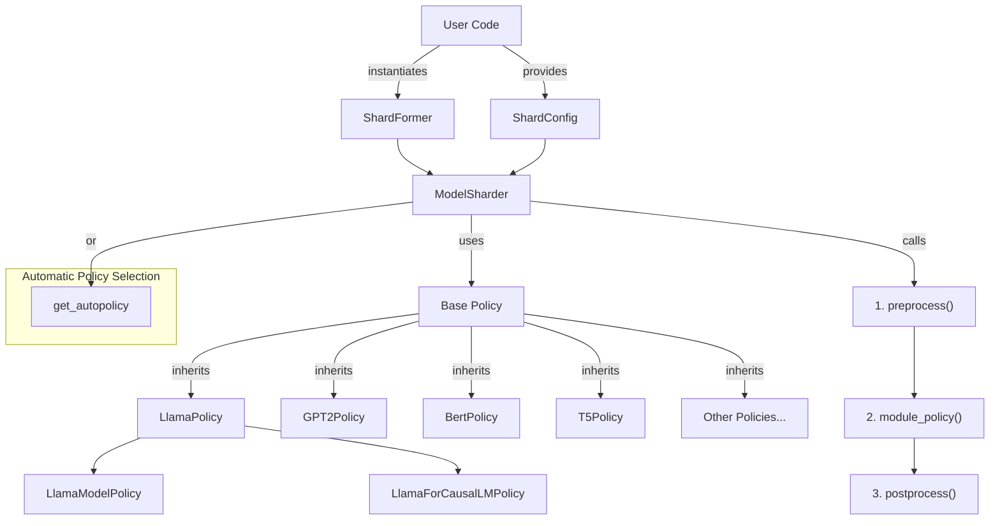
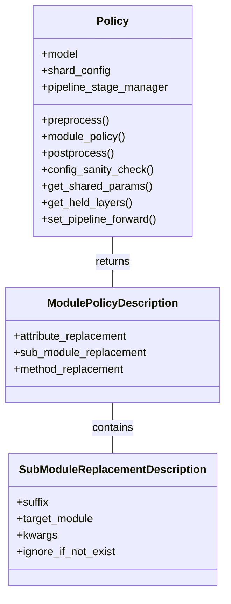
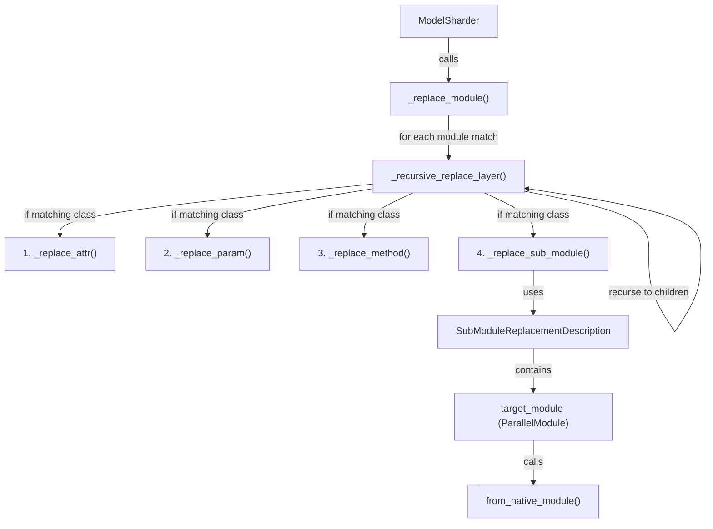
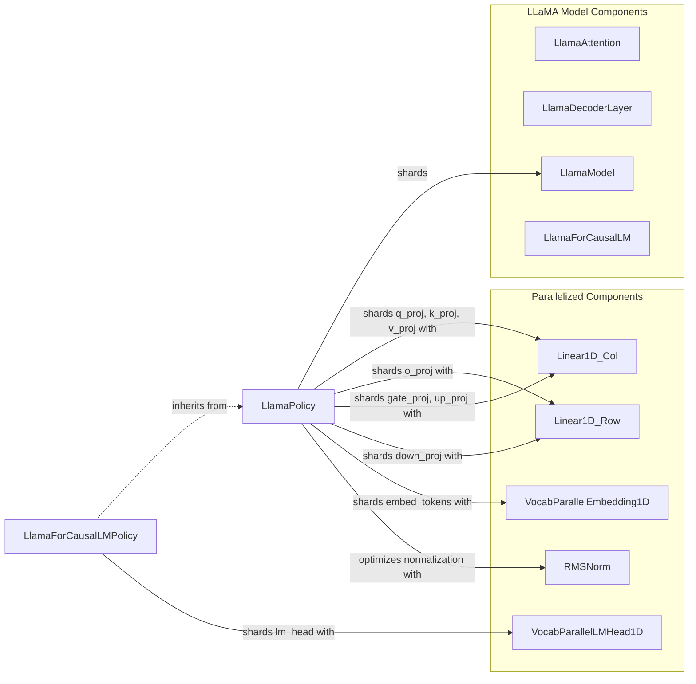

<!-- source: DeepWiki mcp.deepwiki.com · repo hpcaitech/ColossalAI · page 5.1 Policies for LLM Architectures · fetched 2026-10-21 -->

# Policies for LLM Architectures

<details>
<summary>Relevant source files</summary>

The following files were used as context for generating this wiki page:

- [.github/workflows/release_test_pypi_before_merge.yml](.github/workflows/release_test_pypi_before_merge.yml)
- [colossalai/__init__.py](colossalai/__init__.py)
- [colossalai/shardformer/README.md](colossalai/shardformer/README.md)
- [colossalai/shardformer/__init__.py](colossalai/shardformer/__init__.py)
- [colossalai/shardformer/layer/loss.py](colossalai/shardformer/layer/loss.py)
- [colossalai/shardformer/modeling/deepseek_v3.py](colossalai/shardformer/modeling/deepseek_v3.py)
- [colossalai/shardformer/modeling/qwen2.py](colossalai/shardformer/modeling/qwen2.py)
- [colossalai/shardformer/policies/auto_policy.py](colossalai/shardformer/policies/auto_policy.py)
- [colossalai/shardformer/policies/bert.py](colossalai/shardformer/policies/bert.py)
- [colossalai/shardformer/policies/bloom.py](colossalai/shardformer/policies/bloom.py)
- [colossalai/shardformer/policies/deepseek_v3.py](colossalai/shardformer/policies/deepseek_v3.py)
- [colossalai/shardformer/policies/falcon.py](colossalai/shardformer/policies/falcon.py)
- [colossalai/shardformer/policies/gpt2.py](colossalai/shardformer/policies/gpt2.py)
- [colossalai/shardformer/policies/gptj.py](colossalai/shardformer/policies/gptj.py)
- [colossalai/shardformer/policies/llama.py](colossalai/shardformer/policies/llama.py)
- [colossalai/shardformer/policies/opt.py](colossalai/shardformer/policies/opt.py)
- [colossalai/shardformer/policies/qwen2.py](colossalai/shardformer/policies/qwen2.py)
- [colossalai/shardformer/policies/t5.py](colossalai/shardformer/policies/t5.py)
- [colossalai/shardformer/policies/vit.py](colossalai/shardformer/policies/vit.py)
- [colossalai/shardformer/policies/whisper.py](colossalai/shardformer/policies/whisper.py)
- [colossalai/shardformer/shard/__init__.py](colossalai/shardformer/shard/__init__.py)
- [colossalai/shardformer/shard/shard_config.py](colossalai/shardformer/shard/shard_config.py)
- [colossalai/shardformer/shard/sharder.py](colossalai/shardformer/shard/sharder.py)
- [examples/language/deepseek/benchmark.py](examples/language/deepseek/benchmark.py)
- [tests/kit/model_zoo/transformers/__init__.py](tests/kit/model_zoo/transformers/__init__.py)
- [tests/kit/model_zoo/transformers/deepseek_v3.py](tests/kit/model_zoo/transformers/deepseek_v3.py)
- [tests/test_shardformer/test_model/test_shard_deepseek_v3.py](tests/test_shardformer/test_model/test_shard_deepseek_v3.py)
- [tests/test_shardformer/test_model/test_shard_qwen2.py](tests/test_shardformer/test_model/test_shard_qwen2.py)
- [version.txt](version.txt)

</details>


## Introduction

Policies in ColossalAI define how specific model architectures are sharded across multiple devices for distributed training. Each policy implements architecture-specific optimizations and mappings for tensor parallelism, pipeline parallelism, and sequence parallelism. This document explains how model-specific policies are structured and implemented to optimize large language models (LLMs) like LLaMA, GPT-2, BERT, and others.

For information about the general ShardFormer framework, see [ShardFormer Framework](#5).

Sources:
- [colossalai/shardformer/README.md:25-27](colossalai/shardformer/README.md:25-27)
- [colossalai/shardformer/policies/base_policy.py](colossalai/shardformer/policies/base_policy.py)

## Policy Hierarchy and Execution Flow



The policy system follows a hierarchical structure where the base Policy class is inherited by architecture-specific implementations. The ModelSharder uses these policies to optimize models via a three-step process: preprocess, module_policy, and postprocess.

Sources:
- [colossalai/shardformer/shard/sharder.py:18-46](colossalai/shardformer/shard/sharder.py:18-46)
- [colossalai/shardformer/policies/llama.py:26-32](colossalai/shardformer/policies/llama.py:26-32)
- [colossalai/shardformer/policies/gpt2.py:22-36](colossalai/shardformer/policies/gpt2.py:22-36)

## Policy Components



Each policy has three primary methods:

1. **preprocess()**: Prepares the model for sharding by examining and possibly modifying the model structure.
2. **module_policy()**: Returns a dictionary mapping module classes to their sharding strategy.
3. **postprocess()**: Performs final modifications after sharding is applied.

The module_policy method returns a dictionary where each key is a model class (like `LlamaAttention` or `GPT2Block`), and each value is a `ModulePolicyDescription` object that specifies:

- **attribute_replacement**: Modifications to module attributes
- **sub_module_replacement**: Replacements for submodules with parallelized versions
- **method_replacement**: Replacements for methods with optimized versions

Sources:
- [colossalai/shardformer/policies/base_policy.py](colossalai/shardformer/policies/base_policy.py)
- [colossalai/shardformer/shard/sharder.py:54-237](colossalai/shardformer/shard/sharder.py:54-237)

## Module Replacement Process



Model sharding is performed recursively, replacing model components with parallelized versions:

1. For each module class in the policy, the sharder finds all matching instances in the model.
2. For each match, it applies four types of replacements:
   - Replace attributes
   - Replace parameters
   - Replace methods
   - Replace submodules with parallelized equivalents

The `from_native_module()` static method in parallel modules converts a standard PyTorch module into a parallelized version.

Sources:
- [colossalai/shardformer/shard/sharder.py:76-123](colossalai/shardformer/shard/sharder.py:76-123)
- [colossalai/shardformer/shard/sharder.py:161-207](colossalai/shardformer/shard/sharder.py:161-207)

## Architecture-Specific Parallelization

Architecture-specific policies implement custom optimizations for different model architectures. Here's an example comparing sharding strategies for different architectures:

| Architecture | Tensor Parallel Layers | Special Handling | Supported Attention Mechanisms |
|--------------|------------------------|------------------|--------------------------------|
| LLaMA        | Linear1D_Col, Linear1D_Row | RMSNorm, FlashAttention | eager, flash_attention_2, sdpa |
| GPT-2        | GPT2FusedLinearConv1D_Col, GPT2FusedLinearConv1D_Row | Fused QKV attention | eager, flash_attention |
| BERT         | Linear1D_Col, Linear1D_Row | LayerNorm, Dropout | eager |
| T5           | Linear1D_Col, Linear1D_Row | RMSNorm, embeddings | eager, flash_attention |
| OPT          | Linear1D_Col, Linear1D_Row | LayerNorm | eager, flash_attention_2 |

The appropriate policy is either explicitly provided by the user or automatically selected based on the model architecture.

Sources:
- [colossalai/shardformer/policies/llama.py:50-55](colossalai/shardformer/policies/llama.py:50-55)
- [colossalai/shardformer/policies/gpt2.py:38-68](colossalai/shardformer/policies/gpt2.py:38-68)
- [colossalai/shardformer/policies/bert.py:44-76](colossalai/shardformer/policies/bert.py:44-76)

## Example: LLaMA Policy Implementation



The LLaMA policy illustrates typical architecture-specific optimizations:

1. **Tensor Parallelism**:
   - Shards attention key/query/value projections column-wise
   - Shards output projections row-wise
   - Partitions embedding tables

2. **Flash Attention Integration**:
   - Replaces native attention with optimized implementation

3. **Pipeline Parallelism**:
   - Handles layer distribution across stages
   - Manages embedding and output layers

4. **Sequence Parallelism**:
   - Supports various modes (split_gather, ring, ring_attn)

Sources:
- [colossalai/shardformer/policies/llama.py:35-310](colossalai/shardformer/policies/llama.py:35-310)
- [colossalai/shardformer/layer/linear.py:180-620](colossalai/shardformer/layer/linear.py:180-620)

## Parallel Techniques Implementation

The policies implement several parallelism techniques:

### 1. Tensor Parallelism

```python
policy[LlamaDecoderLayer] = ModulePolicyDescription(
    attribute_replacement={
        "self_attn.hidden_size": self.model.config.hidden_size // tp_size,
        "self_attn.num_heads": num_q_heads,
    },
    sub_module_replacement=[
        SubModuleReplacementDescription(
            suffix="self_attn.q_proj",
            target_module=Linear1D_Col,
            kwargs=dict(
                seq_parallel_mode=sp_mode,
                fp8_communication=self.shard_config.fp8_communication,
                use_zbv=use_zbv,
            ),
        ),
        # ... more replacements
    ],
)
```

Tensor parallelism is implemented by:
- Dividing attention heads across devices
- Replacing linear layers with sharded versions (Linear1D_Col, Linear1D_Row)
- Adjusting model attributes to reflect the parallelism

### 2. Sequence Parallelism

```python
if self.shard_config.enable_sequence_parallelism or self.shard_config.enable_flash_attention:
    self.append_or_create_method_replacement(
        description={
            "forward": get_llama_flash_attention_forward(self.shard_config, sp_mode, sp_size, sp_group),
        },
        policy=policy,
        target_key=attn_cls,
    )
```

Sequence parallelism is implemented by:
- Replacing forward methods with sequence-parallel versions
- Configuring different modes (split_gather, ring, ring_attn, all_to_all)
- Integrating with tensor parallelism

### 3. Pipeline Parallelism

```python
def get_held_layers(self) -> List[Module]:
    """Get pipeline layers for current stage."""
    assert self.pipeline_stage_manager is not None

    if self.model.__class__.__name__ == "LlamaModel":
        module = self.model
    else:
        module = self.model.model
    stage_manager = self.pipeline_stage_manager

    held_layers = []
    if stage_manager.is_first_stage(ignore_chunk=True):
        held_layers.append(module.embed_tokens)
    # ... determine layers for this stage
    return held_layers
```

Pipeline parallelism is implemented by:
- Distributing model layers across pipeline stages
- Identifying "held layers" that belong to each stage
- Customizing forward passes for pipeline execution

Sources:
- [colossalai/shardformer/policies/llama.py:109-193](colossalai/shardformer/policies/llama.py:109-193)
- [colossalai/shardformer/policies/llama.py:345-380](colossalai/shardformer/policies/llama.py:345-380)
- [colossalai/shardformer/shard/shard_config.py:16-130](colossalai/shardformer/shard/shard_config.py:16-130)

## Configuring Model Sharding Policies

Policies are configured using the `ShardConfig` class, which specifies how various parallelism techniques are applied:

```python
shard_config = ShardConfig(
    tensor_parallel_process_group=tp_group,
    pipeline_stage_manager=stage_manager,
    enable_tensor_parallelism=True,
    enable_all_optimization=False,
    enable_fused_normalization=True,
    enable_flash_attention=True,
    enable_jit_fused=True,
    enable_sequence_parallelism=True,
    sequence_parallelism_mode="split_gather",
    fp8_communication=False,
)
```

Key configuration options include:
- Parallelism groups and managers for TP, PP, SP
- Enabling specific optimization techniques
- Selecting sequence parallelism modes
- Hardware-specific optimizations (FP8, flash attention)

The policy uses this configuration to determine which optimizations to apply when sharding the model.

Sources:
- [colossalai/shardformer/shard/shard_config.py:16-130](colossalai/shardformer/shard/shard_config.py:16-130)
- [colossalai/shardformer/README.md:64-85](colossalai/shardformer/README.md:64-85)

## Conclusion

LLM architecture policies provide a flexible, extensible system for optimizing different model architectures for distributed training. By implementing architecture-specific optimizations and mapping strategies, policies allow ShardFormer to efficiently distribute model parameters and computations across hardware.

The modular design enables support for new architectures by implementing new policies following the established pattern. The combination of tensor, pipeline, and sequence parallelism techniques allows efficient scaling of large language models across distributed hardware.

Sources:
- [colossalai/shardformer/README.md:108-141](colossalai/shardformer/README.md:108-141)
- [colossalai/shardformer/README.md:361-363](colossalai/shardformer/README.md:361-363)

---

