<!-- source: DeepWiki mcp.deepwiki.com · repo hpcaitech/ColossalAI · page 5.2 Custom Attention Mechanisms · fetched 2026-10-21 -->

# Custom Attention Mechanisms

<details>
<summary>Relevant source files</summary>

The following files were used as context for generating this wiki page:

- [colossalai/shardformer/layer/attn.py](colossalai/shardformer/layer/attn.py)
- [colossalai/shardformer/layer/utils.py](colossalai/shardformer/layer/utils.py)
- [colossalai/shardformer/modeling/bert.py](colossalai/shardformer/modeling/bert.py)
- [colossalai/shardformer/modeling/blip2.py](colossalai/shardformer/modeling/blip2.py)
- [colossalai/shardformer/modeling/bloom.py](colossalai/shardformer/modeling/bloom.py)
- [colossalai/shardformer/modeling/falcon.py](colossalai/shardformer/modeling/falcon.py)
- [colossalai/shardformer/modeling/gpt2.py](colossalai/shardformer/modeling/gpt2.py)
- [colossalai/shardformer/modeling/gptj.py](colossalai/shardformer/modeling/gptj.py)
- [colossalai/shardformer/modeling/llama.py](colossalai/shardformer/modeling/llama.py)
- [colossalai/shardformer/modeling/mistral.py](colossalai/shardformer/modeling/mistral.py)
- [colossalai/shardformer/modeling/opt.py](colossalai/shardformer/modeling/opt.py)
- [colossalai/shardformer/modeling/t5.py](colossalai/shardformer/modeling/t5.py)
- [colossalai/shardformer/modeling/vit.py](colossalai/shardformer/modeling/vit.py)
- [colossalai/shardformer/modeling/whisper.py](colossalai/shardformer/modeling/whisper.py)
- [colossalai/shardformer/policies/mistral.py](colossalai/shardformer/policies/mistral.py)
- [tests/kit/model_zoo/transformers/t5.py](tests/kit/model_zoo/transformers/t5.py)
- [tests/test_shardformer/test_layer/test_ring_attn.py](tests/test_shardformer/test_layer/test_ring_attn.py)
- [tests/test_shardformer/test_model/test_shard_blip2.py](tests/test_shardformer/test_model/test_shard_blip2.py)

</details>


## Purpose and Scope

This document describes the custom attention mechanisms implemented in ColossalAI's ShardFormer framework, specifically the `ColoAttention` and `RingAttention` classes. These mechanisms provide optimized attention computation with support for various masking strategies, Flash Attention integration, and sequence parallelism for training with near-infinite context lengths.

For information about how models are transformed to use these attention mechanisms, see [Policies for LLM Architectures](#5.1). For model-specific implementations, see [Model-Specific Policies](#5.3).

Sources: [colossalai/shardformer/layer/attn.py:1-832]()

---

## Attention Mask Types

ShardFormer supports four distinct attention mask types through the `AttnMaskType` enumeration:

| Mask Type | Value | Description | Use Case |
|-----------|-------|-------------|----------|
| `CUSTOM` | 0 | User-provided custom mask | Custom attention patterns |
| `PADDED` | 1 | Padding mask without causal constraint | Packed sequences, cross-attention |
| `CAUSAL` | 2 | Causal (autoregressive) mask | Standard LLM training/inference |
| `PADDED_CAUSAL` | 3 | Combined padding and causal mask | Variable-length autoregressive sequences |

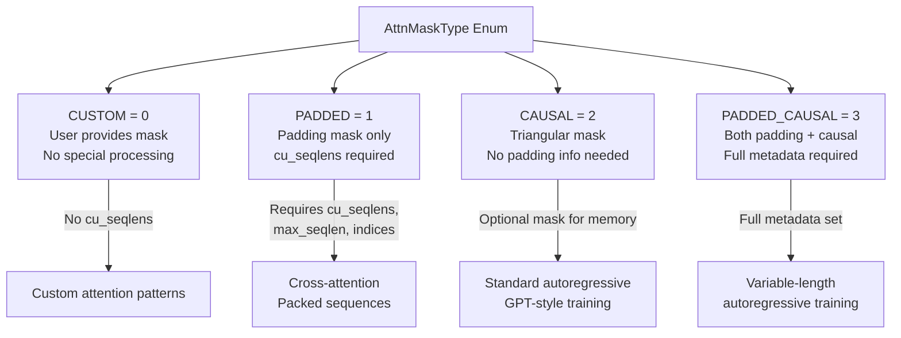

**Diagram: Attention Mask Type Taxonomy**

Sources: [colossalai/shardformer/layer/attn.py:33-37]()

---

## ColoAttention Architecture

### Overview

`ColoAttention` is the primary attention mechanism class that provides a unified interface for optimized attention computation across different data types and masking strategies. It automatically dispatches to appropriate kernels based on input characteristics.

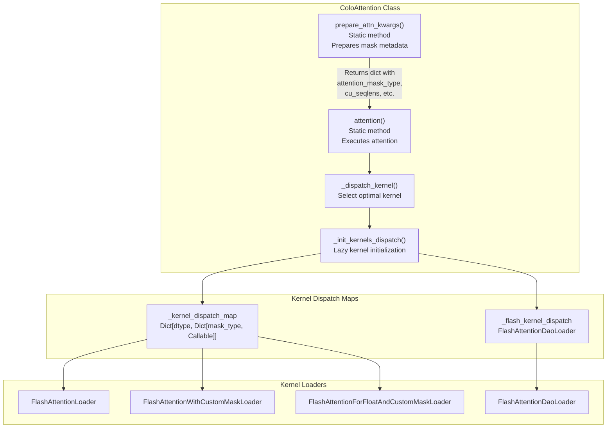

**Diagram: ColoAttention Architecture and Kernel Dispatch System**

Sources: [colossalai/shardformer/layer/attn.py:82-136]()

### Kernel Dispatch System

The kernel dispatch system selects the optimal attention implementation based on:

1. **Data type** (`torch.float16`, `torch.bfloat16`, `torch.float32`)
2. **Mask type** (`None`, `CUSTOM`, `PADDED`, `CAUSAL`, `PADDED_CAUSAL`)
3. **Memory size** (switches to Dao implementation for large sequences)

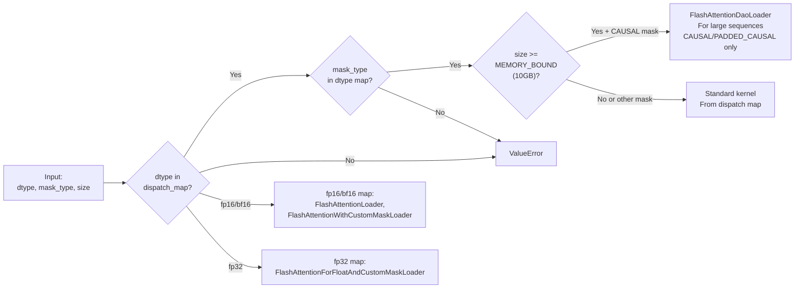

**Diagram: Kernel Selection Decision Tree**

Sources: [colossalai/shardformer/layer/attn.py:87-136]()

### prepare_attn_kwargs Method

This static method prepares attention keyword arguments based on mask type and input characteristics. It handles four distinct scenarios:

| Input Condition | Output `attention_mask_type` | Additional Outputs |
|----------------|------------------------------|-------------------|
| No mask, not causal | None (returns empty dict) | - |
| No padding mask, `is_causal=True` | `CAUSAL` | `attention_mask` (triangular or empty) |
| Has padding mask, not causal | `PADDED` | `cu_seqlens_q`, `cu_seqlens_kv`, `max_seqlen_q`, `max_seqlen_kv`, `q_indices`, `kv_indices` |
| Has padding mask, `is_causal=True` | `PADDED_CAUSAL` | Same as PADDED + causal logic |

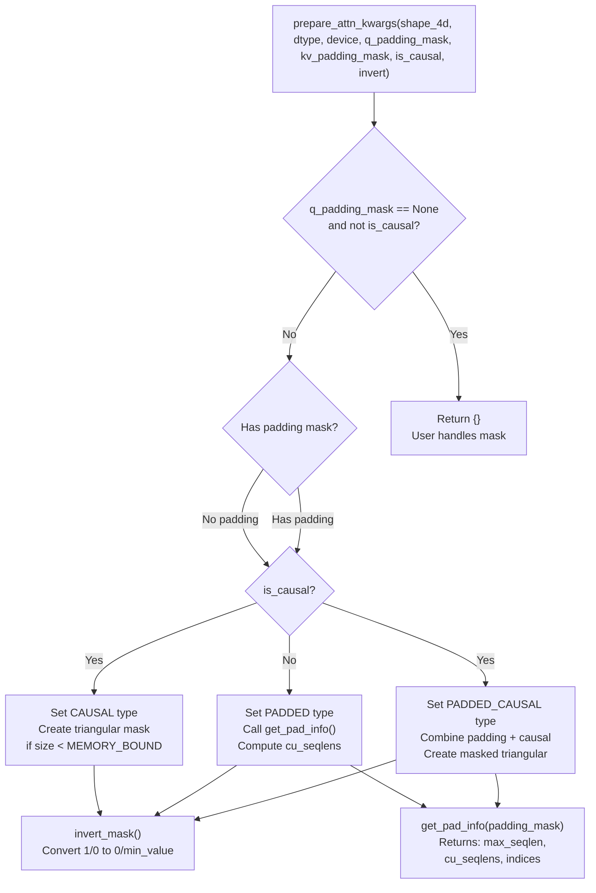

**Diagram: prepare_attn_kwargs Control Flow**

Sources: [colossalai/shardformer/layer/attn.py:138-226]()

### attention Method

The main attention computation method that handles all mask types:

```python
# Signature
@staticmethod
def attention(
    q: torch.Tensor,                    # [B, nHeads, Sq, D]
    k: torch.Tensor,                    # [B, nHeads, Skv, D]
    v: torch.Tensor,                    # [B, nHeads, Skv, D]
    attention_mask: Optional[torch.Tensor] = None,
    attention_mask_type: AttnMaskType = AttnMaskType.CUSTOM,
    cu_seqlens_q: Optional[torch.Tensor] = None,
    cu_seqlens_kv: Optional[torch.Tensor] = None,
    max_seqlen_q: Optional[int] = None,
    max_seqlen_kv: Optional[int] = None,
    q_indices: Optional[torch.Tensor] = None,
    kv_indices: Optional[torch.Tensor] = None,
    dropout_p: float = 0.0,
    scale: Optional[float] = None,
) -> torch.Tensor
```

The method performs sanity checks, dispatches to the appropriate kernel, and returns the attention output.

Sources: [colossalai/shardformer/layer/attn.py:228-331]()

---

## Ring Attention for Long Sequences

### Overview and Purpose

`RingAttention` implements the Ring Attention algorithm from "Ring Attention with Blockwise Transformers for Near-Infinite Context" (arxiv.org/abs/2310.01889). It enables training with sequence lengths that would otherwise exceed GPU memory by distributing KV chunks across sequence parallel ranks in a ring topology.

**Key Features:**
- Supports near-infinite context lengths through sequence parallelism
- Zigzag batching for load balancing with variable-length sequences
- Optional double ring topology to maximize NIC utilization
- Compatible with both fixed-length and packed (varlen) sequences

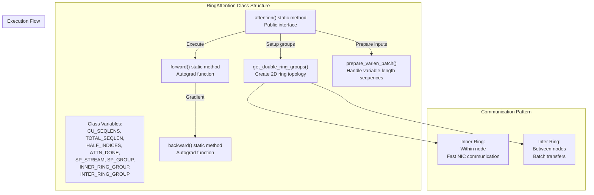

**Diagram: RingAttention Class Structure**

Sources: [colossalai/shardformer/layer/attn.py:406-621]()

### Double Ring Topology

Ring Attention supports a double ring topology to optimize network utilization. This architecture processes attention within inner rings (typically aligned with single nodes) before transferring complete KV states to the next ring.

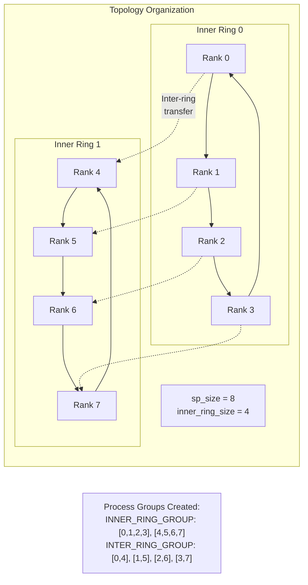

**Diagram: Double Ring Topology for sp_size=8, inner_ring_size=4**

The inner ring size should not exceed the number of NICs on each node to avoid congestion. The algorithm:
1. Performs attention computation within each inner ring
2. Transfers complete KV states between rings in batch

Sources: [colossalai/shardformer/layer/attn.py:444-495]()

### Zigzag Batching for Variable-Length Sequences

Ring Attention implements zigzag batching to balance load when processing sequences of varying lengths. This scheme interleaves long and short sequences across ranks.

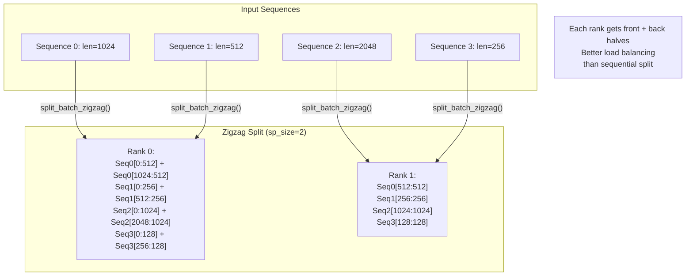

**Diagram: Zigzag Batching Pattern**

This pattern is implemented by:
- `split_batch_zigzag()` for fixed-length sequences
- `split_varlen_zigzag()` for packed (varlen) sequences

Sources: [colossalai/shardformer/layer/attn.py:151-158](), [colossalai/shardformer/layer/utils.py:267-360]()

### Forward Pass Algorithm

The Ring Attention forward pass overlaps attention computation with KV communication using CUDA streams:

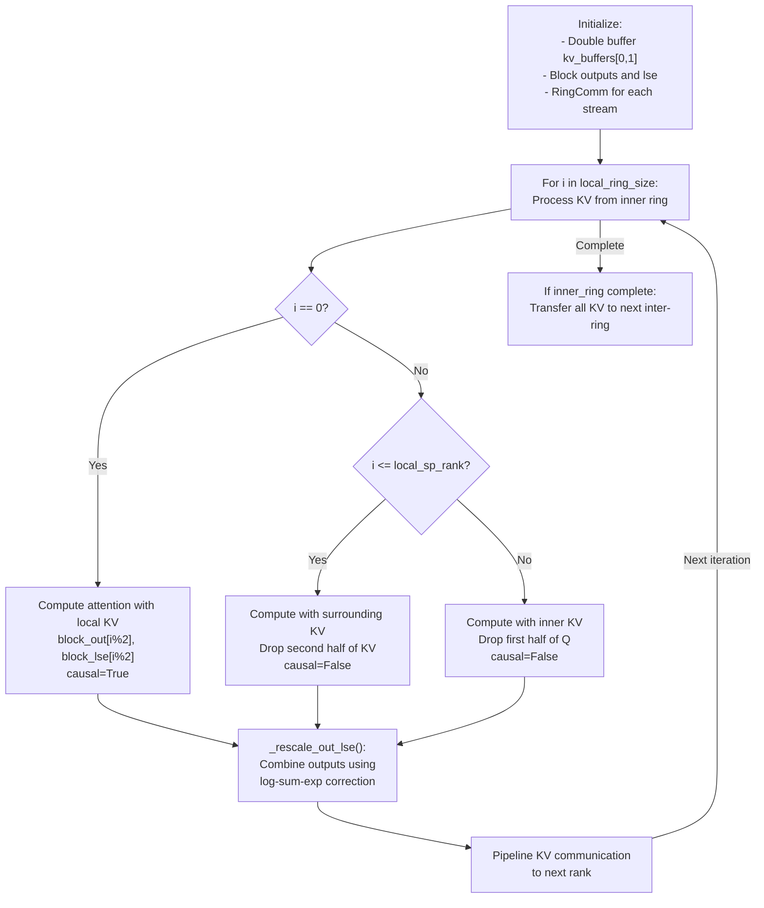

**Diagram: Ring Attention Forward Pass Control Flow**

The key optimization is the use of `_rescale_out_lse()` to combine partial attention outputs:

```python
# Combines outputs from current and previous blocks
new_lse = lse + torch.log(1 + torch.exp(block_lse - lse))
new_block_lse = torch.exp(block_lse - new_lse)
out = (torch.exp(lse - new_lse) * out + new_block_lse * block_out).to(out)
```

This maintains numerical stability while accumulating attention across ring positions.

Sources: [colossalai/shardformer/layer/attn.py:622-850]()

### Backward Pass Algorithm

The backward pass reverses the ring communication direction while accumulating gradients:

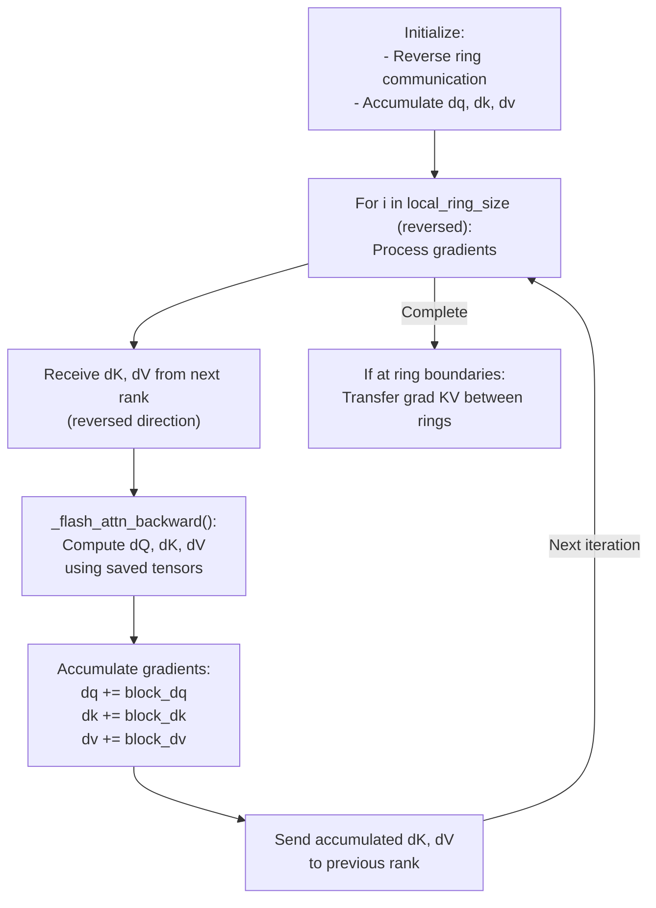

**Diagram: Ring Attention Backward Pass**

Sources: [colossalai/shardformer/layer/attn.py:852-1064]()

---

## Integration with Model Forward Functions

### Usage Pattern in Model Implementations

Models integrate these attention mechanisms through modified forward functions. The typical pattern:

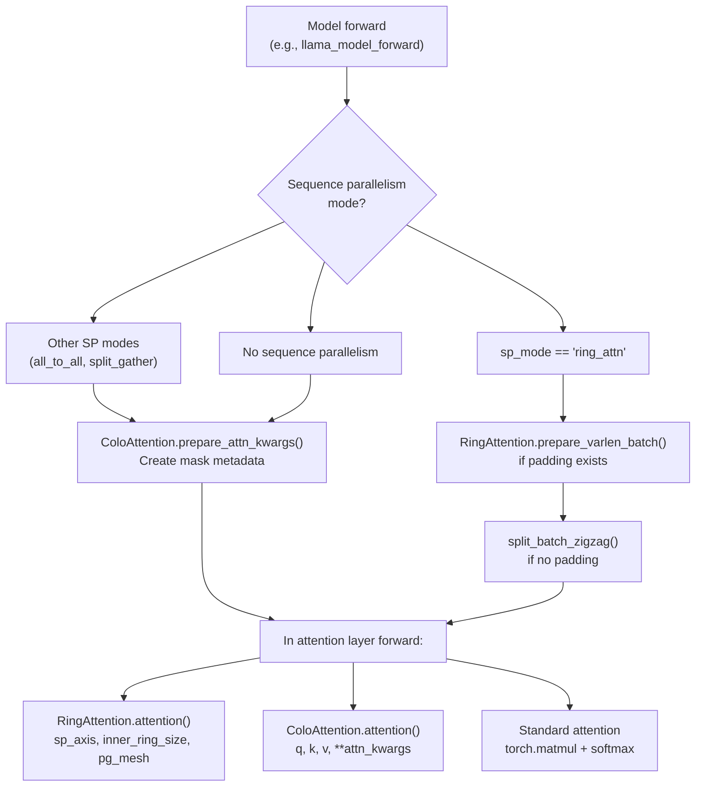

**Diagram: Model Integration Pattern**

Sources: [colossalai/shardformer/modeling/llama.py:130-158](), [colossalai/shardformer/modeling/llama.py:489-609]()

### Example: LLaMA Flash Attention Forward

The LLaMA model's attention forward demonstrates the integration:

```python
# From get_llama_flash_attention_forward()
def forward(
    self,
    hidden_states: torch.Tensor,
    position_embeddings: Tuple[torch.Tensor, torch.Tensor],
    attention_mask: Optional[Union[torch.Tensor, Dict]] = None,
    ...
):
    # Project to Q, K, V
    query_states = self.q_proj(hidden_states)
    key_states = self.k_proj(hidden_states)
    value_states = self.v_proj(hidden_states)
    
    # Apply RoPE
    query_states, key_states = apply_rotary_pos_emb(query_states, key_states, cos, sin)
    
    # Choose attention implementation
    if sp_mode == "ring_attn":
        attn_output = RingAttention.attention(
            query_states,
            key_states,
            value_states,
            sp_axis=shard_config.sp_axis,
            **attention_mask,  # Dict from prepare_varlen_batch
            inner_ring_size=shard_config.inner_ring_size,
            pg_mesh=shard_config.pg_mesh,
        )
    elif shard_config.enable_flash_attention:
        attn_output = ColoAttention.attention(
            query_states, key_states, value_states, **attention_mask
        )
    else:
        # Standard attention fallback
        ...
```

Sources: [colossalai/shardformer/modeling/llama.py:554-567]()

### Policy Configuration

Model policies enable these attention mechanisms through configuration:

```python
# From MistralPolicy.module_policy()
if self.shard_config.enable_flash_attention:
    self.append_or_create_method_replacement(
        description={
            "forward": get_mistral_flash_attention_forward(self.shard_config),
        },
        policy=policy,
        target_key=MistralAttention,
    )
```

This replaces the standard `MistralAttention.forward` method with one that uses `ColoAttention`.

Sources: [colossalai/shardformer/policies/mistral.py:241-248]()

---

## Performance Optimizations

### Memory-Based Kernel Selection

The dispatch system uses a memory threshold (`MEMORY_BOUND = 10GB`) to switch between kernel implementations:

| Condition | Kernel Selected | Rationale |
|-----------|----------------|-----------|
| `size < MEMORY_BOUND` | Standard Flash Attention | Materialized attention mask in memory |
| `size >= MEMORY_BOUND` AND `CAUSAL`/`PADDED_CAUSAL` | FlashAttentionDaoLoader | Efficient causal masking without materialization |
| `size >= MEMORY_BOUND` AND other mask types | Standard kernel | Must materialize custom masks |

```python
# From _dispatch_kernel
if size >= MEMORY_BOUND:
    if isinstance(ColoAttention._flash_kernel_dispatch, KernelLoader):
        ColoAttention._flash_kernel_dispatch = ColoAttention._flash_kernel_dispatch.load()

if size >= MEMORY_BOUND and mask_type in (AttnMaskType.PADDED_CAUSAL, AttnMaskType.CAUSAL):
    return ColoAttention._flash_kernel_dispatch
else:
    return ColoAttention._kernel_dispatch_map[dtype][mask_type]
```

Sources: [colossalai/shardformer/layer/attn.py:114-136]()

### Lazy Kernel Loading

Kernels are loaded lazily to minimize startup overhead:

```python
# Kernels stored as KernelLoader objects initially
if isinstance(ColoAttention._kernel_dispatch_map[dtype][mask_type], KernelLoader):
    ColoAttention._kernel_dispatch_map[dtype][mask_type] = \
        ColoAttention._kernel_dispatch_map[dtype][mask_type].load()
```

This defers the import of Flash Attention and CUDA extensions until first use.

Sources: [colossalai/shardformer/layer/attn.py:128-131]()

### CUDA Stream Overlap in Ring Attention

Ring Attention uses dual CUDA streams to overlap computation and communication:

```python
# Stream 0: Primary attention computation
# Stream 1 (SP_STREAM): Output correction and next KV communication

sp_streams = [torch.cuda.current_stream(), sp_stream]

for i in range(local_sp_size):
    with torch.cuda.stream(sp_streams[i % 2]):
        # Wait for KV from previous rank
        if i > 0:
            local_kv_comms[(i + 1) % 2].wait()
        
        # Compute attention with current KV
        block_out[i % 2], block_softmax_lse[i % 2], rng_states[i] = _forward(...)
        
        # Record completion
        RingAttention.ATTN_DONE.record()
        
        # Pipeline next KV communication while correcting output
        _kv_comm(i + 1)
```

This ping-pong pattern between streams minimizes idle GPU time.

Sources: [colossalai/shardformer/layer/attn.py:764-819]()

---

## Helper Functions and Utilities

### Padding Information Extraction

The `get_pad_info()` function extracts metadata from padding masks:

```python
def get_pad_info(
    padding_mask: torch.Tensor,  # [B, Skv]
    invert: Optional[bool] = False,
    return_indices: Optional[bool] = True
) -> Tuple[int, torch.Tensor, torch.Tensor]:
    """
    Returns:
        max_seqlen_in_batch: Maximum sequence length
        cu_seqlens: [B+1] cumulative sequence lengths
        indices: [total_nonzero] indices of non-masked tokens
    """
```

This is used for packed (varlen) sequence processing where sequences are concatenated without padding.

Sources: [colossalai/shardformer/layer/attn.py:54-79]()

### Mask Inversion

The `invert_mask()` function converts boolean masks to additive attention masks:

```python
def invert_mask(mask: torch.Tensor) -> torch.Tensor:
    """
    Converts:
        1 (attend) -> 0
        0 (masked) -> -inf (dtype min value)
    """
    inverted_mask = 1.0 - mask
    return inverted_mask.masked_fill(inverted_mask.bool(), torch.finfo(mask.dtype).min)
```

Sources: [colossalai/shardformer/layer/attn.py:40-50]()

### Varlen Sequence Helpers

Loading utilities for unpacking/packing sequences:

```python
def _load_varlen_helpers():
    """Loads flash-attn's padding utilities"""
    global _pad_input, _unpad_input
    from flash_attn.bert_padding import index_first_axis, pad_input
    
    def unpad_input(hidden_states: torch.Tensor, indices: torch.Tensor):
        return index_first_axis(rearrange(hidden_states, "b s ... -> (b s) ..."), indices)
    
    _pad_input = pad_input
    _unpad_input = unpad_input
```

These are used when `attention_mask_type == PADDED_CAUSAL` to convert between padded `[B, S, D]` and packed `[T, D]` formats.

Sources: [colossalai/shardformer/layer/attn.py:334-353]()

---

## Testing and Validation

### Ring Attention Tests

The test suite validates Ring Attention correctness against single-GPU Flash Attention:

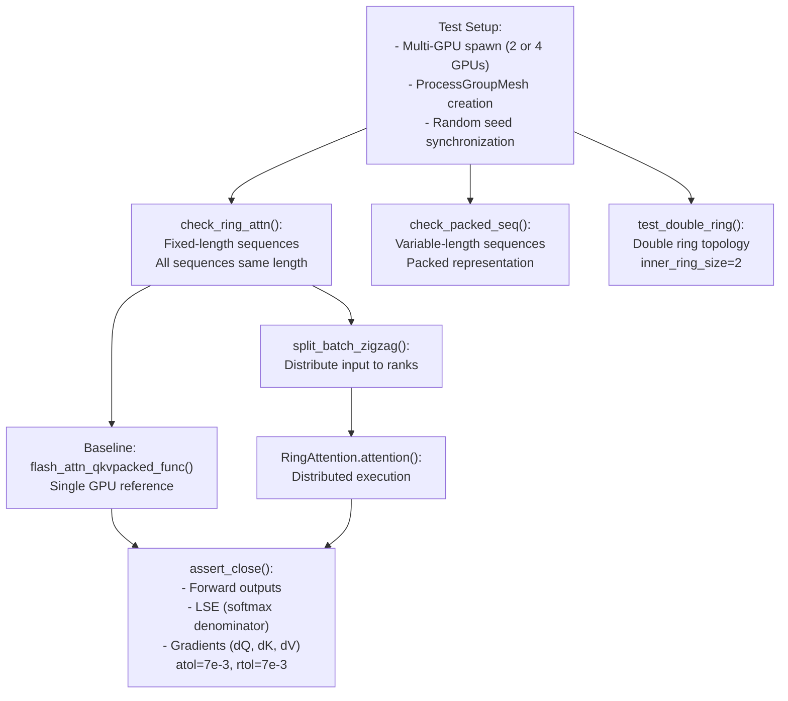

**Diagram: Ring Attention Test Architecture**

The tests verify:
1. Forward pass output matches single-GPU Flash Attention
2. Softmax log-sum-exp (LSE) values are numerically stable
3. Backward pass gradients match within tolerance

Sources: [tests/test_shardformer/test_layer/test_ring_attn.py:16-192]()

---

## Summary of Key Components

| Component | Location | Purpose |
|-----------|----------|---------|
| `ColoAttention` | [colossalai/shardformer/layer/attn.py:82-331]() | Main attention interface with kernel dispatch |
| `RingAttention` | [colossalai/shardformer/layer/attn.py:406-1064]() | Ring-based attention for long sequences |
| `AttnMaskType` | [colossalai/shardformer/layer/attn.py:33-37]() | Enumeration of mask types |
| `prepare_attn_kwargs` | [colossalai/shardformer/layer/attn.py:138-226]() | Prepare attention metadata |
| `get_pad_info` | [colossalai/shardformer/layer/attn.py:54-79]() | Extract padding information |
| `split_batch_zigzag` | [colossalai/shardformer/layer/utils.py:267-360]() | Zigzag sequence distribution |
| Model integrations | [colossalai/shardformer/modeling/*.py]() | Per-model attention implementations |

The attention mechanisms in ColossalAI provide a flexible, high-performance foundation for training and inference across diverse model architectures and deployment scenarios.

---

