<!-- source: DeepWiki mcp.deepwiki.com · repo hpcaitech/ColossalAI · page 5.3 Model-Specific Policies · fetched 2026-10-21 -->

# Model-Specific Policies

<details>
<summary>Relevant source files</summary>

The following files were used as context for generating this wiki page:

- [.github/workflows/release_test_pypi_before_merge.yml](.github/workflows/release_test_pypi_before_merge.yml)
- [colossalai/__init__.py](colossalai/__init__.py)
- [colossalai/shardformer/README.md](colossalai/shardformer/README.md)
- [colossalai/shardformer/__init__.py](colossalai/shardformer/__init__.py)
- [colossalai/shardformer/layer/attn.py](colossalai/shardformer/layer/attn.py)
- [colossalai/shardformer/layer/loss.py](colossalai/shardformer/layer/loss.py)
- [colossalai/shardformer/layer/utils.py](colossalai/shardformer/layer/utils.py)
- [colossalai/shardformer/modeling/bert.py](colossalai/shardformer/modeling/bert.py)
- [colossalai/shardformer/modeling/blip2.py](colossalai/shardformer/modeling/blip2.py)
- [colossalai/shardformer/modeling/bloom.py](colossalai/shardformer/modeling/bloom.py)
- [colossalai/shardformer/modeling/deepseek_v3.py](colossalai/shardformer/modeling/deepseek_v3.py)
- [colossalai/shardformer/modeling/falcon.py](colossalai/shardformer/modeling/falcon.py)
- [colossalai/shardformer/modeling/gpt2.py](colossalai/shardformer/modeling/gpt2.py)
- [colossalai/shardformer/modeling/gptj.py](colossalai/shardformer/modeling/gptj.py)
- [colossalai/shardformer/modeling/llama.py](colossalai/shardformer/modeling/llama.py)
- [colossalai/shardformer/modeling/mistral.py](colossalai/shardformer/modeling/mistral.py)
- [colossalai/shardformer/modeling/opt.py](colossalai/shardformer/modeling/opt.py)
- [colossalai/shardformer/modeling/qwen2.py](colossalai/shardformer/modeling/qwen2.py)
- [colossalai/shardformer/modeling/t5.py](colossalai/shardformer/modeling/t5.py)
- [colossalai/shardformer/modeling/vit.py](colossalai/shardformer/modeling/vit.py)
- [colossalai/shardformer/modeling/whisper.py](colossalai/shardformer/modeling/whisper.py)
- [colossalai/shardformer/policies/auto_policy.py](colossalai/shardformer/policies/auto_policy.py)
- [colossalai/shardformer/policies/bert.py](colossalai/shardformer/policies/bert.py)
- [colossalai/shardformer/policies/bloom.py](colossalai/shardformer/policies/bloom.py)
- [colossalai/shardformer/policies/deepseek_v3.py](colossalai/shardformer/policies/deepseek_v3.py)
- [colossalai/shardformer/policies/falcon.py](colossalai/shardformer/policies/falcon.py)
- [colossalai/shardformer/policies/gpt2.py](colossalai/shardformer/policies/gpt2.py)
- [colossalai/shardformer/policies/gptj.py](colossalai/shardformer/policies/gptj.py)
- [colossalai/shardformer/policies/llama.py](colossalai/shardformer/policies/llama.py)
- [colossalai/shardformer/policies/mistral.py](colossalai/shardformer/policies/mistral.py)
- [colossalai/shardformer/policies/opt.py](colossalai/shardformer/policies/opt.py)
- [colossalai/shardformer/policies/qwen2.py](colossalai/shardformer/policies/qwen2.py)
- [colossalai/shardformer/policies/t5.py](colossalai/shardformer/policies/t5.py)
- [colossalai/shardformer/policies/vit.py](colossalai/shardformer/policies/vit.py)
- [colossalai/shardformer/policies/whisper.py](colossalai/shardformer/policies/whisper.py)
- [colossalai/shardformer/shard/__init__.py](colossalai/shardformer/shard/__init__.py)
- [colossalai/shardformer/shard/shard_config.py](colossalai/shardformer/shard/shard_config.py)
- [colossalai/shardformer/shard/sharder.py](colossalai/shardformer/shard/sharder.py)
- [examples/language/deepseek/benchmark.py](examples/language/deepseek/benchmark.py)
- [tests/kit/model_zoo/transformers/__init__.py](tests/kit/model_zoo/transformers/__init__.py)
- [tests/kit/model_zoo/transformers/deepseek_v3.py](tests/kit/model_zoo/transformers/deepseek_v3.py)
- [tests/kit/model_zoo/transformers/t5.py](tests/kit/model_zoo/transformers/t5.py)
- [tests/test_shardformer/test_layer/test_ring_attn.py](tests/test_shardformer/test_layer/test_ring_attn.py)
- [tests/test_shardformer/test_model/test_shard_blip2.py](tests/test_shardformer/test_model/test_shard_blip2.py)
- [tests/test_shardformer/test_model/test_shard_deepseek_v3.py](tests/test_shardformer/test_model/test_shard_deepseek_v3.py)
- [tests/test_shardformer/test_model/test_shard_qwen2.py](tests/test_shardformer/test_model/test_shard_qwen2.py)
- [version.txt](version.txt)

</details>


Model-specific policies are the core configuration mechanism in ShardFormer that define how to transform a particular neural network architecture for distributed training. Each policy class encapsulates the model-specific knowledge required to correctly partition layers, replace modules, and adapt forward methods for tensor parallelism, pipeline parallelism, and sequence parallelism.

**Scope**: This page documents concrete policy implementations for specific models (BERT, LLaMA, GPT-2, Qwen2, etc.). For general policy architecture and the base `Policy` class, see [Policies for LLM Architectures](#5.1). For attention-specific transformations, see [Custom Attention Mechanisms](#5.2).

---

## Policy Purpose and Architecture

Model-specific policies serve as declarative specifications that describe how to transform a HuggingFace model into its distributed equivalent. Unlike imperative code that directly modifies models, policies describe transformations through structured metadata that the `ModelSharder` interprets and applies.

### Design Philosophy

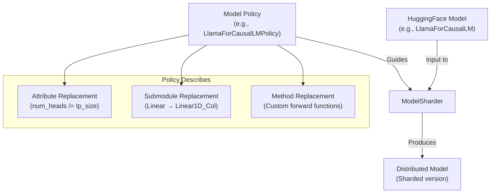

**Sources**: [colossalai/shardformer/shard/sharder.py:1-237](), [colossalai/shardformer/policies/base_policy.py]()

---

## Policy Class Hierarchy

All model-specific policies inherit from a base `Policy` class and implement a standard interface:

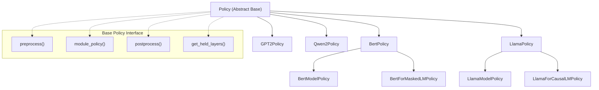

Each model typically has:
- A **base policy** (e.g., `BertPolicy`) containing common transformations for all model variants
- **Task-specific policies** (e.g., `BertForMaskedLMPolicy`) that extend the base policy for specific tasks

**Sources**: [colossalai/shardformer/policies/bert.py:36-492](), [colossalai/shardformer/policies/llama.py:26-366](), [colossalai/shardformer/policies/base_policy.py]()

---

## Policy Lifecycle

### Three-Phase Transformation

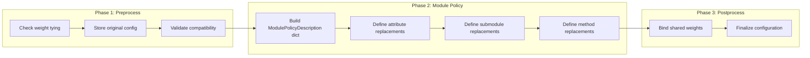

#### 1. Preprocess Phase

The `preprocess()` method performs preliminary checks and setup before transformation:

| Method | Purpose | Example |
|--------|---------|---------|
| `tie_weight_check()` | Detect if embedding and LM head share weights | BERT, GPT-2 |
| Store `_attn_implementation` | Preserve original attention type | LLaMA, Qwen2 |
| Validate configuration | Check divisibility constraints | All policies |

**Example from LlamaPolicy**:
```python
def preprocess(self):
    self.tie_weight = self.tie_weight_check()
    self.origin_attn_implement = self.model.config._attn_implementation
    return self.model
```

**Sources**: [colossalai/shardformer/policies/llama.py:30-33](), [colossalai/shardformer/policies/bert.py:40-43]()

#### 2. Module Policy Phase

The `module_policy()` method returns a dictionary mapping module classes to their transformation descriptions:

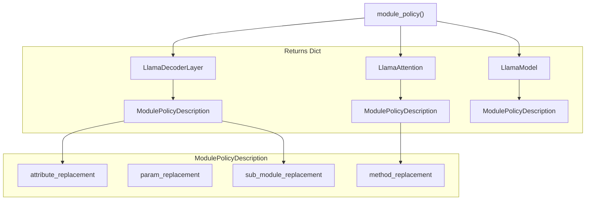

**Sources**: [colossalai/shardformer/policies/llama.py:35-298](), [colossalai/shardformer/README.md:194-289]()

#### 3. Postprocess Phase

The `postprocess()` method handles final configuration, typically weight binding for models with tied weights.

**Sources**: [colossalai/shardformer/policies/llama.py:300-301](), [colossalai/shardformer/policies/bert.py:418-419]()

---

## Policy Components

### ModulePolicyDescription

The `ModulePolicyDescription` dataclass specifies all transformations for a particular module type:

| Field | Type | Purpose |
|-------|------|---------|
| `attribute_replacement` | `Dict[str, Any]` | Change module attributes (e.g., `num_heads /= tp_size`) |
| `param_replacement` | `List[Callable]` | Apply in-place parameter transformations |
| `sub_module_replacement` | `List[SubModuleReplacementDescription]` | Replace child modules with parallel versions |
| `method_replacement` | `Dict[str, Callable]` | Replace methods (e.g., `forward`) with custom implementations |

**Example**: Transforming `LlamaDecoderLayer` for tensor parallelism:

```python
policy[LlamaDecoderLayer] = ModulePolicyDescription(
    attribute_replacement={
        "self_attn.hidden_size": self.model.config.hidden_size // tp_size,
        "self_attn.num_heads": num_q_heads // tp_size,
        "self_attn.num_key_value_heads": num_kv_heads // tp_size,
    },
    sub_module_replacement=[
        SubModuleReplacementDescription(
            suffix="self_attn.q_proj",
            target_module=Linear1D_Col,
            kwargs=dict(seq_parallel_mode=sp_mode, use_zbv=use_zbv)
        ),
        SubModuleReplacementDescription(
            suffix="self_attn.o_proj",
            target_module=Linear1D_Row,
            kwargs=dict(seq_parallel_mode=sp_mode, use_zbv=use_zbv)
        ),
        # ... more replacements
    ]
)
```

**Sources**: [colossalai/shardformer/policies/llama.py:113-180](), [colossalai/shardformer/README.md:205-236]()

### SubModuleReplacementDescription

Describes how to replace a child module with its parallel equivalent:

| Field | Type | Purpose |
|-------|------|---------|
| `suffix` | `str` | Module path suffix (e.g., "self_attn.q_proj") |
| `target_module` | `ParallelModule` | Replacement class (e.g., `Linear1D_Col`) |
| `kwargs` | `Dict[str, Any]` | Arguments for `from_native_module()` |
| `ignore_if_not_exist` | `bool` | Skip if submodule doesn't exist |

**Sources**: [colossalai/shardformer/README.md:222-236](), [colossalai/shardformer/shard/sharder.py:161-208]()

---

## Common Policy Patterns

### Pattern 1: Tensor Parallelism for Linear Layers

Most policies follow this pattern for attention and MLP layers:

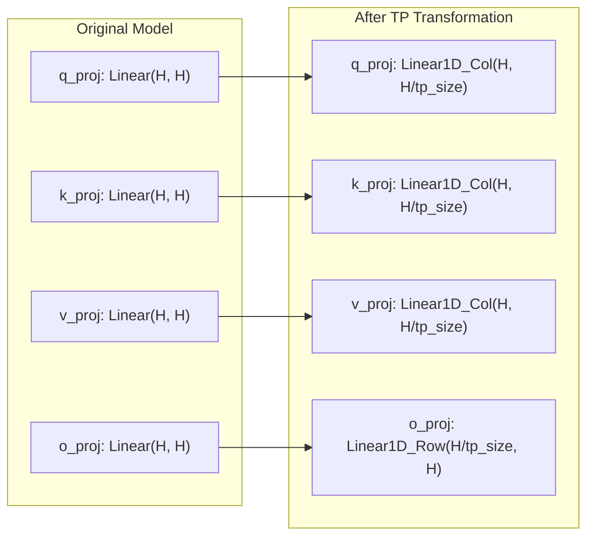

**Column-parallel layers** (`Linear1D_Col`): Split output features, shard weight columns
- Query, Key, Value projections
- MLP gate/up projections

**Row-parallel layers** (`Linear1D_Row`): Split input features, shard weight rows
- Attention output projection
- MLP down projection

**Sources**: [colossalai/shardformer/policies/llama.py:115-178](), [colossalai/shardformer/policies/bert.py:96-176](), [colossalai/shardformer/policies/gpt2.py:66-138]()

### Pattern 2: Attribute Adjustment for TP

When splitting layers across devices, corresponding attributes must be divided:

```python
# For LlamaDecoderLayer with tp_size=4
attribute_replacement = {
    "self_attn.hidden_size": hidden_size // 4,        # 4096 → 1024
    "self_attn.num_heads": num_heads // 4,            # 32 → 8
    "self_attn.num_key_value_heads": num_kv_heads // 4,  # 8 → 2 (GQA)
}
```

**Sources**: [colossalai/shardformer/policies/llama.py:105-112](), [colossalai/shardformer/policies/qwen2.py:82-113]()

### Pattern 3: Sequence Parallelism Integration

Policies specify sequence parallel mode for compatible layers:

| SP Mode | Description | Supported Models |
|---------|-------------|------------------|
| `split_gather` | Split sequence dim, gather in backward | BERT, GPT-2, LLaMA |
| `ring_attn` | Ring attention for long sequences | LLaMA, GPT-2, Qwen2 |
| `all_to_all` | All-to-all communication | LLaMA, Qwen2 |

**Example**:
```python
SubModuleReplacementDescription(
    suffix="self_attn.q_proj",
    target_module=Linear1D_Col,
    kwargs=dict(
        seq_parallel_mode="split_gather",  # or "ring_attn"
        fp8_communication=shard_config.fp8_communication
    )
)
```

**Sources**: [colossalai/shardformer/policies/llama.py:120-122](), [colossalai/shardformer/policies/gpt2.py:55-62](), [colossalai/shardformer/shard/shard_config.py:13-86]()

### Pattern 4: Flash Attention Method Replacement

Policies replace attention forward methods with flash attention implementations:

```python
self.append_or_create_method_replacement(
    description={
        "forward": get_llama_flash_attention_forward(
            self.shard_config, sp_mode, sp_size, sp_group
        ),
    },
    policy=policy,
    target_key=LlamaAttention,
)
```

The custom forward functions handle:
- ColoAttention kernel dispatch
- RingAttention for long sequences
- Attention mask preparation
- Integration with sequence parallelism

**Sources**: [colossalai/shardformer/policies/llama.py:75-82](), [colossalai/shardformer/modeling/llama.py:489-610]()

### Pattern 5: Pipeline Parallelism Support

Policies define pipeline-specific forward methods when `pipeline_stage_manager` is present:

```python
def set_pipeline_forward(self, model_cls, new_forward, policy):
    if self.pipeline_stage_manager is None:
        return
    
    layers_per_stage = stage_manager.distribute_layers(len(module.layers))
    stage_index = stage_manager.get_stage_index(layers_per_stage)
    
    method_replacement = {
        "forward": partial(
            new_forward,
            stage_manager=stage_manager,
            stage_index=stage_index,
            shard_config=self.shard_config
        )
    }
    self.append_or_create_method_replacement(
        description=method_replacement,
        policy=policy,
        target_key=model_cls
    )
```

**Sources**: [colossalai/shardformer/policies/llama.py:303-331](), [colossalai/shardformer/policies/bert.py:421-458]()

---

## Concrete Policy Examples

### Example 1: BertPolicy

BERT policies demonstrate handling encoder-only architectures with cross-attention support:

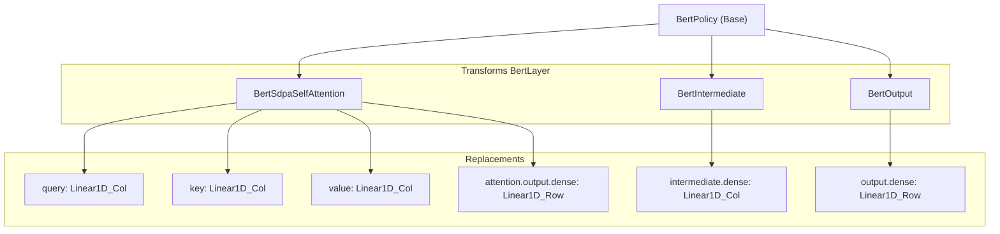

**Key characteristics**:
- Supports both self-attention and cross-attention
- Integrates JIT-fused bias+GELU for `gelu` activation
- Sequence parallelism mode restricted to `split_gather` (not `all_to_all`)
- Handles both standard and ZBV (zero bubble virtual) pipeline modes

**Sources**: [colossalai/shardformer/policies/bert.py:36-360]()

### Example 2: LlamaPolicy

LLaMA policies handle decoder-only causal language models with rotary embeddings:

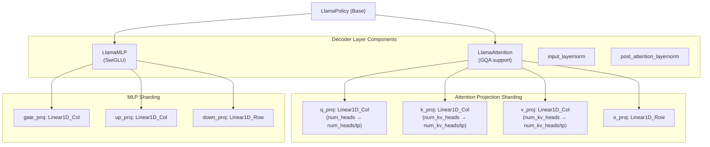

**Key characteristics**:
- Handles Grouped Query Attention (GQA) with fewer KV heads than Q heads
- Supports all sequence parallelism modes: `split_gather`, `all_to_all`, `ring_attn`
- Uses `RMSNorm` (or `FusedRMSNorm`) instead of LayerNorm
- Supports rope (rotary position embeddings) integration
- Handles both standard LLaMA and variants (e.g., Mistral uses same base)

**Sources**: [colossalai/shardformer/policies/llama.py:26-298]()

### Example 3: GPT2Policy

GPT2 policies handle models using Conv1D layers instead of Linear:

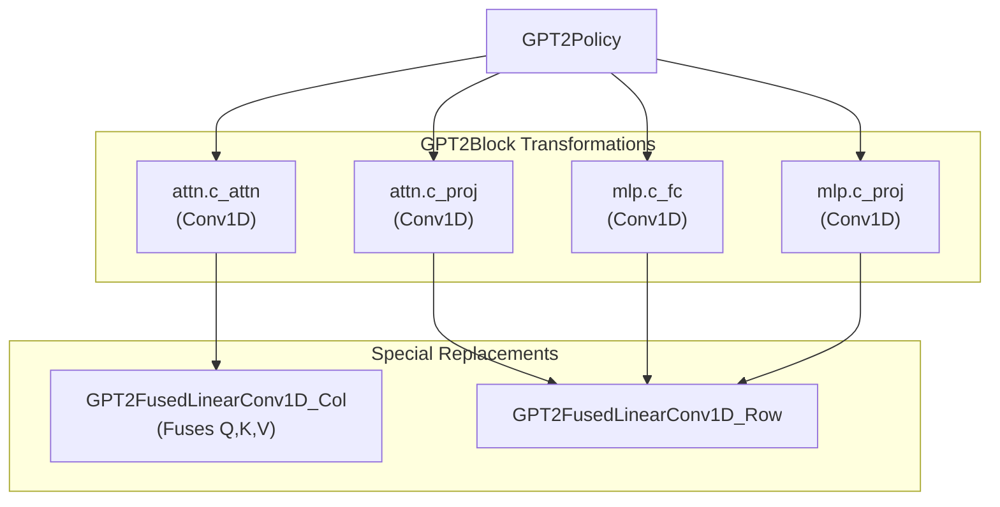

**Key characteristics**:
- Uses `GPT2FusedLinearConv1D_Col` and `GPT2FusedLinearConv1D_Row` instead of standard parallel layers
- `c_attn` layer produces fused Q, K, V outputs that must be split with `split_sizes`
- Supports cross-attention for encoder-decoder variants
- Sequence parallelism restricted to `split_gather` mode

**Code example**:
```python
SubModuleReplacementDescription(
    suffix="attn.c_attn",
    target_module=col_nn.GPT2FusedLinearConv1D_Col,
    kwargs={
        "split_sizes": [self.model.config.hidden_size] * 3,  # Q, K, V
        "seq_parallel_mode": sp_mode,
        "fp8_communication": self.shard_config.fp8_communication,
    },
)
```

**Sources**: [colossalai/shardformer/policies/gpt2.py:22-280]()

### Example 4: Qwen2Policy

Qwen2 policies demonstrate handling modern LLaMA-based architectures:

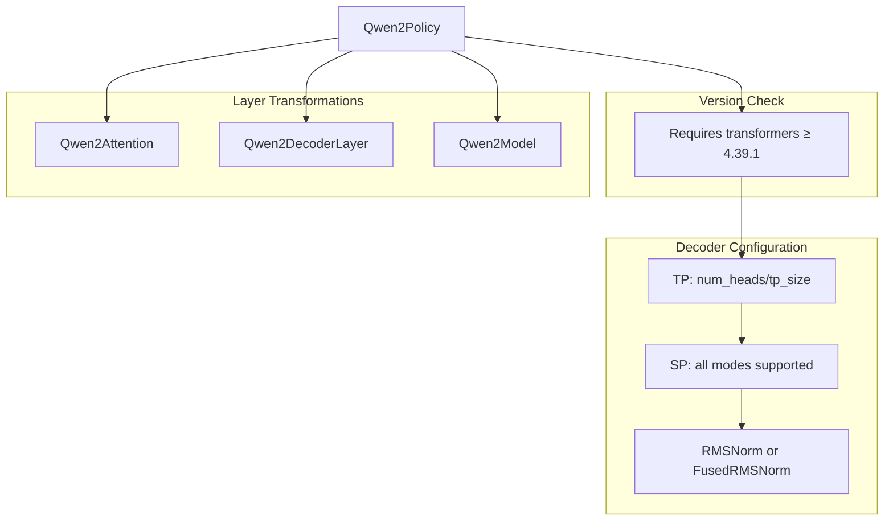

**Key characteristics**:
- Very similar to LLaMA but requires newer transformers version
- Flash attention method replacement for both standard and varlen modes
- Full sequence parallelism support including ring attention
- Cross-entropy distribution for parallel output

**Sources**: [colossalai/shardformer/policies/qwen2.py:37-219]()

---

## Auto-Policy System

The auto-policy system automatically maps model classes to their corresponding policies, eliminating manual policy selection:

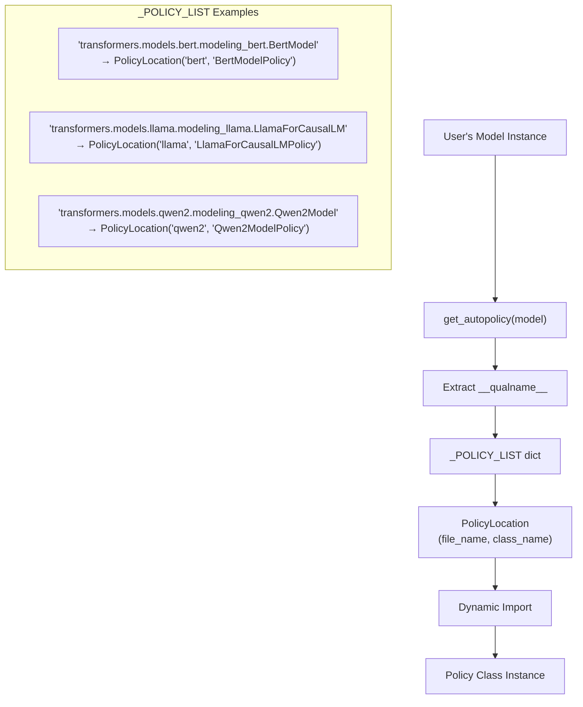

### Policy Registration

Policies are registered in `_POLICY_LIST` dictionary:

```python
_POLICY_LIST = {
    "transformers.models.bert.modeling_bert.BertModel": 
        PolicyLocation(file_name="bert", class_name="BertModelPolicy"),
    
    "transformers.models.llama.modeling_llama.LlamaForCausalLM": 
        PolicyLocation(file_name="llama", class_name="LlamaForCausalLMPolicy"),
    
    "transformers.models.qwen2.modeling_qwen2.Qwen2ForCausalLM": 
        PolicyLocation(file_name="qwen2", class_name="Qwen2ForCausalLMPolicy"),
    
    # Special handling for models not in transformers
    "transformers_modules.modeling_deepseek.DeepseekV3ForCausalLM":
        PolicyLocation(file_name="deepseek_v3", class_name="DeepseekV3ForCausalLMPolicy"),
}
```

**Key points**:
- Uses model's `__qualname__` as dictionary key
- Lazy imports: policy files only loaded when needed
- Supports custom models from HuggingFace Hub via `transformers_modules.*` prefix

**Sources**: [colossalai/shardformer/policies/auto_policy.py:1-108]()

### Dynamic Import Mechanism

The `import_policy()` function handles lazy loading:

```python
def import_policy(policy_location: PolicyLocation) -> Policy:
    """
    Dynamically import policy class from its location.
    Avoids importing heavy dependencies until needed.
    """
    module_path = f"colossalai.shardformer.policies.{policy_location.file_name}"
    module = importlib.import_module(module_path)
    return getattr(module, policy_location.class_name)
```

This design prevents importing transformers, timm, or other heavy libraries until a specific policy is actually used.

**Sources**: [colossalai/shardformer/policies/auto_policy.py:25-108]()

---

## Writing Custom Policies

### Step-by-Step Guide

**Step 1: Create Policy File**

Create a new file in `colossalai/shardformer/policies/` named after your model:

```python
# colossalai/shardformer/policies/my_model.py
from functools import partial
from typing import Dict, Union
import torch.nn as nn
from .base_policy import Policy, ModulePolicyDescription, SubModuleReplacementDescription
import colossalai.shardformer.layer as col_nn
```

**Step 2: Implement Base Policy Class**

```python
class MyModelPolicy(Policy):
    def config_sanity_check(self):
        """Validate model configuration compatibility."""
        pass
    
    def preprocess(self):
        """Perform preprocessing checks."""
        self.tie_weight = self.tie_weight_check()
        return self.model
    
    def module_policy(self) -> Dict[Union[str, nn.Module], ModulePolicyDescription]:
        """Define transformation rules."""
        from transformers.models.my_model.modeling_my_model import (
            MyModelLayer,
            MyModelAttention,
        )
        
        policy = {}
        
        # Define transformations for each module type
        if self.shard_config.enable_tensor_parallelism:
            policy[MyModelLayer] = ModulePolicyDescription(
                attribute_replacement={
                    "num_heads": self.model.config.num_heads // self.shard_config.tensor_parallel_size,
                },
                sub_module_replacement=[
                    SubModuleReplacementDescription(
                        suffix="attention.query",
                        target_module=col_nn.Linear1D_Col,
                    ),
                    # ... more replacements
                ]
            )
        
        return policy
    
    def postprocess(self):
        """Perform any final adjustments."""
        return self.model
```

**Step 3: Register in Auto-Policy**

Add entry to `_POLICY_LIST` in `auto_policy.py`:

```python
_POLICY_LIST = {
    # ... existing entries
    "transformers.models.my_model.modeling_my_model.MyModel": 
        PolicyLocation(file_name="my_model", class_name="MyModelPolicy"),
}
```

**Sources**: [colossalai/shardformer/README.md:358-393](), [colossalai/shardformer/policies/auto_policy.py:25-238]()

### Common Patterns Checklist

When implementing a policy, consider these aspects:

| Aspect | Implementation |
|--------|----------------|
| **Linear layers** | Replace with `Linear1D_Col` / `Linear1D_Row` |
| **Attention heads** | Divide `num_heads` by `tp_size` |
| **Embedding** | Use `VocabParallelEmbedding1D` or `PaddingEmbedding` |
| **Normalization** | Use `FusedLayerNorm` / `FusedRMSNorm` if enabled |
| **Dropout** | Replace with `DropoutForParallelInput` / `DropoutForReplicatedInput` |
| **Flash attention** | Provide custom forward via method replacement |
| **Sequence parallel** | Set `seq_parallel_mode` in layer kwargs |
| **Pipeline parallel** | Implement `set_pipeline_forward()` and `get_held_layers()` |

**Sources**: [colossalai/shardformer/policies/bert.py:96-360](), [colossalai/shardformer/policies/llama.py:96-298]()

### Testing Your Policy

Create test file in `tests/test_shardformer/test_model/`:

```python
# tests/test_shardformer/test_model/test_shard_my_model.py
import pytest
import torch
from colossalai.shardformer import ShardConfig, ShardFormer

@pytest.mark.parametrize("enable_tensor_parallelism", [True, False])
@pytest.mark.parametrize("enable_flash_attention", [True, False])
def test_my_model_policy(enable_tensor_parallelism, enable_flash_attention):
    # Load model
    from transformers import MyModelForCausalLM
    model = MyModelForCausalLM.from_pretrained("model-name")
    
    # Create shard config
    shard_config = ShardConfig(
        enable_tensor_parallelism=enable_tensor_parallelism,
        enable_flash_attention=enable_flash_attention,
    )
    
    # Apply policy
    shard_former = ShardFormer(shard_config=shard_config)
    sharded_model, shared_params = shard_former.optimize(model)
    
    # Run forward pass
    input_ids = torch.randint(0, 1000, (2, 128))
    output = sharded_model(input_ids)
    
    # Verify output
    assert output.logits.shape[0] == 2  # batch size preserved
```

**Sources**: [tests/test_shardformer/test_model/test_shard_qwen2.py:1-95](), [colossalai/shardformer/README.md:431-453]()

---

## Policy Integration with ModelSharder

The `ModelSharder` class interprets and applies policy transformations:

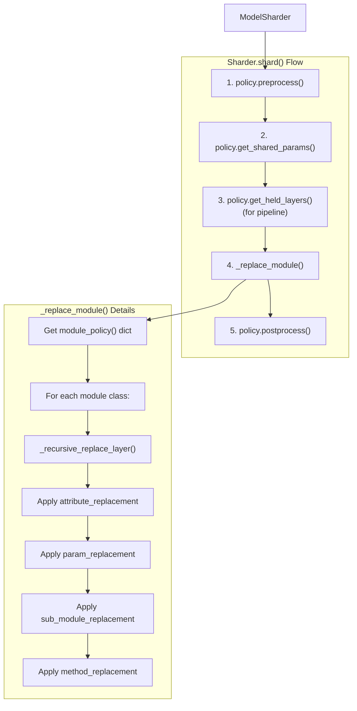

### Module Replacement Process

The sharder recursively walks the model tree and applies transformations:

```python
def _recursive_replace_layer(
    self,
    module: nn.Module,
    origin_cls: Union[str, nn.Module],
    attr_replacement: Dict[str, Any],
    param_replacement: List[Callable],
    method_replacement: Dict[str, Callable],
    sub_module_replacement: List[SubModuleReplacementDescription],
    include: Optional[Set[nn.Module]] = None,
) -> None:
    """
    Recursively traverse module tree and apply transformations
    when module class matches origin_cls.
    """
    # Match by class or class name (for models not in transformers)
    if (isinstance(origin_cls, str) and origin_cls == module.__class__.__name__) or \
       (module.__class__ == origin_cls):
        
        # Apply transformations in order
        if attr_replacement is not None:
            self._replace_attr(module, attr_replacement)
        
        if param_replacement is not None:
            self._replace_param(module, param_replacement)
        
        if method_replacement is not None:
            self._replace_method(module, method_replacement)
        
        if sub_module_replacement is not None:
            self._replace_sub_module(module, sub_module_replacement, include)
    
    # Recurse to children
    for name, child in module.named_children():
        self._recursive_replace_layer(child, origin_cls, ...)
```

**Sources**: [colossalai/shardformer/shard/sharder.py:77-124]()

### Attribute Replacement

Direct attribute modification on matched modules:

```python
def _replace_attr(self, module: nn.Module, attr_replacement: Dict[str, Any]) -> None:
    """Replace attributes using setattr_ helper."""
    for k, v in attr_replacement.items():
        setattr_(module, k, v, ignore=True)  # Handles nested attributes
```

**Sources**: [colossalai/shardformer/shard/sharder.py:125-139]()

### Submodule Replacement

Child module replacement using `from_native_module()` pattern:

```python
def _replace_sub_module(self, org_layer: nn.Module, 
                         sub_module_replacement: List[SubModuleReplacementDescription],
                         include: Optional[Set[nn.Module]] = None) -> None:
    """Replace child modules with parallel versions."""
    for description in sub_module_replacement:
        suffix = description.suffix
        target_module = description.target_module
        kwargs = description.kwargs or {}
        
        # Get original submodule
        native_sub_module = getattr_(org_layer, suffix, ignore=True)
        
        # Skip if not in pipeline stage
        if include is not None and native_sub_module not in include:
            continue
        
        # Convert to parallel version
        replace_layer = target_module.from_native_module(
            native_sub_module,
            process_group=self.shard_config.tensor_parallel_process_group,
            **kwargs
        )
        
        # Replace in model
        setattr_(org_layer, suffix, replace_layer)
```

**Sources**: [colossalai/shardformer/shard/sharder.py:161-208]()

---

## Summary

Model-specific policies provide a declarative framework for transforming neural networks for distributed training. Key takeaways:

**Core Concepts**:
- Policies describe transformations; ModelSharder applies them
- Each model architecture needs a tailored policy
- Auto-policy system enables zero-configuration usage

**Policy Structure**:
- Three-phase lifecycle: preprocess → module_policy → postprocess
- ModulePolicyDescription contains all transformation types
- SubModuleReplacementDescription specifies parallel module conversions

**Common Patterns**:
- Linear layers → Linear1D_Col/Row for tensor parallelism
- Attribute division by parallelism degree
- Method replacement for flash attention and pipeline parallelism
- Sequence parallelism mode specification in layer kwargs

**Implementation**:
- Inherit from `Policy` base class
- Implement required methods (preprocess, module_policy, postprocess)
- Register in auto-policy for automatic discovery
- Test with various parallelism configurations

**Sources**: [colossalai/shardformer/policies/base_policy.py](), [colossalai/shardformer/shard/sharder.py:18-237](), [colossalai/shardformer/README.md:143-393]()

---

