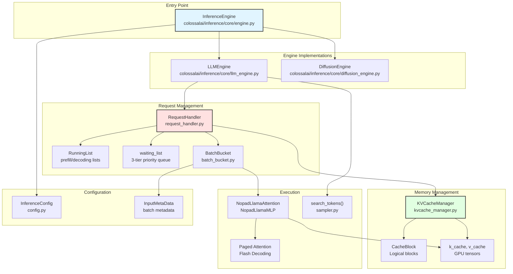
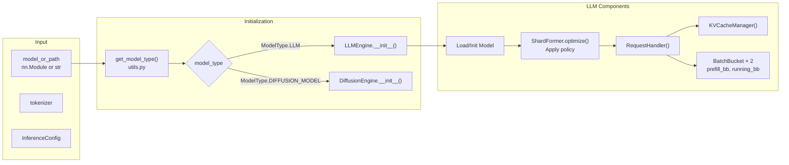
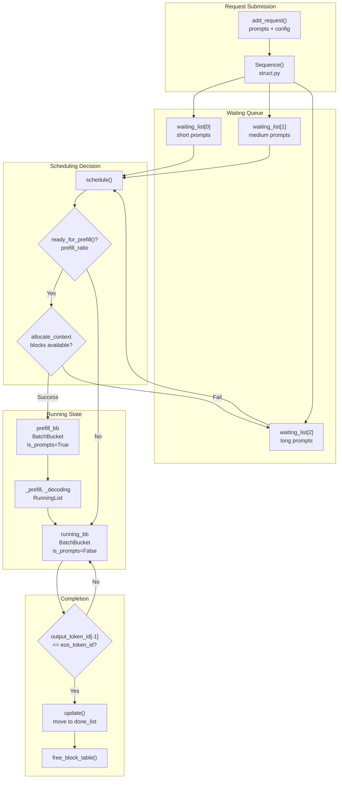
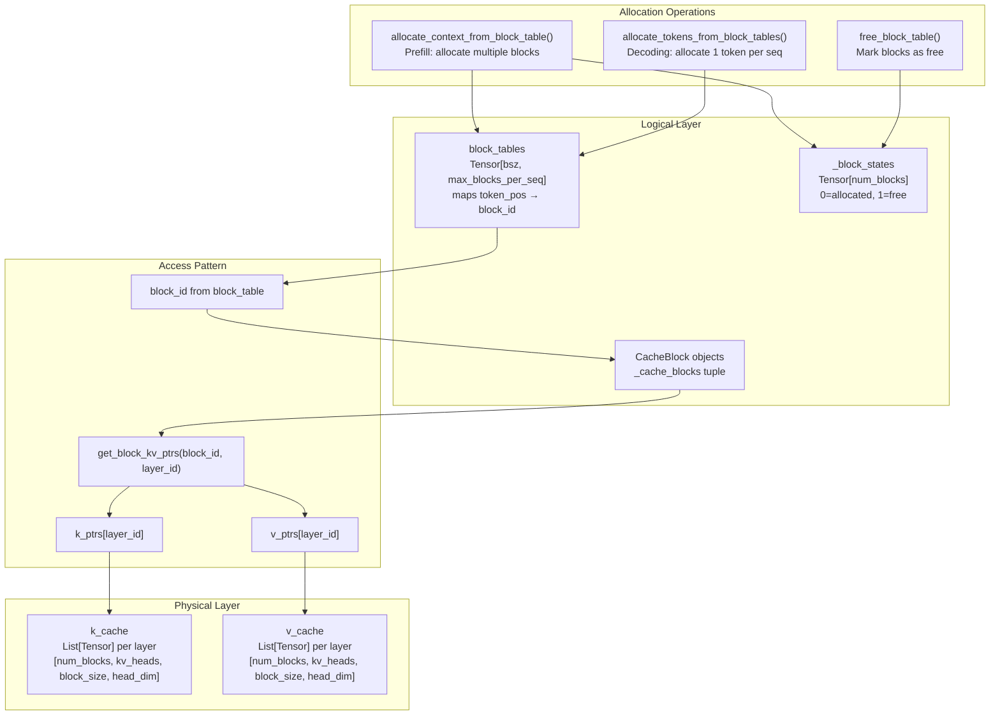
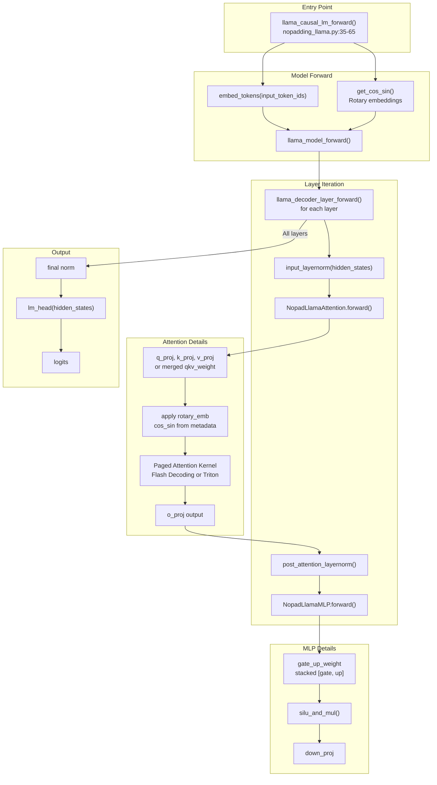
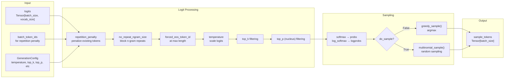
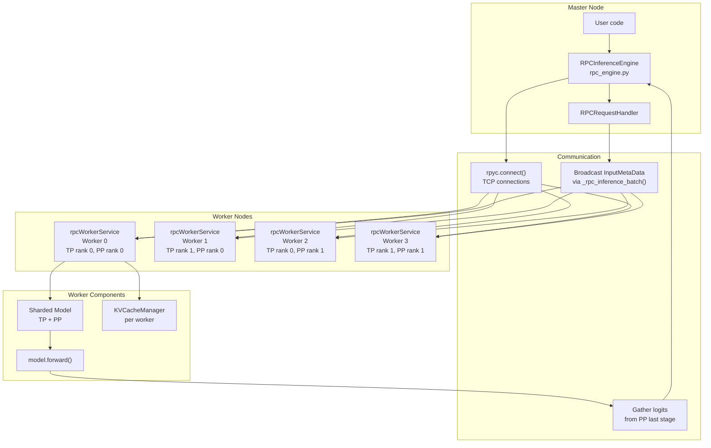

<!-- source: DeepWiki mcp.deepwiki.com · repo hpcaitech/ColossalAI · page 6 Inference Engine · fetched 2026-10-21 -->

# Inference Engine

<details>
<summary>Relevant source files</summary>

The following files were used as context for generating this wiki page:

- [README.md](README.md)
- [applications/ColossalChat/.gitignore](applications/ColossalChat/.gitignore)
- [applications/README.md](applications/README.md)
- [colossalai/inference/batch_bucket.py](colossalai/inference/batch_bucket.py)
- [colossalai/inference/config.py](colossalai/inference/config.py)
- [colossalai/inference/core/engine.py](colossalai/inference/core/engine.py)
- [colossalai/inference/core/request_handler.py](colossalai/inference/core/request_handler.py)
- [colossalai/inference/core/rpc_engine.py](colossalai/inference/core/rpc_engine.py)
- [colossalai/inference/executor/rpc_worker.py](colossalai/inference/executor/rpc_worker.py)
- [colossalai/inference/kv_cache/__init__.py](colossalai/inference/kv_cache/__init__.py)
- [colossalai/inference/kv_cache/kvcache_manager.py](colossalai/inference/kv_cache/kvcache_manager.py)
- [colossalai/inference/logit_processors.py](colossalai/inference/logit_processors.py)
- [colossalai/inference/modeling/layers/attention.py](colossalai/inference/modeling/layers/attention.py)
- [colossalai/inference/modeling/models/nopadding_llama.py](colossalai/inference/modeling/models/nopadding_llama.py)
- [colossalai/inference/modeling/policy/__init__.py](colossalai/inference/modeling/policy/__init__.py)
- [colossalai/inference/modeling/policy/nopadding_llama.py](colossalai/inference/modeling/policy/nopadding_llama.py)
- [colossalai/inference/sampler.py](colossalai/inference/sampler.py)
- [colossalai/inference/struct.py](colossalai/inference/struct.py)
- [colossalai/nn/optimizer/README.md](colossalai/nn/optimizer/README.md)
- [docs/README-zh-Hans.md](docs/README-zh-Hans.md)
- [docs/source/en/basics/launch_colossalai.md](docs/source/en/basics/launch_colossalai.md)
- [docs/source/en/get_started/installation.md](docs/source/en/get_started/installation.md)
- [docs/source/zh-Hans/basics/launch_colossalai.md](docs/source/zh-Hans/basics/launch_colossalai.md)
- [docs/source/zh-Hans/get_started/installation.md](docs/source/zh-Hans/get_started/installation.md)
- [examples/README.md](examples/README.md)
- [examples/tutorial/.gitignore](examples/tutorial/.gitignore)
- [examples/tutorial/README.md](examples/tutorial/README.md)
- [examples/tutorial/download_cifar10.py](examples/tutorial/download_cifar10.py)
- [examples/tutorial/sequence_parallel/data/dummy_dataloader.py](examples/tutorial/sequence_parallel/data/dummy_dataloader.py)
- [tests/test_infer/test_batch_bucket.py](tests/test_infer/test_batch_bucket.py)
- [tests/test_infer/test_config_and_struct.py](tests/test_infer/test_config_and_struct.py)
- [tests/test_infer/test_inference_engine.py](tests/test_infer/test_inference_engine.py)
- [tests/test_infer/test_kvcache_manager.py](tests/test_infer/test_kvcache_manager.py)
- [tests/test_infer/test_models/test_attention.py](tests/test_infer/test_models/test_attention.py)
- [tests/test_infer/test_request_handler.py](tests/test_infer/test_request_handler.py)

</details>


The Inference Engine system in ColossalAI provides high-performance inference for large language models (LLMs) and diffusion models. It implements continuous batching, paged attention, KV cache management, and distributed execution capabilities to maximize throughput and minimize latency during inference. The system supports both single-node and multi-node deployment with tensor parallelism and pipeline parallelism.

For information about training systems, see [Booster API](#4). For model transformation and optimization, see [ShardFormer Framework](#5).

## System Architecture

The Inference Engine is organized into several key subsystems that work together to handle inference requests efficiently.



**Architecture: Inference Engine Component Hierarchy**

The `InferenceEngine` class in [colossalai/inference/core/engine.py:16-134]() serves as a facade that detects the model type and delegates to either `LLMEngine` or `DiffusionEngine`. The engine coordinates request handling, memory management, model execution, and token generation.

Sources: [colossalai/inference/core/engine.py:1-134](), [README.md:413-448]()

## Engine Initialization Flow

The initialization process involves model type detection, configuration setup, and component instantiation.



**Initialization: Engine Setup Process**

The `InferenceEngine.__init__()` method at [colossalai/inference/core/engine.py:28-62]() calls `get_model_type()` to determine whether the input is an LLM or diffusion model. For LLMs, it instantiates `LLMEngine`, which:

1. Loads or initializes the model from a path or existing `nn.Module`
2. Applies `ShardFormer` transformations using a model-specific policy (e.g., `NoPaddingLlamaModelInferPolicy`)
3. Creates a `RequestHandler` with associated `KVCacheManager` and two `BatchBucket` instances (prefill and decoding)

The `InferenceConfig` dataclass at [colossalai/inference/config.py:151-396]() contains parameters including `max_batch_size`, `max_input_len`, `max_output_len`, `block_size`, `dtype`, `tp_size`, `pp_size`, and generation parameters like `temperature`, `top_k`, `top_p`.

Sources: [colossalai/inference/core/engine.py:16-134](), [colossalai/inference/config.py:151-396](), [colossalai/inference/utils.py:1-50]()

## Request Lifecycle and Scheduling

The request handling system manages the complete lifecycle from submission to completion, implementing continuous batching with a priority-based scheduling algorithm.



**Request Lifecycle: From Submission to Completion**

The `RequestHandler` class at [colossalai/inference/core/request_handler.py:140-403]() manages requests through several stages:

1. **Submission**: `add_request()` at [colossalai/inference/core/request_handler.py:300-308]() creates a `Sequence` object and adds it to one of three waiting lists based on input length (bucketed into short/medium/long).

2. **Scheduling**: `schedule()` at [colossalai/inference/core/request_handler.py:235-291]() implements a two-phase algorithm:
   - Checks if `ready_for_prefill()` returns `True` (when `len(_prefill) / len(_decoding) >= prefill_ratio`)
   - If ready, allocates KV cache blocks for prefill sequences and adds them to `prefill_bb`
   - Otherwise, allocates tokens for existing decoding sequences in `running_bb`

3. **Execution**: Sequences move from `_prefill` dict to `_decoding` dict in `RunningList` after prefill completes.

4. **Completion**: `update()` at [colossalai/inference/core/request_handler.py:380-396]() checks for finished sequences (EOS token or max length reached), removes them from `running_bb`, and frees their KV cache blocks.

The three-tier waiting queue prioritizes shorter prompts to minimize prefill overhead, as seen in [colossalai/inference/core/request_handler.py:154-156]().

Sources: [colossalai/inference/core/request_handler.py:140-403](), [colossalai/inference/struct.py:50-188]()

## KV Cache Management

The KV cache management system implements a two-level abstraction: logical cache blocks and physical cache memory.



**KV Cache Architecture: Logical and Physical Cache Layers**

The `KVCacheManager` at [colossalai/inference/kv_cache/kvcache_manager.py:18-395]() maintains both logical and physical cache representations:

**Logical Cache Blocks**:
- `_cache_blocks`: A tuple of `CacheBlock` objects, each tracking reference count and allocated size
- `block_tables`: A 2D tensor of shape `[max_batch_size, max_blocks_per_sequence]` containing block IDs, where `-1` indicates unallocated
- `_block_states`: A 1D boolean tensor tracking whether each block is free (1) or allocated (0)

**Physical Cache**:
- `_kv_caches`: Lists of GPU tensors allocated at initialization, shaped `[num_blocks, kv_head_num, block_size, head_size]` for each layer
- Total memory: `num_layers * 2 * num_blocks * block_size * kv_head_num * head_size * elem_size_in_bytes`

**Allocation Operations**:
- `allocate_context_from_block_table()` at [colossalai/inference/kv_cache/kvcache_manager.py:170-219](): Allocates contiguous or non-contiguous blocks for prefill, using cumulative sum to find contiguous regions
- `allocate_tokens_from_block_tables()` at [colossalai/inference/kv_cache/kvcache_manager.py:257-288](): Allocates single tokens during decoding, potentially allocating new blocks when current block is full
- `free_block_table()` at [colossalai/inference/kv_cache/kvcache_manager.py:327-344](): Marks blocks as free and decrements reference counts

The system supports **StreamingLLM** mode (enabled via `enable_streamingllm=True`) which implements sliding window attention with attention sinks, swapping out old blocks when the cache exceeds `start_token_size + generated_token_size`, as documented in [colossalai/inference/config.py:284-295]().

Sources: [colossalai/inference/kv_cache/kvcache_manager.py:18-395](), [colossalai/inference/config.py:244-295]()

## Batch Execution and Metadata

The `BatchBucket` class aggregates sequences into batches and maintains execution metadata.

| Attribute | Type | Purpose |
|-----------|------|---------|
| `_sequences_dict` | `Dict[int, Sequence]` | Maps request_id to Sequence object |
| `_sequences_indexes` | `Dict[int, int]` | Maps request_id to batch index |
| `_sequence_lengths` | `Tensor[max_batch_size]` | Current length of each sequence |
| `_block_tables` | `Tensor[max_batch_size, max_blocks_per_seq]` | Block table for each sequence |
| `_current_batch_size` | `int` | Number of active sequences |
| `fd_interm_tensor` | `FDIntermTensors` | Intermediate tensors for flash decoding |

**BatchBucket State Management**

The `BatchBucket` class at [colossalai/inference/batch_bucket.py:9-477]() provides operations:

- `add_seqs()`: Adds sequences to the batch, allocating blocks via callback function
- `append_batch_tokens()`: Appends newly sampled tokens to sequences
- `pop_finished()`: Removes completed sequences and frees their blocks
- `merge()`: Merges prefill batch into running batch after prefill completes

The `InputMetaData` dataclass at [colossalai/inference/config.py:52-148]() is constructed from `BatchBucket` state and passed to model forward functions:

```python
InputMetaData(
    block_tables=batch.block_tables[:batch_size],
    sequence_lengths=batch.seq_lengths[:batch_size],
    batch_size=batch_size,
    is_prompts=is_prefill_stage,
    use_cuda_kernel=config.use_cuda_kernel,
    kv_seq_len=max(sequence_lengths),
    head_dim=head_dim,
    dtype=config.dtype,
    fd_inter_tensor=batch.fd_interm_tensor,
    batch_token_ids=batch.batch_token_ids,
)
```

This metadata enables the attention implementation to locate KV cache blocks and configure kernel parameters.

Sources: [colossalai/inference/batch_bucket.py:9-477](), [colossalai/inference/config.py:52-148]()

## Model Forward Pass

The model forward pass is optimized for inference with custom implementations that support paged attention and no-padding sequences.



**Model Execution: Forward Pass Through LLaMA Layers**

The forward pass is implemented with specialized functions that replace the original Transformers implementations:

**Top-Level Forward**: `llama_causal_lm_forward()` at [colossalai/inference/modeling/models/nopadding_llama.py:35-65]() serves as the entry point, calling `llama_model_forward()` and then `lm_head()` to produce logits.

**Model Forward**: `llama_model_forward()` at [colossalai/inference/modeling/models/nopadding_llama.py:68-165]() performs:
1. Token embedding lookup
2. Precomputes rotary embedding indices using `get_xine_cache()` or CUDA kernel
3. Iterates through decoder layers
4. Applies final RMSNorm
5. Extracts last token hidden states for decoding (using `seq_len_cumsum - 1` indexing)

**Decoder Layer**: `llama_decoder_layer_forward()` at [colossalai/inference/modeling/models/nopadding_llama.py:168-236]() implements the standard pre-norm transformer block with residual connections.

**Attention**: `NopadLlamaAttention` at [colossalai/inference/modeling/models/nopadding_llama.py:388-674]() uses:
- Merged QKV projection when `num_heads == num_key_value_heads` (stacked weights for better memory access)
- `get_attention_backend()` selects between flash attention, paged attention, or Triton implementations
- Writes KV to cache via `copy_kv_to_mem_cache()` kernel
- Performs attention computation using paged attention with block tables

**MLP**: `NopadLlamaMLP` at [colossalai/inference/modeling/models/nopadding_llama.py:259-386]() stacks gate and up projection weights into `gate_up_weight` of shape `[2, hidden_size, intermediate_size]` for efficient batched matrix multiplication, followed by fused SiLU activation and element-wise multiplication.

Sources: [colossalai/inference/modeling/models/nopadding_llama.py:1-674](), [colossalai/inference/modeling/backends/attention_backend.py:1-100]()

## Token Sampling

After the forward pass produces logits, the sampling module generates the next token.



**Token Generation: Logit Processing and Sampling**

The `search_tokens()` function at [colossalai/inference/sampler.py:64-111]() orchestrates token generation:

1. **Logit Processors** (applied sequentially):
   - `repetition_penalty`: Applies multiplicative penalty to tokens in `batch_token_ids` [colossalai/inference/logit_processors.py:56-78]()
   - `no_repeat_ngram_size`: Blocks tokens that would complete forbidden n-grams [colossalai/inference/logit_processors.py:24-53]()
   - `forced_eos_token_id`: Forces EOS token when reaching max length [colossalai/inference/logit_processors.py:80-96]()
   - `temperature`: Divides logits by temperature value [colossalai/inference/logit_processors.py:99-106]()
   - `top_k`: Keeps only top-k highest probability tokens [colossalai/inference/logit_processors.py:109-127]()
   - `top_p`: Keeps tokens with cumulative probability ≤ top_p [colossalai/inference/logit_processors.py:130-146]()

2. **Probability Computation**: Converts logits to probabilities via softmax

3. **Sampling**:
   - If `do_sample=False`: `greedy_sample()` returns `argmax(logprobs)` [colossalai/inference/sampler.py:9-16]()
   - If `do_sample=True`: `multinomial_sample()` samples from probability distribution [colossalai/inference/sampler.py:19-26]()

The sampled tokens are then appended to sequences via `RequestHandler.append_next_tokens()` at [colossalai/inference/core/request_handler.py:366-378]().

Sources: [colossalai/inference/sampler.py:1-112](), [colossalai/inference/logit_processors.py:1-149]()

## Distributed Inference with RPC

For models that don't fit on a single node, ColossalAI provides RPC-based distributed inference.



**Distributed Inference: RPC-Based Multi-Node Execution**

The `RPCInferenceEngine` at [colossalai/inference/core/rpc_engine.py:1-350]() coordinates distributed inference:

**Architecture**:
- Master node runs `RPCInferenceEngine` and `RPCRequestHandler`
- Worker nodes run `rpcWorkerService` (defined in [colossalai/inference/executor/rpc_worker.py:44-300]()) as rpyc services
- Each worker holds a shard of the model based on its TP/PP rank

**Initialization**:
1. Master launches worker processes via `mp.spawn()` and establishes rpyc connections
2. Workers initialize via `exposed_init_model()` which:
   - Sets up `ProcessGroupMesh` with TP and PP dimensions
   - Loads model shards using `ShardFormer` with appropriate policy
   - Initializes local `RPCKVCacheManager`

**Execution Flow**:
1. Master's `add_request()` broadcasts request info to all workers
2. Master's `step()` calls `_rpc_inference_batch()` which:
   - Calls `schedule()` to get next batch
   - Converts `InputMetaData` to RPC-serializable format via `to_rpc_param()`
   - Broadcasts to all workers via `exposed_inference_batch()`
3. Workers execute forward pass in PP order using `PipelineStageManager`
4. Last PP stage workers return logits to master
5. Master performs sampling and updates sequences

**Data Serialization**: The `RPC_PARAM` base class at [colossalai/inference/config.py:35-50]() provides `to_rpc_param()` and `from_rpc_param()` methods to serialize complex objects (tensors, configs) for RPC transmission.

The distributed mode supports the same features as single-node inference including continuous batching, paged attention, and speculative decoding.

Sources: [colossalai/inference/core/rpc_engine.py:1-350](), [colossalai/inference/executor/rpc_worker.py:1-300](), [colossalai/inference/kv_cache/kvcache_manager.py:398-600]()

## Configuration Reference

Key configuration parameters in `InferenceConfig`:

| Parameter | Default | Description |
|-----------|---------|-------------|
| `max_batch_size` | 8 | Maximum number of sequences in a batch |
| `max_input_len` | 256 | Maximum prompt length |
| `max_output_len` | 256 | Maximum generated tokens per sequence |
| `block_size` | 16 | Number of tokens per KV cache block |
| `prefill_ratio` | 1.2 | Ratio threshold to trigger prefill batch scheduling |
| `dtype` | `torch.float16` | Model computation dtype |
| `kv_cache_dtype` | `None` | KV cache storage dtype (fp8 supported with CUDA kernels) |
| `use_cuda_kernel` | `False` | Enable optimized CUDA kernels for attention/RMSNorm |
| `use_cuda_graph` | `False` | Enable CUDA graph capture for fixed batch sizes |
| `enable_streamingllm` | `False` | Enable sliding window with attention sinks |
| `tp_size` | 1 | Tensor parallelism size |
| `pp_size` | 1 | Pipeline parallelism size |
| `temperature` | 1.0 | Sampling temperature |
| `top_k` | 50 | Top-k filtering |
| `top_p` | 1.0 | Nucleus sampling threshold |
| `repetition_penalty` | 1.0 | Penalty for token repetition |

The configuration is validated in `_verify_config()` at [colossalai/inference/config.py:258-315]() which checks dtype compatibility, ensures StreamingLLM parameters are valid, and converts string dtypes to torch dtypes.

Sources: [colossalai/inference/config.py:151-396]()

## Usage Example

```python
from colossalai.inference import InferenceEngine, InferenceConfig
from transformers import AutoTokenizer, AutoModelForCausalLM

# Initialize model and tokenizer
model = AutoModelForCausalLM.from_pretrained("meta-llama/Llama-2-7b-hf")
tokenizer = AutoTokenizer.from_pretrained("meta-llama/Llama-2-7b-hf")

# Configure inference
config = InferenceConfig(
    max_batch_size=16,
    max_input_len=512,
    max_output_len=256,
    block_size=16,
    tp_size=2,  # Use 2-way tensor parallelism
    dtype="fp16",
    use_cuda_kernel=True,
)

# Create engine
engine = InferenceEngine(
    model_or_path=model,
    tokenizer=tokenizer,
    inference_config=config,
    verbose=True,
)

# Submit requests
prompts = [
    "Explain quantum computing in simple terms:",
    "Write a short poem about AI:",
]
engine.add_request(prompts=prompts)

# Generate outputs
outputs = engine.generate(max_new_tokens=100)
for prompt, output in zip(prompts, outputs):
    print(f"Prompt: {prompt}")
    print(f"Output: {output}\n")
```

The test file [tests/test_infer/test_inference_engine.py:26-85]() demonstrates engine initialization, request submission, and generation with various configurations including tensor parallelism and custom policies.

Sources: [tests/test_infer/test_inference_engine.py:1-209](), [colossalai/inference/core/engine.py:69-85]()

---

