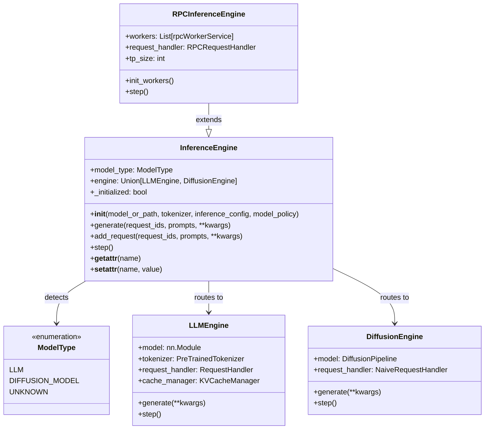
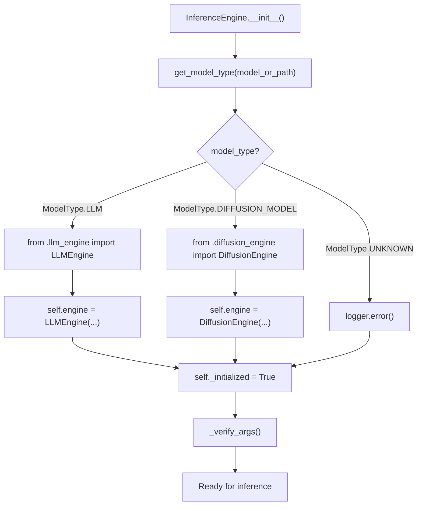
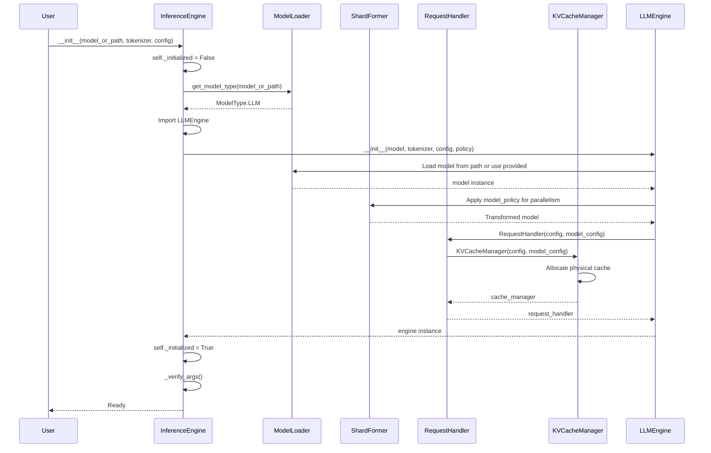
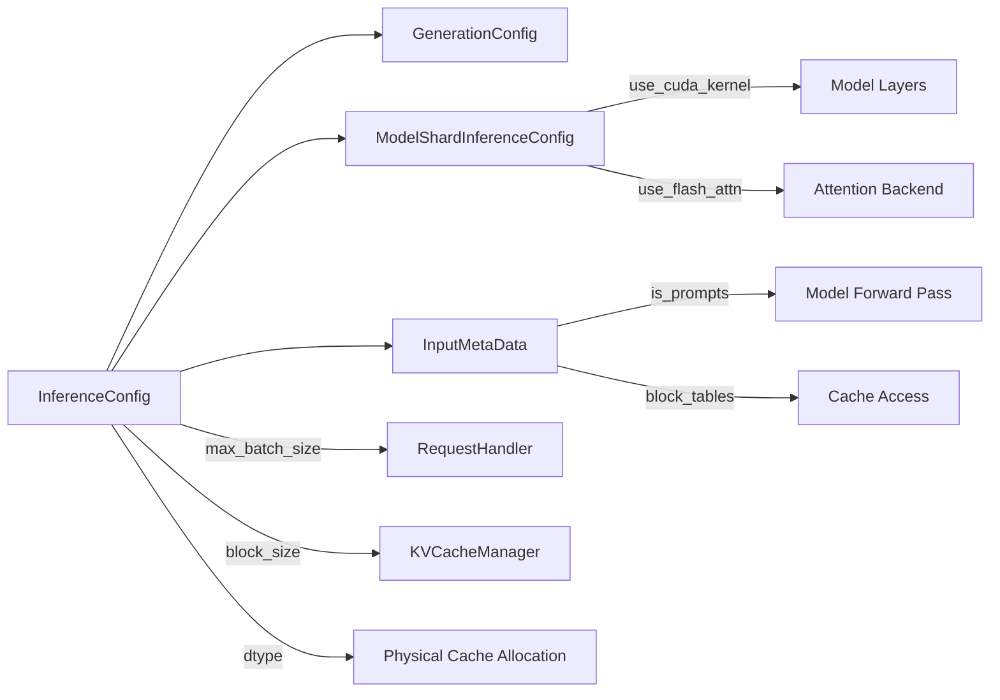
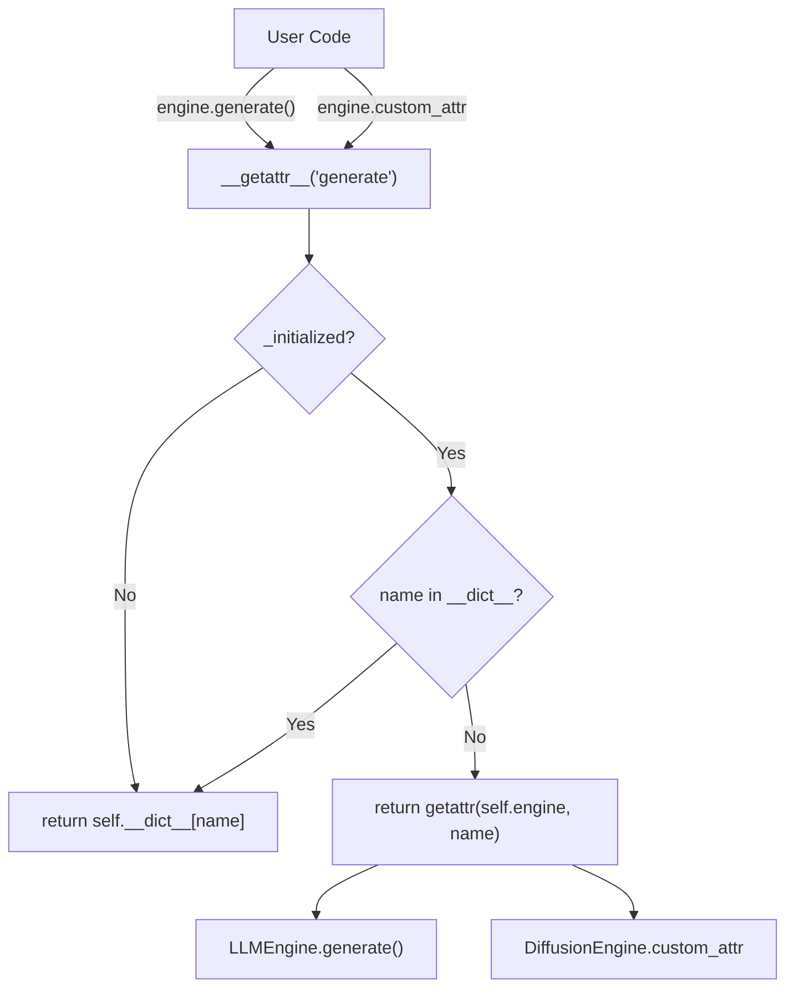
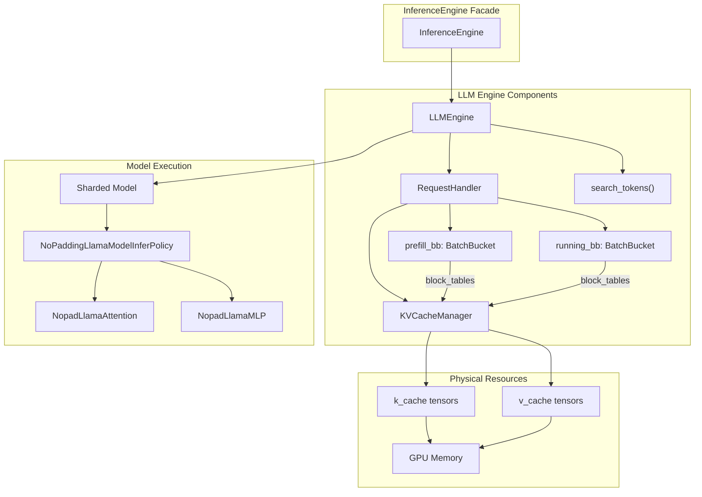
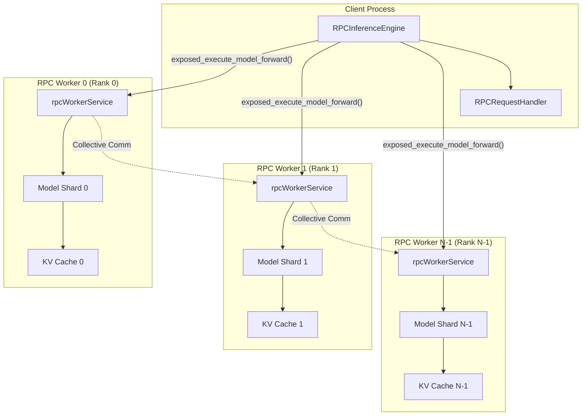
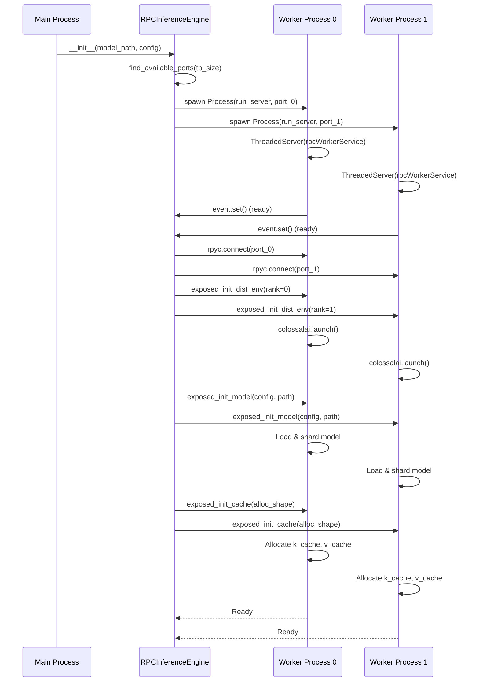
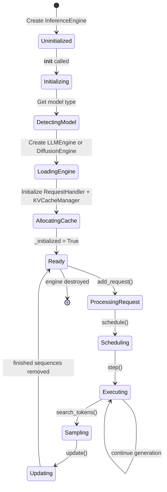

<!-- source: DeepWiki mcp.deepwiki.com · repo hpcaitech/ColossalAI · page 6.1 Engine Architecture · fetched 2026-10-21 -->

# Engine Architecture

<details>
<summary>Relevant source files</summary>

The following files were used as context for generating this wiki page:

- [colossalai/inference/batch_bucket.py](colossalai/inference/batch_bucket.py)
- [colossalai/inference/config.py](colossalai/inference/config.py)
- [colossalai/inference/core/engine.py](colossalai/inference/core/engine.py)
- [colossalai/inference/core/request_handler.py](colossalai/inference/core/request_handler.py)
- [colossalai/inference/core/rpc_engine.py](colossalai/inference/core/rpc_engine.py)
- [colossalai/inference/executor/rpc_worker.py](colossalai/inference/executor/rpc_worker.py)
- [colossalai/inference/kv_cache/__init__.py](colossalai/inference/kv_cache/__init__.py)
- [colossalai/inference/kv_cache/kvcache_manager.py](colossalai/inference/kv_cache/kvcache_manager.py)
- [colossalai/inference/logit_processors.py](colossalai/inference/logit_processors.py)
- [colossalai/inference/modeling/layers/attention.py](colossalai/inference/modeling/layers/attention.py)
- [colossalai/inference/modeling/models/nopadding_llama.py](colossalai/inference/modeling/models/nopadding_llama.py)
- [colossalai/inference/modeling/policy/__init__.py](colossalai/inference/modeling/policy/__init__.py)
- [colossalai/inference/modeling/policy/nopadding_llama.py](colossalai/inference/modeling/policy/nopadding_llama.py)
- [colossalai/inference/sampler.py](colossalai/inference/sampler.py)
- [colossalai/inference/struct.py](colossalai/inference/struct.py)
- [tests/test_infer/test_batch_bucket.py](tests/test_infer/test_batch_bucket.py)
- [tests/test_infer/test_config_and_struct.py](tests/test_infer/test_config_and_struct.py)
- [tests/test_infer/test_inference_engine.py](tests/test_infer/test_inference_engine.py)
- [tests/test_infer/test_kvcache_manager.py](tests/test_infer/test_kvcache_manager.py)
- [tests/test_infer/test_models/test_attention.py](tests/test_infer/test_models/test_attention.py)
- [tests/test_infer/test_request_handler.py](tests/test_infer/test_request_handler.py)

</details>


## Purpose and Scope

This document describes the architecture of the inference engine layer, which provides a unified interface for running inference on both LLM and Diffusion models. The `InferenceEngine` class acts as a facade that routes to model-specific implementations while managing configuration and model initialization.

For details on request scheduling and batch management, see [Request Handling and Batching](#6.2). For KV cache implementation, see [KV Cache Management](#6.3). For distributed inference across nodes, see [Distributed Inference with RPC](#6.4).

## InferenceEngine Class Hierarchy

The inference engine system uses a facade pattern where `InferenceEngine` acts as the primary user-facing interface, routing to specialized engine implementations based on model type.



**Sources:** [colossalai/inference/core/engine.py:16-134](), [colossalai/inference/utils.py](), [colossalai/inference/core/rpc_engine.py:36-273]()

## Model Type Detection and Routing

The `InferenceEngine` determines the appropriate engine implementation by detecting the model type during initialization. This routing is transparent to the user.



**Sources:** [colossalai/inference/core/engine.py:36-62](), [colossalai/inference/utils.py]()

The detection logic examines the model structure:
- **LLM models**: Detected by presence of transformer architecture patterns (e.g., `LlamaForCausalLM`, `BaichuanForCausalLM`)
- **Diffusion models**: Detected by `DiffusionPipeline` base class or diffusion-specific attributes
- **Unknown**: Falls back to error state if neither pattern matches

## Initialization Flow

The engine initialization process involves multiple stages that prepare the model, cache, and request handling infrastructure.



**Sources:** [colossalai/inference/core/engine.py:28-67](), [colossalai/inference/core/request_handler.py:151-216](), [colossalai/inference/kv_cache/kvcache_manager.py:48-125]()

### Initialization Parameter Flow

| Component | Configuration Input | Key Initialized Objects |
|-----------|-------------------|------------------------|
| `InferenceEngine` | `InferenceConfig`, `model_policy` | `self.engine` (LLM or Diffusion), `self.model_type` |
| `LLMEngine` | Inherited from `InferenceConfig` | `self.model`, `self.request_handler`, `self.generation_config` |
| `RequestHandler` | `inference_config`, `model_config` | `self.cache_manager`, `self.running_bb`, `self.prefill_bb` |
| `KVCacheManager` | `inference_config`, `model_config` | `self._kv_caches`, `self._cache_blocks` |

**Sources:** [colossalai/inference/config.py:151-395](), [colossalai/inference/core/request_handler.py:151-217]()

## Configuration System

The engine relies on a hierarchical configuration system that propagates settings from top-level inference parameters down to specific components.



**Sources:** [colossalai/inference/config.py:52-461]()

### InferenceConfig Structure

The `InferenceConfig` dataclass contains all configuration parameters and provides conversion methods to component-specific configs:

| Method | Returns | Purpose |
|--------|---------|---------|
| `to_generation_config(model_config)` | `GenerationConfig` | Transformer-compatible generation parameters |
| `to_model_shard_inference_config()` | `ModelShardInferenceConfig` | Model sharding and optimization settings |
| `to_rpc_param()` | `dict` | Serialized config for RPC transmission |
| `from_rpc_param(rpc_dict)` | `InferenceConfig` | Deserialized config reconstruction |

**Sources:** [colossalai/inference/config.py:317-380]()

Key configuration parameters:

```python
# Runtime limits
max_batch_size: int = 8
max_output_len: int = 256
max_input_len: int = 256

# Model execution
dtype: torch.dtype = torch.float16
use_cuda_kernel: bool = False
use_cuda_graph: bool = False

# Parallelism
tp_size: int = 1
pp_size: int = 1

# Memory management
block_size: int = 16
prefill_ratio: float = 1.2

# Generation
do_sample: bool = False
top_k: int = 50
top_p: float = 1.0
temperature: float = 1.0
```

**Sources:** [colossalai/inference/config.py:195-253]()

## Facade Pattern Implementation

The `InferenceEngine` implements a transparent proxy pattern using Python's `__getattr__` and `__setattr__` magic methods to delegate all operations to the underlying engine.



**Sources:** [colossalai/inference/core/engine.py:111-133]()

This design allows users to interact with `InferenceEngine` as if it were the specific engine type:

```python
# All these calls are transparently forwarded to the underlying LLMEngine or DiffusionEngine
inference_engine.add_request(prompts=["Hello"])
inference_engine.step()
outputs = inference_engine.generate(prompts=["Test"])

# Even custom attributes are accessible
cache_manager = inference_engine.cache_manager  # From LLMEngine.cache_manager
```

**Sources:** [colossalai/inference/core/engine.py:111-125]()

## Component Integration

The engine integrates several major subsystems to provide complete inference capability.



**Sources:** [colossalai/inference/core/engine.py:16-134](), [colossalai/inference/core/request_handler.py:140-403](), [colossalai/inference/kv_cache/kvcache_manager.py:18-558]()

### Key Interfaces

| Component A | Component B | Interface | Purpose |
|-------------|-------------|-----------|---------|
| `InferenceEngine` | `LLMEngine` / `DiffusionEngine` | `generate()`, `step()`, `add_request()` | Unified inference operations |
| `LLMEngine` | `RequestHandler` | `schedule()`, `update()` | Batch scheduling and lifecycle |
| `RequestHandler` | `BatchBucket` | `running_bb`, `prefill_bb` | Separate prefill and decode batches |
| `RequestHandler` | `KVCacheManager` | `allocate_context_from_block_tables()`, `free_block_table()` | Cache allocation and deallocation |
| `BatchBucket` | `KVCacheManager` | `block_tables` tensor | Block allocation mapping |

**Sources:** [colossalai/inference/core/engine.py:69-110](), [colossalai/inference/core/request_handler.py:235-396]()

## RPC-Based Distributed Engine

For multi-GPU distributed inference, `RPCInferenceEngine` extends `InferenceEngine` with RPC worker coordination.



**Sources:** [colossalai/inference/core/rpc_engine.py:36-273](), [colossalai/inference/executor/rpc_worker.py:44-267]()

### RPC Worker Initialization Flow

The distributed engine spawns worker processes and establishes RPC connections:



**Sources:** [colossalai/inference/core/rpc_engine.py:134-211](), [colossalai/inference/executor/rpc_worker.py:51-99]()

### RPC Method Exposure

The `rpcWorkerService` exposes methods with the `exposed_` prefix that can be invoked remotely:

| Method | Parameters | Purpose |
|--------|-----------|---------|
| `exposed_init_dist_env()` | `rank`, `world_size`, `master_address`, `master_port` | Initialize distributed environment |
| `exposed_init_model()` | `inference_config_param`, `model_or_path`, `model_policy_param` | Load and shard model |
| `exposed_init_cache()` | `alloc_shape` | Allocate physical KV cache |
| `exposed_execute_model_forward()` | `input_token_ids_param`, `input_meta_data_param`, `generation_config_param` | Execute forward pass and sampling |

**Sources:** [colossalai/inference/executor/rpc_worker.py:51-133]()

Each worker maintains its own:
- Model shard (via `ShardFormer` with tensor/pipeline parallelism)
- Physical KV cache tensors (`self.k_cache`, `self.v_cache`)
- FD intermediate tensors for flash decoding (`self.fd_inter_tensor`)
- Output tensor buffer (`self.output_tensor`)

**Sources:** [colossalai/inference/executor/rpc_worker.py:134-168]()

## Engine Lifecycle and State Management

The engine maintains state throughout its lifecycle, from initialization through generation to shutdown.



**Sources:** [colossalai/inference/core/engine.py:28-67]()

State flags and their meanings:

| Flag | Location | Meaning |
|------|----------|---------|
| `self._initialized` | `InferenceEngine` | Engine has completed initialization |
| `seq.status` | `Sequence` | Per-sequence state (WAITING, RUNNING, COMPLETED, etc.) |
| `batch.is_prompts` | `BatchBucket` | Whether batch contains prefill or decode sequences |
| `cache_manager._available_blocks` | `KVCacheManager` | Number of free cache blocks |

**Sources:** [colossalai/inference/core/engine.py:36-67](), [colossalai/inference/struct.py:15-48](), [colossalai/inference/batch_bucket.py:68-82]()

---

