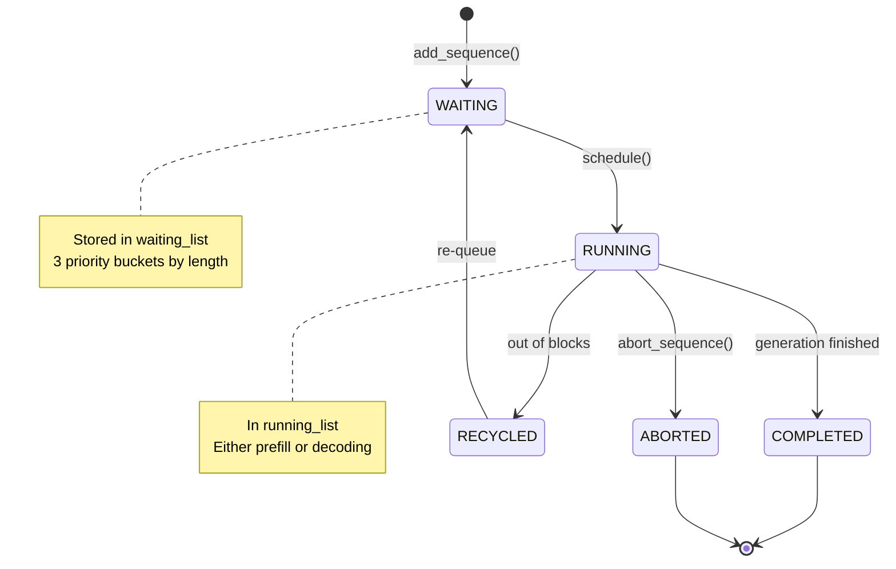
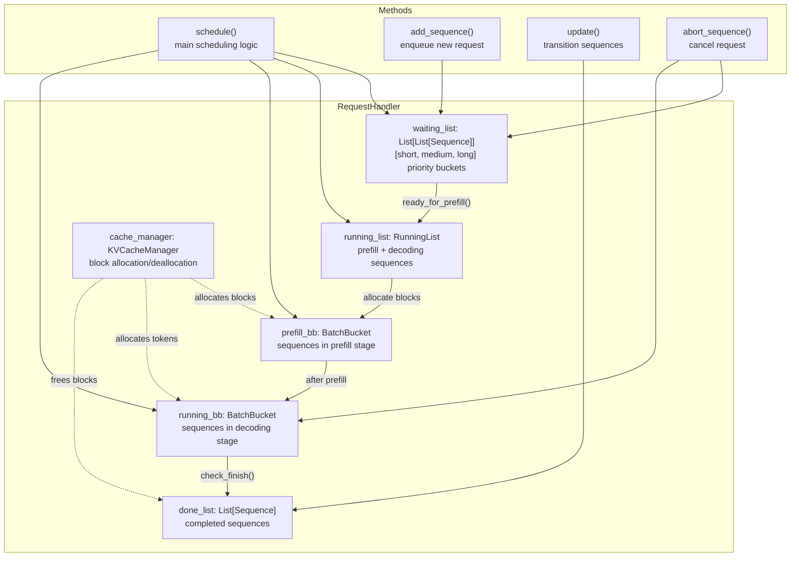
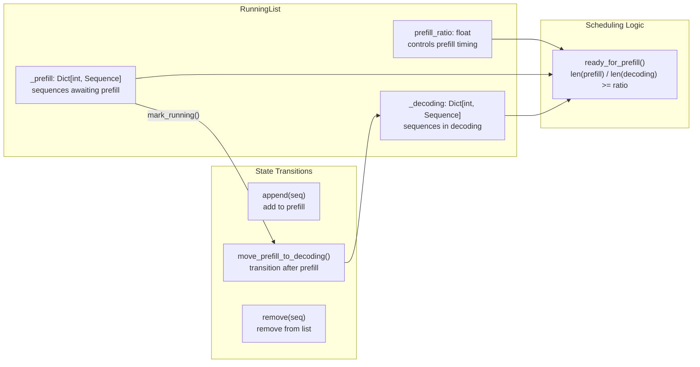
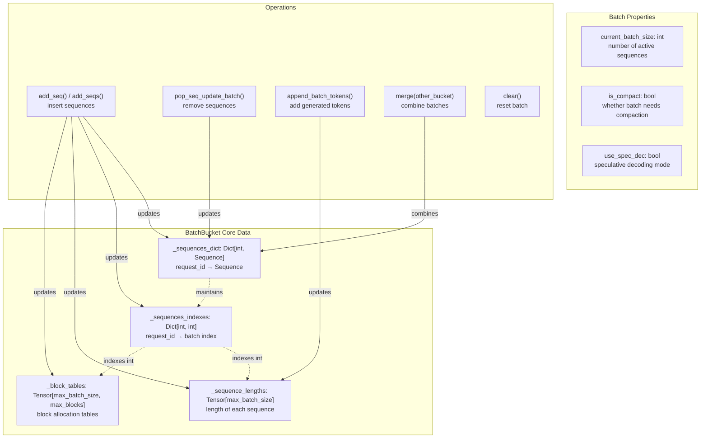
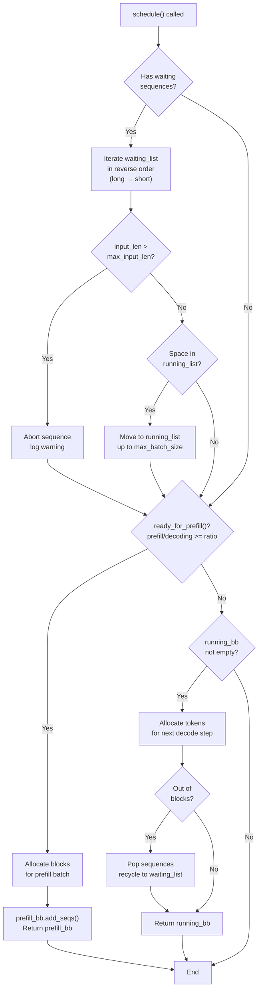
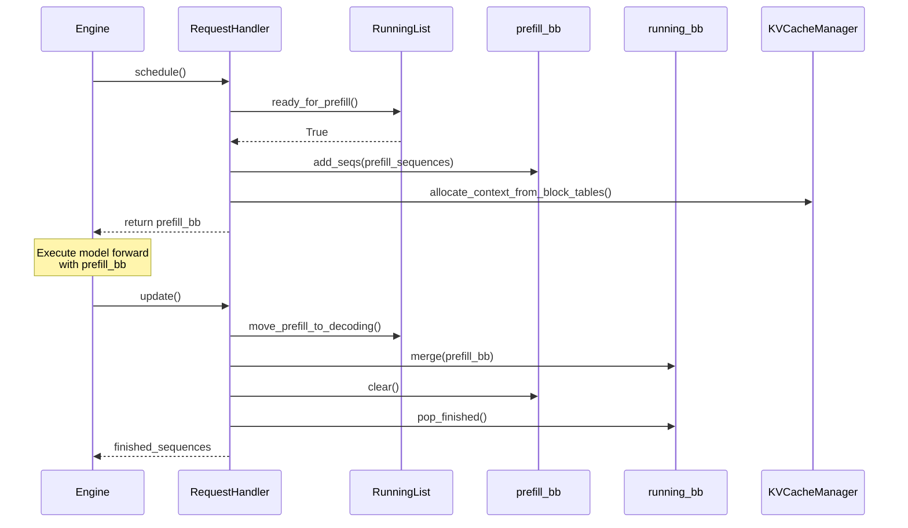
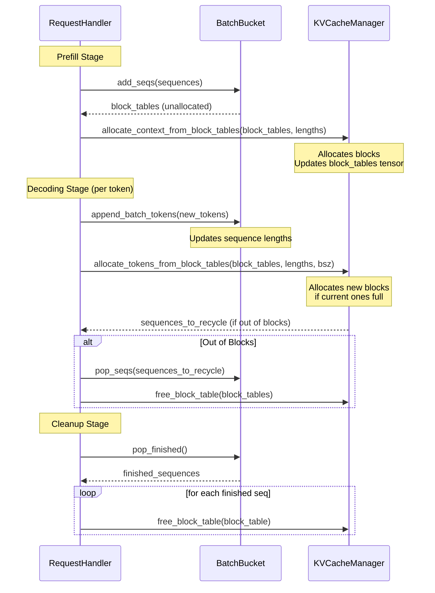

<!-- source: DeepWiki mcp.deepwiki.com · repo hpcaitech/ColossalAI · page 6.2 Request Handling and Batching · fetched 2026-10-21 -->

# Request Handling and Batching

<details>
<summary>Relevant source files</summary>

The following files were used as context for generating this wiki page:

- [colossalai/inference/batch_bucket.py](colossalai/inference/batch_bucket.py)
- [colossalai/inference/config.py](colossalai/inference/config.py)
- [colossalai/inference/core/engine.py](colossalai/inference/core/engine.py)
- [colossalai/inference/core/request_handler.py](colossalai/inference/core/request_handler.py)
- [colossalai/inference/core/rpc_engine.py](colossalai/inference/core/rpc_engine.py)
- [colossalai/inference/executor/rpc_worker.py](colossalai/inference/executor/rpc_worker.py)
- [colossalai/inference/kv_cache/__init__.py](colossalai/inference/kv_cache/__init__.py)
- [colossalai/inference/kv_cache/kvcache_manager.py](colossalai/inference/kv_cache/kvcache_manager.py)
- [colossalai/inference/logit_processors.py](colossalai/inference/logit_processors.py)
- [colossalai/inference/modeling/layers/attention.py](colossalai/inference/modeling/layers/attention.py)
- [colossalai/inference/modeling/models/nopadding_llama.py](colossalai/inference/modeling/models/nopadding_llama.py)
- [colossalai/inference/modeling/policy/__init__.py](colossalai/inference/modeling/policy/__init__.py)
- [colossalai/inference/modeling/policy/nopadding_llama.py](colossalai/inference/modeling/policy/nopadding_llama.py)
- [colossalai/inference/sampler.py](colossalai/inference/sampler.py)
- [colossalai/inference/struct.py](colossalai/inference/struct.py)
- [tests/test_infer/test_batch_bucket.py](tests/test_infer/test_batch_bucket.py)
- [tests/test_infer/test_config_and_struct.py](tests/test_infer/test_config_and_struct.py)
- [tests/test_infer/test_inference_engine.py](tests/test_infer/test_inference_engine.py)
- [tests/test_infer/test_kvcache_manager.py](tests/test_infer/test_kvcache_manager.py)
- [tests/test_infer/test_models/test_attention.py](tests/test_infer/test_models/test_attention.py)
- [tests/test_infer/test_request_handler.py](tests/test_infer/test_request_handler.py)

</details>


This document describes the request handling and batching system in ColossalAI's inference engine. This system manages the lifecycle of inference requests, schedules them for execution, and organizes them into efficient batches for processing. It implements continuous batching to maximize GPU utilization during LLM inference.

For information about the overall inference architecture, see [Inference Engine](#6). For KV cache management during request processing, see [KV Cache Management](#6.3).

## Overview

The request handling system consists of three primary components:

1. **RequestHandler**: Manages request lifecycle and scheduling decisions
2. **RunningList**: Tracks sequences in prefill and decoding stages
3. **BatchBucket**: Organizes sequences into batches for model execution

These components work together to implement continuous batching, where new requests can be added while existing requests are being processed, maximizing hardware utilization.

Sources: [colossalai/inference/core/request_handler.py:140-403]()

## Request Lifecycle



Sources: [colossalai/inference/struct.py:15-49](), [colossalai/inference/core/request_handler.py:300-329]()

### Request Status Transitions

| Status | Description | Next States |
|--------|-------------|-------------|
| `WAITING` | Request queued, awaiting resources | `RUNNING`, `ABORTED` |
| `RUNNING` | Currently being processed (prefill or decode) | `COMPLETED`, `RECYCLED`, `ABORTED` |
| `COMPLETED` | Generation finished successfully | Terminal state |
| `RECYCLED` | Temporarily removed due to resource constraints | `WAITING` |
| `ABORTED` | Request cancelled by user | Terminal state |

Sources: [colossalai/inference/struct.py:15-49]()

## Core Components

### RequestHandler Architecture



Sources: [colossalai/inference/core/request_handler.py:140-403]()

### Three-Tier Waiting Queue

The `RequestHandler` maintains three waiting queues prioritized by input length to optimize batch processing:

```python
self.waiting_list: List[List] = [[], [], []]  # [short, medium, long]
```

When a sequence is added, it's placed in a bucket based on its input length:

```python
bucket_index = req.input_len * 3 // (self.inference_config.max_input_len + 1)
self.waiting_list[bucket_index].append(req)
```

During scheduling, longer sequences are processed with higher priority (reversed iteration) to minimize padding overhead.

Sources: [colossalai/inference/core/request_handler.py:154-163](), [colossalai/inference/core/request_handler.py:300-308]()

### RunningList Structure



The `RunningList` implements a key optimization: it batches prefill operations to balance prefill and decoding workloads. The `prefill_ratio` parameter (default 1.2) determines when to perform prefill:

```python
def ready_for_prefill(self):
    if not self._decoding:
        return len(self._prefill) > 0
    return len(self._prefill) / len(self._decoding) >= self.prefill_ratio
```

This prevents prefill operations from starving decoding operations and vice versa.

Sources: [colossalai/inference/core/request_handler.py:19-99]()

## Batch Management

### BatchBucket Data Structure

The `BatchBucket` class manages batches of sequences and their associated metadata:



Sources: [colossalai/inference/batch_bucket.py:9-217]()

### Batch Compaction

The `BatchBucket` maintains an internal consistency invariant called "compactness". A batch is compact when:

1. All active sequences are stored contiguously at the front of the tensors
2. The sequence dictionary, indexes, lengths, and block tables are all consistent

After removing sequences, the batch may become fragmented. The `_make_compact()` method reorganizes the data:

| Before Pop | After Pop (fragmented) | After Compact |
|------------|------------------------|---------------|
| `[seq0, seq1, seq2, seq3]` | `[seq0, _, seq2, seq3]` | `[seq0, seq2, seq3, _]` |
| Lengths: `[10, 15, 20, 25]` | Lengths: `[10, 0, 20, 25]` | Lengths: `[10, 20, 25, 0]` |

Sources: [colossalai/inference/batch_bucket.py:99-106](), [colossalai/inference/batch_bucket.py:162-182]()

## Scheduling Algorithm

### Main Scheduling Loop



The `schedule()` method returns either `prefill_bb` or `running_bb` to indicate which batch should be processed next.

Sources: [colossalai/inference/core/request_handler.py:235-291]()

### Prefill vs Decoding Decision

The scheduling algorithm alternates between prefill and decoding stages based on the `prefill_ratio`:

```python
def ready_for_prefill(self):
    if not self._decoding:
        return len(self._prefill) > 0
    return len(self._prefill) / len(self._decoding) >= self.prefill_ratio
```

**Example with `prefill_ratio=1.2`:**

| Prefill Count | Decoding Count | Ratio | Action |
|---------------|----------------|-------|--------|
| 3 | 0 | ∞ | Do prefill |
| 2 | 4 | 0.5 | Continue decoding |
| 3 | 2 | 1.5 | Do prefill |
| 1 | 3 | 0.33 | Continue decoding |

This mechanism ensures a balanced workload between prefill (processing new prompts) and decoding (generating tokens for existing sequences).

Sources: [colossalai/inference/core/request_handler.py:83-86]()

## Continuous Batching

### Batch Merging After Prefill

After completing a prefill step, sequences transition from `prefill_bb` to `running_bb`:



The `update()` method orchestrates this transition:

```python
def update(self):
    if not self.prefill_bb.is_empty:
        self.running_list.move_prefill_to_decoding(self.prefill_bb.seqs_ids)
        self.running_bb.merge(self.prefill_bb)
        self.prefill_bb.clear(free_block_tables_fn=None)
    
    finished_seqs, _ = self.running_bb.pop_finished(self.cache_manager.free_block_table)
    for seq in finished_seqs:
        self.running_list.remove(seq)
    self.done_list.extend(finished_seqs)
    
    return finished_seqs
```

Sources: [colossalai/inference/core/request_handler.py:380-396]()

### Adding New Requests During Decoding

Continuous batching allows adding new requests while existing ones are decoding:

```mermaid
gantt
    title Continuous Batching Timeline
    dateFormat X
    axisFormat %s
    
    section Batch 1
    Prefill (Req 1,2)    :0, 1
    Decode Step 1        :1, 2
    Decode Step 2        :2, 3
    Decode Step 3        :3, 4
    
    section Batch 2
    Waiting              :0, 2
    Prefill (Req 3,4)    :2, 3
    Decode Step 1        :3, 4
    
    section Combined
    Batch 1 + 2 Decode   :3, 4
```



This happens when:
1. New requests arrive and are added to `waiting_list`
2. The current batch (`running_bb`) continues decoding
3. When `ready_for_prefill()` returns True, new requests are prefilled
4. After prefill, the new batch merges into `running_bb`

Sources: [colossalai/inference/core/request_handler.py:235-291]()

## Integration with KV Cache

### Block Allocation Flow



Sources: [colossalai/inference/core/request_handler.py:262-291](), [colossalai/inference/batch_bucket.py:184-269]()

### Block Table Management

Each sequence in a batch has a corresponding block table that maps token positions to physical cache blocks:

```python
self._block_tables = torch.full((self.max_batch_size, max_blocks_per_seq), -1, dtype=torch.int32)
```

| Batch Index | Request ID | Block Table | Sequence Length |
|-------------|-----------|-------------|-----------------|
| 0 | 42 | `[0, 1, 2, -1, -1]` | 18 tokens |
| 1 | 43 | `[3, 4, -1, -1, -1]` | 9 tokens |
| 2 | 44 | `[5, 6, 7, 8, -1]` | 30 tokens |

The `-1` values indicate unallocated block table slots. As sequences generate more tokens, additional blocks are allocated.

Sources: [colossalai/inference/batch_bucket.py:58-65]()

## Special Features

### Speculative Decoding Support

The request handler supports speculative decoding mode, where multiple tokens are verified in parallel:

```python
def set_spec_dec_mode(self, n_spec_tokens: int):
    self.prefill_bb.set_use_spec_dec(n_spec_tokens)
    self.running_bb.set_use_spec_dec(n_spec_tokens)

def allocate_batch_spec_dec(self, batch: BatchBucket, n: int):
    assert batch.use_spec_dec
    if n > 0:
        self.cache_manager.allocate_n_tokens_from_block_tables(
            batch.block_tables, batch.seq_lengths, batch.current_batch_size, n=n
        )
```

In speculative decoding mode:
- The batch processes `n_spec_tokens + 1` tokens per step (speculated + ground truth)
- Block allocation reserves space for multiple tokens
- Only batch size 1 is currently supported for prefill with speculative decoding

Sources: [colossalai/inference/core/request_handler.py:227-234](), [colossalai/inference/core/request_handler.py:293-298]()

### StreamingLLM Integration

For streaming long contexts, the batch bucket tracks when blocks need to be swapped:

```python
def streamingllm_update_batch(self, start_token_size: int, generated_token_size: int):
    updated_block_ids = []
    if self.current_batch_size > 0:
        for batch_id in range(self.current_batch_size):
            if sequence_lengths_list[batch_id] == start_token_size + generated_token_size + self.block_size - 1:
                sequence_lengths_list[batch_id] = start_token_size + generated_token_size - 1
                block_id = block_tables_list[batch_id].pop(1)  # Remove second block
                updated_block_ids.append(block_id)
    return updated_block_ids
```

This implements sliding window attention by swapping out middle blocks while preserving attention sink tokens.

Sources: [colossalai/inference/batch_bucket.py:122-147](), [colossalai/inference/core/request_handler.py:398-402]()

## Configuration Parameters

The `InferenceConfig` class controls request handling behavior:

| Parameter | Default | Description |
|-----------|---------|-------------|
| `max_batch_size` | 8 | Maximum number of sequences in a batch |
| `max_input_len` | 256 | Maximum input prompt length |
| `max_output_len` | 256 | Maximum output generation length |
| `prefill_ratio` | 1.2 | Ratio threshold for prefill scheduling |
| `block_size` | 16 | Number of tokens per cache block |
| `use_spec_dec` | False | Enable speculative decoding |
| `max_n_spec_tokens` | 5 | Number of speculated tokens per step |

Sources: [colossalai/inference/config.py:195-227]()

## Usage Example

```python
from colossalai.inference.config import InferenceConfig
from colossalai.inference.core.request_handler import RequestHandler
from colossalai.inference.struct import Sequence
from transformers.models.llama import LlamaConfig

# Initialize configuration
inference_config = InferenceConfig(
    max_batch_size=8,
    max_input_len=128,
    max_output_len=128,
    prefill_ratio=1.2,
    block_size=16
)

model_config = LlamaConfig(
    hidden_size=4096,
    num_hidden_layers=32,
    num_attention_heads=32
)

# Create request handler
request_handler = RequestHandler(inference_config, model_config)

# Add sequences
seq1 = Sequence(
    request_id=1,
    prompt="Hello, world!",
    input_token_id=[1, 2, 3, 4, 5],
    block_size=16,
    eos_token_id=2,
    pad_token_id=0,
    sample_params=None
)
request_handler.add_sequence(seq1)

# Schedule next batch
batch = request_handler.schedule()  # Returns prefill_bb or running_bb

# After model forward pass
next_tokens = torch.tensor([42, 43, 44])  # Generated tokens
request_handler.append_next_tokens(next_tokens)

# Update state
finished_seqs = request_handler.update()
```

Sources: [tests/test_infer/test_request_handler.py:56-90]()

## Performance Considerations

### Batch Size and Throughput

The effective batch size varies based on:
- Number of waiting sequences
- Available KV cache blocks
- Current prefill/decoding ratio

Larger batches improve throughput but require more memory. The scheduler automatically adjusts based on resource availability.

### Priority Queue Strategy

The three-tier waiting queue prioritizes longer sequences to minimize wasted computation from padding. When sequences of similar length are batched together, less padding is needed, improving efficiency.

### Memory Recycling

When running out of cache blocks during decoding, sequences can be recycled back to the waiting list:

```python
seqs_to_recycle = self.cache_manager.allocate_tokens_from_block_tables(
    self.running_bb.block_tables, self.running_bb.seq_lengths, self.running_bb.current_batch_size
)
if seqs_to_recycle:
    seqs = self.running_bb.pop_seqs(seqs_to_recycle)
    for seq in seqs:
        seq.recycle()
        self.running_list.remove(seq)
        self.waiting_list[-1].append(seq)  # Highest priority bucket
```

Recycled sequences are placed in the highest priority bucket for reprocessing.

Sources: [colossalai/inference/core/request_handler.py:280-289]()

---

