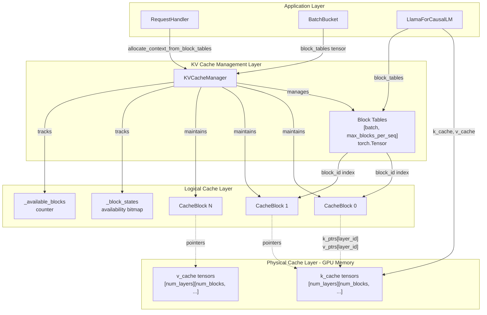
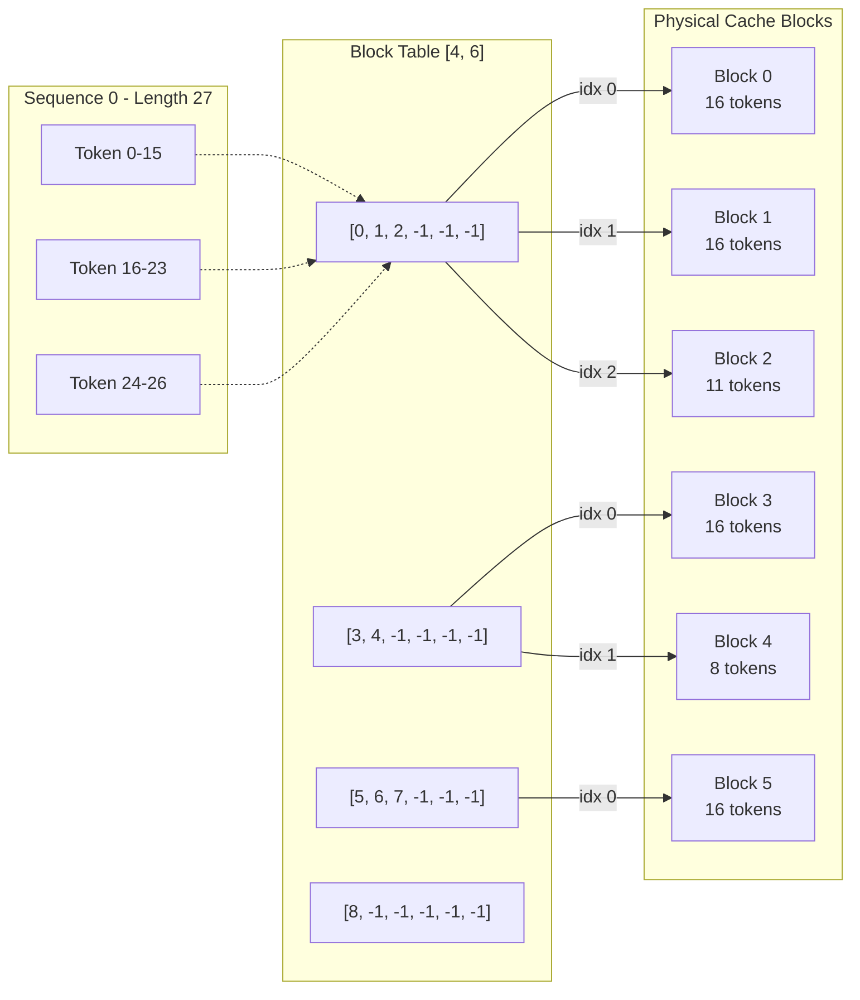
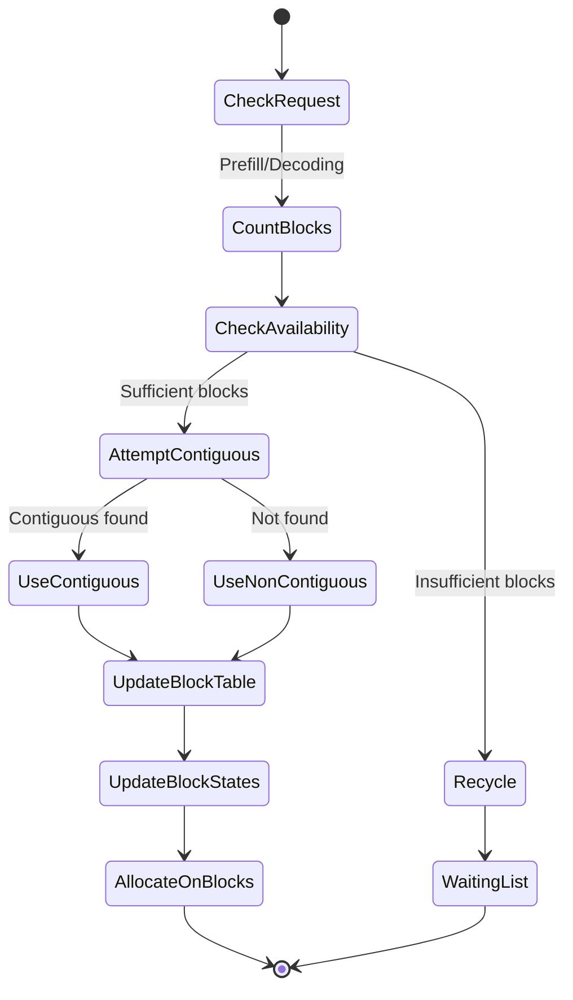
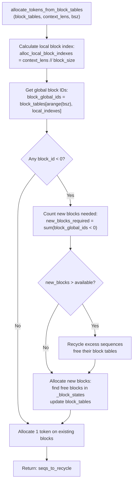
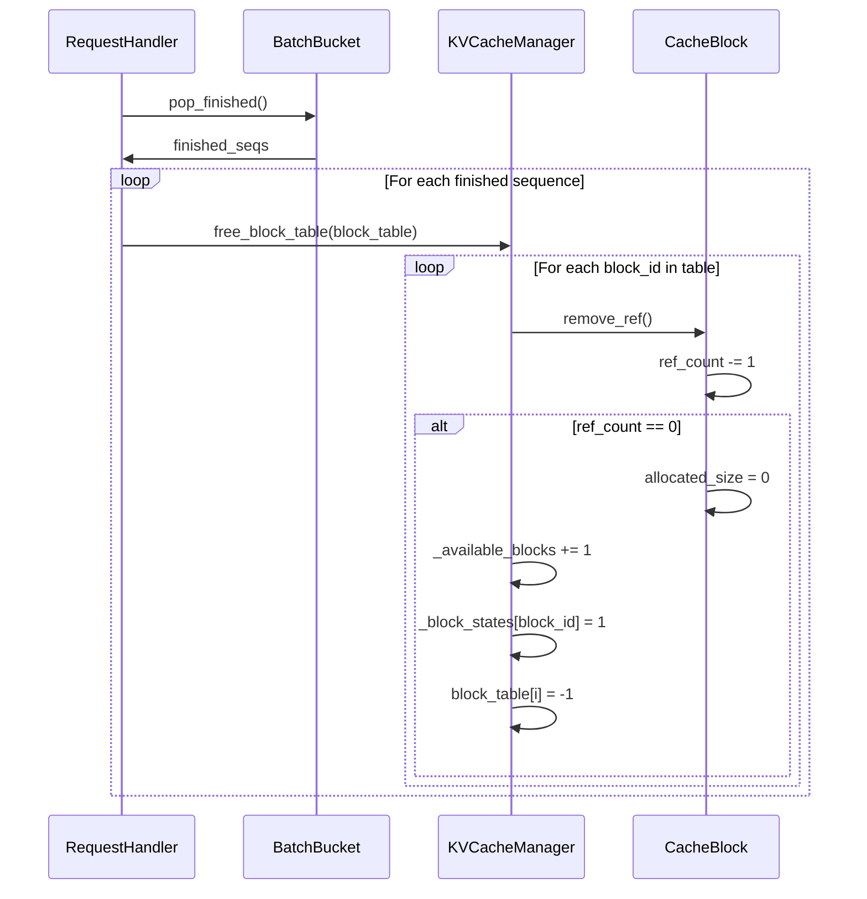
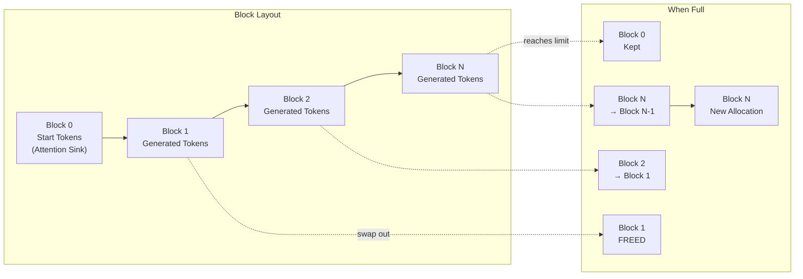
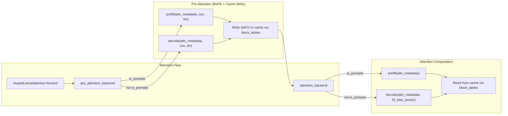

<!-- source: DeepWiki mcp.deepwiki.com · repo hpcaitech/ColossalAI · page 6.3 KV Cache Management · fetched 2026-10-21 -->

# KV Cache Management

<details>
<summary>Relevant source files</summary>

The following files were used as context for generating this wiki page:

- [colossalai/inference/batch_bucket.py](colossalai/inference/batch_bucket.py)
- [colossalai/inference/config.py](colossalai/inference/config.py)
- [colossalai/inference/core/engine.py](colossalai/inference/core/engine.py)
- [colossalai/inference/core/request_handler.py](colossalai/inference/core/request_handler.py)
- [colossalai/inference/core/rpc_engine.py](colossalai/inference/core/rpc_engine.py)
- [colossalai/inference/executor/rpc_worker.py](colossalai/inference/executor/rpc_worker.py)
- [colossalai/inference/kv_cache/__init__.py](colossalai/inference/kv_cache/__init__.py)
- [colossalai/inference/kv_cache/kvcache_manager.py](colossalai/inference/kv_cache/kvcache_manager.py)
- [colossalai/inference/logit_processors.py](colossalai/inference/logit_processors.py)
- [colossalai/inference/modeling/layers/attention.py](colossalai/inference/modeling/layers/attention.py)
- [colossalai/inference/modeling/models/nopadding_llama.py](colossalai/inference/modeling/models/nopadding_llama.py)
- [colossalai/inference/modeling/policy/__init__.py](colossalai/inference/modeling/policy/__init__.py)
- [colossalai/inference/modeling/policy/nopadding_llama.py](colossalai/inference/modeling/policy/nopadding_llama.py)
- [colossalai/inference/sampler.py](colossalai/inference/sampler.py)
- [colossalai/inference/struct.py](colossalai/inference/struct.py)
- [tests/test_infer/test_batch_bucket.py](tests/test_infer/test_batch_bucket.py)
- [tests/test_infer/test_config_and_struct.py](tests/test_infer/test_config_and_struct.py)
- [tests/test_infer/test_inference_engine.py](tests/test_infer/test_inference_engine.py)
- [tests/test_infer/test_kvcache_manager.py](tests/test_infer/test_kvcache_manager.py)
- [tests/test_infer/test_models/test_attention.py](tests/test_infer/test_models/test_attention.py)
- [tests/test_infer/test_request_handler.py](tests/test_infer/test_request_handler.py)

</details>


The KV Cache Management system provides efficient memory management for key-value caches during LLM inference. It implements a **paged attention** mechanism with a two-layer abstraction: logical cache blocks and physical GPU memory. This system enables continuous batching, dynamic sequence management, and memory-efficient inference for large language models.

For information about request scheduling and batching, see [Request Handling and Batching](#6.2). For details on attention computation using the cache, see [Custom Attention Mechanisms](#5.2).

---

## Architecture Overview

The KV cache system implements a two-layer architecture separating logical block management from physical memory allocation.

### Two-Layer Cache Architecture



**Sources:** [colossalai/inference/kv_cache/kvcache_manager.py:18-46](), [colossalai/inference/kv_cache/kvcache_manager.py:48-125]()

### Core Components

| Component | Type | Description |
|-----------|------|-------------|
| `KVCacheManager` | Class | Main manager coordinating logical and physical cache |
| `CacheBlock` | Class | Logical block tracking allocation state and references |
| `_kv_caches` | Tuple[List[Tensor], List[Tensor]] | Physical K/V cache tensors per layer |
| `_cache_blocks` | Tuple[CacheBlock] | Logical block objects |
| `_block_states` | Tensor | Boolean tensor tracking block availability (0=allocated, 1=free) |
| `_block_tables` | Tensor | Maps token positions to block IDs for each sequence |

**Sources:** [colossalai/inference/kv_cache/kvcache_manager.py:48-125](), [colossalai/inference/kv_cache/block_cache.py:1-80]()

---

## Block Table Mechanism

The block table is the core data structure mapping token positions to physical cache blocks.

### Block Table Structure and Mapping



**Mapping Formula**: For a token at position `t` with block size `b`:
- Block index in table: `t // b`
- Position within block: `t % b`

**Sources:** [colossalai/inference/kv_cache/kvcache_manager.py:26-42](), [colossalai/inference/batch_bucket.py:19-21]()

### Physical Cache Layout

The physical cache layout differs based on kernel type:

| Kernel Type | K Cache Shape | V Cache Shape |
|-------------|---------------|---------------|
| CUDA Kernel | `[num_blocks, num_kv_heads, head_size//x, block_size, x]` | `[num_blocks, num_kv_heads, block_size, head_size]` |
| Triton Kernel | `[num_blocks, num_kv_heads, block_size, head_size]` | `[num_blocks, num_kv_heads, block_size, head_size]` |

Where `x = 16 // element_size` for alignment optimization in CUDA kernels.

**Sources:** [colossalai/inference/kv_cache/kvcache_manager.py:94-105]()

---

## Block Allocation Strategies

The KVCacheManager implements contiguous and non-contiguous allocation strategies.

### Allocation Flow



**Sources:** [colossalai/inference/kv_cache/kvcache_manager.py:170-219](), [colossalai/inference/kv_cache/kvcache_manager.py:309-374]()

### Prefill Stage Allocation

The `allocate_context_from_block_table` method allocates blocks for entire input sequences:

1. **Calculate Required Blocks**: `blocks_required = (context_len + block_size - 1) // block_size`
2. **Try Contiguous Allocation**:
   - Compute cumulative sum of `_block_states` tensor
   - Search for contiguous free regions using `torch.subtract` and `torch.nonzero`
   - If found, allocate block range `[start_idx, end_idx)`
3. **Fallback to Non-Contiguous**:
   - Find all free blocks with `torch.nonzero(_block_states == 1)`
   - Allocate first `blocks_required` free blocks
4. **Update State**:
   - Set `_block_states[allocated_blocks] = 0`
   - Update `_available_blocks -= blocks_required`
   - Call `add_ref()` on each `CacheBlock`
   - Set allocated size on last block

**Sources:** [colossalai/inference/kv_cache/kvcache_manager.py:170-219]()

### Decoding Stage Allocation

The `allocate_tokens_from_block_tables` method handles token-by-token generation:



**Sources:** [colossalai/inference/kv_cache/kvcache_manager.py:309-374]()

---

## Lifecycle Management

### Block Reference Counting

The `CacheBlock` class implements reference counting for shared blocks (e.g., beam search):

| Operation | Method | Effect |
|-----------|--------|--------|
| Add reference | `add_ref()` | Increment `ref_count` |
| Remove reference | `remove_ref()` | Decrement `ref_count` |
| Check references | `has_ref()` | Return `ref_count > 0` |
| Allocate space | `allocate(size)` | Increase `allocated_size` |
| Check availability | `available_space` | Return `block_size - allocated_size` |

**Sources:** [colossalai/inference/kv_cache/block_cache.py:17-80]()

### Block Freeing



**Sources:** [colossalai/inference/kv_cache/kvcache_manager.py:426-449](), [colossalai/inference/core/request_handler.py:391-394]()

---

## StreamingLLM Support

StreamingLLM implements sliding window attention with attention sinks for near-infinite context.

### Configuration

StreamingLLM mode is enabled via `InferenceConfig`:

```python
inference_config = InferenceConfig(
    enable_streamingllm=True,
    start_token_size=4,      # Attention sink size
    generated_token_size=512, # Sliding window size
    block_size=16
)
```

**Constraint**: `start_token_size` must be ≤ `block_size`, and `generated_token_size` must be a multiple of `block_size`.

**Sources:** [colossalai/inference/config.py:244-295]()

### Memory Management



The `streamingllm_free_block_tables` method releases the second block when the generated token limit is reached, maintaining the first block (attention sink) and shifting remaining blocks.

**Sources:** [colossalai/inference/kv_cache/kvcache_manager.py:457-469](), [colossalai/inference/batch_bucket.py:122-147]()

---

## Integration with Inference System

### RequestHandler Integration

```mermaid
graph TB
    subgraph "RequestHandler Initialization"
        RH_Init["RequestHandler.__init__()"]
        RH_Init --> InitCache["_init_cache(model_config)"]
        InitCache --> CreateKVM["self.cache_manager = KVCacheManager(config, model_config)"]
    end
    
    subgraph "Scheduling Flow"
        Schedule["schedule()"]
        Schedule --> CheckWaiting{"Has waiting requests?"}
        CheckWaiting -->|Yes| MoveToPrefill["Move to running_list.prefill"]
        
        MoveToPrefill --> ReadyPrefill{"ready_for_prefill()?"}
        ReadyPrefill -->|Yes| AllocPrefill["prefill_bb.add_seqs()<br/>with allocate_context_from_block_tables"]
        ReadyPrefill -->|No| CheckDecoding
        
        CheckDecoding{"running_bb not empty?"} -->|Yes| AllocDecode["allocate_tokens_from_block_tables"]
        AllocDecode --> CheckRecycle{"Sequences to recycle?"}
        CheckRecycle -->|Yes| RecycleSeqs["Pop sequences<br/>Move to waiting_list"]
        CheckRecycle -->|No| ReturnBB
        RecycleSeqs --> ReturnBB["Return batch bucket"]
    end
    
    subgraph "Update Flow"
        Update["update()"]
        Update --> MovePrefillDecode["Move prefill → decoding"]
        MovePrefillDecode --> PopFinished["pop_finished()<br/>with free_block_table"]
        PopFinished --> AddDone["Add to done_list"]
    end
```



**Sources:** [colossalai/inference/core/request_handler.py:150-161](), [colossalai/inference/core/request_handler.py:235-291](), [colossalai/inference/core/request_handler.py:380-395]()

### Model Forward Integration

The KV cache is used in model forward passes through block tables and cache tensors:

| Model Component | KV Cache Usage | File Reference |
|-----------------|----------------|----------------|
| `llama_causal_lm_forward` | Receives `k_caches`, `v_caches` lists | [colossalai/inference/modeling/models/nopadding_llama.py:35-65]() |
| `llama_model_forward` | Passes caches to decoder layers | [colossalai/inference/modeling/models/nopadding_llama.py:68-165]() |
| `llama_decoder_layer_forward` | Passes `k_cache`, `v_cache` to attention | [colossalai/inference/modeling/models/nopadding_llama.py:168-236]() |
| `NopadLlamaAttention.forward` | Writes/reads KV via block tables | [colossalai/inference/modeling/models/nopadding_llama.py:489-590]() |

**Sources:** [colossalai/inference/modeling/models/nopadding_llama.py:35-590]()

### Attention Backend Integration



The `AttentionMetaData` structure carries block table information:

```python
attn_metadata = AttentionMetaData(
    query_states=query_states,
    key_states=key_states,
    value_states=value_states,
    k_cache=k_cache,
    v_cache=v_cache,
    block_tables=block_tables,
    block_size=block_size,
    # ... other fields
)
```

**Sources:** [colossalai/inference/modeling/models/nopadding_llama.py:543-586]()

---

## Configuration Parameters

### InferenceConfig KV Cache Settings

| Parameter | Type | Default | Description |
|-----------|------|---------|-------------|
| `block_size` | int | 16 | Tokens per logical block |
| `kv_cache_dtype` | Optional[str] | None | Data type for KV cache (e.g., "fp8") |
| `enable_streamingllm` | bool | False | Enable sliding window with attention sinks |
| `start_token_size` | int | 4 | Attention sink size for StreamingLLM |
| `generated_token_size` | int | 512 | Sliding window size for StreamingLLM |
| `beam_width` | int | 1 | Beam width for KV cache sizing |
| `max_batch_size` | int | 8 | Maximum batch size |
| `max_input_len` | int | 256 | Maximum input length |
| `max_output_len` | int | 256 | Maximum output length |

**Derived Values**:
- `num_blocks = max_blocks_per_sequence * max_batch_size * beam_width`
- `max_blocks_per_sequence = (max_input_len + max_output_len + block_size - 1) // block_size`

For StreamingLLM:
- `max_blocks_per_sequence = (start_token_size + generated_token_size + block_size - 1) // block_size + 1`

**Sources:** [colossalai/inference/config.py:150-253](), [colossalai/inference/kv_cache/kvcache_manager.py:48-92]()

---

## Key Classes and Methods

### KVCacheManager

| Method | Purpose | Key Parameters |
|--------|---------|----------------|
| `__init__` | Initialize manager, allocate physical cache | `config`, `model_config` |
| `allocate_context_from_block_table` | Allocate blocks for single sequence (prefill) | `block_table`, `context_len` |
| `allocate_context_from_block_tables` | Allocate blocks for batch (prefill) | `block_tables`, `context_lengths` |
| `allocate_token_from_block_table` | Allocate space for single token (decoding) | `block_table`, `context_len` |
| `allocate_tokens_from_block_tables` | Allocate space for batch tokens (decoding) | `block_tables`, `context_lens`, `bsz` |
| `free_block_table` | Free blocks for single sequence | `block_table` |
| `free_block_tables` | Free blocks for batch | `block_tables`, `first_n` |
| `get_physical_cache` | Get K/V cache tensors for layer and block | `layer_id`, `block_idx` |
| `streamingllm_free_block_tables` | Free blocks for StreamingLLM | `updated_block_ids` |

**Sources:** [colossalai/inference/kv_cache/kvcache_manager.py:18-510]()

### CacheBlock

| Attribute/Method | Type/Return | Description |
|------------------|-------------|-------------|
| `block_id` | int | Unique identifier |
| `block_size` | int | Maximum tokens |
| `allocated_size` | int | Currently allocated tokens |
| `ref_count` | int | Reference count |
| `k_ptrs` | List[int] | K cache pointers per layer |
| `v_ptrs` | List[int] | V cache pointers per layer |
| `add_ref()` | None | Increment reference count |
| `remove_ref()` | None | Decrement reference count |
| `has_ref()` | bool | Check if referenced |
| `allocate(size)` | None | Allocate space |
| `available_space` | int | Remaining space |

**Sources:** [colossalai/inference/kv_cache/block_cache.py:17-80]()

---

## Testing and Usage Examples

### Basic Cache Manager Test

From the test suite, typical usage pattern:

```python
# Initialize configuration
inference_config = InferenceConfig(
    block_size=8,
    max_batch_size=10,
    max_input_len=32,
    max_output_len=32,
    dtype=torch.float16
)

# Create cache manager
cache_manager = KVCacheManager(inference_config, model_config)

# Allocate for prefill (single sequence)
block_table = torch.full((max_blocks_per_seq,), -1, dtype=torch.int32)
cache_manager.allocate_context_from_block_table(block_table, context_len=20)

# Allocate for decoding (token by token)
for _ in range(output_len):
    cache_manager.allocate_token_from_block_table(block_table, context_len)
    context_len += 1

# Free when done
cache_manager.free_block_table(block_table)
```

**Sources:** [tests/test_infer/test_kvcache_manager.py:69-149]()

### BatchBucket Integration

```python
# Add sequences to batch bucket
bb = BatchBucket(num_heads, head_dim, max_batch_size, max_length, block_size)
block_tables = bb.add_seqs(
    [seq1, seq2],
    alloc_block_tables_fn=cache_manager.allocate_context_from_block_tables
)

# During decoding, allocate for new tokens
cache_manager.allocate_tokens_from_block_tables(
    bb.block_tables,
    bb.seq_lengths,
    bb.current_batch_size
)

# Clean up finished sequences
bb.pop_finished(cache_manager.free_block_table)
```

**Sources:** [tests/test_infer/test_batch_bucket.py:30-141]()

---

