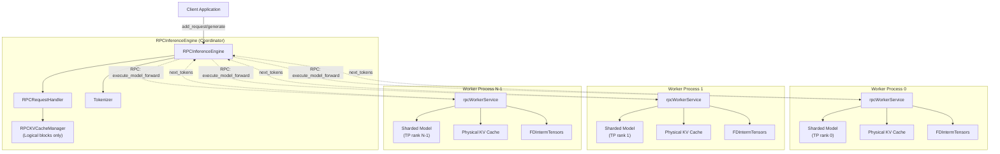
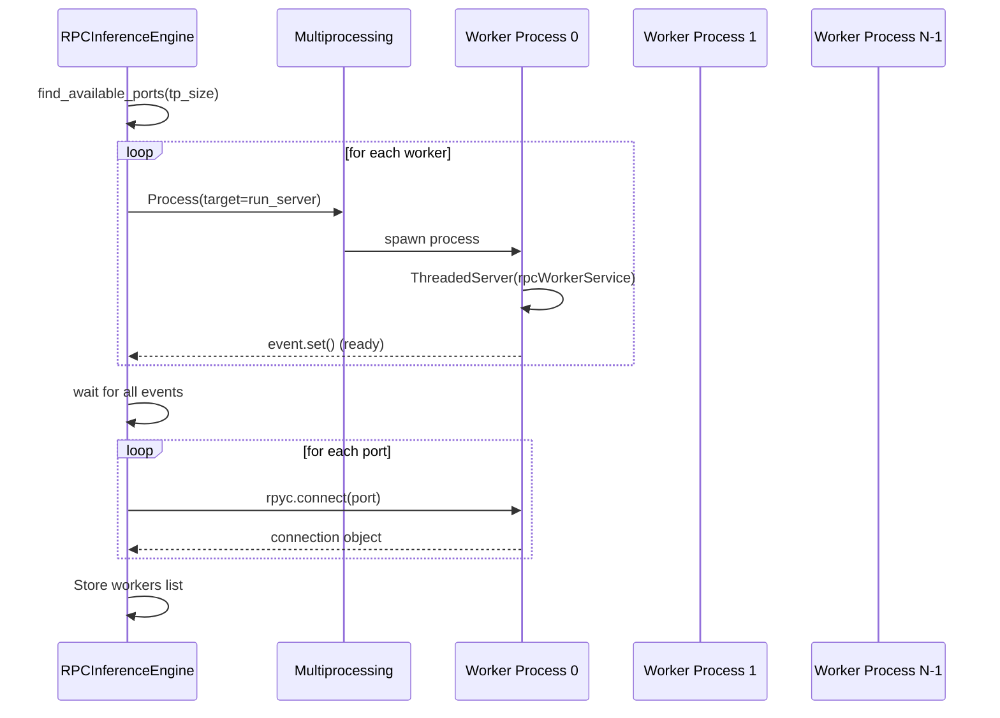
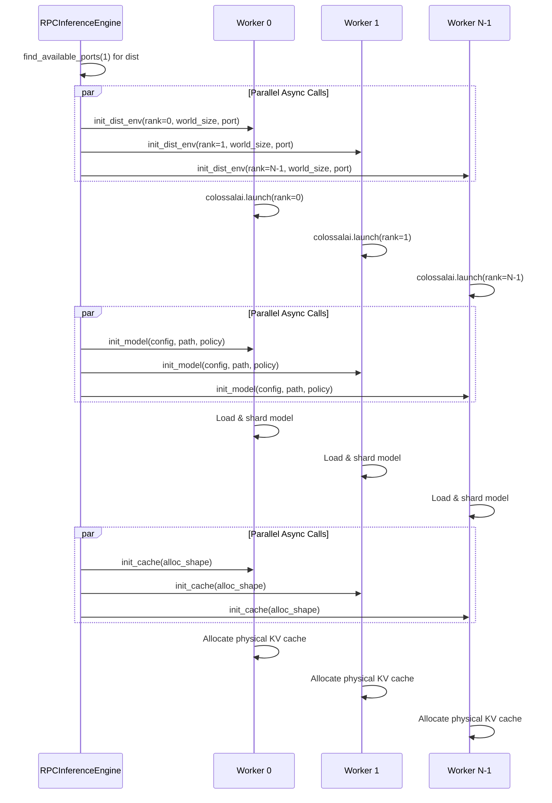
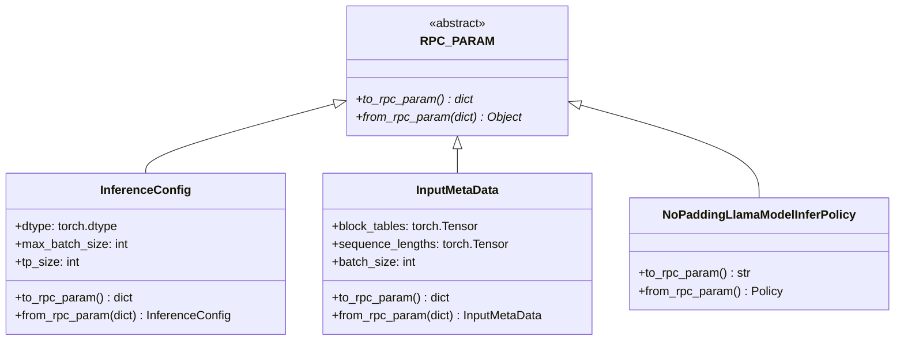
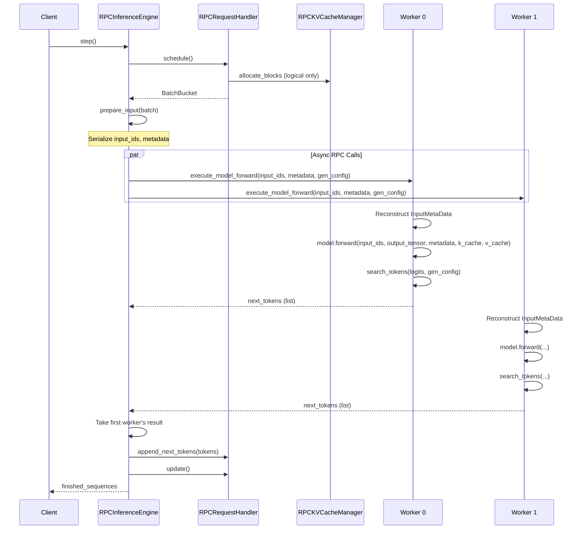
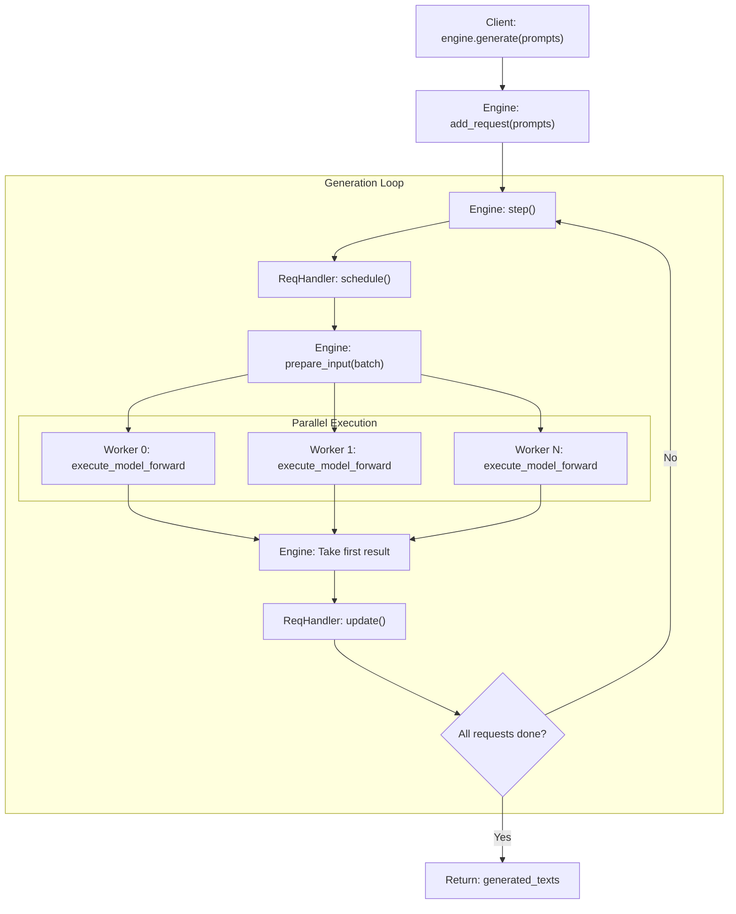
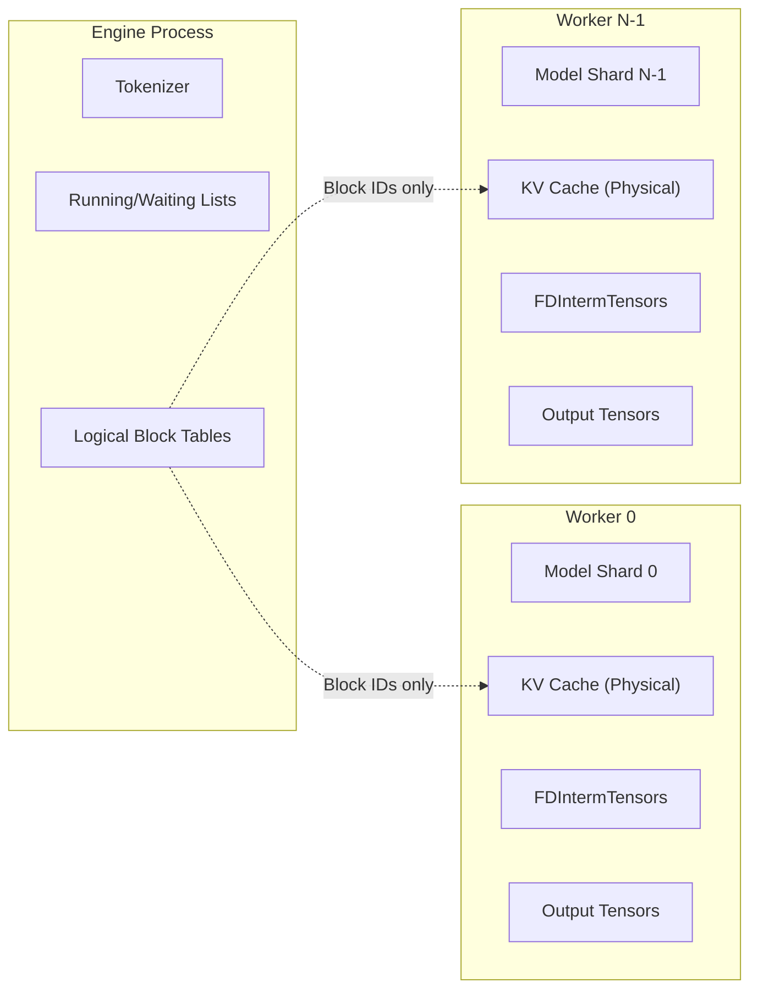

<!-- source: DeepWiki mcp.deepwiki.com · repo hpcaitech/ColossalAI · page 6.4 Distributed Inference with RPC · fetched 2026-10-21 -->

# Distributed Inference with RPC

<details>
<summary>Relevant source files</summary>

The following files were used as context for generating this wiki page:

- [colossalai/inference/batch_bucket.py](colossalai/inference/batch_bucket.py)
- [colossalai/inference/config.py](colossalai/inference/config.py)
- [colossalai/inference/core/engine.py](colossalai/inference/core/engine.py)
- [colossalai/inference/core/request_handler.py](colossalai/inference/core/request_handler.py)
- [colossalai/inference/core/rpc_engine.py](colossalai/inference/core/rpc_engine.py)
- [colossalai/inference/executor/rpc_worker.py](colossalai/inference/executor/rpc_worker.py)
- [colossalai/inference/kv_cache/__init__.py](colossalai/inference/kv_cache/__init__.py)
- [colossalai/inference/kv_cache/kvcache_manager.py](colossalai/inference/kv_cache/kvcache_manager.py)
- [colossalai/inference/logit_processors.py](colossalai/inference/logit_processors.py)
- [colossalai/inference/modeling/layers/attention.py](colossalai/inference/modeling/layers/attention.py)
- [colossalai/inference/modeling/models/nopadding_llama.py](colossalai/inference/modeling/models/nopadding_llama.py)
- [colossalai/inference/modeling/policy/__init__.py](colossalai/inference/modeling/policy/__init__.py)
- [colossalai/inference/modeling/policy/nopadding_llama.py](colossalai/inference/modeling/policy/nopadding_llama.py)
- [colossalai/inference/sampler.py](colossalai/inference/sampler.py)
- [colossalai/inference/struct.py](colossalai/inference/struct.py)
- [tests/test_infer/test_batch_bucket.py](tests/test_infer/test_batch_bucket.py)
- [tests/test_infer/test_config_and_struct.py](tests/test_infer/test_config_and_struct.py)
- [tests/test_infer/test_inference_engine.py](tests/test_infer/test_inference_engine.py)
- [tests/test_infer/test_kvcache_manager.py](tests/test_infer/test_kvcache_manager.py)
- [tests/test_infer/test_models/test_attention.py](tests/test_infer/test_models/test_attention.py)
- [tests/test_infer/test_request_handler.py](tests/test_infer/test_request_handler.py)

</details>


This page documents the RPC-based distributed inference system, which enables multi-device inference by coordinating multiple worker processes via Remote Procedure Calls. This system is designed for online serving scenarios where a single model is sharded across multiple GPUs/nodes.

**Related pages:** For single-device inference, see [Engine Architecture](#6.1). For batch scheduling logic, see [Request Handling and Batching](#6.2). For cache management details, see [KV Cache Management](#6.3).

## Architecture Overview

The RPC inference system uses a coordinator-worker pattern where a central `RPCInferenceEngine` coordinates multiple `rpcWorkerService` instances, each running on a separate device/process. The engine handles request scheduling and result aggregation, while workers execute model forward passes on their sharded model portions.

### System Components



**Sources:** [colossalai/inference/core/rpc_engine.py:36-124](), [colossalai/inference/executor/rpc_worker.py:44-98](), [colossalai/inference/core/request_handler.py:405-453]()

| Component | Location | Purpose |
|-----------|----------|---------|
| `RPCInferenceEngine` | [colossalai/inference/core/rpc_engine.py:36-273]() | Coordinates distributed inference across workers |
| `rpcWorkerService` | [colossalai/inference/executor/rpc_worker.py:44-255]() | Executes model forward passes on worker devices |
| `RPCRequestHandler` | [colossalai/inference/core/request_handler.py:405-453]() | Schedules requests without FD tensors |
| `RPCKVCacheManager` | [colossalai/inference/kv_cache/kvcache_manager.py:495-542]() | Manages logical cache blocks only |

**Sources:** [colossalai/inference/core/rpc_engine.py:24](), [colossalai/inference/executor/rpc_worker.py:1-42](), [colossalai/inference/core/request_handler.py:405-453]()

## Initialization Flow

The initialization process involves setting up worker processes, establishing RPC connections, initializing distributed environments, loading models, and allocating caches.

### Worker Process Startup



**Sources:** [colossalai/inference/core/rpc_engine.py:134-165](), [colossalai/inference/core/rpc_engine.py:27-33]()

The engine spawns one worker process per tensor parallel rank:

1. **Port Allocation**: Find `tp_size` available ports using `find_available_ports()` [colossalai/inference/core/rpc_engine.py:135]()
2. **Process Spawn**: Create multiprocessing.Process for each worker [colossalai/inference/core/rpc_engine.py:139]()
3. **Server Start**: Each worker starts a `ThreadedServer` with `rpcWorkerService` [colossalai/inference/core/rpc_engine.py:28-33]()
4. **Connection**: Main engine connects to each worker via rpyc [colossalai/inference/core/rpc_engine.py:154-161]()

### Distributed Environment Setup



**Sources:** [colossalai/inference/core/rpc_engine.py:173-211](), [colossalai/inference/executor/rpc_worker.py:51-98]()

**Initialization Steps:**

| Step | Engine Method | Worker Method | Description |
|------|---------------|---------------|-------------|
| 1 | `init_worker_env()` | `exposed_init_dist_env()` | Initialize PyTorch distributed groups |
| 2 | `init_model()` | `exposed_init_model()` | Load model, apply sharding via ShardFormer |
| 3 | `init_device_cache()` | `exposed_init_cache()` | Allocate physical KV cache tensors |

**Sources:** [colossalai/inference/core/rpc_engine.py:173-211](), [colossalai/inference/executor/rpc_worker.py:51-98]()

### Model Sharding on Workers

Each worker independently shards the model using ShardFormer:

```python
# From rpc_worker.py:169-237
def _init_model(self, model_or_path, model_policy):
    # Load model with LazyInitContext for efficiency
    model = AutoModelForCausalLM.from_pretrained(model_or_path)
    
    # Apply ShardFormer with tensor parallelism
    pg_mesh = ProcessGroupMesh(pp_size, tp_size)
    tp_group = pg_mesh.get_group_along_axis(TP_AXIS)
    
    model = self._shardformer(model, model_policy, stage_manager=None, tp_group=tp_group)
    
    # Load checkpoint if needed
    if pretrained_path:
        cpt_io.load_model(self.model, model_index_file)
```

**Sources:** [colossalai/inference/executor/rpc_worker.py:169-252]()

## RPC Parameter Serialization

RPC calls cannot directly pass PyTorch tensors or complex objects. The `RPC_PARAM` protocol enables serialization of inference parameters.

### RPC_PARAM Protocol



**Sources:** [colossalai/inference/config.py:35-49](), [colossalai/inference/config.py:151-380](), [colossalai/inference/modeling/policy/nopadding_llama.py:18-115]()

### Serialization Examples

**InferenceConfig Serialization:**
```python
# Engine side (to_rpc_param)
config = InferenceConfig(dtype=torch.float16, tp_size=2, ...)
config_dict = config.to_rpc_param()
# Returns: {"dtype": "float16", "tp_size": 2, "max_batch_size": 8, ...}

# Worker side (from_rpc_param)
config = InferenceConfig.from_rpc_param(config_dict)
# Reconstructs: InferenceConfig with torch.float16 dtype
```

**Sources:** [colossalai/inference/config.py:345-380]()

**InputMetaData Serialization:**
```python
# Engine side
meta = InputMetaData(
    block_tables=torch.tensor([[0, 1, 2]]),
    sequence_lengths=torch.tensor([10]),
    batch_size=1,
    is_prompts=True,
    dtype=torch.float16
)
meta_dict = meta.to_rpc_param()
# Converts tensors to lists, dtype to string

# Worker side
meta = InputMetaData.from_rpc_param(meta_dict)
# Reconstructs tensors on worker device
```

**Sources:** [colossalai/inference/config.py:90-133]()

## Request Execution Flow

The execution flow coordinates batch scheduling on the engine with parallel forward passes on workers.

### Single Step Execution



**Sources:** [colossalai/inference/core/rpc_engine.py:273-295](), [colossalai/inference/executor/rpc_worker.py:100-132]()

### Key Differences from Standard InferenceEngine

| Aspect | InferenceEngine | RPCInferenceEngine |
|--------|-----------------|-------------------|
| Model Location | Single process | Distributed across workers |
| Cache Management | Full KVCacheManager | RPCKVCacheManager (logical only) |
| FD Tensors | Allocated on engine | Allocated per worker |
| Forward Pass | Direct call | RPC to workers |
| Sampling | On engine | On each worker |
| Result Aggregation | N/A | Takes first worker result |

**Sources:** [colossalai/inference/core/engine.py:16-134](), [colossalai/inference/core/rpc_engine.py:36-295]()

## RPCRequestHandler and RPCKVCacheManager

These components are specialized versions that work with the RPC architecture.

### RPCRequestHandler

The `RPCRequestHandler` extends `RequestHandler` with RPC-specific modifications:

```python
# From request_handler.py:405-453
class RPCRequestHandler(RequestHandler):
    def __init__(self, inference_config, model_config):
        # Initialize without device-specific components
        self.running_list = RunningList(inference_config.prefill_ratio)
        self.waiting_list = [[], [], []]
        
        # Use RPCKVCacheManager instead of KVCacheManager
        self._init_cache(model_config)
        
        # No FDIntermTensors - set to None
        self.running_bb = BatchBucket(
            ...,
            fd_interm_tensor=None,  # Workers manage their own
            ...
        )
```

**Key differences:**
- No `FDIntermTensors` allocation (line 437, 447)
- Uses `RPCKVCacheManager` (line 452)
- No device specification for BatchBucket

**Sources:** [colossalai/inference/core/request_handler.py:405-453]()

### RPCKVCacheManager

The `RPCKVCacheManager` only manages logical block tables, not physical caches:

```python
# From kvcache_manager.py:495-542
class RPCKVCacheManager(KVCacheManager):
    def __init__(self, config, model_config):
        super().__init__(config, model_config)
        # No physical cache allocation
        self._kv_caches = None
        
    def _init_device_caches(self, k_alloc_shape, v_alloc_shape):
        # Physical cache allocated on workers
        return None, None
        
    def get_kv_cache(self):
        # Returns None - workers have physical caches
        return None, None
    
    def get_physical_cache_shape(self):
        # Returns shape for workers to allocate
        return (k_alloc_shape, v_alloc_shape)
```

**Sources:** [colossalai/inference/kv_cache/kvcache_manager.py:495-542]()

## Worker Service Methods

The `rpcWorkerService` exposes methods callable via RPC (prefixed with `exposed_`).

### Exposed Methods

| Method | Purpose | Parameters | Returns |
|--------|---------|------------|---------|
| `exposed_init_dist_env` | Initialize distributed process group | rank, world_size, master_address, master_port | None |
| `exposed_init_model` | Load and shard model | inference_config_param, model_or_path, model_policy_param | None |
| `exposed_init_cache` | Allocate physical KV cache | alloc_shape (k_shape, v_shape) | None |
| `exposed_execute_model_forward` | Execute forward pass and sampling | input_token_ids, input_meta_data, generation_config | next_tokens (list) |

**Sources:** [colossalai/inference/executor/rpc_worker.py:51-132]()

### Execute Model Forward

The core execution method on workers:

```python
# From rpc_worker.py:100-132
def exposed_execute_model_forward(
    self,
    input_token_ids_param: List[int],
    input_meta_data_param: dict,
    generation_config_param: dict
):
    # Reconstruct metadata from RPC params
    input_meta_data = InputMetaData.from_rpc_param(input_meta_data_param)
    input_meta_data.fd_inter_tensor = self.fd_inter_tensor
    
    # Convert to tensor
    input_token_ids = torch.tensor(input_token_ids_param, dtype=torch.int, device=self.device)
    
    # Execute model forward
    logits = self.model(
        input_token_ids,
        self.output_tensor[:n_tokens],
        input_meta_data,
        self.k_cache,
        self.v_cache,
    )
    
    # Sample next tokens
    next_tokens = search_tokens(
        generation_config_param,
        logits,
        input_meta_data.is_prompts,
        input_meta_data.batch_token_ids,
    )
    
    # Return as list for RPC
    return next_tokens.tolist()
```

**Sources:** [colossalai/inference/executor/rpc_worker.py:100-132]()

## Async Execution Pattern

The engine uses asyncio for parallel RPC calls to workers.

### Async Wrapper

```python
# From rpc_engine.py:167-171
async def async_parallel_wrapper(self, f, *args, **kwargs):
    async_res = rpyc.async_(f)(*args, **kwargs)
    await asyncio.to_thread(async_res.wait)
    assert async_res.ready
    return async_res.value
```

This wrapper:
1. Converts rpyc method to async
2. Awaits completion in thread pool
3. Returns result value

**Sources:** [colossalai/inference/core/rpc_engine.py:167-171]()

### Parallel Model Forward

```python
# From rpc_engine.py:257-271
async def step_(self, input_token_ids, input_meta_data: InputMetaData):
    # Create parallel tasks for all workers
    init_tasks = [
        self.async_parallel_wrapper(
            worker.execute_model_forward,
            input_token_ids,
            input_meta_data.to_rpc_param(),
            self.generation_config_dict,
        )
        for worker in self.workers
    ]
    
    # Execute in parallel, wait for all
    ret = await asyncio.gather(*init_tasks)
    
    # Return first worker's result (all should be identical)
    return ret[0]
```

**Sources:** [colossalai/inference/core/rpc_engine.py:257-271]()

## Complete Generation Example

### Code Flow



**Sources:** [colossalai/inference/core/rpc_engine.py:273-295]()

### Usage Example

```python
from colossalai.inference import RPCInferenceEngine, InferenceConfig
from transformers import AutoTokenizer

# Initialize engine
inference_config = InferenceConfig(
    max_batch_size=4,
    max_output_len=256,
    tp_size=4,  # 4-way tensor parallelism
    dtype="fp16"
)

tokenizer = AutoTokenizer.from_pretrained("meta-llama/Llama-2-7b-hf")

engine = RPCInferenceEngine(
    model_or_path="meta-llama/Llama-2-7b-hf",
    tokenizer=tokenizer,
    inference_config=inference_config
)

# Generate
prompts = ["Hello, how are you?", "Explain quantum computing."]
outputs = engine.generate(prompts=prompts)

# outputs: ["Hello, how are you? I'm doing well...", "Quantum computing is..."]
```

**Sources:** [colossalai/inference/core/rpc_engine.py:50-124](), [tests/test_infer/test_inference_engine.py:26-85]()

## Key Design Decisions

### Why RPC Instead of Direct Distributed?

| Aspect | RPC Approach | Direct Distributed |
|--------|-------------|-------------------|
| **Deployment** | Separate processes, easier containerization | Single process group |
| **Fault Tolerance** | Workers can restart independently | Single point of failure |
| **Scaling** | Add/remove workers dynamically | Fixed at startup |
| **Debugging** | Each worker logs independently | Mixed logs |
| **State Management** | Clear separation of concerns | Shared state complexity |

**Sources:** [colossalai/inference/core/rpc_engine.py:24]()

### Why Workers Perform Sampling?

Each worker independently samples tokens from logits rather than sending logits back to the engine because:

1. **Bandwidth**: Logits tensor is large (vocab_size × batch_size), next_tokens is small
2. **Consistency**: All workers produce identical results (same seed, same model)
3. **Latency**: Sampling is fast, no need for extra round trip

**Sources:** [colossalai/inference/executor/rpc_worker.py:120-132]()

### Memory Distribution



**Sources:** [colossalai/inference/core/rpc_engine.py:103-107](), [colossalai/inference/executor/rpc_worker.py:72-98]()

## Limitations and Considerations

### Current Limitations

1. **Pipeline Parallelism**: Not supported in RPC mode (`pp_size` must be 1)
2. **Speculative Decoding**: Limited support with RPC coordination overhead
3. **CUDA Graphs**: Each worker maintains separate graphs
4. **Batch Size**: Must be coordinated across all workers

**Sources:** [colossalai/inference/core/rpc_engine.py:50-124]()

### Performance Considerations

| Factor | Impact | Mitigation |
|--------|--------|------------|
| RPC Overhead | ~1-5ms per call | Async batching, minimize calls |
| Serialization | Convert tensors to/from lists | Use RPC_PARAM efficiently |
| Sampling Redundancy | Each worker samples independently | Negligible compute cost |
| Network Latency | Multi-node deployment | Co-locate workers when possible |

**Sources:** [colossalai/inference/core/rpc_engine.py:167-271]()

### Best Practices

1. **Use Tensor Parallelism**: Ideal for models too large for single GPU
2. **Batch Requests**: Maximize throughput by batching multiple requests
3. **Monitor Workers**: Each worker logs independently; aggregate logs for debugging
4. **Handle Failures**: Implement retry logic for transient RPC failures
5. **Resource Allocation**: Ensure each worker has sufficient GPU memory

**Sources:** [colossalai/inference/core/rpc_engine.py:36-295](), [colossalai/inference/executor/rpc_worker.py:44-255]()

---

