<!-- source: DeepWiki mcp.deepwiki.com · repo hpcaitech/ColossalAI · page 7 Memory Optimization Techniques · fetched 2026-10-21 -->

# Memory Optimization Techniques

<details>
<summary>Relevant source files</summary>

The following files were used as context for generating this wiki page:

- [README.md](README.md)
- [applications/ColossalChat/.gitignore](applications/ColossalChat/.gitignore)
- [applications/README.md](applications/README.md)
- [colossalai/booster/booster.py](colossalai/booster/booster.py)
- [colossalai/booster/plugin/gemini_plugin.py](colossalai/booster/plugin/gemini_plugin.py)
- [colossalai/booster/plugin/hybrid_parallel_plugin.py](colossalai/booster/plugin/hybrid_parallel_plugin.py)
- [colossalai/booster/plugin/low_level_zero_plugin.py](colossalai/booster/plugin/low_level_zero_plugin.py)
- [colossalai/booster/plugin/torch_ddp_plugin.py](colossalai/booster/plugin/torch_ddp_plugin.py)
- [colossalai/booster/plugin/torch_fsdp_plugin.py](colossalai/booster/plugin/torch_fsdp_plugin.py)
- [colossalai/checkpoint_io/__init__.py](colossalai/checkpoint_io/__init__.py)
- [colossalai/checkpoint_io/checkpoint_io_base.py](colossalai/checkpoint_io/checkpoint_io_base.py)
- [colossalai/checkpoint_io/general_checkpoint_io.py](colossalai/checkpoint_io/general_checkpoint_io.py)
- [colossalai/checkpoint_io/hybrid_parallel_checkpoint_io.py](colossalai/checkpoint_io/hybrid_parallel_checkpoint_io.py)
- [colossalai/checkpoint_io/index_file.py](colossalai/checkpoint_io/index_file.py)
- [colossalai/checkpoint_io/moe_checkpoint.py](colossalai/checkpoint_io/moe_checkpoint.py)
- [colossalai/checkpoint_io/utils.py](colossalai/checkpoint_io/utils.py)
- [colossalai/nn/optimizer/README.md](colossalai/nn/optimizer/README.md)
- [colossalai/utils/safetensors.py](colossalai/utils/safetensors.py)
- [colossalai/zero/gemini/gemini_optimizer.py](colossalai/zero/gemini/gemini_optimizer.py)
- [colossalai/zero/low_level/bookkeeping/tensor_bucket.py](colossalai/zero/low_level/bookkeeping/tensor_bucket.py)
- [colossalai/zero/low_level/low_level_optim.py](colossalai/zero/low_level/low_level_optim.py)
- [docs/README-zh-Hans.md](docs/README-zh-Hans.md)
- [docs/source/en/basics/launch_colossalai.md](docs/source/en/basics/launch_colossalai.md)
- [docs/source/en/get_started/installation.md](docs/source/en/get_started/installation.md)
- [docs/source/zh-Hans/basics/launch_colossalai.md](docs/source/zh-Hans/basics/launch_colossalai.md)
- [docs/source/zh-Hans/get_started/installation.md](docs/source/zh-Hans/get_started/installation.md)
- [examples/README.md](examples/README.md)
- [examples/tutorial/.gitignore](examples/tutorial/.gitignore)
- [examples/tutorial/README.md](examples/tutorial/README.md)
- [examples/tutorial/download_cifar10.py](examples/tutorial/download_cifar10.py)
- [examples/tutorial/sequence_parallel/data/dummy_dataloader.py](examples/tutorial/sequence_parallel/data/dummy_dataloader.py)
- [tests/test_checkpoint_io/test_gemini_checkpoint_io.py](tests/test_checkpoint_io/test_gemini_checkpoint_io.py)
- [tests/test_checkpoint_io/test_general_checkpoint_io.py](tests/test_checkpoint_io/test_general_checkpoint_io.py)
- [tests/test_checkpoint_io/test_hybrid_parallel_plugin_checkpoint_io.py](tests/test_checkpoint_io/test_hybrid_parallel_plugin_checkpoint_io.py)
- [tests/test_checkpoint_io/test_low_level_zero_checkpoint_io.py](tests/test_checkpoint_io/test_low_level_zero_checkpoint_io.py)
- [tests/test_checkpoint_io/test_safetensors_async_io.py](tests/test_checkpoint_io/test_safetensors_async_io.py)
- [tests/test_checkpoint_io/test_torch_ddp_checkpoint_io.py](tests/test_checkpoint_io/test_torch_ddp_checkpoint_io.py)

</details>


## Purpose and Scope

This page provides an overview of memory optimization techniques available in ColossalAI for training and inference of large-scale models. These techniques enable training models that exceed GPU memory capacity by employing parameter sharding, gradient management, heterogeneous memory management, quantization, and communication optimization strategies.

For detailed information on specific optimizations:
- ZeRO optimizer implementation details: See [Zero Redundancy Optimizer (ZeRO)](#3.1)
- Gemini heterogeneous memory system: See [Gemini: Memory Management System](#3.2)
- FP8 quantization: See [FP8 Quantization](#7.1)
- CPU/NVMe offloading details: See [CPU and NVMe Offloading](#7.2)

For combining memory optimizations with parallelism strategies, see [Hybrid Parallelism](#3.7).

---

## Memory Challenges in Large Model Training

Training large neural networks requires storing:

1. **Model parameters** (weights and biases)
2. **Gradients** (same size as parameters)
3. **Optimizer states** (momentum, variance for Adam - 2x parameter size)
4. **Activations** (intermediate outputs for backward pass)

For mixed-precision training with Adam optimizer, memory requirement per parameter is approximately:
- 2 bytes (FP16 parameter) + 2 bytes (FP16 gradient) + 4 bytes (FP32 master parameter) + 8 bytes (FP32 optimizer states) = **16 bytes per parameter**

A 175B parameter model would require approximately **2.8 TB** of memory for training, far exceeding the capacity of a single GPU (typically 40-80 GB).

Sources: [README.md:1-610](), [colossalai/zero/low_level/low_level_optim.py:1-100]()

---

## Memory Optimization Strategy Hierarchy

The following diagram shows how different memory optimization techniques are layered in ColossalAI:

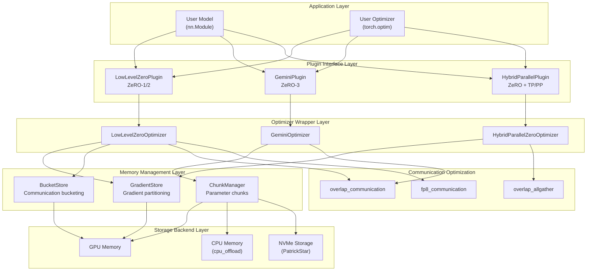

Sources: [colossalai/booster/plugin/low_level_zero_plugin.py:368-492](), [colossalai/booster/plugin/gemini_plugin.py:1-800](), [colossalai/booster/plugin/hybrid_parallel_plugin.py:1-900]()

---

## Memory Optimization Techniques Overview

| Technique | ZeRO Stage | Memory Saved | Trade-offs | Plugin Support | Key Classes |
|-----------|------------|--------------|------------|----------------|-------------|
| **Optimizer State Sharding** | Stage 1 | ~4x | Minimal overhead | `LowLevelZeroPlugin`<br/>`HybridParallelPlugin` | `LowLevelZeroOptimizer` |
| **Gradient Sharding** | Stage 2 | ~8x | Communication during backward | `LowLevelZeroPlugin`<br/>`HybridParallelPlugin` | `LowLevelZeroOptimizer`<br/>`GradientStore` |
| **Parameter Sharding** | Stage 3 | ~16x+ | All-gather before forward | `GeminiPlugin`<br/>`HybridParallelPlugin` | `GeminiOptimizer`<br/>`ChunkManager` |
| **CPU Offloading** | Any | GPU→CPU capacity | PCIe bandwidth | All plugins | `cpu_offload=True` |
| **NVMe Offloading** | Stage 3 | GPU→SSD capacity | I/O latency | `GeminiPlugin` | `ChunkManager` |
| **Mixed Precision** | N/A | 2x | Numerical precision | All plugins | `precision="fp16"/"bf16"` |
| **FP8 Communication** | Any | Bandwidth 2x | Specialized hardware | `LowLevelZeroPlugin`<br/>`HybridParallelPlugin` | `fp8_communication=True` |
| **Gradient Checkpointing** | N/A | Activation memory | Recomputation cost | Manual | `GradientCheckpointConfig` |

Sources: [README.md:136-156](), [colossalai/zero/low_level/low_level_optim.py:74-240](), [colossalai/booster/plugin/low_level_zero_plugin.py:407-460]()

---

## Parameter and Optimizer State Sharding (ZeRO)

### ZeRO Stage 1: Optimizer State Partitioning

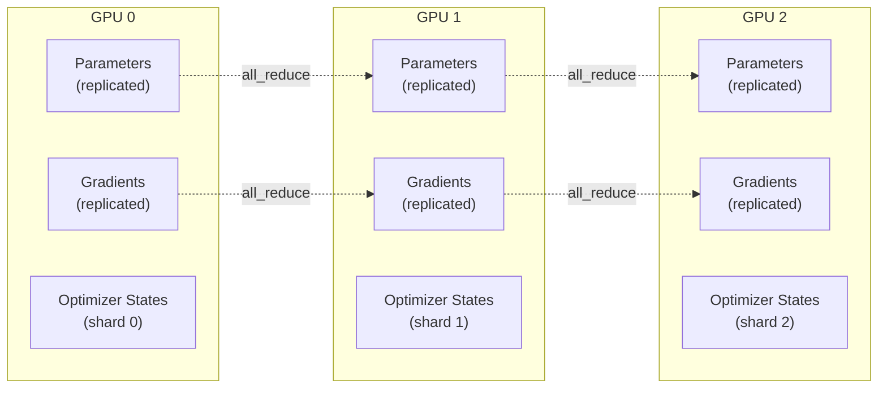

In ZeRO Stage 1, optimizer states (momentum and variance for Adam) are partitioned across devices. Each device:
- Maintains a complete copy of model parameters
- Maintains a complete copy of gradients
- Updates only its shard of optimizer states and corresponding parameter shard
- Broadcasts updated parameters via all-gather

**Configuration:**
```python
plugin = LowLevelZeroPlugin(
    stage=1,
    precision="fp16"
)
```

Sources: [colossalai/zero/low_level/low_level_optim.py:74-103](), [colossalai/booster/plugin/low_level_zero_plugin.py:407-433]()

---

### ZeRO Stage 2: Gradient Partitioning

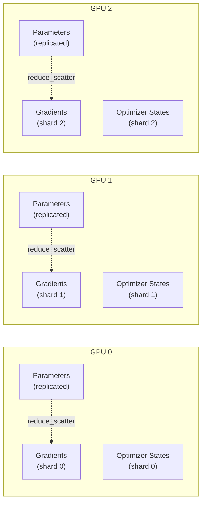

ZeRO Stage 2 additionally partitions gradients. During backward pass:
- Uses `reduce_scatter` instead of `all_reduce` to aggregate and partition gradients
- Each device receives only its gradient shard
- Reduces gradient memory by DP world size

**Configuration:**
```python
plugin = LowLevelZeroPlugin(
    stage=2,
    precision="fp16",
    overlap_communication=True  # Overlap gradient reduction with backward
)
```

**Key Implementation Details:**

The `LowLevelZeroOptimizer` uses a bucket-based approach for gradient reduction:

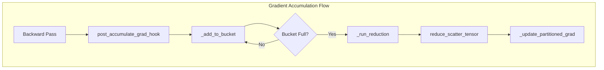

Sources: [colossalai/zero/low_level/low_level_optim.py:305-446](), [colossalai/zero/low_level/bookkeeping/__init__.py]()

---

### ZeRO Stage 3: Parameter Partitioning (Gemini)

ZeRO Stage 3 is implemented through the Gemini system, which partitions all training states and provides heterogeneous memory management.

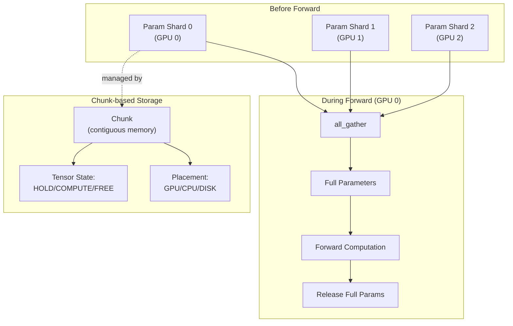

**Configuration:**
```python
plugin = GeminiPlugin(
    placement_policy="auto",     # Auto-move chunks between GPU/CPU/NVMe
    initial_scale=2**16,
    precision="fp16"
)
```

**ChunkManager Architecture:**

The `ChunkManager` handles dynamic memory placement:

| Component | File | Responsibility |
|-----------|------|----------------|
| `Chunk` | `colossalai/zero/gemini/chunk.py` | Contiguous memory block for parameters |
| `ChunkManager` | `colossalai/zero/gemini/chunk_manager.py` | Manages chunk lifecycle and placement |
| `MemoryTracer` | `colossalai/zero/gemini/memory_tracer.py` | Tracks memory usage patterns |
| `PlacementPolicy` | `colossalai/zero/gemini/placement_policy.py` | Decides chunk placement (GPU/CPU/Disk) |

Sources: [colossalai/booster/plugin/gemini_plugin.py:1-800](), [colossalai/zero/gemini/gemini_optimizer.py:1-150]()

---

## Gradient Management and Communication Optimization

### Gradient Bucketing System

The gradient bucketing system accumulates gradients into buckets before communication to improve efficiency:

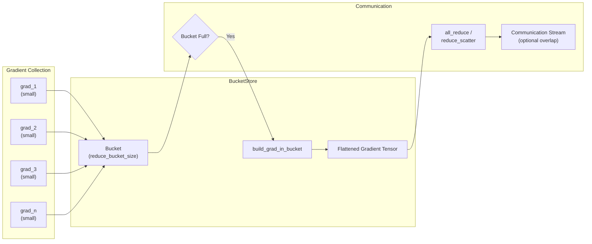

**Key Configuration Parameters:**

```python
plugin = LowLevelZeroPlugin(
    stage=2,
    reduce_bucket_size_in_m=12,          # Bucket size in MB
    overlap_communication=True,           # Use separate stream for communication
    communication_dtype=torch.float16,    # Compress gradients to fp16
    fp8_communication=False              # Further compress to fp8
)
```

The `BucketStore` implementation tracks:
- Current bucket size and capacity
- Parameter-to-gradient mapping
- Communication stream for overlap

Sources: [colossalai/zero/low_level/low_level_optim.py:431-446](), [colossalai/zero/low_level/bookkeeping/bucket_store.py:1-100]()

---

### Communication Overlap Strategies

ColossalAI provides two types of communication overlap:

#### 1. Backward Communication Overlap

Overlaps gradient reduction with backward computation:

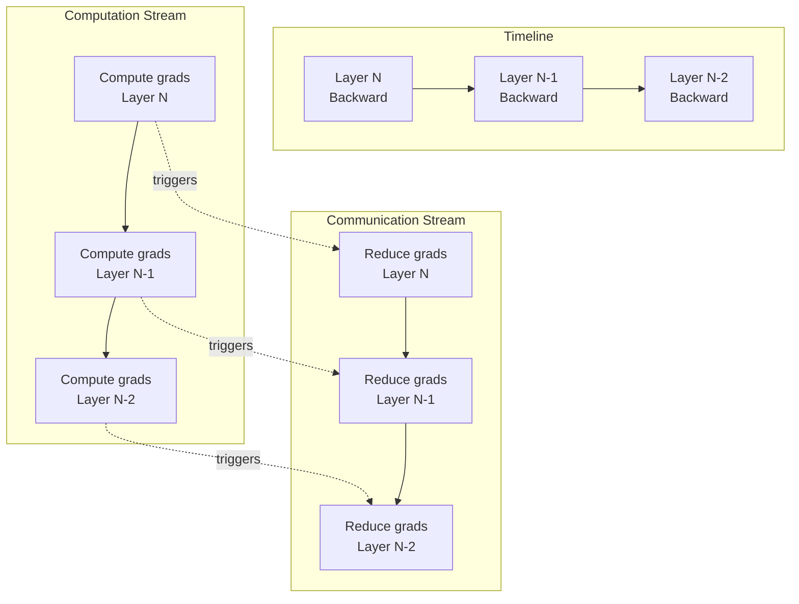

Enabled via `overlap_communication=True` in `LowLevelZeroOptimizer`.

#### 2. Forward All-Gather Overlap (ZeRO-3)

Overlaps parameter all-gather with forward computation:

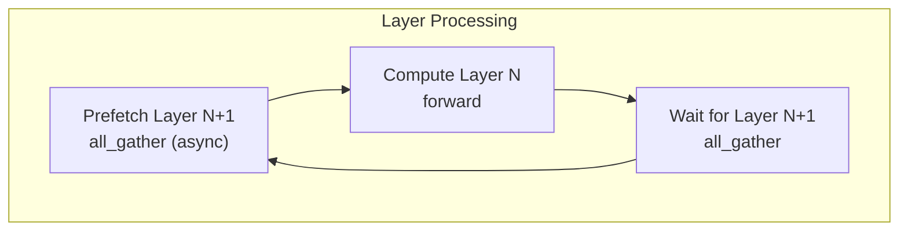

Enabled via `overlap_allgather=True` in plugins. Requires converting parameters to `ColoParameter`:

Sources: [colossalai/zero/low_level/low_level_optim.py:217-221](), [colossalai/booster/plugin/low_level_zero_plugin.py:422-423](), [colossalai/zero/low_level/zero_hook.py:1-50]()

---

## Heterogeneous Memory Management

### Memory Hierarchy

ColossalAI supports a three-tier memory hierarchy:

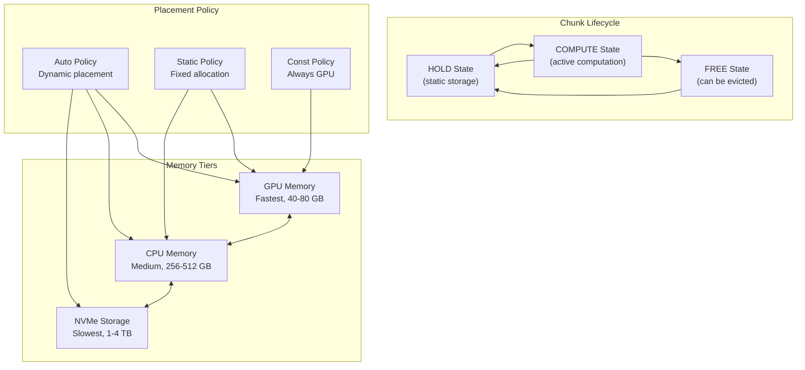

### CPU Offloading Configuration

**For ZeRO-1/2 (LowLevelZeroPlugin):**

```python
plugin = LowLevelZeroPlugin(
    stage=2,
    cpu_offload=True,       # Offload optimizer states to CPU
    master_weights=True     # Keep fp32 master weights on CPU
)
```

Master parameters and optimizer states are stored in CPU memory, reducing GPU memory usage significantly.

**For ZeRO-3 (GeminiPlugin):**

```python
plugin = GeminiPlugin(
    placement_policy="auto",          # Automatically move chunks
    offload_optim_frac=1.0,          # Fraction of optimizer states on CPU
    offload_param_frac=0.0,          # Fraction of parameters on CPU
    warmup_non_model_data_ratio=0.8  # Memory reserved for activations
)
```

The `ChunkManager` automatically moves chunks between GPU and CPU based on:
- Memory pressure
- Access patterns learned during warmup
- Chunk state (HOLD/COMPUTE/FREE)

### NVMe Offloading

NVMe offloading extends the memory hierarchy to disk storage for extreme scale:

| Feature | CPU Offload | NVMe Offload |
|---------|-------------|--------------|
| Bandwidth | ~30-50 GB/s | ~3-7 GB/s |
| Latency | Microseconds | Milliseconds |
| Capacity | 100s of GB | TBs |
| Best for | Large models | Extreme scale models |

Configuration requires the `placement_policy="auto"` with NVMe-specific settings in `GeminiPlugin`.

Sources: [colossalai/zero/gemini/chunk_manager.py:1-200](), [colossalai/zero/gemini/placement_policy.py:1-100](), [colossalai/booster/plugin/gemini_plugin.py:350-490]()

---

## Mixed Precision and Quantization

### Mixed Precision Training

Mixed precision training uses FP16/BF16 for computation while maintaining FP32 master weights for numerical stability:

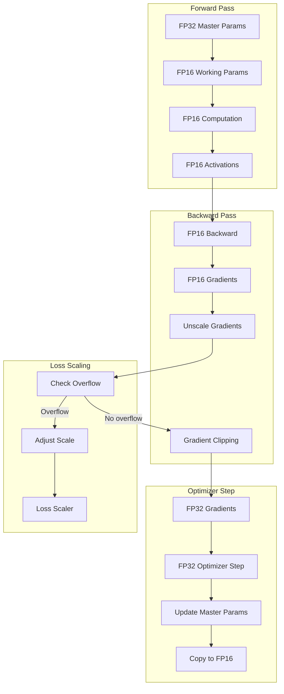

**Precision Options:**

| Precision | Memory | Speed | Numerical Stability | Hardware |
|-----------|--------|-------|---------------------|----------|
| FP32 | 1x | 1x | Best | All GPUs |
| FP16 | 0.5x | 2-3x | Good with loss scaling | V100+ |
| BF16 | 0.5x | 2-3x | Better than FP16 | A100+ |
| FP8 | 0.25x | 4x+ | Requires careful tuning | H100+ |

**Configuration:**

```python
plugin = LowLevelZeroPlugin(
    stage=2,
    precision="fp16",           # or "bf16", "fp32"
    initial_scale=2**16,        # Initial loss scale
    growth_interval=1000,       # Scale growth interval
    max_norm=1.0               # Gradient clipping
)
```

The mixed precision mixin classes handle:
- Loss scaling and unscaling
- Overflow detection
- Dynamic scale adjustment
- Master weight synchronization

Sources: [colossalai/amp/naive_amp/mixed_precision_mixin.py:1-100](), [colossalai/zero/low_level/low_level_optim.py:40-72]()

---

### FP8 Communication

FP8 communication reduces gradient communication bandwidth by compressing gradients to FP8 format:

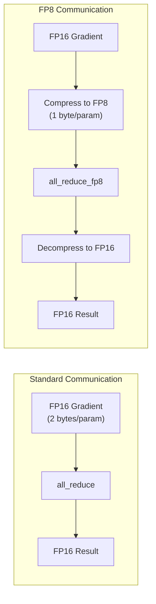

**Benefits:**
- 2x bandwidth reduction
- Faster communication for gradient-heavy workloads
- Minimal accuracy impact with proper calibration

**Configuration:**

```python
plugin = LowLevelZeroPlugin(
    stage=2,
    fp8_communication=True,
    communication_dtype=torch.float16
)
```

Requires:
- H100 or newer GPUs with FP8 support
- Transformer Engine or similar FP8 library
- Careful hyperparameter tuning

Sources: [colossalai/quantization/fp8_hook.py:1-100](), [colossalai/zero/low_level/low_level_optim.py:359-382]()

---

## Gradient Checkpointing

Gradient checkpointing trades computation for memory by recomputing activations during backward pass instead of storing them:

```mermaid
graph TB
    subgraph "Standard Training (No Checkpointing)"
        F1["Forward Layer 1<br/>Store activations"]
        F2["Forward Layer 2<br/>Store activations"]
        F3["Forward Layer 3<br/>Store activations"]
        B3["Backward Layer 3<br/>Use stored activations"]
        B2["Backward Layer 2<br/>Use stored activations"]
        B1["Backward Layer 1<br/>Use stored activations"]
    end
    
    subgraph "With Gradient Checkpointing"
        FC1["Forward Layer 1<br/>Store checkpoint"]
        FC2["Forward Layer 2<br/>Discard activations"]
        FC3["Forward Layer 3<br/>Discard activations"]
        BC3["Backward Layer 3"]
        RC2["Recompute Layer 2<br/>from checkpoint"]
        BC2["Backward Layer 2"]
        RC1["Recompute Layer 1"]
        BC1["Backward Layer 1"]
    end
    
    F1 --> F2 --> F3 --> B3 --> B2 --> B1
    FC1 --> FC2 --> FC3 --> BC3 --> RC2 --> BC2 --> RC1 --> BC1
```

**Configuration via ShardFormer:**

```python
from colossalai.shardformer import GradientCheckpointConfig

config = GradientCheckpointConfig(
    enable_gradient_checkpointing=True,
    checkpoint_block_num=None  # Checkpoint every block
)

plugin = HybridParallelPlugin(
    tp_size=2,
    pp_size=2,
    gradient_checkpoint_config=config
)
```

Gradient checkpointing is typically combined with other memory optimizations for maximum effect.

Sources: [colossalai/shardformer/__init__.py:1-50](), [colossalai/booster/plugin/hybrid_parallel_plugin.py:1-100]()

---

## Integration with Plugin System

All memory optimization techniques are exposed through ColossalAI's plugin system:

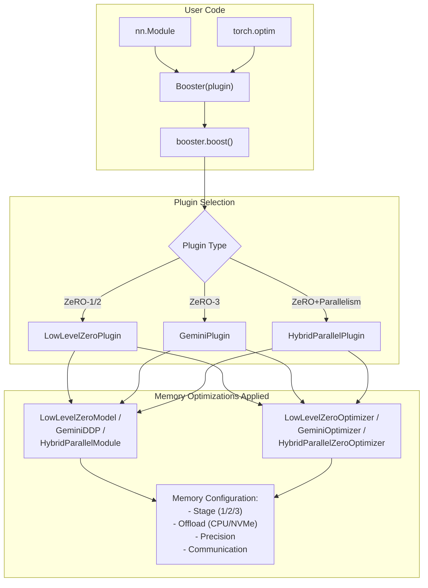

### Plugin Selection Guide

| Use Case | Plugin | Configuration |
|----------|--------|---------------|
| Simple DP training, moderate scale | `LowLevelZeroPlugin` | `stage=1`, `precision="fp16"` |
| Large model, gradient memory issue | `LowLevelZeroPlugin` | `stage=2`, `overlap_communication=True` |
| Very large model, fits with offload | `LowLevelZeroPlugin` | `stage=2`, `cpu_offload=True` |
| Extreme scale, parameter sharding needed | `GeminiPlugin` | `placement_policy="auto"` |
| Multi-dimensional parallelism | `HybridParallelPlugin` | `tp_size=X`, `pp_size=Y`, `zero_stage=Z` |

Sources: [colossalai/booster/booster.py:1-200](), [colossalai/booster/plugin/__init__.py:1-50]()

---

## Choosing the Right Memory Optimization Strategy

### Decision Flow

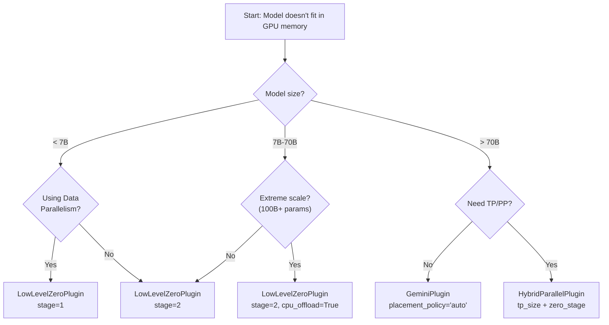

### Memory vs. Speed Trade-offs

The following table shows approximate trade-offs for different configurations:

| Configuration | Memory Saved | Communication Overhead | Computation Overhead | Recommended For |
|---------------|--------------|----------------------|---------------------|-----------------|
| No optimization | 1x | - | - | Small models only |
| ZeRO-1 | 4x | Very low (~5%) | None | All DP training |
| ZeRO-2 | 8x | Low (~10%) | None | Large models with DP |
| ZeRO-2 + CPU offload | 12x+ | Medium (~15%) | Low (PCIe transfer) | Models too large for GPU |
| ZeRO-3 (Gemini) | 16x+ | High (~25%) | Low (all-gather) | Very large models |
| ZeRO-3 + CPU/NVMe | 100x+ | High | Medium (I/O) | Extreme scale models |
| + FP8 communication | - | Bandwidth 2x | Very low | Communication-bound |
| + Gradient checkpoint | Activation memory | - | High (recompute) | Activation-bound |

### Configuration Examples

**Example 1: 7B Model, 8 GPUs**

```python
# Conservative: ZeRO-1 + mixed precision
plugin = LowLevelZeroPlugin(
    stage=1,
    precision="fp16",
    reduce_bucket_size_in_m=12
)
```

**Example 2: 13B Model, 8 GPUs**

```python
# More aggressive: ZeRO-2 with communication overlap
plugin = LowLevelZeroPlugin(
    stage=2,
    precision="fp16",
    overlap_communication=True,
    reduce_bucket_size_in_m=12
)
```

**Example 3: 70B Model, 16 GPUs**

```python
# ZeRO-3 with auto memory management
plugin = GeminiPlugin(
    placement_policy="auto",
    precision="bf16",
    initial_scale=2**16
)
```

**Example 4: 175B Model, 64 GPUs with TP+PP+DP**

```python
# Hybrid parallelism with ZeRO-1
plugin = HybridParallelPlugin(
    tp_size=8,          # 8-way tensor parallel
    pp_size=4,          # 4-way pipeline parallel
    zero_stage=1,       # ZeRO-1 over remaining 2-way DP
    precision="bf16",
    overlap_allgather=True
)
```

Sources: [colossalai/booster/plugin/low_level_zero_plugin.py:368-492](), [colossalai/booster/plugin/gemini_plugin.py:350-600](), [colossalai/booster/plugin/hybrid_parallel_plugin.py:666-800]()

---

## Memory Profiling and Monitoring

### Built-in Memory Statistics

Gemini provides memory tracking through `MemStats`:

```python
from colossalai.zero.gemini.memory_tracer import MemStats

# During training, Gemini tracks:
# - Current memory usage per device
# - Peak memory usage
# - Memory allocation patterns
# - Optimal chunk placement decisions
```

Key metrics tracked:
- `memory_allocated()`: Current GPU memory allocated
- `memory_reserved()`: Total GPU memory reserved
- `max_memory_allocated()`: Peak GPU memory during training

### Logging and Debugging

Enable verbose logging to see memory optimization decisions:

```python
plugin = LowLevelZeroPlugin(
    stage=2,
    verbose=True  # Logs gradient overflow, memory events
)

# Or for Gemini:
plugin = GeminiPlugin(
    placement_policy="auto",
    verbose=True  # Logs chunk movement, memory pressure
)
```

Sources: [colossalai/zero/gemini/memory_tracer.py:1-200](), [colossalai/zero/low_level/low_level_optim.py:532-536]()

---

## Best Practices and Recommendations

### General Guidelines

1. **Start Conservative**: Begin with ZeRO-1 and increase optimization level only if needed
2. **Enable Communication Overlap**: Use `overlap_communication=True` for ZeRO-2+
3. **Monitor for Overflow**: Use `verbose=True` during initial runs to catch numerical issues
4. **Tune Bucket Size**: Adjust `reduce_bucket_size_in_m` based on model architecture
5. **Profile First**: Use profiling to identify memory bottlenecks before applying aggressive optimizations

### Common Pitfalls

| Issue | Cause | Solution |
|-------|-------|----------|
| Gradient overflow | Loss scale too high | Reduce `initial_scale` |
| Slow training | Bucket size too small | Increase `reduce_bucket_size_in_m` |
| OOM during forward | Activations too large | Enable gradient checkpointing |
| Communication bottleneck | Synchronous communication | Enable `overlap_communication` |
| CPU offload slow | PCIe bottleneck | Use NVMe offload or ZeRO-3 |

### Performance Tuning

For optimal performance, consider:

1. **Bucket Size**: Larger buckets (16-24 MB) for better throughput, smaller (8-12 MB) for lower latency
2. **Communication Backend**: Use NCCL for GPU-GPU, optimize PCIe for CPU offload
3. **FP8 Communication**: Enable only on H100+ with proper validation
4. **Gradient Accumulation**: Use with `no_sync()` context to skip synchronization on intermediate steps

```python
# Example: Gradient accumulation with ZeRO-2
for i, batch in enumerate(dataloader):
    if i % accumulation_steps != accumulation_steps - 1:
        with model.no_sync():  # Skip gradient sync
            loss = model(batch)
            optimizer.backward(loss)
    else:
        loss = model(batch)
        optimizer.backward(loss)  # Sync gradients
        optimizer.step()
        optimizer.zero_grad()
```

Sources: [colossalai/booster/plugin/low_level_zero_plugin.py:407-470](), [colossalai/zero/low_level/low_level_optim.py:451-493]()

---

## Summary

ColossalAI provides a comprehensive suite of memory optimization techniques that can be combined to train models far exceeding single-GPU capacity:

- **ZeRO Stages 1-3** progressively partition optimizer states, gradients, and parameters
- **Heterogeneous memory management** extends capacity through CPU and NVMe offloading
- **Communication optimization** overlaps computation with gradient reduction and parameter gathering
- **Mixed precision and quantization** reduce memory footprint and accelerate training
- **Plugin architecture** provides easy integration with minimal code changes

By understanding the trade-offs and choosing the appropriate combination of techniques, users can efficiently train models from 7B to 175B+ parameters on available hardware.

Sources: [README.md:1-610](), [colossalai/zero/low_level/low_level_optim.py:1-800](), [colossalai/zero/gemini/gemini_optimizer.py:1-600](), [colossalai/booster/plugin/low_level_zero_plugin.py:368-492](), [colossalai/booster/plugin/gemini_plugin.py:1-800](), [colossalai/booster/plugin/hybrid_parallel_plugin.py:1-900]()

---

