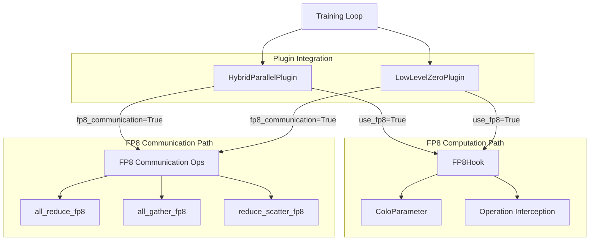
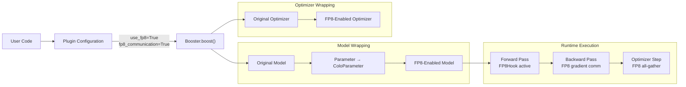
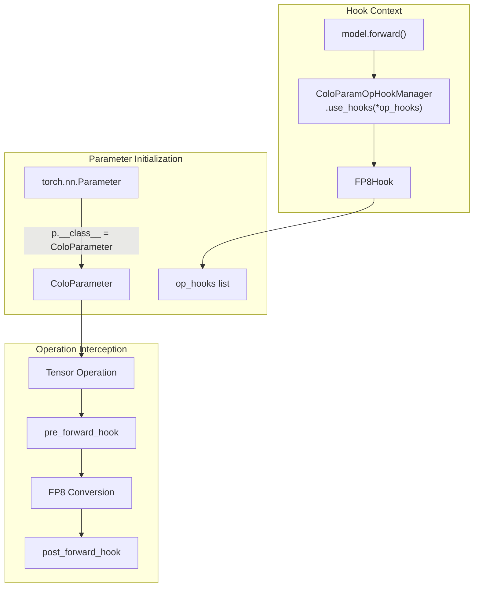
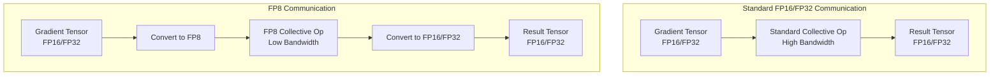
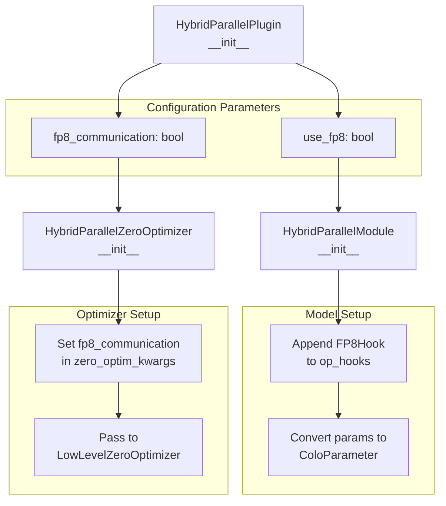
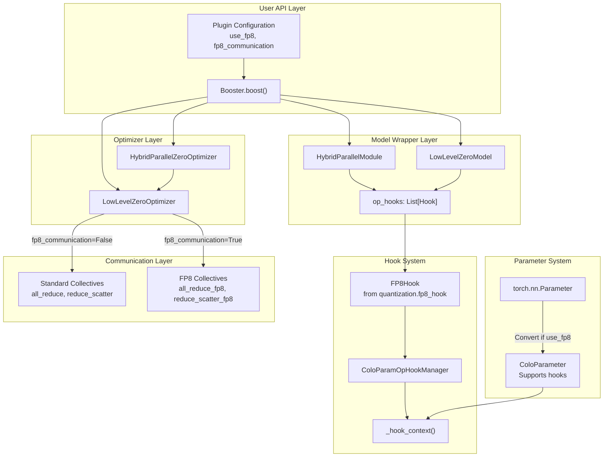

<!-- source: DeepWiki mcp.deepwiki.com · repo hpcaitech/ColossalAI · page 7.1 FP8 Quantization · fetched 2026-10-21 -->

# FP8 Quantization

<details>
<summary>Relevant source files</summary>

The following files were used as context for generating this wiki page:

- [README.md](README.md)
- [applications/ColossalChat/.gitignore](applications/ColossalChat/.gitignore)
- [applications/README.md](applications/README.md)
- [colossalai/booster/booster.py](colossalai/booster/booster.py)
- [colossalai/booster/plugin/gemini_plugin.py](colossalai/booster/plugin/gemini_plugin.py)
- [colossalai/booster/plugin/hybrid_parallel_plugin.py](colossalai/booster/plugin/hybrid_parallel_plugin.py)
- [colossalai/booster/plugin/low_level_zero_plugin.py](colossalai/booster/plugin/low_level_zero_plugin.py)
- [colossalai/booster/plugin/torch_ddp_plugin.py](colossalai/booster/plugin/torch_ddp_plugin.py)
- [colossalai/booster/plugin/torch_fsdp_plugin.py](colossalai/booster/plugin/torch_fsdp_plugin.py)
- [colossalai/checkpoint_io/__init__.py](colossalai/checkpoint_io/__init__.py)
- [colossalai/checkpoint_io/checkpoint_io_base.py](colossalai/checkpoint_io/checkpoint_io_base.py)
- [colossalai/checkpoint_io/general_checkpoint_io.py](colossalai/checkpoint_io/general_checkpoint_io.py)
- [colossalai/checkpoint_io/hybrid_parallel_checkpoint_io.py](colossalai/checkpoint_io/hybrid_parallel_checkpoint_io.py)
- [colossalai/checkpoint_io/index_file.py](colossalai/checkpoint_io/index_file.py)
- [colossalai/checkpoint_io/moe_checkpoint.py](colossalai/checkpoint_io/moe_checkpoint.py)
- [colossalai/checkpoint_io/utils.py](colossalai/checkpoint_io/utils.py)
- [colossalai/nn/optimizer/README.md](colossalai/nn/optimizer/README.md)
- [colossalai/utils/safetensors.py](colossalai/utils/safetensors.py)
- [colossalai/zero/gemini/gemini_optimizer.py](colossalai/zero/gemini/gemini_optimizer.py)
- [colossalai/zero/low_level/bookkeeping/tensor_bucket.py](colossalai/zero/low_level/bookkeeping/tensor_bucket.py)
- [colossalai/zero/low_level/low_level_optim.py](colossalai/zero/low_level/low_level_optim.py)
- [docs/README-zh-Hans.md](docs/README-zh-Hans.md)
- [docs/source/en/basics/launch_colossalai.md](docs/source/en/basics/launch_colossalai.md)
- [docs/source/en/get_started/installation.md](docs/source/en/get_started/installation.md)
- [docs/source/zh-Hans/basics/launch_colossalai.md](docs/source/zh-Hans/basics/launch_colossalai.md)
- [docs/source/zh-Hans/get_started/installation.md](docs/source/zh-Hans/get_started/installation.md)
- [examples/README.md](examples/README.md)
- [examples/tutorial/.gitignore](examples/tutorial/.gitignore)
- [examples/tutorial/README.md](examples/tutorial/README.md)
- [examples/tutorial/download_cifar10.py](examples/tutorial/download_cifar10.py)
- [examples/tutorial/sequence_parallel/data/dummy_dataloader.py](examples/tutorial/sequence_parallel/data/dummy_dataloader.py)
- [tests/test_checkpoint_io/test_gemini_checkpoint_io.py](tests/test_checkpoint_io/test_gemini_checkpoint_io.py)
- [tests/test_checkpoint_io/test_general_checkpoint_io.py](tests/test_checkpoint_io/test_general_checkpoint_io.py)
- [tests/test_checkpoint_io/test_hybrid_parallel_plugin_checkpoint_io.py](tests/test_checkpoint_io/test_hybrid_parallel_plugin_checkpoint_io.py)
- [tests/test_checkpoint_io/test_low_level_zero_checkpoint_io.py](tests/test_checkpoint_io/test_low_level_zero_checkpoint_io.py)
- [tests/test_checkpoint_io/test_safetensors_async_io.py](tests/test_checkpoint_io/test_safetensors_async_io.py)
- [tests/test_checkpoint_io/test_torch_ddp_checkpoint_io.py](tests/test_checkpoint_io/test_torch_ddp_checkpoint_io.py)

</details>


## Purpose and Scope

This document describes the FP8 (8-bit floating point) quantization system in ColossalAI, which reduces memory consumption and accelerates training and communication for large models by using lower-precision computation and data transfer. FP8 quantization can reduce training costs by up to 30% while maintaining model accuracy.

For general memory optimization strategies including ZeRO stages, see [Memory Optimization Techniques](#7). For CPU/NVMe offloading, see [CPU and NVMe Offloading](#7.2).

---

## Overview

FP8 quantization in ColossalAI provides two complementary optimization mechanisms:

1. **FP8 Computation**: Uses `FP8Hook` to intercept tensor operations during forward and backward passes, converting tensors to FP8 precision for computation
2. **FP8 Communication**: Replaces standard collective operations (all-reduce, all-gather, reduce-scatter) with FP8 variants to reduce communication overhead

These mechanisms work together to reduce both memory footprint and communication bandwidth while maintaining training convergence.



**Diagram: FP8 Quantization System Architecture**

Sources: [colossalai/booster/plugin/hybrid_parallel_plugin.py:36-44](), [colossalai/booster/plugin/low_level_zero_plugin.py:40-44](), [colossalai/zero/low_level/low_level_optim.py:24]()

---

## FP8 in the Training Pipeline

FP8 quantization integrates into the training pipeline through plugin configuration and automatic tensor conversion during forward and backward passes.

### Integration Points

| Component | Configuration Parameter | Effect |
|-----------|------------------------|--------|
| `HybridParallelPlugin` | `use_fp8=True` | Enables FP8Hook for computation |
| `HybridParallelPlugin` | `fp8_communication=True` | Uses FP8 for gradient communication |
| `LowLevelZeroPlugin` | `use_fp8=True` | Enables FP8Hook for computation |
| `LowLevelZeroPlugin` | `fp8_communication=True` | Uses FP8 for ZeRO gradient reduction |



**Diagram: FP8 Quantization Activation Flow**

Sources: [colossalai/booster/plugin/hybrid_parallel_plugin.py:59-130](), [colossalai/booster/plugin/low_level_zero_plugin.py:67-115]()

---

## FP8 Hook System

The `FP8Hook` mechanism intercepts tensor operations and converts them to FP8 precision during computation. This is implemented through the `ColoParamOpHookManager` system.

### Hook Activation

When `use_fp8=True` is specified, the plugin performs the following initialization:

1. **Hook Registration**: `FP8Hook` instance is added to the model's operation hooks list
2. **Parameter Conversion**: Model parameters are converted from `torch.nn.Parameter` to `ColoParameter` to enable operation interception
3. **Context Management**: Forward passes execute within a hook context that applies FP8 conversion



**Diagram: FP8Hook Operation Interception Mechanism**

The actual conversion logic in `FP8Hook` is located in `colossalai/quantization/fp8_hook.py`, which this system imports and uses.

Sources: [colossalai/booster/plugin/hybrid_parallel_plugin.py:120-130](), [colossalai/booster/plugin/low_level_zero_plugin.py:91-100]()

### Hook Context Usage

The hook context is applied during forward passes to ensure FP8 conversions are active:

```python
# In HybridParallelModule
def forward(self, *args, **kwargs):
    if self.convert_fn is not None:
        args = tree_map(self.convert_fn, args)
        kwargs = tree_map(self.convert_fn, kwargs)
    with self._hook_context():  # FP8Hook active here
        return super().forward(*args, **kwargs)

def _hook_context(self):
    return ColoParamOpHookManager.use_hooks(*self.op_hooks) if len(self.op_hooks) > 0 else nullcontext()
```

Sources: [colossalai/booster/plugin/hybrid_parallel_plugin.py:217-238](), [colossalai/booster/plugin/low_level_zero_plugin.py:102-114]()

---

## FP8 Communication Operations

FP8 communication reduces bandwidth requirements for collective operations by transmitting gradients and parameters in FP8 format instead of FP16 or FP32.

### Available FP8 Communication Functions

The following FP8 communication primitives are provided:

| Function | Standard Equivalent | Usage Context |
|----------|-------------------|---------------|
| `all_reduce_fp8` | `dist.all_reduce` | Gradient synchronization in data parallel |
| `reduce_scatter_fp8` | `dist.reduce_scatter_tensor` | ZeRO stage 2 gradient partitioning |
| `all_gather_fp8` | `dist.all_gather_into_tensor` | Parameter gathering in ZeRO optimizer step |



**Diagram: FP8 Communication vs Standard Communication**

Sources: [colossalai/zero/low_level/low_level_optim.py:24]()

### FP8 Communication in Gradient Reduction

In `LowLevelZeroOptimizer`, FP8 communication is conditionally used based on the `fp8_communication` flag:

**Standard All-Reduce** (Stage 1):
```python
# colossalai/zero/low_level/low_level_optim.py:356-363
if not self._partition_grads:
    for i, sz in enumerate(bucket_store.sizes):
        grp = bucket_store.torch_pg if len(bucket_store.sizes) == 1 else bucket_store.torch_pg[i]
        if self._fp8_communication:
            all_reduce_fp8(flat_grads, group=grp)
        else:
            dist.all_reduce(flat_grads, group=grp)
```

**Reduce-Scatter** (Stage 2):
```python
# colossalai/zero/low_level/low_level_optim.py:369-383
else:
    cur_flat_grads = flat_grads
    for i, sz in enumerate(bucket_store.sizes):
        grp = bucket_store.torch_pg if len(bucket_store.sizes) == 1 else bucket_store.torch_pg[i]
        flat_grads_list = list(cur_flat_grads.split(len(cur_flat_grads) // sz))
        received_grad = torch.empty_like(flat_grads_list[0])
        if self._fp8_communication:
            reduce_scatter_fp8(received_grad, flat_grads_list, group=grp)
        else:
            dist.reduce_scatter_tensor(received_grad, cur_flat_grads, group=grp)
```

**All-Gather** (Parameter Updates):
```python
# colossalai/zero/low_level/low_level_optim.py:613-620
if param_to_gather.numel() > self.pg_to_tensor_bucket[pg].max_size:
    if self._fp8_communication:
        # TODO: fit fp8 communication
        all_gather_fp8(
            list(padded_working_param.chunk(dist.get_world_size(pg))),
            param_to_gather,
            group=pg,
        )
```

Sources: [colossalai/zero/low_level/low_level_optim.py:327-620]()

---

## Integration with Plugins

FP8 quantization integrates with both `HybridParallelPlugin` and `LowLevelZeroPlugin` through configuration parameters.

### HybridParallelPlugin Integration



**Diagram: FP8 Integration in HybridParallelPlugin**

The `HybridParallelPlugin` passes FP8 configuration to both model and optimizer wrappers:

- **Model Configuration**: The `use_fp8` parameter is passed to `HybridParallelModule`, which conditionally adds `FP8Hook` to the operation hooks list
- **Optimizer Configuration**: The `fp8_communication` parameter is included in `zero_optim_kwargs` and passed to `LowLevelZeroOptimizer`

Sources: [colossalai/booster/plugin/hybrid_parallel_plugin.py:666-694]()

### LowLevelZeroPlugin Integration

The `LowLevelZeroPlugin` follows a similar pattern:

| Parameter | Type | Purpose |
|-----------|------|---------|
| `use_fp8` | `bool` | Enables FP8Hook for model computation |
| `fp8_communication` | `bool` | Enables FP8 collective operations |

When boosting a model:

1. `LowLevelZeroModel` receives `use_fp8` parameter
2. If enabled, `FP8Hook` is appended to `op_hooks`
3. Model parameters are converted to `ColoParameter`
4. Forward pass executes within hook context

When boosting an optimizer:

1. `LowLevelZeroOptimizer` receives `fp8_communication` parameter
2. FP8 communication functions replace standard collectives during gradient reduction
3. Parameter all-gather operations use `all_gather_fp8` when enabled

Sources: [colossalai/booster/plugin/low_level_zero_plugin.py:407-459]()

---

## Configuration and Usage

### Basic Usage with HybridParallelPlugin

```python
from colossalai.booster import Booster
from colossalai.booster.plugin import HybridParallelPlugin

# Enable FP8 computation and communication
plugin = HybridParallelPlugin(
    tp_size=2,
    pp_size=2,
    zero_stage=2,
    use_fp8=True,              # Enable FP8 computation hook
    fp8_communication=True     # Enable FP8 communication
)

booster = Booster(plugin=plugin)
model, optimizer, dataloader, criterion, scheduler = booster.boost(
    model, optimizer, dataloader, criterion, scheduler
)
```

### Basic Usage with LowLevelZeroPlugin

```python
from colossalai.booster import Booster
from colossalai.booster.plugin import LowLevelZeroPlugin

# Enable FP8 for ZeRO stage 1 or 2
plugin = LowLevelZeroPlugin(
    stage=2,
    use_fp8=True,              # Enable FP8 computation hook
    fp8_communication=True     # Enable FP8 communication
)

booster = Booster(plugin=plugin)
model, optimizer, dataloader, criterion, scheduler = booster.boost(
    model, optimizer, dataloader, criterion, scheduler
)
```

Sources: [colossalai/booster/plugin/hybrid_parallel_plugin.py:407-459](), [colossalai/booster/plugin/low_level_zero_plugin.py:407-459]()

### Configuration Table

| Parameter | Default | Valid Values | Effect |
|-----------|---------|--------------|--------|
| `use_fp8` | `False` | `True`, `False` | Enables `FP8Hook` for forward/backward computation |
| `fp8_communication` | `False` | `True`, `False` | Replaces standard collectives with FP8 variants |

**Notes**:
- `fp8_communication` requires that the plugin supports ZeRO optimizer integration
- Both parameters can be enabled independently or together for maximum benefit
- FP8 computation hooks require parameters to be converted to `ColoParameter`
- FP8 communication is compatible with ZeRO stages 1 and 2

Sources: [colossalai/booster/plugin/hybrid_parallel_plugin.py:59-82](), [colossalai/booster/plugin/low_level_zero_plugin.py:407-431]()

---

## Implementation Architecture



**Diagram: Complete FP8 Quantization System Architecture**

Sources: [colossalai/booster/plugin/hybrid_parallel_plugin.py:59-237](), [colossalai/booster/plugin/low_level_zero_plugin.py:67-115](), [colossalai/zero/low_level/low_level_optim.py:327-620]()

---

## Benefits and Performance

According to the official blog post, enabling FP8 quantization can reduce AI large model training costs by approximately 30%. The benefits come from:

1. **Reduced Memory Bandwidth**: FP8 tensors use half the bandwidth of FP16 tensors
2. **Lower Memory Footprint**: FP8 parameters and gradients consume less memory
3. **Faster Communication**: Collective operations transmit less data
4. **Hardware Acceleration**: Modern GPUs provide native FP8 tensor cores

The quantization is designed to maintain model accuracy while providing these performance benefits, making it suitable for production training workloads.

Sources: [README.md:63](), [docs/README-zh-Hans.md:32]()

---

