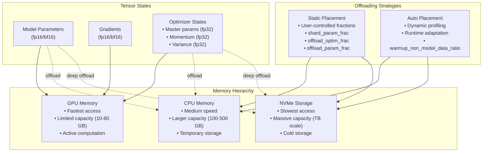
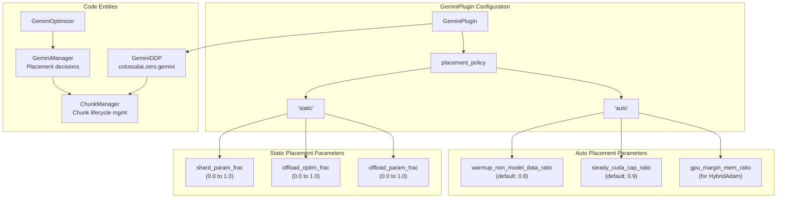
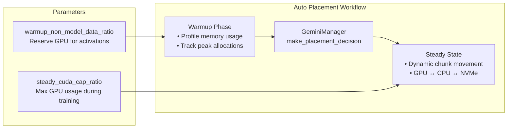
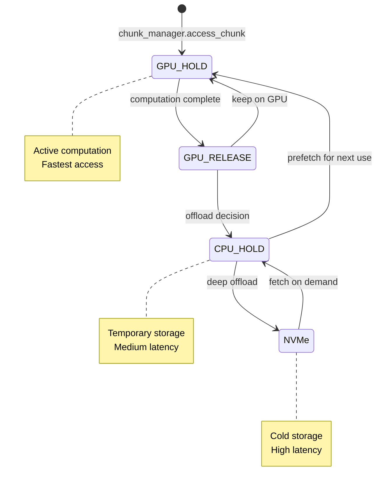
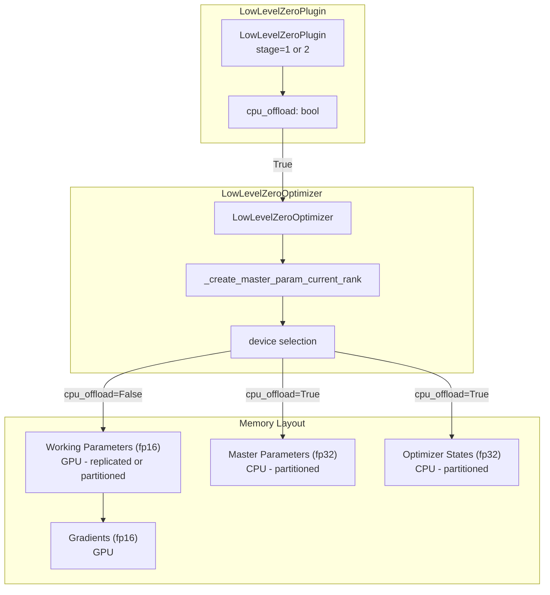
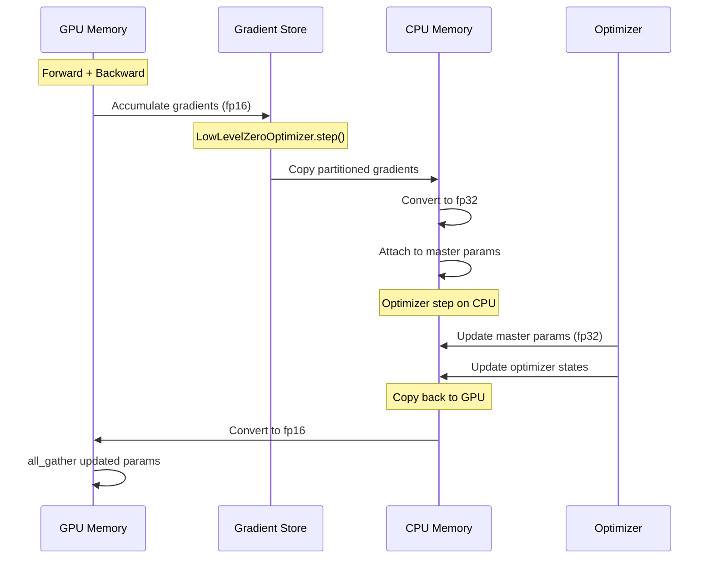
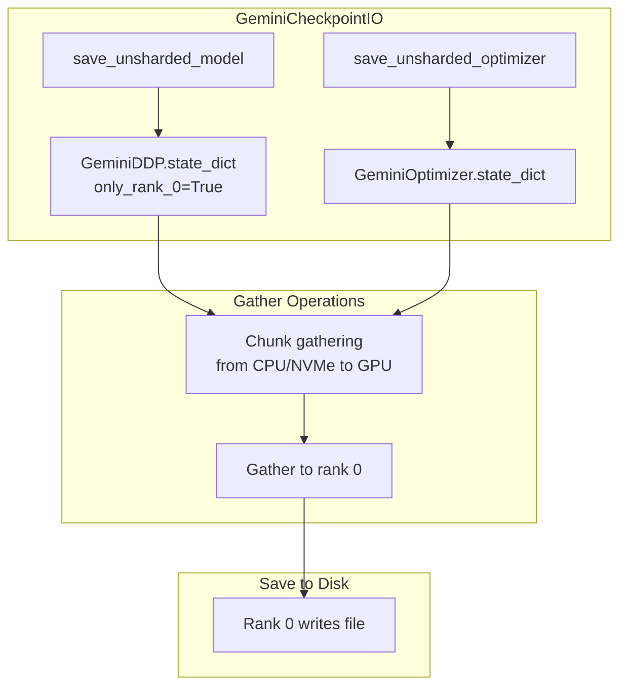

<!-- source: DeepWiki mcp.deepwiki.com · repo hpcaitech/ColossalAI · page 7.2 CPU and NVMe Offloading · fetched 2026-10-21 -->

# CPU and NVMe Offloading

<details>
<summary>Relevant source files</summary>

The following files were used as context for generating this wiki page:

- [colossalai/booster/booster.py](colossalai/booster/booster.py)
- [colossalai/booster/plugin/gemini_plugin.py](colossalai/booster/plugin/gemini_plugin.py)
- [colossalai/booster/plugin/hybrid_parallel_plugin.py](colossalai/booster/plugin/hybrid_parallel_plugin.py)
- [colossalai/booster/plugin/low_level_zero_plugin.py](colossalai/booster/plugin/low_level_zero_plugin.py)
- [colossalai/booster/plugin/torch_ddp_plugin.py](colossalai/booster/plugin/torch_ddp_plugin.py)
- [colossalai/booster/plugin/torch_fsdp_plugin.py](colossalai/booster/plugin/torch_fsdp_plugin.py)
- [colossalai/checkpoint_io/__init__.py](colossalai/checkpoint_io/__init__.py)
- [colossalai/checkpoint_io/checkpoint_io_base.py](colossalai/checkpoint_io/checkpoint_io_base.py)
- [colossalai/checkpoint_io/general_checkpoint_io.py](colossalai/checkpoint_io/general_checkpoint_io.py)
- [colossalai/checkpoint_io/hybrid_parallel_checkpoint_io.py](colossalai/checkpoint_io/hybrid_parallel_checkpoint_io.py)
- [colossalai/checkpoint_io/index_file.py](colossalai/checkpoint_io/index_file.py)
- [colossalai/checkpoint_io/moe_checkpoint.py](colossalai/checkpoint_io/moe_checkpoint.py)
- [colossalai/checkpoint_io/utils.py](colossalai/checkpoint_io/utils.py)
- [colossalai/initialize.py](colossalai/initialize.py)
- [colossalai/utils/safetensors.py](colossalai/utils/safetensors.py)
- [colossalai/zero/__init__.py](colossalai/zero/__init__.py)
- [colossalai/zero/gemini/gemini_optimizer.py](colossalai/zero/gemini/gemini_optimizer.py)
- [colossalai/zero/low_level/bookkeeping/tensor_bucket.py](colossalai/zero/low_level/bookkeeping/tensor_bucket.py)
- [colossalai/zero/low_level/low_level_optim.py](colossalai/zero/low_level/low_level_optim.py)
- [tests/test_checkpoint_io/test_gemini_checkpoint_io.py](tests/test_checkpoint_io/test_gemini_checkpoint_io.py)
- [tests/test_checkpoint_io/test_general_checkpoint_io.py](tests/test_checkpoint_io/test_general_checkpoint_io.py)
- [tests/test_checkpoint_io/test_hybrid_parallel_plugin_checkpoint_io.py](tests/test_checkpoint_io/test_hybrid_parallel_plugin_checkpoint_io.py)
- [tests/test_checkpoint_io/test_low_level_zero_checkpoint_io.py](tests/test_checkpoint_io/test_low_level_zero_checkpoint_io.py)
- [tests/test_checkpoint_io/test_safetensors_async_io.py](tests/test_checkpoint_io/test_safetensors_async_io.py)
- [tests/test_checkpoint_io/test_torch_ddp_checkpoint_io.py](tests/test_checkpoint_io/test_torch_ddp_checkpoint_io.py)

</details>


## Purpose and Scope

This page documents ColossalAI's heterogeneous memory management capabilities that enable training models larger than available GPU memory by offloading tensors to CPU RAM and NVMe storage. Two distinct systems provide offloading:

1. **Gemini** - Advanced chunk-based memory manager with dynamic placement across GPU/CPU/NVMe (used with ZeRO-3)
2. **LowLevelZeroOptimizer** - Simpler CPU offloading for optimizer states (used with ZeRO-1/2)

For information about ZeRO parallelism strategies without offloading, see [Zero Redundancy Optimizer (ZeRO)](#3.1). For Gemini's overall memory management architecture, see [Gemini: Memory Management System](#3.2).

---

## Memory Hierarchy and Offloading Strategy

ColossalAI's offloading systems exploit the memory hierarchy to trade memory capacity for access speed:



**Sources:** [colossalai/booster/plugin/gemini_plugin.py:386-440](), [colossalai/zero/low_level/low_level_optim.py:94]()

---

## Gemini Heterogeneous Memory System

### Overview

Gemini provides chunk-based memory management with three placement policies controlling how model parameters, gradients, and optimizer states are distributed across GPU, CPU, and NVMe storage.



**Sources:** [colossalai/booster/plugin/gemini_plugin.py:442-484](), [colossalai/zero/gemini/gemini_optimizer.py:100-118]()

### Placement Policy: Static

The **static** placement policy allows fine-grained control over memory distribution using three fraction parameters:

| Parameter | Range | Description | Default |
|-----------|-------|-------------|---------|
| `shard_param_frac` | 0.0 - 1.0 | Fraction of parameters to shard across ranks | 1.0 |
| `offload_optim_frac` | 0.0 - 1.0 | Fraction of optimizer states to offload to CPU | 0.0 |
| `offload_param_frac` | 0.0 - 1.0 | Fraction of parameters to offload to CPU | 0.0 |

**Configuration equivalences:**

- **ZeRO-2**: `shard_param_frac=0.0, offload_optim_frac=0.0`
- **ZeRO-3 (GPU only)**: `shard_param_frac=1.0, offload_optim_frac=0.0, offload_param_frac=0.0`
- **ZeRO-3 + CPU (old "cuda" placement)**: `shard_param_frac=1.0, offload_optim_frac=1.0, offload_param_frac=0.0`
- **ZeRO-3 + full offload (old "cpu" placement)**: `shard_param_frac=1.0, offload_optim_frac=1.0, offload_param_frac=1.0`

**Tuning recommendation:** First tune `shard_param_frac`, then `offload_optim_frac`. The `offload_param_frac` parameter is only effective when both other fractions are set to 1.0.

**Sources:** [colossalai/booster/plugin/gemini_plugin.py:386-398](), [colossalai/booster/plugin/gemini_plugin.py:449-451]()

### Placement Policy: Auto

The **auto** placement policy automatically determines optimal tensor placement based on runtime memory profiling:



| Parameter | Default | Description |
|-----------|---------|-------------|
| `warmup_non_model_data_ratio` | 0.8 | Ratio of expected non-model data (activations, gradients) memory during warmup |
| `steady_cuda_cap_ratio` | 0.9 | Ratio of allowed CUDA capacity for model data during steady state |
| `gpu_margin_mem_ratio` | 0.0 | GPU remaining memory ratio for hybrid CPU optimizer (requires `placement_policy="auto"`) |

**Sources:** [colossalai/booster/plugin/gemini_plugin.py:399-401](), [colossalai/booster/plugin/gemini_plugin.py:452-453](), [colossalai/zero/gemini/gemini_optimizer.py:77-78]()

### Chunk-Based Memory Management

Gemini organizes tensors into **chunks** that move between memory tiers as a unit:



The `ChunkManager` coordinates chunk lifecycle and placement decisions based on access patterns and memory pressure.

**Sources:** [colossalai/zero/gemini/gemini_optimizer.py:126]()

### Usage Example

```python
from colossalai.booster import Booster
from colossalai.booster.plugin import GeminiPlugin

# Static placement: ZeRO-3 with half optimizer states on CPU
plugin = GeminiPlugin(
    placement_policy="static",
    shard_param_frac=1.0,
    offload_optim_frac=0.5,
    offload_param_frac=0.0,
    precision="fp16",
)

# Auto placement: Dynamic memory management
plugin = GeminiPlugin(
    placement_policy="auto",
    warmup_non_model_data_ratio=0.8,
    steady_cuda_cap_ratio=0.9,
    precision="fp16",
)

booster = Booster(plugin=plugin)
model, optimizer, criterion, dataloader, lr_scheduler = booster.boost(
    model, optimizer, criterion, dataloader, lr_scheduler
)
```

**Sources:** [colossalai/booster/plugin/gemini_plugin.py:372-383]()

---

## LowLevelZero CPU Offload

### Overview

The `LowLevelZeroOptimizer` provides simpler CPU offloading for ZeRO-1 and ZeRO-2 configurations. Unlike Gemini, this system only offloads optimizer states (master parameters and momentum) to CPU, while keeping working parameters and gradients on GPU.



**Sources:** [colossalai/booster/plugin/low_level_zero_plugin.py:424](), [colossalai/zero/low_level/low_level_optim.py:94](), [colossalai/zero/low_level/low_level_optim.py:263-296]()

### Device Selection Logic

The device for master parameters and optimizer states is determined at initialization:

```python
# colossalai/zero/low_level/low_level_optim.py:266
device = "cpu" if self._cpu_offload else get_accelerator().get_current_device()
```

When `cpu_offload=True`:
1. **Master parameters** (fp32) are created on CPU
2. **Optimizer states** (momentum, variance, etc.) remain on CPU
3. **Working parameters** (fp16) stay on GPU for computation
4. Gradients are synchronized on GPU, then copied to CPU for optimizer step

**Sources:** [colossalai/zero/low_level/low_level_optim.py:263-299]()

### Configuration

```python
from colossalai.booster import Booster
from colossalai.booster.plugin import LowLevelZeroPlugin

# ZeRO-2 with CPU offload
plugin = LowLevelZeroPlugin(
    stage=2,
    precision="fp16",
    cpu_offload=True,  # Enable CPU offloading
    reduce_bucket_size_in_m=12,
    overlap_communication=True,
)

booster = Booster(plugin=plugin)
model, optimizer, criterion, dataloader, lr_scheduler = booster.boost(
    model, optimizer, criterion, dataloader, lr_scheduler
)
```

**Sources:** [colossalai/booster/plugin/low_level_zero_plugin.py:407-431]()

### Optimizer Step Workflow with CPU Offload



**Sources:** [colossalai/zero/low_level/low_level_optim.py:527-636]()

### Master Parameter Management

The optimizer maintains mappings between working parameters (fp16 on GPU) and master parameters (fp32 on CPU/GPU):

| Data Structure | Purpose | Location |
|----------------|---------|----------|
| `_working_param_groups` | Original model parameters (fp16) | GPU |
| `_master_param_groups_of_current_rank` | Partitioned master parameters (fp32) | CPU (if offload) or GPU |
| `master_to_working_param` | Mapping: master param → working param | Memory |
| `working_to_master_param` | Mapping: working param → master param | Memory |

**Sources:** [colossalai/zero/low_level/low_level_optim.py:143-180]()

---

## Comparison: Gemini vs LowLevelZero Offloading

| Feature | Gemini (ZeRO-3) | LowLevelZero (ZeRO-1/2) |
|---------|-----------------|-------------------------|
| **Offload targets** | Parameters, gradients, optimizer states | Optimizer states only |
| **Storage tiers** | GPU, CPU, NVMe | GPU, CPU |
| **Placement strategy** | Static fractions or Auto dynamic | Static flag |
| **Memory management** | Chunk-based with prefetching | Simple partition |
| **Configuration complexity** | High (multiple parameters) | Low (single boolean) |
| **Memory savings** | Up to 120x baseline | Moderate (optimizer states) |
| **Performance overhead** | Higher (dynamic movement) | Lower (static placement) |
| **Use case** | Very large models (>GPU memory) | Models fitting in GPU with reduced memory |

**Sources:** [colossalai/booster/plugin/gemini_plugin.py:369-440](), [colossalai/booster/plugin/low_level_zero_plugin.py:368-405]()

---

## HybridParallelPlugin Offloading

The `HybridParallelPlugin` (combining TP+PP+DP+SP) also supports CPU offloading through its integration with `LowLevelZeroOptimizer`:

```python
from colossalai.booster.plugin import HybridParallelPlugin

plugin = HybridParallelPlugin(
    tp_size=2,
    pp_size=2,
    zero_stage=2,
    cpu_offload=True,  # Enable optimizer state offload
    precision="fp16",
)
```

The `cpu_offload` parameter is passed to the underlying `LowLevelZeroOptimizer`:

**Sources:** [colossalai/booster/plugin/hybrid_parallel_plugin.py:687-725]()

---

## Checkpoint I/O with Offloading

### Saving Offloaded States

When using offloading, checkpoint saving must handle tensors distributed across GPU, CPU, and potentially NVMe:



Both `GeminiCheckpointIO` and `LowLevelZeroCheckpointIO` handle gathering offloaded tensors before saving.

**Sources:** [colossalai/booster/plugin/gemini_plugin.py:69-96](), [colossalai/booster/plugin/low_level_zero_plugin.py:117-148]()

### Loading into Offloaded States

When loading checkpoints with offloading enabled:

1. Checkpoint is loaded on rank 0 or all ranks
2. States are partitioned according to ZeRO configuration
3. Master parameters are placed on CPU if `cpu_offload=True`
4. Working parameters remain on GPU

**Sources:** [colossalai/booster/plugin/gemini_plugin.py:98-152](), [colossalai/booster/plugin/low_level_zero_plugin.py:149-162]()

---

## Performance Considerations

### Memory vs Speed Tradeoff

Offloading introduces data movement overhead:

| Operation | No Offload | CPU Offload | NVMe Offload |
|-----------|------------|-------------|--------------|
| Optimizer step | ~1ms | ~10-50ms | ~100-500ms |
| Memory capacity | 1x | 5-10x | 50-100x |
| Training throughput | 100% | 60-90% | 20-50% |

**Optimization strategies:**

1. **Overlap communication and computation** - Set `overlap_communication=True` in `LowLevelZeroPlugin`
2. **Tune chunk size** - Adjust `search_range_m` and `min_chunk_size_m` in `GeminiPlugin`
3. **Use auto placement** - Let Gemini optimize placement dynamically
4. **Prefetch chunks** - Set `max_prefetch > 0` in `GeminiPlugin`

**Sources:** [colossalai/booster/plugin/gemini_plugin.py:406-411](), [colossalai/booster/plugin/low_level_zero_plugin.py:399]()

### NVMe Performance Requirements

For effective NVMe offloading:
- **Minimum**: PCIe 3.0 NVMe SSD (3 GB/s)
- **Recommended**: PCIe 4.0 NVMe SSD (7 GB/s)
- **Optimal**: PCIe 5.0 NVMe SSD (14 GB/s)

The system requires the `tensornvme` library for asynchronous NVMe I/O.

**Sources:** [colossalai/utils/safetensors.py:11-15]()

---

## Key Implementation Components

| Component | File Path | Primary Responsibility |
|-----------|-----------|------------------------|
| `GeminiPlugin` | [colossalai/booster/plugin/gemini_plugin.py:369-600]() | Configure Gemini offloading |
| `GeminiDDP` | [colossalai/zero/gemini/]() | Distributed data parallel with chunk management |
| `GeminiOptimizer` | [colossalai/zero/gemini/gemini_optimizer.py:70-300]() | Optimizer with heterogeneous memory |
| `ChunkManager` | [colossalai/zero/gemini/]() | Chunk lifecycle and placement |
| `LowLevelZeroPlugin` | [colossalai/booster/plugin/low_level_zero_plugin.py:368-500]() | Configure ZeRO-1/2 offloading |
| `LowLevelZeroOptimizer` | [colossalai/zero/low_level/low_level_optim.py:74-750]() | ZeRO optimizer with CPU offload |
| `HybridParallelPlugin` | [colossalai/booster/plugin/hybrid_parallel_plugin.py:666-726]() | Multi-dimensional parallelism with offload |

**Sources:** Multiple files listed in table

---

