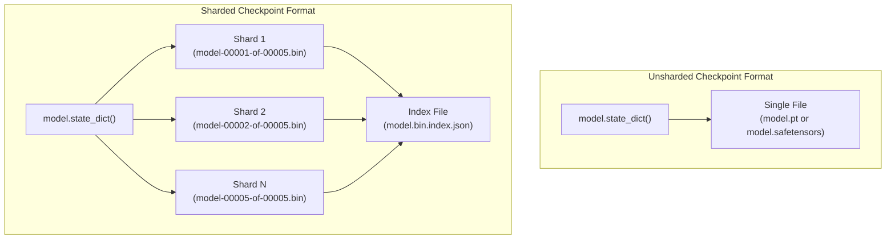
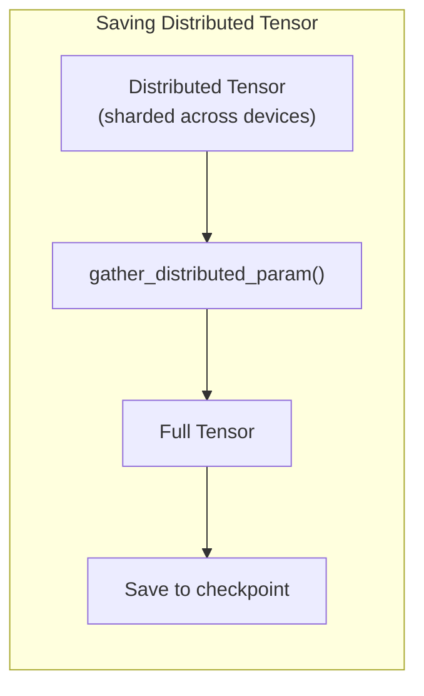

<!-- source: DeepWiki mcp.deepwiki.com · repo hpcaitech/ColossalAI · page 8 Checkpointing System · fetched 2026-10-21 -->

# Checkpointing System

<details>
<summary>Relevant source files</summary>

The following files were used as context for generating this wiki page:

- [colossalai/booster/booster.py](colossalai/booster/booster.py)
- [colossalai/booster/plugin/gemini_plugin.py](colossalai/booster/plugin/gemini_plugin.py)
- [colossalai/booster/plugin/hybrid_parallel_plugin.py](colossalai/booster/plugin/hybrid_parallel_plugin.py)
- [colossalai/booster/plugin/low_level_zero_plugin.py](colossalai/booster/plugin/low_level_zero_plugin.py)
- [colossalai/booster/plugin/torch_ddp_plugin.py](colossalai/booster/plugin/torch_ddp_plugin.py)
- [colossalai/booster/plugin/torch_fsdp_plugin.py](colossalai/booster/plugin/torch_fsdp_plugin.py)
- [colossalai/checkpoint_io/__init__.py](colossalai/checkpoint_io/__init__.py)
- [colossalai/checkpoint_io/checkpoint_io_base.py](colossalai/checkpoint_io/checkpoint_io_base.py)
- [colossalai/checkpoint_io/general_checkpoint_io.py](colossalai/checkpoint_io/general_checkpoint_io.py)
- [colossalai/checkpoint_io/hybrid_parallel_checkpoint_io.py](colossalai/checkpoint_io/hybrid_parallel_checkpoint_io.py)
- [colossalai/checkpoint_io/index_file.py](colossalai/checkpoint_io/index_file.py)
- [colossalai/checkpoint_io/moe_checkpoint.py](colossalai/checkpoint_io/moe_checkpoint.py)
- [colossalai/checkpoint_io/utils.py](colossalai/checkpoint_io/utils.py)
- [colossalai/utils/safetensors.py](colossalai/utils/safetensors.py)
- [colossalai/zero/gemini/gemini_optimizer.py](colossalai/zero/gemini/gemini_optimizer.py)
- [colossalai/zero/low_level/bookkeeping/tensor_bucket.py](colossalai/zero/low_level/bookkeeping/tensor_bucket.py)
- [colossalai/zero/low_level/low_level_optim.py](colossalai/zero/low_level/low_level_optim.py)
- [tests/test_checkpoint_io/test_gemini_checkpoint_io.py](tests/test_checkpoint_io/test_gemini_checkpoint_io.py)
- [tests/test_checkpoint_io/test_general_checkpoint_io.py](tests/test_checkpoint_io/test_general_checkpoint_io.py)
- [tests/test_checkpoint_io/test_hybrid_parallel_plugin_checkpoint_io.py](tests/test_checkpoint_io/test_hybrid_parallel_plugin_checkpoint_io.py)
- [tests/test_checkpoint_io/test_low_level_zero_checkpoint_io.py](tests/test_checkpoint_io/test_low_level_zero_checkpoint_io.py)
- [tests/test_checkpoint_io/test_safetensors_async_io.py](tests/test_checkpoint_io/test_safetensors_async_io.py)
- [tests/test_checkpoint_io/test_torch_ddp_checkpoint_io.py](tests/test_checkpoint_io/test_torch_ddp_checkpoint_io.py)

</details>


The Checkpointing System in ColossalAI provides a unified framework for saving and loading model states, optimizer states, and learning rate schedulers in distributed training environments. It's specifically designed to handle the complexities of large-scale AI model training with different parallelism strategies, memory optimization techniques, and distributed tensor configurations.

## Architecture Overview

The checkpointing system follows a plugin-based architecture where each parallelism or optimization strategy (like ZeRO, Gemini, or Hybrid Parallelism) has its own specialized CheckpointIO implementation.

```mermaid
classDiagram
    class "CheckpointIO" {
        <<Abstract Base Class>>
        +save_model()
        +load_model()
        +save_optimizer()
        +load_optimizer()
        +save_lr_scheduler()
        +load_lr_scheduler()
        +save_sharded_model()
        +load_sharded_model()
    }
    
    "CheckpointIO" <|-- "GeneralCheckpointIO"
    "GeneralCheckpointIO" <|-- "TorchDDPCheckpointIO"
    "GeneralCheckpointIO" <|-- "TorchFSDPCheckpointIO"
    "GeneralCheckpointIO" <|-- "LowLevelZeroCheckpointIO"
    "GeneralCheckpointIO" <|-- "GeminiCheckpointIO"
    "GeneralCheckpointIO" <|-- "HybridParallelCheckpointIO"
    "HybridParallelCheckpointIO" <|-- "MoECheckpointIO"
```

Sources: [colossalai/checkpoint_io/checkpoint_io_base.py](), [colossalai/checkpoint_io/general_checkpoint_io.py](), [colossalai/booster/plugin/gemini_plugin.py](), [colossalai/booster/plugin/low_level_zero_plugin.py](), [colossalai/booster/plugin/torch_ddp_plugin.py](), [colossalai/checkpoint_io/hybrid_parallel_checkpoint_io.py](), [colossalai/checkpoint_io/moe_checkpoint.py]()

## Core Components

### 1. CheckpointIO Base Class

The `CheckpointIO` base class defines the common interface used by all checkpoint implementations:

```mermaid
classDiagram
    class "CheckpointIO" {
        +load_model(model, checkpoint, strict)
        +save_model(model, checkpoint, shard, gather_dtensor)
        +load_optimizer(optimizer, checkpoint)
        +save_optimizer(optimizer, checkpoint, shard)
        +load_lr_scheduler(lr_scheduler, checkpoint)
        +save_lr_scheduler(lr_scheduler, checkpoint)
        #load_sharded_model() abstract
        #save_sharded_model() abstract
        #load_unsharded_model() abstract
        #save_unsharded_model() abstract
        #load_sharded_optimizer() abstract
        #save_sharded_optimizer() abstract
        #load_unsharded_optimizer() abstract
        #save_unsharded_optimizer() abstract
    }
```

The base class provides high-level methods that automatically detect whether checkpoints are sharded or unsharded, and delegates to specialized methods for the specific format.

Sources: [colossalai/checkpoint_io/checkpoint_io_base.py:65-306]()

### 2. Sharded and Unsharded Checkpoints

The system supports two main checkpoint formats:

1. **Unsharded Checkpoints**: The entire model/optimizer state is saved in a single file
2. **Sharded Checkpoints**: The state is split across multiple files with an index file that maps parameters to shards



Sources: [colossalai/checkpoint_io/utils.py:229-267](), [colossalai/checkpoint_io/utils.py:406-430]()

### 3. Plugin-Specific Implementations

Each plugin in ColossalAI has its own specialized CheckpointIO implementation to handle the unique aspects of different parallelism and memory optimization strategies:

#### GeneralCheckpointIO

The base implementation that handles basic checkpoint operations without specific parallelism considerations.

Sources: [colossalai/checkpoint_io/general_checkpoint_io.py:37-315]()

#### LowLevelZeroCheckpointIO

Handles checkpointing for ZeRO (Zero Redundancy Optimizer) stages 1 and 2, which shard optimizer states and gradients across data-parallel processes.

```python
# Example: A ZeRO-sharded optimizer state will be gathered before saving
self.save_sharded_optimizer(optimizer, checkpoint, gather_dtensor, prefix, size_per_shard)
```

Sources: [colossalai/booster/plugin/low_level_zero_plugin.py:117-367]()

#### GeminiCheckpointIO

Designed for the Gemini memory management system, which moves tensors between CPU and GPU memory to optimize memory usage.

Sources: [colossalai/booster/plugin/gemini_plugin.py:63-359]()

#### HybridParallelCheckpointIO

Manages checkpointing for models using multiple parallelism techniques simultaneously (e.g., tensor parallelism + pipeline parallelism + data parallelism).

Sources: [colossalai/checkpoint_io/hybrid_parallel_checkpoint_io.py:59-591]()

## Saving and Loading Process

The following diagram illustrates the process of saving and loading a sharded model checkpoint:

```mermaid
flowchart TB
    subgraph "Saving Process"
        SaveStart["save_model(model, path, shard=True)"] --> CheckPlugin["Check plugin type\nGet appropriate CheckpointIO"]
        CheckPlugin --> CreateFolder["Create checkpoint directory"]
        CreateFolder --> ModelStateShard["Shard model state dict\ninto smaller chunks"]
        ModelStateShard --> SaveShards["Save each shard to a separate file"]
        SaveShards --> CreateIndex["Create index file mapping\nparameters to shards"]
    end
    
    subgraph "Loading Process"
        LoadStart["load_model(model, path)"] --> DetectFormat["Detect checkpoint format\n(sharded or unsharded)"]
        DetectFormat --> ReadIndex["Read index file"]
        ReadIndex --> LoadFiles["Load required shard files"]
        LoadFiles --> LoadIntoModel["Load state dict into model"]
    end
```



Sources: [colossalai/checkpoint_io/checkpoint_io_base.py:87-141](), [colossalai/checkpoint_io/checkpoint_io_base.py:143-195]()

## Key Features

### 1. Memory Optimization

The system includes several features for optimizing memory usage during checkpoint operations:

- **Low CPU Memory Mode**: Avoids caching the entire state in RAM
- **Pinned Memory**: Uses pinned memory for faster CPU-GPU transfers
- **Asynchronous IO**: Performs IO operations in background threads

```python
# Example usage with memory optimization
booster.load_model(model, "checkpoint.pt", low_cpu_mem_mode=True)
```

Sources: [colossalai/checkpoint_io/utils.py:93-110](), [colossalai/utils/safetensors.py:162-197]()

### 2. SafeTensors Support

In addition to PyTorch's native format, the system supports the SafeTensors format, which provides better security and performance:

```python
# Save model in SafeTensors format
booster.save_model(model, "model.safetensors", use_safetensors=True)
```

Sources: [colossalai/utils/safetensors.py:1-205]()

### 3. Distributed Tensor Handling

The system can gather distributed tensors when saving and distribute them correctly when loading:



Sources: [colossalai/checkpoint_io/utils.py:209-226]()

## Integration with Booster

The Checkpointing System is integrated with the ColossalAI Booster, which provides a high-level API for training with different plugins:

```python
# Example: Booster integrates with CheckpointIO
if self.plugin is not None and self.plugin.control_checkpoint_io():
    self.checkpoint_io = self.plugin.get_checkpoint_io()
else:
    self.checkpoint_io = GeneralCheckpointIO()
```

Sources: [colossalai/booster/booster.py:122-124]()

## Plugin-Specific Considerations

### ZeRO Optimization (LowLevelZeroPlugin)

When using the `LowLevelZeroPlugin`, specific considerations for checkpointing include:

- Parameters, gradients, and optimizer states are sharded across data-parallel processes
- All shards must be gathered before saving the complete state
- Master weights need to be properly handled for mixed-precision training

```python
# ZeRO checkpointing implementation
class LowLevelZeroCheckpointIO(TorchDDPCheckpointIO):
    def load_unsharded_model(self, model, checkpoint, strict=True, low_cpu_mem_mode=True, num_threads=1):
        # Force wait for all-gather to ensure the model is complete
        model._force_wait_all_gather()
        super().load_unsharded_model(model, checkpoint, strict, low_cpu_mem_mode, num_threads)
        # Update master params for mixed precision
        model.update_master_params()
```

Sources: [colossalai/booster/plugin/low_level_zero_plugin.py:301-314]()

### Gemini Memory Management (GeminiPlugin)

The `GeminiPlugin` requires special handling for checkpoint operations:

- Tensors may be dynamically moved between CPU and GPU memory
- The plugin manages tensor placement based on memory availability
- Checkpoints must account for the current placement of tensors

```python
# Gemini checkpointing implementation
class GeminiCheckpointIO(GeneralCheckpointIO):
    def save_unsharded_model(self, model, checkpoint, gather_dtensor, use_safetensors, use_async=False):
        assert isinstance(model, GeminiDDP), "Please boost the model before saving!"
        state_dict = model.state_dict(only_rank_0=True)
        if self.coordinator.is_master():
            # Save state dict only on master process
            save_state_dict(state_dict, checkpoint, use_safetensors)
```

Sources: [colossalai/booster/plugin/gemini_plugin.py:69-96]()

### Hybrid Parallelism (HybridParallelPlugin)

With hybrid parallelism, models can be split across devices using multiple parallelism strategies simultaneously:

- Tensor Parallelism: Splits operations across devices
- Pipeline Parallelism: Splits model layers across devices
- Data Parallelism: Splits batches across devices

```python
# Hybrid Parallelism checkpoint loading
def load_sharded_model(self, model, checkpoint_index_file, strict=False, low_cpu_mem_mode=True, num_threads=1):
    # Process-specific loading based on pipeline rank and tensor parallel rank
    if self.pp_rank == 0 and self.tp_rank == 0:
        # Master process integrates index files
        final_index_file = CheckpointIndexFile(checkpoint)
        for filename in os.listdir(tmp_index_file_folder):
            stage_index_file = CheckpointIndexFile.from_file(os.path.join(tmp_index_file_folder, filename))
            # Merge stage index files
```

Sources: [colossalai/checkpoint_io/hybrid_parallel_checkpoint_io.py:205-329](), [colossalai/checkpoint_io/hybrid_parallel_checkpoint_io.py:361-451]()

## Utility Functions

The system includes various utility functions for handling checkpoints:

- **StateDictSharder**: Breaks state dictionaries into shards of specified size
- **gather_distributed_param**: Gathers distributed parameters for saving
- **save_state_dict_shards**: Saves sharded state dictionaries with index files
- **load_state_dict_shards**: Loads state dictionaries from shards

Sources: [colossalai/checkpoint_io/utils.py:149-207](), [colossalai/checkpoint_io/utils.py:229-334]()

## Best Practices

1. **Use sharded checkpoints for large models** to avoid file size limitations and reduce memory usage during saving/loading.

2. **Consider SafeTensors format** for better security and potential performance improvements.

3. **Enable asynchronous IO** for better performance when saving large models.

4. **Use low CPU memory mode** when loading large checkpoints on memory-constrained machines.

5. **Be aware of parallelism-specific considerations** when working with different plugins.

## Summary

The CheckpointIO system in ColossalAI provides a flexible and efficient way to save and load model states in distributed training environments. It handles the complexities of different parallelism strategies and memory optimization techniques, making it easier to work with large-scale AI models.

Sources: [colossalai/checkpoint_io/checkpoint_io_base.py](), [colossalai/checkpoint_io/utils.py](), [colossalai/booster/booster.py:176-242]()

---

