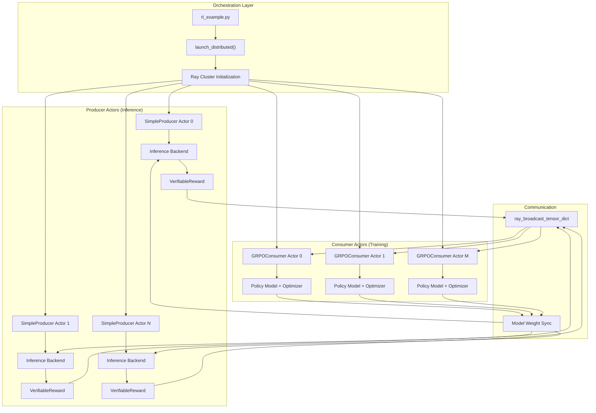
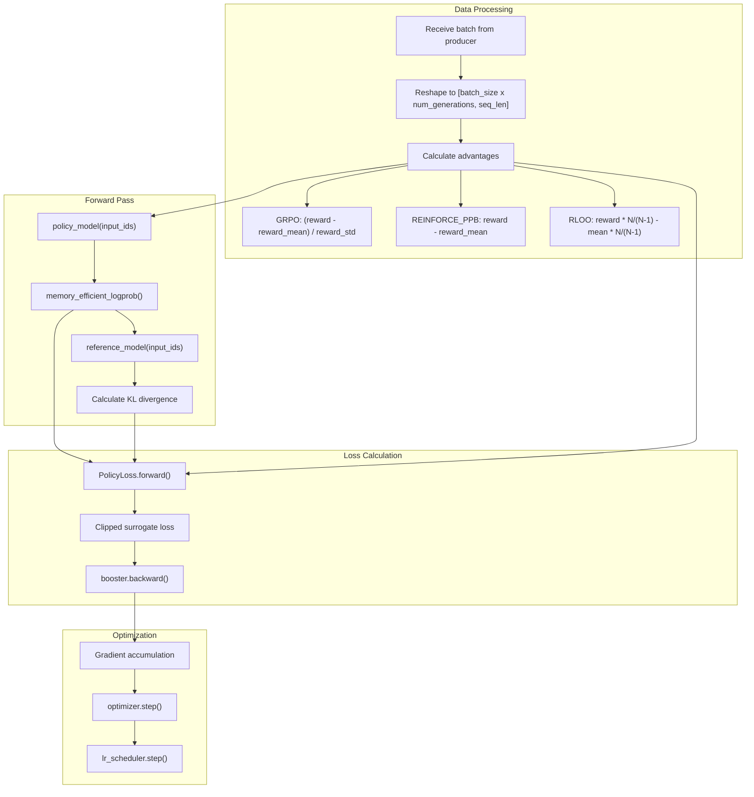
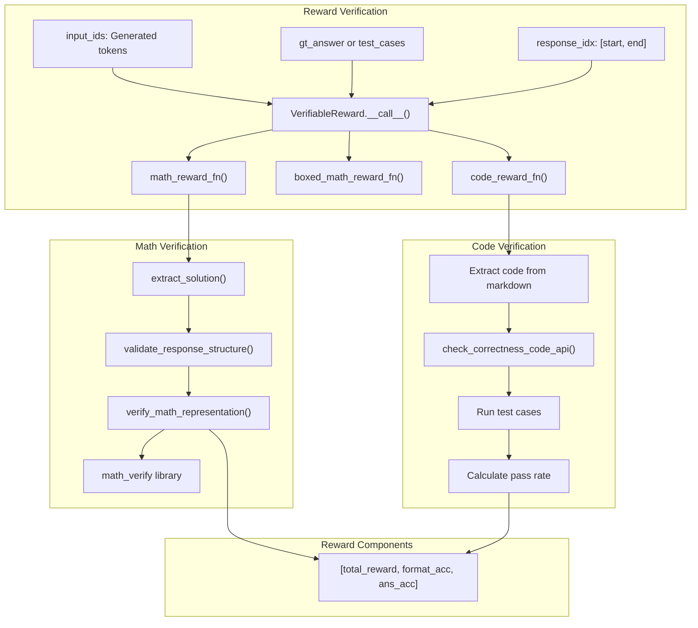
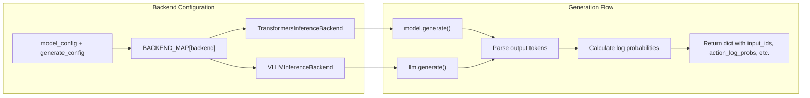
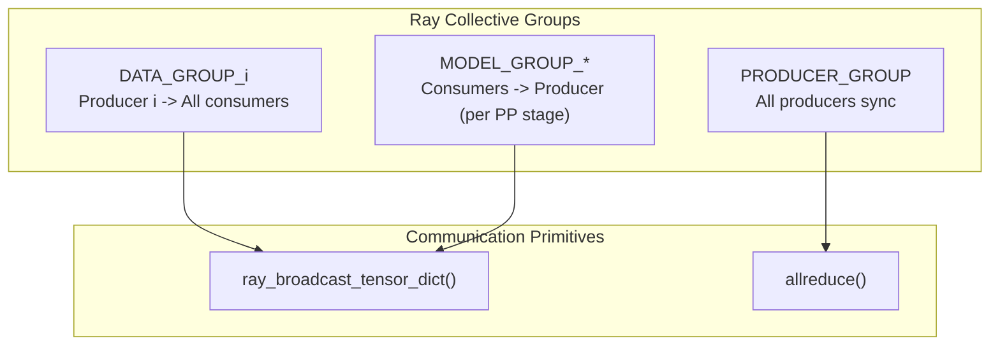
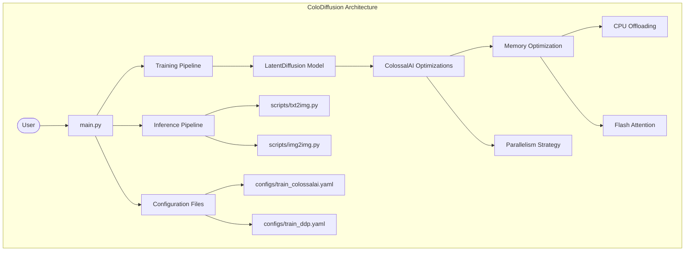
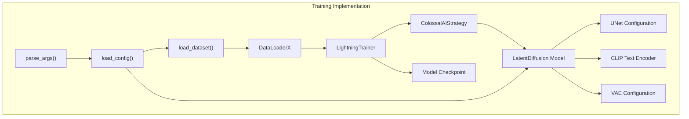
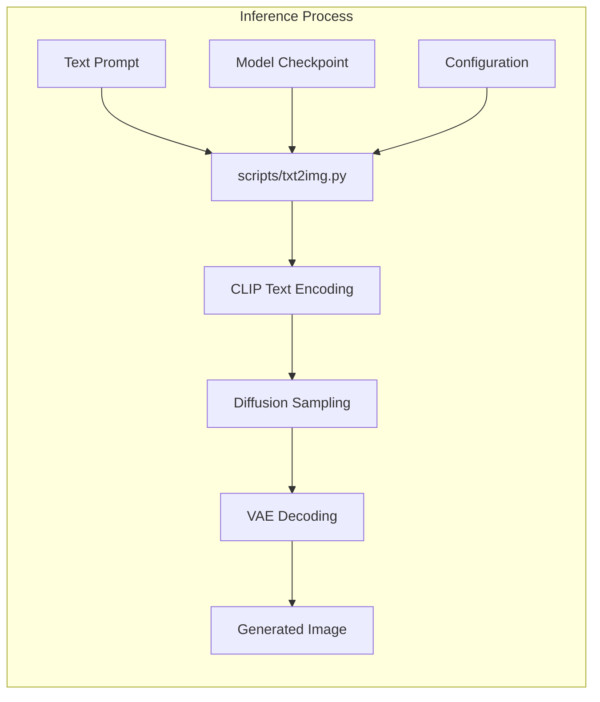
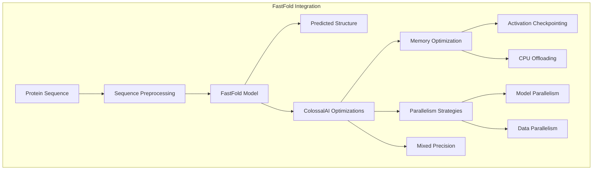

<!-- source: DeepWiki mcp.deepwiki.com · repo hpcaitech/ColossalAI · page 9 Applications and Examples · fetched 2026-10-21 -->

# Applications and Examples

<details>
<summary>Relevant source files</summary>

The following files were used as context for generating this wiki page:

- [.gitignore](.gitignore)
- [README.md](README.md)
- [applications/ColossalChat/.gitignore](applications/ColossalChat/.gitignore)
- [applications/ColossalChat/coati/dataset/loader.py](applications/ColossalChat/coati/dataset/loader.py)
- [applications/ColossalChat/coati/distributed/consumer.py](applications/ColossalChat/coati/distributed/consumer.py)
- [applications/ColossalChat/coati/distributed/grpo_consumer.py](applications/ColossalChat/coati/distributed/grpo_consumer.py)
- [applications/ColossalChat/coati/distributed/inference_backend.py](applications/ColossalChat/coati/distributed/inference_backend.py)
- [applications/ColossalChat/coati/distributed/launch.py](applications/ColossalChat/coati/distributed/launch.py)
- [applications/ColossalChat/coati/distributed/loss.py](applications/ColossalChat/coati/distributed/loss.py)
- [applications/ColossalChat/coati/distributed/producer.py](applications/ColossalChat/coati/distributed/producer.py)
- [applications/ColossalChat/coati/distributed/reward/code_reward/testing_util.py](applications/ColossalChat/coati/distributed/reward/code_reward/testing_util.py)
- [applications/ColossalChat/coati/distributed/reward/code_reward/utils.py](applications/ColossalChat/coati/distributed/reward/code_reward/utils.py)
- [applications/ColossalChat/coati/distributed/reward/reward_fn.py](applications/ColossalChat/coati/distributed/reward/reward_fn.py)
- [applications/ColossalChat/coati/distributed/reward/verifiable_reward.py](applications/ColossalChat/coati/distributed/reward/verifiable_reward.py)
- [applications/ColossalChat/coati/distributed/utils.py](applications/ColossalChat/coati/distributed/utils.py)
- [applications/ColossalChat/coati/trainer/utils.py](applications/ColossalChat/coati/trainer/utils.py)
- [applications/ColossalChat/rl_example.py](applications/ColossalChat/rl_example.py)
- [applications/ColossalChat/start_code_verifier.py](applications/ColossalChat/start_code_verifier.py)
- [applications/README.md](applications/README.md)
- [colossalai/nn/optimizer/README.md](colossalai/nn/optimizer/README.md)
- [docs/README-zh-Hans.md](docs/README-zh-Hans.md)
- [docs/source/en/basics/launch_colossalai.md](docs/source/en/basics/launch_colossalai.md)
- [docs/source/en/get_started/installation.md](docs/source/en/get_started/installation.md)
- [docs/source/zh-Hans/basics/launch_colossalai.md](docs/source/zh-Hans/basics/launch_colossalai.md)
- [docs/source/zh-Hans/get_started/installation.md](docs/source/zh-Hans/get_started/installation.md)
- [examples/README.md](examples/README.md)
- [examples/tutorial/.gitignore](examples/tutorial/.gitignore)
- [examples/tutorial/README.md](examples/tutorial/README.md)
- [examples/tutorial/download_cifar10.py](examples/tutorial/download_cifar10.py)
- [examples/tutorial/sequence_parallel/data/dummy_dataloader.py](examples/tutorial/sequence_parallel/data/dummy_dataloader.py)

</details>


This page provides an overview of major applications built with ColossalAI, demonstrating real-world usage patterns for training and deploying large-scale AI models across different domains. These applications showcase how ColossalAI's distributed training capabilities, memory optimizations, and parallelism strategies enable efficient model development.

## Overview of Applications

ColossalAI powers several production-ready applications:

| Application | Domain | Key Features |
|-------------|--------|--------------|
| Open-Sora | Video Generation | Sora-like video generation with complete model parameters and training details |
| Colossal-LLaMA | LLM Training | Continual pre-training and supervised fine-tuning for LLaMA2/LLaMA3 |
| ColossalChat | RLHF Training | Complete RLHF pipeline with distributed producer-consumer architecture |
| FastFold | Protein Structure | Optimized AlphaFold training and inference on GPU clusters |
| ColossalQA | Conversational AI | Document retrieval conversation system |
| SwiftInfer | LLM Inference | Breaks length limits for multi-round conversations |

Sources:
- [README.md:14-23]()
- [applications/README.md:14-22]()

## ColossalChat: Distributed RLHF System

ColossalChat implements a distributed RLHF (Reinforcement Learning from Human Feedback) system using a producer-consumer architecture with Ray for coordination. This design separates the computationally expensive inference (generation) from the training updates, enabling efficient scaling across multiple nodes.

### Distributed Architecture Overview

The system uses a producer-consumer pattern where:
- **Producers**: Run inference to generate responses and calculate rewards
- **Consumers**: Train the policy model using the generated data

**High-Level System Architecture**



Sources:
- [applications/ColossalChat/rl_example.py:1-448]()
- [applications/ColossalChat/coati/distributed/launch.py:36-191]()

### Producer-Consumer Workflow

The training loop follows this workflow:

**Training Loop Flow**

```mermaid
graph LR
    subgraph "Producer Flow"
        Dataset["RawConversationDataset"] --> Rollout["rollout()"]
        Rollout --> Generate["Inference Backend.generate()"]
        Generate --> CalcReward["VerifiableReward.__call__()"]
        CalcReward --> BroadcastData["ray_broadcast_tensor_dict()"]
    end
    
    subgraph "Consumer Flow"
        BroadcastData --> RecvData["Consumer.loop() receives data"]
        RecvData --> Buffer["Add to buffer"]
        Buffer --> PrepareBatch["prepare_mini_batch()"]
        PrepareBatch --> Step["step() - forward/backward"]
        Step --> UpdateWeights["optimizer.step()"]
        UpdateWeights --> SyncWeights["Broadcast state_dict()"]
    end
    
    SyncWeights --> Rollout
```



**Key Implementation Details:**

1. **Producers** ([applications/ColossalChat/coati/distributed/producer.py]()):
   - Load dataset using `RawConversationDataset` from [applications/ColossalChat/coati/dataset/loader.py:125-141]()
   - Generate responses via inference backend (Transformers or vLLM)
   - Calculate rewards using verifiable reward functions
   - Broadcast data to consumers via Ray collective communication

2. **Consumers** ([applications/ColossalChat/coati/distributed/consumer.py](), [applications/ColossalChat/coati/distributed/grpo_consumer.py]()):
   - Receive batches from producers
   - Accumulate data in a buffer
   - Perform training steps with gradient accumulation
   - Synchronize updated model weights back to producers

Sources:
- [applications/ColossalChat/coati/distributed/producer.py:218-416]()
- [applications/ColossalChat/coati/distributed/consumer.py:149-356]()
- [applications/ColossalChat/coati/distributed/grpo_consumer.py:174-606]()

### GRPO Training Algorithm

ColossalChat implements Group Relative Policy Optimization (GRPO), which uses verifiable rewards for tasks like math problem solving. The `GRPOConsumer` class implements the training logic:

**GRPO Training Step**



Key components:

- **Advantage Calculation** ([applications/ColossalChat/coati/distributed/grpo_consumer.py:206-227]()): Supports GRPO, REINFORCE_PPB, and RLOO algorithms
- **Policy Loss** ([applications/ColossalChat/coati/distributed/loss.py:8-71]()): PPO-style clipped surrogate loss with KL penalty
- **Memory-Efficient Log Prob Calculation** ([applications/ColossalChat/coati/distributed/utils.py:74-111]()): Processes logits in chunks to save memory

Sources:
- [applications/ColossalChat/coati/distributed/grpo_consumer.py:174-606]()
- [applications/ColossalChat/coati/distributed/loss.py:8-71]()
- [applications/ColossalChat/coati/distributed/utils.py:74-111]()

### Verifiable Reward Functions

ColossalChat uses verifiable reward functions for math and code problems, enabling automatic evaluation without human labeling:

**Reward Function Architecture**



**Math Reward Function** ([applications/ColossalChat/coati/distributed/reward/reward_fn.py:99-158]()):
- Extracts answer from response using tags (`<think>`, `<answer>`)
- Validates response structure
- Verifies mathematical correctness using symbolic math verification
- Applies length-based penalties for over-length responses

**Code Reward Function** ([applications/ColossalChat/coati/distributed/reward/reward_fn.py:225-293]()):
- Extracts Python code from markdown blocks
- Runs code against test cases via API
- Calculates pass rate across all test cases
- Returns combined reward signal

Sources:
- [applications/ColossalChat/coati/distributed/reward/verifiable_reward.py:1-72]()
- [applications/ColossalChat/coati/distributed/reward/reward_fn.py:99-293]()

### Inference Backend Support

ColossalChat supports multiple inference backends for generation:

| Backend | Class | Key Features |
|---------|-------|--------------|
| Transformers | `TransformersInferenceBackend` | HuggingFace models, flexible configuration |
| vLLM | `VLLMInferenceBackend` | High-throughput serving, paged attention |

**Backend Selection and Usage**



**Transformers Backend** ([applications/ColossalChat/coati/distributed/inference_backend.py:46-127]()):
- Uses HuggingFace `AutoModelForCausalLM.generate()`
- Returns logits for log probability calculation
- Supports multiple generations per prompt

**vLLM Backend** ([applications/ColossalChat/coati/distributed/inference_backend.py:186-285]()):
- High-performance inference with paged attention
- Returns log probabilities directly from vLLM
- Supports tensor parallelism for large models

Sources:
- [applications/ColossalChat/coati/distributed/inference_backend.py:22-292]()

### Ray-Based Coordination

The system uses Ray for distributed coordination with custom collective communication:

**Communication Groups**



**Group Initialization** ([applications/ColossalChat/coati/distributed/launch.py:92-119]()):
- Creates producer and consumer actors with GPU resources
- Initializes Ray collective groups for communication
- Schedules actors to specific nodes based on GPU availability

Sources:
- [applications/ColossalChat/coati/distributed/launch.py:36-191]()
- [applications/ColossalChat/coati/distributed/consumer.py:91-103]()
- [applications/ColossalChat/coati/distributed/producer.py:198-211]()

### Running ColossalChat RLHF Training

**Command-Line Interface**

The main entry point `rl_example.py` accepts numerous configuration parameters:

```bash
python rl_example.py \
    --model Qwen/Qwen2.5-7B \
    --dataset data.jsonl \
    --num-trainers 2 \
    --num-inferencer 2 \
    --num-generations 8 \
    --inference-batch-size 64 \
    --train-batch-size 32 \
    --algo GRPO \
    --reward-type think_answer_tags \
    --backend vllm
```

**Key Parameters** ([applications/ColossalChat/rl_example.py:19-185]()):

| Parameter | Description |
|-----------|-------------|
| `--num-trainers` | Number of consumer processes for training |
| `--num-inferencer` | Number of producer processes for inference |
| `--num-generations` | Number of responses generated per prompt |
| `--inference-batch-size` | Batch size for inference |
| `--train-batch-size` | Batch size for training per DP group |
| `--algo` | Algorithm: GRPO, DAPO, REINFORCE_PPB, or RLOO |
| `--reward-type` | Reward function: think_answer_tags, boxed, or code |
| `--backend` | Inference backend: transformers or vllm |

Sources:
- [applications/ColossalChat/rl_example.py:18-448]()

## Open-Sora: Video Generation Model

Open-Sora is a complete implementation of Sora-like video generation models with full model parameters and training details. It demonstrates how ColossalAI can be used to train large-scale diffusion models for video generation.

**Key Features:**
- Generate 16-second 720p HD videos with one click
- Complete model parameters and training details openly available
- Significant cost reduction: 50% development cost savings reported
- Integration with ColossalAI for efficient training

The implementation is available as a separate repository: `https://github.com/hpcaitech/Open-Sora`

**Performance Highlights:**
- Capable of generating high-quality 16-second videos at 720p resolution
- Uses diffusion-based architecture optimized with ColossalAI
- Supports distributed training across multiple GPUs

Sources:
- [README.md:59-67]()
- [docs/README-zh-Hans.md:27-33]()

## Colossal-LLaMA: LLM Fine-Tuning

Colossal-LLaMA provides optimized solutions for continual pre-training and supervised fine-tuning of LLaMA2 and LLaMA3 models. It demonstrates cost-effective approaches to building domain-specific language models.

**Performance Results:**

The following table shows performance comparison on Chinese language benchmarks:

| Model | Backbone | Tokens Consumed | MMLU (5-shot) | CMMLU (5-shot) | AGIEval (5-shot) | GAOKAO (0-shot) | CEval (5-shot) |
|-------|----------|-----------------|---------------|----------------|------------------|-----------------|----------------|
| Llama-2-7B | - | 2.0T | 44.47 (45.30) | 32.97 (-) | 32.60 | 25.46 | - |
| **Colossal-LLaMA-2-7b-base** | Llama-2-7B | **0.0085T** | 53.06 | 49.89 | 51.48 | 58.82 | 50.2 |
| **Colossal-LLaMA-2-13b-base** | Llama-2-13B | **0.025T** | 56.42 | 61.80 | 54.69 | 69.53 | 60.3 |

**Key Achievements:**
- **7B Model**: Half-day training with a few hundred dollars yields similar results to mainstream large models
- **13B Model**: Construct refined 13B private model with just $5000 USD
- Open-source and commercial-free domain-specific LLM solution

The training leverages ColossalAI's optimization techniques to dramatically reduce training time and cost while maintaining or improving model quality.

Sources:
- [README.md:177-214]()
- [docs/README-zh-Hans.md:140-174]()

## ColoDiffusion: Stable Diffusion with ColossalAI

ColoDiffusion is an implementation of Stable Diffusion models (v1 and v2) optimized with ColossalAI. It significantly reduces the memory footprint and hardware requirements for training and running diffusion models.



Sources:
- [examples/images/diffusion/README.md:1-23]()
- [examples/images/diffusion/main.py]()

### Key Features and Benefits

ColoDiffusion provides several significant optimizations:

- **Training Optimization**: Reduces Stable Diffusion memory consumption by up to 5.6x, enabling training on consumer GPUs (RTX3060) instead of requiring A100
- **DreamBooth Fine-tuning**: Personalize your model using just 3-5 images of the desired subject
- **Inference Optimization**: Reduces inference GPU memory consumption by 2.5x

| Feature | Benefit |
|---------|---------|
| Memory Optimization | Train on consumer GPUs (up to 46x lower hardware cost) |
| DreamBooth Support | Personalize models with just a few images |
| Inference Optimization | 2.5x less memory during inference |
| ColossalAI Integration | Efficient parallelism and memory management |

Sources:
- [examples/images/diffusion/README.md:5-23]()

### Training Process

The training process in ColoDiffusion is implemented in `main.py` and uses PyTorch Lightning with the ColossalAI strategy:



Training a diffusion model with ColossalAI:

```bash
python main.py --logdir /tmp/ --train --base configs/train_colossalai.yaml --ckpt 512-base-ema.ckpt
```

Fine-tuning on a specific dataset:

```bash
python main.py --logdir /tmp/ -t -b configs/Teyvat/train_colossalai_teyvat.yaml
```

Sources:
- [examples/images/diffusion/main.py]()
- [examples/images/diffusion/README.md:162-165]()
- [examples/images/diffusion/configs/train_colossalai.yaml]()

### Inference Process

Inference is implemented in `scripts/txt2img.py` and `scripts/img2img.py`:



Example inference command:

```bash
python scripts/txt2img.py --prompt "a photograph of an astronaut riding a horse" --plms \
    --outdir ./output \
    --ckpt path/to/logdir/checkpoints/last.ckpt \
    --config path/to/logdir/configs/project.yaml
```

Sources:
- [examples/images/diffusion/README.md:205-214]()
- [examples/images/diffusion/scripts/txt2img.py]()

## FastFold: Protein Structure Prediction

FastFold is an implementation for protein structure prediction optimized with ColossalAI. It provides significant speedups over existing implementations for protein folding algorithms.



FastFold leverages ColossalAI's optimization techniques to accelerate protein structure prediction, making it more accessible for researchers without requiring extensive computational resources. The implementation is available as a submodule in the ColossalAI repository at `examples/tutorial/fastfold/FastFold`.

Sources:
- [.gitmodules:1-3]()

## Hardware Requirements

The optimization techniques provided by ColossalAI in these applications significantly reduce hardware requirements:

| Application | Without ColossalAI | With ColossalAI | Reduction |
|-------------|-------------------|----------------|-----------|
| ColoDiffusion Training | NVIDIA A100 | Consumer GPU (RTX 3060) | Up to 46x lower cost |
| ColoDiffusion Inference | Standard Memory | 2.5x less memory | 2.5x memory reduction |
| ColossalChat | Multiple high-end GPUs | Flexible based on configuration | Varies by setup |

For ColossalChat, the specific hardware requirements depend on the model size and the optimization techniques used. The plugin system (Gemini, Zero2, etc.) allows for flexible hardware configurations based on available resources.

Sources:
- [examples/images/diffusion/README.md:5-11]()
- [applications/ColossalChat/examples/README.md:36-37]()

## Summary

ColossalAI provides optimized implementations for several important deep learning applications:

1. **ColossalChat**: Complete RLHF pipeline for LLM training with multiple optimization methods
2. **ColoDiffusion**: Memory-efficient implementation of Stable Diffusion
3. **FastFold**: Accelerated protein structure prediction

These applications demonstrate how ColossalAI's optimization techniques can make training and deploying large AI models more accessible by reducing memory requirements and hardware costs.

Sources:
- [applications/ColossalChat/examples/README.md]()
- [examples/images/diffusion/README.md]()
- [.gitmodules]()

---

