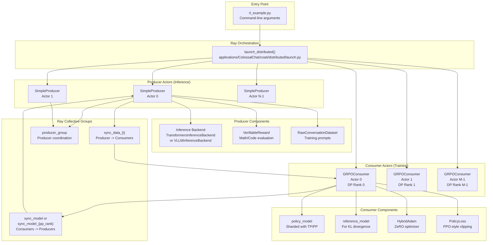
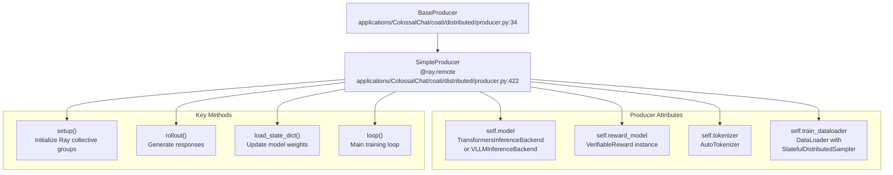
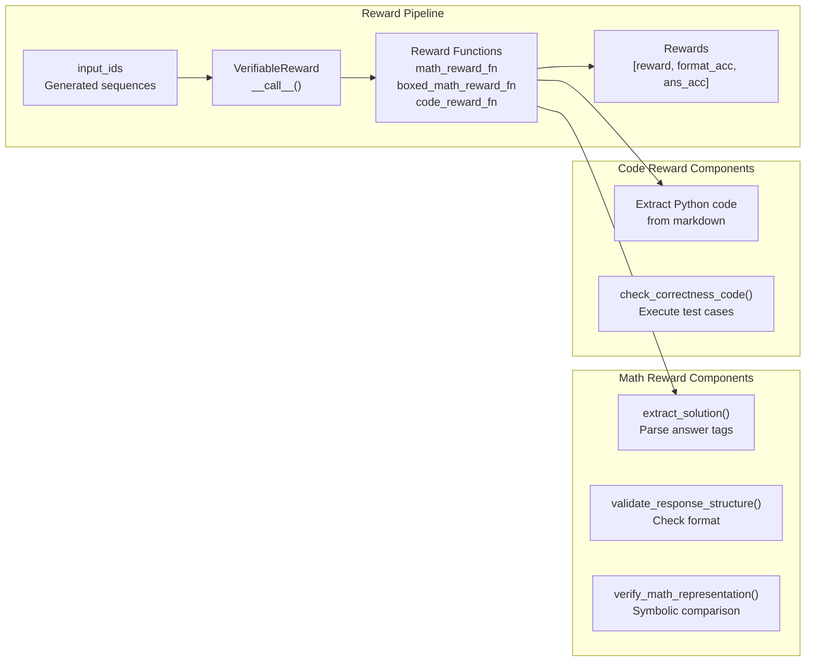
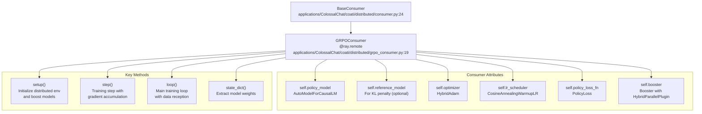
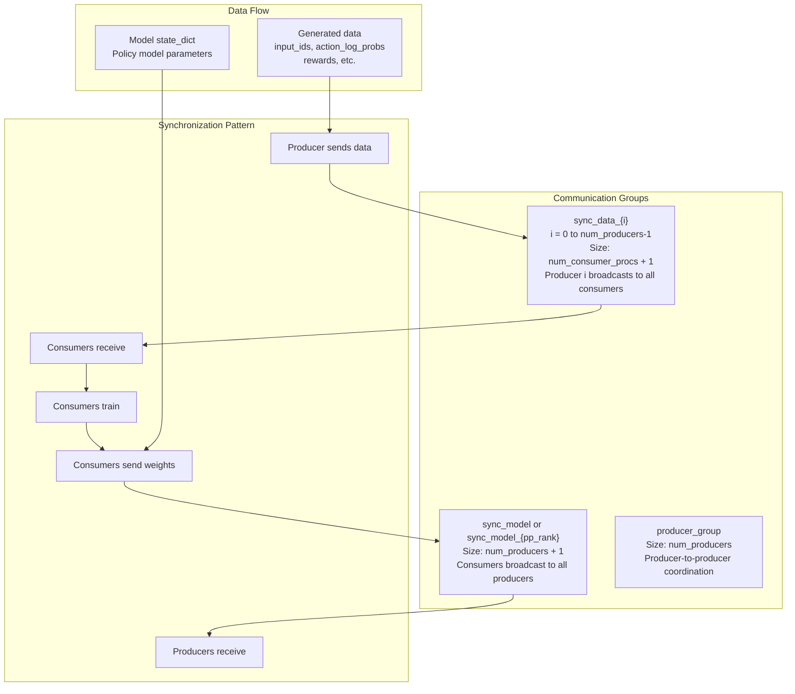
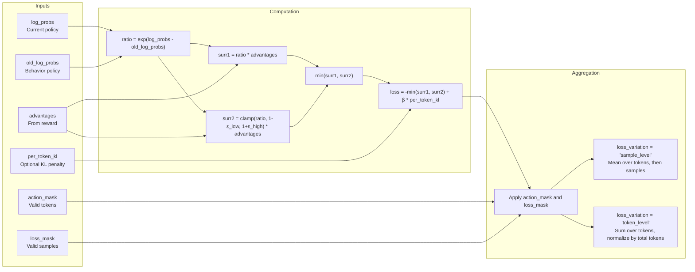

<!-- source: DeepWiki mcp.deepwiki.com · repo hpcaitech/ColossalAI · page 9.1 ColossalChat and RLHF Pipeline · fetched 2026-10-21 -->

# ColossalChat and RLHF Pipeline

<details>
<summary>Relevant source files</summary>

The following files were used as context for generating this wiki page:

- [.gitignore](.gitignore)
- [applications/ColossalChat/coati/dataset/loader.py](applications/ColossalChat/coati/dataset/loader.py)
- [applications/ColossalChat/coati/distributed/consumer.py](applications/ColossalChat/coati/distributed/consumer.py)
- [applications/ColossalChat/coati/distributed/grpo_consumer.py](applications/ColossalChat/coati/distributed/grpo_consumer.py)
- [applications/ColossalChat/coati/distributed/inference_backend.py](applications/ColossalChat/coati/distributed/inference_backend.py)
- [applications/ColossalChat/coati/distributed/launch.py](applications/ColossalChat/coati/distributed/launch.py)
- [applications/ColossalChat/coati/distributed/loss.py](applications/ColossalChat/coati/distributed/loss.py)
- [applications/ColossalChat/coati/distributed/producer.py](applications/ColossalChat/coati/distributed/producer.py)
- [applications/ColossalChat/coati/distributed/reward/code_reward/testing_util.py](applications/ColossalChat/coati/distributed/reward/code_reward/testing_util.py)
- [applications/ColossalChat/coati/distributed/reward/code_reward/utils.py](applications/ColossalChat/coati/distributed/reward/code_reward/utils.py)
- [applications/ColossalChat/coati/distributed/reward/reward_fn.py](applications/ColossalChat/coati/distributed/reward/reward_fn.py)
- [applications/ColossalChat/coati/distributed/reward/verifiable_reward.py](applications/ColossalChat/coati/distributed/reward/verifiable_reward.py)
- [applications/ColossalChat/coati/distributed/utils.py](applications/ColossalChat/coati/distributed/utils.py)
- [applications/ColossalChat/coati/trainer/utils.py](applications/ColossalChat/coati/trainer/utils.py)
- [applications/ColossalChat/rl_example.py](applications/ColossalChat/rl_example.py)
- [applications/ColossalChat/start_code_verifier.py](applications/ColossalChat/start_code_verifier.py)

</details>


## Purpose and Scope

This document describes the distributed Reinforcement Learning from Human Feedback (RLHF) system implemented in ColossalChat. The system uses a producer-consumer architecture orchestrated via Ray to train large language models with verifiable reward functions. It supports multiple RL algorithms (GRPO, DAPO, RLOO, REINFORCE_PPB) for tasks requiring step-by-step reasoning, such as mathematical problem solving and code generation.

For information about the general inference engine architecture, see [Inference Engine](#6). For training parallelism strategies used by consumers, see [Hybrid Parallelism](#3.7).

## System Architecture

The RLHF pipeline separates text generation (inference) from policy training using a distributed producer-consumer pattern. Producers generate multiple response candidates per prompt and compute rewards, while consumers train the policy model on the collected experiences. Ray coordinates communication and model synchronization between actors.

### Producer-Consumer Architecture



**Sources:** [applications/ColossalChat/rl_example.py:1-448](), [applications/ColossalChat/coati/distributed/launch.py:36-191](), [applications/ColossalChat/coati/distributed/producer.py:34-419](), [applications/ColossalChat/coati/distributed/consumer.py:24-362](), [applications/ColossalChat/coati/distributed/grpo_consumer.py:18-613]()

## Producer Actors

Producers are Ray actors responsible for generating multiple response candidates per prompt and computing rewards. Each producer runs an inference backend (Transformers or vLLM) and evaluates responses using verifiable reward functions.

### Producer Class Hierarchy



**Sources:** [applications/ColossalChat/coati/distributed/producer.py:34-419](), [applications/ColossalChat/coati/distributed/producer.py:422-514]()

### Inference Backends

Producers support multiple inference backends for text generation. The backend selection affects memory usage and throughput.

| Backend | Class | Generation Method | Key Features |
|---------|-------|-------------------|--------------|
| Transformers | `TransformersInferenceBackend` | `model.generate()` | Baseline implementation, outputs logits for log prob calculation |
| vLLM | `VLLMInferenceBackend` | `llm.generate()` | Optimized for high throughput, supports paged attention, returns logprobs directly |
| SGLang | `SGLangInferenceBackend` | `llm.generate()` | Alternative optimized backend (currently disabled) |

All backends implement the `generate()` method that returns:
- `input_ids`: Full sequences (prompt + response)
- `attention_mask`: Attention mask
- `action_log_probs`: Log probabilities of generated tokens
- `action_mask`: Mask indicating valid generated tokens
- `response_idx`: Start and end indices of responses

**Sources:** [applications/ColossalChat/coati/distributed/inference_backend.py:46-127](), [applications/ColossalChat/coati/distributed/inference_backend.py:186-285]()

### Reward Calculation

The `VerifiableReward` class coordinates multiple reward functions to evaluate generated responses. For math tasks, it verifies symbolic equivalence using `math_verify`. For code tasks, it executes test cases.



**Sources:** [applications/ColossalChat/coati/distributed/reward/verifiable_reward.py:11-72](), [applications/ColossalChat/coati/distributed/reward/reward_fn.py:99-158](), [applications/ColossalChat/coati/distributed/reward/reward_fn.py:225-307]()

## Consumer Actors

Consumers are Ray actors that train the policy model using experiences collected by producers. Each consumer runs on a single GPU and can use tensor parallelism (TP), pipeline parallelism (PP), and data parallelism (DP) via the `HybridParallelPlugin`.

### Consumer Class Hierarchy



**Sources:** [applications/ColossalChat/coati/distributed/consumer.py:24-362](), [applications/ColossalChat/coati/distributed/grpo_consumer.py:19-613]()

### Training Step Implementation

The `step()` method in `GRPOConsumer` performs one training iteration:

1. **Reshape data**: Convert `[minibatch_size, num_generations, seq_len]` to `[minibatch_size * num_generations, seq_len]`
2. **Calculate advantages**: Based on algorithm (GRPO/RLOO/REINFORCE_PPB)
3. **Filter samples**: Remove truncated or out-of-range responses
4. **Gradient accumulation**: Process data in microbatches with optional gradient sync
5. **Forward pass**: Compute action log probs from policy model (and reference model if KL penalty enabled)
6. **Compute loss**: Using `PolicyLoss` with PPO-style clipping
7. **Backward pass**: Accumulate gradients
8. **Optimizer step**: Update parameters when gradient accumulation completes

**Sources:** [applications/ColossalChat/coati/distributed/grpo_consumer.py:174-606]()

### Advantage Calculation

Different RL algorithms use different methods to compute advantages from rewards:

| Algorithm | Advantage Formula | Description |
|-----------|-------------------|-------------|
| GRPO | `(reward - reward_mean) / (reward_std + ε)` | Group Relative Policy Optimization: standardize within generation group |
| RLOO | `reward * N/(N-1) - reward_mean * N/(N-1)` | REINFORCE Leave One Out: exclude current sample from baseline |
| REINFORCE_PPB | `reward - reward_mean - β * KL` | REINFORCE with per-prompt baseline and KL penalty |
| DAPO | Same as GRPO | Direct Alignment from Preferences with Online feedback |

Where `N` is `num_generations`, `reward_mean` is the mean reward across generations for the same prompt, and `KL` is the KL divergence from the reference model.

**Sources:** [applications/ColossalChat/coati/distributed/grpo_consumer.py:210-227](), [applications/ColossalChat/rl_example.py:292-387]()

## Communication and Synchronization

Ray collective communication enables data transfer between producers and consumers, and model weight synchronization from consumers back to producers.

### Ray Collective Groups



**Sources:** [applications/ColossalChat/coati/distributed/producer.py:198-211](), [applications/ColossalChat/coati/distributed/consumer.py:91-103]()

### Data Broadcasting

The `ray_broadcast_tensor_dict()` function handles tensor dictionary broadcasting between actors. Producers send generated data to consumers after each rollout batch:

```python
# Producer sends (applications/ColossalChat/coati/distributed/producer.py:362-364)
ray_broadcast_tensor_dict(
    outputs, src=0, device=self.device, group_name=f"sync_data_{self.producer_idx}"
)

# Consumers receive (applications/ColossalChat/coati/distributed/consumer.py:223-225)
raw_batch = ray_broadcast_tensor_dict(
    None, src=0, device=self.device, group_name=f"sync_data_{r}"
)
```

**Sources:** [applications/ColossalChat/coati/distributed/producer.py:362-365](), [applications/ColossalChat/coati/distributed/consumer.py:223-226]()

### Model Weight Synchronization

After training steps, consumers synchronize updated policy model weights back to producers. For pipeline parallelism, each PP stage synchronizes separately:

```python
# Without pipeline parallelism (applications/ColossalChat/coati/distributed/consumer.py:348-351)
ray_broadcast_tensor_dict(
    state_dict, src=self.num_producers, device=self.device, group_name="sync_model"
)

# With pipeline parallelism (applications/ColossalChat/coati/distributed/consumer.py:341-346)
ray_broadcast_tensor_dict(
    state_dict,
    src=self.num_producers,
    device=self.device,
    group_name=f"sync_model_{self.pp_rank}",
)
```

**Sources:** [applications/ColossalChat/coati/distributed/consumer.py:336-354](), [applications/ColossalChat/coati/distributed/producer.py:377-399]()

## Training Workflow

The RLHF training loop alternates between rollout (producers) and training (consumers) phases, with model synchronization after each training step.

### Main Training Loop

```mermaid
graph TB
    Start["Start Training<br/>Episode 0"]
    
    subgraph "Producer Rollout Phase"
        LoadBatch["Load batch from<br/>train_dataloader"]
        Generate["Generate N responses<br/>per prompt using<br/>inference backend"]
        CalcReward["Calculate rewards<br/>using VerifiableReward"]
        BroadcastData["Broadcast data to<br/>consumers via<br/>sync_data_{i}"]
    end
    
    subgraph "Consumer Training Phase"
        ReceiveData["Receive data from<br/>producers"]
        BufferData["Buffer data and<br/>filter by reward range"]
        PrepareMiniBatch["Prepare mini-batch<br/>when enough data collected"]
        CalcAdv["Calculate advantages<br/>based on algorithm"]
        ForwardPass["Forward pass through<br/>policy_model and<br/>reference_model"]
        ComputeLoss["Compute PolicyLoss<br/>with PPO clipping"]
        BackwardPass["Backward pass and<br/>accumulate gradients"]
        OptimizerStep["Optimizer step when<br/>accumulation complete"]
    end
    
    subgraph "Synchronization Phase"
        ExtractWeights["Extract state_dict<br/>from policy_model"]
        BroadcastWeights["Broadcast weights to<br/>producers via<br/>sync_model"]
        LoadWeights["Producers load_state_dict<br/>into inference backend"]
    end
    
    CheckDone{"All episodes<br/>complete?"}
    End["Training Complete"]
    
    Start --> LoadBatch
    LoadBatch --> Generate
    Generate --> CalcReward
    CalcReward --> BroadcastData
    BroadcastData --> ReceiveData
    ReceiveData --> BufferData
    BufferData --> PrepareMiniBatch
    PrepareMiniBatch --> CalcAdv
    CalcAdv --> ForwardPass
    ForwardPass --> ComputeLoss
    ComputeLoss --> BackwardPass
    BackwardPass --> OptimizerStep
    OptimizerStep --> ExtractWeights
    ExtractWeights --> BroadcastWeights
    BroadcastWeights --> LoadWeights
    LoadWeights --> CheckDone
    CheckDone -->|No| LoadBatch
    CheckDone -->|Yes| End
```



**Sources:** [applications/ColossalChat/coati/distributed/producer.py:218-416](), [applications/ColossalChat/coati/distributed/consumer.py:149-357]()

### Batch Processing Flow

The system processes data in hierarchical batch sizes to manage memory and optimize throughput:

| Batch Size | Scope | Description |
|------------|-------|-------------|
| `inference_batch_size` | Per producer | Prompts processed by one producer in one rollout step |
| `inference_microbatch_size` | Per producer | Prompts processed in one inference call (memory constraint) |
| `train_batch_size` | Per DP group | Unique prompts for one gradient update per DP group |
| `train_minibatch_size` | Per DP group | Unique prompts forwarded together before gradient accumulation |
| `train_microbatch_size` | Per DP group | Samples (prompts × generations) forwarded in one pass |

The relationship: `train_batch_size >= train_minibatch_size * dp_size >= train_microbatch_size`

**Sources:** [applications/ColossalChat/rl_example.py:41-79](), [applications/ColossalChat/coati/distributed/launch.py:36-68]()

## Policy Loss Function

The `PolicyLoss` class implements PPO-style clipped surrogate objective with optional KL penalty and supports both sample-level and token-level loss variations.

### Loss Computation



**Sources:** [applications/ColossalChat/coati/distributed/loss.py:8-71]()

The loss variations differ in how they aggregate:
- **Sample-level**: `mean(masked_mean(loss, action_mask) * loss_mask)` - Equal weight per sample
- **Token-level**: `sum(masked_sum(loss, action_mask) * loss_mask) / total_effective_tokens` - Equal weight per token

**Sources:** [applications/ColossalChat/coati/distributed/loss.py:51-68]()

## Configuration and Launch

The main entry point `rl_example.py` provides a command-line interface for launching distributed RLHF training.

### Key Configuration Parameters

| Parameter Group | Key Parameters | Description |
|----------------|----------------|-------------|
| Model | `-m/--model` | HuggingFace model path (e.g., "Qwen/Qwen2.5-7B") |
| Dataset | `-d/--dataset` | Training dataset path (JSONL format) |
| Distributed | `-t/--num-trainers`<br/>`-i/--num-inferencer`<br/>`-g/--num-generations` | Number of consumer actors<br/>Number of producer actors<br/>Response candidates per prompt |
| Batch Sizes | `-ibs/--inference-batch-size`<br/>`-tbs/--train-batch-size`<br/>`-tmbs/--train-microbatch-size` | Prompts per producer step<br/>Prompts per gradient update<br/>Effective forward batch size |
| Parallelism | `-tp/--tensor-parallel-size`<br/>`-pp/--pipeline-parallel-size`<br/>`-zero/--zero-stage` | TP size for consumers<br/>PP size for consumers<br/>ZeRO optimization stage |
| Algorithm | `-a/--algo` | GRPO, DAPO, RLOO, or REINFORCE_PPB |
| Sampling | `-temp/--temperature`<br/>`-topp/--top-p` | Sampling temperature<br/>Nucleus sampling threshold |
| Reward | `-rt/--reward-type` | think_answer_tags, boxed, or code |

**Sources:** [applications/ColossalChat/rl_example.py:18-186]()

### Launch Process

The `launch_distributed()` function orchestrates the creation and initialization of producer and consumer actors:

1. **Calculate batch parameters**: Determine `num_update_per_episode` and `num_recv_per_update` based on dataset size and batch sizes
2. **Schedule actors on nodes**: Allocate GPUs to producers first (lower node IDs), then consumers (higher node IDs)
3. **Create producer actors**: Instantiate `SimpleProducer.remote()` with `num_gpus=num_proc_per_producer`
4. **Create consumer actors**: Instantiate `GRPOConsumer.remote()` with `num_gpus=1` per actor
5. **Setup actors**: Call `setup.remote()` on all actors to initialize Ray collective groups
6. **Start training**: Call `loop.remote()` on all actors to begin training

**Sources:** [applications/ColossalChat/coati/distributed/launch.py:36-191]()

### Example Command

```bash
python rl_example.py \
    -m Qwen/Qwen2.5-7B \
    -d data/math_problems.jsonl \
    -t 4 \
    -i 2 \
    -g 8 \
    -ibs 64 \
    -tbs 32 \
    -tmbs 2 \
    -tp 2 \
    -pp 1 \
    -zero 1 \
    -a GRPO \
    -temp 1.0 \
    -topp 0.9 \
    -rt think_answer_tags \
    -lr 1e-6 \
    -kl 0.01
```

This launches training with 2 producer actors (each using 1 GPU for vLLM or as specified by `-ptp`), 4 consumer actors (TP=2, DP=2), generating 8 responses per prompt, using GRPO algorithm with think-answer-tags reward.

**Sources:** [applications/ColossalChat/rl_example.py:18-448]()

## Dataset Format

Training and evaluation datasets use JSONL format with conversation messages and ground truth answers.

### Training Dataset Schema

Each line in the JSONL file contains:
```json
{
    "messages": {
        "role": "user",
        "content": "Solve: 2x + 3 = 7"
    },
    "gt_answer": "2"
}
```

For code tasks:
```json
{
    "messages": {
        "role": "user", 
        "content": "Write a function to add two numbers"
    },
    "test_cases": {
        "fn_name": "add",
        "inputs": ["[1, 2]\n", "[3, 4]\n"],
        "outputs": ["3\n", "7\n"]
    }
}
```

The `RawConversationDataset` class loads these files and applies chat templates with configurable system prompts.

**Sources:** [applications/ColossalChat/coati/dataset/loader.py:420-463](), [applications/ColossalChat/coati/dataset/loader.py:351-418]()

---

