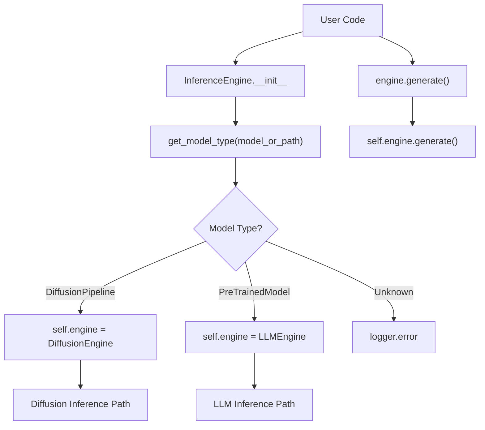
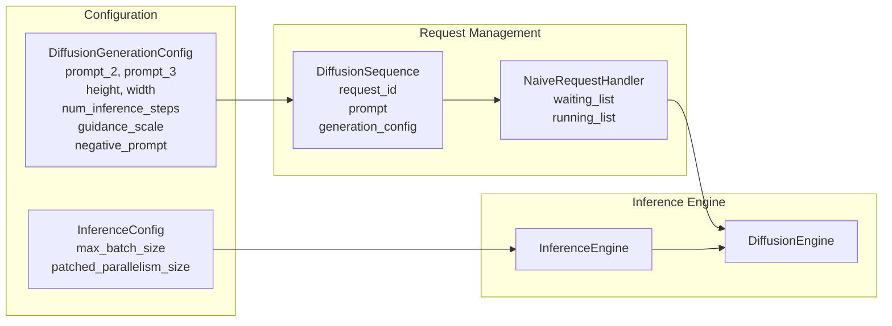
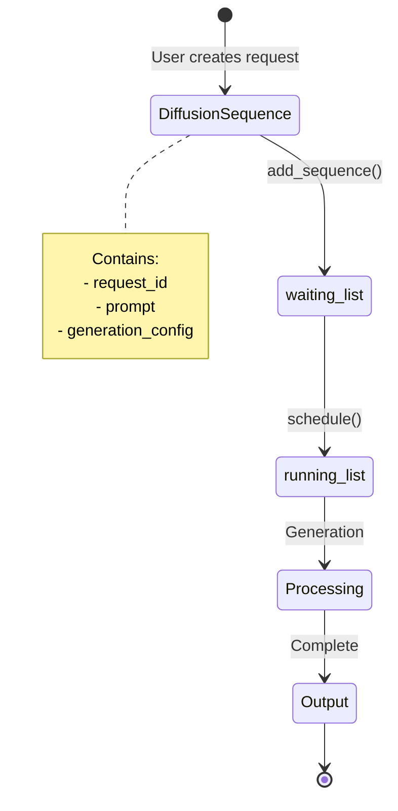

<!-- source: DeepWiki mcp.deepwiki.com · repo hpcaitech/ColossalAI · page 9.2 Diffusion Models · fetched 2026-10-21 -->

# Diffusion Models

<details>
<summary>Relevant source files</summary>

The following files were used as context for generating this wiki page:

- [README.md](README.md)
- [applications/ColossalChat/.gitignore](applications/ColossalChat/.gitignore)
- [applications/README.md](applications/README.md)
- [colossalai/inference/batch_bucket.py](colossalai/inference/batch_bucket.py)
- [colossalai/inference/config.py](colossalai/inference/config.py)
- [colossalai/inference/core/engine.py](colossalai/inference/core/engine.py)
- [colossalai/inference/core/request_handler.py](colossalai/inference/core/request_handler.py)
- [colossalai/inference/core/rpc_engine.py](colossalai/inference/core/rpc_engine.py)
- [colossalai/inference/executor/rpc_worker.py](colossalai/inference/executor/rpc_worker.py)
- [colossalai/inference/kv_cache/__init__.py](colossalai/inference/kv_cache/__init__.py)
- [colossalai/inference/kv_cache/kvcache_manager.py](colossalai/inference/kv_cache/kvcache_manager.py)
- [colossalai/inference/logit_processors.py](colossalai/inference/logit_processors.py)
- [colossalai/inference/modeling/layers/attention.py](colossalai/inference/modeling/layers/attention.py)
- [colossalai/inference/modeling/models/nopadding_llama.py](colossalai/inference/modeling/models/nopadding_llama.py)
- [colossalai/inference/modeling/policy/__init__.py](colossalai/inference/modeling/policy/__init__.py)
- [colossalai/inference/modeling/policy/nopadding_llama.py](colossalai/inference/modeling/policy/nopadding_llama.py)
- [colossalai/inference/sampler.py](colossalai/inference/sampler.py)
- [colossalai/inference/struct.py](colossalai/inference/struct.py)
- [colossalai/nn/optimizer/README.md](colossalai/nn/optimizer/README.md)
- [docs/README-zh-Hans.md](docs/README-zh-Hans.md)
- [docs/source/en/basics/launch_colossalai.md](docs/source/en/basics/launch_colossalai.md)
- [docs/source/en/get_started/installation.md](docs/source/en/get_started/installation.md)
- [docs/source/zh-Hans/basics/launch_colossalai.md](docs/source/zh-Hans/basics/launch_colossalai.md)
- [docs/source/zh-Hans/get_started/installation.md](docs/source/zh-Hans/get_started/installation.md)
- [examples/README.md](examples/README.md)
- [examples/tutorial/.gitignore](examples/tutorial/.gitignore)
- [examples/tutorial/README.md](examples/tutorial/README.md)
- [examples/tutorial/download_cifar10.py](examples/tutorial/download_cifar10.py)
- [examples/tutorial/sequence_parallel/data/dummy_dataloader.py](examples/tutorial/sequence_parallel/data/dummy_dataloader.py)
- [tests/test_infer/test_batch_bucket.py](tests/test_infer/test_batch_bucket.py)
- [tests/test_infer/test_config_and_struct.py](tests/test_infer/test_config_and_struct.py)
- [tests/test_infer/test_inference_engine.py](tests/test_infer/test_inference_engine.py)
- [tests/test_infer/test_kvcache_manager.py](tests/test_infer/test_kvcache_manager.py)
- [tests/test_infer/test_models/test_attention.py](tests/test_infer/test_models/test_attention.py)
- [tests/test_infer/test_request_handler.py](tests/test_infer/test_request_handler.py)

</details>


This page documents how Colossal-AI supports diffusion models for both training and inference. Diffusion models are generative models that work by gradually denoising random noise into coherent images or videos. Colossal-AI provides:

1. **Inference Engine**: Unified inference system supporting diffusion models alongside LLMs
2. **Training Optimizations**: Memory-efficient training implementations for Stable Diffusion
3. **Open-Sora**: Video generation system built on diffusion models

## Architecture Overview

Colossal-AI's diffusion model support is integrated into the unified inference engine architecture. The `InferenceEngine` class automatically detects the model type and routes to the appropriate backend.

### InferenceEngine Model Type Detection



Sources:
- [colossalai/inference/core/engine.py:16-62]()
- [colossalai/inference/utils.py]() (for `get_model_type`)

### Diffusion Model Components

The diffusion inference system consists of several key classes:



Sources:
- [colossalai/inference/config.py:418-461]() (DiffusionGenerationConfig)
- [colossalai/inference/struct.py:51-59]() (DiffusionSequence)
- [colossalai/inference/core/request_handler.py:101-138]() (NaiveRequestHandler)
- [colossalai/inference/core/engine.py:49-57]()

## Diffusion Model Configuration

### DiffusionGenerationConfig

The `DiffusionGenerationConfig` dataclass defines parameters for diffusion model generation. Key parameters include:

| Parameter | Type | Description |
|-----------|------|-------------|
| `prompt_2` | `Optional[Union[str, List[str]]]` | Secondary prompt (for multi-prompt models) |
| `prompt_3` | `Optional[Union[str, List[str]]]` | Tertiary prompt |
| `height` | `Optional[int]` | Output image height |
| `width` | `Optional[int]` | Output image width |
| `num_inference_steps` | `int` | Number of denoising steps |
| `timesteps` | `List[int]` | Custom timestep schedule |
| `guidance_scale` | `float` | Classifier-free guidance scale |
| `negative_prompt` | `Optional[Union[str, List[str]]]` | Negative prompt for guidance |
| `num_images_per_prompt` | `Optional[int]` | Number of images to generate per prompt |
| `latents` | `Optional[torch.FloatTensor]` | Pre-generated noisy latents |
| `prompt_embeds` | `Optional[torch.FloatTensor]` | Pre-computed prompt embeddings |
| `output_type` | `Optional[str]` | Output format (e.g., "pil") |

The configuration can be created from kwargs:

```python
config = DiffusionGenerationConfig.from_kwargs(
    height=512,
    width=512,
    num_inference_steps=50,
    guidance_scale=7.5
)
```

Sources:
- [colossalai/inference/config.py:418-461]()

### InferenceConfig for Diffusion

The `InferenceConfig` includes specific parameters for diffusion model acceleration:

| Parameter | Description | Default |
|-----------|-------------|---------|
| `patched_parallelism_size` | Enables DistriFusion technique for parallel processing | 1 |
| `max_batch_size` | Maximum batch size for inference | 8 |
| `dtype` | Data type for computation | `torch.float16` |

When `patched_parallelism_size > 1`, DistriFusion parallelism is enabled, and `tp_size` is internally set to this value.

Sources:
- [colossalai/inference/config.py:250-304]()

## Diffusion Inference Workflow

### Request Lifecycle



The `DiffusionSequence` dataclass encapsulates a single diffusion generation request:

```python
@dataclass
class DiffusionSequence:
    request_id: int
    prompt: str
    generation_config: DiffusionGenerationConfig
```

Sources:
- [colossalai/inference/struct.py:51-59]()
- [colossalai/inference/core/request_handler.py:101-138]()

### Using the InferenceEngine

Basic usage for diffusion model inference:

```python
from colossalai.inference import InferenceEngine
from colossalai.inference.config import InferenceConfig
from diffusers import DiffusionPipeline

# Load diffusion pipeline
model = DiffusionPipeline.from_pretrained("model_path")

# Configure inference
inference_config = InferenceConfig(
    max_batch_size=4,
    patched_parallelism_size=2  # Enable DistriFusion
)

# Create engine (automatically detects DiffusionPipeline)
engine = InferenceEngine(
    model_or_path=model,
    inference_config=inference_config
)

# Add generation requests
engine.add_request(
    request_ids=[1, 2],
    prompts=["a cat", "a dog"],
    height=512,
    width=512,
    num_inference_steps=50
)

# Generate
outputs = engine.generate()
```

Sources:
- [colossalai/inference/core/engine.py:69-110]()

## Stable Diffusion Training Examples

The `examples/images/diffusion` directory contains implementations for training Stable Diffusion models with memory optimizations.

### Memory Optimizations

The training implementation achieves significant memory reduction through:

1. **Tensor Chunking**: Reduces peak memory by breaking large tensors into manageable chunks
2. **Memory Placement Policies**: Dynamic placement between GPU, CPU, and NVMe storage
3. **Gradient Checkpointing**: Trades computation for memory by recomputing activations
4. **Mixed Precision Training**: Uses FP16 for most operations with FP32 master weights

Performance improvements:
- Up to 5.6x reduction in training memory consumption
- Up to 2.5x reduction in inference memory consumption
- Enables training on consumer GPUs (RTX 3060) instead of datacenter GPUs (A100)
- Hardware cost reduction up to 46x

Sources:
- [README.md:259-281]()

### Training Configuration

Training examples are located in `examples/images/diffusion`. Key scripts:

- `main.py`: Main training script with PyTorch Lightning integration
- `configs/train_colossalai.yaml`: Configuration with ColossalAI optimizations
- `configs/train_ddp.yaml`: Baseline configuration for comparison

Example training command:

```bash
cd examples/images/diffusion
python main.py --logdir /tmp/ --train \
    --base configs/train_colossalai.yaml \
    --ckpt 512-base-ema.ckpt
```

The training system supports:
- Training Stable Diffusion v1 and v2 from scratch
- Fine-tuning pretrained models on custom datasets
- DreamBooth fine-tuning with 3-5 images

Sources:
- [README.md:259-281]()

## Open-Sora: Video Generation

Open-Sora is a complete video generation system built on diffusion models. It provides:

- **Complete Model Parameters**: Full disclosure of model architecture and weights
- **Training Details**: Comprehensive training methodology and configurations
- **Video Generation**: Support for 16-second 720p HD video generation
- **Open Source**: Fully open-source implementation with commercial-free usage

Open-Sora demonstrates Colossal-AI's capabilities for large-scale diffusion model training and inference, extending beyond image generation to video synthesis.

Key features:
- Single-shot 16-second video generation
- 720p resolution output
- Integration with Colossal-AI's memory optimization techniques
- Reduced training costs by 50% through optimizations

Sources:
- [README.md:159-175]()
- [docs/README-zh-Hans.md:124-138]()

## Fine-tuning Examples

The repository includes examples for fine-tuning pretrained Stable Diffusion models:

### Teyvat Dataset Example

Configuration file `configs/Teyvat/train_colossalai_teyvat.yaml` demonstrates fine-tuning on the Teyvat dataset, which contains images with BLIP-generated captions.

```bash
python main.py --logdir /tmp/ -t -b configs/Teyvat/train_colossalai_teyvat.yaml
```

Configuration highlights:
- Small batch size (16)
- Custom dataset implementation
- Image transforms for preprocessing

Sources:
- [examples/images/diffusion/configs/Teyvat/train_colossalai_teyvat.yaml]()
- [examples/images/diffusion/README.md:194-202]()

## Memory Optimization Details

ColossalAI's memory optimizations for diffusion models include:

1. **Tensor Chunking**: Breaks large tensors into manageable chunks to reduce peak memory usage
2. **Memory Placement Policies**:
   - `cuda`: All parameters in GPU memory
   - `cpu`: CPU offloading strategy
   - `auto`: Gemini's automatic memory management
3. **Distributed Storage**: Distributes model parameters across multiple devices
4. **Optional Flash Attention**: Integration with xformers for memory-efficient attention computation

These optimizations enable:
- Training on consumer GPUs with limited VRAM
- Larger batch sizes on the same hardware
- Fine-tuning large models without specialized hardware

Sources:
- [examples/images/diffusion/README.md:5-23]()
- [examples/images/diffusion/configs/train_colossalai.yaml:92-97]()

## Performance Comparison

Performance improvements with ColossalAI:

| Metric | Standard Training | With ColossalAI |
|--------|-----------------|----------------|
| Memory Consumption (Training) | 100% | Reduced by up to 5.6x |
| Memory Consumption (Inference) | 100% | Reduced by 2.5x |
| Hardware Requirements | A100/V100 GPUs | Consumer GPUs (RTX 3060) |
| Cost Reduction | Baseline | Up to 46x lower |

Sources:
- [examples/images/diffusion/README.md:5-23]()

## Installation and Setup

### Requirements

The implementation requires:
- CUDA 11.6/11.8
- PyTorch 1.12.1
- ColossalAI 0.2.5 (for compatibility with PyTorch 1.12.1)
- Optional: xformers 0.0.12 for flash attention

Installation can be done via conda environment:

```bash
conda env create -f environment.yaml
conda activate ldm
```

Sources:
- [examples/images/diffusion/README.md:38-55]()
- [examples/images/diffusion/environment.yaml]()

### Docker Option

A Docker image is available for easier setup:

```bash
docker pull hpcaitech/diffusion:0.2.0
```

Sources:
- [examples/images/diffusion/README.md:91-101]()
- [examples/images/diffusion/docker/Dockerfile]()

## Roadmap

The diffusion model implementation in ColossalAI has the following features and development status:

- ✅ Train Stable Diffusion models v1/v2 from scratch
- ✅ Fine-tune pretrained Stable Diffusion v1 models
- ✅ Inference using PyTorch
- ❌ Fine-tune pretrained Stable Diffusion v2 models (in development)
- ❌ Inference using TensorRT (in development)

Sources:
- [examples/images/diffusion/README.md:29-36]()

---

